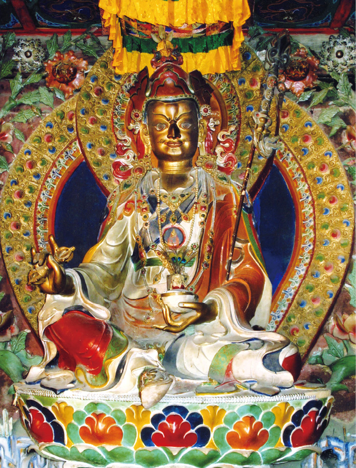

# 第4课

2022年8月11日

### 第5节·时间圆满

具足这样的处、本师、眷属、法，这个时候就是时间圆满。

佛陀和高僧大德讲经说法，都具有五圆满。以上道场、法师、眷属、佛法四者圆满，处于一个时间之中，这就叫做时间圆满。不过，我们讲到报身刹土的五圆满时，时间是“无尽庄严轮”，这是一种不同的解释方法。在世间一般解释中，当这四圆满同时具足的时候，就称为时间圆满。

尤其是在这个时候，如果你仔细想想，就像我曾经在27岁写的教言中说的那样：“夏季乌云密布时，渐成晴朗非瞬间，具慧解脱怀疑壳。”在这个喇荣山谷，我们已经整顿佛教13年了。整顿佛教就像阴天的时候，不是一瞬间放晴，而是逐渐才晴空万里。

这是法王如意宝早期的教言。法王早在27岁时写过一个对自己未来一生的授记，其中这样说道：“夏季乌云密布时，渐成晴朗非瞬间，具慧解脱怀疑壳。”表面的意思是：夏天密布乌云的天空是逐渐变晴朗的，而不是在一瞬间中，由此比喻具有智慧的人也需要从怀疑的壳里慢慢解脱。这是字面解释，至于其中内涵，法王继续讲道：在这个喇荣山谷中，我们整顿佛教已经有13年了。

法王在佛教政策开放前就已着眼于此，建立佛学院后便开始了对藏地佛教的长期整顿。为什么要整顿呢？大家都知道，在“文革”期间，藏地很多寺院遭到毁坏，无数僧人被迫还俗。后来政策稍有恢复，但寺院破败已久，许多僧人失坏了戒律。那时候藏传佛教内部十分混乱，可以说是一片狼藉。法王建立佛学院不久，就开始着手整顿这些现象。当时法王面向佛教界发布了一封公函，要求在家修行人应受居士戒，出家人至少要守持沙弥和沙弥尼以上的戒律，由此对寺院僧侣做了一番清理。特别是针对当时不少破了密宗誓言的人，比如和金刚上师产生矛盾等，公函中要求他们一律不得参加密宗的灌顶等任何活动。

同样，佛教经过13年的精勤整顿，也很难说已经彻底清净了，但一定达到了民主改革前的水平。

从上世纪五六十年代到“文革”结束，整个藏地佛教遭到了前所未有的破坏。法王认为，经过了13年的努力，虽不敢说所有僧团里里外外都非常清净，但基本上已经恢复到了受破坏之前的样子，还算有一定成效。

当年的情况你们可能不太清楚。确实，如果法王没有发起这样一个倡议，整个藏地佛教界要恢复秩序不会那么容易。现在一些人指责的“佛教乱象”，其实不一定有多严重，只不过是多建了几尊佛像、几座佛塔，或者乱挂了点经旗。那个年代的情形才真是乱象中的乱象，多亏法王把那些现象基本整顿干净，藏地佛教的原貌才得以恢复。

就我而言，我已经整顿佛教13年了。从现在开始，整顿佛教的重任就落在你们的肩上。

这是法王给弟子们的嘱咐，要大家继续肩负起整顿佛教的重任。

所以，时间圆满，总的来说，是喇荣佛教大学从成立到现在的15年；分别而言，就是现在圆满兴盛的时期。然而，这还不够。菩提金刚在授记中说：“利生事业顶天立地也，清净所化眷属遍十方，凡结缘者皆生极乐刹。”

如果从1980年佛学院建立算起，这段话应该是法王在1995年讲的。虽然那时候学院还未完整具备男众、尼众、居士林、降魔胜利洲四大部分，但从设立了多种学科的角度来看，当时的喇荣五明佛学院也可算是一所内容完备的佛教大学。法王在1995年年初时举办了持明法会（所谓的95大自在持明甘露丸就出自那次法会），接着去了新加坡，回来后开始讲课，秋天时示现生病，在成都疗养了很久，这段教言应该就是那一年讲的。到如今，我们学院已经成立足足42年了。

菩提金刚的授记讲道：法王的利生事业顶天立地。确实，古往今来有许许多多大德开展过各种了不起的事业，但在这段时期中，我们可以毫不夸张地说，法王如意宝是佛教界的一代伟人，他的事业顶天立地。并非因为我们是他的传承弟子而这样吹嘘，这是大家有目共睹的。

法王的清净所化遍于十方，这也毋庸置疑。近十年来，我去过很多国家，亲眼见到世界各地有许许多多人对法王充满信心，甚至从他那里得过法。很多人虽然没有亲见过法王，但也得到过相关的传承，并为此感到非常自豪。所以，如今整个世界范围内，法王的清净眷属的确遍布十方，而且普遍十分重视理论的学习和实修的应用，这方面尤为与众不同。不管别人承不承认，这个事实我们应该确信。

授记的最后说道：凡与法王结缘者都能往生极乐世界。这一点传承弟子们应该都熟知。

这个偈颂中的内容都可以归在时间圆满当中。即便如今法王的色身已融入法界，但只要他的事业、他的眷属、他的佛法，包括结缘者皆往生极乐等一切功德仍然具足，我们就可以说现在处在时间圆满之中。

以上所有条件都满足了，现在我们达到了鼎盛时期。因此，这个顺缘样样俱全、远离违缘的大好时机，就叫做时间圆满。为此，你们众弟子一天也不要浪费，而应该不懈地闻思。这是我的希望。

1995年的时候这里人还不是很多，经堂也很破。比较而言，现在的佛学院也许更称得上鼎盛。一切都在变化之中，我们现在确实算是处在一个大好时机，大家应该珍惜。法王如果还在，可能会这样教诫：希望大家不要浪费时间，应该不懈闻思。

## 第2章 依师令喜

### 第6节·专心祈祷莲师

这个非常难以调化的藏地雪域，却拥有包括密宗在内的佛法，这唯一来源于邬金莲花生大士的恩德。

这片雪域藏地以前是野蛮凶恶的罗刹国，后来因为有了佛法，变成了举世瞩目、人人向往的净土。最近有很多人来喇荣观光，吸引他们的应该是佛法的力量，不然就这个小小的山沟和这些破破烂烂的板皮房，没什么特别的看点。

我们以后应该把屋顶统一换掉。现在有些小木屋是用砖头、石块、牛粪等各种各样的东西放在屋顶上，从山谷里看还稍好一点，但从山上往下看的话，确实不太好看，还是应该注重一下人居环境的美观。我看到有些房子后面围了一些破布，这样万一发生火灾是很危险的。你们每个人都要把房屋周围的易燃物清理掉，否则一旦发生火灾，就把自己直接变成火施的“供品”了，这样可不太好。

所以在我看来，我们喇荣除了佛法，没有其他更加引人入胜之处。

前几天我看到一个短视频，博主问一位游客：“喇荣是一个很清净的地方，你去那里旅游，会不会打扰到僧人？”游客一边吃面一边玩手机，漫不经心地回答：“不会打扰的，他们都有手机，也会刷短视频，什么都玩。你随便去吧，没什么影响。”所以我认为，现在确实存在这样的问题，要是不把你们的手机收上来管理，也许在别人看来，喇荣已经跟世间城市没什么差别了。但我们的内心和我们的佛法，还是应该和世间保持区别。

整个雪域的人们，都应以坚定不移的恭敬信解，一心一意虔诚地祈祷莲师，确保佛法与世法都不会出现衰败。

藏地佛法的恩德来自莲花生大士，过去如此，未来也是如此。如果人们都祈祷莲花生大士，不论个人的违缘，还是整个佛法与世法的衰败，都能遣除。

而且，金刚乘佛教中也多次赞叹，藏地大部分的持教大德，唯一是“第二佛陀”莲花生大士的化现。比如，达波达吾云尼、文殊怙主萨迦班智达、无等宗喀巴大师、大成就者噶玛巴巴协等，都是莲花生大士的幻化身。

某些特别了不起的大德会被尊称为第二佛陀，比如玄奘大师、智者大师，还有世亲论师。藏地有一些大德被视为第二佛陀莲花生大士的化现，比如噶举派的达波仁波切——达波达吾云尼。他是《胜道宝鬘论》的作者，也是米拉日巴尊者的大弟子。他传承了玛尔巴罗扎译师和米拉日巴尊者的教法，正式创立了噶举派。此外，还有萨迦派的文殊护主、萨迦班智达根嘎嘉村，格鲁派的宗喀巴大师罗桑扎巴，大成就者噶玛巴巴协——第二世噶玛巴，他们在各自的传记中，都是莲花生大士的化身。

有些宗派只赞叹自己，而对其他宗派的说法不太承认，但其实藏地不论萨迦派、格鲁派、觉囊派、噶举派，各个教派的大德，都可以说是莲花生大士的化身。

然而，一些福报浅薄的众生却把独角鬼奉为自己的本尊，作恶多端，这就到了藏地受苦受难的时刻。

藏地历史上曾经有段时期，人们对莲师大肆诽谤，甚至把他的像扔到雅鲁藏布江里。当时出现了很多过分的行为，后来导致了种种灾难。

那些恩将仇报、倒行逆施的众生，把莲花生大士当成敌人，反而把邪魔冤魂奉为本尊，导致佛法和世法严重衰落。所以一般来说，整个雪域唯一的有缘上师，就是“第二佛陀”邬金莲花生大士。

现在公认的大德们，不论属于哪一宗派，无不对莲花生大士恭敬顶戴。因为当初如果不是莲花生大士降伏外魔，把藏地变成圣地，佛法就不可能在这里建立和兴盛。我们常说饮水思源，但凡懂得感恩的人，都应该明白，一切都是莲师的加持和恩德。

尤其是密宗前译派的修行人，对超胜一切的上师莲花生更有信心，并成为大圆满特别的不共所化，所以是极具善缘者。

只要对莲师有信心，就有很好的缘分。刚开始我们都不太明白，为什么法王对莲师有着特别的信心，后来经过多年学习，经历了各种佛法和世间法的启示，才知道我们能与莲师结缘，是多么幸运。

正如上师麦彭仁波切曾说：“摄集三部如来本体师，唯忆尊名降下加持雨，于藏恩德无比持明师，海生金刚足莲如意宝，得以观修头顶此善缘，思维断缘无信个别人，于应信处虔信此获得，诚信获得之最我欣悦。”

这段教言出自麦彭仁波切的一首欢喜歌，希望大家记下来。

“摄集三部如来本体师”，莲花生大士是三部如来本体的总集。“唯忆尊名降下加持雨”，不用说经常祈祷，仅仅是忆念莲师的尊名，也能降下加持的雨水。“于藏恩德无比持明师”，莲花生大士对整个藏地恩德极大，其实从长远来看，藏地的佛法也能利益整个世界。就像当初印度的二圣六庄严，不仅是印度诸多智者的大恩师，也为后世各地的众生带来了极大的利益。所以莲花生大士是我们恩德无比的持明上师。

“海生金刚足莲如意宝，得以观修头顶此善缘，思维断缘无信个别人”，莲花生大士也叫做海生金刚，我们有机会观想顶礼无与伦比的莲师仿佛如意宝般的莲足，这样的善缘，思维起来，就已经远远胜过那些断了缘分的无信心之人。现在世界上大多数人对佛法、对莲师并没有信心，跟这些人比较起来——“于应信处虔信此获得，诚信获得之最我欣悦”，我们对应该产生信心的地方，确实有了信心，所以非常值得欢喜。有些人常常对一些非应信处很有信心，比如假上师、假法、伪经。所以，我们应该对莲花生大士这样的应信处真正产生信心，这是用多少钱也无法买到的。

大家应该记住麦彭仁波切的这段教言，法王以前经常在课堂上引用。如果今生对莲花生大士具有信心，确实会感受到他不可思议的威力、加持和智慧，这一点凡是学过大圆满的人都有体会。并非因为莲花生大士是我们的祖师，我们才对他赞叹。只要真正去了解、去修行他所传下的《莲花心滴》等大圆满心髓，就会知道莲师有多么了不起。所以，我们每个人都应该通过经常念诵《七句祈祷文》或莲师心咒来向他祈祷。

（堪布展示照片）

这张照片是五台山的莲师像，但现在那里已经对外关闭了，这背后有种种原因，包括宗派之间的隔阂。虽然大家都是佛教徒，但有时候不同宗派、学派之间的偏见在某种意义上比非佛教徒还大。现在你们去五台山不一定能见到这尊莲花生大士像，但这也不要紧，我们每个人都可以把莲师像戴在身上，装在衣服里、书夹里，实在不行还可以放在电脑里。只要自己有信心，莲花生大士随时随处都在。

如果你们想做一些像章戴在身上，最好是用莲花生大士和释迦牟尼佛的像，这是绝对的应信处，应该对他们产生信心。如果把一个假上师的像带着身上，最后真相暴露时，后悔也没什么用。

我希望你们每个人都认真读一读莲师的传记，经常对莲师祈祷，一定要不断增强信心，千万不要产生邪见。要记住法王的教言，这些都是他老人家的原话，我连一个修饰词都没有加。在翻译过程中，我一般只会在必要时加一点虚词，但不会加修饰词，否则就不叫翻译，而是编撰了。所以这些全都是法王原本的金刚语。

对于我们这些缘分如此好的密宗前译派修行人来说，虽然有些节日也可以积资净障，但最重要的是永远不要忘记这个纪念“第二佛陀”莲花生大士的大节日。

我自己也经常有这种感觉，遇到这样殊胜的上师和教派，既有理论，又有实修，各方面应有尽有，缘分的确很好。

莲花生大士的节日是藏历每月初十，我们通常会在那时候念麦彭仁波切所著的莲师会供仪轨。这本书的后部分会讲到相关内容，比如第77节讲到猴年猴月初十的功德，我们可以看到法王一生是怎么过这个节日的。

我们以后遇到初十，如果有集体会供的机会，大家最好一起做一个莲师会供；如果没有机会，也可以自己做一个简略的会供。因为莲花生大士承诺过，每月初十会周遍整个世界来给予众生加持，这是一种不可思议的缘起，大家应该重视起来。
