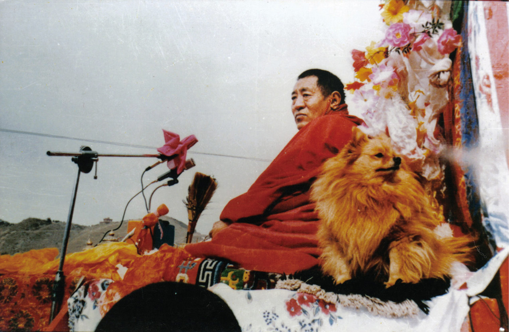

# 第52课

2022年10月28日

（堪布展示照片）

这张照片里，法王身边向外张望的小狗是布廓。它有个特点，一旦法王身边没有门卫或者护法，它就会很警觉地守卫，大家从它的表情也看得出来。

这幅图是法王圆寂以后丹增活佛做的，据说里面有些是他画的，有些是电脑合成的。在下面的四众弟子中，还有明慧比丘尼的像。这幅往生极乐图画得非常好，云光向下方延伸，一直落到法王如意宝在学院的住处。图中还有我们的大经堂，当时是这个样子。

### 第83节·以猛烈的信心意乐祈祷往生极乐

你们要时时刻刻用心思维：极为难得的暇满人身宝，已经得到了；不仅获得了人身，还遇到了清净的上师；光是遇到上师还不够，上师正在亲口传讲诸恶莫作、诸善奉行的真理。

这是法王如意宝在某一年极乐法会上的开示。

即使你们在家男女记不住很多法理，看看能不能理解其中几句，懂了以后就要实修。

要将每位上师所讲的法理全部记住是很难的，但是每堂课上记住一些重要的窍诀，这应该能做到。

当上师讲得很广时，并不需要完全理解他所讲的内容，但你应该仔细思考对你有利的那个法。

末法时代，人们的记性有限，我们不一定能把一位法师讲课的所有内容全都记住，但是一些关键的词句，应该尽量记下来。最好写在自己的日记本上，这样日积月累，渐渐自相续就会有所改变。

如果有人问：“具有虔诚信心的所有在家男女，观想的主要对境是什么？”

就是祈愿自己和一切与自己有关的、以亲友为主、结过善缘恶缘的众生，今生长寿无病、幸福美满，后世往生西方极乐世界。

发愿的时候，要祈愿跟自己有缘的所有众生，包括结恶缘、有仇怨的众生，都往生极乐世界，这是我们平时的一个重要修法。

如果有人问：“自己一生的实修法，以及决定对自相续有利的法，到底是什么呢？”

主要是祈祷阿弥陀佛，这是最根本的。

每个人都在修不同的法，到底哪个法才是真正对自己有利的呢？按照法王的教言，祈祷阿弥陀佛是最根本的。

每个人都要发誓念一百万遍阿弥陀佛圣号，绝不食言，一定要做。若能如此，这次劝勉大家行善念诵阿弥陀佛圣号七百多亿遍的善根，你们一定都能得到。

当时的一次极乐法会中，法王劝勉大家念阿弥陀佛圣号的数量，总计就有七百亿遍之多。现在也有很多人在劝念阿弥陀佛。所以，我们只要念修圣号，也可以融入这巨大的善根之中。

这比你独自闭关诵经的善根功德要大得多。那种善根可能会因为你未回向、颠倒回向、向别人炫耀、生嗔恨心等而被灭尽，但这次与上万僧众的善根平等融在一起，就像水滴融入大海一样，在所有善根没有穷尽之前，你的善根也不会单独穷尽。所以，这种善行，不同于你个人独自诵经，是不可思议的。

一个人所做的善根，很容易因为没有回向、颠倒回向、向别人炫耀或者生起嗔恨心等原因而毁坏灭尽。但在法会上，自己的善根融入上万僧众的善根当中，就像水滴融入大海一样，在所有善根穷尽之前，你的善根也是不会穷尽的。
