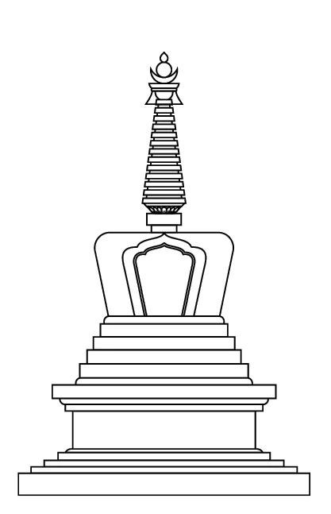

# 第二十八讲虚名之十法、大乐任运自成之十法

2018年12月12日

今天讲《胜道宝鬘论》的最后一堂课。

虚名之十法

什么叫虚名呢？我们讲密法和中观的见修行果时会说：在未经观察的时候，万法本身及其名称都是存在的，一旦用智慧去观察，就会发现一切都是虚假的。比如人们特别执著的修行、证悟、感情等，表面上看好像确实存在，但如果用中观的智慧来剖析，这些法就像芭蕉树一样，最后会一无所得。另外，通过上师的窍诀来修行，也可以证悟诸法了不可得的本质。

《大宝积经》中说：“如是诸佛难思议，善巧调伏众生类，了知法性无所有，假名安立示世间。”诸佛以不可思议的智慧来调伏众生，他们了知法性无所有的本体后，对世间人用虚假的名称做出表示。

比如，当我们用智慧观察嗔恨心的时候，能嗔、所嗔、嗔恨之事都不存在，即三轮体空；看得到、摸得着的柱子、瓶子等有为法也是如此，未经观察时好像确实存在，真正观察时才发现，除了虚名以外什么都不存在。

因此，一切万法在世俗中都是虚假的名称，在胜义中如同虚空一样了不可得，这是一个很重要的境界。我们今天主要从空性方面抉择实相，所讲的意义都比较深，我就简单地做个字面解释。

1．基实相无所宣说，因此基是虚名。

显宗和密宗都会强调基道果。所谓的基，就是一切万法的实相，即现和空的本源。这样的基实相无法用语言和文字来描述，就像虚空一样了不可得，因此说基是虚名。

2．道无有所往能往，因此道是虚名。

“道”即所行的道。佛教中讲资粮道、加行道、见道、修道、无学道这五道；从世间角度来讲，所行的地方叫做道，它包括公路、铁路、人行道等。这些道虽然在显现中存在，但若真正观察，其实只是虚名而已。首先，能行者是不成立的；其次，如果能行者不成立，所行的道也不可能成立。这样的话，所谓的道即是无生无灭的法，除虚名外毫不存在。

《中观根本慧论》中说：“诸法实相者，心行言语断，无生亦无灭，法性如涅槃。”所行的道、能行的行者，都无法用语言、行为去表达，这是真正的实相。此外，密法中也有许多关于实相的描述，大家应该是清楚的。

3．实相无有所见能见，因此证悟是虚名。

如果实相存在，那么我们可以见到它。但事实上，所谓的实相无有能见所见，因此见也是不存在的。《大般涅槃经》中说：“无相之相名为实相。”没有相才是真正的实相。如果实相是没有相的，那能见、所见也就没有，因此证悟仅仅是虚名而已。我们可以用“见性开悟”“见性成佛”“明心见性”等词句来表示见到本性，但这些只是名言上的安立，并没有真实的法存在。

4．本位无有所修能修，因此觉受是虚名。

“本位”即本位的心，我们本来具有的如如不动的心是没有所修、能修的。麦彭仁波切在《三本性论》中，按照外续部、内续部的解释方法，对本心作了很深的诠释。我曾经想翻译这部论，但是在短暂的人生当中，确实无法把想要翻译的论典全部翻译出来。

虽然一个人的力量和发心都是有限的，但我在短暂的生命当中还是翻译了一部分论典，其中包括一些甚深的密法。有些翻译自己非常满意，有些因为当时身体不好、琐事繁多等原因，自己并不是很满意。

我为什么要翻译密法呢？因为，无上瑜伽的密法目前只存在于藏传佛教当中，在南传佛教和汉传佛教中基本都没有。汉传佛教中的唐密大致相当于部分事续、行续、瑜伽续，比如《金刚顶经》《苏悉地经》（有汉语和日语译本）等。因此，真正完整、系统的无上瑜伽密续传承、修行窍诀只存在于藏地雪域高原。如果学修佛法的人没有得到这些，无疑是一种遗憾。如果要懂得完整的佛法，尤其是心性光明与空性无二无别的道理，的确需要学习密法。对于这一点，密法班的很多人应该有所感悟吧。大家通过修加行、学习密法，不敢说都已经开悟了，但在理论研习、窍诀实修等方面确实有不共的特点。

大家既要懂得南传佛教、北传佛教，又要懂得藏传佛教。在早期，印度的佛法非常圆满、兴盛。但在公元一千年左右（后弘时期的开端），藏传佛教后译派的译师仁青桑波等人去了印度，发现甚深密法只存在于一些老修行人的念诵本里，他们对此严格保密，不会随便外传。也就是说，在那个时候，很多甚深密法已经从印度迁移到了藏地。但是，密法在藏地能保存多长时间呢？确实不好说。一是因为藏地的很多高僧大德纷纷圆寂，二是因为一些年轻人对密法的传承和窍诀并不是特别重视，他们可能更重视学英语、学汉语，更关注人工智能等方面。

所以，你们对于自己得到的传承和窍诀应该珍惜。不然时过境迁，藏地高原上的无上瑜伽密法，可能也会消失得无踪无影。我那天看法显传记的时候就不禁感慨万千。在法显法师的年代，大小乘佛法在新疆一带和中亚一些国家非常兴盛，但是现在，那些地方基本都被其他宗教占领了，有些地方甚至没有任何宗教。可见，时代已经完全变了，不知道将来还会变成什么样。

刚才讲了，本位无有能修所修，因此通过修行所获得的觉受、觉悟、体验、感应也只是虚名。比如我昨天做了什么梦、见了什么本尊，都如梦境一般，根本不存在。

5．本性无有所行能行，因此行为是虚名。

本性当中没有所行的法，也没有能行的行者，因此行为也是虚名。行为有很多种，包括密法的二十一种行为，出家人、在家人守持戒律的行为，大乘、小乘的行为等。但这些只不过是修行过程中暂时的现相，在真正的实相当中，所谓的行为了不可得。

6．实际无有所护能护，因此誓言是虚名。

我们所守护的大幻化网五条根本誓言、密宗十四条根本戒以及成千上万的密乘誓言，在实相中都了不可得。就像十种法行了不可得一样，所护的誓言、能护的行者都不存在。因此，所谓的誓言（即密乘的戒律）如同虚空一样，只是虚名而已。

7．实际无有所积能积，因此二资是虚名。

在显现当中，我们要积累智慧资粮和福德资粮。但如果用智慧观察，所积的资粮、能积累的人都得不到，因此二资粮也是虚名。

8．实际无有所净能净，因此二障是虚名。

在没有详细观察的时候，所净的烦恼障和所知障是存在的，能净的行者也是存在的。比如我们念百字明、金刚萨埵心咒或观空性来忏悔的时候，忏悔者和所净的法现似存在。但真正观察的时候，能净、所净的本体了不可得，所以二障也是虚名。

9．实际无有所断能断，因此轮回是虚名。

表面上看，六道轮回确实存在。但真正观察的时候，首先是没有所断的轮回，其次是没有能断除的智慧。或者说，首先没有所断的无明——轮回的根本即无明，由无明呈现出轮回的各种境相；其次也没有能断的智慧。

有一部大乘经典叫《大乘菩萨藏正法经》，是法护等法师翻译的，这部经不是很出名。其中说道：“于彼轮回而作厌离，是不了义。于轮回涅槃悟不二法，是为了义。”也就是说，宣说轮回与涅槃无二的才是了义法；宣说轮回为所断、智慧为能断的是不了义法。

10．实际无有所得能得，因此果是虚名。

我们昨天讲《维摩诘经》的时候说到，舍利弗问天女：“你什么时候得果？”天女说：“您这位阿罗汉变成凡夫的时候，我才能得阿耨多罗三藐三菩提果。”[^1]阿罗汉是不可能变成凡夫的，因此在真正的本体当中，果也是不存在的。如果所得的果不存在，那么能得者也不会存在。

《月灯三昧经》中说：“诸法不可得，无有法可证，如是知于法，能解佛菩提。”诸法了不可得，也无有可证，懂得了这一点，才能通达诸佛菩萨的解脱。也就是说，在真正的实相上，诸佛菩萨的解脱是无法安立的。

对于这样的道理，初学者可能无法接受。但对于有闻思基础的人来说，应该可以明白大乘佛教的基本教义。我们首先要对这些道理有所觉悟，其次要把正确的道理讲给别人，一定不能误人子弟，这是很重要的。

以上的“虚名之十法”，讲了万法皆为空性的道理。这可以按照二转法轮的中观义、三转法轮如来藏本体空性的意义来解释，也可以按照大圆满本来清净的意义来解释。

大乐任运自成之十法

这里的十法，按照密宗任运自成的脱嘎修法或三转法轮抉择如来藏光明智慧的方法来安立比较方便。

佛陀在第二转法轮中主要宣讲了空性，在第三转法轮中主要宣讲了光明。为了让大家与弥勒五论结上善缘，我想传讲一些光明方面的经论，今年给大家讲了《维摩诘经》，这是一个很好的引导。如果明年没有出现什么违缘，我想再给大家讲一下《宝性论》。因为，《宝性论》主要讲每个人的佛性如何以任运自成的方式存在。这个道理在很多论典中并不明显，因此对很多人来说还是一个谜。

这种想法也是一种发愿吧，能实现也可以，不能实现也没有什么。因为从世间法的角度来讲，很多人都有美好的梦想，但因缘成熟而最终实现的也是寥若晨星。

如果没有明白任运自成的道理，就会觉得下面有些内容好像都是一样的。但是如果有了密法的基础，就会比较明白。

我刚才讲了，在显宗当中，二转法轮着重抉择空性，三转法轮着重抉择光明，但空性和光明并没有同时抉择。而在密宗的无上瑜伽当中，光明和空性是同时宣说的，学过《大幻化网总说·光明藏论》的人应该知道这一点。这部论虽然只是密法中的沧海一滴，但很多道友学了以后还是感觉很好。其实，前译派大德们所宣说的大量教义，有很多还没有翻译出来，这很可惜。但是人生短暂，即使翻译出来了，也不知道我们有没有时间去学习。

无上密法中的阿底约嘎，尤其是《七宝藏》等大圆满法，是以理论和窍诀相结合的方式直指心的本性为光明和空性，让人当下了悟。所以，密法在这方面确实有不共的特点。

当然，只学显宗、不学密宗的人可能不会承认这一点，不承认也是可以的。因为，某种思想和价值观对于特定的人群来说才是最殊胜的。比如我学中观的时候，可以说诸佛思想的精华就是般若空性，讲光明的时候也可以这样赞叹。同样，讲禅宗、净土宗、南传佛教的《法句经》《阿含经》《阿毗达磨》的时候，也可以说它是世界上最好的法。总之，对于密法根基者来讲，密法确实很殊胜。

1．一切有情的心自性安住于法身中，因此大乐任运自成。

“大乐”并不是我们感受中的乐受，而是远离苦谛和集谛的智慧。它也远离了无常，所以叫做“大乐”。《四百论》中说：“无常定有损，有损则非乐，故说凡无常，一切皆是苦。”如果是无常的，就肯定有损，有损的就不是快乐的，最终还是会痛苦。世间的任何乐受都会坏灭，所以并非大乐。如来藏本来具有的任运自成的光明才是大乐智慧，它分为基位、道位和果位三种。

这里讲，一切有情的心安住在法身当中，也可以说法身安住在一切有情的心中，因此大乐任运自成。《佛说不增不减经》中有一个偈颂跟这个教言比较相似，这部经不是很出名，藏文《大藏经》中没有找到，但汉文中有。其中讲道：“不离众生界有法身，不离法身有众生界。众生界即法身，法身即众生界。”意思是说，众生界其实就是法身，法身也是众生界，二者是不离不异的。很多人可能认为：“我现在是众生，法身对我来讲是很遥远的。”其实不是这样，众生心的本性——如来藏的本体，也可以叫做法身。

2．基法性界中无有相状戏论，因此大乐任运自成。

诸法的本基法性界没有任何有、无、是、非、好、坏的戏论和相状，因此本基为大乐任运自成。所谓戏论，就是一种边执。

3．离边超心的证悟中无有偏颇戏论，因此大乐任运自成。

远离有、无、是、非一切边，超离一切分别念的证悟中没有偏颇。当一个修行人真正悟道的时候，他就不会有偏颇之心。这种大乐是任运自成的，也就是说，这种心并不是外来的。

在《维摩诘经》中，舍利弗问天女：“您在这里多长时间了？”天女回答：“您解脱的时候，我就在这里。”[^2]同样，从无为法的角度来讲，我们无论是否证悟了心的本性，它都一直以任运自成的方式存在。

4．无有作意的觉受中无有所缘戏论，因此大乐任运自成。

在没有能作意、所作意的觉受中，没有任何分别念。此时虽然有清净、光明的显现，即密法中所讲的赤裸觉性、本来面目的光明智慧，但是没有能缘、所缘的戏论，因此也可以叫做大乐任运自成。

5．离作无勤作的行为中无有取舍戏论，因此大乐任运自成。

这里有些教言是从行为方面讲的，有些是从修行或见解方面讲的，有不同的角度。我们由于时间关系，就不展开讲了。

无有任何勤作，意为已经远离了能作、所作，这样的行为无有取舍戏论——大圆满的真正行为就是没有能行、所行，因此自然具足光明大乐智慧，也可以说是大乐智慧任运自成。

这里的每一个教言都讲到了没有戏论，而且讲到，在没有戏论的境界中自然具足大乐智慧。《中论》当中讲了破八种戏论——不来不去、不常不断、不生不灭、不一不异，但是破完就结束了，没有讲破完以后是怎样的。实际上，心的本性并非仅此而已，它还有一种光明。如果没有这种光明，我们最后怎么成佛，怎么现前如来智慧，怎么在所化界中示现二十七种事业？这些是很重要的问题。另外，显宗的《现观庄严论》中也讲到了果法和佛的事业，但并没有讲这些是如何出现的。所以，如果不懂三转法轮或密乘的教义，只依靠“无戏论”是无法完整理解佛法之义的。

前面讲的是基和道，下面开始讲果，首先讲法身。

6．法界与本智无别的法身中无有所取能取戏论，因此大乐任运自成。

密宗当中主要讲智慧，显宗当中主要讲法界空性。在法界与智慧无二无别的法身当中，没有能取所取的戏论，因此大乐任运自成。

《发觉净心经》中说：“戏论行者道难得，是故不应住戏论。”不管学显宗还是学密宗，戏论都是一种障碍，没有执著的人会断除一切戏论。

7．大悲自生的报身中无有生死迁变的戏论，因此大乐任运自成。

报身当中没有生生死死无常迁变的戏论，因此大乐任运自成。

8．大悲自现的化身中无有二现行的戏论，因此大乐任运自成。

在众生面前以大悲自现的化身中，没有能幻化者、所幻化者显现二现行的戏论，因此大乐任运自成。

以上讲了法身、报身、化身这三身中没有戏论，因此大乐智慧任运自成。下面两个教言是从佛的事业方面讲的。

9．佛教法轮中无有我见相状的戏论，因此大乐任运自成。

佛陀成佛之后主要通过转法轮来利益众生，在佛教的法轮中没有相状、戏论。不仅显宗当中这样讲，密宗当中也讲，光明清净的法性和真如没有真实的相状，因此大乐任运自成。

10．悲无量的事业中无有偏向偏堕，因此大乐任运自成。

佛陀悲心的无量事业是周遍、恒常、任运自成的。世间一般的领导会有偏颇之心，下面的人也会有意见：“领导对这个人偏心，对我不好。”尤其是自心特别不平的人，看到的都是凹凸不平之相。如果自己有了一定的境界，就不会有太多高下长短之想。

佛陀的事业是平等无偏的，就像阳光一样普照大地——除了朝北的山洞以外，万物都能得到阳光的温暖。心行无有偏颇是很重要的，上师、法师以及世间任何一个管理人员，都要以一颗平等心去对待别人。

在这个时代，东西方的一些人确实有不平等的思想，这也导致了人与人之间的矛盾和国家与国家之间的冲突。而大乘佛教的理念，是以同等的爱和智慧来摄持众生，不会对不同国家、民族、肤色的人区别对待。这种理念在其他宗教中很难找到，在世间知识、伦理道德中更找不到了。表面上看，每个国家、每个民族都以特别美好的歌来赞扬自己的某种精神，但实际上，他们基本上都是偏向于自己的。

佛陀最初为众生发阿耨多罗三藐三菩提心后，历经无量劫所证得的甘露妙法确实是平等而圆融的，就像月光一般清凉，像甘露一般滋润，众生得到以后肯定会受益匪浅的。当然，每个人的境界不同，在理解佛法、表达佛法、行持佛法的过程中，也可能没有很好地将大乘佛法落到实处，甚至对其有所扭曲。

在人类社会当中，国家之间常常发生战争，民族之间经常互相残杀，这是非常可怕的悲剧。如果人们真正能行持大乘佛教的理念——富裕的人将自己拥有的资源与人分享，强大的人去帮助弱小的众生，世界就完全可以是和平而安乐的。

其实，地球给人类提供的资源是足够的，但很多强势者以自私自利的心占有了很多资源，甚至为此而发动战争，这样就导致了资源分配上的不平衡。当然，众生业力现前的时候也没有办法，虽然我们知道佛教中有很好的解决办法，但也很难起到作用。而且，大多数人都有自己的想法、宗教信仰和价值观。但不管怎么样，我们还是要终生发利益众生的心。

佛陀的无量事业无有偏颇、偏堕，这也是因为众生本来具有大乐智慧、本来具有如来藏。如果众生没有如来藏，那么这些事业就是无因而生的，非常不合理。这个道理只有学过密宗的人才会真正明白，因为密宗对于任运自成、自性光明方面的道理讲得非常清楚，而其他经论在这方面确实比较欠缺。所以，如果不借助密宗，这个道理可能一百年也讲不清楚。

此《胜道宝鬘论》，是将自己于噶当派诸位大恩上师前所聆听具无漏智诸上师、至尊度母等诸本尊授权于北方雪域开显佛法的具德阿底峡父子之无垢言传法脉教言、印度圣境如日月般闻名的大德那若巴、美哲巴二位尊者以及受持南岩玛尔巴等诸成就者心髓之至尊王米拉日巴秉持的无垢言传汇集而成，受持噶当派及大手印（噶举派）教授藏的达波冈波巴索南仁钦撰著圆满。愿此成为吉祥福泽赡部洲庄严。

达波瓦尊者于噶当派的诸位大德、大恩上师前聆听了诸多教言。具有无漏智慧的上师，应该是指金洲上师。上师和至尊度母等本尊授权于北方雪域开显佛法的具德阿底峡尊者和仲敦巴父子，他们是无垢言传法脉的传承人。因此，这部论的来源之一是噶当派上师阿底峡尊者的教言。度母曾对阿底峡尊者授记：“如果你到藏地雪域去弘扬佛法，一定会利益无量无边的众生，但你的寿命会缩短二十年。”后来，阿底峡尊者确实提前二十年示现了圆寂。

另外这部论还有噶举派的传承。我们之前提到的《圣行集萃》中，就有噶举派那若巴尊者和美哲巴尊者的故事。作者将这些尊者的教言以及受持藏地南岩玛尔巴罗扎等诸成就者的心髓之至尊米拉日巴尊者秉持的无垢教言汇集而成本论。因此，《胜道宝鬘论》中汇集了噶举派的梅志巴、帝洛巴、那若巴、玛尔巴罗扎、米拉日巴诸位尊者的教言。

我刚开始传讲本论的时候也讲过吧，达波瓦尊者在22岁结婚，生了一儿一女，到了26岁的时候，他的两个孩子都死了，妻子也得了瘟疫病，临死前妻子要求：“你千万不能跟别人结婚，一定要出家修道。”于是达波瓦尊者就“依教奉行”了。他在寻找上师的时候遇到了三个乞丐，一个乞丐说财富很重要，一个乞丐说国王的地位很重要，一个乞丐说“我要像米拉日巴尊者那样”。他听到米拉日巴尊者的名字时汗毛竖立、眼泪直流，有很多感应，决心无论如何都要找到米拉日巴尊者，后来他终于如愿以偿地见到了尊者。

玛尔巴罗扎和米拉日巴等噶举派的很多大德都是在家身份，从达波瓦开始就出现了许多出家身份的传承者。一般来说，人们一讲到噶举派的传承祖师都会讲到玛尔巴罗扎、米拉日巴和达波瓦，他们就像我们宁玛巴的莲花生大士、全知无垢光尊者和麦彭仁波切一样，是传承当中最重要的三位祖师。

总之，达波瓦尊者把噶举派和噶当派的教言汇集成了《胜道宝鬘论》。达波瓦尊者的名字是索南仁钦。

冈波巴亲言：“祈愿未来对我有信心、想见我的一切行者，得见我所著的《胜道宝鬘论》及《解脱庄严论》等诸论，与亲见我无有差别。”

达波瓦尊者因为一直住在冈波寺院，所以他也叫冈波巴尊者，听说那座寺院现在还在。冈波巴尊者说：“祈愿未来对我有信心、想见我的一切行者，见到《胜道宝鬘论》和《解脱庄严论》，就与亲见我没有差别。”

不知道现在有没有人觉得达波瓦尊者很了不起，很想见到他。如果有，那你见不见他本人都没有关系——“见与不见，他就在那里”，最重要的是见到《胜道宝鬘论》和《解脱庄严论》。《解脱庄严论》也有汉文译本，其中主要宣讲了共同前行和不共前行，就像《大圆满前行》一样。无垢光尊者经常说，《法界宝藏论》是他的肖像。所以，见到上师与否不是最重要的，最重要的是见到他的智慧。

可见，法本是很重要的，希望道友们都能尊重法本。我有时会在垃圾桶里看到一些法本，不知道是不是有人不懂规矩，把法本扔在了那里。如果这样做的话，自己会生生世世堕入恶趣，特别可怕。

其实，一个人能否开悟，关键看他是否恭敬法本。我在《密宗虹身成就略记》中讲过，洛若寺的金旺堪布经常说：“如果一个出家人很恭敬法本，他将来应该会开智慧、学得很好；如果他不恭敬法本，肯定是学不好的。”他有这样的推测。

大家在装行李的时候，不要把法本跟衣服、食物随便装在一起，而应该把法本放在比较干净的地方。有些人出国的时候，把自己的内裙、内裤跟法本放在一起，这样做非常不恭敬。按理来讲，我们对法本的重视程度要超过佛像。按照大德们的说法，法本上面不能放佛像，而佛像上面可以放法本。所以，法本是最重要的。

有些人可能是半途出家、半途学佛的，对恭敬三宝的道理一点都不懂。《大圆满前行》中说，翻书的时候沾口水也是非常不合理的，以前上师如意宝也经常这样讲。但是现在，我们经常看到很多人对法本一点都不恭敬，把法本随便扔在地上、放在楼梯上。一般来讲，人们对佛像更尊重一些，不会随便乱放。

有些人根本没有把法本看成佛陀，这是很不好的。以前我在讲《大圆满前行》和《极乐愿文大疏》的时候引用过这个教证：“末法五百世，我现文字相，观想彼为吾，尔时当恭敬。”佛陀亲自说过：“我在末法五百世的时候显现为文字相，那个时候你们应该将文字观为我，并恭敬文字。”

因此，如果有一些法本的纸张脱落了，我们可以把它放在干净的地方，或者以恭敬心来烧掉，格色班智达说过，这样做是没有过失的。当然，用轻辱心来烧毁法本肯定是不行的。《胜道宝鬘论》虽然只有二十多个“十法”，但它与达波瓦尊者是一模一样的。达波瓦尊者是噶举派这么了不起的大德，如果我们把他扔在垃圾桶里，别人肯定会笑的，我们自己心里也会过意不去。

每个佛教徒都要对法本有恭敬心、欢喜心，这样就很容易开悟，考试的时候也容易考好（众笑）。我在这里讲课的时候，有些人就在下面看书，因为明天要考试了——平时不好好看书，现在开始临时抱佛脚，也可以吧。但是如果以前一点都没有看，今天晚上不睡觉也是没有用的，明天可能更加发挥不好。如果平时对法本特别恭敬的话，应该能考一百分以上；如果平时对法本不太恭敬，考的成绩就会一般般。这是自然规律。

不过，大家有考试的意乐还是很好的。我希望，山上山下的道友都要尽量参加考试。昨天，我们的讲考班圆满了一年所有的讲考。这一年来，虽然我每次讲完课以后都精疲力尽了，而且我的身体也不好、事情也多，但每次念完《普贤行愿品》以后，我都会去听他们的讲考，一直陪着他们。

昨天晚上我回去以后，心里很开心。因为，我经常听到这里的好多道友在讲考的时候发挥出了自己的智慧。即使有的道友讲得不是很好，讲经说法五分钟的功德也是不可思议的。有些人可能比较有福报，每次都能轮到讲考；有些人在讲考班十几年了，一次都没有轮到，所以现在他们都不看书了，觉得反正也轮不到自己。但不管怎么样，有这种考试是很好的。

现在很多人的心都在考试上，所以我就多念一点经，祝愿你们考得好。当然，也不可能所有人都考得很好，否则那个考场肯定有问题。

敬请对冈波巴尊者有信心的诸有缘者精进实修此等法为盼。

2018年3月10日译毕于色达喇荣

《胜道宝鬘论》的功德很大。今年三月份，我完成了这部论的翻译。后来，我亲自向我们寺庙的老喇嘛求了传承，又用二十八节课传讲圆满了。

每次圆满一部法我都很开心，这是三宝和护法神的加持。非常感谢所有听众和发心人员。如果没有发心人员，大家不可能轻轻松松地听课。你们可能也知道，在外面开一个三四天的法会需要付出多少人力和财力。我们讲完这二十八堂课也不是那么容易的事情。如果我们在外面租一个场地，用一个月的时间来讲这部论，你们可能也很难抽出时间来听。以前我们在香港开过三四天的法会，当时人不算很多，但我们还是会有各种担心。

现在，我们依靠诸佛菩萨的加持，依靠很多善男、善女、护法神、空行母、土地神、人和非人、阿修罗、夜叉等的特别帮助、特别支持，最终圆满了这部法的讲闻。大家在短暂的人生中，得到了达波瓦尊者的教言是非常有意义的。希望大家得到这个传承以后，在有机缘的时候传授给其他有缘者。

[^1]: 《维摩诘所说经》：舍利弗问天：“汝久如当得阿耨多罗三藐三菩提？”天曰：“如舍利弗还为凡夫，我乃当成阿耨多罗三藐三菩提。”舍利弗言：“我作凡夫，无有是处。”天曰：“我得阿耨多罗三藐三菩提，亦无是处。所以者何？菩提无住处，是故无有得者。”
[^2]: 《维摩诘所说经》：舍利弗言：“天止此室，其已久如？”答曰：“我止此室，如耆年解脱。”舍利弗言：“止此久耶？”天曰：“耆年解脱，亦何如久？”舍利弗默然不答。
