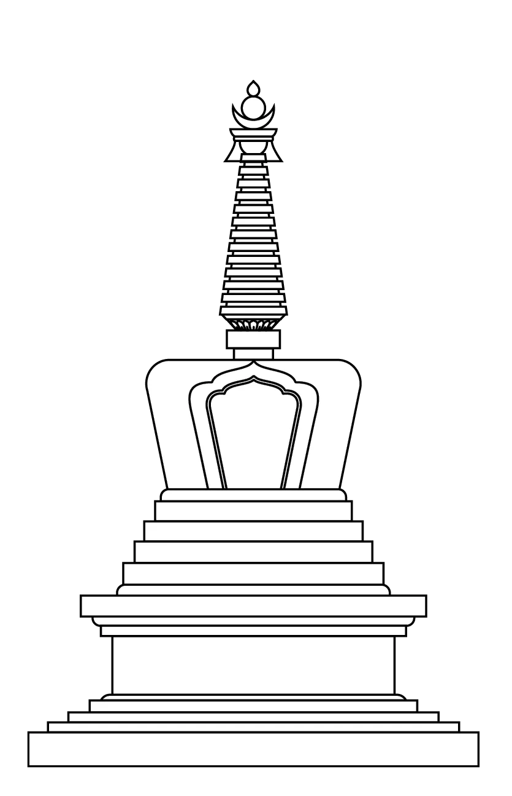

# 第10课

2020年6月25日

（堪布念《苦乐道用》传承）

《苦乐道用》讲了十节课，还是不错的。今年有这个机缘，值得开心，但更要转为道用。

胜义当中苦转为道用、世俗当中苦转为道用，胜义当中乐转为道用、世俗当中乐转为道用的方法都已经讲完了。下面我们讲苦乐转为道用的最后一部分。

如果痛苦时因为心受煎熬而无法来修行正法，快乐时因沉迷于快乐也无法修行正法，那么就没办法有一个行持正法的时候了，对修行人来说恐怕再没有比这更可悲的事了。

凡夫人经常产生各种痛苦，比如，身体不好、由于各种情况不好而产生恐怖，或者没有吃穿、心情不好，或者外面的条件不好、气候不好，还有些工作不顺利，家庭不和睦等等。因为各种各样的因缘，自己觉得特别痛苦，根本无法修行。一边忍着痛苦一边想：“这个痛苦能不能过去，过去了我再听课、再修行。”

快乐的时候，凡夫人又很容易沉迷于其中。比如最近特别开心，和朋友一起去玩、事业比较成功……整日沉迷于自认为是快乐的事情当中，游山玩水、看电影电视、听歌看节目、去酒吧吃喝玩乐等等，没办法修行。

以前传法时，不精进的人有各种各样的理由不修行。今天因为痛苦不修行，明天因为快乐不修行，不痛苦也不快乐的时候，便处于无记、发呆、无聊的状态当中，每天浑浑噩噩，一直傻傻地等着。这样的话，便没有真正修行正法的时候。

在人世间，要么苦，要么乐，要么处于无记的状态，除此之外也没有其他的。人生那么短暂，如果一会儿因为这个事情不修，一会儿因为那个事情不修，就没有修行的机会和时间了。对于修行人来说，恐怕再没有比这更可悲的事了。

前辈的许多大德们真的与我们不同，他们虽然没办法制止痛苦，但是一直在痛苦中坚持修行。当时藏地发生了很多历史性的变化，在这种情况下，他们没有放弃自己的修行、讲经说法、禅修等等。后来有些人名声、财富什么都有了，但他们在特别快乐时，也不放弃修行正法，不会沉迷在欲妙当中。

在座的很多人，以后也会面对这些情况，因为生活中什么事情都有可能遭遇。要么特别痛苦：“在这个世界上哪还有我这么痛苦的人啊？比地狱的众生还苦，比饿鬼道的众生还苦，比旁生道的众生还苦……”在这种情况下，更不用提修法的事情了。要么特别快乐，拥有有漏的财富、名声，又特别满意自己的相貌，觉得自己像天人一样，世界上哪有我这样好看的人！越照镜子越开心，开心到大叫：“啊——”这样特别开心的时候也不修行，把法本扔到一百公尺以外的地方去了。

这样的话，苦乐轮番而起，此起彼伏，最终就没有真正修行的时候了。作为修行人来讲，这是比较可悲的。

我们不知道以后会发生什么，众生的业力各不相同，也许会快乐，也许会痛苦。有些人一生都比较平稳、健康，没有大起大落，心情也可以；有些人比较悲观，每天板着脸；有些人快乐多一点，乐呵呵的；有些人痛苦多一点；有些人一会儿快乐，一会儿痛苦，乐的时候像天人一样，苦的时候像夜叉一样，变来变去……但不管怎样，我们还是要走解脱道，尽量不要放弃自己的修行。

有的人说：“我现在没有时间吵架，我要念课诵，等念完了再和你吵架。”这样也可以吧，因为他还是很重视修行，但是也不会放弃吵架（众笑）。这种人不是最可悲的，因为他在痛苦的时候没有放弃修行，一边感受痛苦一边修行。

从世间的角度来讲，性格、行为比较稳定的人，会让别人有安全感，感觉这个人比较可靠。而情绪、行为变化特别大的人，会给周围的人带来不安全感。以前没有学佛、没有信仰或者修行不好的时候，自己给周围人的印象，可能一会儿特别可爱，一会儿特别可恨。以后如果修行稍微好一点，即便内心有很大的痛苦，非常难受，也应该尽量不要显露出来。这样的话，在日常生活或者修行中，除了有他心通，周围的人都会感觉很好。

有些比较有涵养的法师、老师，虽然内心不太高兴，但仅仅是旁敲侧击，稍微说一下而已，没有很明显的表现。而有些比较容易激动的、感性的人，即便在课堂上，也是一会儿显得特别开心，恨不得在法座上跳金刚舞；一会儿痛苦得不得了，泪水沾满了经函，这样不一定很合适。

可能大法师们也有不同的性格吧！从阿底峡尊者的传记中看，阿底峡尊者显现上有点苦乐不定。法王如意宝有时也显现忿怒相，非常可怕；有时显得非常欢喜。尤其是看到众生感受痛苦时，也经常伤心、流泪。

“路遥知马力，日久见人心。”渐渐地，别人也会清楚，“虽然这个人经常发脾气，但是人不坏。”或者，“这个人不容易发脾气，可是一旦发脾气，就像爆炸一样，周围的人也会遭殃。”所以，每个人的业力不同，性格也有非常大的差别，但无论如何，真正的修行人都不会放弃修行。

如果苦乐能够道用，那么不管待在寂静处还是城区任何地方，不管交往善友恶友任何人，不管遇到兴衰、苦乐任何事，不管听到赞叹贬低、好的坏的任何话，都不会有担心自己失去什么的畏惧，因此这就是“如狮子般的行者”。

如果苦乐能够道用，即使是毫无人烟、特别寂静的阿兰若，修行人也可以待下来，不会说：“这里太寂寞了，我住一晚上就走。”

有些法师接管的寺院如果偏僻一点，一个晚上都不待，说：“这里太寂寞了，不是我想要的。”然后去另一个城市里比较豪华的寺院，又说：“哇，太乱了，我一个晚上也不想待。”不同的寺院，都不想待，这种人可能无法将苦乐转为道用吧！真正能将苦乐转为道用的人，在特别寂静的地方可以修行，在特别嘈杂散乱的地方也可以修行。

住旅馆也是这样。有人在热闹的地方说旁边有车的声音、人的声音，睡都睡不着，特别麻烦；在寂静的地方又说太封闭、太压抑了，也不行。有些人真的是“显现成为怨敌”，他的显现都是这个不行，那个不行，而苦乐转为道用的人，在寂静的地方也可以，在城市里面也可以，待多少天都没问题。

特别恶劣、充满贪嗔痴的恶友，他也可以跟他们合得拢，通过一些特殊方法度化他们；对特别好的善知识和善友，他也能合得拢。有的人可能接触好人还可以，和坏人就无法相处。但善知识、菩萨和苦乐转为道用修得比较好的人，好人能接受，坏人也可以接受。

今天有无数的人赞叹供养他，他看作如梦如幻；明天衰败了、马上要被关到监狱里面，或者生病了、特别惨不忍睹，他也能接受。不管遇到痛苦和快乐等任何事，不管听到赞美和诋毁等任何语言，他都能忍受，因为他不担心自己失去什么，所以无所畏惧，这样的修行人就是“如狮子般的行者”。

一方面可能他证悟了一些无我的境界，另一方面他知道轮回当中确实苦乐不定，苦过了以后是乐，乐过了以后是苦；还知道在胜义当中一切都是空性的。痛苦出现的时候，他觉得，机会来了，我马上要好好修行；快乐出现的时候，他也觉得，机会来了，我要马上修行。就像昨天讲的一样，真正的修行人痛苦也不会浪费，快乐也不会浪费，他会抓住这个机会。

当然，这需要长期的修行，否则痛苦来的时候，你想都不会想修行。比如遇到父母逝世，或者别人诽谤，你就会抓狂：“啊！为什么会这样？”凡夫人身上出现任何事情，要么因为赞叹而快乐、因为兴盛而快乐、因为遇到好友而快乐，因为来到自己特别向往的地方而快乐；要么遇到不悦意的事情就痛苦、伤心、失望、绝望等，就是想不起修行。

对我们来说，无论在什么时候，修这样的法都很重要。很多人好不容易对三宝有信心、有发心的意乐，但因为自己的苦乐无法转为道用，与人不和。我经常对发心人员讲：“你们出去时是手拉着手走的，回来的时候却分道扬镳，分开而来。”

包括有些堪姆，她们小时候一起拿着帐篷去耍坝子，然后两三个人吵起来，把帐篷放在那里就走了。那个时候可能是苦乐转为道用没有修好，现在肯定不会了，对吧？

人际关系处理不好的话，确实经常在修行的过程中造成违缘，在发心的过程当中也会造成违缘。轮回中，不可能所有的人都让你满意。每个众生的习气不同、业力不同，有些是南赡部洲来的，有些是西牛货洲来的，有些是地狱里面来的，有些是天堂来的，不可能都随顺你。

当别人跟你一起，生活、说话完全不适应你的性格和心态时，如果是苦乐能转为道用的人，应该能和睦相处；如果是这里也不和、那里也不和的性格，就如藏地所说，很多牛角放在一个袋子里，只能互相抵触。

同样，我们在任何时候，都应该好好观察自己的心。这方面可以说，我在喇荣或者在其他地方，与别人的关系基本上是可以的。无论有神论者、无神论者，无论出家人、在家人，上面的领导、上师，下面的弟子、学生等，如果观点与我不合，我当场会说，但不会计较，过一段我也会理解别人不同的看法和见解。

这么说也许是一种傲慢心，但我觉得与修行和教言有密切的关系。以前读书的时候，我有一种特别的性格，经常打架，与别人不和。我曾说过，每次看到读小学和中学的地方，我想不起来在哪里读过书、背过书，只记得我在这里和某某人打架，在那里跟某某人打架。

藏地的孩子一般不会在学校里面打架，我们会说等会下课后在那棵树下面，或者到泉水那里去打架。凡是有比较明显标志的地方，就约在那里打架，这是我们一贯的传统。到喇荣以后，至少我和谁都没有约过架，和谁也没有说过“现在我们去坛城那里打架”“去喇荣宾馆大门口打架”，对吧？

如果和谁都相合，别人的赞叹、贬低，什么都能听进去，就像狮子在雪山遨游，毫不畏惧。同样，如果修行很好的话，无论到哪里都特别坚强。

很多人之所以没有安全感，就因为害怕别人说自己，害怕别人轻贱自己、看不起自己，或者因为自己的脾气很暴躁，害怕和人接触时会暴露内在的丑恶等等。但如果我们修行很好的话，真的与大狮子没有什么差别。

汉地有一部《成实论》[^1]，是鸠摩罗什翻译的，里面有很多大乘对小乘的驳斥。其中有一句：“智者愚者俱受苦乐，而智者于苦乐中，不生贪恚取多少等。”智者会有苦乐、愚者也会有苦乐、出家人有苦乐、居士也有苦乐，没证得一地菩萨或者无欲阿罗汉之前，肯定都有苦受和乐受。那么，为什么智者能转为道用，而愚者不能？因为智者在感受痛苦的时候不会产生嗔恨心，在感受快乐的时候也不会产生极大的贪心并因此而造业，这就是两者之间最明显的差别。

无论如何做，内心都祥和安乐，逍遥自在，心态清净，圆满善妙，

苦乐转为道用的人，不管做什么、到哪里、接触什么人，不管吃得怎么样，穿得怎么样，都怡然自得。比如有些有智慧的人，今天让他穿特别高档的衣服，也可以；明天让他穿得像乞丐一样，也可以。今天吃美味佳肴也可以，明天什么都没有，吃得很差，他也能接受。

因为心态很清净，所以他的善法、发心、内在的安乐都是非常圆满的。这就是一种修行境界，人生当中确实需要这样的境界。

虽然身体住在不清净的刹土，但心中却享受着清净刹土佛子一样不可思议的安乐，

如果苦乐真的转为道用，身体虽然在不清净的环境中，在人群当中、在浊世当中、在城市里面、在没有信仰的人中、在有邪知邪见的混浊的群体当中，但我们的心却像极乐世界和现喜刹土的大势至菩萨、观世音菩萨、文殊菩萨以及虚空藏菩萨一样，无论去哪里，都不会被烦恼困扰，不会被痛苦折磨。

我觉得每句话都特别有意思。我们不可能像菩萨一样，一点痛苦都没有。但希望现在听这堂课和以后学习这部论的人，至少要懂得这些道理，然后慢慢串习，这样很多人会有改变的。因为这些是真理，只要是讲道理的人，刚开始虽然有习气，但通过这样修习，就像慢性病人，慢慢吃药、调理，最后有痊愈的可能。

修行人和凡夫人一样，需要吃饭、睡觉，需要生活，但我还是希望大家的心态跟世间人不一样，不会那么敏感、痛苦。

与噶当大德所说的“控制快乐，结束痛苦，独居时作为你的陪伴，生病时作为你的护士”。

藏传佛教中，噶当派和宁玛派的修行教言是非常多的。噶当派的前辈大德说，如果我们苦乐转为道用，就能结束痛苦，控制快乐——如果过于快乐、过于执著，就会产生傲慢心、嫉妒心，也会导致懈怠、散乱。

现在很多人痛苦的时候能坚强，一旦快乐时，尤其是有了钱财，没有福报的人就撑不住。前面也说了，如果没有丰厚的载体——福德，很难以撑得起。比如有的人，稍微有一点钱的时候，马上买个车给别人看。藏地有些暴发户，有了钱马上买特别大的金戒指，这里戴一个，那里戴一个，一块一块的，什么都是金子，但金子实际上与石头没什么差别。

现在藏地隔一段时间就会有专门的服饰表演，演员身上佩戴着几十斤珊瑚、玛瑙、琥珀，缓慢地走来走去，让人觉得这人好有福报。其实不是福报，全部是借的，他可能一颗天珠也没有。汉地也有这样的，这里不多说。

要控制快乐。修行人太快乐、太激动、太爱着急的话，在别人面前显得不自在。痛苦的时候，要转为道用，不要一直停留在痛苦中，要接受它。

这样的痛苦转为道用对你而言，是非常好的陪伴，独自居住时，你不会孤独，即使没有任何人，你也会很开心。生病时，它相当于是护持你的人。这里的护持不一定是戴着白帽子的小护士，就像《旅途脚印》中那个打针的护士一样，而是指生病的时候，若苦转为道用，如同旁边有一个专门递茶倒水、护理我们的人一样。

如果苦乐转为道用，不需要其他依靠。米拉日巴尊者也说过，病的时候没有人问，死的时候没有人哭，如果在这个山洞里能死的话，瑜伽士我心满意足。

作为修行人，到一定的时候，苦乐转为道用是最好的。今天听课时大家会想，我一定会把苦乐转为道用，但过一段时间真的生病了，又开始怨天尤人。会不会这样？这是没有修行的缘故。如果有修行，每个人一定能变“如狮子般的行者”。

苦乐转为道用就像噶当派大德说的一样，什么都可以。不会无聊、不会痛苦，不会非常悲观，不会觉得自己被社会遗弃、被亲人抛弃。无论痛苦还是快乐来临，一方面想到这是前世的业，另一方面要想到这是最好的修行机会。此时不要放弃修行，一定要在当下念诵功课、禅修，这是最重要的。

还有，快乐和痛苦自己转为道用。什么意思呢？快乐的时候把它当成顺缘，痛苦的时候也把它看作是一种顺缘，这就是真正的大德们修行的教言，也是心的一个秘密。这样你的苦不会变成障碍，乐也不会变成障碍。

否则的话，凡夫人容易堕入极端。苦的时候实在没办法道用，最后产生各种嗔恨心，做很多非法的事情，今生和来世都感受痛苦；快乐的时候也有点极端，什么都不在乎，也不把别人放在眼里，也会有一些过激的行为，最终也是毁坏自他。所以苦乐转为道用很重要。

下面讲了一个比喻，其实这样的修行很好。

如同金匠将金子放在火上烧来净化垢染、用水反复洗涤使它柔和一样，如果心也是以快乐道用调伏，以痛苦道用来清净，那么身心都会轻而易举成就殊胜的轻安等持，

金子毕竟是矿物，里面的泥沙、各种石料等都可以净化。一般的铁匠和金匠银匠，会通过水、火等不同的因缘来煅炼矿物，用火烧来去除染污，用水反反复复地洗涤，使之柔和，不会那么刚硬，一碰就断。

同样的道理，心也是一样。快乐时，把它转为道用，心态不会过分傲慢，可以调柔；痛苦时，把它转为道用，心变得清净，不会造业、嗔恨。

“轻安等持”是菩萨的一种禅定，指你的心堪能、做什么都可以，都轻而易举。在《俱舍论》中对轻安禅定、轻安等持专门有阐述。如果苦也能转为道用，乐也能转为道用，身心都非常堪能，那他的修行已经成功了。此时心向外散乱也没有问题，专注在某个地方也特别听话。

我们现在的心是什么样？想让它安住的时候不能安住，心跑出去了，想让它跑出去的时候它又回来了。像特别调皮的小孩一样，让他做作业不做，让他出去玩，“不行，我要在这里看iPad”。

如果我们得到这样的轻安等持，心随时堪能，安住时心如山王，放舍时像射箭一样直达目的地。苦乐转为道用，能轻而易举地成就这种轻安等持。

那么，苦乐转为道用有什么功德呢？

能使善资根本的戒律得以圆满的窍诀也属这一点最深，不贪恋快乐而作为具足殊胜出家戒的所依根本，不畏惧痛苦能圆满清净戒律，

一切善根的根本就是别解脱戒、菩萨戒等戒律。而圆满戒律需要一个窍诀，这个窍诀就是苦乐转为道用。

如果苦乐道用修得好，肯定能成为戒律清净的修行人。因为，通过乐转为道用，他不会贪图快乐，而会觉得快乐没有什么可执著的，把快乐看成痛苦、假象、无常、空性等等。这样观的话，能很好地守持戒律。所以说乐转为道用实际上是守持出家戒、居士戒、别解脱戒的根本。很多人就是因为乐无法转为道用，觉得世间当中有真实不变的乐，从而破戒。

不畏惧痛苦，也就是苦转为道用。这样的话，他的戒律能得以清净圆满，也就是说，出离心是苦转为道用的最好结果。

以所说的“布施是持戒的所依，安忍能清净戒律”即可了知。

六度首先是布施度，布施是戒律的所依，它能断除贪心，将乐转为道用——有财富的时候，你要能舍得，愿意舍给别人。而安忍是将苦转为道用，能清净戒律——很多人就是因为无法将苦转为道用，从而产生了嗔恨心，毁坏了大乘戒律。

佛经中经常讲，布施是持戒的根本；持戒的果即是安忍，持戒圆满清净，也需要安忍。

如果现在就依靠这样修炼而达到了较高的道行，那么他就是生起了“悟法皆如幻，生如入乐园，或兴或衰时，悉无惑苦惧”的境界。

《大乘经庄严论》中讲“悟法皆如幻，生如入乐园。”真正获得空性的这些人，他用智慧证悟万法，了知万法胜义当中是空性的，世俗当中如梦如幻，以大悲心转生到任何地方，就像入花园一样不会有畏惧心。

这种人具有大悲心，度化众生如入花园一样。因为他具有智慧，了知一切万法如梦如幻，所以人生中无论出现兴盛还是衰败，都没有痛苦、没有烦恼、没有畏惧。

这个偈颂是很重要的，我在课堂上引用了无数次。能背的人有多少？可以举手背一背。如果还是不能背的话，说明是不好好闻思的人。

虽然这种境界比较高，这个偈颂在《经庄严论》的注释中讲，是一地菩萨的境界，但是我们得到总相的证悟时，基本上有与之相似的境界。

所以，真正能苦乐转为道用，证悟了一切法如梦如幻的菩萨，不管到轮回中哪里去，都不会担心、害怕，而是像入乐园一样，没有一点担忧。今天回到城市里面，无论是有艾滋病的地方、有传染病的地方，还是比较严重的灾区，一点都不害怕、不畏惧，对自己的兴盛或衰败，都不会特别担忧。

有时觉得菩萨的这种境界非常令人羡慕。现在的人是什么样呢？每天都在担心，一直患得患失。又希望、又担忧，一辈子都是这样。到了离开人间的时候，担心和希望还没有了结，最后一口气出来，还在担心当中。人在世间如果能够证悟空性，是多么潇洒、自在！

结合佛的传记来讲，佛陀在未证得菩提前，如草芥般舍弃转轮王的国政，于尼莲禅河苦行安住，结果证悟自利甘露，这宣说了苦乐必然平等一味，

当时有几种不同的转轮王。净饭王不是真正的转轮王，只是一种名称上的转轮王。而佛陀如果没有成佛，他会成为大势力转轮王，相师对他有这样的授记。

在没有成就菩提之前，佛陀也会苦乐转为道用。他把这个国家的王位像草芥一般舍弃，这是乐转为道用；在尼莲禅河畔，做了六年的苦行，每天仅享用一滴水、一粒米，这是苦转为道用，最终证悟了能圆满自利的空性。

我们也是一样的。有些道友学佛很不容易，放弃了以前的财富、地位，这是乐转为道用；在某个地方闭关、修行，每天自己提水、自己炒菜，这也是苦转为道用。虽然有些人吃得多一些，每天三顿饭，不像佛陀那样一天只吃一粒米，但也不像世间人那样每天浪费时间。

这是没有成道前苦乐转为道用的方法，证得菩提以后也有苦乐转为道用的情况。

证得菩提后受到乃至色究竟天之间的天王、人君众顶戴，以一切安乐资具供养承侍；

这是乐转为道用，佛陀受到了所有人间和天界君王将相的供养和恭敬顶礼。

另一方面，佛陀也遭到婆罗门巴绕敦达百般辱骂、婆罗门女栴沙（多舌）以染行加以诽谤，以及在火施国王境内三个月吃腐烂青稞马料等，但佛陀的心没有变得高低起伏而是如须弥山不为风所动般安住，平等利益众生。

这是佛陀成就以后苦转为道用。就像须弥山不会被风吹动，佛陀也不会因为赞毁而动摇，平等利益众生。

佛陀传记中记载了他在证悟之前苦乐转为道用的情形。证得菩提之后，受供养和恭敬顶戴方面大家都比较清楚，不用多讲。苦转为道用方面，《大智度论》[^2]中讲到，婆罗门巴绕敦达，先以五百事谩骂、诋毁佛陀，佛陀没有对他产生嗔恨心；后来又改为以五百事赞叹佛陀，佛陀也没有因此产生贪心、欢喜心。

我们虽然没有达到佛陀的境界，但在世间面对赞叹或谩骂、诽谤也不要特别在意。尤其现在是网络时代，今天赞叹明天诽谤的事情很常见，稍微有点名气和能力的人更是如此。有智慧的人对此不会轻易相信，面对赞叹会认为“不一定是这样吧，到底有没有这样的功德”，面对诽谤也会觉得“这也不一定，也许有其他目的”。大家也应该尽量这样想。

在这个时代，你的言辞稍微不当时，网络上可能有成千上万的人谩骂你；你的言辞、行为稍微合别人心意时，又会有很多人赞叹你。但你要认识到，这些都不是实有的东西，不被赞毁动摇很重要。

婆罗门女栴沙的公案我们以前也讲过。当时一位婆罗门女在腹部绑了一个盆子，来到佛陀讲经说法的地方，公然宣称佛陀与自己有关系，她已经怀孕。这种行为让帝释天忍无可忍，变成老鼠钻进栴沙的衣服里，把绳子咬断，木盆掉在地上。大家一看原来是这样的“怀孕”。佛陀也并没有因为她的诋毁而受影响。

另外，《释迦牟尼佛广传》《秘密大方便经》中都有佛陀受到诽谤的公案，大家方便时可以看一下。

火施国王[^3]的公案也如此。当时佛陀受到很多国王的邀请，火施国王觉得邻国国王都邀请了，自己如果不邀请，在别的国王面前不太好看，于是他也发愿供斋三个月，请佛陀和五百眷属应供并安居。但他同时下令，在这三个月中，只允许国王供养，其他任何百姓不许供养，否则要进行惩罚，百姓都吓得不敢动。

当天晚上，国王做了一个梦，梦中国城被白色帐子围绕。他觉得莫名其妙，不知道这个梦预示着什么，于是第二天去请问看相的婆罗门。婆罗门明知这个梦非常吉祥，但因为对宗派的执著，他对佛教不满，就故意告诉国王说，这个梦很不吉祥，如果不躲避三个月，会有生命危险或失去王位。之后，国王为了保命开始闭关，但对佛陀应供的事没有做任何交代。

佛陀带着五百眷属到来之后，由于没有安排供养，只好要大家到百姓家里乞食，但碍于国王之前的命令，百姓也都不敢供养。这时又到了安居的时候，非常艰难。目犍连好像有风湿，去了一个山顶上，舍利子和他一起去，得到了帝释天的供养，其他人都留下来跟着佛陀找东西吃。

幸好有一个敬仰佛陀的外国人，他有五百匹马，有很多马料粮食，在佛陀与眷属安居的三个月期间，就以那些连马都不吃的、腐烂的马料来做供养。

阿难奉养佛陀时，内心实在不忍，觉得佛陀已经成就了，为什么还要吃这么脏的东西。佛陀知道阿难的心意，就把自己钵中的马料给他吃，阿难一吃觉得特别美味，才知道原来佛陀的境界是不同的。

这里藏文中说是“青稞马料”，印度几乎没有青稞，只有个别地方才有。当初法王去印度的时候很想吃糌粑，但一直吃不到。我们从藏地带去的糌粑，到南卓佛学院时就已经坏掉了，虽然索顿喇嘛特别舍不得，也只能扔到屋后的田野里。他说：“我们藏地这么好的糌粑，现在就像泥土一样。”又吃了一口，“哎，像泥巴一样，一点味道都没有。”

为什么佛陀要示现三个月的马麦之报呢？佛经中讲，毗婆尸佛成佛之后，受到国王和百姓的礼拜供养。当时佛陀的前世是梵志，带了五百弟子乞食，看到后心生嫉妒，说“这个沙门应该吃马料”。以此因缘，佛陀在成佛之后，显现上也感受了这样的果报。

所以，无论面对以不净行诽谤还是在三个月中吃马料，无论是显现荆棘刺脚还是头痛等因果现象，因为佛陀已经证悟，得到自他平等、万法平等这样的等持，所以始终像须弥山一样没有动摇，平等地利益无量的众生。

以上是本论初善和中善的所有内容。接下来是末善，也就是结尾的教言：

甲三、后善末义：

这样的教言理当是由具有“苦时不说恶语，乐时强烈厌离”境界的噶当派大德们来传讲，

这种苦乐都能转为道用的境界，很多噶当派大德都具有。他们不会像凡夫人那样，苦的时候脆弱地叫苦连天，到处哭诉：“我好痛苦，好伤心啊！”“我心情不好，家里出事了。”“我最近房子漏水了”“我最近天天做恶梦”“我最近好像吃得太辣了、太咸了、太腻了，心情不舒服啊”……快乐的时候又美滋滋地，从而产生傲慢、懒惰等情绪。

噶当派的修行人，苦的时候不会向外传出恶语，乐的时候也会了知轮回中的一切万法都没什么可乐的，从而生起更加强烈的厌离心。三界轮回犹如草芥般的快乐都不存在，还有什么可贪执呢？

这样的教言，如果是具有苦乐平等的噶当派修行人，如果由他们传讲，自己也觉得应该有把握的，别人看来理所当然、天经地义。

如果像我这样的人来讲解，那恐怕连自己的舌头也会耻笑，

作者很谦虚，他说，像我这样的人，要将苦转为道用、乐转为道用的教言写出来，不要说别人，恐怕连自己最亲的舌头也会耻笑，“这个人一点境界没有，还要说这样的大话”。因为舌头最了解自己，它都不敢出口。这是藏传佛教常用的拟人手法，汉文中应该也有。

他可能觉得，如果噶当派大德们讲，自他都是可以认可的。如果你们中有些修行人讲，应该也会很好。但像我这样的人讲，因为苦乐道用一点都没修，自己的舌头也会耻笑——我好像没有听到舌头在笑，可能它还是接受了吧。

既然这么担心，为什么还造这个论典呢？

但想到为了自己平息世间八法、种下善根习气，老乞人丹毕尼玛写于百鸟林苑。

平息世间八法是一个目的，大家也要尽量地去听、去学、去阅读，使自己的世间八法得到平息；另一个目的是种植善根习气。

就像汉地经常说“贫僧”一样，藏地说“老乞人”表示自谦，老乞人丹毕尼玛写于百鸟林苑。百鸟林苑是法王降生地青海班玛县附近的森林，现在那里也有一些修行闭关者。丹毕尼玛当时可能是在那里写的。

2020年3月5日译于成都

这个法是在疫情期间翻译的，也是苦乐转为道用的一种精神吧！

这个法圆满了。

[^1]: 成实即成就四谛之意。为反对小乘说一切有部“诸法实有”理论，提倡“人法二空”，弘扬苦、集、灭、道四谛之理。
[^2]: 《大智度论》：如一婆罗门，以五百种恶口众中骂佛，佛无异色亦无异心。此婆罗门心伏，还以五百种语赞佛，佛无喜色亦无悦心。于此毁誉心色无变。
[^3]: 阿耆达王，《毗奈耶经》中译为火授。
