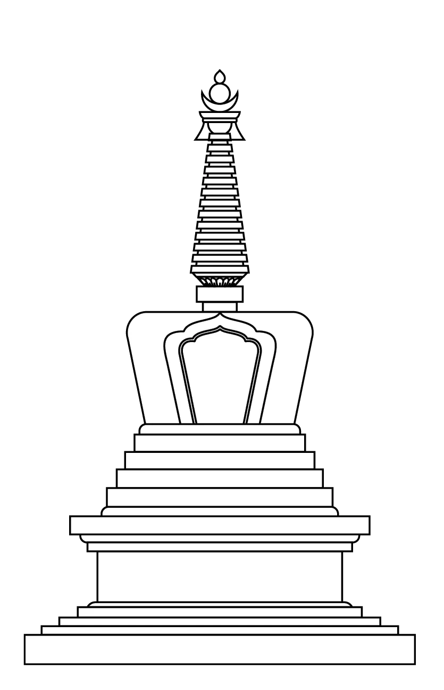

# 第12课

现在讲《菩提道灯论》的密宗部分，没有得过灌顶的人暂时躲一躲。（众笑）

辛二、令师欢喜：

为求师长灌顶故，当以承事施宝等、

依教奉行等诸事，令贤善师心欢喜。

前面讲了有些人想修密咒，有些人想修事部、续部或瑜伽部，总之有各种情况。而修习密法，首先一定要在上师面前得灌顶。密宗不像大乘显宗或其他教法，无须灌顶便能学习。有些人说：“密法可以随便看，没什么问题，灌顶只是一种说法而已。在释迦牟尼佛的时代比较严格，但现在这个社会非常开放，所以没有问题，可以随便看，不用灌顶。”虽然现在的社会非常开放，但密法也不能无缘无故地随意学习，否则就失去了它的价值。所以可能是说这些话的人本身太开放了。总之，修密法前，必须先得到灌顶。

多识仁波切写过一篇文章，专门破斥了密法不用灌顶的邪说，我觉得写得很好。我们有些道友也要注意，如果别人没有得过灌顶，你不要劝他看密法书或念密法仪轨，因为这对他不一定有利。比如，有些人根本没有得过大圆满灌顶，你就让他读《系解脱》、劝他看《上师心滴》，这肯定不合理。还是要让对方先得灌顶，这是进入密乘的入门法，一定要有。

不仅如此，得灌顶时应该让上师欢喜。这里的“师长”指的就是上师。密宗有各种不同的法，学修不同密法，对灌顶的要求也不一样。如果你求的是大圆满，就必须得大圆满的灌顶；如果你求的是一般的密法，也应该获得密宗的一般灌顶，这是不可缺少的。总之，必须求得上师的灌顶，并应当在上师面前承侍。如果你很难做到像释迦牟尼佛一样，于百千万劫中在如来面前承侍，但至少要让上师欢喜。

“施”是供养的意思。有些人为了在上师面前求灌顶，用假的宝物供养上师说：“它的价值很高，您可不可以给我灌个顶？”这肯定不合理。正确的做法是：在上师面前供养珍宝等，对上师的教言依教奉行，要听上师的话。在末法时代，有些人只要上师说什么，他就否认什么，每天都挑毛病。

希望堪布堪姆说的话，你们还是要听，这样好一点。如果他们说的话你们都不听，他们也会失去热情。对法师的教言，无论你认为它是否正确，都要尽量依教奉行，这样大家才有凝聚力。否则，在一个团体里，人本来就多，遇事又是你反对、我反对，最后这个团体就会很混乱。这是不行的。而且，我想他们也不会提过分的要求，平时让大家做的事情，主要还是与讲经说法、考试等有关，所以希望你们尽量依教奉行。

人只要自己的心堪能，那什么事情都好办；如果心不堪能，即便对方的建议或要求很合理，你也不一定能做得到。总之，弟子要依教奉行，令上师欢喜。这是第一个条件，令具有法相的贤善上师心生欢喜。这之后是求得灌顶。

辛三、求得灌顶：

贤善上师心喜故，圆满传授师灌顶，

清净诸罪为体性，即成修习悉地器。

首先，令灌顶或传法上师生起欢喜心，不扰乱上师的心，然后在上师面前圆满获得你需要的灌顶，这是一定要做的。这样一来，自己无始以来所造的罪业就能全部清净，并堪为真实的法器。

从来没有耕种过的荒地，经过开垦后再播种，种子才有成熟的机会。同样，很多人的相续起初不是密法法器，通过上师的灌顶，相续就会成熟。灌顶就像往瓶子里灌水，可以滋润你的相续，因为灌顶的本意就是赐悉地、洒甘露。那天讲《三戒论》时也讲过，灌顶的梵语“阿贝肯札”就有这些意思。

令上师欢喜之后，通过灌顶让自相续成熟、成为法器，这是进入密宗最基本的条件。

庚二（如何得灌顶）分三：一、梵行者不得受密智灌；二、若受犯戒；三、犯戒则堕恶趣。

梵行者、出家人不能受秘密灌顶和智慧灌顶，如果受了就会犯戒，犯戒则会堕地狱。这个科判可能很多人解释不清楚。

辛一、梵行者不得受密智灌：

初佛大续中，极力遮止故，

梵行者勿受，密与慧灌顶。

《时轮金刚》续部是由初佛，也就是最早的佛所宣说的。《时轮金刚》大续中再三强调：遮止梵净行者、受出家戒律者受密宗的秘密灌顶和智慧灌顶。在密宗的四灌顶中，第一个是宝瓶灌顶，第二个是秘密灌顶，第三个是智慧灌顶，第四个是句义灌顶。其中第一个宝瓶灌顶出家人也可以得，但第二个秘密灌顶和第三个智慧灌顶，在《时轮金刚》中对出家人严厉遮止。

很多出家人可能会想：“我等了这么久，一直想获得阿底峡尊者《菩提道灯论》密宗部分的窍诀，结果今天却说出家人不能受这些灌顶。”其中的密意到底是什么呢？以前在其他论典中也提过，这个问题有历史原因。当年阿底峡尊者来藏地时，后弘时期刚开始，正值朗达玛灭佛后佛教还未恢复的混乱期，很多根本没有资格灌顶的人，却亲自做真实灌顶。

那天讲《三戒论》时说过：按照密宗真正的要求，如果上师具有大慈如来的真实法相，那么就需要亲自灌顶，与空行母双运，然后让弟子享受甘露；而在智慧灌顶时，要让弟子行男女双运。以前有这样的真实灌顶。但在后弘初期的藏地，出家人也做真实灌顶，这种混乱的现象普遍存在，就像现在个别地方也有修双运法的乱象。

后来，阿底峡尊者依据《时轮金刚》，对这样的行为进行严厉遮止：凡是出家人，不能亲自做真实灌顶。从此之后，整个藏地只能以表示方法灌顶，不能以真实方式灌顶。如果上师和弟子都是真正的大成就者，那他们做真实灌顶也不会犯戒律。但如果不是大成就者，作为出家人，上师灌顶时带着空行母，弟子也行双运，则都犯出家戒律。

阿底峡尊者在《菩提道灯论》中所安立的观点，与当时的历史背景有密切关系。因此，在当时，尊者依据《时轮金刚》，要求出家人不能接受秘密灌顶和智慧灌顶。但按照后来高僧大德的解释，现在的出家人是否可以接受上师的这两种灌顶呢？现在开许以表示法受秘密灌顶和智慧灌顶，并不是亲自受真实灌顶。就像法王如意宝给我们灌了很多次顶，用的都是托巴里的甘露、智慧空行母的照片等表示物。所以我们没有亲自受过真实灌顶，否则后果非常可怕。

国外的有些著作，将续部中的这些意义做了直接表达，所以美国人都特别喜欢，觉得这些行为很了不起，也许是因为他们个别人的贪心比较大。但肆意而行可能会对密宗造成不利，很多人不仅没有等净无二的见解，甚至连密宗基本的道理都不懂。如果没有见解就行持所谓的男女双运，这是一种疯狂的行为。对这些行为，高僧大德在各种经典中都予以了严厉遮止。

在这方面，阿底峡尊者对佛教有非常大的贡献。尊者通过造这部论，对藏地很多不如法的现象进行了遮止。时至今日，藏地的高僧大德在传密法时，如果没有境界也不敢做真实灌顶，这已经成为一种传统。其实，采用表示法进行灌顶与密续的观点非常相合，在授予灌顶者的能力成熟之前，运用表示法才是合理的，但即便如此，受灌顶者也能获得灌顶。这个问题还是比较重要的。

辛二、若受犯戒：

若受彼灌顶，复住净梵行，

违犯所遮故，坏彼难行律。

作为出家人、梵净行者，如果没有资格受真实的秘密灌顶和智慧灌顶，而以此理由与他人行双运，就违犯了释迦牟尼佛在《毗奈耶经》中所制定的戒律，毁坏了难行的律仪。

辛三、犯戒则堕恶趣：

禁行者若受，当生他胜罪，

且定堕恶趣，故亦无成就。

现在有些出家人说：“上师和我说过，他跟我有很多密切的因缘。”其实，有些所谓的上师也生贪心，实在不能自主，以各种方法欺骗他人。尤其是一些女众，经常受到相似上师的引诱，这方面一定要注意。阿底峡尊者在这里严厉地遮止了这些行为。

个别人由于贪心增长，无法守持梵行，如果要犯戒，就要按小乘的方法处理，千万不要以密宗当借口说：“上师这样做是有密意的。上师有加持力、有功德，与我双运对他的成就有帮助，而且对我成佛也有利益。”如果通过这种途径染污佛法，对自他都不利，应该注意。

凡是梵净行者，如果受了这种灌顶，则犯他胜罪，即四种他胜罪中的淫戒。如果犯了淫戒，以后一定会堕入恶趣，不会有成就的希望，因此一定要注意。

庚三、闻思密法等得上师灌顶即可：

如果仅是听闻密法，得到上师的一个灌顶即可。上师灌顶是共同五灌顶之一。如果只是为了听密法，没有得过宝瓶灌顶、秘密灌顶、智慧灌顶、句义灌顶这四灌顶也可以，只需要得一个共同灌顶。

欲闻说诸续、火供祠祀等，

须得师灌顶；知真者无过。

如果你想听一些密法续部或大圆满中的个别法，如《大圆满心性休息》《大幻化网》《时轮金刚》等，或准备依靠密宗做火供、息增怀诛的事业，只要得过共同五种灌顶中的上师灌顶就可以。

“知真者”是知真如者。在《事师五十颂》中提到过十真如[^1]，内容在“上师法相”部分，你们方便时可以看一下。知真如者可以对密续做任意阅读、听闻、修持，都没有过失。

阿底峡尊者在《菩提道灯论》的密宗部分，主要讲的就是出家人不能受真实灌顶，对修法则讲得不是很广，说得一个上师灌顶就可以了。其实，要想听这些密宗部分，那几位道友不离开也可以，因为只讲了这些内容，平时我们也会提到。不过，对他们有这样的要求，会让他们有一种难得心，这样也可以。

甲三（末义）分二：一、造论者；二、译者。

乙一、造论者：

上座吉祥燃灯智，见经等法所说教；

菩提光诚劝请故，已略示明菩提道。

“吉祥燃灯智”是阿底峡尊者的名字。尊者以慧眼照见了各种显宗经典、密宗续部的法义，之后由菩提光国王劝请，简单地宣说了这部《菩提道灯论》。

大阿阇黎吉祥燃灯智所造《菩提道灯》竟。

乙二、译者：

此论造于象雄托铃寺[^2]，由这位印度大学者本人以及主校译师善慧共同翻译审校。

象雄托铃寺，位于藏地。阿底峡尊者用梵文写了这部论，之后又自己翻译成藏文。不知道为什么尊者不用藏语直接写，可能一开始他的藏语说得不是很好。藏族的善慧法师翻译了很多经论，对藏文很精通，所以尊者跟他合作翻译。

阿底峡尊者用梵语撰著论典肯定没问题，但不知道他在藏地学了多少藏语。有些人在藏地待了十五年，连十五句藏语也不会说。阿底峡尊者在藏地待了十三年，不知道这部论是他什么时候造的。总之，阿底峡尊者用梵语撰著，之后与善慧法师共同把梵文译成藏文。后来此论又被翻译成汉文。

《菩提道灯论》已经宣讲圆满了。

[^1]: 无上瑜伽续《金刚藏庄严续》最后一品中云：“二遮遣仪轨，秘密智慧灌，降伏之仪轨，食子金刚诵，猛修之仪轨，开光修坛城，即内十真如；坛城与等持，手印姿势诵，坐式火施供，加行与收摄，乃外十真如。”
[^2]: 另称托林寺。
