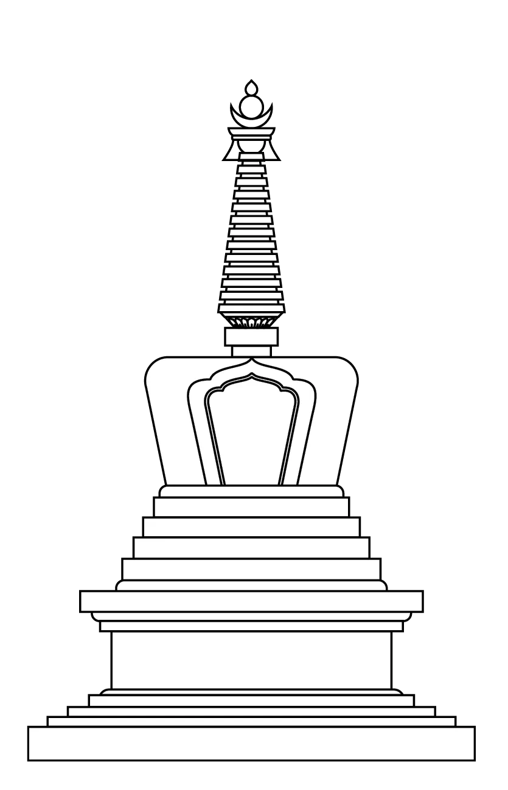

# 自我教言讲解

华智仁波切·造论

索达吉堪布·译讲

传讲时间：2007年12月2日

自我教言讲解

华智仁波切·造论

索达吉堪布·译讲

今天我们共同学习华智仁波切的《自我教言》，先给大家简单讲解一下字面意思，之后我们再就法义共同探讨，大家有问题可以提出来。

我们这里网络终端的位置设得比较高，我刚刚从一公里外的地方走路上来。讲完了以后，你们可能要开车或者坐车到很远的地方去，我也要走很远回去。今晚我们在虚空中聚会，可以说你们也在显神通，我也在显神通，大家共聚在虚空之中闻受佛法。

《自我教言》是宁玛派华智仁波切所造的一部甚深的教言，表面上看只有十几个颂词，但其实非常殊胜，我们修行人应该用它来时刻提醒自己。上师如意宝也曾经给我们传过很多次，今晚我们一起共同学习，大家在听闻的同时，可以对照一下自己，看看能做到的有多少，做不到的有多少。

《自我教言》如果广讲要好几堂课。今天因为时间关系，只是给大家做简单的字面介绍，争取用半个小时讲完。以前我讲过一遍，益西彭措堪布也讲过，网上也有《自我教言》的讲义。希望大家听了之后，再仔细思维、领会。

《自我教言》是华智仁波切写给自己的教言。作为修行人，我们始终都要用正知正念来观察自己的所作所为合不合理、如不如法，不要把这个教言当作观察别人过失的工具，而是要用来检查自己。

切莫遗忘有三种：莫忘恩重善知识，

莫忘大慈大悲佛，莫忘正念与正知。

不能忘的有三种：不忘上师、不忘佛、不忘自我观察。我们在轮回中沉溺时，如果没有上师的开示，就得不到解脱。所以在修行中，千万不能忘了恩重如山的上师。如果没有佛陀的教诲，我们也很可怜。还有正知和正念也不能忘，《入菩萨行论》中讲过要经常观照自己的正知正念。这三者都是始终不能遗忘的，大家能不能做到？

恒需忆念有三种：恒念传戒之上师，

恒念示道之佛法，恒念律仪与誓言。

需恒时忆念的有三种：第一，恒时忆念传戒的上师。给你传过皈依戒、居士戒等戒律的任何一位上师，在今生中都是很难得的，应该恒时忆念他的功德。第二，恒时忆念佛法。作为修行人，我们始终都要忆念佛法，不能忘失。第三，恒时忆念律仪和誓言。学密宗有三昧耶誓言，学显宗有显宗的戒律。上师、佛法、戒律这三者不能忘，要恒时忆念。

恒时应具有三种：身体恒时应有心，

床榻恒时应有身，心中恒时应放松。

恒时应该具足的有三种：一是身体恒时有心，意思是说，我们应该身心合一。有些人虽然坐在听法行列中，但心在胡思乱想，身体在经堂里，心却跑到别处去了。二是身体不能离开修行的床榻。真正的修行人不会天天逛街，到处旅游。三是心处于放松的状态。修行人心里应该是不慌不乱的，始终都处于一种很安详、很快乐的境界。真正内心放松的修行人，就像以前宁玛派和噶当派的大德一样，经常安住在自己的屋里，不会去很多地方。大家观察一下：自己的身体里是否有心？床榻上是否经常具足身体？心是否放松？这是恒时要具足的三种法。

急须忘掉有三种：急须忘掉生贪友，

急须忘掉生嗔敌，急须忘掉痴睡眠。

急需忘掉的有三种：第一，急需忘掉令自己生贪心的亲友。当然，作为在家人，要将自己的丈夫、妻子、儿女一下子全忘掉有一定的困难，但也不要对他们过分执著。第二，急需忘掉令自己生嗔恨心的怨敌。让你相续中生嗔恨心、与你关系不好的敌人，我们要尽量把他忘掉。第三，急需忘掉令自己产生痴心的睡眠。大家要少睡一点，很多人星期天懒觉睡得特别严重，这样不行。生贪心的友人、生嗔心的怨敌、生痴心的睡眠这三者都要尽快忘掉。如果实在不能忘，也不能有过多的贪心、嗔心和痴心。

恒需谨慎有三种：众中出言当谨慎，

独处行为当谨慎，平常观心当谨慎。

恒时需要谨慎的有三种：第一，众人当中出言要谨慎。人多时不要轻易出言，否则容易得罪他人，也不要对人过于赞叹，这点一定要特别注意。第二，一个人独处之时，要注意行为。一个人的时候，很容易做偷盗等坏事，所以应当谨慎。第三，平常时时刻刻要观察自己的心，这一点也要谨慎。这是我们应该恒时谨慎的三种教言。

恒需隐秘有三种：隐秘自己之功德，

隐秘他人之过失，隐秘未来之计划。

需要恒时保密的有三种：第一，隐秘自己的功德。自己有什么功德不要随便跟别人讲。第二，隐秘他人的过失。如果发现了别人的过失，应该保密，尽量不要告诉他人。第三，还要隐秘未来的计划。有智慧的人，对于自己未来的各种打算，不会在众人当中宣说。随便告诉别人的话，有些事情不一定能成功。这是关于隐秘的三种教言。

不可宣说有三种：不宣偶尔出离心，

不宣自己狡诈行，不宣自己之善行。

不可宣说的有三种：第一是“不宣偶尔出离心”。有些人偶尔产生一点出离心，就马上想出家，想离开自己的家庭，似乎对轮回生起了极大的厌离心，但这不一定稳固，要长期观察。如果长期厌离轮回，才算是有真正的出离心。所以偶尔的出离心是不可靠的，不能随便告诉别人。第二，不能宣说自己狡诈的行为。有些人觉得自己很聪明，喜欢跟别人说自己偷东西时多么厉害，说妄语时多么能干，做邪淫或其他坏事时如何如何……没有必要在别人面前宣扬自己的狡诈行为。第三，不能宣说自己的善行。很多人喜欢自我宣传，在没有特殊必要的情况下，上师也没有特别过问，就随随便便宣扬自己放生、持咒、听课的功德，这是不太合理的。这些是不能宣说的三种行为。

不可去处有三种：怨仇争处不可去，

众人聚处不可去，玩乐之处不可去。

不可去处有三种：第一是“怨仇争处不可去”。怨恨的敌人互相争斗、争执不休的地方，我们作为修行人，没有必要去。第二，众人聚集的地方不能去。人们娱乐狂欢、无意闲聊的场所，修行人不能去。第三，玩乐之处不能去。不能去一些打游戏、打麻将的地方，还有舞厅、网吧之类的场所，否则正知、正念、菩提心全部会退失。所以这三种地方是不能去的，大家应该记住。

不宜言说有三种：无信者前不说法，

未问不说自经历，不说不符实际语。

不应该说的有三种：第一，在没有信心的人面前最好不要传法。佛教的功德、大乘菩提心的利益等等，应该对具有缘分、堪为法器的人宣说。在那些邪见很重、特别愚痴、不愿意听受佛法的人面前，强行宣讲皈依、授戒是不合理的。对于没有缘分的人，我们很难度化。第二，如果没人问，不要说自己的经历。在别人主动提问的情况下，可以讲一些，但如果没有特殊必要，不要随便说自己做过些什么功德和过失。第三，任何时候都不能说不符合实际道理的语言，即不说妄语。说妄语的过失相当大。学习大乘佛法的修行人，要始终观察自己的语言，尽量不要说妄语。这三种不该宣说的大家应该记住。

很多道友把《佛子行》《自我教言》这些教言背得非常熟练，这样一来，大家在行为上自然会经常观察自己。

不该之事有三种：友前不该有喜怒，

承诺不该有变动，行事不该有表里。

不该有的行为有三种：第一，在朋友面前不该喜怒无常。在朋友或熟人面前，不要出现一会儿高兴、一会儿不悦、一会儿伤心、一会儿痛苦的情况，要有稳重的人格。第二，承诺不该随便变动。自己承诺过的事情，就不要变来变去。有些人答应得很快，但变得也很快，这是没有智慧的表现。关于这一点，《二规教言论》中讲得比较细致。第三，行事不该表里不一。有些人表面说得特别好听，实际上却当面一套背后一套，这是狡诈者的行为，是不合理的。

今天不讲公案也不引用教证，只是就字面意思给大家简单讲解一下，希望大家能打开思路。《自我教言》虽然翻译得浅显易懂，但很多道友以前没想过这到底对自己有什么作用。这些教言是大德们经常引用的，如果每个修行人都以此来观察自己的行为，对自己会有非常大的利益。

我刚来学院时，看到《自我教言》，就抄在笔记本上，经常观察自己，虽然很多都做不到，但对自己帮助是非常大的。我想，对自己有利的法，对你们应该也会有帮助、有利益，所以今天在网上和佛友共享。

莫作之事有三种：切莫自大与傲慢，

切莫暗中说他过，于谁亦莫作轻毁。

不能做的事情有三种：第一，作为修行人千万不要骄傲自满，《入菩萨行论》中大量教义遮破自高自大的行为。第二，千万不要暗中说别人的过失。我们作为大乘修行人要尽量观清净心，即使看到别人有些不如法、不合理的行为，也不要背后指摘。有些人自己做得再差都意识不到，而别人哪怕没有一点过失，也会添枝加叶地找别人的过失，这是一种非常不好的行为。修行人尽量不要说别人的过失。第三，对于任何众生，都千万不要歧视、欺负、轻毁。一定要关心一切众生，不管对谁都不能冷漠无视。

不应之事有三种：不于富人施财物，

不于狡者起信心，于谁亦莫说密语。

不应该做的有三种：第一，对富贵的人或者一些领导供养财富，是没有必要的。第二，不要对一些狡诈者，比如世间的骗子起信心，否则容易上当。第三，对任何人都不要说自己的秘密。需要保密的事，除上师外，跟任何人都不能说。有些续部中也讲，如果某位上师不可信赖、不能帮你保守秘密，那么对他也不能讲秘密语言。如果说了，一传十、十传百，最后秘密就会泄露出去。因此，对于委托密或是自己承诺保密的事，在任何人面前都不能说。

不应观察有三种：不应观察美女身，

不应观察友之事，不应观察己功德。

不应观察的有三种：第一，男众出家人或者修行人不能观察美女的长相。如果观察美女长得如何漂亮，会逐渐毁坏自己的戒律。同样，女众出家人也不能观察男身。作为居士，也有一些相关的戒律。总之，不应观察异性的身体，否则对自己的戒律有害。第二，不应观察朋友的过失。有些金刚道友住在一起，人格不好的人，就会经常观察道友的过失，这是很不好的。如果真要观察，别说对凡夫人，就是对佛陀，心不清净的人也会发现过失。因此，对自己道友的过失，千万不要去观察。第三，不能经常观察自己的功德。不论做了什么好事，也不应该去观察分析自己的功德。

随顺之事有三种：语言随顺于亲友，

衣饰随顺于当地，自心相应于佛法。

应该随顺、相应的事有三种：第一，说话应该随顺于亲友。比如不信佛教的亲友对于很多佛教专用名词都听不懂，因此应该随顺他们的语言。第二，我们的衣饰要随顺于当地风俗，到任何一个地方去，行为或者衣饰应该入乡随俗。第三，自己的心要时时刻刻相应于佛法，佛法里怎么讲，心就应该随顺。道友们要用佛法来观察自己的行为，这一点很重要。

不应听闻有三种，不闻他人赞己德，

不闻喜新者之语，不闻愚者之教诲。

不应该听的有三种：第一，不应该听别人赞叹自己的功德。别人称赞你长相漂亮、口才好、功德无量，这对你的修行可能是一种违缘，不应该听赞叹之语。第二，一些人总是喜新厌旧，刚开始对人很亲热、很关心，这时不要听他们的语言。第三，有些人自己非常愚痴，连基本的道理都不懂，却要教育别人。比如有的父母不信佛教，比较愚昧，反而教子女不要学佛，说学佛不好。我们在其他方面可以听父母的话，但如果反对学佛，就不要听他们的了。千万不要听信愚者的语言。

不能希求有三种：不求富人之财物，

不求高贵之地位，不求华丽之衣饰。

这个教言对于居士很重要。在这个时代，不要过于追求财富，不要过于追求地位，也不要过于希求华丽的衣服。对真正的修行人而言，地位、财产以及漂亮的服饰，都像梦幻泡影一样，没有实在的意义。修行人不应该特别希求这些。

不能诽谤有三种：不谤众望所归者，

不谤他人买卖物，不谤慈己善知识。

不应该诽谤的有三种：第一，不能诽谤公认的高僧大德和成就者，以及一些对人类和社会有很大贡献的人。对于这样的人，寻找过失、进行诽谤，是非常不合理的。第二，不能在别人买卖东西的时候去毁谤、搞破坏，比如说产品质量不好。自己不买的话，也没必要对其随意评价。第三，更不应该诽谤对自己特别慈爱的上师和善知识。

不能赞叹有三种：不赞众夫所指者，

不赞自大愚昧者，不赞幼稚之孩童。

第一，如果大家都对某个人不满，对其进行呵斥，说他是坏人，那大家自有其道理，我们没有必要去赞叹这个人。第二，对于一些自高自大、不学无术的愚笨者，没有必要刻意去赞叹其功德。第三，没有必要赞叹幼稚的孩童。如果过于赞叹孩童本不具有的功德，他容易生起傲慢心，最后就没有办法管教了，所以对幼稚的孩童不应该说许多赞叹之语。

不赞不谤有三种：不赞不谤自亲属，

不赞不谤陌生师，不赞不谤一切人。

不赞不谤的有三种：第一，既不能赞叹也不能诽谤自己的父母、亲属。如果过于赞叹，别人会认为我们对亲人贪心很大，不像个修行人；如果过于攻击家人或者说亲朋好友的过失，从世间人格和伦理道德的角度也是讲不过去的。没有必要说你的父母家人如何如何不好，你们既然聚集在一个家庭里，也是因为前世的因缘，何必过于攻击。有些人连做人的基本道理都不太懂，要么把自己的亲友赞叹得特别夸张，要么到处宣说自己亲友的过失，这是没有素质的一种表现。第二，不能赞叹也不能诽谤陌生师。陌生师指自己不太熟悉的上师，现在世间比较多。比如某城市里今天来了一个活佛，明天来了一个堪布，后天来了一个仁波切，你要是对这些人不是很熟悉，最好不要去评价。如果过于赞叹，过一段时间可能会发现他的过失；如果过于毁谤，过一段时间也可能会发现他的功德。所以，我们对陌生的上师没有必要去参与评价，既不应赞叹也不应诽谤，这很重要。第三，不赞不谤一切人。一个真正的大菩萨，对所有人都不会特别赞叹，因为这些人总会有一定的过失；也不会特别诽谤，因为每个人都有如来藏，是未来的佛，如果去诽谤，自己也有过失。所以对任何人，在没有特殊必要的情况下，既不应诽谤也不要特别去赞叹。

如此窍诀尚众多，总之时时刻刻中，

自观自心极为要，世出世法亦归此。

华智仁波切说：虽然这样的窍诀还很多，但归纳而言就是要时时刻刻观察自己的三门——身体在做什么，心在想什么，语言在讲什么，这样一来，我们作为修行人的世间法和出世间法全都可以包含在《自我教言》中。

上面讲了这么多个“三种教言”，大家如果能全部做到，当然是最好的，要是实在做不到，也要经常反思。自己既然已经皈依了三宝，参加了菩提学会，就要时时刻刻观察自己的所做所思。很多人以前没有观察过自己，做什么事都是随心所欲、放任自流，但这样是不行的，应该以正知正念来观察自己。如果能做到这样，就算得上是大乘修行人。我们学习的高僧大德的行为也是如此。世间法和出世间法全部可以包括在这个教言当中。

如是略说之教言，无垢智慧瑜伽士，

为调自心而宣说，此乃极深当修持。

华智仁波切在这里把自己形容为一个瑜伽士。上面所讲的这些教言，是为了调伏自己的心而宣说的，里面的道理非常深，希望各位好好地修持。

今天用了半个小时，将《自我教言》给大家做了简单的介绍，作为一种提醒。我个人也经常用这个教言来观察自己，调伏自己的相续。我想大家也应该经常用这些简单的教言来调整自心，观察自己的相续，这样对修行会有一定的帮助。

在学习《入菩萨行论》的过程中，我讲了三种善法的功德：第一是观音心咒“嗡玛呢巴美吽”的功德。如果有时间，希望每个人能发愿念诵十万遍以上。大家如果学习工作特别忙，我也不强迫，但如果条件允许，早上可以起早一点，每天念一点这个咒语是很容易的。最少也应发愿在三个月中念十万遍以上，当然，如果能发愿念一亿遍，功德更大。从十万、一百万到一千万、一亿遍，大家能发愿多少，到时都可以在网络上报给我们。

第二是供灯的功德，现在全国很多地方的道友都想供灯，但是不太懂供灯的方法，所以最近我们给大家做了介绍。

第三就是转绕佛塔的功德，我也做了一些特别的开示，希望大家有时间的话了解一下。

我们修行人应该提醒自己，每天都要学一些新知识，否则修行是很难进步的。最近很多道友通过网络等方式在共同学习，这一点我很随喜。我们这里有很多发心人员在给大家提供方便，希望大家利用这些难得的机会，认认真真学习。

今天开示的内容就到这里，下面我们进入提问环节。

现场互动

问：我是一名退休医生，因为年龄大了，希望把时间都用在修法上，可是我的病人每天都要找我看病，不给他们看病也不行，所以我决定回医院，每天上半天班，可以吗？

堪布：可以。

问：《菩提道次第广论》中讲：“若想求解脱，必须以出离心摄持，但是以少数福田力摄持也可以得到解脱，例如持诵阿弥陀佛名号。”光持诵阿弥陀佛名号，没有出离心，怎么能得到解脱呢？是否与麦彭仁波切的《净土教言》中“往生四因”相违？

堪布：这是不相违的。因为有两种根基的人：一种是先以出离心引发，然后持诵阿弥陀佛心咒。这种人自相续中先生起了出离心，然后再念诵阿弥陀佛，就像要证悟“人无我”，先要具足菩提心，然后才证悟空性。还有一种人是先对阿弥陀佛有强烈的信心，然后念诵“阿弥陀佛”。虽然刚开始没有出离心，但往生时对轮回的厌离心会同时生起来。所以在往生极乐世界时，这个人的出离心是具足的。

问：对大多数修行人来讲执著利他是非常好的，但是否与三轮体空相违？如果总是觉得有善可做，有众生可度，那是否会障碍证悟空性？

堪布：我们发菩提心，想度众生，利益众生，这一般是在出定的时候，这种利益众生的心是获得三轮体空的直接因。我们学中观时，也讲了利他的菩提心不能舍弃，因为利他的菩提心是证悟空性的因。麦彭仁波切在《中观庄严论释》里有一个比喻：用燧木和燧垫摩擦，虽然有这两个物质存在，但是火焰燃起之后，此二物会全部自然烧尽。同样的道理，我们在因地的时候，利益众生的执著是需要的，这个执著并不会障碍安住三轮体空或者障碍证悟空性。

问：现在很多年轻人对佛法非常渴望，目前您讲的《佛子行》《二规教言论》课程较少，还能跟上进度，但是《入菩萨行论》已经讲了一百多课了，请您开示新学员的学习方法以及如何跟上学习进度。

堪布：我们的课程不可能等着新学员的学习进度。以前上师如意宝在世时也是这样，传一部法时，中间来了新生，他们就要自己想办法补上前面的课，同时后面的课也要同步进行。

前面的课如果跟不上，新学员自己要想尽一切办法逐渐跟上来。我们不可能每来一个新学员都从头开始讲。好在现在科技发达，有了视频和书，只要有信心，每个人应该都能补上。以前我们在上师如意宝面前听法的时候，有时上师不让录音，前面的法听不到就是听不到了，再也没办法补了，上师也不可能给每个新来的学生都补课。现在不同了，有了视频，我相信只要大家肯努力，跟上进度应该是很方便的。

问：小组学习佛法时，我们按照上师的要求，会做一些简单的辅导讲解，但有时候因为自己的修行不够，自信心不强，害怕错解上师讲的法意，误导了别人。以后我们是不是尽力按照上师讲的内容辅导就可以了？

堪布：是的，这样我比较赞叹。在辅导的过程中，每个人应该尽量不离传承上师的教言。学院要求辅导员在辅导时把上师传讲时引用的教证、公案和道理都要用上，让大家再次学习。以前上师如意宝也是这样要求的，上师课上怎么讲，我们辅导的时候就让大家再次照此复习，这样就不容易搞错。

问：放生鱼的时候，有很多居士不喜欢放大鱼，因为放大鱼特别麻烦，有些人会起烦恼。而小鱼比如泥鳅，放起来比较容易而且数量也多。但是如果不放大鱼，它们就会成为人们餐桌上的美味。请问在放生中大鱼和小鱼应该如何取舍？

堪布：这种因果问题非常微细，我们要讲因果也有一定的困难。一般来讲，大的生命身体的感受更为强烈，一些经典中也讲过。当然，一些小的生命也有同样的感受。所以还是要根据情况，如果大家都发心放大鱼，那么放大鱼也可以。我们放生也不能只为了方便易行才做。应该想办法，不管大鱼小鱼，条件具足的时候，尽量一视同仁。如果有人放大鱼会烦恼，那放牦牛的时候可能更烦恼。

问：志公禅师看到一个婚礼的场景时说：“六道轮回苦，孙儿娶祖母，牛羊席上坐，六亲锅内煮。”也就是看到新郎、新娘结婚，事实上是孙儿娶祖母做老婆。现在世间人没有神通，看不见这些。结婚生子决定了人类的延续，可“孙儿娶祖母”的情况和道德是完全相违背的。这么看来，如果人们不颠倒妄执，人类社会就无法存在。请上师就这个问题给弟子做个开示。

堪布：佛教里讲众生都当过自己的亲人、父母、怨敌，这是从前世的角度来看的，有神通的人可能会看到今生的怨敌就是前世的父母或子女。而即生中，自己不知道的情况下，结婚生子是世间伦常，世间的道德伦常和前世轮回并不冲突。也就是说，把前世的祖母娶为妻子并不会有乱伦之过。从佛教的角度来看，在漫长轮回中，一切众生都当过我们的父母，但佛教里并没有说杀一切众生都会造杀父杀母的五无间罪。这条戒律是从即生的角度来讲的，并不关联前世。所以，这个教言是有神通的人对前世和今生的一种论断，这跟现在的物质文明和社会道德根本不相违。

问1：阿罗汉是否还在六道中转生？

堪布：阿罗汉已经断了所有的烦恼障，不会转生到轮回中去。这在《俱舍论》和有关小乘的经典中讲得非常清楚。

问2：那为什么会有说法：如果妇女怀孕堕胎，有可能会杀了阿罗汉？

堪布：这个意思并不是指阿罗汉会转生到胎中来。

问：您在《入行论讲解》中讲到，念文殊菩萨名号或咒语的功德超过其他佛菩萨的名号咒语。这样的话大家都跑去学文殊法，其他佛法没有人学怎么办呢？

堪布：这个问题不要紧，因为诸佛菩萨的功德各不相同，佛在不同根基、意乐的众生面前，分别宣讲了文殊菩萨、观音菩萨、宝髻佛、阿弥陀佛的功德，所以不会因为赞叹了文殊菩萨的功德，所有人就都去依止文殊菩萨了。

比如世间一个广告说某品牌的车特别好，会有些人喜欢这个车，而有些人无论你怎样打广告，都不会喜欢。所以不管再怎么赞叹，也不可能让所有人都去买它，而不买其他车。

同样，我们赞叹观音菩萨、文殊菩萨的功德时，对文殊菩萨有缘的人就会马上生起信心学文殊法门，对观世音菩萨有因缘、有信心的人，就会去学习观音法门，还有些人听到释迦牟尼佛、宝髻佛等佛菩萨的功德后就会去修学。众生根基不同，因此诸佛菩萨的显现也不相同，所以不用担心所有人全都跑到文殊菩萨那里去，不会有这个过失。

问：我让一个人来学密法，后来他退失了，做了很多不如法的行为。以后如何能让来的人修学更圆满，过失更少呢？

堪布：我们作为一般的修行人，没有他心通，很难测准每一个人将来会变成什么样，但我们还是应该尽心尽力地让别人皈依佛门，学习显密佛法。在这个过程中，有些人可能会退失信心，但这对于我们是没有过失的。以后这个人如果还有转变的机会，我们还应该不断努力帮助他；如果实在没有转变的机会，我们自己引导别人学习佛法的精神永远也不能退转。

问：我们学佛是为了了生脱死，究竟成佛，但是上师传《入菩萨行论》，说我们是为了一切众生而学佛。我有点搞不懂，请上师开示，为什么要利益众生？

堪布：如果我们利益众生，就容易成就；如果不想利益众生，只想自己成佛，反而很难获得佛果。华智仁波切的教言里说：希求成佛，应该有强烈的利益众生之心，如果有了利益众生的心，就会在很短的时间内得到成就。

我们成佛以后要做什么呢？还是要利益众生。就像有些人如果一心一意想要为人民服务，就比较容易当上官；如果一味想要自己当官，这种思想不一定正确。当官的目的并不是自己享受，而是要帮助老百姓。

同样的道理，获得佛果，获得解脱之后，要做的就是利益众生，成佛以后利益众生的事业是很广大的。所以如果一个人发心把利益众生放在首位，那他的成就就会非常快。

问：我们小组有的学员文化程度不高，有时候会抄作业。抄我作业的时候，我也不知道自己的答案是不是正确，这样对他是不是有过失呢？

堪布：最好不要抄作业，因为我们学习并不是为了完成一种任务。如果抄作业，一方面有过失，一方面也把握不准是否正确。每一个人都应该自己动脑筋好好学习。即使文化水平不高，也可以和大家共同交流、研讨。抄作业的习惯很不好，学佛并不是为了给谁一个交代，而是为了让自己内心得到诸佛菩萨的智慧利益。

问：《二规教言论》中说要对利益我们的人和伤害我们的人有所分别，而在大乘教言中又要求对所有众生不能有分别心，要宽容忍辱。请问这两者应该如何看待，如何平衡？

堪布：《二规教言论》是从世间做人的角度来讲的，里面讲到要利害分明，利害分明就不一定要把所有的众生观成自己的父母。从世间角度来说，哪些是坏人、哪些是好人、哪些是敌人、哪些是亲人，应该要分清楚，但对敌人也没必要以报仇之类的方式去应对。

《二规教言论》里面的道理，应该用《入菩萨行论》来完善。首先应该知道哪些是坏人，哪些是好人，在此基础上，按照《入菩萨行论》的观点来对敌人进行摄持，最终要把所有众生当作自己的父母那样来对待。

由于时间关系，今天的课到此就圆满结束。非常感谢所有道友的共同学习。现在将我们所做的善根回向给一切众生。

