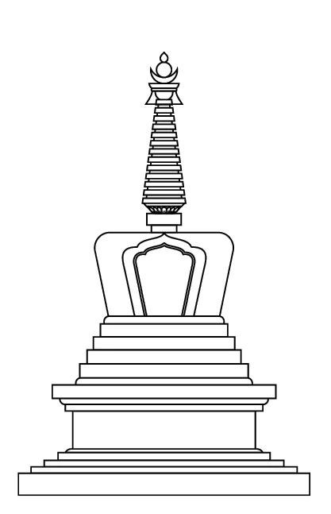

# 三十忠告论讲解

无垢光尊者·造论

索达吉堪布·译讲

传讲时间：2014年12月3日

三十忠告论讲解

无垢光尊者·造论

索达吉堪布·译讲

今天讲《三十忠告论》。

这次我离开学院总共七十五天，离开藏地有七十天，明天如果有时间，我想简单讲讲我的行程。今天在这里先不讲，主要是想，第一天来经堂的人特别多，为了明天不要有太多人，所以我今天先讲课。

明天我们继续讲《大圆满心性休息》，最近具体的课程安排还没有想好。我这次出去，原本还要去很多学校和佛教中心讲课，但因为答应了大家这个月要传讲《大圆满心性休息》，所以就赶时间回来了。

今天我一边念传承，一边对一些颂词稍作讲解。现在国外有些大德在三天内就能讲完《入菩萨行论》，所以我一天讲完《三十忠告论》也非常正常（众笑）。我原来讲《入菩萨行论》讲了两百多堂课，但我也知道，现在是21世纪，大家不一定有那么多时间。所以，我今天就用这种方式给大家讲《三十忠告论》。

我刚回来，还有点头晕，说话也不太清楚。不过没关系，我们照样一起讲课、听课、念《普贤行愿品》，这些都有非常大的功德。

今天是第一天讲课，这是一个缘起。接下来我就念《三十忠告论》的传承，中间有必要的时候再给大家稍微讲解一下。这种方法应该不错，很快就能讲完一部论典，你们也能得到传承。这样以后你们就能跟别人说：我去藏地学到了很多很多论。

（堪布念传承）

法界遍空智愿大云中，善降大悲之光甘露雨，

成熟所化田中三身芽，敬礼胜宝怙主上师足。

虽以愿力传承师摄收，自不精进无义耗此生，

思维圣行自懊他亦然，为生出离说此卅忠告。

无垢光尊者说，自己曾经有非常好的发愿，也有依止善知识修行佛法的机会，但是自己没有很好的精进心，现在已经到了晚年，反思自己的行为感到十分伤心，看到别人的行为也是如此，所以为了自他生起厌离之心，就造了这部《三十忠告论》。

奇哉虽以方便摄眷属，具足顺缘住持寺庙等，

然成诤源自心贪执因，独居静处即是吾忠告。

很多人想修建寺院，但修寺院也是很麻烦的，过程中会有许许多多的争论、执著，最好还是一个人居住，这是我的忠告。不要想太多，今天修这个道场，明天修那个，这样对自己的修行不一定有利，一个人住着，这就很好。

《三十忠告论》主要是对一些真正的修行人、实修者来讲的，有些颂词是针对六百年前藏地的情况，但大多数内容，我们现在的修行人也可以对照。当然，我们如果有真正的利他心，也不是不能修寺院、建道场，有时候也不能过激。比如我们现在在各地建一些佛学中心，让大家一起学习，这就是非常好的机会。我也经常跟很多人说：你们如果能把自己的家提供给大家学习，哪怕是半年或者一年，我觉得这个房子就是非常有价值、有意义的。否则，世间这些有漏的财产，当我们离开的时候，什么都用不上。因此，现在我们大家为了利益众生，全力以赴地做一些事情是很重要的。

但是，如果对众生没有利益，以希求世间八法的心态修建道场等等，就没有多大的意义了，不如一个人实修。这里想说的是，一个人最需要的是修行，如果没有修行，光做这些事也没有什么利益，无垢光尊者也不赞叹。

虽以经忏祈福降魔等，令自功德传扬人群中，

然贪食财自心被魔使，调伏自心即是吾忠告。

虽从贫众收取高赋税，塑造佛像发放布施等，

然依善法成他积罪因，自心修善即是吾忠告。

诸如造佛像、造佛塔、化缘，利用别人的财产来行持一些相似的善法，实际上是依靠善法而造恶业。所以，要令自己的心趋入佛法、趋入善法，这就是我的忠告。

我们在做善事的过程当中，应该注意发心是什么样，整个过程是什么样。现在很多人自己也没有真正地好好修行，给别人也带来了许许多多的麻烦。有些上师的弟子，也许是为了帮助上师弘法利生，但是他在行持过程中，不但对上师不利，对佛教也不利，表面上是做一件善事，但实际上令很多人对三宝起邪见。这样的现象非常多。

所以，我们做任何事情都应该具有善巧方便。现在有些佛教徒，在寺庙中还看不出来，一到了外面，由于没有智慧，没有善巧方便，给佛教带来了很多不好的影响。

为求地位传法与他众，善巧方便护持贤劣眷，

心生实执我慢之因故，息灭妄念即是吾忠告。

为了得到地位而给别人讲经说法，通过各种方法来护持或者摄持一些眷属，自己的心很容易产生傲慢、执著。因此，自己各方面的因缘不具足的时候，不要到处去搞所谓的讲经说法、摄受弟子，应该尽量减免闲事，减少想法。自己尚未具有一定的力量时，最好不要想得太多。

虽以经商放利欺诈等，邪命所积百财作供养，

图名行善世间八法因，断除耽著即是吾忠告。

用邪命来积累各种各样的财产，实际上是追求名利来行持世间八法，因此要修厌离心，断除执著，这即是我的忠告。其实世间的很多法也没有什么可耽著的。

虽思公平作证断讼等，调解争端乃是利他众，

然成依彼生起欲望因，无有希忧即是吾忠告。

这一段比较难懂，我以前讲过，你们自己看讲义[^1]。

虽具领土受用眷属福，悦耳之语遍于赡部洲，

然自临终之际毫无益，精进修持即是吾忠告。

财富、眷属、福德、名声虽然遍于整个世界，但是当你死去的时候什么都带不走，因此要好好地修行。

司库侍者以及家长等，虽是寺院家中骨干者，

二取分别生起挂虑因，远离散乱即是吾忠告。

为了自己各方面的方便，身边有一些侍者、道友和志同道合的人来维护帮助自己，这虽然在修行过程中是一种方便，但是身边的人经常会给自己带来很多执著和麻烦。所以，还是尽量减少人员好一点。

有些人稍微有一点能力时，就经常带着侍者，甚至不仅一个，有两个侍者、三个侍者……现在很多上师的侍者，有些人很好，有些刚开始还不错，可到了一定的时候就出现各种各样的问题。不管汉地藏地都是这样的。世间人也同样如此，有些大老板或大领导身边的人，言行举止也有不如法的地方。即使他的言行举止如法，但很多人把他当作观察的对象，经常关注他，这样也会引起各种各样的情况。

因此，我们修行人对于没有必要的人员、没有必要的琐事、没有必要的财富、没有必要的名声，都要尽量放下，断除散乱即是我忠告。当然，无垢光尊者的《三十忠告论》主要是针对住在寂静地方的修行人而讲的。

虽携佛像经论炉灶等，所需之物前往寂静山，

暂具用品争论痛苦因，无所需求即是吾忠告。

携带佛像、供品、炉灶等等，跑到寂静的山里去，虽然暂时这些都是很有必要的——现在有些修行人备的东西特别多，比如佛像、法本、钢炉——这些表面上是需要的，但实际上也可能是争论、痛苦的因。应当尽量减少财物。

有些道友屋子里的东西特别多。应该尽量地减少，这是很重要的。世间人也是这样，有些人光是衣服就堆得很高，其实一个人在短暂的时间当中不一定能穿那么多。我听说有一个人有好几百件衣服，但还要经常到商场去一件又一件地买，这样不是很好。现在世界上有很多人都没有衣服穿，没有饭吃，应该提供给他们。自己要适当地减少太奢侈、太过分的资源消耗，这也是很重要的。

作为修行人，除了一些法本，没必要拥有太多的资具。当然，无垢光尊者的意思是修行人法本也要少一点为好。有时候法本太多确实也难以处理。我们学院有些刚来的道友，对法本好像不太珍惜，经常乱扔，可能他们不太懂。但我自己觉得法本还是很有必要的，是很珍贵的，不管到哪里去都带着。佛像和佛塔也非常珍贵。但其他一些用不上的东西，就该尽量减少，可以处理掉，或者用来做一些慈善等有意义的事。

以前有的资具应该尽量慢慢减少；以前没有的，除了特别必要的之外，不要添置太多。过一种比较简单的生活，对修行人和世间人都是很重要的。现在很多人痛苦的根源都是欲望。欲望一直无法满足，就会经常感到痛苦。

于此浊时野蛮眷众前，当面呵责纵然是善意，

依彼生起烦恼之因故，言谈平和即是吾忠告。

毫无私欲诚心利他语，以悯揭露他人之过失，

虽思正意彼心结石因，言语悦耳即是吾忠告。

在末法时代，对于一些野蛮的众生，想通过批评来调伏他们，认为现忿怒相是一个很好的度化众生的方法。但实际上，有时对别人说一些粗语，不一定对他有利，还是应该说一些温和、悦耳的语言，这也是很重要的。

如果自己没有什么特殊的能力，说话过程中就要尽量说一些寂静语，别说粗语。有些人一开口就是骂别人、说别人的过失，尤其是一些法师，好像调化弟子最好的方法就是批评，经常批评别人。其实爱说别人的过失也表现了一个人的修证和性格。

偶尔点出别人的错误，这还是有必要的。我刚开始给汉族道友讲课的时候，也比较爱批评。有一次法王如意宝对我说：你经常批评人，在末法时代，批评不一定能利益众生，除了极特殊的情况以外，尽量不要说粗语。从此之后，我也确实改了，在很多方面反省自己。上师亲自这样说，证明我肯定性格不好。其实我本来不是这种性格，但是，刚开始的时候觉得好像不批评就没办法，因为很多人都非常傲慢，批评一下应该对他们有利。

从那以后，我就尽量地说一些温和的语言。当然，特殊情况也比较多，这个应该是可以开许的（众笑）。包括这次我出去讲课，看到有些老师写了一些关于密法的论文，这种泄露秘密的行为我很看不惯，于是在学校里都没有好好演讲，而是直接批评他们，整节课一直讲他们的过失，然后就结束了。也有这种情况吧。

在末法时代，大家确实都应该遵从无垢光尊者的教言。言谈悦耳、言谈平和，即是我忠告。

护持自宗破除他宗者，虽思辩论清除教法尘，

然依彼生烦恼之因故，沉默禁语即是吾忠告。

想通过辩论、研讨、写论文等种种方法，来弘扬佛法或是清除教法的尘垢，但实际上依靠这些也容易生烦恼，所以应该尽量禁语，即是我忠告。

有时候话说得少一点比较好，不然缺乏智慧的话，在辩论探讨中也会经常诽谤到其他高僧大德和上师。有些人不会辩论，就会吵架，辩论到最后就开始争论，争论到最后就开始争斗，这样不太好。

这一听《三十忠告论》，你们就什么都不想了，明天也没有人发心了。（众笑）

偏私护持师传宗派等，彼等纵然认为是承侍，

赞自谤他贪嗔之因故，放弃一切即是吾忠告。

偏护传承上师、自己的宗派、自宗的观点，觉得这对弘扬自宗非常有利，但其实这样经常会导致自赞毁他，是生贪心和嗔恨的因，因此要尽量放下。

对于一个大修行人，自宗和他宗没有什么分别。有人觉得：“啊，我们藏传佛教一定要弘扬，我们宁玛巴的教法一定要弘扬，上师的法一定要弘扬！”其实这在某种意义上很容易产生贪嗔，如果别人对自己的上师或者教法说了什么，就马上产生嗔恨心；别人维护自己的观点，就特别欢喜，产生贪心。对于真正了悟大圆满的修行人，自他的宗派也好，教言也好，其实都没有什么差别，他们的心非常宽容，不是一定非要抬高自宗不可。

我们闻思的时候，应该离开这些狭隘的想法。对整个世界而言，你可以弘扬自己的宗派，但这不一定适合所有人。因此，我们在说话、做事的过程当中，需要善巧方便。

广闻观察诸法之类别，虽思了知他过即智慧，

依彼自己造恶之因故，观修净现即是吾忠告。

通过听闻佛法，观察到别人观点的不合理，看到别人的过失，以为这就是一种智慧，但是依靠这种智慧自己也会造恶业，所以观清净心很重要。“观修净现”就是观清净心的意思。

恶说皆空诽谤诸因果，虽思无作乃为究竟法，

若舍二资断绝修行缘，福慧双运即是吾忠告。

有些人经常说，一切都是空性的，然后通过这种高论调来诽谤因果的存在，认为无所事事就是究竟的佛法，但实际上这样很容易舍弃积累二种资粮的机会。因此，应该智悲双运，或者说胜义谛和世俗谛、智慧资粮和福德资粮双修，这就是无垢光尊者的忠告。

为三灌义修降明点等，虽思他身乃为道助缘，

有漏道欺众多大修者，修解脱道即是吾忠告。

通过密法的一些方便道来修持，认为这是密法的双运修法，但是很多人其实根本没有修这种法的能力，而是具足真实的贪欲，很多修行人以此而受到欺惑。因此，应该通过闻思修行来完成自己修持解脱道的整个过程。

虽无缘分众前施灌顶，加持品等散发于众人，

诋毁之根失毁密戒因，敦肃直行即是吾忠告。

众人之中露体奔跑等，狂妄诸行虽思为禁行，

世间俗人不起信心因，当依谨慎即是吾忠告。

此处为自欲得殊胜位，虽求净行博学及贤善，

是从高顶堕于低处因，行无松紧即是吾忠告。

村落寺院以及深山等，虽住何处不应交亲友，

于谁相触不怨亦不亲，稳重自主即是吾忠告。

不管住在村落、寺院，或处在其他任何环境当中，交往朋友都不要太亲密；在任何时候，与别人的关系既不要相互怨恨，也不要太过亲密，过亲和过远都不太合理。

任何时候都应该稳重自主。稳重自主就是“莫舍己道”，自己有自己的原则，自己有自己的道。不要刚认识一个人时开心得不得了，互相赞叹，吃的喝的睡的全都在一起，两三天之后又发生矛盾，彼此恨之入骨，见面脸色都变了，背后也说种种过失，这不是修行人的行为。所以，在任何时候跟别人相处既不要太亲密，也不要太疏远，关系应该适度。要做一个真正的修行人，这很重要。

很多居士刚开始相互间关系特别好，时不时都要聚一下，“啊！碰到你，我们多么有缘分呀！不管是学习佛法，还是世间事，我们都可以如何如何……”但过了两天，又发生矛盾，产生争论，种种的事情都会发生。这是不太好的。

人与人之间，不管是谁，关系好的时候总是好得过分；关系一旦不好了，杀了他都行。这种情况对于一个修行人来讲不是很好，与人相处应该不要太亲，也不要太远。表面上看，这个人好像石头一样，亲也不是，疏也不是。但实际上，人与人之间的关系确实不能太近，太近的话容易被焚烧；也不能太远，太远了也会消于虚空当中。

我特别希望我们学院和学会的修行人，大家都能按照无垢光尊者这里讲的原则，“于谁相触不怨亦不亲，稳重自主即是吾忠告”——与谁相处，都不应彼此怨恨，像杀父杀母的敌人一样；也不要太亲密，否则好花不常开，过一段时间关系又变了。一般来讲，人和人的关系时间一长就会变淡，甚至由亲转怨。尤其是同一个传承的、在同一个上师那里获得灌顶的同行道友之间，如果发生这种情况，就如密宗金刚道友誓言中所讲，是非常可怕的。

所以大家一定要注意，现在很多人不太会处理人际关系，好的时候太过分，不好的时候也过分。表面上看，不亲不远似乎不近人情，但实际上这样的关系才能长存；如果过分亲密，这种感情很有可能不会长久。现在的世间人，包括家庭关系也是如此，好的时候似乎用任何语言、任何方式都无法表达感情，可到了最后又变成了什么样？可能互相连面都不想见。听说有的在家人离婚以后，听到别人提起对方的名字都特别恨，“啊，你们不要提他！”那又有何必要呢？作为一个修行人，这样更不庄严，一定要注意。

虽受具信男女供衣食，恭敬侍奉自亦诈现行，

为护他心自受束缚因，当行平等即是吾忠告。

工巧历算药等无量书，虽是方便缘起佛果因，

然此种种散乱静虑因，放弃所知即是吾忠告。

学工巧学、医学、历算等各种各样的知识，以及学一些世间的语言、文字等等，表面上是有必要的，最终也是成佛的因——佛陀是遍知，不可能不懂这些。但是暂时而言，学这些知识容易让我们的心变得散乱，对禅定很有影响。无垢光尊者讲，作为一个真正的修行人，最好不要有太多的形式，不要学太多的知识，好好修行就可以。所以，放弃所知即是吾忠告。

住家之时致力严饰屋，寂静山间寻求圆满福，

琐事令自人生虚耗因，断尽诸事即是吾忠告。

住在自己家里的时候，非常努力地装修、装饰屋子。现在有些修行人特别重视自己的破房子，做各种各样的装修。其实作为一个修行人，在寂静的地方每天忙着修一些特别庄严、壮观、豪华的房屋，这是没有任何意义的。有些居士也在买房、装修，天天为了自己的破房子忙着，一直没有修行的时间。为了这些没有意义的小事，把自己的终生都耽误进去，没有修行的机会了。因此，要尽量断除一些琐事，这就是我的忠告。

以后我们各个班的修行道场也不必搞太多装修。按照藏传佛教的传统，经堂里会有很多纹饰。但我认为以后我们的道场还是简单些比较好。现在的建筑并不需要太多装饰，尤其是在西方。我这次出国也了解了一点建筑学。以后我们的经堂和个人的房屋，不需要太多装修，像吊顶之类其实都是上世纪七八十年代的审美，没有太大必要，最多涂一点白色，不然也浪费资源和时间。我希望从今天开始，我们喇荣山沟的道友们不要把房子修得特别庄严，外面再怎么修也比不上白宫。你毕竟是修行人，修行人应该有自己的特色。要以修心为主，而不是修房子为主，否则再怎么修也不庄严。当然，个别道友的房子确实有装修的必要，但也不要搞太多，多了没有意义，心全部散在这方面不太好。

此处讲，不要住家时忙着自己房屋的装饰，到了寂静的山里仍然希求世间的圆满、庄严、快乐。有个别人，虽然已经看破了大城市，却又追求其他新的“城市”。简单的生活方式是很重要的。当然，现在冬天特别冷，没有避寒的设施确实也不行，但也应该注意，不要把所有的时间、精力和资源全部用在个人的一些没有意义的小事上，这方面大家要考虑一下。

虽以精进博学净行等，某种功德纵然已超越，

贪执何法束缚自心故，不堕边执即是吾忠告。

种种伏胜令受雷雹等，虽思能调难度之事业，

焚烧他续自入恶趣因，当居卑处即是吾忠告。

典籍教言以及记录等，虽聚种种所需深义书，

若无修持临死书无利，当观心性即是吾忠告。

准备了很多书籍、教言、笔记本等等，虽然这些对了解甚深佛法很有意义，但如果自己没有好好修行，临死时这些书本可能也没有什么用。因此，观心最重要。

我们的法本和笔记本确实特别多，堆得很高很高。就像我自己，书房里有非常多的书，但临死的时候，如果书里的知识没有融入心，那书就是书，我就是我，没办法产生利益。因此，现在应该把书本上的教言尽量用心修持。就像一个人考试的时候，所有书本都不能用，只能拿着一支笔，学到多少就用多少。人死的时候也是一样，所有外在的法本和知识都无法带走，连自己的身体都带不走。我经常觉得，死亡就像进入一个特殊的考场，那时候连身体的骨肉都不能带，就像我们参加重要的考试时，连一张纸都带不进去，所以观心是很重要的。

我们在座的很多人经常修出离心、修菩提心、念诵经文，以此来观察自己的心，认识自己的心。确实，在任何法中，认识自心都是最重要的。要观心，首先需要闻思，这是必不可少的，否则只会说一些“观心、观心”的大话，没有一点次第和教言，恐怕也不能成功。

一缘修时讨论与觉受，著作论典唱诵道歌等，

虽是力显而增分别因，当护离心即是吾忠告。

心生分别之时直视要，已得定解之时安住要，

修行安住无修是为要，修习无散即是吾忠告。

在真正的修行中，生起分别念的时候，要直接观它的本体；已经获得定解的时候，要在这个定解当中安住；修行、安住其实最后都是无修，没有什么修的。

这是禅宗和大圆满相结合的一个非常深的要诀。意思是说：当我们生起分别念的时候，要直接观察心，观心的时候，你可以观察这个分别念或者在这个心态中安住；当安住的时候，有一种定解，这种定解你可以认识它、修行它，但这种修行并不是依靠分别念非要再次不断地修，那是一种无修的修行。真正无修而修才是最重要的。

我们要观无散的修行。很多人依靠上师的加持以及传承的力量，通过这样的观心，认识自己的心到底是什么样，这并不是很困难。如果要认识这个世界，我们的眼睛不一定看得到，去找也不一定找得到。但是你的心可以观心——不说了，再说就要进入到密法了。

空性之中行持诸因果，证悟无作护持三律仪，

无缘大悲精进为利众，二资双运即是吾忠告。

虽然证悟了空性的见解，取舍因果还是要非常谨慎；虽然证悟了无所作的境界，护持别解脱戒、菩萨戒和密乘戒也非常重要；虽然证悟了无缘的境界，但在这种境界中，还是要对众生不断修大悲菩提心，这就是二资无别。两种资粮双运，这就是我的忠告。

依止胜师亦闻深教授，有阅甚深经续观内心，

呜呼虽知无修自欺自，为我如我者说卅忠告。

无垢光尊者说，他以前依止过很多上师，也听闻过甚深的教言。就像我们这里很多人，也依止过特别好的上师。

昨天我刚回到学院，就在回想自己近二十年中依止上师的整个过程，做了一个总结：我来的第一年是1985年，当年听了什么法；1986年听了什么法；1987年听了什么法……最后到上师圆寂之前，听了什么法。我大概罗列了一下，虽然有些没有记录，不过通过思考和推理，基本上能记起哪年讲了什么。这样一年一年罗列下来，自己确实得过很多甚深的教言，依止过一些像佛陀般、超越我们观察的善知识。

无垢光尊者也阅读过许多甚深的经典和续部，用这些内容自己反观过，思考过，修行过。但是他在这里用很谦虚的语气说：呜呼虽知无修自欺自——虽然自己也依止过上师，听过很好的教言，看过甚深的经典和续部，同时也反观过内心，但是明明已经知道了道理，却没有很好地去修行，相当于自己欺骗了自己。不仅自己是这样，看到有些人也是这样，所以造了这部《三十忠告论》。意思就是说，很多人有了依止善知识、听闻佛法教言的机会，人生本该是非常光彩和辉煌的，可是却没有好好修行。

我觉得无垢光尊者绝对不会有这种情况，因为他是文殊菩萨的化现，只是给我们显现才这样说。但我们这里很多人，反观自己一生的时候，可能确实是这样的。有些人刚学佛一年两年，还算不上什么，相当于还没有读完幼儿园。现在读小学都要六年的时间，所以我们学佛六年的话，可能小学都还没有毕业。但有些人已经在十年、二十年中依止善知识，听闻了很多教言，阅读了很多甚深的经典和续部，也稍稍内观过，然而却没有真正通过这些方式好好修行。有些人甚至离上师越来越遥远，离教言越来越遥远，离经典、续部和自己的修行境界越来越遥远，最后可能自己都找不到自己了，特别可怜。就好比一个人非常有钱，但最后连一分钱都没有用上，全都浪费了，这在世间当中也不合常理。

无垢光尊者的《三十忠告论》，我今天并没有全部讲解，只是给大家简单开示一下。修行的确是非常不容易的。当然，大多数人对修行都很重视，就像我们今晚讲课的直播，在国内听课不算很困难，但在其他很多地方却非常不容易，因为有些地区现在是凌晨三点半，有些是凌晨四点，但他们还是很努力地听着。为了佛法而付出是非常有必要的，你付出越多，得到的就越多。如果我们把佛法当作世间一般的简单学问来看待，那不一定会有很多收获。

无垢光尊者最后说，虽然看过许多经论，但是没有很好地修行，就是自己欺骗自己了，这是非常悲哀的，所以为我和像我这样的人宣说了《三十忠告论》。对于无垢光尊者的这个教言，希望我们大家都好好体会一下。

由厌离心造此之功德，愿诸有情解脱得大乐，

三世诸佛菩萨圣者后，吾等随行愿成彼长子。

此三十忠告论，慈诚罗珠由厌离心驱使而造。

我刚到这里的时候，我们学院有一个小小的高音喇叭放在外边。那个喇叭的声音不像现在的喇叭那么大，但那个时候，法王如意宝经常在里面放《三十忠告论》。所以我以前就在自己的功课里放了《三十忠告论》的颂词，经常念。现在好像有很多年没怎么念了，但我对这部论的信心仍然非常大。

真正当一个修行人，应该对很多事情看得比较淡，但也不能太极端。尤其是今天听课的很多在家居士，不能因为学了“独自观心吾忠告”，明天就班也不上，家里的饭也不做，这不是我们的用意，希望你们要有善巧方便。修行很重要，与家人和同事的人际关系也很重要。现在很多佛教徒在人际关系方面不是很有方便法。大家应该用智慧来处理人与人之间的关系，包括对自己的家人、同事、领导、下属，对各方面的人都要以智慧的方法来和睦相处，这样才能成为一个很好的佛教徒。

[^1]: 《三十忠告论要义简疏》（索达吉堪布著释）：“作为修行人，虽然最初考虑自己作为中间公证者决断讼事，调解双方的争端是为了利益他人，但往往会依此陷入五毒烦恼之中，生起种种非理的欲念，依此减少自己闻思修的功德，相对于解脱方面毫无意义。所以应该无有任何希望和忧虑于决断诤讼能否获得酬劳等，即是我忠心的教言。”
