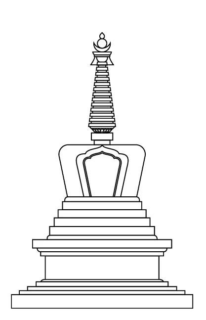

# 第3课

2016年8月14日

今天我们继续学习第二世敦珠法王的《教言精髓》。

犹如灰中烬火之五毒，若未镇服心不能安住，

怀中切莫养育毒蛇崽，愿能勤修殊胜之佛法。

灰里面藏着火烬，表面上看不出来，因为灰覆盖在上面，但实际上灰里还存在火星。同样的道理，我们相续中有一些不明显的贪、嗔、痴、嫉妒、傲慢等五毒烦恼，平时可能是看不出来的。有时候我们刚跟一个人交往，感觉这个人就像天子、天女一样，好像是一个很快乐的人，但是接触一段时间后，就会发现他的相续中其实有很多烦恼。如果我们没有从根本上调整自己的心，就不能安住于法、安住于心性。所以，先要断除根本烦恼，否则暂时也许能安住，可一旦外缘具足，烦恼就会扰乱你。有些人认为自己已经在山上修行多年，自相续中应该没有什么贪嗔痴了，然而一旦遇到对境，贪嗔痴就都出现了。

因此，我们要从根本下手，千万不要在怀里养育毒蛇崽。毒蛇小时候不会喷出毒液，似乎伤害不到附近的人，但是你如果一直把它养在怀里，最后因缘成熟的时候，它不但不报恩，反而会咬你、毒死你，是很有危险性的。同样，如果我们没有断除烦恼，没有调整自己的心，一直养着这五毒烦恼，平时虽然不明显，可一旦被引发就会非常可怕。

噶当派的一些教言说，要看你的修行是否成功，就要看你的烦恼从根本上有没有减少。如果从根本上减少了烦恼的话，说明修行有所进步；如果没有断除贪嗔痴，或者表面上压制着烦恼，但实际上并没有破坏它的种子，一旦因缘具足，它就会对你造成伤害。所以，我们作为修行人也不能太过自信，有些人受了居士戒，或者出了家，或者在山里修行了一段时间，就觉得自己境界很高，但实际上并非如此，只不过是暂时压伏了烦恼而已。其实，所有的根本烦恼，就像灰中的火烬一样可怕，一直隐藏在你的相续中，一旦因缘具足的时候，就会爆发出来。

所以，但愿我们能够精勤修持能断除根本烦恼的殊胜佛法。

犹如裹油硬皮之自心，尚未调服心法不能融，

莫让如子自心染恶癖，愿能勤修殊胜之佛法。

裹酥油的牛皮跟其他皮革不同，其他的皮革在水里浸泡，或者用酥油来揉，就可以变得很柔软，但是，裹酥油的牛皮非常坚硬，不管怎么泡水，或者敷上多少油，都根本不会变软。同样的道理，有些人经常听闻佛法，修行了很长时间，但自相续仍然非常顽固、坚硬，没有调伏自己的心，所以法难以融入心，这种人是很可怕的。

这就是我们经常说的“法油子”。他可能听了很多法，中观、密法都学过，基本的道理也都明白，但实际上相续中并没有真正学进去，甚至比没学佛的人还要刚强，常常生邪见、生嫉妒心，看所有对境都觉得不合理、不如法，清净心观不起来，观不清净心倒是很成功。这样的人，不能像放任孩子自己游荡顽皮一样，任由自己的心被各种烦恼染污，要调教自心，不要让它这样一直坏下去。

由于一些教育的因素，现在很多孩子心态特别不调柔。他们从小接触的动画、游戏里全是贪嗔痴，长大以后，杀死其他生命也会像杀游戏角色一样，毫不在乎，没有任何悲悯心、柔软心。现在这个社会真的越来越糟糕，孩子整天要么玩手机、要么看电视，里面的信息充满贪嗔痴，尤其是一些打斗的内容，导致他们从小就染上一些不良习气。这样的话，孩子长大之后，价值观也会如此。本来我们自己有一些很好的传统文化，比如孝道，但在这个社会中如果过分强调的话，也可能增上人的自私自利心。现在一些腐败分子为什么敢贪污那么多？某些方面也与他的父母、亲友有很大关系。

所以，我们修行人学任何一部法的时候，都应该尽量把它放在心上，让法和心融为一体。比如说，学了中观的空性思想，或者学了因明的逻辑推理，就要看看能不能根除或者压伏自相续中的烦恼。这样一来，你听得越多、学得越多，相续就会越来越调柔，行为也会越来越如法。否则就算听再多佛法，最后好像对谁都不相信，对上师也不恭敬，对佛法也没有信心，对众生也没有悲心。我们对于法油子有一种说法：看到天上佛陀在飞，也不会产生信心；看到地上众生在哭，也不会产生悲心。如果学佛最后学成这样，是很可怕的。

因此，我们不能让自己的心像顽皮的孩子一样放荡不羁，一定要好好调伏自心。其实，如果我们掌握得当，心是很容易改变的。比如一个人心情不好的时候，对他说一句让他欢喜的话，也许他当下就能解开心结；如果一个人本来心情平静，但说一句不中听的话刺激他，他可能一下子就会爆发；这时候，如果别人再跟他说一些安慰的话，他愿意听，也许马上心态又改变了。

我们凡夫众生有很多烦恼在相续当中根深蒂固，但也有佛法的妙药可以对治，希望我们通过这些教言经常观察自己的相续。

犹如奔腾江河之恶习，未断不离非法之行径，

切莫售卖武器与怨敌，愿能勤修殊胜之佛法。

就像大江大河奔腾咆哮，难以阻挡，我们每一个众生都有一些无始以来的恶习和贪嗔之心。有些人喜好酗酒、抽烟，有些人喜欢吵架、打架，有些人有偷东西的恶习，有些人有杀生的恶习……所以，很多人皈依佛教后说：我以前杀盗淫妄无恶不作，世上所有的恶习我都有，从现在开始我要好好忏悔！

要斩断恶习并不容易，但如果没有斩断，我们的行为就不能离开非法。只要相续中有恶习存在，因缘具足的时候，肯定会复发。就像患有慢性病的人，可以通过吃药让病暂时不发作，可病根如果没有除掉，一旦因缘具足，又会发作。历史上有些修行人，包括一些阿罗汉，都会发作前世当猴子、当野兽的习气，更何况我们一般人。所以，有些修行人不要在别人面前装成毫无烦恼、比弥勒菩萨还要庄严的样子，自己内在到底是什么样，自己应该知道。

不要把武器卖给敌人，否则敌人随时都有可能伤害你。当我们认识到这些恶习的时候，就要想尽一切办法把它断掉。有些人在没有学佛时有很多不好的习气，学佛以后虽然暂时可以压制，但还是要在各方面努力，断除这些习气，不然一旦外境现前，还是会复发的。有这样一个公案：有一个仙人本来能在天上飞行，一次他到王宫里讲课，接触到王妃的时候，生起了贪爱之心，结果他的神通就瞬间消失了，离开的时候只好走路回去。

我们应该从各方面努力断除恶习。每个人都有一些恶劣的习气，业力现前之时很难阻挡。有时候一个人经过了很久的苦行，但短短的时间中就全部毁于一旦。所以，如果我们没有从根本上断除恶习，行为就不会离开非法。当然，也不能因此失望，觉得自己习气深重，所作所为都不如法，没什么希望了。作为一个凡夫人，肯定会有烦恼和不好的习气，但同时也会有一些好的机缘，比如我们可以通过忏悔、观修来净除恶业。人生中恶业、善业常常交替混杂，黑白交错，《俱舍论》中讲过，这叫做杂业。所以，为什么我们在生活中有时开心，有时痛苦，苦乐交杂，其实这与我们前世的业有关系。

我们今生当中要努力制止烦恼，好好修行。虽然我们可能会因为过去造的恶业而在将来感受一些苦果，但我们行持善法的因果也不会空耗，以此因缘，将来也会感受乐果。所以，不要因为自己犯过一两次错误，就认为没有任何希望了，最后破罐破摔，一直不断造恶业，这并不是很好的选择。从大的原则上看，人能十全十美固然很好，但做不到的话，我们就以做好事为主，这才是人生当中一种很好的选择。

犹如未平波纹之散乱，未弃无法获得稳固相，

自在之时切莫修轮回，愿能勤修殊胜之佛法。

水面的涟漪总是接连不断，一圈接着一圈，尤其是扔块石头下去时，波纹就会不断地层层出现。同样的道理，世间的琐事和散乱之事，整天没完没了。现在很多人每天嘴上都是“好累、好忙、好辛苦、压力好大……”好像每个人都觉得时间不够用，但其实做的事也不一定很多。所以，散乱的事情，就像水上的波纹一样繁多，我们要尽量把世间无意义的琐事断开、抛弃，否则就无法得到稳固的修行境界。我们在自由自在的时候，不要修轮回，应该好好修持佛法。

无垢光尊者说过：我们的很多所作所为就像孩童的游戏一样——如果肯放弃，就结束了；如果不放弃，那就永远也没有结束的时候。古人是这样的，现代人也是这样的，未来也还会是这样。人人都有许多忙碌的事情，每天都说不完、想不完、做不完。所以，我们还是应该重视自己的修行，否则，即生当中不可能得到稳固的境界。如果把所有的时间和精力全部用在世间琐事上，那你皈依多少年其实也没什么用，因为你从来没有认真地修过佛法。

这里说“自在之时切莫修轮回”，有时候一些行为表面上好像是在修善法，但实际上是在保养轮回。现在就连我们佛教道场中也有这样的现象。最近开法会时我看到，佛学院有人也开始卖什么地藏宝瓶、招财经幡，这也是修轮回！还说是僧众开光的，这样是很不好的，就像是汉地卖高香的，泰国卖佛牌的。虽然这些对个人招财也许会有一些好处，但那天我看到很多出家人也在排队买招财经幡，这样很不合理。

有些寺院以前喜欢在汉地做这样的事，结缘一些各种各样的宝瓶，有些扔到海里，有些埋在山里，那样或许会有一些利益，但跟真正的修行没有什么关系。如果以这种方法来搞经济，那是很不好的，我很反对。现在外界对藏传佛教有些不好的看法，其实也是因为一些藏传佛教徒做了不如法的事情。不论在新加坡、美国、澳洲，各个地方都有一些这样的佛教徒，自己不去好好闻思修行、弘扬佛法，整天只会做些火供之类各种各样的仪式，真正的佛教教理根本不懂，只重视这些外在形式，甚至和经济利益挂钩，利用这些挣起钱来。实际上，单凭这些形式，真正能得到什么呢？现在很多地方通过卖门票、卖高香、卖各种所谓的加持品来发财，其实这些都与出离心、菩提心、真正的修行没有什么关系。

我们佛学院一直要求大家好好地修持佛法、弘扬佛法，如果我们自己也开始搞这些，那就背道而驰了。我在很多场合中都说过，我们的修行如何，到了外面能很明显地看出来。现在很多佛教徒并没有真正去修行，而是整天忙着请这个寺院、那个寺院的加持品，有些还卖得特别贵，说是因为有僧众的加持，所以很贵。我们学院这边，有人卖长寿丸时宣传有抗衰老的作用，有个居士就问我：“听说你们学院某个医院卖的长寿丸很好，吃了以后是不是脸上不会长皱纹？”我说：“做这些的人好像脸上也是有皱纹的，可能他们自己没有吃。（众笑）”我不是开玩笑，希望大家在这方面注意一下。加持品是加持品，有加持的作用，但把我们佛学中的加持品跟现在所谓养生学、成功学结合起来，会导致很多不懂佛理的人把这些当作真正的佛教，最后佛学理念跟一些世俗理念混淆在一起，大家都分不清楚了。如果没有广告宣传中的利益，就不应该欺骗别人。当然，我并不是说这些加持品是欺骗，它们确实经过了僧众的念经加持，但是用它们谋取利益是不应该的。

我以前也讲过，我们学会在共修、放生的时候，经常有人会拿一些某某上师的东西来化缘，这是绝对不允许的。如果有人天天搞这些，我希望他们不要来参加我们佛学小组。我们唯一的目的就是共同闻思修行，因此我们连法本都尽量免费，即使不能完全免费，也只按成本来流通。大家该做的就是一起共修，这就是我们的基本原则。这个大原则我们绝对不会改变，否则现在社会上各种理念会让人眼花缭乱，最后可能迷失自己的方向。

我们在自由自在的时候，尤其是在有一点权力的时候，比如有些管理岗位上的法师和居士，希望你们不要利用学佛的平台来搞世间的各种宣传和名闻利养，这样是故意修轮回。不管大小乘佛教，修行的目的都是超离轮回，并不是增加轮回、延长轮回。我们无始以来在其中流转，不学法、不修行，就会不断继续流转在轮回当中。所以，不要再去给轮回延长寿命，愿能勤修殊胜之佛法。

犹如水土转暖师加持，未得无法直指自心性，

踏入捷径切莫绕道行，愿能勤修殊胜之佛法。

就像大地的水土，在冬天可能会被冻结坚硬，到了开春，得到阳光照耀，慢慢又会转暖。同样的道理，如果我们没有得到上师加持的温暖阳光，就根本无法得到直指心性、认识心性的机会。

敦珠法王这里是按照藏地的气候来比喻的，一些温暖的地方，冬天大地也不会冻结，而喇荣的土地就会冻僵，然后通过春天阳光照耀又慢慢变得温暖。我们的相续就像寒冬腊月的冰地一样，通过上师加持的温暖可以慢慢变得柔软，跟佛法相应，最终可以认识心性。踏上了这样一条捷径之路，我们千万不要再绕道。当然，打好理论的基础，学一些显宗的法，也是很有必要的。但你不要绕远路而行，应该走最近的这条直路，有机会依靠上师的窍诀和指点，修行心性法门，这样就会很快获得成就。所以，愿我们能修持清净殊胜的佛法。

犹如夏时美苑之寂地，未依无法生起诸功德，

栖山之时切莫趋蛮城，愿能勤修殊胜之佛法。

夏天美丽的花园里特别舒服，大家都觉得舒心悦意。寂静的地方就宛如夏天的花园，如果我们没有依止清净寂静之地，根本无法在自相续中生起诸多出世间的出离心、菩提心、信心、悲心等功德。所以，当你有因缘住在山里的时候，千万不要到都市里去。

有些修行人先是抛弃故乡、剃除须发，来到寂静的山里，在山里待了两三年，吃素、苦行，再过了几年之后，就不想待了，又往城市里面跑。现在也比较奇怪，山里面的人喜欢跑到城市里，城市里的人有时候也很喜欢跑到山里。钱钟书有本小说叫《围城》，里面说，婚姻就像围城一样，城里的人想出来，城外的人想进去。我们修行人有时候也是这样的。

我常常跟学院的道友讲，你们如果没有看病的需要和弘法利生的必要，最好还是在学院待着。但有些人只要有两三天的时间，就非要出去一趟。我每次都会盯着，这些人只要一有时间，一定会出去的，我们还没宣布放假，就已经买好机票了，特别着急离开。记得以前他也特别着急要到山里面来，流着泪说：“在大城市里、在红尘里，根本没办法修行，一定要来学院，一定要出家……”而现在却急着想出去。有时候外面的人想进来，“哇，这里好舒服呀，我有没有出家的因缘？有出家因缘的话，我一定生生世世一直待在这里。”生生世世能不能待在这里不好说，有些人待了一段时间以后，不要说生生世世，就是一年两年都很难。当然，我也认识很多特别好的修行人，没什么重大事情的话，他们一直依止寂静的地方好好地修行。

城市里的人也不一定非要去寂静的地方。你们最多放假期间来到藏地充个电，或者吸几天氧、输几天液，假期结束就回去了。其实，有时间的时候，你们在当地找一些清净的道场，或者在自己的佛堂里，也可以好好修持。这里讲到，如果没有依靠寂静的地方，很多出世间的功德都很难生起来。因此，有机会安住在寂静之地时，不要总往外跑。

当然，放假的时候出去一下也是可以的，不过，有些行为必须注意。有些人在家的时候经常剃光头，穿红黄色的衣服，就像我原来在学校时想要出家，每天都穿着黄色的衣服，有一个老师就天天骂我。但有些出家人正好相反，像俗家人一样头上顶着假发，耳朵里戴着耳机，整天玩着电脑，这是不好的相。本来出家人连头发都不要了，更不要耳环首饰，但有的人出家时间长了，可能有点腻，想尝试些新花样，就在电脑上把别人照片的耳环抠出来，贴在自己照片的耳朵上，这样的照片我曾经看到过。我比较担心，这是一种前兆，大家要注意一下。

犹如损耗鬼踞之乐念，未舍即使精勤难断苦，

莫奉魑魅魍魉为天尊，愿能勤修殊胜之佛法。

像损耗鬼盘踞那般追求安乐的心，就是乐念。人们都喜欢追求快乐，但这种念头就像损耗鬼一样，损耗鬼如果和我们居住在一起，就会把我们的很多精力和力量用掉、吃尽。盘踞在我们心中的乐念也是一样，没有舍弃之前，很难断除痛苦。

很多人整天想着：“我要快乐、我要成功、我要……”但其实这种念头跟损耗鬼没有什么差别，我们千万不要把魑魅魍魉这些鬼神或妖怪当作天尊。贪求快乐的心实际上并不是很好。世间当中追求快乐是常事，也是一种普遍的心理，每个人都想要幸福快乐，但如果你天天只想追求快乐，生活中的痛苦反而更加难以断除。如果我们不去刻意追求快乐，保持随缘的生活态度，那你相续中的这些妖怪就会全部荡然无存，那个时候，痛苦也会同时离你而去，你所感受的生活才是真正快乐的。

现在很多人都在寻求快乐，结果心里反而有了更多忧愁烦恼。我们觉得人生必须得到快乐，就拼命去追求，结果得不到，就怨天尤人，觉得自己很倒霉。由于对快乐太过重视，反而痛苦不断；如果我们对快乐不那么刻意追求和耽著，反而能活得更加快乐。

犹如房宅门锁之正念，未依不能谢绝迷乱客，

窃匪存在莫令门洞开，愿能勤修殊胜之佛法。

我们的房门如果没有上锁的话，小偷就会开门进来，把你的东西全都拿走。同样的道理，不忘善法的正知正念就像门锁，如果不依靠它，就难以谢绝迷乱的客人。各种各样迷乱的不速之客如果趁虚而入，你最珍贵的东西就可能会丢失，这样十分危险。

所以，我们修行人始终都要保持正知正念。每个人都要时刻提醒自己，“我是一个佛教徒、我是一个老师、我是一个医生、我是一个出家人……不能做这样的事”，我们要经常观察自己的身口意，这就是正知正念。没有正知正念的人，对什么都无所谓，很容易跟一些恶人同流合污，昏天黑地，到最后，连自己的人生方向也迷失了。所以，千万不要门户大开放盗贼进来，否则你长期以来积累的善法，可能全部都会被盗走，那是很可惜的。

为什么有些佛教徒修行好，有些修行不好？其实修行好的人，心里也许照样有一些贪嗔痴烦恼，但他们经常观察自己的根门，所以相续很调柔。我看到一些南传佛教的修行人，包括一些泰国的法师，他们的三门很寂静，坐在一起的时候，可以感觉到他们非常放松，应该是经常禅修、经常通过正知正念观察自己的心，所以心不散乱。修行的状态从外在行为上可以看得出来。

有些人其实就是不肯修而已，如果真的好好去修，通过正知正念来观察自己的三门，就会有改变。有些原本臭名昭著的人，后来观察到自己的毛病，逐渐抛开恶习，开始看书、打坐、修行，就连说话也都只说别人的优点。我认识两个人，是一样的身份，有时候我会打电话给他们，其中一个总是说过失：“这个事不好，这个人不好，那个地方很乱……”而打给另外一个时，“啊，这里很快乐，很舒服，周围的人都很好呀……”这两个人都是一个地方的，但世界观完全不同，这方面我已经观察他们很长时间了。人的想法一般都是好坏掺杂的，但有些人似乎只会收集不好的观点，从他那里基本上听不到好的评价，有这种情况。

所以我们要用正知正念来观察自己，这对修行很有帮助。

犹如无变虚空之实相，未证不能阻断见解根，

莫为自己铐上铁锁链，愿能勤修殊胜之佛法。

如果没有证悟无变虚空般的实相，那就无法断除轮回见解的根本。我们不论修密法、修禅宗，通过修行能认识自己如虚空一般的心。无垢光尊者的《法界宝藏论》和《实相宝藏论》里，经常用这个比喻——我们的心像虚空一样。像虚空并不是指空空荡荡。如果没有证悟虚空般的心性，那我们的萨迦耶见、恶见、我见、众生见等见解就无法根除。所以，在修行过程当中，不要用锁链把自己铐上。铁镣铐也好，金镣铐也好，实际上都是束缚的因。

禅宗也讲，不论好的念头、不好的念头，只要有念头，对真正的修行都有障碍。所以，我们要真正修行，必须通达心性如虚空的实相；如果没有通达，就不能根除轮回见解的根本。所以，大家的努力，最终还是要落到心性上，如果对心的本来面目有所证悟的话，学什么法、修什么法都会比较容易；如果对心性不那么了解，没有认识心的本性，即使行为上一辈子都在修行，效果也不一定很好。认识了心性的话，修行的力度跟没有认识心性的人截然不同，效果完全不一样。所以，这方面必须努力。

犹如无垢水晶之觉性，未见不能息灭修习执，

相伴不离他处不能寻，愿能勤修殊胜之佛法。

认识自心本性的状态叫觉性，它就像清净无垢的水晶球一样。一般在密法当中，水晶对认识心性方面有一种指示作用，当然这需要密法的一些灌顶。我今天只是跟大家稍微说一下而已，并不是直指心性。在密宗当中，有这种通过水晶来认识自己心的本性的方法。

这里讲，像无垢水晶一样的觉性，如果你没有见到的话，就不能息灭对修行的执著。意思就是说，我们的心跟水晶球没有什么差别，它的本性是空性，显现是光明。没有认识心的本性时，我们肯定需要不断修行；可一旦真正认识了本性，那所有的修行都可以不再执著——就像禅宗讲的“念佛一声，漱口三日”，各种修行都要舍弃，连念佛、打坐的念头都不需要。大圆满中也有舍弃身语意的九种行为，包括念佛、参禅等都要放下。最高的境界，不会执著任何行为。

这种境界其实一直与你相伴不离，在他处无法寻找。禅宗傅大士也说过：“夜夜抱佛眠，朝朝还共起。”众生其实每天晚上跟佛睡在一起，早上跟佛一同起床。这是什么意思呢？就是说，佛，也就是觉悟，与我们本是朝夕相伴的，从来没有离开，不需要到别的地方去寻找。如果真正认识心的本性，其实佛就在当下。这是比较高的法，我们就点到为止吧。

犹如旧友平庸识本面，未证所作皆为欺惑性，

切莫紧闭双眼瞎摸索，愿能勤修殊胜之佛法。

就像相处很久、关系密切的朋友，中间分开了，再见面时会非常欢喜。就像旧友重逢，对于庸俗的分别念，我们应该认识它的本来面目。

这其实很容易，只不过我们没有去内观，无论以禅宗或密法的窍诀，内观的当下就有可能认识到分别念的本性。如果你没有证悟庸俗心的本面，所有的修行和所作所为都是欺惑性的，因为这些都是世俗谛；一旦你认识了无为法的觉性，那一切所作所为全是让佛菩萨欢喜的，不会有欺惑性。而我们凡夫的所作所为相较于认识本性的境界和善根，还差得很远。所以，我们在修行过程当中，千万不要紧闭双目，一直瞎摸索。如果不认识自己心的本性，无论修什么法，都像盲人摸象一样，乱摸乱猜，盲修瞎炼。而一旦真正认识了心的本来面目，修什么法都比较容易。

我想我们很多道友应该对心性方面有所认识，境界高与低我不是特别清楚，但心性层面和传承上师的加持等各方面因缘具足以后，对心性应该会有所认识的。一旦认识了心性，将来的修行就会非常容易，而且不会间断。不会今天开心就好好修一修，念一念，特别精进；明后天烦恼一起现，就睡到中午十二点，不想起来。有所证悟的人，哪会睡懒觉呢？（众笑）

所以，认识心性很重要。有些人看过一些窍诀方面的书——当然，自己去看、去猜，也不一定能真正认识，必须依靠上师的窍诀，再加上自己反复祈祷、修加行、好好忏悔，这样之后，对心的本来面目就会有所认识。一旦对心性有一些认识，那与行持其他善法全然不同。

所以，作为修行人，内观很重要。有些人将所有的精力和时间全部用在外观、研究、学术讨论上，这样虽然暂时比较适合众生的分别念，会受到很多人的欢迎和赞叹，但这不是最究竟的。我经常想，有的人讲经说法口才特别好，可最后尸体天葬的时候，嘴皮也会被秃鹫吃掉；但如果他的内心有一些境界和证悟，这些是秃鹫吃不了的，可以跟随他到后世，去度化无量的众生，这是很有意义的。

总之若未舍弃今生事，无法修成来世胜妙法，

愿习于己有益之教诫，一切所行皆趋于正法。

总而言之，我们要看破今世、舍弃今世，如果没有看破今世，天天想着今世，那就是修轮回。一些在家人不生出离心，要忙于生计，养家糊口，有很多前前后后的盘算、交际、压力，这是情有可原的；但有些出家人也不伦不类，不好好修行，跟在家人一样每天忙于一些琐事，这样恐怕有点颠倒。你应该是愿意舍弃今世才出家的，如果只是因为遇到一些磨难、折磨，就避世出家，那不算一个真正的出家人，只是形象上的出家人。所以我希望在座的出家人，对于那些对解脱、对弘扬佛法没有什么意义的世间琐事，要尽量抛弃或者减少。如果你没有看破世间，那不论往生极乐还是来世获得成就，这些都是不可能实现的。

所以，应该好好修持这些对自己有利的教言，这样以后，你的一切所作所为、所言所行、所思所想，全部都会入于正法。只要与正法相合，即使别人看不惯、听不惯，甚至议论纷纷、加以诽谤，那都无所谓，你只要一味想着佛法、想着利益众生就行。很多世间人对于自己看不惯的事，就用各种方式造谣，这是现在的一种社会现象。如果你的所作所为真是为了弘法利生，自己问心无愧的话，即使外界不认可，那实际上也没什么关系。因为在现在的价值观下，很多信息都在宣传一些非法的理念。比如放生，本来每个众生的生命都是那么的宝贵，但是网上关于放生的正面信息非常少；而说放生不好、破坏环境、影响生态等负面报道比比皆是。我见过有个人想把螃蟹拿去放生，不知道该喂螃蟹吃什么，就到网上查，结果查到的全是怎么吃螃蟹。这就是当前的一种社会状况。

对于动物，本来应该做正面地研究——这种动物生存习性如何？吃什么？喜欢什么环境？可是现在的人更多是研究负面的信息——怎么吃动物？怎么助长贪嗔痴？而关于如何做好事、做好人、行持善法，这些方面的信息却不是太多。有时候一些社会现象可能会影响我们的心态，当我们身处这样的群体和环境中时，每一个人都要看清自己，要保持稳重。否则，东南西北四方的群体都可能对你的见解不利，可能会同时攻击你，这个时候，你还能树立正见吗？这也是个问题。

所以，我们的一切所行要趋于正法，实际上这跟今世的出离心有很大关系，如果我们生起出离心，那就好办了。

如理诲时于师生邪见，感恶果时于尊退信心，

生违缘时退失修行等，愿勿生彼成就之阻碍。

当上师如理如法地教诲你时，可能会揭露你的过失，有些教言会击中你的要害，这个时候，有些人就会对上师产生邪见；当你感受恶果时，比如生病，吃药、念经都不起作用，那是因为要感受以前杀生、偷盗等恶果，但你不知道是自己的原因，却对本尊和三宝退失信心；当你遇到违缘时，本来在修行过程中产生一些违缘是正常的，但这个时候你却对修行失去了信心，退失了修行。希望我们不要产生这些阻碍成就的念头。

在日常生活中，当你听到上师、道友的教诲时，应该去虚心接受，看自己有没有这个过失。如果确实有过失的话，上师打就是最好的灌顶，上师骂就是最好的教诲。但很多人不会这样想，一次批评之后，从此就对上师产生邪见，恨之入骨，不再理睬，甚至去制造各种违缘，有这样的情况。感受恶果时，我们也不应该对三宝退失信心，有些人病得很厉害，就找人打卦念经，结果没有什么效果，就觉得三宝没有加持，经白念了。其实你应该知道自己以前造了什么样的业。还有一些时候，在修行过程中会产生违缘，越是这种关头，越不能退失修行，越要坚强，其实这是一个马上要成就的相，但你在这个时候如果生了邪见，成就也就被放弃了。

有时候上师给你一些不同的教诲、严厉的批评，这是为了遣除你的魔障。上师如意宝以前也在不同的场合中显现过忿怒相，过段时间后我们会发现，当时如果没有上师这样特意加持的话，那个人很有可能在修行中会出现更大的违缘。所以，上师的教诲等都是成就相，不要对成就生起阻碍。

一切所往无义空转绕，一切精勤自心散动因，

一切忆念增上诸迷惑，凡夫所行皆为自缚因。

我们凡夫人不管到什么地方去都没什么意义，今天去旅游、明天去朝圣，说是朝圣，其实也没有好好朝拜、发愿，只是拍了些照片。现在很多人，照片拍了无数，自己也不看，别人也不看。我看到来学院的游客都在不断拍照，拍得手机没空间了，又删、删、删，删完了以后又拍、拍、拍，这样很累的。上世纪七八十年代，有一两张照片都很珍贵，现在照片拍得太多，反而没意义了。

所以，很多人去往各种地方，但对今生来世有意义的事什么都没有做，就空手而归了。凡夫人不管是修行还是做其他事，没有真正根除我执，一切精勤只是散乱自心的因，一切忆念只是增上迷乱，所作所为越做越束缚自己，结果不能成就，不能解脱。凡夫人总的来说都有这样的毛病。

辛勤操劳未能获结果，频频打算皆无有恒定，

所需众多却无具足时，愿能放弃琐事修窍诀。

世间人虽然拼命努力，辛勤操劳，但结果往往一无所成。今天听说一个老乡死了，我说：“他已经成功了。”旁边的人问：“什么意思？”我说：“他从年轻时就非常辛苦，每天都特别努力，结果现在人老了、死了，最后就到他的目的地了。”人就是这样的，从小到大一直努力，一辈子辛辛苦苦地干干干，但最后死时一无所获。修行方面也没有收获，世间法方面也没有收获，所有的东西都留在人间。

“频频打算皆无有恒定”，我们内心当中，总有这个计划、那个计划，但实际上都没有什么真正的目标。其实人生中应该有一两件主要的事，自己最好有个目标，否则整天想这想那，没有定性。很多修行人也是这样，今天修这个上师的法，明天修那个上师的法，今天去这个寺院，明天去另外一个寺院。虽然你一生当中广闻博学，但到了最后可能也一无所成。你到底真正在修什么呢？好像什么法都没有修似的。心里想得很多，但就是没有一个定准的目标。

世间人总有各种各样的需求，所需很多，但最后什么也没有具足。现在的商家都在给人们制造各种需求，就像苹果手机，一会儿苹果4、苹果5、苹果6、苹果6s、苹果7……其实只是稍微薄一点、大一点。然后人们就蜂拥而上，“哦，我需要这个！”甚至有人为了买手机把肾都卖了。需要这个、需要那个，结果呢？什么都没有得到。我们所需的再多，真正能拥有的其实也没有多少。

所以，我们可能做的很多，成就的很少；想的很多，得到的很少；需要的很多，拥有的很少，人生就是如此。希望我们放弃那些没有必要的琐事，真正去修行一些窍诀。

我也不是说什么都不能要，在家人也好、出家人也好，基本的生活资具还是需要的。但是如果贪欲过多、追求过度的话，也许自己到死的时候会一无所得——我们这次讲的是一些零散的窍诀，有一些内容会击中不少人的要害。但事实就是如此，人总是做的很多，但最后也得不到什么。今天想这个，明天想那个，频频打算，但最终连一个目标都没有。人生应该有目标，比如说，在我们的一生中，如果有一些智慧，至少也可以写一两本书留给后人，或者做一两件有意义的事情。将来你回顾2016年到2026年这十年当中，自己做了什么——吃了一大堆酥油和糌粑，这也算是一个贡献吧。（众笑）

行为当以佛语为准则，若欲行事心法当交融，

若欲修行当阅先圣传，骄横汝等岂有他可行？

我们的行为应该以佛的语言作为准则；行事之时，心和法要交融；想要修行，要先阅读古代圣贤的书籍或传记。这样的话，这颗骄傲、蛮横的心，还会有其他可行的吗？

在世间当中，我们的行为，尤其是佛教徒的行为，应该要符合佛语——当然佛所说的语言中，也有了义、不了义等等。尤其是管家和负责人，要精通佛学。我希望选择管家的时候，应该选在学院待的时间长一点、戒律等方面懂得多一点的人。不然有些人很年轻，戒律学得不多，让他们当管家的话，也有一定的困难。

我们不论做什么事情，都应该以佛语为准则。要让法和心相融，不要让法与心背离，否则所做的行为不会很好。我们修行时也要多向前辈高僧大德学习，看看他们如何修行——怎么念咒？怎么参禅？怎么度众生？一天的时间怎么安排？而我自己是怎么样的？参照高僧大德的行为，这就是很好的修行。

常处卑位知足而少欲，解八法羁修行具毅力，

蒙师加被证悟等虚空，愿获普贤王位祈加持。

这是最后一个发愿文。愿我们经常处于卑位，知足少欲，生活过得简单一点，贪欲不要太强。现在的人欲望炽盛，想要拥有很多很多，这样其实非常痛苦。

我们要解开世间八法的绳索。人们都喜欢赞叹、名誉、利益、快乐，不喜欢诋毁、诽谤、衰败、痛苦。这是我们愿意得到的四种和不愿意得到的四种，每个凡夫人都受它们影响。希望我们不要被这世间八法所转，不要被这些绳索绑住。

修行一定要具有毅力。现在很多人修行都没有什么力气。有些老修行人，开个法会、吃个会供品就可以了，而对修行不一定有兴趣——看节目的时候非常激动，晚上都睡不着，但念诵的时候，就没有什么兴头，等到发会供品、加持品的时候，马上又不打瞌睡、精神起来了。修行和闻思都应该有一种毅力，人的毅力是很重要的。如果你有毅力，不论发心、闻思、度化众生都会很容易；如果没有毅力，即使你有智慧、有能力、有辩才，但也显得很弱，遇到一点点事情就脆弱得不得了，很容易退失信心。今天因为这个事而烦恼，明天因为那个事而痛苦，后天又因为其他事而伤心，每天都有不同的伤感，这种人不论是发心、闻思、做事、承侍上师、护持佛法，都很困难。

人生肯定会有各种各样快乐和痛苦的经历，但只要自己能够坚定、坚强地去面对，其实很多痛苦是可以被超越、被转为道用的，这非常重要。尤其是我们修行人，遇到事情的时候不要特别脆弱。我可以理解你哭，但眼泪最好流到这里为止，再流下去别人帮你擦也不方便，最好自己用另一种方式处理。

但愿我们依靠上师的加持，证悟如虚空般的心性。这是我们最需要的。依靠上师和诸佛菩萨的猛厉加持和直指，真正认识心性的时候，其实哪有烦恼、哪有痛苦、哪有伤感；真正通达心性时，我们都会很快乐的。这需要有一种加持，平时要对传承上师时时祈祷，要对密法和直指心性方面具有信心，当信心和加持因缘聚合时，短短的时间内就可以转迷为智，当下就可以破迷开悟，这是很容易的。这并不是我一家之言，这是从一些大德的传记和我们身边发生的一些故事中发现的。

实际上，我们每个人内观自心的时候，里面都有一个非常珍贵的宝藏。这个宝藏有些人已经发现了，有些人还没有发现，正在寻找当中。当你发现的时候，不一定要给别人说，通常人们得到宝藏的时候，会用比较隐藏的方式来享用，这也是世间的一种常识，大家都非常清楚。这里说：愿蒙受上师的加被，证悟如同虚空般的心性，最后获得普贤王如来的果位，祈愿诸佛菩萨加持。

《教言精髓》比较简单零散，我是十多年前翻译的，前几天偶然翻开，觉得正式开课前的一两天，可以讲这个教言。其实这个教言是很有加持力的。最后这里说：以上文字乃由无畏智慧金刚（第二世敦珠法王）汇集前辈大德之金刚语，为自己每日念诵而造之偈颂。所以，我们有时间的话也可以念诵，因为这里面讲了很多窍诀。

最近很多人好像都在修行上有了一些突破，原来可能不知道修行到底是什么样的，现在知道了。修行很重要，认识心性也很重要。我这次并没有按照密法的方式来讲，这里面稍微有一点密法直指心性的内容，但我是按照中观直指空性的方式来给大家讲解的。你们如果有兴趣的话，可以自己经常看一看，对照一下，也许光靠这么一个简单的教言，修行也会成功的。因为敦珠法王与我们学院、与这个法脉、与这个地域在很多方面有不共的缘起。同时也希望获得护法神、诸佛菩萨的加持，愿你们心里真正得到这个法义，法融入心，心融入法。如果我们真正让法融入心的话，修行就会比较容易，否则可能修了很多年都没有进步、没有突破，到一定的时候也会很累。

这次因为开法会，来了很多居士，听说有一些人明后天就要离开。不管怎样，我们的人生就是这样的，修行是最重要的。大家不管遇到什么事，都应该时时刻刻保持开心，有时候可能会有一点暂时的伤心和烦恼，但我们还是要开心地活着、开心地面对一切，这样才是个修行人。我们应该对什么事情都看得淡、看得破、想得开，这就是修行人的特点。

我也希望学习佛法的人，在人际关系上，大家应该和睦相处，不要像牛角放在口袋里一样，互相都不交融，吵吵闹闹的很不好。很多世间学校里的老师都能相处得那么和谐，我们学大乘佛法的佛教团体不应该那样。所以我在这里强调的，一个是人际关系要和合，还有就是自己的内心要经常有所提升和突破，这很重要。

你们也知道，最近学院中一直有很多事情，所以我每次回向文都没有念完就跑了。有些人可能是特意赶来的，想要单独接见，但暂时没如愿也不要紧吧，你们也没有什么特别的事，我这里事情比较多，希望大家理解。重要的是大家已经得到了佛法的传承，至于什么摸顶、供养，这些我都不重视，我最重视的是什么呢？就是法义跟自心对照。所以，虽然有些人从很远的地方赶来，想跟我见一面，但见面不一定有利益，最重要的还是得法。

我们习惯性地总想见一见某个上师、某个明星，其实见了也不一定有什么用，这是世间的一种偶像崇拜。上师也好、明星也好，长得再好、再有名气，这都不重要，关键是要获得一个法，然后自己去修行。就像你们这次来到色达，得到了这个法，以后自己就可以终身受用，这才是重要的。

今天网上听课的人也非常多，这次大家都很重视传承，但这个传承我确实没有。我们有时候传一些短短的法，好像很多人都更喜欢；像《妙法莲华经》和《大乘经庄严论》，讲的时间比较长，就不一定有那么多人听了。但我也希望，先前听这两门课的人，如果没有特殊情况，要继续听下去，我也会继续讲下去。

