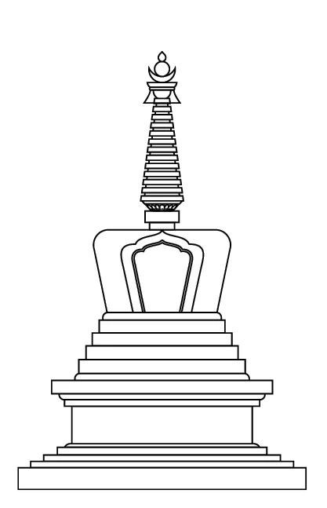

# 根登群佩修行教言讲解

根登群佩尊者·造论

索达吉堪布·译讲

今天给大家讲一下根登群佩的《修行教言》，也就是《勤修精藏胜妙法》。这个教言是我在以前翻译《释尊广传》期间翻译出来的，但是没有得过传承。根登群佩很多著作的传承，藏地的堪布得的都比较少，可能也有一些，但我不是特别清楚。

《修心八颂》和《胜利道歌》传承

今天首先给大家念几个传承，一个是朗日塘巴的《修心八颂》，还有就是法王如意宝的《胜利道歌》，这是两个很有代表性的教言。

（堪布念《修心八颂》《胜利道歌》传承）

《修心八颂》只有八个颂词，但是内容很深，所以希望大家好好思考一下其中的意义。我们可能都会念诵，但里面有些内容行持起来还是比较难的，可即使再难我们也要去修，因为我们毕竟是学习大乘佛法的修行人，遇到一个难题就绕路而走，这是不合理的。

法王如意宝的《胜利道歌》有外内密的很多不共缘起。如果我们经常读诵，比如在开学时，或者任何事情开端时念一遍，就可以从一切邪魔外道的违缘中获得解脱。你们自己如果准备做一件新的事情，可以先念一遍《胜利道歌》；做事遇到瓶颈的时候，也可以念诵，因为这实际上是除障的一种缘起法，非常有意义。

我自己事情做得不太顺的时候，就会念《胜利道歌》；在一件事情开端的时候，为了表示一种缘起，也会念一遍。这种缘起的力量是非常不可思议的。

在这个世界上，不管是出家人还是在家人、世间法还是出世间法，为什么有些人做事非常圆满、成功、顺利，有些人则处处碰壁，即使很小的事情也难以成办，其实这背后有非常复杂的因缘。如果因缘具足，做什么事情都很容易成功。

我们作为修行人，必须承认这种因缘和合，其中最深的叫缘起法。所以，我们一方面要经常祈祷自己的传承上师、护法神，以及自己平时依止的一些法；一方面如《胜道宝鬘论》中所讲[^1]，要经常通过念诵经文和仪轨来依止一些缘起法，这很重要。没有信仰的人可能不以为然，但其实世间万事万物都有非常强大的缘起力，所以我们想要成办任何一件事情，都要依靠甚深缘起。

法王如意宝的《胜利道歌》不仅是一个涵摄三乘的殊胜教言，更是一个让我们做任何事情都能超越违缘、得到胜利、如愿以偿、梦想成真的窍诀。大家平时在生活和修行当中，包括做一些世间的平凡小事时，都应该依靠这个窍诀，我觉得其中确实有不共的因缘。

以上我简单介绍了一下这两个教言的意义。

《修行教言》的作者

今天我们讲根登群佩的教言《勤修精藏胜妙法》，我们在这里简略地称为《修行教言》。

有些修行人可能不一定知道根登群佩，但学术界对他比较熟悉。他是藏族一个非常了不起的传奇人物。他住世时间不是很长，只活了49岁，大概是1951年圆寂的，比较年轻就离开了这个世间。但是在这短短的49年里，他在许多方面都留下了一些非常珍贵的教言。

世间人给根登群佩贴了很多不同的标签，认为他是一个旅行家、画家、史学家、政治学家、社会学家，一个浪漫主义者，一个成就者。他去过斯里兰卡、印度、尼泊尔等地，当时正值第二次世界大战爆发之时，整个世界都比较动荡，再加上他的盘缠有限，所以一直靠画画挣一点钱来做路费、学费。他就是这样一个非常奇特的人。后人对他的研究众多，说法不一，我们今天不从史学家、文学家、旅行家这些角度来分析他，而是从一个修行人的角度来学习他的教言。

从修行层面来讲，他的境界确实非常高，这一点通过他留下来的一些作品可以看得出来。他的著作不是很多，但他留下来的许多教言都非常深，很有吸引力和加持力。

我们学院很多堪布都特别喜欢他的教言和著作，比如他在监狱里写的《牢狱道歌》；还有由他讲授、弟子记录的《龙树密意庄严论》，我刚刚来学院的时候天天读，里面有很多中观的不共见解；历史方面他著有《白史》，但没有写完；还有游历亚洲佛国的《游国记》，包括他对尼泊尔、斯里兰卡以及藏地古代文化的一些研究。当时他和英国好友罗列赫教授将《释量论》翻成了英文，但是现在好像找不到这个英译本。他还将《法句经》的部分内容翻译成了藏文。

根登群佩的一生是很神奇的，他走到哪里都带着纸笔写下游记。以前和法王如意宝一起去印度的时候，我也参考了一些他描写印度圣地的资料，比如这个城市到那个地方路程有多远，火车票是多少钱……每一处都写得非常细致。但从当时到现代，印度许多方面都有了很大的变化，有些内容不太适用了。

他的确是一个很了不起的人，所以全世界很多学者都在专门对他进行研究。有些博士生的论文就是关于他，我们在世青会的时候就遇到了很多根登群佩的研究者，因为他确实比较出名。人们都喜欢追逐名人的思想，好像研究了以后自己也会出名。当然，我们今天并不是为了出名而学这个教言的。

根登群佩的身份比较特殊。他出生在青海热贡，最初学习宁玛派，后来又去格鲁派的拉卜楞寺、哲蚌寺等地求学，他的辩论也非常厉害。然后他去了印度，后来回到拉萨后被关押入狱，大概关了三年。

据说有一位学者采访过根登群佩的妻子，名叫玉珍，还说他有一个女儿。根登群佩在监狱期间，还认识了另外一个叫玉珍的女子，他们两个离开监狱时，根登群佩告诉弟子：“玉珍需要什么都让她带走。”就把当时仅有的一些财物给了她。后来这个玉珍到了拉萨，别人问她在监狱里认识了谁，她说：“有一个叫根登群佩的人，对我很好，应该是个乞丐。”据说这个玉珍也寄过一些酥油之类的东西给根登群佩。但是他的妻子在采访时并不承认这些，她说：“在根登群佩的人生中只有我一个玉珍。”当然，后人对根登群佩的描述也说法不一。

总而言之，根登群佩是一个非常了不起的修行人，在他圆寂之时，要求弟子念了一遍《缘起赞》和《文殊大圆满愿文》，然后就离开了人间。他留下的修行教言，虽然文字不多，但的确是一个大成就者的金刚语。我们对于他身为艺术家、画家等方面的才华并没有如何留意，而是特别欣赏他内在的证悟、洒脱和自在。这一点是根登群佩与其他所谓的名人不同的地方。

所以，我们今天就来了解一下他的教言。他在对未来的预知、对现代社会的洞察等方面，都有与众不同的观点和一种前瞻的睿智。他对未来社会经济变化、政治动荡等诸多方面都有清晰的洞见。所以，在当时那个特殊时代，他的一些文章和言论是相当尖锐的。这些我们在这里就不多讲了，你们有信心的话可以自己看他的传记。现在中外对根登群佩的研究资料都非常多，我也看过一些翻译过来的研究。不过，一些没有佛教专业背景的人，在对佛教的教言进行翻译和解释的时候，有些地方不一定符合根登群佩本人的密意。

他自己有很多非常特殊的教言，我这里就不多说了，不然今天这一个小时全要用来介绍根登群佩，你们有兴趣可以自己看。当然，如果要讲根登群佩的话，我知道很多他比较私人的故事，以前我们学院里很多堪布也喜欢研究根登群佩的教言和生平。

现在就开始讲《修行教言》。

依彼永时无有欺惑者，怙主三宝大悲之妙力，

无义轮回迷现息灭已，祈祷加持心趋入妙法。

首先是祈祷三宝让法融入心。意思是说，三宝永远没有欺惑，依靠三宝可以让我们真正离苦得乐获得解脱，怙主三宝的大悲加持妙力，能让无意义的轮回中可怜众生的迷乱显现，在很短的时间内全部灭尽。在这样的三宝面前进行祈祷，希望三宝的加持融入我们的心，让我们的心融入法。

就如无垢光尊者《四法宝鬘论》中所讲，先要让心趋入法，并让法融入道，然后断除道的一切障碍，最后将障碍转为道用，破迷开悟。所以，要经常祈祷上师三宝，这样我们的心一定会融入法，这是特别重要的事。

如何思维尘世之琐事，无有芝麻毫许之实义，

短暂此生心当急剧转，虔诚勤修精藏胜妙法。

不论我们怎么思考，世间的琐事其实连芝麻许的实义也没有。一切荣华富贵、灭敌护亲、积累财产、增上名声，这些都没有实在的意义。所以，在短暂的此生，我们的心当下应该改变。怎么改变呢？应该虔诚、尽心地修持精华的、秘密的、如宝藏般的殊胜正法，就像出离心、菩提心、无二慧、大圆满这些法义。

人生就像被世间八法拉动的一辆车。一旦我们认识到，世间很多事情其实不论从长远还是当前来看，意义都不大，这个时候就产生了出离心，人生的车辆就应该马上转弯，好好修持正法，不再迷乱。

妙龄韶华宛如夏日英，昳丽娇容瞬若冬时虹，

此生寿数短促不久长，今当勤修精藏胜妙法。

我们的青春是无常的，妙龄韶华如同夏季的鲜花一样美丽，但昳丽娇容瞬间变化就像冬天的彩虹。彩虹在夏天变得很快，在冬天更是一瞬间显现，马上就消失了。也就是说，我们的青春变化飞快，就像夏天的花一样，只盛开几个月，到了秋天就没有了。

世间的花无百日红，很快就会枯干、凋谢，我们的容貌也是如此。有些老年人拿自己年轻时的照片让我加持，我一看，原来那么好看，现在怎么老成这个样子？边看照片边看他，想一想，人生就是这样的。

虽然我们年轻的时候有些很漂亮、有些不那么漂亮，但总体来讲还是比老年人好看得多。现在一些软件可以把人的照片变年轻或变老，我有一次也特意玩了一下，看看我十年、二十年前是什么样的，好像基本上还是这个样子。（众笑）

我们此生的寿命非常短暂，不会长久，这个人身确实是无常的。现在整个世界都觉得年轻很重要、美貌很重要，但实际上，有一颗善心、菩提心更加重要，这是一种永恒的美。如果你的心很善良，即使老了，看起来也特别的可爱、慈悲；如果人心不那么善良，即使外相特别美丽，也没有什么实在的意义。

想靠美妙的外貌来提升自己真正的价值是很难的，因为谁都逃不过无常。我们应该懂得人生的真相，这才是最重要的。《集法句》中说：“上日见多人，下日有不见；下日多见者，上日有不见。”上午见到的很多人，有些下午就已经不见了；下午见到了很多人，有些第二天上午又不见了。他们到哪里去了呢？也许永远离开了这个世界，这个时候容貌也好、青春也好、韶华也好，什么都已经荡然无存。

所以，真正对我们具有永恒利益的是修持正法。佛教中特别注重在拥有人身之时，要真正让人身具有意义和价值。一方面自己不要堕落，认真修行；另一方面要利用这个人身，哪怕在短暂的时间中帮助别人，这就是人身的意义、活着的意义。好好修行，利益众生，这是最重要的。这是关于我们人身青春无常的一个教言。

苦时希求幸福之良方，悦时担忧愁苦之临降，

永无逃离希忧险关时，今当勤修精藏胜妙法。

下面是关于苦乐、希忧方面的教言。人在痛苦的时候总是希求幸福的良方，比如我们生病时总想快点痊愈。有些人生病的时候，即使起不到作用也会吃很多药，喜欢吃药的人身体肯定不大好，身体稍微好一点时连药瓶都不想看见。所以，我们在痛苦中会自然而然希望得到幸福，贫穷的时候很想有钱，关在监狱里的时候很想得到自由，饥饿的时候很想吃饱；而当我们愉悦、快乐的时候，又担心忧愁痛苦会降临到自己头上。

人们总是活在这种患得患失、忐忑不安、希忧不定的状态之中，也就是“永无逃离希忧险关时”，我觉得确实如此。很多人快乐时害怕痛苦降临，痛苦时希望得到快乐。有些人做企业，实在经营不下去时，还一直扛着，“我应该还有希望，努力再扛几天应该就可以了！”等到比较成功的时候又特别担心危机出现、网络黑子之类的事。所以我们的人生随时处在希望和担忧之中，如果一直这么下去，确实没有什么实在的意义。人生真正有意义的，就是平息一切喜怒、得失。就像《入行论》中讲的“何有得与失？”“苦乐由何生？”当然，这是证悟法无我时的境界，对于我们现在来讲可能有点困难。

如果做不到这样，也可以像西方人所说的“与希忧共舞”，与希望和担忧共同舞蹈、共同相伴，这也是他们喜欢用的一种方法。有希望也好、有担忧也好，不管怎样都随缘，命运当中出现什么就接受什么。如果对自己和众生有利，苦多一点也可以；如果快乐的话，也不要太去执著，这样修行反而会减少痛苦、增长快乐。

这个教言确实说中了现代人的心态，苦的时候希望解脱痛苦，乐的时候希望绵绵不断，但实际上这是不可能的。我们每个人的人生苦乐都是此起彼伏的，就像弯弯曲曲的道路一样，并不能完全确定。人生之中有苦肯定就有乐，有乐肯定会有苦，所以我们不能一遇到苦就特别伤心，“啊，我太倒霉了！太不幸了！太不顺了！”乐的时候又开始产生傲慢，这样是不合理的。因此，我们应该好好修持菩提心、出离心、无我这些妙法。

珍爱护持疾病沉疴因，修饰装扮不净之本性，

无常之身无丝毫实质，今当勤修精藏胜妙法。

下面讲我们身体的无常。不论怎样珍爱这个身体，用衣服装扮、用美食喂养、用各种方法来保护，其实这个身体也是各种疾病、疼痛、违缘的因，就像人们讲的“臭皮囊”。

《中观四百论》里说“人苦从身生”，人的大多数痛苦都是依靠身体而产生的，身体就是各种疾病的因缘。我们不管怎么去修饰、装扮它，实际上它的本体都是不清净的。现在的人们在身体上用着各种整形、美容方式，用着各种品牌的护肤品、香水，但再怎么样，这个身体里面实际是些什么东西组成的，大家都非常清楚。如果不太清楚的话，可以到尸陀林去看一看，马上就可以知道：“哦，原来我们所爱的身体是这个样子的！”那个时候，就会明白我们身体的本体面目了。

无常的身体其实并没有丝毫的实质。《中观宝鬘论》《入菩萨行论》等很多书中讲到，我们的人身其实是由不净物组成的，只不过人们喜欢凭借一些表面的赞美去执著，实际上一个人的身体不管好看还是不好看，本质上都是一样的。寂天菩萨也讲过，身体本来是伤害自己的利器，人们却特别努力地修饰它，让它不断变锋利[^2]，其实这有什么用呢？“自迷痴狂徒，呜呼满天下！”世间之人那么愚痴，本来是不清净的、由三十六种不净物组成的骨肉架构，却要修饰、美化、赞扬它，这样的确非常可笑。

影视中经常赞颂人的皮相：这个人头发多么好，皮肤多么嫩……但如果这些影视反过来拍里面，将人身体内部的真相暴露出来的话，那很多人可能要“过午不食”了（众笑），甚至一两天都吃不下饭。很多道友去了尸陀林，当天基本上都不太想吃饭，因为秃鹫吃血肉的场面一直浮现在眼前。

现在全世界的媒体都为了种种目的，把我们身体比较好的一面拿来修饰、赞扬，展现在世人面前。其实真正用一些佛教的分析方法来看，这个身体是非常不清净的。佛教并非要把它刻意丑化，当我们用公正的智慧来观察和分析时，不得不承认这是有道理的。

虽然人们都喜欢打扮自己的身体，对它特别重视、珍爱，但它也只能维持几十年，仅此而已，几十年后再好的身体也好不到哪去。

这是关于身体方面的教言，下面讲财富方面。

大亨身处富位尚抱怨，穷汉身处贫地也呻吟，

每人皆为痛苦包袱累，轮回之中永无愉悦时。

富翁身处富位的时候也总是抱怨，穷汉身处贫地的时候也一直呻吟，每个人都有痛苦的包袱，一直被压得特别累，喘不过气来，所以整个轮回中没有任何快乐的时候。

有些人可能会想：“怎么没有呢？有钱、有地位肯定就会特别快乐。”没有经过详细观察的话，似乎是这样的，但实际上只要真正去观察，富翁在他的位置上也会发出哀号，穷人在他的位置上也会发出呻吟，每个人心里其实都有很大的痛苦。

就如《中观四百论》所说：“胜者为意苦，劣者从身生，即由此二苦，日日坏世间。”在这个世界上，一些有能力的上层人物，身体方面可能不像工人农民那样受苦受累，但是心里的痛苦很严重；而有一些处于低位的人，他们遭受的更多是身体上的痛苦。总之在这个世间，身苦和心苦一直折磨着我们。

这句话很有意思，大家应该思考一下。没钱的人总觉得那些有钱、有地位、长得好看的人肯定很幸福，但实际上如果你真正接触这些人，会发现他们其实也特别伤心、特别痛苦。穷人的话就更不用说了。所以，每个人心里都有痛苦的包袱。弥勒菩萨这样讲过：“五趣之中无安乐，不净室中无妙香。”人活在这个世间，还是痛苦更多一点，如果你们不相信，可以去了解了解。

我去非洲的时候感受很深，当时我特意问过一些非洲人，他们的痛苦跟我们的痛苦基本上是一样的，比如在他们自己的位置上，同级之间的人也会互相嫉妒。我问了一个老太太，最大的痛苦是什么？她说他们的领导特别不公平，她家的女儿如何如何……有很多问题跟我们是相同的。老百姓有老百姓的痛苦，上层也有上层的痛苦。当地的一些领导也抱怨他们的国王，抱怨他们的处境，虽然他们的事业相对广大一些，但也照样有痛苦。

真正的修行人，贫穷也好、富贵也好，内心和身体都没有严重的痛苦，这一点我们可以看得出来。不依靠外境，通过内在的证悟得到的快乐，才是真正的快乐。这一点大家也可以思考一下。

总之外境苦乐之显现，皆为自心奇特之幻变，

内心影像如实而外现，外之显像非能入内心。

总之，外境的种种苦和乐的现象，都是自心的一种奇特变化，实际上是内心影像如实显现于外，而并不是外在的现象入于内心。这就是“万法唯心造”的意思。我们的苦和乐全都是心的一种幻现、一种变化，就像镜子里照出各种各样的影像，这些影像并不是外面的色法进到了镜子里，而是镜子在因缘具足的时候，影像自然显现出来。所以我们的苦和乐，实际上只是依靠外在的一些因缘，让自己内在的感受展现出来了而已。

麦彭仁波切在《君规教言论》中讲过：“愚者认为诸苦乐，皆从他缘而产生，恒时散于取舍境，贪嗔浪涛杂念中。智者了知诸苦乐，悉皆来源于自身，恒时向内观自心，审视自己不放逸。”苦和乐，愚者认为是外在的因缘产生的，然后不断地产生贪心、嗔心，就像大海的波涛一样此起彼伏、不断涌现。智者认为痛苦和快乐是自心的一种外现，所以智者会通过内观让自己不放逸。

我们有时候会看到一些条件特别好的人，心中还是充满痛苦，因为富贵的人要求总是很高，包括孩子读书，一般的幼儿园、小学、中学都不行，他们的标准越高，压力就越大，这样也是很痛苦的。

我们内在的心外现的时候也会有很多的痛苦。大家都知道，现在这个世界上，很多人遵循的标准并非源于自己的本心，而是来自公共社会普遍认可的一种标准。比如影视剧中经常塑造一些最好的妈妈、最好的丈夫、最好的妻子形象，很多人就认为：“好的妈妈应该像某个电影里那样对孩子，我的妈妈并没有做到，她真是很差。”然后就对自己的母亲恨之入骨。有些人对比了电影里的好丈夫，“噢，丈夫就该像他那样才好，我的丈夫根本不如他，真可恨！”很多问题就是这样产生的。

很多人都追求一种外在的标准，正因为这种标准，自己的定位常常与大众的定位无法平衡。媒体为了吸引眼球会做种种策划，包装出一些大众流行文化，展现在人们面前。比如一部电视剧特别火爆，一段时间内整个社会的价值观都会受到它的影响。很多时候，我们自己的家庭、婚姻、生活、修行，完全跟不上外界的风潮，很多人都因此焦虑、抑郁，产生很多痛苦。

所以，作为一个修行人，有时外在的一些现象对我们也会有影响，会起到一种外缘的作用，但最根本的是自己的内心。如果我们的内心非常淡定、明智的话，外在的现象就不会给我们的内心造成很大的波动。

这里讲的教言其实很深，后面还会讲到一些中观和大圆满的内容，一些初学者也许听不懂。但有时听不懂也有好处，“哇，连我都听不懂，这法应该很好！”如果你们听得懂，也许就会觉得“这有什么可听的？”（众笑）

通晓彼等如理而思择，心根阿赖耶之断绝时，

迷乱现境雾霭烟云外，真实具足法性义虚空。

我们刚才讲的内外的关系，通过如理抉择以后会知道，其实一切苦和乐的根本就是我们的这颗心。心的根本就是阿赖耶，阿赖耶如果断绝，在所有像雾霭烟云般不真实的、迷乱而显现的外境之外，真实具足如虚空般的法性真实义。

意思就是说，当你真正认识到自己心的本性时，世间所有苦和乐其实并不真实，都是阿赖耶中的迷乱显现，就像虚空中出现各种各样的雾，一旦这些雾霾全部消失，虚空就会直接显露。

当所有外在的苦乐全部消失之后，我们内在法界的自然本智和觉性，也就是这颗心的本面，其实就如同虚空一般。我们经常说“如虚空般的心性”，心的真正本性就是这样。如果有一点大圆满、大中观的见解，当你安住于虚空般的境界时，原来世间种种像云雾般苦乐不定的波涛全部会消失。

所谓之有假立非真实，所谓之无亦具虚幻性，

心性本为圆满正等觉，不被彼等假立所沾染。

所谓的“有”是假立的、非真实的；所谓的“无”也是假立的，是虚幻的、不真实的，心性本来就是圆满正等觉，不被“有”和“无”的假立法所沾染。

“有”实际上是不真实的。萨绕哈巴尊者说过：“执有众生迷，执无更愚昧。”我在“索达吉藏文化”微博里发过这句话。执著为“有”是众生的迷乱，执著为“没有”则更是愚痴。我们所谓的“存在”或“有”，一个一个分析时，实际上都不成立，“有”不存在的话，“无”又在哪里呢？执著“无”更是愚昧。所以，一切假立法在我们本来正等觉的心性中都没有，“有”也没有，“无”也没有。

没有修过中观的人也许很难理解这个道理，“有也不是，没有也不是，到底是什么意思啊？”“有就是有，无就是无，哪有这样的？”在我们迷乱的心前，“有”和“无”好像都是存在的，但是真正用智慧来观察的时候，“有”的一切最后都是不成立的，都变成了无有；那如果“有”不存在，观待它的“无”也就不存在，因为有和无是互相观待而成立的，就像左和右、东和西一样。

我们从小习惯实有，总认为“有的、有的”，但实际上，通过佛教的一些观察方法，最后“有”也不存在，“无”也不存在，“有”“无”全都是假立的。离开这一切假立法的染污，就是我们心性本来的面目。正如《六祖坛经》中“不思善，不思恶，正恁么时，哪个是明上座本来面目？”也不是善也不是恶，也不是有也不是无，也不是好也不是坏，真正通达这种平等心的话，这就是你的本来面目。

我们讲密法和中观的时候，有些人也许真的能对自己的心有所认识。因为如果是“有”，那么如来都未见到实有的法，所以不可能真的有；如果是“无”的话，那一切轮涅的基础说没有也不对。有无二者是完全互斥、相违的，除此之外有没有其他呢？语言没办法说，分别心也没办法思维，这就是“不可思议”。所以，我们要明白，法的本性就是不可思议的。这一点，按照荣索班智达的说法，就是要安住在大正知的器中摄持，这就是大圆满的修行。

是非妄念如水之涟漪，频频泛起此等之众生，

无缘之中自然安住时，趋至法界本始之大海。

是、非等妄念就像水的涟漪、波涛一般，这些妄念纷飞、念头此起彼伏的众生，如果安住于无缘的自然禅定、一切无别的境界中，就是趋至法界原始的大海。

水在山谷流淌时不断“哗哗”作响，泛起波纹，而一旦汇入大海，所有的波涛、涟漪就都没有了，只有大海本身，无比平静、无比广阔、无比美丽。我们的心也是同样，现在总是一会儿哭、一会儿笑，开心时就像天人一样，痛苦时就獠牙毕露。有些人哭起来嘴也歪了、鼻涕也流下来了，眼睛里不单流泪，都快要泣血了，就像魔鬼一样吓人。

这样苦乐不定的波纹，一旦真正融入了大海，也就是证悟如来觉性的时候，那就无苦无乐了。那时候就像济公和尚之类的大成就者的境界，生活中哪里还会有不平？哪里还会有痛苦？

根登群佩在牢狱之中留下了很多道歌，无垢光尊者也是在被寺院开除的时候写下了厌世歌。其实我们藏传佛教中很多高僧大德都曾以种种因缘被开除、被关进监狱，但他们还是在这样的境界中唱出了大圆满的平等之歌，非常奇妙！世间也有很多这样的经历，都是很精彩的！

所以，我们修行之人不要对世间太过执著，虽然我们现在还达不到像大海一般无苦无乐、没有分别念波涛涌现的境界，但我希望大家在人生当中不论遇到什么样的境况，都要能够接受，不要抑郁、焦虑、痛苦、自杀。人生当中有些事情确实很难，但也没什么想不开的。我们好也好不到哪里去，因为还身陷轮回苦海当中；坏也坏不到哪里去，反正人生也很短暂。所以我们应该以正面的心态来看待生活。

总之境现乃为心幻化，心则本空无基而离根，

无基之法执为我所故，汝吾长时漂流轮回中。

总之，境现是心的幻变，而心的本体是空性的、无基的，远离一切根本，但是很多众生对无基的法执著为我和我所，所以你我一直在无边的轮回大海中漂泊。

从究竟意义上讲，一切都是自己心的幻化，心也是本来离一切戏论的。可是大多数众生确实有“常乐我净”四种颠倒，执著我和我所，于是无始以来都漂泊在轮回之中。如果现在我们还不去认识自心、还不去好好修行，将来漫长的时间中还要不断继续漂泊。所以，我们现在既然已经值遇了大乘佛法，在今生当中该忏悔的要忏悔、该念诵的要念诵，临死的时候清清白白、舒舒服服地离开，也许以后就不需要再流转到轮回中了。

不管怎么样，轮回确实是很苦。很多人觉得：“佛教怎么说得那么悲观？我是个乐观主义者。”可有些乐观主义的人，在病的时候、穷的时候、沦落的时候乃至最后死的时候，也哭得很厉害。人不可能永远都乐观。所以我们应该明白这样的规律，即生当中最好认识自己的心性，即使不能认识，也要打好一个基础。

我们现在的因缘是非常好的，在茫茫人海中遇到了解脱法门，我认为特别难得。如果错过了一点点因缘，就擦肩而过了，也许你永远都不可能得到解脱。所以，既然我们因缘具足遇到了这样的大乘佛法，最好在即生当中不要退失信心，一旦退失信心，那是最可怕的！我们哪怕修行稍微懒惰一点也不是太要紧，但如果产生邪见、退失信心、永远抛弃佛法，那就是你一生最大的损失。

有些人说“我失恋了，失业了，失败了”，从我的角度来看，这些虽然比较可惜，但也许通过这种机会能让你重新回到本位，这也是有意义的。

我从小在信仰三宝的教育中长大，我一直认为，只要信心坚固，出家人也好、居士也好，哪怕不那么精进，但只要一直保持这样，都是很好的。我想，依靠法王如意宝的加持力，凡是“圆”字辈的人，今后道心应该都不容易退。有些上师起名确实有一些缘起力，清定上师的弟子中很多法名都带有“智”字，后来这些道友，不论是出家人还是在家人，道心好像都不容易退，也许有这方面的缘起。我希望大家道心永远不要退，这是很重要的。

自此当不追随外境转，无散直视自心之当下，

现见无可言说心自性，则获佛果道路不遥远。

不要追随外面的对境，应该无散地直视当下自己的这颗心。也就是说，不去求心外的法，而是反观自己当下的这颗心，这样的话，就能现见不可言说的自心的本体，最后离获得佛果的境界就不遥远了。

《中观根本慧论》是这样说的：“诸法实相者，心行言语断。”真正的实相实际上是无法用语言来描述、用分别念来思维的，这是真正的开悟。

我在这里也想提醒大家，不要经常往外面到处跑。我们学院的道友，最好不要把那些刚刚初学的人今天带到这里，明天又带到那里，这样没有必要。如果你个人想去拜见某位上师是可以的，但如果你组织别人去的话，会有一定的危险性的。一是现在交通等很多方面都不安全，再者，一些所谓的善知识也是需要观察的。我们的建议是，不管在道场中、学会中，个人要到哪里去、要依止哪一位上师都是自由的，但有组织地行动，影响到别人的学习和修行，这样就不值得赞叹。尤其不要在放生、法会等各种场合搞这类宣传。我个人也是这样的，我的任何法讯都不要在其他道场、寺庙中宣传。他们有自己的组织、自己的团队，我们在那里宣传，对别人不是很尊重。

所以，我们的心往外散、往外求不是很好，应该当下对照所得的教言，看看能不能当下认识自己的心。法王如意宝以前讲过麦彭仁波切的一个教言，叫《老狗吐金》，是密法中直观自心的大圆满窍诀。法王当时讲得特别好，应该是在南山讲的，有些老道友可能有印象。

里面讲道：“外观百法，不如内观一法胜。”我们与其在外东奔西跑、到处云游，不如自己在一个坐垫上好好修行；与其追求外面世界上的白红蓝各种法，不如自己当下内观。就像无垢光尊者《三十忠告论》所讲：“心生分别之时直视要，已得定解之时安住要，修行安住无修是为要，修习无散即是吾忠告。”这非常重要。

希望大家当下就要修行，你已经得到了法，自己就该去修。否则再怎么乱跑，最后也得不到什么，反而可能产生各种邪念邪见，有这种危险性！

依彼三根本尊之加持，愿能迅速证悟大空性，

获得本净大圆满王位，利益无边无际之众生。

依靠三根本，也就是上师、本尊、空行的加持，希望我们能够很快得到大空性、大圆满、大般若的证悟。

我们大家也同样发愿：希望上师、本尊、空行三根本加持，比如上师莲花生大士、本尊文殊菩萨、空行母益西措嘉或作明佛母等等，通过他们的加持和垂念，让我们尽快断除实有的执著，通达万法本性为空性的般若波罗蜜多，获得本来清净的大圆满王位，利益天下无量无边的众生。这就是我们共同所发的愿。

以上文字，乃由漂泊者根登群佩为虔诚趋向善法之卓玛央宗而造。

根登群佩经常称自己为“漂泊者”，以上文字是他为虔诚趋向善法的卓玛央宗造的。

卓玛央宗是一个居住在印度的藏人，当时根登群佩好像在她家中待过一段时间，有些历史学家说卓玛央宗家里保存着根登群佩亲手画的画。根登群佩的画作在当今世界上很受重视，他的作品包括山水画、人物画、肖像画，有一种特殊的风格。据资料介绍，卓玛央宗是个商人，她丈夫是一个英国人，这个教言是根登群佩应她的祈请在印度写下的。当时是上世纪40年代，在印度的藏族人应该比较少，这个教言就是那个时候写的。

在我们藏地，这个教言非常有名，很多大德经常引用其中的片段。希望这些短短的教言，能让我们每个人在生活中、修行中有所收获。

我今天是将根登群佩作为一位修行者、证悟者、成就者来介绍给大家，这和世间很多人对他的介绍方式完全不同。我们佛教徒，应该从这个方面来理解才更有深度。

[^1]: 《胜道宝鬘论》：“应当依止有益自他之物、妙药、咒语与甚深缘起法。”
[^2]: 《入菩萨行论》：“长发污修爪，黄牙泥臭味，皆令人怖畏，躯体自本性，如伤己利刃，何故勤擦拭？自迷痴狂徒，呜呼满天下！”
