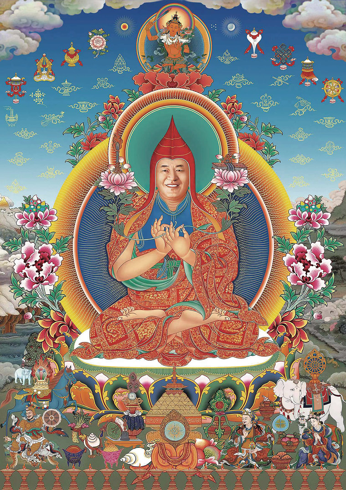

# 上师瑜伽持讲解

法王晋美彭措·造论

索达吉堪布·译讲

2023年12月28日

今天是共修第五天，后面还有两天，这个过程中，大家都非常努力。在法王如意宝示现圆寂二十周年的特殊日子，大家来到喇荣参加这场法会，非常不容易，但也特别殊胜，我想在座各位应该都非常欢喜，法喜充满。

最初我计划给大家讲讲上师瑜伽或者发菩提心的功德，但因为“天气”不太好，就暂时取消了。今天“天气”又稍微升温，所以就给大家安排了这一堂课。我不会耽误很长时间，大家全天念修已经很累了，明天一早还要继续念，我要是占用你们太多时间，也不太合理。

首先，我想跟各位简单讲一些道理。在座听众的水平可能参差不齐——有些人已经学佛多年，长期修行，有了一定的境界；有些人要求今晚做个皈依，这说明他们应该还是刚入佛门的初学者。近四十年来，我不管讲经说法也好，空磨嘴唇也罢，一直在给大家不断地讲这个、讲那个，现在我算是已届晚年，以后还能讲多长时间也不好说。同样，你们的寿命也是无常的。所以，这次大家能参加这场非常殊胜的共修上师瑜伽、忆念上师功德的法会，确实是千百万劫中极为难得的机会。续部中讲“何人俱胝劫，修十万本尊，不如一刹那，忆念上师胜”，在千万劫中修十万本尊，也不如一刹那间忆念上师的功德殊胜；“念咒修法千万遍，不如祈师一遍胜”——念咒语、修祈祷千万遍，也不如祈祷一次上师的功德超胜。通过这些教证来推理，这次大家日日夜夜念修的功德是极其难得的。

当然，在这次求法过程中，大家也吃了不少苦。很多人想尽各种办法才来到这里，每个人都有非常精彩的故事。有的人徒步十几个小时，有的人坐车，有的人坐摩托，有的人骑马，有的人爬山，有的人穿过森林，有的人钻污水管，有的人越过“铁围山”——翻铁丝网，还有人花钱通关，给了几千甚至上万。大家通过各种各样的方式来到求法之处，相信每个人都能求得正法。这些苦行在历史上也有不少前人经历过，在如今也不是没有——为了修行，为了求得上师加持，一切付出都是值得的。

我们在世间曾毫无意义地花天酒地，也曾千辛万苦地打拼谋生，为了感情，为了地位，为了名闻利养等世间八法，从无始以来直到现在，自己最珍贵、最有价值的东西，也舍弃过不少。相比而言，我们为了求得正法，经历一些苦行是很有意义的。现在这样的苦行，虽然无法与前辈高僧大德们的求法经历相提并论，但是大家经过种种努力，最终得到了最为难得的东西，自己也该感到尤为珍贵。世间当中也是如此，越是稀少的东西才越有价值。大家也知道，这次共修差点被取消。虽然我们只是共同祈祷、怀念一下二十年前离世的一位老人，并没什么可怕的，也没什么好紧张的，但有时候因缘也不尽如人意。在这个特殊的寒冬腊月，很多东西都容易冻结，我们的一点鼻涕、口水落到地上，都有可能变成冰块。在无常之中，我们还能继续活着、继续呼吸、继续持咒共修，这其实是非常幸运的事情。

在座各位这几天都比较辛苦，因为要从早到晚念诵，但从另一方面看，这种辛苦也不算什么。很多法会都要更长的时间，比如念《大藏经》传承，或是汉地的打佛七。藏地有些法会从早上四五点开始，一直持续到晚上十点才能休息。参加这次为期一周的共修，不少人感到十分疲劳，累得躺在地上不想动。要是身体素质本就不好，又加上高原反应，如果心力薄弱，确实容易遇到一些障碍，但如果我们心力够强，身体状况也还行，把这几天的共修坚持下来，也并不是特别艰难的事。在我自己的求法经历中，也有过没有住处、没有饮食、没有铺盖的情况。过去一些高僧大德外出传法或灌顶的时候，一切资具都要自己携带，除了随身的一点糌粑之外，没有其他食物，甚至连栖身的帐篷都没有，然而他们对食宿毫无要求，一切全靠自己解决。相比而言，我们学院多年以来，一直在给各地来的求法者提供接待服务。当然，我们的发心人员和志愿者给予的服务，不一定能满足所有人，尤其是那些喜欢挑剔、爱生邪见的人——这种人总是看到别人的毛病和过患，而对于更多的优秀之处和清净的菩提心，却不一定看得到。不管怎样，大家能在如此殊胜的纪念活动中，勉强安置下来，有吃的，有喝的，有共修的机会，确实很不容易。你们中有些人也许习惯了优越的生活，从没体验过与这么多陌生人一起打地铺、一起吃斋饭，但是为了求法，这些苦行都是值得接受的。

在这里，我想代表学院的僧众、居士，以及外来的信众，向学院所有发心人员致谢。他们在这次法会中，给大家提供了住宿、饮食、安保、卫生等里里外外各方面的服务——很多事情你们也许不了解，你们从小在父母温暖的怀抱中长大，已经习惯一伸手就有吃的、有穿的，也许不知道背后需要多少付出。事实上，我们举办这场法会，因为无法名正言顺地提前公开准备，也没有容纳这么多人的场地和环境，所以学院里很多道友只能暗地里偷偷摸摸地给大家提供服务。他们也是人，在这样的寒冬里也会冷，也会有高原反应，但他们不顾一切，在外面对大家进行保护，在内部给大家安排吃住，虽然不一定能百分之百令你们满足，但他们为了提供这些服务，已经倾尽了全力。在这么殊胜的时刻，他们宁可放弃自己念诵和修行的机会，也要保证你们安安逸逸地修持下去。所以，大家应该知道这有多不容易。

我自己这次没有福报在学院与大家一起参加法会，但是在遥远的地方也了解到了一些情况，所以特别随喜学院的发心人员。要知道，服务这么大的群体意味着什么——通常举办一场百十来人的活动，背后都需要很多复杂的准备工作，哪怕只是组织二十来人参加一场为期数日的共修，也要解决吃喝拉撒等各种问题。这次依靠三宝的加持和道友们的付出，现在我们的共修已接近尾声，这个过程中每个人都尽心竭力，所以我要感谢所有发心人员，感谢负责的堪布、堪姆，他们从大局上做了很多工作，如果没有他们的努力，这次法会恐怕很难圆满。你们也许不知道，很多人为此在精神上和其他方面扛了多大的压力，比你们经历重重艰难来到这里还要不易得多。

这次怀念上师如意宝的共修即将圆满，我希望大家在接下来的两天里，继续把剩余的念修完成。在修行过程中，你们一定要争气。我看到绝大多数人都很珍惜这个机会，一直在努力地念修和祈祷，但也有个别人，可能陷于习气和烦恼，来到了如此殊胜的圣地还不好好修行——有的人没有时间观念，有的人不知是太累还是高原反应，一直躺着、靠着、睡着。虽然同样参加了共修，可最后每个人得到的修行成果却差距很大。所以，我希望大家珍惜后面这几天，一定要好好发愿和回向，以后还有没有这种机会，是很难说的。你们可以这么想：“这可能是我最后一次来学院参加共修。”这样想也许对你们有好处，这也是观无常的一种方法。确实，从现在里里外外诸多环境的约束来看，以后要举办一些大型的佛教活动，包括灌顶、传法等，都不一定方便。当然，将来环境也许会更加紧缩，也许会更加开放，各种因缘都是不确定的。

我也经常提醒学院常住的道友：“你们在喇荣，既要怀着一颗求法之心在这里好好安住，也要时时有所准备，一旦到了该离开的时候，自己也得有个去处。”作为一个修行人，尤其是出家人，如果在这里修不成功，将来回到世间，要想再找到一个安身之地，其实是很难的，所以我不得不时常讲这些话。你们自己也应该想：“这次依靠上师三宝的加持，在殊胜的喇荣圣地，跟这么多僧众一起共同念修、共同发愿，是特别难得的机会。即使我人生中只有这最后一次机会，也值得心满意足。我一定要好好祈祷上师如意宝，好好发愿，就算未来不能再参加法会，即生当中我也可以说，自己已经没有任何遗憾了。”每位道友都应该有这样的觉悟。也许你们认为这种想法毫无必要，觉得自己以后有的是机会再来——我虽然没有神通，也没有授记的能力，但是我知道应该从各方面观察因缘，如果以后我们没有机会再办大型的活动，没有了组织，大家应该学会自己默默地修行。

我们现在整理出了很多法本、音频和视频，可以直接或间接地提供给大家。现在我们不能一起学习，这当然是比较遗憾的。前几年我解散了菩提学会，那是出于我个人自愿，否则在许多方面会有不便。解散以后，我不但没有后悔，还觉得这样也好，否则早晚会有不少麻烦。今天我趁此机会再次声明，希望大家听明白：菩提学会已经不存在了，任何人如果以菩提学会的名义组织共修之类的活动，都不是我授意的。我在这里已经把话讲明了，如果继续组织这些活动，可能会受到相关部门的严查，组织者自身也会面临一定的风险。当然，如果有人凭个人意愿来组织，我也无权干涉、阻拦。从我的角度来说，学会早在三年前就已经解散了，我个人也确实没有再组织过任何活动。我可不是当面跟大家说一套，背地又派一些法师或居士搞组织，没有这种事。但如果有人想自发共修，或是私下自己修，我也没有权力去阻止，毕竟我的菩提学会早已不复存在了。

我对学会解散的结果其实很满意，否则等我不在了以后，若是留下一个这么大的摊子，难免会被各种各样的人利用。现在也存在这种现象，有个别来自学院或其他地方的人，自称是我派去传法的某某堪布、某某上师，其实根本不是我安排的，希望大家搞清楚。观察上师应该谨慎，不能盲目依止。有的人虽然在学院待过，但不一定具有上师的法相，学院里也有各种各样的人。大家知道，从某所大学里出来的人，不一定是这所大学里最好的老师，所以有些时候大家也应该谨慎观察自己的缘分。

自从学会解散后，有不少人开始建立各种组织、平台，这些情况我也能理解。世间也不乏这种现象，一家企业解散以后，员工会各自分流，另找工作，这也属正常。但我始终希望各位，应该通过正规的途径继续学习佛法，这是最重要的。虽然我们的平台已经不在了，但是大家的学习不可间断。这些年来，有些人一直在坚持自己学习，而有些人从学会解散后就断了自己学佛的因缘，甚至入于各种邪道和歧途，这种情况也是有的。所以，今天我在这里也想告诉各位：学佛不必非要去某个道场、非要见某位上师，在这个时代，亲见上师不是最重要的——要见也有诸多困难，我们其实可以通过各种方便方法来了知上师的密意，学习上师所讲的法，然后依靠所学之法自己好好修行，这才是真正重要的。

我非常希望大家以个人的方式，认真学习一下《大圆满前行引导文》，这是佛教中对于每一个修行人都至关重要的法。很多人以前学过，但不一定学得很扎实，再学一遍也许对你会有非常大的帮助。学完这部法以后，最好继续学习《入菩萨行论》，这对我们相续中生起大乘菩提心有非常重要的作用。要认真学习，仅仅看一遍是不够的。这部法我在十多年前讲过一次，大家可以一边听当时的音频，一边看讲记自学。

你们如果想听我的课，我最推荐的也就是《大圆满前行引导文》和《入菩萨行论》，还有我讲过的《金刚经》《妙法莲华经》《维摩诘经》《楞严经》等经典。我知道有相当一部分人在持续学习这些课程，有人一天听三节，有人一天听一节，认认真真地学完了许多经论。我们现在身处21世纪的网络时代，不一定非要像过去那样辛辛苦苦来雪域求法，其实安坐自己家中，也能得到许多法要，关键的是，大家应该找到符合这个时代的求法方式，要学会运用各种方便方法。当然，在城市里学佛和修行，难免要面对一些违缘，毕竟城市里不像学院这样的寂静处，有佛法的氛围和特殊的加持力，但不管怎样，我们自己要尽力好好修行，这是人生中最重要的事情。

说到修行，有一点我要提醒大家。藏传佛教中有一个著名的词，叫做“干燥的理解”，意思是什么呢？学任何一门知识的时候，如果仅仅停留在学术的认知上，这种理解其实是非常干燥的。佛法的学修中如果没有菩提心和信心的滋润，就会沦为“干燥的理解”。说其“干燥”，是因为空有干枯的知识，缺乏出离心、慈悲心、菩提心的滋润，并不能解决真正的问题。所以我希望各位一定要将出离心和菩提心的修行重视起来，这是我要特别强调的。

## 正式讲解

接下来我给大家讲讲法王如意宝的上师瑜伽。这个修法你们每天都在修，但不知有多少人能真正观修起来，所以我觉得还是稍微讲解一下比较好。

你们是不是有点困了？如果困的话，我就讲简单点，不广说。困还是不困，我是看得出来的——我能听到有人在打哈欠，能看到有人闭着眼睛，也能感觉到有人非常疲倦。作为一个讲课多年的老师，我对课堂上听众的状态其实都一目了然。这堂课原本计划讲一个小时左右，如果大家很困的话，我也可以少讲一些，根据大家的状态来决定。

为什么今天我要讲上师瑜伽的修法呢？我们学院的道友每天都会在课前共同念诵一遍法王如意宝的上师瑜伽，这次涅槃法会上大家也在共修这个法门。虽然很多人口头上都会念仪轨词句，但说到真正的实修方法，不知道大家掌握得如何——如果没有掌握，确实需要好好学习一下。这个上师瑜伽的修法，我在法王圆寂三周年的时候讲过一遍，之后就没再传讲过了。这次正值法王圆寂二十周年之际，时隔十七年，我想再次给大家从字面上稍作解释。有些人可能会想：“这个仪轨我已经念了二三十年了，不用讲我也懂。”可是，也许你念得很熟，但不一定会如法观修。所以，希望大家趁这次讲解的机会，自己对照一下，你对观修的理解是否正确。

下面我就从字面意思上讲一讲。法王如意宝的上师瑜伽修法在新版的《喇荣课诵集》中有收录，跟以前的版本稍有不同。有些人这么多年来已经念熟了，突然看到个别字词有改动，可能不太习惯。我当时也考虑过这个问题，但后来想，这是我即生当中最后一次改动，所以有些字词还是稍作调整比较好。有人可能会担心，以前念的是不是没有功德了呢？并不会。就如公案所讲，念“嗡玛呢巴美吽”和“嗡玛呢巴美牛”都有同样的功德。只要你自己具有信心，以前按旧版仪轨念诵是没有问题的，现在稍微纠正一些字词也是有必要的。

这个上师瑜伽的仪轨是法王如意宝所造。起初是我们学院的丹增嘉措活佛为了当时的弟子和未来的众生，向法王请求造一个上师瑜伽修法。当时在喇荣“小五台山”的南台上，法王如意宝从觉性当中自然流露出了这个仪轨，学院的龙多活佛在现场作了文字记录。这两位大德的名字也记在了后文的小字中。所以，这个上师瑜伽也是法王如意宝对两大弟子的特殊交付。在上师圆寂后的二十年来，这两位活佛不管在灌顶还是传法方面，都对继承法王事业做出了不共的成就，这是大家有目共睹的。

下面我就给大家简单介绍一下这个仪轨。

【释名】

上师瑜伽·速赐加持

什么是上师瑜伽？瑜伽是一种相应法；上师可分为法身上师、报身上师、化身上师，究竟而言，上师就是佛。上师瑜伽就是令自己与佛相应的一种修行。我们的心根本上其实与上师相续中慈悲、智慧的功德无二无别，通过一种金刚语的修炼方法来达到相应，这就叫做上师瑜伽。

此上师瑜伽修法名为“速赐加持”，意思是指，不管你是什么样的人，这个修法都能在最快的时间内给你赐予上师所有的加持。

在这段特殊的日子里，我相信很多道友相续中都获得了法王如意宝的加持，这点从大家请购《西游回忆录》和参与发心的热情中也能感觉得到。我前几天在微博上怀念上师：“虽然您已经离我们而去整整二十年了，但您的加持历久弥新，我们的信心依然强烈。”确实，人们对于离去多年的逝者，通常感情会逐渐淡去，包括自己的父母。然而上师却不同，尽管他老人家已经圆寂了二十年，今天学院里仍旧弥漫着如此强烈的怀念之情和祈祷之声，大家忆念起上师时依然热泪盈眶，这是为什么呢？其实这就是加持的不可思议。

想要成为一个很好的修行人，先决条件就是要与上师相应，得到上师密意的加持。如果不具备这点，很有可能今天还是一个虔诚的佛教徒，过不了几年就落入邪知邪见的泥沼当中。所以，对于我们来说，最为关键、最为保险的，就是要与上师相应，获得上师的加持，而且一定要尽快得到，不能拖延，否则一不小心就有可能滑落到轮回恶趣的深渊。

这个上师瑜伽的修法，既可属于前行，也可作为正行。不论修行哪一个法门，上师瑜伽都很重要，尤其是对于密法、大圆满的修行，上师瑜伽更是不能间断，每一座都需要修持。

我之前反复思考：这么多人千辛万苦来到这里，应该给他们传一个最殊胜、最有利益的法——传哪一个好呢？还有我们学院内部的道友，大家等待了那么久，在今年最后的时刻，应该送给他们一个最好的礼物——该给什么呢？最后我想，传一个上师瑜伽的修法也许比较好。我多少也得到过一些上师不共的身语意加持，通过这样的因缘，如果能给大家带来一些与上师的相应，或许你们今后的修行就不会退转，弘法利生的事业也会更加广大，在证悟心性方面也不会有太大困难，我是这样认为的。

（堪布展示照片）

在《喇荣课诵集》中有一幅上师瑜伽的图片，大家应该如图观修。

【皈依、发心】

一般来讲，修上师瑜伽之前，要先修皈依和发心。今天现场有些人还没受过皈依戒，也有些人想要重新皈依，所以我就在这里带领大家一同进行皈依和发心。一会儿念诵时，大家要如此观想：在十方三世诸佛菩萨和金刚上师面前，自己从现在开始皈依三宝，从现在开始利益众生，发誓以后决不损害众生。这就是皈依和发菩提心。如果你们以前皈依过，也发过菩提心，今天在法王如意宝圆寂二十周年之时，可以再次皈依、发心。

下面我带领大家念偈颂，也就是我们每天所念课诵中的菩萨戒仪轨，我念一遍，你们跟着我念一遍。大家一起大声念，也许就能从迷惑之中把心唤醒过来。

（堪布带念，众人跟念）

秀杰那尤波 桑吉炯丹第 檀嘉当

萨杰拉内波 香确森华森华钦波南当

喇嘛多杰怎巴钦波南达拉 贡色索

（祈请十方一切出有坏正等觉

十地菩萨摩诃萨众

及诸位大金刚持上师垂念我）

皈依：

> 香确酿波齐杰瓦 乃至菩提果

> 桑吉南拉嘉森切 皈依诸如来

> 秋当香确森华耶 正法菩萨众

> 措拉昂得印嘉森切 如是亦皈依

（三遍）

这就是皈依，你们如果以前没有皈依过，这样就算是已经皈依了。接下来大家一起发菩提心。

（堪布带念，众人跟念）

发心：

> 杰达温杰得夏吉 如昔诸善逝

> 香确特呢杰巴当 先发菩提心

> 香确森慧拉巴拉 复此循序住

> 得达仁印内巴达 菩萨诸学处

> 得印卓拉攀敦德 如是为利生

> 香确森呢杰杰样 我发菩提心

> 得印德呢拉巴拉昂 复于诸学处

> 仁巴印德拉巴杰 次第勤修学

（两遍）

我们已经念了两遍，再念完最后一遍，你们就真正得受了菩萨戒。在此之前，我再提醒一下：以前没有发过菩提心的人，现在可以发；以前发过菩提心的人，也可以再次发。发心的时候应该这样想：在前方虚空之中，十方诸佛菩萨和金刚上师全都见证着自己，此刻就在他们面前郑重发誓，从今天开始，自己正式发起菩提心。我们每个人都该记得自己最初是在什么时候发起了菩提心。现在你们可以说：“我是在法王如意宝涅槃20周年的时候，正式发起了大乘菩提心。”大家应该在内心之中铭记这个关键的时刻。

下面我就念最后一遍，念的时候大家心里一定要想：“我从现在开始真正变成了菩萨，真正发起了菩提心。”我前段时间也按照寂天菩萨的教证说过：如果我们这一世中没有发起菩提心，那实在很可惜；到了离开人世的那一刻，其他一切都会离我们远去，但只要发了菩提心，哪怕变成动物，这颗心的力量也在，乃至菩提果之间不会退失。我们获得了这样难得的人身，如果不发菩提心，是特别遗憾的。所以，今天每个人一定要发起菩提心。人的一生非常短暂，何时离开人世谁都很难说，可如果我们这次真正发起了大乘菩提心，以后生死就有把握了。下面我们念最后一遍，大家要真实地在相续中发起菩提心。

（堪布带念，众人跟念）

> 杰达温杰得夏吉 如昔诸善逝

> 香确特呢杰巴当 先发菩提心

> 香确森慧拉巴拉 复此循序住

> 得达仁印内巴达 菩萨诸学处

> 得印卓拉攀敦德 如是为利生

> 香确森呢杰杰样 我发菩提心

> 得印德呢拉巴拉昂 复于诸学处

> 仁巴印德拉巴杰 次第勤修学

【修法讲解】

下面我就开始对上师瑜伽仪轨作解释，可能需要二十分钟。在这个过程中，希望大家精神一点，要是连二十分钟都坚持不了，说明修行定力太差。我不会占用太多时间，只要求你们在这二十分钟里认真听讲；要是不好好听，也许后面我讲得就不会很深入。

法王如意宝的上师瑜伽修法，既可以按照显宗的祈祷方式来修行，也可以按照密宗的生起次第、圆满次第或大圆满的方式来修行，总共有三种或四种修行方式。我先按共同乘的方式给大家简单讲解一下，这是一种被普遍公认的修法方式，修行起来也比较简单。

> 阿

> 轮涅诸法本净觉性中

> 自性不灭智慧五光界

> 本体具德文殊金刚尊

> 形相唯一怙主如意宝

> 白明美悦班智达装束

> 说法手印执持剑经函

> 双足跏趺放射无边光

> 明然观想自现净庄严

最前面的“阿”字代表法王如意宝的心咒。法王的梵文名是“阿贝拉江嘎绕”，意思是无畏圆满。此处以法王名字的首字“阿”表示对他老人家的呼唤，同时这个“阿”也是他的种子咒。

偈颂的意思是：在轮回与涅槃一切诸法皆为本来清净的觉性当中，自心的白、蓝、黄、红、青五色智慧光芒不灭，在这样的境界中观想上师。观想成什么样子呢？上师的本体是大家熟悉的具德文殊菩萨，形象是我们唯一的怙主法王如意宝。如果你有其他根本上师，也可以这样观想。上师如意宝的身相十分洁白、明清、美妙，和颜悦色，身着班智达装束。所谓“班智达装束”，通常是头戴班智达帽，袈裟底下有蓝色的内衫。上师的形象整体与文殊菩萨的法相一致，只是身相是法王如意宝的样子。双手结说法手印，手里持着宝剑和经函——宝剑代表断除一切无明，经函代表开启智慧。双腿金刚跏趺坐于月轮和莲花之上，放射无边光芒，度化无量众生。再观想一切都是自现清净的庄严——上师是非常清净的庄严身相，我们所住之处也是如极乐世界或莲花生大士的铜色吉祥山一般的清净刹土，一切都非常庄严清净。

如此观想之后，就要按下面的偈颂不断祈祷。

> 自大圣境五台山

> 文殊加持融入心

> 祈祷晋美彭措尊

> 意传加持得证悟

从汉地圣境五台山，文殊师利菩萨的加持入于上师心中；我们向晋美彭措上师祈祷，请赐予意传的加持让我们得到证悟。如此不断念诵上师的祈祷文。

> 末观师成五光之明点

> 由自头顶融入于心间

> 获得诸佛智慧之总集

> 上师同等缘分之加持

入定于离意法身中……从中起定时，一切现有观为上师本体，平日行住坐卧如是行持。

此文，第十七胜生周木猪年六月二十五日于虚空彩云萦绕静处，雪域语自在丹增嘉措活佛劝请：“为利我等徒众，请造一上师瑜伽。”即刻，阿旺罗珠宗美无勤显现觉空文殊自声，由具足智慧净戒成就自在者龙多降措活佛立成文字。善哉！

最后结座之时，观想上师变成代表五种智慧的五色光芒，从自己的头顶融入心间，自己由此获得与一切诸佛菩萨的智慧总集上师如意宝同等缘分的果位。

这是一种比较简单的观想方法，我们通常就是照此修行的。

如果你们想修得再深一点，我今天也可以稍微讲讲密宗的修法方式。

有些人可能会想：“我从没有见过法王如意宝的面，也没有亲耳听过他的声音，感觉法王离我很遥远。这样向他祈祷，到底能不能得到加持呢？”通过密宗的修行，可以让我们与上师更加贴近。然而，对于没有受过密法训练的人，这种修行方式也许不太容易接受，如果学过《大幻化网》《入大乘论》等密续的观点，修行起来就容易得多。

下面，我就用密宗的方式给大家讲讲上师瑜伽的修法，会与前面稍有不同。一般来讲，密宗里有生起次第、圆满次第和大圆满三种层次的修法。大圆满的修法我们先不讲，今天在这里主要讲接近大圆满的生圆次第的修法。

以生圆次第观修上师瑜伽的时候，必须具足三种等持——真如等持、显位等持、因位等持。这三种等持分别是什么意思呢？

我们观想任何一位本尊之时，要先将所有轮回涅槃之法都观为空性，这就叫真如等持。可以用“嗡 索巴哇 谢达 萨瓦达玛 索巴瓦 谢多杭（一切诸法住于空性中清净）”这个咒语来将诸法变成空性；也可以用上师瑜伽仪轨前面的“阿”字，因为“阿”即代表无生空性，我们一念到“阿”字时，包括自身在内的一切万法当即变为空性。

安住于空性之中继续观想，本来万法皆空，但六道众生却因为没有证悟空性，一直在轮回中流转受苦，于是对他们生起强烈的悲心，这就是显位等持。

在这种强烈悲心的基础上，我们要通过修持本尊获得本尊的果位，最终饶益这些众生，于是自己开始观想本尊，这就叫做因位等持。

通常观修密法生圆次第的时候，都必须具足这三种等持——先将诸法变成空性，继而对众生生起大悲心，然后将自己或他人观为本尊。

我们在上师瑜伽中观修本尊的时候，应该知道，所谓的上师其实不仅仅是外面的肉身，上师的含义包括了法身上师、报身上师、化身上师。

法身上师是什么意思呢？就是一切诸法如虚空一般的空性。上师瑜伽仪轨里“轮涅诸法本净觉性中”这一句说的就是法身上师。轮回和涅槃所摄的一切诸法本来都是清净的——我们也称之为本体空性，本体空性就是法身，也就是这里说的法身上师。

报身上师又是什么意思呢？就是在本净空性之中，自性光明不灭。我们的心其实是本体空性、自性光明的，其中自性光明这一点就是报身。所谓报身，就如东方不动佛、南方宝生佛、西方无量光佛等五部佛，这就是报身上师。仪轨中第二句“自性不灭智慧五光界”说的就是报身上师，即五光智慧显现为五佛。

我们心的本体是空性的，这是法身上师；自性是光明的，这是报身上师。那化身上师又是什么意思呢？实际上就是大悲周遍，显现各种各样的化身。就如仪轨中所说的“本体具德文殊金刚尊”——上师的本体是具有相好圆满功德的文殊金刚尊。五台山有五部文殊的幻化身，上师本体就是化身文殊，而化身文殊实际上就是我们自己的心。

我们所观想的上师本体其实是具足法、报、化三身的文殊菩萨，而在众生面前与我们每个人相应的时候，形相是自心如意宝——我们自己的心本来就具足了法身上师、报身上师和化身上师。所以，“形相唯一怙主如意宝”的意思是说，我们所观想的形相是如意宝，这里的如意宝，既可以指法王如意宝，也可以指自心如意宝。佛教当中经常讲，自心即是如来，明白了这一点，你就不必担心“法王如意宝走了二十年，还会不会加持你”，因为自心如意宝每个人都有，你的心就是佛，佛就是上师，上师就是如意宝。这个道理大家应该不难理解。

我们自己的心就是如意宝，显现为外面的色相时有一些表示法。任何一尊化身佛，外在都有各种化身的形象。在这个仪轨中，班智达装束代表摧毁一切魔众、显现本来光明；说法手印表示断证圆满，手中执持的宝剑是断圆满，经函是证圆满；双足跏趺表示压伏四魔；放射光芒，表示利益无量无边的众生。

最后一句“明然观想自现净庄严”的意思是，法、报、化三身无二无别的上师具足了一切庄严，包括身庄严、语庄严、意庄严等诸多功德。

接下来念法王如意宝的祈祷文进行祈祷。文中所说的五台山并不是要我们观想一座有五个台的山，而是将我们的贪嗔痴等五毒转为五种智慧，最后得到无畏的自心如意宝的果位，现前断证圆满的正觉。

最后结座时观想五光，住于与五种智慧无二无别的境界，这就是上师融入自身，自身获得了上师的果位。

今天因为时间关系，大概就讲这些。

我想，可能很多人以密宗的解释方法来修上师瑜伽会更有感觉。按照密宗的见解，虽然上师如意宝已经不在世上，但其实每一时每一刻，我们的法身上师都从未离开过；既然法身上师从未离开，与之无二无别的光明报身上师也不曾离开；同样，我们的化身上师——自心如意宝，也没有离开过。通过这种方式祈祷，虽然上师似乎很遥远，但只要我们证悟较高一些的境界，就会发现上师其实一刹那也没有离开过，与我们始终无离无合，也会懂得为何禅宗讲自心即是佛。禅宗讲明心见性，大圆满讲本来清净，我们自己的心想要达到这种证悟境界，并不需要去别的地方寻找。

所以，我希望大家从外相上祈祷上师的同时，心里也要明白这一点。大家在学院里集体念诵《上师供》和祈祷文时气氛非常好，与僧众一起这样共修固然很殊胜，但你们每个人也要想到，上师实际上就是自己的心性，自心如意宝与自己从来没有分离过。萨绕哈巴的道歌和龙猛菩萨的著述中，都有对自性的顶礼。我们通过这种方式来修上师瑜伽，就会离上师的境界越来越近，同时也会真正认识到，原来上师从未离开过自己，因为我们只要反观自心，就不难明白法、报、化三身具足的境界。

以后大家修习上师瑜伽，可以按共同乘的方式对法王如意宝或者其他上师观修，也可以按密乘的方式以自心即佛的观念来修。如果有了究竟的见解，大圆满本来清净的许多道理也可以完全包括在这个短短的上师瑜伽修法之中。今天我担心大家太累，以后有机会再传吧。

这堂课纪律很好，我从大家的表情上也能看出来，你们都很有信心。这次我本来没有传法的打算，但是大家来到这里确实很不容易，我也希望你们能得到法王的加持。我之前说的是自己的心里话，一般来讲，一位老人离世多年后，人们对他的记忆会渐渐淡去，就如我的父母。我母亲是2016年去世的，现在我的弟弟妹妹们提起她时，已经不会再流泪了，但是，我们在座的人一想起上师如意宝，依然会饱含热泪。我这几天来也一直梦见上师，所以很希望你们每个人都得到上师的加持。如果大家内心得到了加持和转变，以后的修行之路，自己走下去就不是难事了。

这个时代十分便捷，过去如果没有上师的亲自传授，佛法是很难得到的，而现在你们可以通过各种方式找到学习机会，只要自己肯努力，听一百堂课、两百堂课，想学多少法都没有问题。

一方面，现在是一个很好的时代，音频、视频等各种学习资料都能轻易获得。虽然我不能现场给每个人进行引导，但很多人这几年来都在通过各种途径认真地闻思、实修。只要真正学过、修过，见解和行为都会大不一样。

另一方面，现在又是一个非常复杂的时代。大家也知道，很多人在依止善知识的时候，稍不注意就会上当。这个圈子里鱼龙混杂，有些人自称是某派的掌教，有些人自称是大活佛、大堪布、大格西。不要光听别人怎么说，要靠你自己的学习，真正明白佛法的经典和续部里怎么讲，怎么寻找上师，怎么得到窍诀，这样到最后哪怕死也无憾。

我这样的人，虽然修得不好，但确实依靠上师如意宝和前辈大德们的恩惠，得到了不少利益，现在可以说是心满意足，人生里有了满满的收获，死也值得。轮回本来就是痛苦的，这毫无疑问，早就应该明白。我们从来没有指望会一直快乐下去，人生不像小说，可以有永远幸福的结局。虽然人生的本质就是苦，但我们从中可以找到意义和价值。

所以，这次你们既然来了这一趟，我希望每个人心中都能有所收获，而不是只有形象上的转变。一定要懂得佛法的道理，一定要生起菩提心，一定要对上师信心坚固——要是今天依止一个，明天又换一个，这说明修行不太好。

同时，我也希望，在家人对自己的家庭负好责任。佛教徒不可能全部出家。现在有的人出家以后又选择还俗，还口口声声说僧团很复杂，把自己说得好像很了不起。其实这种人是因为自己烦恼深重才还俗的，否则不会一开始做了出家的决定，最后又反悔，这其实是没有智慧的表现。可以看得出来，这种人出家后并没有真正学到佛法的精髓，否则不会说出那些话。所以，不管一个人有多大的名气、财富、威望、权力，如果没能真正懂得佛法的甚深教义，始终是遗憾的；而我们依靠善知识们的恩惠，得到了佛法的精髓窍诀，今后的人生可谓有了把握。

这次有如此难得的机会，大家来到学院纪念法王，确实特别不容易，也特别有意义，我非常随喜你们的功德。我虽然不在现场，但也默默发愿，默默祈祷，希望你们每个人都能好好修行佛法，得到上师的加持，也希望你们能将上师如意宝的法脉继续传下去，至少可以向身边的人多分享。这次给大家结缘的《西游回忆录》，虽然是三十年前的回忆，但依靠上师的加持，不论英文版、藏文版还是汉文版，都在这个世界上许多小小的角落里起到了一些小小的作用。我也非常欢喜与在座各位有这样一种因缘。

同时我也要再次感谢所有的发心人员。很多人这段时间从早到晚忙碌，冒着外面的严寒，凌晨就要出来护持道场。冬天的喇荣很冷很冷，但大家在寒冷之中得到了温暖的加持，这就是我们这次最大的收获。

好，我就不啰嗦了——人老了总是爱啰嗦，这是一种特点。

最后，祝大家一切吉祥，得到上师的意传加持。吉祥如意！
