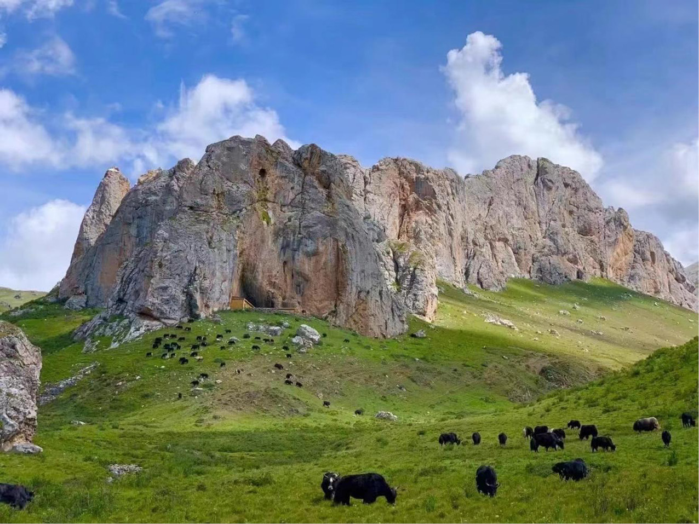

# 劝修寂止之语讲解

麦彭仁波切·造论

索达吉堪布·译讲

### 第1课

2024年10月28日

接下来三天，我们一起学习全知麦彭仁波切的教言《劝修寂止之语·天鼓妙音》。前面学的《禅修深义密要》讲了禅修需经历的四个阶段，在今天这部教言中，麦彭仁波切主要劝告我们要勤修寂止。

论名：劝修寂止之语·天鼓妙音

“寂止”的意思是寂静、安住。“寂”是指心不被分别念所转，寂静下来；“止”是指停下纷飞的妄念，不要动来动去，安住下来。所以，寂静地安住下来，这就是寂止的大意。汉传佛教中也很强调寂止，智者大师著有《摩诃止观》，其中的“止”就代表寂止。大多数修行人所说的坐禅、禅修，主要也是指修行寂止。麦彭仁波切先是讲了禅修的密要，现在继续劝大家实际行持禅修。

副标题是“天鼓妙音”。法王如意宝的《胜利道歌》和《项袋金刚橛·胜利歌》，副标题同样是“天鼓妙音”，这些都是表示胜利的歌。所谓“天鼓妙音”，就是天人与非天作战获胜时，天鼓自然发出的胜利之音。通过寂止的禅修战胜分别念，这也是一种美妙的天鼓之音。

作为修行人，我们必须与烦恼分别一直战斗，在这个战场上，有些人遍体鳞伤，失败告终；有些人则依靠教言指导，最终获得胜利，光荣凯旋。所以，此法非常殊胜。麦彭仁波切、全知无垢光尊者、法王如意宝等传承上师留下了许多无比珍贵的教言，其殊胜性并不是我们自吹自擂的，圣者的语言自然具有严密的逻辑性、甚深的义理和强大的加持力。有智慧的人在学习过程中应该会对此有所感受，而缺乏智慧或是没有缘分的人，就不一定有感觉了。

这部教言是全知麦彭仁波切所作。法王以前写过一篇《全知麦彭仁波切略传》，记得2002年5月我在成都译出了汉文，建议大家看一看。虽然大部分道友都对无垢光尊者、麦彭仁波切等自宗最重要的大德比较了解，但也有些新学者可能不太熟悉，如果有人不认识麦彭仁波切，可以阅读这部传记。从中你们会看到麦彭仁波切的超凡智慧和向他祈祷的功德，特别是他生平的一些精彩事迹。记得尊者在德格一带游历时曾遇到一伙强盗，对方要用石头、棍棒对他发起攻击，此时麦彭仁波切施展神变，震慑群敌：“不论依靠教证、理证，还是石头、棍棒，都无法将我打倒，我乃常胜不败者！”——“麦彭”即不败、战胜之意，“麦”是否定词，“彭”是失败的意思。有时候大德们为了让众生起信，对自己的功德宣说、赞叹一下也是很有必要的。

这部教言是从麦彭仁波切的智慧中流露出的。大家发现没有，我们之前讲的《禅修深义密要》和这部《劝修寂止之语》是在同一天内撰写的，都是木龙年一月初十。麦彭仁波切以超凡的智慧顷刻写就，而我们学了这么多天都没学完。今年恰好又值木龙年，我查了一下，那个木龙年应该是1904年，因为麦彭仁波切是1912年圆寂的。他总共住世67年，撰著此论时是59岁，所以，这是仁波切晚年的教言。

著论的地点在如今石渠县内，一个叫做嘉普白岩大乐自在山洞的地方。前段时间我们向当地人考证过，那里确实有个闭关房，也拍了一些照片。这个山洞不是常见的林间山洞，而是位于一片岩石之上，石渠一带多见这种地貌。这里夏天看起来不错，但冬天肯定很冷，因为那边冬天本来就比色达更冷。各位道友可能觉得十一月后的喇荣就已严寒难忍，但不论麦彭仁波切造论的这个岩洞，还是无垢光尊者住锡的刚日托嘎等地，其实都要冷得多。刚日托嘎距离拉萨大概五十公里，位置很高。我以前去过，当时要四五个小时才能爬到山上。那里非常殊胜，但也非常寒冷，不过应该比石渠稍微暖和一些。麦彭仁波切在石渠造论的那天是一月初十，藏历新年刚过，正是最冷的时候。就在这样一个寒冷的山洞中，仁波切流露出了自己智慧的结晶。

这次我们能学到这些教言，大家应该好好珍惜。对于传承上师们金刚语的密意，最好真正领会并背诵下来，这对将来的行持和修心都非常重要。因为我们只要能让自心稍微堪能，此生之中不论闻思修行还是做其他任何事情，都会更为方便自如。

最近可能是刚评选了一批堪布堪姆的缘故，很多人开始在意名声和地位，突然变得非常精进，也许闭关的时间都会拿来用功复习。当然，这也是可以的，反正我现在不在学院，对你们怎样闭关也没有执著。但是，我还是希望你们能有一点点禅修的境界，这对不论出家人或在家人而言，都是最根本的需要。作为佛教徒，不能没有一点修行境界，天天光会纸上谈兵——就像我这样，口头上讲了几十年法，可等真正要离开人世时，却不知道有几分把握。有些道友虽然不玩嘴上功夫，但两脚总喜欢到处跑来跑去，也许就这样白白度过一生，到最后也没有多大意义。因此，在有机会的时候，大家一定要在修心上抓紧。多修一修，对自己今生来世都是很重要的。

《大乘理趣六波罗蜜多经》中这样讲：“舍此身命时，如弃于土木，亲戚皆相离，唯禅定随逐。”最终离世之时，你的身体就像土木一样，全部都要还给大自然，亲朋好友也会纷纷离散，这时候能跟随你的唯有生前的禅定境界。世间的名利权情，死时分毫都带不走，如果整天为了带不走的东西拼命奔波，却对真正属于自己的修心境界从不认真，那确实有点可惜。所以，我一再奉劝大家要好好修心。当然，我只能从旁劝勉一下，最后修和不修，主要靠你们自己的缘分和自觉。任何一位老师都不可能带动所有学生，任何一所名牌大学也不可能把每个学生都培养成人才，这是客观规律，我们学院也同样。

接下来我边念藏文，边给大家做简单的讲解。

## 一、顶礼立誓句

（堪布念传承）

> 止息妄念波涛文，二智自现光明殊，

> 童子身尊前敬礼，撰写大义实修教。

首先是顶礼立誓句。作者麦彭仁波切在造论最初先对文殊菩萨进行了顶礼，并点明了这部教言的重要性。

作者是如何顶礼的呢？文殊菩萨相较于其他本尊，在寂止方面有特殊的功德和加持，因为文殊的“文”本身就有遮止、息灭的意思。我们的妄念分别如汹涌波涛，此起彼伏，不停翻滚，难以阻挡，而文殊菩萨能止息所有分别念的波浪，这就是“文”的意义。“殊”则代表能显现尽所有智和如所有智。若是没有智慧，光有止息之禅定还不够。而文殊菩萨不仅能息灭所有分别妄念，还能自然显现二种智慧的光芒。并且，他还在诸佛菩萨和众生面前始终保持着十六岁的童子相，没有生老病死的衰败。在这样的本尊面前，作者以三门恭敬的方式诚挚顶礼。

麦彭仁波切在其他教言中曾对文殊菩萨如此赞叹：“文殊大慧光，明咒明灯光，心中显现时，焚尽密林障。”意思是说，如果我们心中能显现文殊菩萨的大智慧之光和文殊心咒的大明灯之光，就能无余焚烧所有稠林般的障碍。因此，大家若想修好寂止，一定要重视祈祷文殊菩萨、麦彭仁波切和法王如意宝。依靠诸佛菩萨和传承上师的加持，一定能息灭汹涌的分别妄念。

闭关期间，大家在禅修时可以在面前供上文殊菩萨像或者法王像。我们学院的年度闭关是在法王圆寂后才固定下来的。几年前我们考虑到，法王在世时经常传授修心引导，但是他老人家圆寂以后，很多道友不一定能自觉禅修，所以就定下了两个制度：一是每年要有一个月专门学习密法，二是每年要进行十七天左右的闭关禅修。针对性的修心训练是万不可少的。这就是学院年度闭关的由来。这个决策当初我也参与商量过。早年我在学院和五台山等地都进行过七天到十几天的闭关，但后来总被分别念的风吹来吹去，说来很惭愧。每到闭关的时候，我虽然没有在外散乱，可总觉得人生短暂，更想尽快把一些重要的论典翻译出来，所以闭关的大量时间都用在这上面了。面对在座那么多精进禅修的道友，我似乎也没有劝你们闭关的资格。但不管怎样，希望大家在闭关时记得祈祷文殊菩萨，这非常重要。

麦彭仁波切在这里说到，自己撰写的这部教言非常有意义。虽然许多法门都很殊胜，但是归根结底，还是禅修意义最大，所以麦彭仁波切特意宣讲了这部关于实际禅修的教言。本文虽然不像引导文那样详述实修寂止的方式，但阐明了修心的重要性以及初中后次第，因此，颂词点明了这部实际行持禅修的教言具有重大的意义。

## 二、离寂止之过失

> 妄念汹涌无间断，无始至今屡累积，

> 若未思维则确定，唯沉无义苦涛中。

这个偈颂讲了不修寂止的过失。有些人或许觉得，自己已经很不错了，为什么还要天天禅修呢？当然，你实在不愿修我也不勉强。佛教徒中也有一部分人就是跟修心无缘，怎么都不愿意，这也没办法。但如果你真正想了解禅修，必须明白：首先要让这颗心静下来，若心不静，会有很大的问题。

有哪些问题呢？如前所述，分别妄念涌现之时，就像大海的波涛此起彼伏，毫无规则可言。所以大家都知道，我们这颗心很多时候完全不可控。现在常说人与人之间缺乏信任，其实不说他人，就连自己的这颗心，都是很难信任的。今天发的誓言，明天就反悔；今天做的决定，明天就放弃。不管是自己的，还是别人的，分别念妄随时都在变化，根本无法预测。春夏秋冬等外在变化至少还有一定的规律可循，而众生的分别念想冒头就冒头，想爆发就爆发，完全不讲道理。要是一个人前世修得不好，烦恼习气较重，妄念就更容易失控了。总之，分别念就是这样毫无规则、变化不断、无始无终，直到今日，已经无数次给我们制造了种种痛苦。

许多情况并非我们本质有问题，而是分别念作祟。比如，才发愿好好修行，没多久就毫无动力，放弃发愿了；前两天对这个法很感兴趣，现在却丧失意乐，一眼都不想看了。很多道友就是这样吧，刚开始十分精进，但过一段时间就后继无力；当然，也有人刚开始比较懈怠，但后来又在某个因缘下突飞猛进。所以，人的分别念变化万端，确实连自己都难以信任。有些人也许盲目自信，觉得不但能信任自己的心，也能信任他人的心，但实际上，只要是有分别念的凡夫，就很难做到这点。

虽然我们都认为凡事应该讲原则、讲道理，但自他众生的心有时非常讨厌，常常不肯按理出牌。不少道友都有这样的经验，明明下了决心好好闭关，但坐着坐着就没劲了，只想赶快出来。想闭关的是自己，想走的也是自己，分别念就是这样此起彼伏、变化不断。如果不依照上师们的教言深入思维、修持，我们不仅无始以来在无意义的轮回大海中不断沉溺，而且将来也注定会继续承受无量的痛苦。

所以，如果现在还不赶快修心，可以说解脱就没戏了。心不调伏，成就的希望就很渺茫。我们的心一直是颠倒的，但是大多数人根本意识不到，就像《禅修深义密要》中讲的主人和仆人位置倒换了一样。萨绕哈巴尊者有一首道歌说得好：“缚者走十方，见者稳不动，我说倒如驼，汝等观自心。”这是我今天刚翻译出来的，都能背了。意思是说，被束缚着的人愿意到处去走，而什么都见过的人反倒会安稳不动，哪都不去，我萨绕哈巴说，这种颠倒就像骆驼一样，骆驼背上驮的东西越多，走得越快，驮得越少，反而越走不动，你们的心就是如此颠倒，所以奉劝你们要多观自心。

按一般规律，被束缚着本应走不动，就像人被镣铐铐起来，然而凡夫的心虽被执著和烦恼束缚，却到处乱跑，刹那不停；相反，一个修行人如果见到了自心，也就见到了十方一切，本来可以到处行走，但他却保持安住不动。所以，这是一种颠倒。我觉得这个教言很好，如果我们观心没有成功，就会被分别妄念一直束缚，而越是在这种状态下，就越想得多，各种杂念纷涌而出，到处乱窜。虽然世间人觉得其中应该有道理可循，但所谓道理也只是名言安立，实际上很多安立出的道理都非常颠倒，这方面大家也可以思考一下。《宗镜录》中说：“有心皆苦，无心乃乐。”有分别心其实是一种痛苦，没有分别念才能获得真正的快乐，这也是一句很有意义的教言。

> 沉沦此中苦难消，心不安宁则不得，

> 少许止观之功德，断定祸根此分别。

如果我们不能调服自心，必然会在苦海之中沉沦，这是断定无疑的，因为我们一直以来都在分别妄念中沉溺。唯有善自修心，才能消除痛苦。修心不是一蹴而就的，虽然有些上师说过，闭关七或二十一天，就有认识心性的机会，但除少数利根者外，普通凡夫无始以来的深重习气很难在短短的时间内改变。所以，若不好好调心，后果之一是无法消除痛苦，后果之二是内心不能得到健康、快乐和安宁。大家都知道，人身上大多数痛苦和疾病都是由内心问题引起，这是中医、西医和藏医都承认的。如果一个人经常生嗔恨心，整天烦恼炽盛，就容易出现高血压、心脏病等问题。正是由于心不堪能，导致很多人失去了健康和快乐。所以，只要我们还被分别妄念所缠缚，就很难脱离痛苦，也不能获得世间的幸福。

而且，如果不好好调心，我们就连少许止观方面的功德都得不到。一个人若是寂止修得很好，在觉受或梦境中会显现诸佛菩萨、上师空行的相——当然这是很难的。如果胜观修得很好，就能在安住的同时认识心的本性。胜观一词在藏文中是“见胜”的意思，也就是见到最殊胜的。什么才是最殊胜的呢？就是我们心的本来面目。寂止是安住下来的意思，安住以后认识心的本来面目，这叫做止观。如果心静不下来，整天胡思乱想，根本不可能得到止观的功德。

包括闻思方面，心定不下来的人，往往理解也不行，背诵也不行。就算是法师，如果心不安宁的话，不管讲经说法还是行持善事，都根本不在状态。相反，如果有一定的修行功夫和禅定境界，那不论做什么善法都会有很大的功德利益。因此，我们应该知道，一切过患的罪魁祸首就是这颗心的起心动念。

希望大家重视向内观心，作为修行人，如果能把这颗心修好，不论闻思、发心，还是做其他善法，都会比较容易。心不调柔的话，很多事是没办法做好的。《格言宝藏论》中也说：“设若自心散乱者，彼无修法之良机，若人寂静而安住，彼心即可得堪能。”我们不管做什么都应该有一个好的心境，这是成事的一种基础，但这个基础也并不是说有就有的，要靠每个人自己的勤奋努力。莲花生大士给空行母益西措嘉讲授过一个长期修本尊的教言，其中这样说道：如果我们能保持心不烦乱，同时明而无分别，一直在这种状态中，修本尊就会成功。比如观修文殊菩萨时，要让心保持一种明现而没有其他分别的状态，以这种方式来修行。所以，大家一定要想办法认识自己的心，我们的心其实具足各种各样的功德，就像如意宝一样，但大多数人根本不曾观察它、开发它。我们幸好遇到了如此殊胜的大乘显密佛法，依靠这些教言能对心的宝藏有一些发现，在这个时候千万不要错失良机。

如果你真正将上师的教诲融入自心，自然会对上师感恩不尽，但如果教言没有入心，也许非但不会感恩上师，还会有抱怨嗔恨之念。这方面每个人各不相同，见仁见智。我很喜欢萨绕哈巴尊者的一句教言：“愚者必束缚，智者速解脱。”什么意思呢？愚者受到心的束缚，而智者依靠观心很快就获得解脱。人和人是不同的，上师讲的一句话，有人听了起嗔恨心，有人听了生感恩心。

以前上师如意宝传授密法教言时都是公开面向所有人。据我所知，在他老人家的传承弟子中，即使那些最为优秀、后来弘法利生事业最为广大的人，法王也没有给过他们独传。虽然法是所有人一起听的，但是有些人真正通达了上师的密意，后来在自他二利上都获得了不起的成就，而有些人不但自己没有得到利益，反而可能有害于众生和佛法。法王如意宝的《项袋金刚橛·胜利歌》中暗含了两个人的名字，一个已经被降伏，一个后来堕入地狱。由于当时的环境因素，这些只能以隐藏的方式来讲。我前几天翻译到那里才回想起来，法王曾经暗示过这件事。

密宗中常讲“三恩德上师”，其中最重要的就是给你直指、让你认识心性的上师，这是最大的恩德。但直指心性也离不开其他条件：一个是灌顶，如果没有灌顶，就无法接受甚深窍诀，所以这是第二的恩德；另一个是传讲续部，如果没有续部教理的讲解，很难学修得特别究竟。因此，给你传灌顶、传续部、传窍诀的上师叫做三恩德上师。三恩德中最根本的是直指心性，这样的上师恩德等同佛陀，甚至比佛陀还大。密乘中要求视师如佛或者视师是佛，就如有些经典中所讲的视上师为真正的佛陀，这其实没有矛盾之处。每个弟子由于对自己的根本上师有不同的定位，学修也会有不同的结果。这就像阿难和善星比丘，同在佛陀面前闻法，但最后得到的果位完全不同。也有些弟子心态普普通通，结果也无利无害。其实，上师对待所有人都是平等的，就如太阳的光明普照众生，但有些人能得到阳光的照耀，有些则不能。就像莲花中大部分是遇阳光而开放，但有一种莲花在阳光照射时反而闭合，等到有月光时它才开放——自然界中也是无奇不有。

总之，我非常希望大家明白修寂止的重要性。

> 恶习难改如卷纸，知此屡屡依正念，

> 所缘意中不散乱，常念不忘勤修此。

我们的习气是很严重的，不可能修一两天就有立竿见影的效果。很多人尽管修了好几月、好几年，但是恶劣的习气很难改变，就好比一桶卷纸拉平以后，马上又“噔”一声卷回去。我们的习气就是如此，修行时还好，可一旦遇到一些对境或因缘，原来的毛病又全部发作出来了。所以，凡夫人的修行不是一天两天的事，需要长期下功夫。知道这个道理之后，我们要屡屡地、数数地、长期不断地修行，这样才能让心有所改变。这个过程要依靠正知正念，还要不散乱地观所缘境。你可以观佛像修寂止、观大圆满，对于任何所缘境，心要一直不散而修，而且应常念不忘，这样坚持下来，修行才会有效果。

总之，不论修什么法，都要有正知正念，专注所缘，不断精勤修行。不然的话，只靠短短几天，几乎是不可能修出任何成果的。有些人可能会纳闷，自己已经闭关七天了，怎么还没有见到本尊，也没有什么验相？其实，你虽然闭了七天关，但在这七天里大部分时间都在散乱当中度过，你只是身体坐了七天，但心不一定一直安住。真正的闭关，一天至少要修六到八座。莲师的教言中提到过，修行应该白天四次、晚上四次。我们学院规定一天要修四座，这是针对没有能力多修的人制定的一种较低的标准，那些本就精进的人，每天修得可能更多。所以，要修就要实实在在地好好修，只在表面上修是没用的。

在这个网络时代，一旦你玩起手机、刷起短视频，就根本不可能真正闭关修行。现代人真的很可怜，随时被网络、手机、电脑控制着。就连很多儿童都已经离不开电子设备了，如果没有手机或平板电脑可玩，就一直哭闹不停，而只要拿到手里，就马上沉迷其中。这样的孩子看上去虽然能自己乖乖玩一整天，但长期下来脑子和眼睛都被搞坏了，不少人小小年纪就戴上了厚厚的眼镜。不仅世间人在这方面非常苦恼，就连很多修行人也深受其害。以前我听说过，学院有个别闭关者买了好多光盘，在闭关期间一口气看六七十集的连续剧。虽然这是极少数情况，但这样的案例许多地方都存在。所以，如果你连正知正念都没有，那就不必谈什么闭关了。好不容易来到一个修行的道场，却沉迷于世间的网络和娱乐，这是很可惜的。这样的人，与其待在寂静之处，还不如回到红尘之中。

有些人自称在闭关，把房门锁上，还贴起“闭关勿扰”的标签，外面的盗贼虽然没进你的房，可内在的妄念之贼却已溜进了你的心。《佛垂般涅槃略说教诫经》中讲：“若不忘念者，诸烦恼贼则不能入。是故汝等常当摄念在心，若失念者则失诸功德。”如果你没有忘失正念，烦恼之贼就不会乘虚而入；如果你忘失了正念，那烦恼之贼就会进入你的心房，偷走你所有的三学功德财宝。因此，我希望大家真正投入努力去修法，这很重要的。真正的修行并不简单，但只要你们对此有所认识，就抓住了关键。

## 三、修寂止之利益

> 人天福乐纵如何，亦无法比心自在，

> 贪欲享受如搔痒，痒止自心得安乐。

这个偈颂以对比的方式告诉了我们修行成功是何等的快乐。天人有非常多的福德妙乐，世间人也有各种各样的荣华富贵、美食享乐，人们以为这些快乐已经够好了，但其实再好也比不上内心得到自在的快乐。通过修行寂止，你可以自如驾驭自己的心，让它来去自由，完完全全地受你控制。真正的修行人，始终能把心放在自己的管辖之中，不论观修还是安住，做什么都能成功，这就是心得自在的状态，这种快乐完全不需依靠外在。外在不一定能给你快乐，我们可以看到，巴菲特也好，马斯克也好，这些身价千亿、表面光鲜的巨富，内心其实充斥着常人无法想象的焦虑、不安和恐惧。而很多深山里的修行人，虽然看起来生活环境和物质条件都不怎么样，但他们的内心一直被快乐的阳光照耀着，这是谁也无法相比的。

这里有些道友曾经也是成功人士，但他们愿意把事业、地位或百万高薪完全放弃，选择走这条修行之路，通过精进不懈地内观自心，后来获得了远超从前的快乐。这时再看看他们过去的同行、同事，表面看来虽然活得更加风光，更加滋润，但也承受了更多的痛苦和压力，流下了更多的汗水和眼泪。而修行人不仅不需要感受这些痛苦，还能从心灵深处获得平静和快乐。这种内在的快乐，远远超过世间人享受的级别，根本无法用语言描述。

后半句讲的是，贪执世间享乐，就像得了皮肤病的人天天用手搔痒，刚开始挠着好像舒服了一点，但越挠越上瘾，最后完全无法控制。《中观宝鬘论》里说得很清楚：“搔痒则安乐，无痒更安乐；具世欲安乐，无欲更安乐。”抓痒的时候虽然感觉快乐，但彻底不痒岂不是更快乐。同样的道理，如果我们以修持寂止的方式从根本上止息了“痒”，内心就能获得更深层的安乐。

其实享受世间的欲妙，就像喝咖啡、喝酒上瘾一样。我看过一个故事：有个特别喜欢抽烟的人坐飞机去西方国家，在十几个小时的航程里烟瘾发作，坐立不安、痛苦不堪。一下飞机，他立刻冲到吸烟区“啊——”地猛吸一口，觉得非常惬意。后来他回想起来，发现十几个小时的煎熬只换来一两秒钟的过瘾，如果自己像旁边的乘客一样没有烟瘾，岂不是根本不用承受这种痛苦，那才是真正的快乐。世间的快乐就是这样颠倒——不管是感情还是财物，很多人一辈子都在痛苦执著，实际上依靠这些只能带来短短一瞬间的满足。可惜的是，能看清这种颠倒真相的，只有极少数人。正如我之前讲过的，“愚者必束缚，智者速解脱”，同样都有一颗心，愚者被分别妄念束缚得苦不堪言，智者却能快速获得解脱。面对同样的对境，比如一杯咖啡，愚者会上瘾拔不出来，智者却能通过禅定获得自在。很多修行人为什么能一直坚持禅修，保持境界，这就是一个重要原因。

这方面的公案很多，比如窥基大师的故事。当年玄奘法师在山中发现一位入定的老人，用引磬“叮”地一声将他唤醒。那人说：“我是很久以前入定的修行人，准备等释迦牟尼佛出世时协助弘扬佛法。”玄奘法师告诉他：“佛陀已圆寂一千多年了。”他又说：“那我就继续入定，等弥勒佛出世时再出定。”玄奘劝道：“你不应再等那么久，我现在要去印度取经，你若有信心，等我回来为你说法。但你的肉身已经太旧，不如先转世投胎。”那人欣然应允。本来玄奘法师让他投生到皇宫里，结果他认错路，误投到了大臣家中。玄奘取经归来时，他已成了个生活奢侈的“富二代”，死活不肯出家。后来唐太宗得知前因，下旨命他出家，他竟提出三个条件，要带着一车酒、一车肉、一车美女才肯出家——这很像藏族的婚俗，女方出嫁时要带上一车牦牛、一车粮食，还有一车杂七杂八的嫁妆。玄奘法师为度他出家，就答应了他的要求。结果车队刚到寺院门口，钟声一响，他前世修行的记忆顿时苏醒，立刻舍弃三车剃度出家，这就是著名的“三车和尚”窥基大师。虽然他前世在禅定中安住了漫长岁月，具有宿缘，但转世入胎后也会迷乱，翻出了许多习气，因此一开始沉溺世俗，不肯出家，但最终还是在玄奘大师面前获得觉悟，成为了法脉的继承者。这就是心真正得到自在的一种表现。很多大德的修行历程都是这样走过来的。

> 如瘟疫愈之安乐，即此心海无垢浊，

> 如此安乐无垢福，帝释天王亦难得。

这个偈颂讲的是认识到自心本性后的快乐有多么美妙。就像世人染上瘟疫，终于痊愈后的感觉，“今天终于不痛了，好舒服啊！”这种从病痛中获得解脱的快乐，确实美好得难以言喻。我们的心也是如此，通过禅定，认识到心的大海本来没有任何垢染污浊，这种源于自心的快乐，普通人根本无法企及，唯有修行者能真切感受。做到这一点要依靠上师们的教言。有些人一直没时间修，要么忙于学业，要么忙于发心，有的即便有空闲，也被妄念琐事缠绕，这非常可惜。当然，也有些人对修心十分重视，长期坚持每年闭关。如果能真正踏实修行，会获得超越世间、难以想象的快乐。这就连欲界帝释天王所享的快乐也比不上。虽然帝释天有无数天子天女供养，一切妙乐应有尽有，但修行获得的至上安乐和无垢福德，他根本享受不到。

我们经常会看到，世间很多拥有地位、财富、美貌，看似很有福报的人，一旦真正了解他们，会发现其实他们并不快乐，甚至内心充满痛苦煎熬。所以，如果没有针对心灵的甘露教言，汹涌的苦海不知何时才能干涸。什么时候你能稍微有一点认识自心的把握和窍诀，你的心才可能真正平静下来。大家应该知道这一点。

> 解开动念之束缚，谁享如此之心乐，

> 无与匹敌所享故，人天世间最胜宝。

如果真正能认识自心，这就是人世间最快乐的事。具体怎么做呢？首先要通过寂止修法解开妄念分别的束缚，或者如麦彭仁波切的中观教授，用胜义谛和世俗谛的观察方式破除所有实执的相。这样才能真正解开束缚，享受寂止之乐。如果拥有了这种内心的快乐，整个世间也没有人能与之相比，所以说这种心灵的财富，是世上最珍贵、最有价值的珍宝。

米拉日巴尊者的许多道歌都是证明。他住在深山里，从物质条件上看，确实缺衣少食，非常艰苦，别人难以忍受这种生活，但尊者却乐在其中，高唱欢歌：“我现在没有罪业，死了也很快乐！我现在行持善法，活着也很快乐！”他的道歌中流露的无限快乐之情，多得说也说不尽。有些修行人体验到的快乐，确实是世间根本享受不到、用语言也描述不了的。

所以，心被束缚的痛苦是世间最大的痛苦，而解开分别念束缚的快乐则是世间最极致的快乐。这种通过修行获得的心灵财富，才是人天世间最殊胜的珍宝。

> 如净湖现月星影，多显神通等功德，

> 调伏自心功德本，未调心者怎具德？

我们的心就像一片湖水，当湖面澄澈清净时，能清晰映现月亮星辰的影子，当我们的心安住稳固时，各种神变、神通和等持功德都会自然显现。之前讲过，如果你想要好好闻思，或是闭关观修本尊、念诵百万心咒，一定要先让心安静下来。只要心稍得自在，就能做到，但心若不得自在，可能第一天还凑合，到第二三天就坚持不住了。

现在很多人热衷于接传承、得灌顶、赶法会，可有些人修着修着就变得跟疯子似的，这就是心没有获得自在的表现。心若得以清净，想修什么都是可以的，所以，调伏自心才是一切功德的根本，如果连自己的心都未能调伏，怎么可能得到功德呢？《华严经》中说：“甚深因缘海，功德宝无尽，清净法身中，无像而不现。”就像大海蕴藏无数珍宝，法性中本来具足一切功德，只要心海清净，这些功德就会从中显现。以前有位老板对我说：“你们要修经堂，钱我是有的，但要不要供养，得看我到时的想法。”就像他这句话，我们心的宝海中，功德本是有的，但能不能让其显现，关键要看我们是否能让心安住，这很重要。《瑜伽师地论》讲：“善调伏其心，心调引安乐。”善于调伏自心的人，自然会得安乐，而那些心未调伏者，什么功德都难以出现。

《佛所行赞》中有句教言：“心调形自正。”意思是心若调伏，外在形象自然端正。这句话建议大家记下来——长的教证记不住，这种又短又有力的总该背得下来。观察现实就会发现：心调伏的人，行为举止、说话语气都合乎法度；心不调的人，做事常常颠三倒四。有些人把心保护得特别好，就像藏地一些老修行人，当然也有些人在这方面做得不太到位，这也要靠个人因缘。

前辈大德有很多这方面的公案。虚云老和尚在终南山闭关时，有一次在锅里煮着洋芋时打坐入定，附近的同修发现他许久没有音讯，冒雪寻到他的茅棚，用引磬将他唤起。他出定后说：“芋应该煮熟了，一起用斋吧。”结果掀开锅一看，洋芋都长出一寸长的毛了——这次入定持续了十八天。老和尚开悟的根基，正是如此扎实的禅修功夫。

印度大成就者萨绕哈巴的事迹更为惊人。他依止十五岁贫女在森林修行，有次在打坐前让妻子煮咖喱土豆（另说萝卜），结果一入定就是十二年。出定时尊者第一句话就问：“咖喱土豆做好没？”妻子的修行境界也很高，便提醒他：“真正的禅定是远离相状的，你有入定十二年的功夫，怎么还对咖喱土豆这么执著？”尊者顿觉惭愧，重新安住，真正获得了大手印果位。

不管是历史上还是现在，都可以看到很多真正通过禅修调伏自心的案例。反观我们这些凡夫，别说十二年、十八天，连坐一个小时都难，常常五分钟不到就眼珠乱转、妄念纷飞。所以说修行到底该怎么用功，关键还得靠自己。

> 宁可舍弃身与命，然为永久之果位，

> 莫舍修心正念续，立誓勿懈此意乐。

为了永久的果位，宁可舍弃宝贵的身体与生命，也不能舍弃修心，要让正知正念相续不断，在任何境界中都不动摇。我们每个人都应当立下这样的誓言，发愿不懈地修持下去，这非常重要。

这个年代我们要修行虽然不用舍弃身体性命，但仍然需要经历很多苦行，比如忍耐严寒的气候、面对道友间的人际问题、一个人提水做饭……不过这些烦恼和琐事对真正一心求法的人而言并不算什么。大家今后还有多少闭关禅修的机会，这很难说，要知道，人生中的很多计划只是空谈而已，你有兴趣的时候，可能没有时间，等到有时间的时候，又没了兴趣。现在一些道友能在山上学修，而城市里的道友没有这种条件，你们也可以偶尔去寺院，或在家里的安静处约几位道友，共同进行七天、半月或一月的禅修，这也算是创造一种缘起。经常禅修非常重要，过程中难免要承受一些辛苦，尤其是在山上修行，确实十分不容易，要面对很多困难，但只要你内心足够坚强，外境的问题也没什么大不了，到了一定时候自然会过去。所以希望大家在禅修上认真下点功夫。

麦彭仁波切的教言大家要反复思维。我讲得未必很圆满，但禅修的重要性是千真万确的。现在有些寺院虽在强调实修，但如果心静不下来，修再多法也不一定有效果。包括大圆满中观明点的顿超修法，如果你没有寂止的基础，不认识自心，安住不下来的话，光盯着虚空是没用的。同样，一味地念咒、做佛事、赶功课是不够的，至少要有一个窍诀令自己的心静下来，这十分重要。当然，这些道理说来简单，关键要先明白重要性，然后再实际修持，这样会比较方便。
