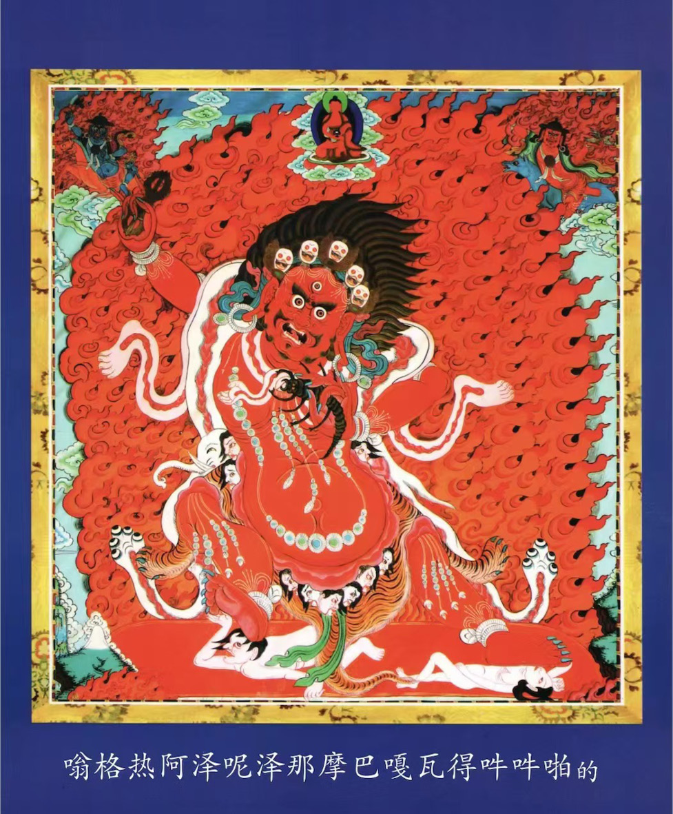
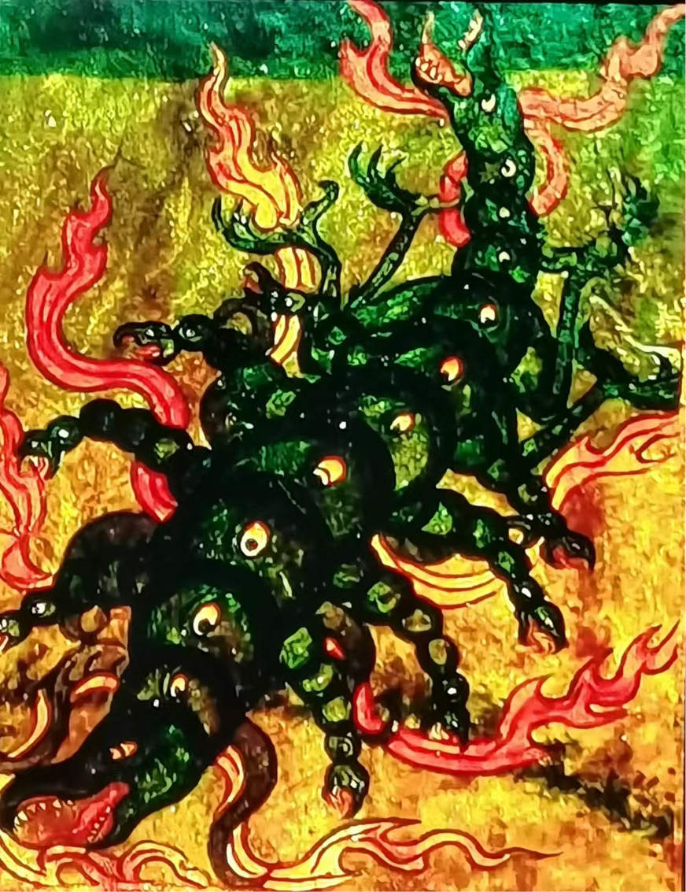

# 忿怒莲师修法讲解

法王晋美彭措·意伏藏

索达吉堪布·译讲

2024年8月23日

「课前开示」

今天在正式讲课之前，我想跟大家说几件事情。

第一件事，不论你是学院的常住人员，还是临时人员，到这里来的目的应该都是求法。当然，也许有些人有不同的希求、意乐和目标，停留的计划也或长或短，不论如何，希望每个人都能好好珍惜在这里的时间，做一些有意义的事。作为修行人，我们应该把自己的全部生命和精力都花在解脱上，这一点很重要。

这里不少人可能是趁着夏天到这里旅游或朝圣来的，你可以短期停留一段时间，但长期是不允许的。现在整个佛学院不再接收常住人员，也不能新建房屋。这不是我们说了算的，而是有关部门的硬性规定，也会强制执行，大家应该明白这点。所以，暂住人员不用计划一直在学院里住下去，这里不是养老院，也不是幼儿园，这个现状谁也无法改变。你们在这里稍微待上几天、几周，这是可以的，但是在此期间，一定要遵守学院的相关纪律。这里是个佛教道场，不是什么旅游胜地，即使在世间的旅游景区，也有它的相关规定要遵守，大家都清楚。我们学院的人员现在已经超负荷了，目前正在想办法，一方面减少现存，一方面不再新增。所以，你们也没必要留在这里观望、期待，这里只是个佛学院，没有什么其他的。大家也知道，这几年宗教方面的管理越来越严，在这样的基调之下，很多事情与以前已经大不相同。所以，希望你们观光之后就离开，不要一直待着不走。很多人都有一种逆反的习气，有时候不让他走，他非要走，让他离开，他又非不离开。对于这种情况，学院也有一套系统的管理方法，最后会照章执行，到时候也希望大家理解。这是一个方面。

至于常住人员，从今年开始，学院制定了新的规定，要求每个人在学业完成后必须离开。如果轮到你了，希望你能主动出去弘法或者修行，不要继续在学院里待着。这是学院的一个新制度。以前我们都希望尽量接收新学员，但现在形势不同以往，只能这样安排。所以，今后希望大家都有这个共识，不管你是堪布堪姆、法师、辅导员，还是普通学员，都要遵照这样的规则执行。

对于极少数法王住世时代就来学院，已经待了几十年的老道友，按照藏僧部的要求，如果行为、修行等各方面比较稳重，暂时可以不要求离院。以前学院对于一些二十年以上的老道友，可以开许不入班听课，但后来这种情况越来越多，如果又不入班，又要待在学院，现在就不允许了。法王圆寂至今已将近二十一年，有极个别当年在他老人家座下听过法，闻思过关、修行认真、人格稳重、遵纪守戒的道友，可能会有特殊开许，除此之外，所有人一律平等，一视同仁。

今天我们降魔胜利洲相关负责人开会时也提到，以前我们有一部分长期闭关的名额，但后来发现有人以闭关的名义做各种散乱之事，不好好修行，自己到处乱跑；还有人闭关之后不但没修出一点境界，反而出现了很多问题。所以，从今年开始，我们在这方面也制定了新的规定。以前以闭关等名义不入班的人，现在必须入班听课，至少也要参加一个修心班，如果做不到，那最好还是到别的地方去闭关。你们这样的人，在有些寺院很受欢迎。

这些相关要求，我希望负责的管家和堪布堪姆落实到位。如果规则制定出来却不执行，最后就成了废纸，没什么意义了。不过在中间应该给大家留一定的时间，比如对于取消闭关，要告知相关人员在什么时间之前必须结束闭关，重新入班。定出明确的时间节点，在此之后不论任何人都要服从安排。

有些人可能想不通，“以前我还可以自由自在地待着，为什么现在就不行了？”确实，变化和改革难免会发生的。要是不根据形势做相应调整，我们也不可能管理好这么多人。包括最近的分班，很多人有议论、有怨言，我都理解。学院里言论自由，你们可以表达意见。但希望大家也理解我们，众口难调的情况下，有时也只能服从大局。经过很多次会议商讨，最后我们只得这样决定。如果换你来当负责人，你也会明白这些决定是不得不做的。在世间的团体中，做管理不是义务劳动。假如我是一个教育局的领导，那肯定有相应的工资，不论是为了工资，还是为了教育事业，我都得履行这份职责。但学院里的管理人员并非如此。堪布堪姆们带班、讲课、做管理，不仅没有任何特殊待遇，还要加班加点劳心劳力。所以，管理者有管理者的不易。

就像我自己，从1987年到现在，一直给你们汉族人做管理和教学，从来没有一句怨言，顶多偶尔发点脾气。这些年来，我从未要求任何回报，讲课也都是免费的。我之前也说过，这副身体用到现在，确实已经消耗不起了。以这样的脆弱之躯，扛了接近四十年，也可以了吧。世间人上这么多年班，也该退休了。一辆进口车，也有它的报废年限。这点大家都是清楚的。

不仅是我，学院里很多堪布堪姆一直以来也确实非常辛苦。大家能理解就理解，不能理解的话也没关系，我们做这些也不是为了得到理解，而是为了延续法王的传承，为了给众生带来一些利益。其实，这么大的一个摊子能维持到现在，从世间的角度来讲，上上下下都做了非常不易的付出。如果没有我们这些管理人员，很多事你们自己来管，不一定处理得那么好；当然，也许会管得更好，这也说不定。

关于分班，我们相关的管理人员和教务部门，到一定的时候，也许只能强制进行一些调剂。因为现在各班报名的情况，有的班人特别多，有的班人特别少。当然，背后有方方面面的原因，人少的班并不意味着法师不好。每位堪布堪姆都有各自的特点，有的人威望很高，很具善巧方便，能吸引弟子。法师个性上的差别是一方面，还有一方面的原因是我们的教学框架发生了变更，在这个节点上，有些人可能挤不进去，有些人可能受到一些条件限制，所以报不了想学的专业。但不管怎样，只要你真正想闻思修行，总会有适合的班级。只是到一定的时候，我们也需要服从必要的规则，希望大家能够配合。

在这里有几件特别的事，我要专门说一下。一是今年新评了一些堪布和堪姆。以前有几位堪姆总说身体不好，要请假休息。但现在多了好多新堪姆后，她们可能有了危机感，非要坚持上课。如果身体不好，现在我们可以安排个两三年的长假，可这时候她们又不愿休息了，一定要上课，积极得不得了（众笑）。这种精神固然可嘉，但要是你的身体确实坚持不了，上几天课又生几天病，这样三天打鱼两天晒网，那可能对学员不够负责。我们并不是有了新人就扔掉旧人，不是这个意思。但凡事都要讲求平衡，否则一味“好的、好的”，肯定成不了事。

这些话很多人不太敢说，或者不好意思说，所以今天我来说。反正三四十年来，我当“坏人”已经当惯了。个别堪布堪姆，如果确实身体不好，或者年纪太大，带班比较吃力，自己也觉得需要休养，可以提交休假申请。经过主管堪布堪姆们的审核，可以允许你休息两三年。这不是开除，你依然可以待在学院，毕竟你是有贡献的人，暂时休假疗养一段时间，这是允许的。我以前总劝你们坚持上课，有的堪布堪姆想下山休养，我一直不开许：“最好还是别出去，别请假，哪怕死在这里也值得。”但现在我觉得应该重视你们的健康，该休息的时候，休息一下也是可以的。

这是身体不好的情况。其实光是这样还不要紧，我的身体也不好，还不是一直在这里勉强支撑。另一种情况是教学年限很长，但教学质量始终上不去，这也不是太好。所以，不论是我还是其他堪布堪姆，到了一定的时候，适当平衡一下也是应该的。否则一直在这个位置上占着也不是很好。我不是要求你们非退下来不可，如果还能坚持，当然可以继续带班。但你既然选择坚持，就要好好讲课，不要因为身体或者其他缘故影响了教学质量。

我今天不想说负面问题，但考虑到眼下选班的情况，稍加分析就知道，很多人的顾虑之处就在于法师。个别人讲课从来是照本宣科，没有什么发挥和创新，备课马虎，讲课也呆板，所以大家都不愿去他的班里听课。这样的法师，不如稍微休息一下。

还有一类情况是琐事太多，带着班里的人今天到这里朝圣，明天到那里打卦。堪布堪姆中有人就是因为这类原因，被要求停课了。喇嘛这边有一位堪布，有段时间见解似乎不是很正，于是管理人员和教务处共同商量之后，就暂时中止了他的工作。现在他已经回来了，表现还不错。以后我们这边也应该有类似的机制，社会上任何一个组织，要是成员鱼龙混杂，水平良莠不齐，都不可能产出好的结果。

所以，各位堪布堪姆，如果确实需要治病、疗养，或者有外出弘法的计划，我们可以批准下山。但我希望你们离开之后，不像之前有些人一样，再也没有音讯，这可不好。学院培养了你这么多年，让你成为讲经说法的人才，不论将来去到那里，希望你始终记得学院，保持联系。

这是我要说的第一件事。

第二件事，我考虑到，你们将来回到汉地，对大众最有利益的应该是宣讲佛教经典，所以我们今年设立了经典班。然而我今天看到报名人数比较少。原因之一是大部分人目前正在学五部大论，还需要过渡一两年。中途跳到一个新专业，确实不太方便。另一个原因可能是大家觉得这些经典自己已经学过了。但我真正的想法是，你们以后如果想在汉地弘法利生，讲经典是最好的选择。汉地佛教的传统本就是讲经，不像藏地主要是讲论。所以，将来你们真想弘法的话，应该把重点放在讲解经典上。我建议大家对此多加考虑。

现在报名实修班的人数有些超额，如果你们愿意来学经典，其实这个专业可能更适合你。几年学下来，就算考试成绩不是最好，但以后你们回到自己的地方，讲讲佛经肯定不在话下。而且，从宗教政策上看，讲汉传的经典更有空间。你给别人讲个《维摩诘经》或者《金刚经》，一般不会有什么问题。你们现在报班也该像世间人一样，看看毕业后什么专业更好就业，不是吗？就业问题应该提前考虑，不论定向还是非定向，这其实很重要。以后“找工作”时，要是你的专业不对口，可能根本找不到适合的地方。想想看，你讲五部大论，能找到几个弟子？讲《大圆满前行》，在有些环境下不一定方便。讲因明，谁都听不懂，根本找不到受众。讲《俱舍论》，那就更没人听了（众笑）。可要是讲《维摩诘经》，情况就大不一样了。这么多部佛经我以前都讲过，现在又有堪布堪姆开班精讲，你将来一口气讲好几年都没什么问题。因此，从目前的整体形势和外部因缘来看，未来弘扬经典也许是更为适宜的形式，也是一个很好的机遇。

在我看来，如果能学会讲一些经典，这对大家来说是非常有益的。所以，我鼓励大家报名经典班，无论是现在直接报，还是等一两年后学完五论再报，都是可以的。女众这边目前报名人数不多，谁都有机会。但我也不是为了凑人数，人多点少点没关系，我们可以开小班，也可以开中班或大班。我主要是从整体上观察，未来你们从佛学院毕业后，无论是个人“就业”、利益众生、满足寺院需求，还是适应当地政策，应该怎样准备，才更加实际。现在外面的一些佛教道场，很多内容都不允许讲，而讲汉地本来就广泛流传的佛经，相关部门也会比较支持。因此，这条路径更为方便。

这就是我们开设经典班的目的。一部分实修班和净修班的道友，也可以考虑学学经典。以前你们只是在我讲的时候顺便听听而已，但现在是带着目的学习，因为将来也许真有机会把所学的法义弘扬出去。就像师范学校的学生，目标是成为一名教师。你们现在也要认真学好经典，以后在其他寺院或居士团体中为别人宣讲。

总之，从经典入手是未来最适合弘法的模式。我本人并没有其他目的，只是为你们今后的培养和发展考虑。

这是第二件事。

第三件事，这次选拔出的这批新的堪布堪姆，应该先当助理法师。在你们正式带班之前，暂时一段时间，还需要给现任的带班堪布堪姆当助理。现在男众这边各班助理基本已经定下来了，女众这边还在安排。因为堪布堪姆要管理一个班级，必须有一定的经验，不是所有人一评上堪布堪姆，就有带班的能力。所以我希望你们先从助理的位置开始锻炼。

一些堪布堪姆手下可能有好几位新堪布或新堪姆，这种情况你可以抽签选一位当助理，或者自己指定一位也行。一般西方国家总统上任的时候，都会自己带着副手。就像特朗普和哈里斯竞选时，都带着一个人，你也可以直接任命你的助理，这是你的权力。如果担心这样不公平，可以在后备人选中抽签决定。没选上的人可以去其他缺人手的班里当助理。现在觉姆这边就经常用这种方式。有时要安排人去分流的道场，就在所有带班堪姆中抽签，抽到谁，就谁去。要是不这样的话，有些工作很难推进。所以，我建议各班用抽签的方式确定助理法师。

另外，班里人数太多，管理上会有不便。所以，一个班如果超员，除助理法师外，所有人通通抽签决定去留。该谁走，谁就走，由教务重新调剂分班。要是有人赖着不走，就不能再享受日常待遇。一个群体中人数应该适当，人太多会有麻烦，人太少就难以运转。不然，要迁就每个人的私心来做事，根本无法管理。如果你想去某位法师班上，但命运不允许，就要服从调剂。哪些堪姆班上人数不满，你可以选择去这些班里。所以，希望你们不要再继续观望了。我们要求本月27号各班讲解《教诲甘露明点》，过渡两三天后，9月1号新学期正式开始。从此之后，各班人员两三年内不再改变。如果有人非要折腾，那就对不起了，请你不要待在这里，到别的地方去创造你的王国，这样可能比较好。

有些人现在非常纠结，这个班也不行，那个班也不行，就像中阴身一样飘来飘去。这说明你的人格可能存在一些问题。其实换成是我，只要能学法，去任何一个班都可以，每天听个半小时、一个小时，就很满足了。我们这里的堪布堪姆，没有谁水平是差的，如果真的特别差，也不可能这么多年一直带班。能在僧众中讲经说法那么久，说明他肯定有功德，否则讲法的生命力不会那么长。至于适不适应你的口味，那我们也没办法。

最近教务一直忙于分班的事，到现在还没有彻底解决。如果是能力不足，那还情有可原，但有时候是因为部分人带有私心，这样是不行的。不论如何，9月1号起，希望大家都各就各位，不要再有变动。如果还有人轻举妄动，人事就把他的档案吊销。任何一个组织在发展过程中都会有改革，世间的教育机构也是如此。要一一满足这里每个人的要求，这是不可能的。但是从整体上看，负责的堪布堪姆已经做了充分的商议和最好的安排。我今年身体状况不好，有些具体的会议没办法参加，但听他们的分析和汇报，基本上都非常到位。当然，任何安排都不会百分之百完美，但凡做出决策，就难免会有一些遗漏，但这并不意味决策是错误的。

既然制度已经定下来了，希望大家都能配合。如果有人实在不肯配合，那人事和管家也不必继续保留他在学院的资格。这个问题我想还是给大家讲清楚比较好。我们这里并不缺这一两个人，而且眼下也在不得不减员的关头。所以，要是有人实在过分，那我们也只能从大局上安排了。

我知道有些堪布堪姆很有威望，很有吸引力，但他们的班级也有人数限制。藏族堪布堪姆也如此，有的很受欢迎，有的人气平平，但每个班都有人数规定，不能超过上限，而低于下限就不能成班，必须保持中间值。不管怎样，教务有分班的原则，如果不遵照硬性标准执行，一个班可能会涌进几百学员，而有的班可能一个人都没有，这种情况是不合理的。

我建议，现有的班级中如果有人想重新学习五论，可以由这次新任堪姆开班。她们中有些人在学院学法时间很长，对五论十分精通。这么多年来我通过讲考，基本上了解她们的水平。这次我也帮着选了几位堪姆，她们都非常优秀。所以，如果有人愿意重学一遍五论，可以考虑新班，这样原班的负担也能少一点。另外，各班现在上课需要共享教室，交替使用，不能一个班占着一个房间。以我们的条件只能如此，喇嘛和觉姆那边也是这样。这些方面希望大家理解。当然，不理解也无所谓，我们也没有故意损害他人。凡事都有一个标准线，一旦超越，不管你愿不愿意，都要切断。这是第三件事。

第四件事，我们今年会在女众这边建立英文学习试点。男众这边由于人数较少，暂时等一段时间再看。这次尝试的原因是，未来一些道友也许会有因缘走向外面的世界，用英语来讲课。现在国内熟练掌握英文的人也越来越多。就像我们藏族人，有些内容用藏语不太好表达，用汉语反而更好沟通。未来你们也有可能遇到一些外语环境下的佛学受众。所以，我们现在就以试验性的方式，建立一个英文学习组。大家有兴趣的话可以报名。我们正在挑选适合的堪姆或法师，用英语来给大家授课。

从未来的可能性上看，外面的环境对于我们这种身份、形象，包括衣着，许多方面都太多严格限制，将来也许你们会在更广阔的世界中有所作为。因此，现在英文组先以兴趣的方式试水，以后有可能成为正式的学科，比如你可以得到中观专业的学位，也可以得到英语专业的学位。我们的很多课程都已翻译成英文，完全可以搭建出系统的学习内容。如果你们有兴趣，或者对将来有这方面的想法，可以参与进来。

这个方案最初是由英编组提出的，我和几位堪布堪姆经过讨论，觉得确实有这个必要。毕竟，我们佛教徒不应该拘束在一个小圈子里。法王最初给我们降魔胜利洲取的名字是“国际学经会”，代表一种建立国际化平台的缘起，我们现在应该尽量去创造这种因缘。

今天说得稍微多了些，但是这些都是我们近期开会决定的内容，希望大家好好思考。这几天一些“中阴身”要抓紧时间转生，否则错过最后期限，可能连胎门都找不到，这就麻烦了。你们也不必特别纠结，因为所有带班的堪布堪姆都是三藏法师，不论你去谁的班里，佛法都像甘露和蜜糖一样，中边皆甜。也许刚开始需要适应一下，但根本上没有什么差别。

我在学法过程中也依止过很多位堪布，不论在哪位面前听法，我都会起信心。多年来，我从未对任何一位给我传法的堪布生过邪见、起过争执。而有些人业力和习气不同，跟这为法师也起矛盾，跟那位法师也起矛盾，这是很严重的恶业，真的很可悲。但这也不奇怪，你们并非从小就有信仰，中途学佛，难免带着些世间的毛病，所以有些人在因果取舍等方面还是存在不少问题。

从我自身的经验来看，讲法法师没什么差别，但听法者自己的清净心和精进力有很大差别。如果没有清净心和精进力，再好的堪布堪姆来教你，你也还是不行。以前有个别人几乎在所有法师面前听了个遍，结果每位法师对他印象都不好，大家一提起来他的名字，都连连摇头，“这个人还是不要来我这里的好”，有这样的情况。

所以，希望大家配合最近的这些新规。我们毕竟是一个团体，团体的运行离不开规则。规则有软性的，也有硬性的，必要的时候就得强制执行。这方面我今天反复强调，是因为今年是一个特殊的转型期，在这个时候，如果一些人没把心态调整好，就会成为一种障碍。只要心态调好，其实这些改变没什么大不了。

有些人非常固执：“我死也不要离开我的法师！”这样也没有必要。法师与你只是传讲佛法的因缘，你们又不是世间的夫妻关系，怎么可能互相绑定。同样，有些法师也不要对自己培养出的学员起执著，明里暗里地加以控制，这样别人也很为难。你们看我对身边任何一个人，从不干预他的选择，他想去哪里都可以。我唯独担心他遇到假善知识，只要他能找到善知识依止，我从来都不阻拦。

我有一次外出时遇到一个人，他说：“虽然我离开喇荣后依止了其他上师，但是在您面前我比较放松，因为我知道您不会因此不高兴。”确实，我没什么不高兴的，只要他遇到好的善知识，遇到适合的道，我只会为他高兴。在这三四十年的教学中，我从来没有把哪个弟子执为我所。只是态度上有时会略显担心，怕你们出去乱跑，被恶知识摄受，到时候就再也回不来了。除此之外，只要你跟随善知识，不论哪个教派、哪个传承、哪位上师活佛，我都没有什么意见。我已经把该讲的法给你讲了，还有什么可执著的。你要走的路，你自己来选择，这是我一贯的做法。

所以，在这个转型时期，也希望有些堪布堪姆不要对学员舍不得放手，这样也没有必要。他们只是在你面前听过法而已，你没有权力干涉他们的人生。虽然一些人离开你会感到心疼，但还是应该大胆布施。我知道，其中有的是你用心培养的辅导员，有的与你有多年的师徒感情，但是该离开的时候也不得不离开。包括堪布堪姆，将来也没必要全都待在这个地方，应该出去开展弘法利生的事业。如果实在找不到机会，暂时可以在学院待一段时间。但长期来讲，堪布堪姆不该待在这里养老，而应该出去开拓你的天地，所以，你们也要有心理准备。

我本来是想给最近在这里旅游、打卡的临时人士讲堂课，但今天常住事务讲得多了点，因为之后我暂时没有课，只能借用这个机会。上午开会时发现目前很多工作执行不下去，所以我决定跟大家讲一讲。该做的事必须尽快推进，不能一再拖延。其实都没什么大不了的，有些道友也没有必要观望不决，无非换个群体、换个专业，在学法上没什么差别。只要你好好闻思修行，去哪里都能得到窍诀。所以大家也不要太过执著，该怎么样就该怎么样，实在不行就抽签。比如一班80个人中要减掉5个人，这5个名额就抽签决定。虽然这5个人不能留在原班，但法师的意传加持全部都给他们，他们才是最厉害、最优秀的。这种方式最为公平，也不会引起争议。以前我们学院有两个在青海的分流道场，其中一个谁都不愿意去，最后只能抽签决定，抽到的人也接受了。抽签前大家念几遍缘起咒，这样缘起一定很好。（众笑）

包括刚才讲到的助理堪布堪姆的安排，必要的时候，也可以用抽签的方式。今天会上有一些财务科的事务需要指定负责人，但几位藏族堪布堪姆都推来推去。我说抽签决定，就这样抽出了最终的负责人。这确实是一个不错的方式。大家都清楚缘起性空的道理，这样安排还是很好的。

好，我的课现在准备开始，一不小心讲了快一个小时。（众笑）

今天我给大家讲讲祈祷莲花生大士的功德。

## 一、如何理解忿怒修法

莲花生大士是集三世诸佛身语意为一体的智慧本尊、大悲本尊、力量本尊，是智悲力三者的融合。时时祈祷莲花生大士，不仅能轻易遣除我们身语意各方面的违缘，还能令我们迅速获得证悟，尤其是大圆满方面的证悟。密乘中无数前辈大德，都是依靠实修莲师而成就的。总的来讲，莲花生大士有不共的愿力和摄受力，不论是谁，只要真诚祈祷莲师，都会在很短的时间内得到感应或成就相，这是毫无疑问的。

我自己从小对莲师很有信心。当时条件很差，我放牦牛时总带着一本藏文版《莲花生大士略传》，天天念、天天背。后来我人生中包括出家、学佛等很多大事，自然而然具足顺缘。当然，也许有其他因缘的作用，但我自己始终认为，是莲花生大士的加持令这一切如愿以偿。所以，大家都应该认识到祈祷莲师的重要性。

莲花生大士的修法分为寂静和忿怒两大类。寂静修法我们以前在学《大圆满前行》、《七句祈祷文》和《开显解脱道》时都讲过一些。很多上师瑜伽中也有依于莲师的修法。至于忿怒修法，许多伏藏大师的伏藏品中都有不同的仪轨。这些修法或广或略，一些大修仪轨甚至有几百上千页，要一连修三天或七天。以前很多寺院都有进行忿怒莲师大修的传统。然而这些广的修法一方面暂时没有汉文翻译，另一方面相关的传承、仪轨，包括应做的供品，都比较复杂。在这个末法时代，大家要修起来可能有一定的困难。相较而言，法王如意宝的这个略修仪轨更加简便易修。

法王所造的忿怒莲师略修法有两个，一是“莲师多吉卓罗修法”，我们以前讲过，还有一个是“忿怒莲师修法”。这两个修法方式稍有不同。今天我先给大家念个“忿怒莲师修法”的传承，再从字面上简单介绍一下。希望大家每年都修一修。

为什么要修忿怒修法呢？因为现在这个浊世之中，非人魔众十分猖狂，我们仅仅依靠寂静的方式，念念观音心咒、修修菩提心，虽然也有效果，但有时候不是很明显。而如果用莲师忿怒修法加以调伏，见效会更为迅速。通常而言，这样的修法不应面向大众传讲，应当只传给少数有缘弟子。但我认为，一方面应该秉持法王如意宝的精神，将他老人家珍贵的意伏藏修法传承提供给大家，是很有必要的。另一方面，各位道友在学佛和修行的过程中，可能会遇到各种各样的违缘和障碍，这个时候依靠忿怒本尊的修法，就会立竿见影。所以，这对大家应该是很有利益的。以前我们学院每年都会共修一些忿怒修法。我自己有时也会遇到一些似乎很难越过的坎，但只要修一修莲师的忿怒修法，不管对于个人还是集体，方方面面的违缘都很容易遣除。

但要注意，修忿怒修法的时候，一定要以慈悲心来摄持。记得法王在上世纪80年代传过一些忿怒本尊的修法和咒语。当时有一对重庆来的夫妇求法王传授莲师的忿怒修法和心咒，法王就给他们传了。后来他们有一次来我家——那时候不像现在，我的院子没有门，谁都能进来。其中一人跟我说：“我现在修莲师忿怒修法感应很强，应该是修成了。”我问：“你怎么知道修成了？”“我用非常猛烈的嗔恨心来念咒语时，感觉我的敌人瞬间粉身碎骨。”我赶忙纠正：“你这样修肯定不对，不能用嗔恨心来修这类降伏法。”后来我无意间给法王讲了这件事，法王在课堂上专门作了批评。如果以嗔恨心来修忿怒修法，比如存心报复伤害自己的怨敌或非人，那根本的发心就已经错了，这种发心绝对不行。虽然有时候他人会令我们不悦意，或者故意制造违缘，但我们绝不能以嗔心将其作为忿怒修法的对境。

那到底该怎么修呢？其实我们每个人相续中都有很多分别念的魔，依靠忿怒莲师的金刚威猛之力将这些魔摧毁，这才是修法的目的。我们心中生起强烈的贪嗔痴，也相当于一种可怖的非人相，这时修持忿怒莲师，就能以莲花生大士的觉性本智将其刺穿摧灭。

莲师的忿怒修法可以遣除我们外内密的违缘。外在的违缘包括地水火风的灾害、人与人之间的冲突，以及突发性的人和非人的危害等等；内在的违缘包括我们自己产生的病魔、烦恼、妄想、恐怖、悲痛、怀疑等等；秘密的违缘从根本上来说，就是不认识真相的无明，正是由于无明，才有贪嗔痴等分别妄想。这些炽盛的烦恼其实就是一种忿怒之相。从反面来说，这是粗暴恐怖的魔相；然而从正面来说，这就是觉性金刚本智，这即是忿怒莲师的本相。以忿怒莲师的智慧利刃将粗大的无明分别的魔相统统砍断、刺穿，一切的一切就荡然无存了。这样修有很大的利益。

大家对修行如有一定的理解深度，就应该知道，外在的魔虽是狰狞恐怖、令人畏惧的凶猛之相，但只要认识到内在自心的状态，心一旦平静，一切世界也会随即平静。这就是最彻底、最甚深的莲师威猛的本质。

在这个修法中，虽然显现上莲师双脚踩着男魔和女魔，手里拿着种种兵器，但这只是一种表示，内在实际上象征着自然本智的妙用。所以我们在修行的时候，千万不能怀有嗔恨心、抱怨心，不要想着莲师的忿怒相，自己也生起气来。像那位重庆居士的想法，就彻底错了，也不符合佛教的精神。

总之，我们在实修时应该认识到，一切恐怖的魔障和违缘，不论显现为人、非人或病魔，抑或是眼睛看不到、心也无法触及的状态，通过祈祷莲花生大士，以忿怒的形象都能统统降伏。如果有些人不太容易接受忿怒相的降伏法，也可以多念莲师心咒和《七句祈祷文》。

《西游回忆录》中《谈谈莲花生大士》一文，就是法王在纽约传授莲师修法的讲记。当时法王也提到了莲师的不同名号，包括爱慧莲师、狮吼莲师、莲花生比丘等等。顶果钦哲仁波切专门作过一篇包含莲花生大士种种名号的祈祷文，虽然我没有传承，但以后有时间也可以给大家翻译一下。莲师就是这样以不同的名称、不同的形象、不同的方式来度化无量众生。所以，我们每个人都应该多多祈祷莲师。我经常跟大家谈起我对莲师的信心——虽然这只是我的个人经验，你们不一定相应，因为每个人的根基和意乐都不同，但我确实认为莲师有不共的加持。如果能把莲师像、咒语戴着身上，就是一种最好的护身符。

我们今天要讲这个“忿怒莲师修法”略修仪轨是法王如意宝所造。按理来讲，传法前应该先进行忿怒莲师的灌顶，但这个灌顶太深，而现在受众中各种各样的人都有，我不太敢灌这个顶。不过此法包括外修、内修等不同层次的修行方式，我们今天就用外修的方式，先念一遍传承，然后从词句上做个大致讲解，最后大家可以一起简单共修一遍。这样一来，可以遣除我们这个道场和个人的很多违缘。我之前也给大家强调过，不管我以后在还是不在，你们每个人都要多修“莲师忿怒修法”。法王所造的种种修法仪轨，我也给你们翻译和传讲了不少，然而其中我最重视的就是莲师忿怒修法，这可能跟我自己的一些修行感应有关。就像我吃了某种药觉得效果很好，就会推荐给其他人吃。如果自身没什么感觉，当然不会随便给别人推荐。但是我同时也有些顾虑，因为这个法很深，是否能灌顶，我经过了很长时间的考虑，也对自己各方面的情况做了观察，后来觉得确实没办法。因此，这次就只给大家念一念传承。

（堪布念传承）

## 二、此法由来

接下来简单介绍一下这部“忿怒莲师修法”的由来。法王如意宝于1988年受邀去北京的中国藏语系高级佛学院讲课，然后去拉萨等地朝圣。在去桑耶青朴的路上，遇到一个魔女施加干扰，当时法王显现忿怒莲师之相对她做了降伏。这段经历在我写的《法王晋美彭措传》和丹增活佛的《圣者法王如意宝广传》中均有记载。后来法王在桑耶青朴一个山洞中得到了一个海螺形的宝箧，以此缘起，造了这个“忿怒莲师修法”的仪轨。法王曾经说，其实那个宝箧当中还伏藏着莲师寂猛广修修法，但因为当时各方面的缘起，暂时只将这个威猛略修法取出来，其他留待后世。

后来法王去不丹的时候，也给国王和王室成员灌了忿怒莲师的灌顶，并做了相关授记。我在《梦尘回忆录》里讲过这段经历。当时不丹面临被其他国家吞并的危险，法王把不丹国政比喻为雪山，与国王进行了一番交谈：邻国的日光正要把雪山融化，依靠忿怒莲师的修法，雪山可永远屹立。据说后来不丹王室专门修行此法，后来危机果然化解。当时，不丹国师顶果钦哲仁波切也在那场法宴中，直到圆寂之前，仁波切也一直在修这个修法。事实上，像顶果钦哲仁波切和敦珠仁波切这些宁玛派最重要的大德中，很多人都特别重视祈祷莲师。敦珠法王有一个较略的莲师忿怒修法，与法王在虎穴取的伏藏法相当一致，都是修多杰卓罗，都是念修“吽”字，区别只是本尊手中拿的是铁蝎还是金刚杵。其实，大德们的智慧海是融合一体的，只不过在有缘弟子面前显现各自的法脉和仪轨。

法王给不丹国王授记后，第二天去了虎穴，在那里开取了“莲师多吉卓罗修法”。法王后来说，当时在境现中，本来可取的莲师伏藏法有九函之多，但是为了不破坏缘起，只取出了略的仪轨。

（堪布向周围的道友借法本。“我看看这是谁的法本，是戒智堪布的吗？看来这个法你念得很勤，法本边缘都磨破。我以前说过要常修这个法，说明你确实经常修。”）

## 三、修法讲解

忿怒莲师修法

> 一切轮涅之诸法 本来无生净本性

> 觉性水中鱼跃式 自身忿怒莲师尊

> 一面二臂身红色 右持金刚举空中

> 左持毒蝎于心前 双足热扎男女上

> 威猛舞姿而安住 身著圆满尸林饰

> 智慧炽燃火聚中 雨降兵器小怒尊

> 明观摧伏魔军身 心间日垫蓝吽边

> 咒语之鬘右旋绕 诵咒震撼三千界

> 妄念鬼魔名亦无

嗡格热阿则呢则纳摩巴嘎瓦得吽吽啪的

> 猛厉念诵秘密咒，胜伏违缘及魔军，

> 普获胜共诸悉地。莲生究竟此窍诀，

> 伏藏善缘者心中，后现魔之灾害时，

> 愿吾心子得值遇。萨玛雅，嘉嘉嘉！

下面我们从字面上简单解释一下这个“忿怒莲师修法”的仪轨。

首先观想，轮回和涅槃所摄的一切法，自始至终都是无生空性、本来清净的状态。我们讲禅修三等持的时候，观想轮涅所摄的一切法是空性，这是很重要的。在这样的空性之中，有许多不同的观想方法，比如生起次第中观想种子、月轮、日轮等，但这里是一种针对极利根者的修行方式——观想自己的觉性和心识如鱼从水中一跃而出，在一刹那间明观为忿怒莲师。

莲花生大士的这个忿怒相是什么样子？这里有张图片，大家一边看图一边学习仪轨。

（堪布展示图片）

图中的本尊是一面二臂——有时莲师的忿怒相是一面四臂，敦珠法王的自传中也如此讲过，而这里是一面二臂。身色红火，如同火焰一般——有些莲师忿怒相是紫黑色或紫色的，不同仪轨的观想方式不一样。莲花生大士在众生面前会显现为不同颜色，就像我们很多人今天穿黑色，明天穿红色一样。右手在空中挥舞金刚杵。左手持着铁蝎。这个铁蝎在莲花生大士的很多仪轨中都有，表示一种缘起，是非常重要的标志。我稍后会介绍铁蝎的功德。现在很多人在网上卖各种九头铁蝎，这是一种护身的法器。莲师的双足踩在男女魔鬼身上——我们修过的莲师多杰卓罗是骑着母虎，而这个忿怒相是踩踏男魔女魔。他以游舞傲然式安住，周身体圆满装饰着各种尸林骨饰。莲师置身于智慧的火焰中，在身周燃烧的熊熊烈焰当中，有许多微小怒尊、兵器、铁蝎，这一切全是火焰本性，无比炽热，就像暴雨一样降下，将世间各种分别烦恼所成的恶魔、眷属、违缘、非人等全部摧毁无余。边念咒边如此观想。

念咒的时候，观想心间日轮上有一个蓝色的“吽”字，周围是忿怒莲师的咒串，以右绕的方式旋转。念诵这个咒语时，整个三千大千世界都为之震动，所有分别妄念变成的恶魔障碍，全部荡然无存，化为虚名。在这样的观想中一直念诵“嗡格热阿则呢则纳摩巴嘎瓦得吽吽啪的”。

念诵此猛咒，能克胜一切障碍和魔军，获得殊胜和共同的悉地。在莲师最究竟的窍诀中，此法最为甚深。具缘者应该将其藏于自己心中，未来末法时代各种恶魔猖狂危害之时，有缘弟子会遇到此法。

遇到这个法是非常珍贵的机缘。就像金子要有钱人才能买到，一般人不一定买得起，同样，能够遇到这个法的，都是与莲师和法王的法门有缘的人。从1989年取出伏藏直到现在，已经过去三十多年，经过这么多年后我们有幸值遇此法，只要对莲师具有信心，一定可以降伏一切魔障。

## 四、相关公案

讲到莲师的修法，我想分享几个前辈大德的公案。《全知无垢光尊者略传》中讲过，尊者在一个地方建经堂时，飞出了许多天灵盖，当时情况凶险，尊者当即示现忿怒相，飞身而起，踩踏天灵盖，将它们压伏在一座降魔塔下。[^1]现场有一位喇嘛叫索南桑波，他亲眼见到尊者就是忿怒莲师。由这个公案可知，前辈大德显现上主要是依靠莲师的忿怒本尊相来降伏魔众的。

《一世敦珠法王自传》中有一个故事，在他六岁的时候，一天空中出现了一只九头铁蝎，一个人骑在上面对他说：“忿怒莲师让我给你捎个口信，在三年中，你要在晚上睡时把自己观为铁蝎，虽然自观为旁生不太好，但这是为了帮你遣除违缘，切记！”[^2]我这里有张九头铁蝎的图片。

（堪布展示图片）

这只铁蝎看起来好像跟刚才忿怒莲师手里拿的有点不同的，不知是不是敦珠法王当时看到的那只九头铁蝎。很多唐卡中专门有一个铁蝎的护轮，还包括一些仪轨和咒语。虽然有时候铁蝎看上去比较恐怖，但实际上要对治魔众的话，这种“以毒攻毒”方式是很有效的。

创巴仁波切的家徽就是一只铁蝎，他自从上世纪80年代从虎穴取出了莲师忿怒伏藏后，就把铁蝎作为自己的一个象征。所以，他的弟子们都非常珍视铁蝎，在他们的法会和很多场合都能看到蝎子的印章，这就叫做蝎印，代表很多西方弟子心目中最高的法。

我很早以前也想制作一个铁蝎的法器，因为其中有一些缘起。但后来我又担心，流通的人一多会变成一种商品，而很多人对此容易产生误解。就像现在也有人诋毁藏传佛教，尤其是一些密法的深义，不懂的人可能会有误会。这件事也可以再考虑斟酌，因为在莲师的忿怒法中，铁蝎确实是一个非常重要的因缘。修忿怒本尊时，经常要观自己的身体或口中出现很多铁蝎摧毁魔众，依靠这种因缘，可以降伏外在的众多魔障。

还有第四世竹钦仁波切，他在修行过程中有一次由于接触了一个女众，染上了晦气，以前广闻博学的知识全部遗忘无余。这个时候忿怒莲师出现在他面前，让他修狮面佛母。他依教奉行，兢兢业业地修持，后来果然遣除了所有的障碍和晦气。

莲师的忿怒相在藏地很多唐卡上和经堂中都很常见。不丹有一座叫日郎扎梅的寺院尤其以此闻名。这个寺院坐落于不丹三大神山之一，离虎穴比较远，寺院的岩壁上自然形成了许多莲花生大士的手印、标帜，包括铁蝎的印子。据说莲师在这里示现过很多神通神变，而且藏了六十卷伏藏法。我虽没有去过，但听很多去过的人说这里特别殊胜。这座寺院在不丹非常有名，当时我们本来很想去，但时间和交通实在不方便。以后你们如果有机会去不丹的话可以看看，忿怒相的莲师在不丹确实比较多见。

多修这样的忿怒本尊是很有必要的，因为我们在修行过程中，难免会出现各种各样的违缘。记得第一世敦珠法王十四岁的时候，一次梦见一个僧人和一个老妇，他们叫他去下面一个快乐的地方。他正准备出发的时候，一个骑着大鹏的人出现阻止了他，并给他传了一个四臂忿怒莲师的修法。依靠这个因缘，他才没被两个魔鬼带走害死。[^3]

梦里的僧人和老妇，会不会就是忿怒莲师脚踩的男魔女魔？所以，有时候我们必须要依靠忿怒莲师来遣除违缘恼害。就像前年的瘟疫，我们没有病死，或许也有这方面的原因。我当时一直非常认真地修除疫莲师修法，那也是莲师的一个忿怒相。现在还好好活着，也可能就是因为除疫莲师的加持，虽然不能确定，但我自己是非常相信的。在这个末法时代，大家尽可能每年都修一修忿怒莲师，不管以后我们是否还有机会见面，为了保障自己的修行，你们最好记住我的话。

（堪布对借书者说：“我看你修得还不错，连法本都翻破了，真厉害，今天要给你点赞！我用你的法本传了这个法，缘起很好。这个法我是十年前翻译的，当时给大家传了，愿修的人确实在修，不愿修的人可能一点都没有念过，这就看你们自己吧。”）

## 五、劝修忿怒莲师

关于“忿怒莲师修法”我就介绍到这里。如果你们觉得忿怒本尊有点恐怖，可以直接修莲花生大士，如果感觉跟莲花生大士不太相应，也可以修释迦牟尼佛、药师佛等本尊。我也不会要求你学了这个法就非修不可。但我自己确实从小就对莲师特别有信心，感觉就像自己的父亲一样。不管我去哪里都会戴上莲师的像或咒语。以前我也做过一批莲师的挂件作为法王涅槃纪念的加持品，外面有一圈莲师心咒的咒轮。我想任何人只要把它戴在身上，都不会受到邪魔外道的危害。不过，如果前世业力深重，或者邪魔特别猖狂，这些因缘也不一定能阻挡。不管怎样，我觉得每个人熬到现在都很不容易，虽然看上去外面似乎没有什么违缘，但实际上如果真正观察每个人的内心，其实每过一关都十分艰难。有些人以为只是自己不容易，别人都很轻松，其实除了个别修行好的人以外，每个人都会遇到各种各样的挑战。

前阵子我们评选堪布堪姆，当时有一位堪布发言说，在这里十余年闻思，熬过来很不容易。我听了也很认同，因为这里很多法师，刚开始非常有意乐，但后来慢慢就退了，这一点在讲考时也看得出来。有些人心魔尤其很严重，如果不是心魔干扰，外在的地水火风或疾病等违缘其实对我们没有太大威胁，但心魔一旦出现，干扰确实很厉害。在这个时候，要么依靠本尊的特别加持，要么依靠自己的证悟，这样才有机会自救。

我们这里的很多道友现在修行基本上能交出答卷了，如果最近圆寂，也算善始善终，这也是依靠本尊的加持。就像在战场上要存活，必须依赖铠甲和自己的勇气，所以，我对此比较重视。以前有些堪布也提醒过我，应该传一些简单的修法，不要讲这么深的法。可能是我个人经历的缘故。早在没学佛的时候，我就对莲师的修法非常感兴趣。虽然我感兴趣的你们不一定感兴趣，但我要讲一堂课，必须结合自己的兴趣和信心，这样也许对你们会多一些所谓的意传加持或者上师的相应。我一直认为，法王如意宝与忿怒莲师无二无别。就像法王在青朴降服魔女，我们每个人也要面对自己分别念的魔众，有时是一个两个，有时可能很多很多。依靠这个修法，我们在慈悲心的前提下，认识自心是空性，在空性的境界中，依靠观想的缘起力，就能摧毁一切违缘，这样我们修行必能善始善终，利益众生也会轻松实现。

今天就讲这些。接下来我们一起来念诵仪轨，修一些咒语。

（堪布带领共修“忿怒莲师修法”）

[^1]: 《全知无垢光尊者略传》：“后来，所有边地的魔军因为被长期地压伏，而且从前所压伏的不同类众生，许多天灵盖中的俑像需要复修的都重新复修了。在为压伏作准备时，突然天降土石之雨，狂风大作，情况变得十分险恶，人们惊惶失措，乱作一团，有的甚至昏厥在地，根本无法帮助压伏魔众。这时，尊者现示黑日嘎的形象，气势威猛，咄咄逼人。跳起金刚舞，口中也铿锵有力地念诵梵音，那些天灵盖从地上跳起，相互碰撞，钉铛作响，其中最大的一个天灵盖腾空而起，并且停在空中。于是他也纵身飞到空中，左脚踩着天灵盖，跳起姿态各异的九种金刚舞，当时全知索南桑波亲眼见到尊者就是忿怒的莲师，最后所有的天灵盖都被压在降魔塔下了。”
[^2]: 《一世敦珠法王自传》：“我到了六岁，那一年是鼠年，六月初一的早晨，我刚刚醒来，就看见前方的虚空中有一只黑色的九头铁蝎在缓缓动弹，把我吓得赶紧蒙上头哭了一会儿。这时，听到呼唤‘阿霍’，我露出头一看，在铁蝎的上面有一个人，那个人对我说：‘鄙人骑着这只蝎，来给你捎个口信，忿怒莲师亲口说：你晚上临睡时，要把自己观想成一个燃火的铁蝎，三年之间切切不可忘记这件事，尽管不能常常观想成旁生，但这次是为了克胜鬼王加害。就是这只蝎子，快看看，千万要将它的这个形象在心里现得清清楚楚，认认真真看好。’说完他就消失了。”
[^3]: 《一世敦珠法王自传》：“在十月初三的那天夜里，我梦到一个老妇人和一个僧人结伴而来对我说：‘你该走了，在我们下方有一个快乐的地方，去那里吧。’正当我准备启程之时，又一个骑着红色金翅鸟、身色鲜红的人出现说：‘孩子，你千万不能去，你要这样想到，命已经落到鬼魔的手中，心里如此观想：吽！自己的身语意三门，变成空性，由空性法界中，上师本尊无二无别的本体忿怒莲师，身色红黑，一面四臂，龇牙咧嘴，舌头上卷，胡须眉毛迸射火星，褐色头发向上立起，第一双手将金刚杵和三尖天杖向空中挥舞，第二双手握着金刚橛和铁蝎，下身以燃铁橛插入厉鬼的心间，在劫末火般的界域内，吽的声音如千声巨雷般传出，以数多小忿怒铁蝎，摧毁所有凶神恶煞。念诵“嗡啊吽、阿则内则、那莫巴嘎瓦得、班则革乐革拉雅、萨瓦布南旺吽啪的。”再同样明显观想以后念诵咒语，结果能使那两个厉鬼昏厥倒地，片刻间清醒过来立即逃之夭夭，消失不见。’随后那个红黑人又说：‘从往昔累劫以来，你和护法神我刹那也不曾分离过，你对我一心信赖，我能消除一切违缘。’这时我醒了。”
