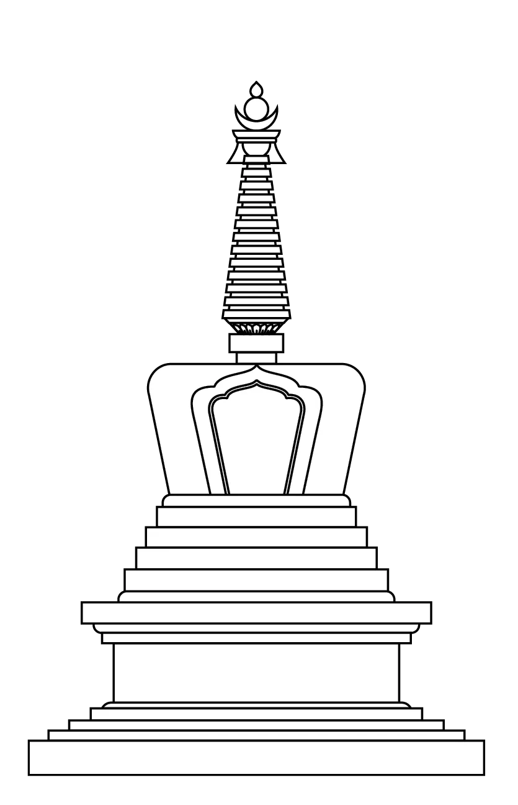

# 修行人如何闭关

索达吉堪布·传讲

传讲时间：2018年5月28日

修行人如何闭关

索达吉堪布·传讲

喇荣内部的金刚萨埵法会已基本圆满，明天僧众再念一下《药师经》就全部结束了。金刚萨埵法会有二十几年的历史，以前是对外的，现在改为内部法会，但外面的人可以参与共修，这方面没有限制。这次法会，大家念修的情况很好。今天做总回向的时候，我看到报上来的念咒数量非常多，因此大家所获得的共修功德也很圆满。

同心同德

这里的道友们在七天当中一直精进地实修，各个地方的佛教徒也比较听话，多数都在当地参与共修。开法会之前我也讲过，这里的交通、卫生条件等方面都不是很方便，最好不要来很多人，不然你们可能会自讨苦吃。后来确实没有来很多人。

其实，大家在各自的地方参与共修，所获得的功德是同样圆满的。而且，所有僧众和善心人士共同回向功德，所获得的善根乃至菩提果之间都不会耗尽。另外，大家在诸佛菩萨尤其是金刚萨埵佛面前，忏悔无始以来的自性罪和佛制罪，我相信，在清净的法性力、不可思议的缘起力和金刚萨埵佛为主十方佛菩萨的发愿力等殊胜因缘齐聚之时，自他相续中的罪业都能得以清净。因此，我们不一定要到同一个地方才能参与共修，只要以同样的一颗心做同样的事情，就会获得共同的功德。这就是佛教中所讲的缘起不可思议。

“吉祥日”

今天，我按照课程安排给大家讲一下“修行人如何闭关”。在此之前，我先念一下《释迦佛修法仪轨》的传承。

为什么要念这个传承呢？因为明天（农历和藏历都是四月十五）是本师释迦牟尼佛的成道日和涅槃日。

有些历算中说，明天也是佛陀的降生日，有不同的说法。在汉历当中，普遍的说法是农历四月初八为佛陀降生日。在藏历当中，按照《时轮金刚》的推算方法，佛陀的降生日为四月初八或四月初七。

不管怎样，萨嘎月确实非常殊胜，因为在一年的十二个月当中，只有这个月具足了佛陀的三个节日（降生日、成道日、涅槃日）。在此期间，全世界的佛教徒会以各自的方式纪念佛陀。

今天我也想呼吁大家，在佛陀的成道日举行一些活动来纪念佛陀。明天我们可以念诵一下《释迦佛修法仪轨》，我在十多年前翻译了这个仪轨，并倡导大家经常念修，等会儿我就给大家念这个传承。

在斯里兰卡、新加坡、马来西亚、缅甸、老挝、越南、美国、加拿大等很多地方，佛教徒都非常重视佛陀的诞生日、成道日等节日，届时会举行一些纪念活动。而中国的佛教徒，在这方面的活动就比较少。在藏传佛教当中，僧众会在安居结束时宣讲释迦牟尼佛的十二相成道；在汉地，佛教徒会在四月初八庆祝浴佛节。但这些活动的范围都不是很广。

所以我想，我们佛教徒能否从今年开始，将四月十五这一天作为佛陀的一个特殊节日。虽然在佛陀的四个节日（降生日、成道日、转法轮日、涅槃日）当中，喇荣都会举行法会，但这其中最重要的就是萨嘎月的十五号，即佛陀成道日和佛陀涅槃日，我们最好在这一天有一些特殊的仪式。

◎ 卫塞节

在东南亚的很多国家，这一天是卫塞节，他们会举行各种活动来怀念佛陀。1995年，我们随法王如意宝去新加坡，在那里参加过两场卫塞节活动。一次是在晚上，观看他们总会的表演，现场有一尊非常大的释迦牟尼佛像，很多学生在佛像前献歌献舞、赞美佛陀；一次是在白天，法王如意宝去了当地的道场参加活动。

卫塞节是一个很重要的国际性节日，一些政界首脑也会参与其中。2006年，在泰国举办的大型卫塞节庆典中，四十多国的佛教徒前来参加，时任联合国秘书长安南也为庆典送上了祝贺。2016年，奥巴马以美国总统名义向卫塞节庆典大会发来贺信，时任联合国秘书长潘基文在大会上致辞：“面对当前存在的大规模人口流动、暴力冲突、残暴的侵犯人权行为和旨在分裂社群的仇恨言论，纪念神圣的卫塞节提供了一个宝贵的契机，我们可以借此思考佛教教义如何能够有助于国际社会处理各种紧迫挑战。”今年（2018年），尼泊尔总理也参加了本国的佛陀纪念活动。

◎ 纪念仪式

既然连政界的领导们都如此重视佛教节日，那我们佛教徒以及佛教的寺院、道场、中心、学会等，就更应该重视这些特殊的日子了。若在一年365天当中，对佛陀的节日都不闻不问，恐怕不是很合理。我们通过各方面的观察，已经对藏传佛教的寺院提出倡议：从今年开始，在佛陀的节日举行一些纪念仪式。

前两天，佛学院举行了一个比较简单的佛陀成道日纪念仪式——为了避免与金刚萨埵法会的时间发生冲突，仪式是提前举行的；我的寺院朵芒佛学院，明天会集聚僧人和在家信众，召开为期一天的佛陀纪念法会，非常有意义。

这边的道友们，明天也要举行一个象征性的仪式。由于时间比较紧，网上也没来得及通知，大家就做一些简单的念诵：前后念汉文的《普贤行愿品》，中间念《释迦佛修法仪轨》，再念1000遍释迦牟尼佛心咒“嗡牟尼牟尼玛哈牟尼耶索哈”；并做简单的灯供、花供，供灯时要注意安全，防止发生火灾。

各个地方的佛教徒，如果实在没有条件跟大家聚在一起，可以单独做一个简单的纪念仪式。我小的时候，每逢佛陀的特殊节日，都会请求母亲给我一点酥油，自己做一盏灯，供在佛像面前。刚开始，我连佛像都没有，就拿一块三角形的石头当佛像。现在看来，当时的做法是对的，小的时候还是有一些善根的。

在那个年代，宗教政策还没有开放，佛像、唐卡都非常难找，而且人们之间互不信任，即使自己有佛像也不敢拿出来。当时，我家隔壁住着一位老喇嘛，他经常说哪一天是佛的什么节日。于是，我就在那一天把那块三角形的石头拿出来，放在特殊的石板上，再供一盏灯。因为怕别人告状、惹出麻烦，我供灯的时候会非常保密——在帐篷里面，用一些衣服把四周围起来，我一个人在里面念释迦牟尼佛心咒，一直念到灯熄灭为止，我的“供佛仪式”就算结束了。我当时选的那块石头，看起来还是比较像佛像的。至于孩童时代玩耍般的“供佛仪式”，也应该是具有功德的，去年我讲《妙法莲华经》的时候也说过这一点。

现在真的很方便，佛像、唐卡都很容易得到。但如果家人不信仰佛教，不方便摆佛像，可以从网上下载一些图片放在电脑里，看到有人来了，马上玩游戏就可以了。

总之，希望大家明天在各自的地方过一个大乘佛教的卫塞节。

◎ “吉祥日”的内涵

释迦牟尼佛成道和涅槃之时，月亮都是圆满的，因此卫塞节也是月圆之日。1950年，世界佛教联谊会在首届会议中，通过了庆祝卫塞节的决定，并请求各国政府领袖，将公历5月（藏历、农历四月）的月圆之日作为公众假期，以纪念佛陀。但在中国，人们很少庆祝卫塞节，很多佛教徒甚至不知道有这个节日。

其实，这一天不仅是一个佛教的节日，也是一个吉祥圆满的日子。我等大师释迦牟尼佛证悟万法实相，给整个三千大千世界带来了光明和吉祥。因此无论是佛教徒还是非佛教徒，都可以把这一天当作“吉祥日”。作为佛教徒，如果在这一天没有举行任何仪式、没有任何表示，是非常遗憾的。

◎ 营造吉祥气氛

在西方，人们庆祝圣诞节的时候，会装扮圣诞树，还有圣诞老人等。我们过“吉祥日”的时候，也可以有一些特殊的标志。当然，我们不会效仿他们吃火鸡，但我们可以吃“吉祥饭”“吉祥菜”等，大家在这一天多吃一点好吃的；还可以制作“吉祥卡片”，希望懂卡片制作的佛教徒，明年能做出一些丰富多彩的“吉祥卡片”；还可以打“吉祥结”、送“吉祥礼物”等。这样大家都会比较开心。

◎ “佛诞日”的历史记载

关于佛诞日，历史上也有一些记载：周昭王有一天看到，太阳出现两重光轮，祥光遍照四方，于是命太史进行占筮，太史说：“这是西方圣人降临诞生之相，此后过1000年，他的教法会传到我们这个地方。”周昭王命令将此事刻在石头上记载。大概过了1000年，汉明帝在梦境中见到了佛陀，就派人前往印度求取佛法。他们回来的时候，是用一匹白马驮着佛经，因此汉明帝下令在洛阳建造了白马寺。这段历史我以前也讲过。

◎ 非佛教徒也可以过“吉祥日”

我刚才所说的“吉祥日”，也可以不冠以“佛”字，便于非佛教徒接受。因为，宗教信仰毕竟只是一部分人的精神活动。在一些基督教的活动中，也没有宗教标志，这样大众就容易接受。

像基督教，在一些非宗教场合，甚至是无神论的场合都会举行活动。有些不信上帝的人也会加入，如果你问他们加入的原因，他们自己往往也答不上来，也许是被当时的气氛所感染了吧。这样也是非常好的，因为不管是基督教、佛教还是其他一些宗教，都可以成为人们心灵的妙药与依靠。

◎ 为了佛法的延续

如果“吉祥日”形成了一种传统，孩子们就会经常期盼，“什么时候到‘吉祥日’啊，那一天会有很多好吃的！”不过，现在的很多孩子可能对吃的没什么感觉了，不像我们小时候，对一颗糖都特别期待。

我们每个佛教徒都要反思：对于佛陀证悟的日子，为什么没有一种特殊的表达，为什么没有任何仪式？这样下去的话，佛法的传承也许将无法延续。所以我再次呼吁大家，以后要在佛陀的成道日举行放生、供灯等活动。

另外，大家不仅要共同做善事，还需要一些沟通和交流。比如可以互相赠送一些礼物，你可以对别人说：“我们都是佛教徒，所以我要等到‘吉祥日’再送给你，至于是什么礼物，我要保密75天！”于是对方一直等着，到了“吉祥日”收到礼物的时候就很惊喜，“哇，原来是这个，真好啊！”

在泰国、不丹、尼泊尔等很多国家，每逢佛陀的特殊节日，都四处洋溢着浓郁的佛教气息，每个佛教徒都会在门口悬挂佛教旗帜。当然，各个国家的情况不一定相同，但在个人层面，我们还是可以把握自己的生活方式和内在信仰，因此小范围内举行一些仪式应该没有什么问题。

从寺院的层面来讲，理应在佛陀的节日举行一些纪念仪式，但很多寺院并没有这么做。当然，有些寺院会庆祝浴佛节，还是很好的。以前法王也参加过浴佛节活动，还讲述了佛陀的很多功德，我们当时给法王拍了一张照片。在庆祝佛陀的节日时，大家应该多讲佛陀的感人故事，表演与佛陀的事迹有关的节目，这非常有意义。

下面我念传承。

（堪布念藏文传承）

刚才念了《释迦佛修法仪轨》和会供、供护法的几个简略仪轨。

明天，大家可以发一些殊胜的愿，在发愿的时候一定要忆念：本师释迦牟尼佛在因地时，为我们这些三界众生布施过多少次身体、行持了多少苦行……这些事迹，在我们学习过的《释迦牟尼佛广传·白莲花论》中有详细叙述。

我们是佛陀的传承弟子，理应对佛陀怀有深厚的感恩之心，犹如孩子始终不忘父母的恩德。但佛陀与父母的差别在于，他的慈悲没有远近之分，任何对他有信心的人，都能得到其加持、灌顶和摄受；反之，如果对他没有信心，即使整天待在他的面前，也不一定能获得什么利益。

这些道理看似简单，但我们也一定要看看自己到底有没有真正懂得。的确，佛教中的闻思还是很重要的。有闻思基础的人，在这次法会中就能如理念修，取得不错的修行效果。而闻思基础非常薄弱的人，即使已经入佛门20年，或者闭关了五六年，也无法如理修持一个简单的忏悔法门。

闻思是实修之基

所以，我非常反对没有任何闻思基础的闭关与实修。有些人刚刚皈依，第二天就说：“我要闭关，我要禅修！”其实，这样的实修只是一个形式而已。

另外，不闻思的人容易迷信，有些佛教徒确实有这方面的问题。当然，这些问题被非佛教徒指出来的时候，我们心里会不太舒服。但若就事论事，有些佛教徒确实是过于感性了。他们不好好闻思慈悲、智慧、出离心、菩提心等重要的佛法教义，只是整天搞一些形式上的活动，赶各种法会，这样的人现在被叫做“法会居士”。

“法会居士”尽管参加了无数次法会，但真正实修时，还是连一个非常简单的金刚萨埵仪轨都不会修。其实，我们讲《大圆满前行》和《入菩萨行论》的时候都讲过这个修法，但对有些人来说，讲了也没有用。

这几天我发现，有些居士连恭敬三宝所依的道理都不懂，随便跨越踩踏法本、佛像、唐卡、转经轮、佛经等，有些人还会坐在上面。那天大家排队进来的时候，管理人员为了维护经堂卫生，给每人发了一个塑料袋，用来装鞋子。但有些居士是怎么做的呢？他们把金刚萨埵唐卡放在塑料袋的最下面，然后再把鞋子装在上面……

对于如何恭敬三宝所依，佛经中讲过很多，我在课上也讲过无数次，但有些人还是不懂，从他们的行为中就看得出来。不仅如此，有些人还口口声声地说自己有什么境界、依止过哪些上师、得过什么高法……说的全是高大上的豪言壮语，仿佛用不了一个礼拜，他就可以飞到外太空去了。

之所以要跟大家说这些，是因为有时候，一味赞美起不到作用。

关于闻思与修行，我在香港度母法会也说过，最好是闻思5年到10年才考虑专门的闭关。有些人年龄偏大或闻思能力非常薄弱，实在无法学习五部大论，这种情况就不强求；但各方面因缘都具足的人，最好把五部大论学完，然后再学修生起次第、圆满次第、大圆满等密法。因为缺少闻思基础的话，修行时就会非常困难。

有些人说：学五部大论会增加分别念和所知障。这非常可笑。所知障[^1]是获得佛果时才能完全断除的非常细微的障碍，学五部大论怎么会增长所知障呢？有些时候，我们佛教徒自己说出来的笑话还是特别幽默的。

今天虽然要讲如何闭关，但我还是想提醒大家，很多人可能并不具备闭关条件。除非你参加的是与佛法没有任何关系的“闭关”。

现在有些国家流行“闭黑关”，而且价格很贵。“闭黑关”的人，进入关房后做什么都可以，只要在7天到21天当中不出来就行，不能见到光明。这样的地方恐怕跟看守所、监狱没有什么区别吧？只不过后者还有提审。但是，很多人还是特别欢喜，提前一两年就开始报名了。

有些人听到这些可能不太舒服，但我还是觉得，至少要修一些解脱法门，才称得上是佛教的闭关。如果只是在关房里面随心所欲，那究竟是何种闭关呢？可现在的人非常颠倒，真正有内涵、有价值的法不去修，非要去修这种法。

修行主要靠自己

还有很多人说：如果要闭关的话，我一定要师父带着，不然我不会修。有什么不会修的？如果修行还要师父带的话，说明你的水平太差了。师父一般是在你闻思的过程中给你讲解的——我给你指点解脱道，而解脱依赖于你自己。本师释迦牟尼佛也是这样说的：“吾为汝说解脱道，当知解脱依自己。”他并没有给每个弟子单独指导，“舍利子过来，我今天教你禅修。”可是很多居士就比较迷茫，认为有人带修才好，并为此付出很多代价。

其他宗教当中还有“辟谷”，就是7天当中不吃饭，参加“辟谷”的人要交5000块钱到1万块钱。很多人也特别欢喜，“我一定要去，不吃饭很舒服！”你自己在家里不吃饭也差不多吧，为什么一定要到那里去呢？我们用智慧来观察的话，有些人真的是……当然，在他们面前我们也不会说这些，而是会说：“哇，非常殊胜，好棒哦，真是很了不起！”因为不这样说可能也不行。

何为闭关？

如今世界上有各式各样的闭关，比如“工作闭关”“生活闭关”“旅游闭关”，武侠小说里也经常提到“闭关”。所以很多人一听到这两个字就很惊讶，甚至会害怕，因为他们不清楚到底什么是“闭关”。

佛教徒最好以智慧来观察：何为佛教中的闭关？当然，有些人只是为了养生或调节情绪而参加各种闭关，我们也不排斥，只要你有这个条件就可以。但是大家一定要懂得，佛教中与闻思修行相结合的闭关，与世间的各种“闭关”截然不同。有些佛教徒不明白这一点，整天背着个黄色的包，装得满满的，东南西北地到处跑，“某个人要传真正的闭关法，我要去！”但是，他所谓的“真正的闭关法”究竟是什么？大家要自己观察。

其实，像藏传佛教中无垢光尊者的《三处三善引导文》就是真正的闭关法，其中有140个引导文。1992年我传了这部法，有些人依此而实修。后来有一位比丘尼依靠本法获得了成就，对此我深信不疑。很多续部和论典中都说，上根者修习大圆满，六个月会获得成就，而从我讲完这个引导文到她圆寂，刚好是六个月。我在一些书中也如实地做了记录[^2]。

无垢光尊者在《三处三善引导文》中说，上等修法者每个引导修7天，中等修法者每个引导修3天，下等者每个引导修1天……很多法本对于修行方法都讲得很清楚，但有些人还是觉得自己不会修，一定要去黑屋子里面闭关。

去黑屋子里闭关也可以，前提是你的修行要与出离心、菩提心、无二慧相关联。如果只是压制分别念，就不是真正的闭关了。正如华智仁波切所说：未以出离心、菩提心所摄持的修行，闭关9年也会一无所获，连解脱的种子都无法播下。

从未学过佛法的人，不懂佛教的闭关还情有可原，但佛教徒也不懂的话，就有点悲哀了——只有极少数人不懂也正常，因为在任何一个团体中，人们的水平都不可能完全相同；但如果多数佛教徒都在盲修的话，就要出问题了。

我为什么一直强调闻思与修行相结合？因为佛教是一个非常殊胜而又系统的教育体系。但现在很多人把佛教当成了一种活动、一种灵丹妙药或止痛剂，甚至是某种神神叨叨、可以产生特异功能的方法，这是对于佛教莫大的误解。

闭关的重要性

十多年前我讲《入菩萨行论》的时候，第二节课讲到了菩提心的功德，要求大家每天早上修半小时菩提心，很多人都发愿了。前几天我遇到了当时听课的一些道友，问他们是否还在坚持，他们说，十多年来没有间断过，每天早上或晚上都会修半小时以上。

我觉得他们非常了不起。相比之下，我自己虽然是倡导者，但由于经常出去弘法、讲课，需要倒时差、赶时间，有时候就没办法修了；在佛学院还稍微好一点。还有一些人，当时可能只是口头上说说而已，修得不是很理想。

去年我讲麦彭仁波切的《禅修法》时，也要求学会的人一年至少闭关7天，如果无法连续闭关，就在一年当中累计闭关7天。但是到了年底统计的时候，只有20%左右的人做到了，80%的人都说没有时间修。其实，他们不是没有时间修，只是没有修行的习惯，觉得自己不会修，也不想修、不愿意修。

如果没有修行，烦恼确实是很难断除的。西方的“一万小时定律”中说：要想在任何一个领域取得突破性进展，必须付出至少一万小时的努力。比如要精通一门技艺，就要花一万小时以上去学习、去锤炼。“一万小时”是什么概念呢？按照工作日每天8小时来计算，大概需要5年时间。因此，长时间持续地下功夫，才会在某个领域获得比较明显的、超越平凡人的境界。

有些佛教徒的修行确实是比较差的。我们喇荣寺、佛学院和居士林，在修行方面算是有一种强迫性的要求——每年至少要闭关14天。这几年，大家的修行效果还不错。

有些世间人也非常重视闭关。像比尔·盖茨每年都要闭关14天，当然他闭关并不是为了解脱或利益众生，而是为了在创意、战略等方面获得灵感。我们作为佛教徒，应该比他们更重视闭关才对。

闭关的时间

闭关的时间并不是固定：3天、7天、21天、1个月、100天乃至更长时间都可以。在藏传佛教中，有些修行人会闭关3年、3年零3个月或10年。当年，达摩祖师曾面壁9年。华智仁波切的传记中说，有的修行人通过9年闭关而获得了成就……对于大多数在家人来说，长时间闭关是不现实的，但在一年365天当中，利用节假日休息时间闭关应该是可以的。

有些人以前对修行关注得比较少，所以去年我倡导闭关以后，很多问题就出现了。有些人在闭关过程中非常保守，他们会问：座间可不可以打电话、发微信、接送孩子、吃饭、上厕所、吃瓜子、上网买东西、跟人聊天？而有些人又太开放了。

实际上，闭关之前需要结界，划定闭关区域；还要规定闭关时间，就像我们出家人在安居之前，要提醒安居期限一样。这些大家可以根据自己的情况来定，比如计划上午、下午各打坐两小时，或者早晚各打一坐。定好之后，就严格按此执行。

具体的闭关方法，大多数人可以按照《日修闭关要诀》来修，我们之前给大家提供过。在那个要诀当中，我结合了阿琼仁波切、法王如意宝等很多上师的窍诀。

对于一些在家修行人来说，直接断掉所有的散乱和分别念去闭关确实有一定困难，但还是应该尽量努力。藏地有些在家人，一听说闭关就很害怕，“怎么闭关啊，在7天当中不吃、不喝、不睡觉、不说话吗？这也太孤独了吧？产生烦恼怎么办啊？”有很多的担忧和顾虑。

其实不需要这样担忧，闭关过程中即使产生了一些分别念、跟人说话了，也不会有什么大的问题，更不会像有些人所想象的那样，会受到护法神的惩罚。一开始要对自己宽松一点，不要特别严格，否则修行会很困难。如果循序渐进地修，慢慢就可以步入正轨了。

闭关要诀之六法

全知无垢光尊者在《窍诀宝藏论》中讲了“闭关要诀之六法”，即外、内、密、上、中、下之闭关[^3]。

外闭关：在闭关过程中，尽量远离容易引起贪嗔痴烦恼的环境。因为凡夫人的心容易散乱，在遇到外缘时很难不受影响。

内闭关：尽量断除内心的贪心、嗔心、嫉妒、骄傲等烦恼，并使信心、悲心、智慧、菩提心等正面心态不断增上。

密闭关：修行到了一定的程度，只要安住在自性光明与空性无二无别的境界中即可，能取、所取要全部远离。

然而在有些道场，刚开始就让大家安住，什么都不想，这种做法有点危险。因为有些人还没有任何基础，连居士都不是，加行也没修过，直接安住可能不合理，还是要打好基础。

总之，外闭关是指断除外在的散乱，内闭关是指尽量修持善法，密闭关是指放下所有的分别执著。

上闭关：不希求神通、本尊的加持与授记等，只是安住在自己的境界当中。

下闭关：在修行过程中，不担忧自己是否修错了，对正法不生怀疑，对因果不生邪见……将各种负面情绪和念头全部放下，安住在自己的境界当中；有时还要祈祷上师三宝和护法神。

中闭关：不执著自己所修的法。即使有时做了好梦，出现了好的境相，也不要太开心，“哇，我现在可能成就了，闭关成功啦！”不要这样想。即使有时做了噩梦，或身体不舒服、心情不好、孤独寂寞，也不要太伤心。

有些人特别情绪化，他们的心情就像春天的天气一样：一会儿高兴得不得了，笑得比弥勒佛还灿烂；一会痛苦得不得了，好像比无间地狱的众生还痛苦。其实修行人不能这样，心态要比较平和，将一切好与坏的现象都观为如梦如幻。

如梦如幻观的确很重要。我们对生活与修行中的任何境相都不应过于执著。若按中观和大圆满的方法来观察、抉择，确实没有什么好执著的。比如观察一切万法的因缘、本体和果，会发现它们在胜义当中都了不可得，在世俗当中如梦如幻。有了这样的见解，就容易获得一定的修行境界。

很多人说自己不会闭关，其实没有什么不会的，除非你对佛教的教理一窍不通。如果是这样的话，那你交多少钱也没有用——现在西方的很多人将瑜伽、闭关、禅修当成了最好的赚钱工具。其实，一个真正的佛教徒不一定要在这方面花钱，而应该在法本中寻找答案。像《前行备忘录》等前行、正行的教言，你只要好好学一遍，就会非常清楚，修行过程中应该注意哪些问题。而这些，在一些需要交钱的地方是学不到的。

很多人自己根本没有闭过关，也不会修行，更没有什么境界，却在教别人禅修，“你应该这样上去，这样下去，现在放松下来……”很多人也很愚昧地跟着学，“上去了，下去了，现在可以了……”他们有时还会说：“明天我要给你们讲最深的法，但价钱要提一下，因为我们最近比较忙……”实际上，他们所说的一些“闭关法”，跟出离心、菩提心、无二慧一点关系都没有。

不知大家有没有看过《印度八十四大成就者传》，在这84位大成就者当中，有70多位是在家人，而且大多数人的种姓并不高贵，但他们的修行都获得了成功。现在，印度还有他们曾修行过的山洞，我们去印度的时候就朝拜了萨绕哈巴等大成就者的山洞。

因此，修行确实要靠自己，不能一直指望某位上师、某个道场，甚至到一些根本不熟悉的地方去。有些佛教徒经常到处跑，我看了都非常心疼。当然，如果你有所收获，到哪里去都可以。但是否如此呢？大家要用智慧来观察。

成就相

如何检验自己的修行是否正确呢？麦彭仁波切说，要想知道自己是否真正证悟了空性，就要看自那时起，你是否对因果缘起深信不疑，烦恼是否逐渐微薄，如果是，你就获得了真正的成就相[^4]。

有些人会想：“我修错了没有，这样闭关会不会出问题呢？”那你就看看自己对因果法门是否越来越有信心，相续中的烦恼是否越来越少，如果是，说明你修对了，闭关成功了；如果你对众生的悲心越来越弱，对业因果、上师三宝越来越生不起信心，甚至产生邪见，贪嗔痴烦恼越来越重，出关以后脾气也越来越大，那就说明你修错了。

昨天，在我们学校的毕业典礼上，有个学生说：我们的某某老师，个子不大，但脾气不小（众笑）。同样，如果我们闭关的时间不长，但烦恼不少，那可能不是很好。

利他

另外，我想借这个机会感谢各个地方的志愿者们，感谢他们多年来为贫困地区的教育和慈善事业所做出的贡献。在他们当中，有些人是刚刚大学毕业就到了藏地、云南、贵州等地支教。我最近也去了一些学校，看到很多志愿者在非常投入地教书育人，深深地感受到他们是真正具有菩萨精神的人。

我想，有些人如果闭关很久都没有修出什么功德，反而增长了烦恼的话，还不如到一些偏僻的地方去帮助老人和孩子。有些人可能觉得这样的行为没有什么意义，但实际上，这是非常殊胜、有意义的利他行为。当然，我也非常赞叹那些终生闭关的人，比如藏传佛教的一些大德。但我们如果无法像他们那样终生闭关，也可以通过其他方式来积累功德。

利他的行为不一定会被所有人理解，就像米拉日巴尊者所说：我看轮回中的众生很可怜，轮回的众生看我也很可怜。的确，修行人看到世间人整天都在造业，所作所为都在违背因果，就会想：“这些人死了以后怎么办啊？”同样，那些不信因果的人也会想：“这些佛教徒为什么要放生？为什么要到偏僻的地方去教书？是不是精神有问题？”这种价值观上的隔阂，自古以来都存在。

不管怎么样，每个人都可以站在自己的角度来看问题。从我们佛教徒的角度来看，好好禅修与利益众生都是非常有意义的。

我自己也非常想闭关禅修，但一直在往后拖，不知以后还有没有机会。我在想，如果有一天我死了，你们可能会说：“堪布当时很想禅修，但他确实没有时间，还没来得及修就离开了……”我自己可能也会很遗憾。所以，我确实特别羡慕那些终生闭关、终生修行的人。

另外，那些一心利他的人也非常值得羡慕。他们没有任何自私自利的心，不需要名声、财富、地位，甚至将自己最好、最美、最爱的人都放了下来，去往他乡帮助众生——这个世界还是存在美好的。

小结

我今天说了三件事情：

第一，每年释迦牟尼佛的成道日，大家都要举行吉祥活动。我相信，凡是与释迦牟尼佛结缘的人，不管有无信仰，都会依靠本师不可思议的加持力而获得吉祥。

第二，希望大家重视修行，不要整天夸夸其谈，像我一样一直讲讲讲。如果不修行的话，烦恼丝毫不会减少，最后面对死亡时也毫无把握。这样度过一生的话，人身就空耗了。总之，大家要将学与修圆融起来，因为二者本身就是相辅相成、缺一不可的。

第三，如果自己不能好好闭关、修行，就去做一些利他之事。虽然凡夫人不可能完全放下自私自利，但怀着一颗善心去利益他人也很有意义。

最后也要特别感谢这次法会的志愿者，如果没有你们的帮助，很多方面就会出现困难。

昨天，我本来打算参加你们的感恩会，但是因为实在抽不开身，就没有去，很遗憾。我的事情确实比较多，可能是因为我心里比较有活力吧，这个也想做，那个也想做，最后把自己弄得特别累。昨天有一位藏族老师跟我说：“您每周必须至少休息一天……”他给我发了4个60秒的微信语音。可能我确实需要休息吧。不管怎样，从大家这几天的发心情况来看，很多人的确是具有利他心的。

利他心的确很重要，缺少了利他心，很多事情都会变得困难重重。昨天我跟一些学生到外面去玩，后来发现地上的垃圾特别多，很多发心人员就开始拼命地捡。等到所有人都离开的时候，草地上已经变得干干净净了，看起来非常舒服。如果大家都没有这样的爱心，只顾自己玩，玩完就走了，那个地方会变成什么样？如果大家都很自私，只想获得、不想付出，这个世界又会变成什么样？

所以，每个人都要有爱心，而且要自觉地付出，看到哪里有需要就去哪里帮忙，而不是等别人来指挥，“你过来，你来捡这里的垃圾……”

最后我想说的是，希望大家在因缘具足的时候，也自觉地去闭关、禅修。

[^1]: 所知障：指执著于所证之法而障蔽其真如根本智。又作智障、智碍。为二障之一，“烦恼障”之对称。谓众生由于根本无明惑，遂迷昧于所知之境界，覆蔽法性而成中道种智之障碍，故称智碍。
[^2]: 《密宗成就者略传》：明慧比丘尼，四川雅安人，1989年到五明佛学院学法，后获得堪姆（法师）称号。1993年9月1日在上师前听完《大圆满心性休息三处三善引导文》后，因患癌症到汉地治疗，后回到雅安金凤寺，圆寂前半月身体已不觉病痛。在生病的那段时间里，她对面的墙上始终挂着金刚上师法王如意宝、阿弥陀佛与观世音菩萨像，而且神智一直都很清醒。1994年3月1日，明慧圆寂前，给服侍的道友讲说了般若空性，并发愿将来必定救度她们，便双足跏趺、双手合掌，安详圆寂，圆寂后身体还是一直保持着合掌、盘腿的姿势。在寺院中火化后，骨头呈现红黄绿三种颜色。大圆满续部指出上根人修大圆满六月即可成就，从明慧1993年9月1日听完大圆满引导法，到1994年3月1日圆寂，前后正好六个月时间。如法王在《胜利道歌·天鼓妙音》中说：“六月修要得解脱。”《金刚帐续》中也说：“不动信解行六月，金刚持地能获得。”又《庄严誓言续》说：“由六月不动，信解及恭敬，获金刚持地。”以续部所示观察其圆寂前后的征象，已得解脱无疑。此在新加坡《狮城潮音》1997年第3期上曾有登载。
[^3]: 《窍诀宝藏论》：“实修闭关要诀之六法：远离贪嗔乃为外闭关；无有积蓄乃为内闭关；远离二取乃为密闭关；不希善妙乃为上闭关；不忧恶劣乃为下闭关；无事无执乃为中闭关。若具此六不会出违缘。”
[^4]: 《定解宝灯论》：“若具正见之明目，前所未有证相增，现见空性功德力，于业因果缘起法，无欺惑性生诚信，一切烦恼渐微薄。”
