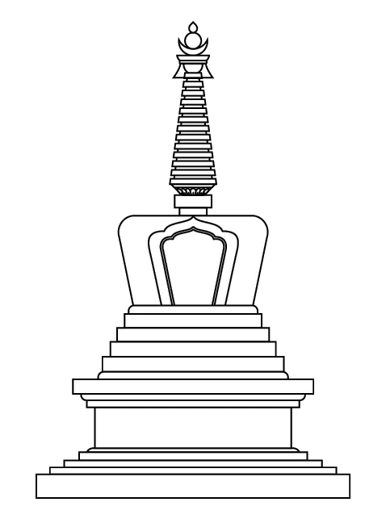

第2课

2023年5月25日

现在正在讲《无常悲歌》。

青春自满少男女，从未浮现死亡念，

不知来时阎罗使，颈索缚时悔不已。

世间当中，风华正茂、青春美满的男男女女们，他们贪执世间的事，心里从未浮现过“我会不会死亡、会不会无常”的念头。尤其是，他们根本不知道阎罗卒什么时候竟到了身边，用死亡的绳索来捆着自己。这时就有很大的后悔：“没想到我死得这么快！我还没有享受过好的生活，这么年轻就死了，为什么啊？”

世间很多人都是这样。尤其是处于青壮年的男男女女，他们耽著于今生的琐事，追求所谓的美好生活，除此之外，从来都没想过：“我什么时候死啊？死的时候怎么办啊？没有正法，来世会不会很痛苦啊？”

我们常说“黄泉路上无老少”，放眼世间，就是这样的景象——黄泉路上，有白发的人，也有黑发的人；有在车祸、空难、水灾、火灾等各种灾难中死去的人；还有每年因为抑郁症而自杀的人……各种各样。

其实，我们的身边就有很多无常。刚开始，人们觉得要建立一个家庭，追求幸福的生活，可是还没过几天，其中一个就离开了人间，或者经历了各种分离。所以，法王在这里讲到了死亡无常。遗憾的是，年轻人的心里从来都没有一个“死亡无常”的念头，但现实却并不美好。

相恋同龄年轻人，甜言蜜语表爱意，

欲终生伴不分离，我等不知寿长短。

同龄的年轻人经常用甜言蜜语来表白爱意，说是生生世世不离开，还发一些海誓山盟。他们终生都不愿意分离，想要一直白头偕老，但其实很难。因为，我们都不知道自己寿命到底多长。

很多年轻人喜欢海誓山盟，例如什么“大海枯了，石头烂了，但是两心永不变”。可实际上，大海还没有干，石头还没有坏，感情已经破裂了。有些人在短短几天之内，新鲜劲一过，爱情的“保质期”也就过了，有各种意外发生。而且，法王在这里也讲，人的寿命可能长，也可能不长。有些人虽然还没死，但对将来会发生什么都不能确定，更不能保证。

现实中也可以看到，有些人经历了爱情的无常，或者其他方面的一些突发事件，最初的美好愿望最后都化作了悲惨的泡影，再也不想触碰。很多人因此都特别痛苦，甚至有些人实在承受不了，就此离开了人间。这样的现象不胜枚举。所以，针对世间男女的感情，法王讲到了无常。现在网上也有报道，一些明星的感情特别随意，今天跟这个谈，明天跟那个谈。很多年轻人则不想谈恋爱、不想生孩子、不想接触——相当于他们都不用学出离心，就已经自然而然产生了。

现在很多人对婚姻没有好感，觉得是一种空谈，或者是一种虚妄，并不像电视或者电影上看到的那么美好。所以，现在的生育率越来越低，可能到2035年就会出现人口负增长[^1]。而且，中国已经进入了老龄化阶段。那天我听到一个新闻说，我们甘孜州都已经是8%的老龄率了。现在很多县城处于这样的情况，如果再过一段时间，可能更严重。

如今，人们的观念跟以往的时代不同了。其中一个原因，如果生很多孩子也养不起，经济上有很大的压力；第二个原因是很多人对成家没什么兴趣，思想受到了西方不婚观念的影响。这些种种转变，也是一种无常。

其实，法王如意宝当年并没有选择世间生活，但他以一种广大的智慧，照见了世间的分分合合，也照见了世间繁杂的事都不过是无常。人们心心念念所希求的“美好人生”，最终都掩盖不了真相——其实生活的内核是腐朽虚妄的，并非如心中所想；只不过外表包装了太多古今中外的美好词汇，里面根本没有实质。

去年家财富足者，今年多成凄惨人，

心镜映现此景时，于有漏法生厌弃。

去年还是家财万贯、富可敌国的大富人，今年大多已沦落成凄惨可怜的穷汉。当“心”的镜子里映现出这些无常景况时，对有漏的法不会再有好感，一定会生悲哀厌离之心。

前段时间，有个人在国外投资，有说投几百亿，有说投了几千亿，结果国外的银行破产了，他身无分文，一夜之间成了穷光蛋，特别可怜。其实，佛陀的教义里说过很多无常，从现实来看，世事确实是这样。包括前几年在这里做了很多事情的有些领导，以前特别厉害，但后来下场也很凄惨。很多富豪经常宣扬自己多么了不起，之后却沦为了穷人。我以前遇到过一个人，他说自己富裕的时候，拥有包括私人飞机在内的无数奢侈品，但后来由于各种原因破产了，连吃面的钱都要找朋友借。

所以，无常的道理真的很简单。每个人不要认为自己的现况是这样，以后永远不会变。有时候，人生难免有高高低低，有些是快乐的时候转而变成痛苦的，有些是痛苦的时候又转而变成快乐的；有些是富裕时转而又变贫穷的，有些是贫穷时转而又变富裕了。或者像《大圆满前行》里所讲的，上半生是很好的人，下半生却变成了特别恶劣的人；上半生是特别恶劣的人，下半生又变成了特别好的人。在这些方面，很容易发现无常。

其实，我们的身边也能处处观察到无常。但如果无常发生在自己身上，也没必要太过在意。比如，倘若你以前有钱，现在没钱了，人人都看不起。那你可以想：“佛陀说的没错，一切果然是无常的。”如果你年轻的时候很漂亮，老的时候连自己都不敢照镜子，怎么办呢？应该这么想：“佛陀说了‘没事的’，一切都是无常的。”

所以，人生当中，无论对身边的人还是自己，观修无常确实很重要。

三十皓齿各脱离，满面皱纹如险路，

已示汝将不久死，若仍不知蠢非牛？

年轻时的三十颗皓齿，到老的时候都一个个松了、掉了；脸上的皱纹一道道的，就像弯曲的险路。这说明不久的将来，你一定会死亡。如果你仍然不知警觉，那不就和愚蠢的牦牛没什么差别了吗？

现在的技术发达了，如果年轻时牙齿不太好，老了换成更好的假牙，甚至比以前的真牙还要白。但不管怎样，这也不能维持很长时间。而且，老了之后会满面皱纹，凭借现在的美容技术，虽然也有越老越没有皱纹的情况，但这也挡不住真正的衰老。

现在很多人会恭维：“看你越来越年轻，已经冻龄了。”意思是说你不会衰老，年龄已经“冻僵”在那里了。但其实也并不一定。就像冰箱里的食物放太久了，最后根本没法吃；同样，即使你精心做各种保养，外表虽然看不出什么老态，但事实是，谁也没办法抹杀岁月，实际上都会变老。所以，变老的时候，大家也不必要太痛苦。西方很多人一照镜子，发现有皱纹就特别伤心：“我以前多好看啊，可是现在老了！”但我们学佛的人对这些就不会太在意，因为深知万法无常的规律。

这个颂词讲到了身体变老方面的一些无常。

今至明年此刻间，多人必赴黄泉路，

无法断言中无己，是故后世并不远。

从今天到明年的今天，很多人都一定会前往死亡的黄泉路。谁也无法保证这当中不会有自己，所以，后世离每个人并不遥远。

现在经堂的人当中，很多人在明年的今天之前肯定已经走了。但到底是我，还是他呢？不知道。也许你明年就会感慨：“某个道友去年听课时还很健康，结果今年突然走了。”这样的现象肯定会有。但是，离开的这么多人当中，谁敢拍胸口保证说“我绝对不会死”呢？谁敢说自己有把握呢？谁也没有。

确实，当我们扪心自问“明天会不会死”的时候，谁都不知道答案。佛经里说“明日死谁知”，而我们不要说明年了，就连下个月、明天会不会死都不知道，也没有把握。所以，后世并不遥远啊！在座的各位也可以想一想：明天的阳光跟后世的路，哪一个会提前现前？确实不知道。所以，如果细细思维就会明白：人生原来真是这样，大慈大悲的佛陀，所说的道理根本没有否定现实。然而，佛陀虽然讲出了真相，但有些人能接受，有些人却不能接受。有些人确实感触很深，有些人却不屑一顾，“唉，不知道天天讲无常干嘛？无常有什么好怕的嘛。”

实际上，当我们知道无常的时候，就知道人生并不完全是理想中美好的前景，还存在着无法抵挡和逾越的现实。

再过百年人间众，必定死亡无一余，

短暂如梦虚妄相，追求今世可有义？

再过一百年，现在的所有人都必定死亡，一个都不剩。所以，人生不过是这样短暂而不真实、如梦一般的虚幻妄相，那么我们追求今世又有什么意义呢？

一百年以后，就是22世纪的今天，除了极个别的，比如今天出生的孩子当中，那时会成为百岁老人，但寥寥无几。

人生匆匆，有些人活到了二十岁或四五十岁，回头一看，许多往事就像在昨天发生，恍然如梦。所以，今生当中，我们苦苦追求的名声、财富和才华有什么意义呢？短短时间当中的安乐，又有什么意义呢？

有些人可能想，“佛教是不是一种悲观主义？如果说人生没有意义，那为什么我们活着？”

其实，这里的意思是：并不是所有的人生都没意义——佛教当中，已经探究到了最极致的意义。它是什么呢？经中讲“人身难得”的时候说，人身并不是没有任何意义；人身的解脱，确实有意义。

佛陀讲，一切众生都当过自己的父母。有人问：“一切众生也都当过自己的怨敌。您为什么不强调一切众生都是怨敌，而只强调是父母？”佛陀说：“轮回无边无际，一切众生确实既当过自己的父母、也当过怨敌。但是，要让大家生起出离心，并且从轮回中获得解脱，就一定要观慈悲心，因为通过慈悲心可以得到解脱。如果你把一切众生当怨敌，天天恨这个、恨那个，不但得不到解脱，反而会堕于轮回。”

所以，这里讲到的“人身无意义”，其实是指，我们造业的人身一直不断漂流在轮回中，是无意义的。但如果我们造善事、求戒定慧，那么，这样的人身是有意义的，人生当中也有快乐。我们不是常说“人生求大乐”吗？所求的就是极乐世界的安乐，到那时，很多证悟空性的大乐智慧也会出现。

佛教说，一切感受是有漏的。实际是指，只要是有变化性的法，都是痛苦的。而并不是连“我们吃饭、今天过得很快乐、天气很好”等所有感受也不承认。佛教不会讲得这么没道理，大家要懂得辨析。

自小同年忠诚伴，多数不定漂他乡，

众人必然游中阴，确定自我不独留。

自己从小的同龄伙伴或同学，这些忠诚的友伴们大多都已经漂泊他乡。所有人都必然前往中阴界，因此，确定我自己也不可能一个人独自存活在世间。

如果问很多大城市的人：“你的小学同学在哪里？”很多人都不知道。至于中学同学在哪里，也不知道。可能其中的大多数人都已经离开人间，变成了中阴身。

确实，从我们的同龄伙伴中也看得出来，无常是耐人寻味的。我只读过中专，当年读初中是在罗科马的中学。那时，我们九个男生全部住在一个十人间的寝室里。而现在呢？这些人当中，当时还在读初三的才让诺吾，现在已经死了；也是读初三的恰瑞玛，也已经死了。然后，和我同班的花侧也死了，次毕也死了。还有读初一的丹毕，也死了。所以，现在只剩下了我和珠扎、思朗才让，还有一个罗科马的同学——当年的我们九个人，现在有五个人已经死了，四个人还活着。当年我们读书的时候是1979年到1982年。今天在座的各位也可以看看，不知道会不会也是这样？当然，你们有些人还比较年轻，可能死掉的伙伴还不是那么多。但有时候回忆起来，我们世间当中的同班同学和同龄人，确实大多都已经离散，有些是不知道在哪儿，有些是已经离开人间。

其实，你们今天一起在这里学习，以及平时在堪布、堪姆面前一起学习，也算是同班同学。但是再过一些年，当中会有多少人离开？人都是无常的，这个大家也知道。所以，谁也不可能一个人独自留存——永远不死的老人，在历史上是没有的。

恐怖死主骤至时，藏于无门坚铁堡，

十万无比勇士护，短短片刻无法住。

如果死主阎罗突然降临，一个人藏躲在一个无门无缝、无比坚硬的钢铁堡垒里，周围有十万个无与伦比的勇士带着武器保护着，他们能不能护住呢？结果连短短的片刻都无法住留。

没办法。死亡一旦到来，无论你再怎么不情愿，即使请来世上最好的医生，也连片刻逗留的机会都没有。我们经常可以看到，一些大老板问医生：“你们有没有办法让我活下来？花多少钱都可以！”因为他们的钱多嘛，花几百万都愿意，只要有办法能活下来。有些人是癌症晚期，但就算是苦苦哀求，医生也爱莫能助、束手无策。以前历史上的诸多帝王都权倾一时，最后也没办法避免死亡。例如秦始皇嬴政、汉武帝刘彻，当时他们都努力寻求各种长生不老的仙丹妙药，但最终也憾然收场。所以，只要来到这个世界，就注定会“生际必死”。

纵具财物遍三有，众阎罗卒不受贿，

统辖三千诸梵王，定无尘许不死法。

纵然具有数不胜数的财物，遍于三有，阎罗狱卒们也不会接收你的贿赂。即使是统治三千大千世界的大梵王、大自在天等，也没办法永生，就连微尘许不死的办法也没有。

人间当中，像比尔·盖茨、巴菲特、洛克菲勒那样的顶流富豪，还有马云、王健林这些在国际上不算顶流的富豪，他们的财富都不一定遍于三界，但在人世间、在一个国家当中还算比较不错的。可即使钱再多，他们对阎罗卒也没办法行贿。在死亡面前，人王没办法、天人没办法、富人也没办法。所以，世间最平等、最公正的是什么呢？就是死亡。

世间有很多事情不平等，总有一些自私自利之人搞鬼。那么，最平等的是什么呢？是“你也会死，我也会死”。领导会死，富人也会死；上师会死，弟子也会死；牦牛会死，所有的众生也会死。这是最平等的。

死的时候怎么办呢？一般来讲，世人的态度就是：“死就死吧，反正生命就如火灭了、水干了一样。”但是，知晓因果道理的人会为了后世而积极行善，因为知道，死亡并不可怕，其实还要前往下一世。这对我们来说，是最有安慰也最有意义的：“死也没关系。下一世我要变得更好。只要我现在不造恶业，尽量行持善法，依靠因果的循环，我下一世会变成更快乐、更有意义的生命继续下去。”这是最好的方法。

以上讲了有钱人也必定会死。下面讲美人也会死。

貌美宛若空彩虹，擅长成百精湛艺，

夺命阎罗之大军，身体毫发无法动。

世间一些美丽绝伦的人，不仅庄严的相貌就像空中的彩虹，而且也精通跳舞等各种动人心魄的艺术，但她到死也无法动摇阎罗死主大军的一根汗毛。

在世间的时候，很多所谓的绝色美人，不管对谁都可以轻易勾引，可她到最后死的时候也很可怜。而且，有些美人依靠自己的美貌，也许在这辈子造了很多恶业，死的时候更是凄惨。放眼世间，曾经有无数的帅哥美女，历史上也曾有精于各种伎艺的人，最后谁也敌不过死亡。

特别是做各种不如法事情的人，死的时候很可怜，来世就更不用说了。比如，世间有些比他人相貌稍微好看的人，就特别傲慢。因为这种傲慢，又造了一种恶业——因为他谁也看不起，歧视别人。还有些人依靠自己的皮肤或身体，也可能造了更多恶业。

而有些看起来风光无限的人，实际上也更可怜。世间有一种说法：“高官不一定就很快乐，也许没有地位更好；美人不一定幸福，也许丑陋一点更好。”丑陋的相貌谁都看不惯，自己也有一种自卑感，就不会造特别大的恶业——因为在谁面前都不敢站出来，谁都会歧视。这样的话，自己没什么把握，就可能乖乖的，造的业反而比较少。所以，容貌的差异也会导致不同的差别。但归根结底，不管美丑都是无常的。

有无病者多死去，静心切实当深思，

真实鞭策自定死，该速勤修解脱道。

世间当中，有病、没病的许多人都死去了。当我们心静下来去认真深思，就知道这是无常的真实鞭策：自己也一定会死。所以，要抓紧时间，精勤地修持解脱之道。

有些人久病多年也死不了，有些很健康的人却突然生个病就死了。对此，应当切实地思维死亡无常。

我原来在传《入行论》的时候讲过一个公案：有个修行人修单坚护法特别成功，已经修到了跟人谈话一样自如。于是，那个修行人说：“我现在有点怕死。如果我快死了，你能提前预示一下吗？”单坚护法神答应了，并且后来告诉他，附近的山上死了一个男人。修行人没有在意：“死了是吧？知道了。”有一次，单坚护法神又说山下死了一个女人。修行人还是没有在意：“哦，那个女人也死了。”直到有一天，单坚护法神又来了：“现在你快死了。”“啊？不是早就说好了吗？我快死的时候，你要表示一下。你为什么现在才说？”“我表示了啊！‘山上的男人死了’是一个预示，‘山下的女人死了’也是一个预示。你也没说让我直接告诉你。现在你快死了，没办法了。”

确实，今天在喇荣念破瓦的地方就看到了好多尸体，尤其在阴山住的道友们，天天都看得到。现在我们安乐办公室的外间是看不到尸体的，但如果进去里面就能看到，存放着很多冷冻的尸体。前一段疫情期间有那么多，现在每天至少也是十几个。这也是一种表示吧——听到谁死了，说明你也快死了。但凡夫人只会想：“他死了，同学死了，亲戚也死了。死了就死了。反正是别人死了。但我肯定不会死的。”

可是，既然无论有病、没病的很多人都死了，说明你自己也不会住留很长的时间。这是对你的一个鞭策：你肯定会死。所以，当你听到“别人死了”就应该赶紧修法。除此之外，别无他法。

不死的办法肯定找不到。所以要好好精进，尽快去修行，哪怕是一天念一遍《普贤行愿品》。包括这次要抓紧念完40万遍金刚萨埵心咒，不然，40万遍还没念完就死了，还是有点可惜。总之，每个人对无常要有准备——长远的准备、短暂的准备，人人都需要，也大有必要。

万家部落众长官，死时无权带一人，

无权携走一口食，修行利法莫拖延。

即使是掌管千家万户、万家部落的大官员，死的时候无权带走任何一个人，也无权带走哪怕一口饭。所以，我们应该好好实修对解脱有利的正法，千万不要拖延。

藏地的村落比较零散。在汉地，一个镇子往往都有若干万人，甚至连一个村长也可说是“万家部落”的长官。但这些长官死的时候，一个人都没法带走。从古至今，历史上死了无数权贵，临死时都只能两手空空。我以前也见过一些大官，活着的时候特别有威望，但死的时候只能独自离开，连一口饭都带不走。

所以，对死亡最有利的就是修习佛法，千万不要明日复明日，一直蹉跎时光。我不是讲了嘛，这七天如果你念完了40万遍金刚萨埵心咒，就可以想：“就算今年死去也无憾了。”就像我们常说的：“那个人已经得过灌顶，后来死了也是很幸运的；那个人刚好忏悔完了才死，没有遗憾；那个人刚念完阿弥陀佛心咒就死了……他们都是很有福报的。”所以，对死亡真正有利的就是佛法。这是反复强调了多次的道理，大家应该记住。

今生命终业感苦，亲朋好友不分担，

泪流满面亦无奈，今当勤修死亡法。

我们这辈子临终的时候，会出现各种业力感召的痛苦，有些是生前造恶业而感召的地狱、饿鬼之苦，或者是临死时四大分离的痛苦。到那时，所有的亲朋好友和家人都无法分担，即使泪流满面也只能无奈地看着。所以，现在就要精勤地修持死亡无常。

我们可以看到，有些人在医院里接近断气时，平时关系要好的亲友都围绕在旁，眼睁睁地哭喊着，但也无法挽留。其实，在那个时候，稍微有一点修行境界或者已经认识本性的人，都是很自在的，而且对死亡没有恐惧、对亲朋好友也没有眷恋。他自身的痛苦虽然无法由亲友承担，但总的来讲，他自己是很自由自在的。比如，有些道友死的时候就很快乐、很安详；有些道友虽然身体特别痛苦，但是心很快乐。

总之，死亡面前，确实谁都无可奈何。所以有时也要做好心理准备——也许精心陪护的病人，最后还是会离开，到那时也没必要撕心裂肺地哭。但是，我们在医院往往会看见这类场景，包括印度也有类似的情况。藏地也有一种习俗：人死的时候，亲朋必须大哭。我们藏族人一般都这样。所以，有些觉姆一旦听说哥哥或者父母死了，需要好几个人前搀后扶地劝她。其实这样也没必要，尤其是作为出家人，在这里已经闻思多年，如果自己的父母死了，哭一下是无可厚非，但也没必要晕倒在地。这种人说明对死亡无常一点都不懂。我不管是父亲死了还是母亲死了，谁死了就死了——这就是无常，谁都肯定会死，这也没有什么奇怪的。我不是经常跟你们讲嘛，我父亲刚刚断气的时候，我给弟弟说：“给我倒点糌粑，我要吃，不然等会儿要开始忙起来了。”他到现在还经常抱怨，说：“父亲刚断气时，你不但不哭，还要吃那么大块的糌粑，能吞得下去吗？”

其实这不是我修行好，而是确实知道死亡无常。我在喇荣已经这么多年了，第一年刚来，就熟悉了这个道歌。因此，对于身边的亲人，虽然也会心疼和怜悯，但是心里也明白：不管自己死还是身边的人死，轮回就是这样。尤其是父母离开的时候，我都在现场。记得当时，我母亲死的时候，我的三个妹妹都晕倒在地了，当她们被稍微唤醒过来之后，纷纷悲伤地说：“现在，世间上再也没有母亲了！我们在遗体面前发愿终生吃素。”除此以外，她们也没有办法。但我个人比较淡定，我希望，我们的道友也要这样。不要遇到家人死了或者上师圆寂、道友去世的时候，只会一直大声地“呜呜呜……”

藏地有这种习俗：哭声越大，说明他对死者越关爱。但这种习俗现在基本都快没有了，只是以前的个别地方有。所以，这样做也没有必要。要知道，哭没有用，闹也没有用，最好是为亡者做一点善事，对他才是最好的。其实，很多中阴法门里也说，哭是对死者不利的。所以，我们实在想哭的话，就悄悄地哭吧，没必要大声。

总之，我们应该经常修死亡无常——藏传佛教当中，很重视这个法。

了知现有一切法，本是演示无常书，

真实言语说不尽，仅此供云歌献汝。

大家应当了知，器情世界的一切万事万物本来都是演示“无常”的教科书。关于这方面的内容，如果用语言来说根本说之不尽，所以，我在这里仅以一种普贤云供的歌声奉献给我的知心好友。

外境器世界的一切都在变化——春夏秋冬在变化，世界的格局也在不断变化。国际上，一会儿七国集团，一会儿二十国集团，到处都在发生各种变化；包括战争，也是一种变化。有些地方经济变得衰落，等等，有好多的变化。如果你能觉察到它们，就会明白，这就是“无常”的教科书。

实际上，我们的家人在变化，我们自己的心态在变化、身体也在变化，所有的一切都在不断变化。我们不想变化都没办法。我的小木屋里面，我让他们什么都不要动，结果两三个月之后回来，他们全都动过了。我问他们：“我这个找不到怎么办？”他们说：“无常啊！找不到就是无常！”（众笑）

他们唯一的道理“就是无常”说得也对，确实谁也没办法。所以，法王在这里说，“无常”方面的内容说之不尽，全部说也没有必要，所以用三十七个颂词，以普贤云供的歌声，奉献给他的知心好友——因为这是邬智雅那堪布劝请的嘛。

一般来说，藏地高僧大德的全集中有很多歌颂集。比如赞叹诸佛菩萨的歌颂，一会儿是悲哀歌，一会儿是欢乐歌，一会儿是无常歌，一会儿是修行歌，一会儿是赞叹歌。我想，作为爱唱歌的一个民族，高僧大德们身为出家人，虽然不方便大声地唱歌，但文字上也是爱写的。其实，印度也有一些道歌，比如萨绕哈巴的道情歌。有些电影里也可以看到，印度民族非常擅长歌舞。此外，汉地也有《费闲歌》《醒世歌》等一些高僧大德们的道歌。但比较而言，还是藏地的道歌多。

如果你的文笔好，也可以自己写一首歌。虽然不一定能让很多人传唱——就像我在五台山写了一首祈祷法王的歌，三十年都没有人读，后来在2017年的时候，我自己到五台山读了一遍。所以，如果有些作者不出名，他的文字也不一定非常流行。但不管怎样，你自己也可以写歌。比如，你到了喇荣，以喇荣作为赞叹的地方，唱一首赞叹之歌；当你产生厌离心或者父母死去时，唱一首悲伤之歌——但我看到，有些人写的歌也不能算歌，就是随便编。其实，歌还是应该有诗韵才好。

总之，法王在这里用一种歌颂的方式讲到了无常，里面的内容很好。道友们应该经常读一读，有空的时候就用动听的声音唱一唱。或者，吐字清晰的人可以用一种稍微带点儿音调的好听声音，做一个朗读的有声书，这样就可以在休闲的时候听音频。我以前就经常这样做，把一些声音动听的道友录的无常歌做成磁带，然后带到山顶上播放，是很有感觉的。一方面，夏天的山上很美，但另一方面也有强烈的无常感。所以这是很有必要的。

请听同心好友伴，总之轮回无可信，

恒时不变无漏乐，今披不懈修行铠。

忠诚的好朋友啊，请你听一听：总之，轮回的所有法没有一个可信的；恒时不变的法就是无漏的大乐智慧。为此，我们要心无旁骛地披上不懈怠的修行铠甲。

当我们获得解脱佛果的时候，就获得了无漏的大乐智慧——这种快乐永远都不会变。

所以，佛教并不是悲观主义，因为承认有特殊的大乐。这种真实的乐、实相的乐，才是我们要追求的目标。所以，每个人都应该想：“我从现在开始应该好好修行，因为我不一定能活很久。”我有时也在想，如果现在我只剩五年寿命的话，那也没有很长的时间了。我以前在法王面前发过愿，并且为此在色达县买了毛毯（那时觉得是最好的东西）供养法王，说：“麦彭仁波切和您，寿命也好、眷属也好，一切都是圆满的……我也像你们一样发愿。”就念了发愿的颂词。当时法王没有说好，也没有说不好，就“哦哦”地应了几句。后来我也想过，这个愿能不能成？如果能成的话，麦彭仁波切住世六十七岁，那么我可能也还有几年的时间。如果不能成，那么寿命也许在那之前、也许之后，也不好说。

其实，每个人都是一样。可能有些人活到四五十岁、五六十岁，也有些人活到七八十岁，但是上百岁的有没有呢？或许在我们这里很难吧——今天坐在前面的只有几个八十多岁的。本来我们规定坐在前排的都是六十岁以上的人，但现在几乎不见了，是不是有些已经到阿弥陀佛那里去了？我们以后讲课，可能要重新调整一下了。

总之，这个颂词讲到了因为寿命是无常的，所以要好好修行。

愿我今至虚空际，顶戴文殊怙主师，

于众生母授深法，拥有文殊勇猛智。

愿我今天乃至虚空边际之间的生生世世，顶戴与怙主文殊菩萨无二无别的善知识麦彭仁波切，把他作为自己的根本上师，然后对所有的老母有情传授甚深佛法，并愿自己拥有文殊菩萨的勇猛行为和勇猛智慧。

实际上，虚空是没有边际的，因此这种愿力也无边无际。此处是法王在麦彭仁波切面前顶礼，做了这样广大的一个发愿。

具三十二妙相数之此偈文，由挚友邬智雅那再三劝请之俱生缘与自心悲情近取因相聚合，心中浮现之同时，阿旺罗珠宗美于木龙年一月二十七日造。增吉祥！

此具有三十二妙相数字的偈文，由法王当时的挚友邬智雅那再三劝请而成为俱生缘，法王自己的悲伤心情成为近取因，当这些因缘聚合，并在心里浮现出无常之理的时候，阿旺罗珠宗美于木龙年一月二十七日造。增吉祥！

以前的老道友都知道，邬智雅那就是邬金丹增堪布。他以前天天拿个拐杖，经常在排队的时候维持秩序：“觉姆们，过去过去……过来过来……不要上来……不要下去……”他是觉姆的一位堪布，法王很喜欢他，经常和他开玩笑。当时我们汉僧还很少的时候，去朝拜桑耶寺，邬金丹增堪布也去了。丹增活佛刚开始写《法王广传》时，邬金丹增堪布祈请：“您写完传记的时候，第一个要给我看。”但是丹增活佛写了七年左右才完成，后来他有感而发，在传记前言里面说：“有一个遗憾：有很多老喇嘛当时想看传记，但最后寿命没有跟上。当这本书现身于世的时候，他们都已经离开了。”

那么，此偈是由邬金丹增堪布的再三劝请成为俱生缘，法王自己的悲伤心情作为近取因而造。因为在那个年代（木龙年是1964年），藏地的佛法已经基本隐没了，饥荒才刚刚过去，到处都在建立合作社，社会发生了翻天覆地的变化，特别悲惨。所以，在当时的因缘聚集下，一方面是自己的悲伤，一方面是道友关于无常的劝请，加上当时整个藏地具有内外的诸多变化，法王也不便多说，只是在这里煽情地以一种外在的无常来表示，但也包含了很多“内在无常”的意义。

2023年5月24日匆匆译于喇荣

这是我昨天匆匆译于喇荣的。昨天本来想全部讲完，但后来没能来得及。以前我也译过一个长行文，但是不方便略讲，而且以前也讲过。所以，这个法在今天也算是圆满了——虽然讲的是无常，但没有出现无常就已经圆满了，也很值得高兴。

法王的金刚语具有不可思议的加持力。所以，虽然稍微有一点耽误时间，但是有些道友也说：“也不缺这几分钟，您还是念一念吧。”那么，接下来我把藏文《无常歌》和《佛子行》的传承都给大家念一遍。

[^1]: 据联合国2019年预测，中国在接近2030年时，会出现人口负增长。但中国社科院原副院长蔡昉在2023年指出，目前中国的人口负增长至少比预测提前了5年。
