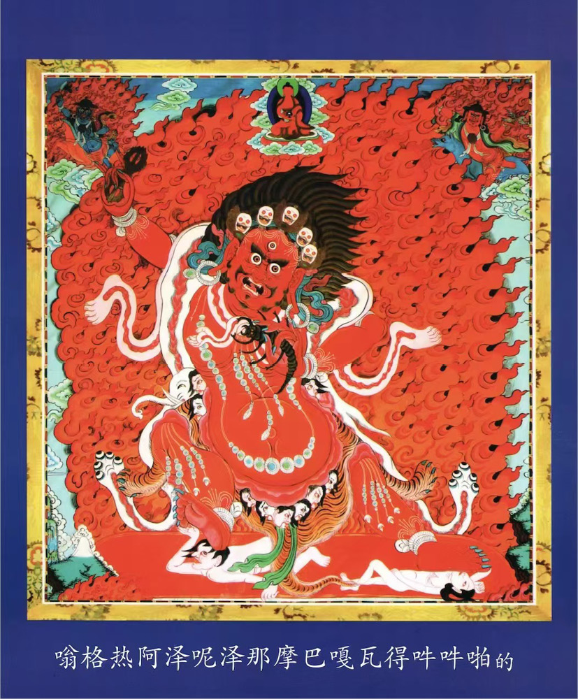
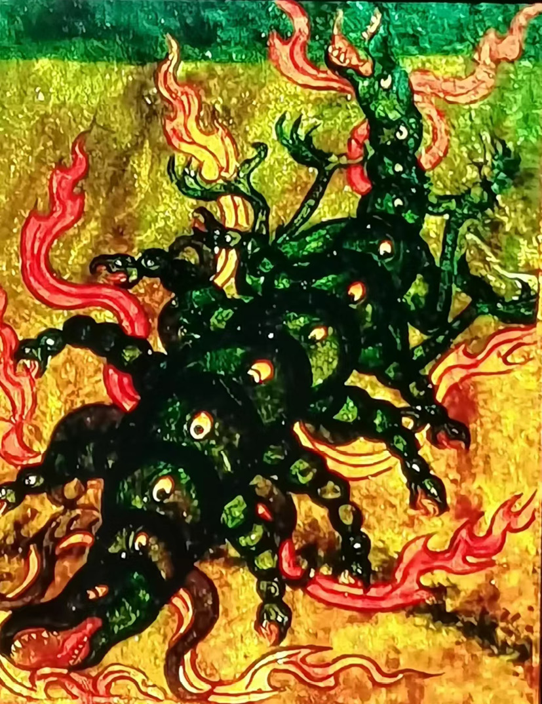

# 忿怒莲师修法讲解

法王晋美彭措·意伏藏

索达吉堪布·译讲

今天我给大家讲讲祈祷莲花生大士的功德。

## 一、如何理解忿怒修法

莲花生大士是集三世诸佛身语意为一体的智慧本尊、大悲本尊、力量本尊，是智悲力三者的融合。时时祈祷莲花生大士，不仅能轻易遣除我们身语意各方面的违缘，还能令我们迅速获得证悟，尤其是大圆满方面的证悟。密乘中无数前辈大德，都是依靠实修莲师而成就的。总的来讲，莲花生大士有不共的愿力和摄受力，不论是谁，只要真诚祈祷莲师，都会在很短的时间内得到感应或成就相，这是毫无疑问的。

我自己从小对莲师很有信心。当时条件很差，我放牦牛时总带着一本藏文版《莲花生大士略传》，天天念、天天背。后来我人生中包括出家、学佛等很多大事，自然而然具足顺缘。当然，也许有其他因缘的作用，但我自己始终认为，是莲花生大士的加持令这一切如愿以偿。所以，大家都应该认识到祈祷莲师的重要性。

莲花生大士的修法分为寂静和忿怒两大类。寂静修法我们以前在学《大圆满前行》、《七句祈祷文》和《开显解脱道》时都讲过一些。很多上师瑜伽中也有依于莲师的修法。至于忿怒修法，许多伏藏大师的伏藏品中都有不同的仪轨。这些修法或广或略，一些大修仪轨甚至有几百上千页，要一连修三天或七天。以前很多寺院都有进行忿怒莲师大修的传统。然而这些广的修法一方面暂时没有汉文翻译，另一方面相关的传承、仪轨，包括应做的供品，都比较复杂。在这个末法时代，大家要修起来可能有一定的困难。相较而言，法王如意宝的这个略修仪轨更加简便易修。

法王所造的忿怒莲师略修法有两个，一是“莲师多吉卓罗修法”，我们以前讲过，还有一个是“忿怒莲师修法”。这两个修法方式稍有不同。今天我先给大家念个“忿怒莲师修法”的传承，再从字面上简单介绍一下。希望大家每年都修一修。

为什么要修忿怒修法呢？因为现在这个浊世之中，非人魔众十分猖狂，我们仅仅依靠寂静的方式，念念观音心咒、修修菩提心，虽然也有效果，但有时候不是很明显。而如果用莲师忿怒修法加以调伏，见效会更为迅速。通常而言，这样的修法不应面向大众传讲，应当只传给少数有缘弟子。但我认为，一方面应该秉持法王如意宝的精神，将他老人家珍贵的意伏藏修法传承提供给大家，是很有必要的。另一方面，各位道友在学佛和修行的过程中，可能会遇到各种各样的违缘和障碍，这个时候依靠忿怒本尊的修法，就会立竿见影。所以，这对大家应该是很有利益的。以前我们学院每年都会共修一些忿怒修法。我自己有时也会遇到一些似乎很难越过的坎，但只要修一修莲师的忿怒修法，不管对于个人还是集体，方方面面的违缘都很容易遣除。

但要注意，修忿怒修法的时候，一定要以慈悲心来摄持。记得法王在上世纪80年代传过一些忿怒本尊的修法和咒语。当时有一对重庆来的夫妇求法王传授莲师的忿怒修法和心咒，法王就给他们传了。后来他们有一次来我家——那时候不像现在，我的院子没有门，谁都能进来。其中一人跟我说：“我现在修莲师忿怒修法感应很强，应该是修成了。”我问：“你怎么知道修成了？”“我用非常猛烈的嗔恨心来念咒语时，感觉我的敌人瞬间粉身碎骨。”我赶忙纠正：“你这样修肯定不对，不能用嗔恨心来修这类降伏法。”后来我无意间给法王讲了这件事，法王在课堂上专门作了批评。如果以嗔恨心来修忿怒修法，比如存心报复伤害自己的怨敌或非人，那根本的发心就已经错了，这种发心绝对不行。虽然有时候他人会令我们不悦意，或者故意制造违缘，但我们绝不能以嗔心将其作为忿怒修法的对境。

那到底该怎么修呢？其实我们每个人相续中都有很多分别念的魔，依靠忿怒莲师的金刚威猛之力将这些魔摧毁，这才是修法的目的。我们心中生起强烈的贪嗔痴，也相当于一种可怖的非人相，这时修持忿怒莲师，就能以莲花生大士的觉性本智将其刺穿摧灭。

莲师的忿怒修法可以遣除我们外内密的违缘。外在的违缘包括地水火风的灾害、人与人之间的冲突，以及突发性的人和非人的危害等等；内在的违缘包括我们自己产生的病魔、烦恼、妄想、恐怖、悲痛、怀疑等等；秘密的违缘从根本上来说，就是不认识真相的无明，正是由于无明，才有贪嗔痴等分别妄想。这些炽盛的烦恼其实就是一种忿怒之相。从反面来说，这是粗暴恐怖的魔相；然而从正面来说，这就是觉性金刚本智，这即是忿怒莲师的本相。以忿怒莲师的智慧利刃将粗大的无明分别的魔相统统砍断、刺穿，一切的一切就荡然无存了。这样修有很大的利益。

大家对修行如有一定的理解深度，就应该知道，外在的魔虽是狰狞恐怖、令人畏惧的凶猛之相，但只要认识到内在自心的状态，心一旦平静，一切世界也会随即平静。这就是最彻底、最甚深的莲师威猛的本质。

在这个修法中，虽然显现上莲师双脚踩着男魔和女魔，手里拿着种种兵器，但这只是一种表示，内在实际上象征着自然本智的妙用。所以我们在修行的时候，千万不能怀有嗔恨心、抱怨心，不要想着莲师的忿怒相，自己也生起气来。像那位重庆居士的想法，就彻底错了，也不符合佛教的精神。

总之，我们在实修时应该认识到，一切恐怖的魔障和违缘，不论显现为人、非人或病魔，抑或是眼睛看不到、心也无法触及的状态，通过祈祷莲花生大士，以忿怒的形象都能统统降伏。如果有些人不太容易接受忿怒相的降伏法，也可以多念莲师心咒和《七句祈祷文》。

《西游回忆录》中《谈谈莲花生大士》一文，就是法王在纽约传授莲师修法的讲记。当时法王也提到了莲师的不同名号，包括爱慧莲师、狮吼莲师、莲花生比丘等等。顶果钦哲仁波切专门作过一篇包含莲花生大士种种名号的祈祷文，虽然我没有传承，但以后有时间也可以给大家翻译一下。莲师就是这样以不同的名称、不同的形象、不同的方式来度化无量众生。所以，我们每个人都应该多多祈祷莲师。我经常跟大家谈起我对莲师的信心——虽然这只是我的个人经验，你们不一定相应，因为每个人的根基和意乐都不同，但我确实认为莲师有不共的加持。如果能把莲师像、咒语戴着身上，就是一种最好的护身符。

我们今天要讲这个“忿怒莲师修法”略修仪轨是法王如意宝所造。按理来讲，传法前应该先进行忿怒莲师的灌顶，但这个灌顶太深，而现在受众中各种各样的人都有，我不太敢灌这个顶。不过此法包括外修、内修等不同层次的修行方式，我们今天就用外修的方式，先念一遍传承，然后从词句上做个大致讲解，最后大家可以一起简单共修一遍。这样一来，可以遣除我们这个道场和个人的很多违缘。我之前也给大家强调过，不管我以后在还是不在，你们每个人都要多修“莲师忿怒修法”。法王所造的种种修法仪轨，我也给你们翻译和传讲了不少，然而其中我最重视的就是莲师忿怒修法，这可能跟我自己的一些修行感应有关。就像我吃了某种药觉得效果很好，就会推荐给其他人吃。如果自身没什么感觉，当然不会随便给别人推荐。但是我同时也有些顾虑，因为这个法很深，是否能灌顶，我经过了很长时间的考虑，也对自己各方面的情况做了观察，后来觉得确实没办法。因此，这次就只给大家念一念传承。

（堪布念传承）

## 二、此法由来

接下来简单介绍一下这部“忿怒莲师修法”的由来。法王如意宝于1988年受邀去北京的中国藏语系高级佛学院讲课，然后去拉萨等地朝圣。在去桑耶青朴的路上，遇到一个魔女施加干扰，当时法王显现忿怒莲师之相对她做了降伏。这段经历在我写的《法王晋美彭措传》和丹增活佛的《圣者法王如意宝广传》中均有记载。后来法王在桑耶青朴一个山洞中得到了一个海螺形的宝箧，以此缘起，造了这个“忿怒莲师修法”的仪轨。法王曾经说，其实那个宝箧当中还伏藏着莲师寂猛广修修法，但因为当时各方面的缘起，暂时只将这个威猛略修法取出来，其他留待后世。

后来法王去不丹的时候，也给国王和王室成员灌了忿怒莲师的灌顶，并做了相关授记。我在《梦尘回忆录》里讲过这段经历。当时不丹面临被其他国家吞并的危险，法王把不丹国政比喻为雪山，与国王进行了一番交谈：邻国的日光正要把雪山融化，依靠忿怒莲师的修法，雪山可永远屹立。据说后来不丹王室专门修行此法，后来危机果然化解。当时，不丹国师顶果钦哲仁波切也在那场法宴中，直到圆寂之前，仁波切也一直在修这个修法。事实上，像顶果钦哲仁波切和敦珠仁波切这些宁玛派最重要的大德中，很多人都特别重视祈祷莲师。敦珠法王有一个较略的莲师忿怒修法，与法王在虎穴取的伏藏法相当一致，都是修多杰卓罗，都是念修“吽”字，区别只是本尊手中拿的是铁蝎还是金刚杵。其实，大德们的智慧海是融合一体的，只不过在有缘弟子面前显现各自的法脉和仪轨。

法王给不丹国王授记后，第二天去了虎穴，在那里开取了“莲师多吉卓罗修法”。法王后来说，当时在境现中，本来可取的莲师伏藏法有九函之多，但是为了不破坏缘起，只取出了略的仪轨。

（堪布向周围的道友借法本。“我看看这是谁的法本，是戒智堪布的吗？看来这个法你念得很勤，法本边缘都磨破。我以前说过要常修这个法，说明你确实经常修。”）

## 三、修法讲解

忿怒莲师修法

> 一切轮涅之诸法 本来无生净本性

> 觉性水中鱼跃式 自身忿怒莲师尊

> 一面二臂身红色 右持金刚举空中

> 左持毒蝎于心前 双足热扎男女上

> 威猛舞姿而安住 身著圆满尸林饰

> 智慧炽燃火聚中 雨降兵器小怒尊

> 明观摧伏魔军身 心间日垫蓝吽边

> 咒语之鬘右旋绕 诵咒震撼三千界

> 妄念鬼魔名亦无

嗡格热阿则呢则纳摩巴嘎瓦得吽吽啪的

> 猛厉念诵秘密咒，胜伏违缘及魔军，

> 普获胜共诸悉地。莲生究竟此窍诀，

> 伏藏善缘者心中，后现魔之灾害时，

> 愿吾心子得值遇。萨玛雅，嘉嘉嘉！

下面我们从字面上简单解释一下这个“忿怒莲师修法”的仪轨。

首先观想，轮回和涅槃所摄的一切法，自始至终都是无生空性、本来清净的状态。我们讲禅修三等持的时候，观想轮涅所摄的一切法是空性，这是很重要的。在这样的空性之中，有许多不同的观想方法，比如生起次第中观想种子、月轮、日轮等，但这里是一种针对极利根者的修行方式——观想自己的觉性和心识如鱼从水中一跃而出，在一刹那间明观为忿怒莲师。

莲花生大士的这个忿怒相是什么样子？这里有张图片，大家一边看图一边学习仪轨。

（堪布展示图片）

图中的本尊是一面二臂——有时莲师的忿怒相是一面四臂，敦珠法王的自传中也如此讲过，而这里是一面二臂。身色红火，如同火焰一般——有些莲师忿怒相是紫黑色或紫色的，不同仪轨的观想方式不一样。莲花生大士在众生面前会显现为不同颜色，就像我们很多人今天穿黑色，明天穿红色一样。右手在空中挥舞金刚杵。左手持着铁蝎。这个铁蝎在莲花生大士的很多仪轨中都有，表示一种缘起，是非常重要的标志。我稍后会介绍铁蝎的功德。现在很多人在网上卖各种九头铁蝎，这是一种护身的法器。莲师的双足踩在男女魔鬼身上——我们修过的莲师多杰卓罗是骑着母虎，而这个忿怒相是踩踏男魔女魔。他以游舞傲然式安住，周身体圆满装饰着各种尸林骨饰。莲师置身于智慧的火焰中，在身周燃烧的熊熊烈焰当中，有许多微小怒尊、兵器、铁蝎，这一切全是火焰本性，无比炽热，就像暴雨一样降下，将世间各种分别烦恼所成的恶魔、眷属、违缘、非人等全部摧毁无余。边念咒边如此观想。

念咒的时候，观想心间日轮上有一个蓝色的“吽”字，周围是忿怒莲师的咒串，以右绕的方式旋转。念诵这个咒语时，整个三千大千世界都为之震动，所有分别妄念变成的恶魔障碍，全部荡然无存，化为虚名。在这样的观想中一直念诵“嗡格热阿则呢则纳摩巴嘎瓦得吽吽啪的”。

念诵此猛咒，能克胜一切障碍和魔军，获得殊胜和共同的悉地。在莲师最究竟的窍诀中，此法最为甚深。具缘者应该将其藏于自己心中，未来末法时代各种恶魔猖狂危害之时，有缘弟子会遇到此法。

遇到这个法是非常珍贵的机缘。就像金子要有钱人才能买到，一般人不一定买得起，同样，能够遇到这个法的，都是与莲师和法王的法门有缘的人。从1989年取出伏藏直到现在，已经过去三十多年，经过这么多年后我们有幸值遇此法，只要对莲师具有信心，一定可以降伏一切魔障。

## 四、相关公案

讲到莲师的修法，我想分享几个前辈大德的公案。《全知无垢光尊者略传》中讲过，尊者在一个地方建经堂时，飞出了许多天灵盖，当时情况凶险，尊者当即示现忿怒相，飞身而起，踩踏天灵盖，将它们压伏在一座降魔塔下。[^1]现场有一位喇嘛叫索南桑波，他亲眼见到尊者就是忿怒莲师。由这个公案可知，前辈大德显现上主要是依靠莲师的忿怒本尊相来降伏魔众的。

《一世敦珠法王自传》中有一个故事，在他六岁的时候，一天空中出现了一只九头铁蝎，一个人骑在上面对他说：“忿怒莲师让我给你捎个口信，在三年中，你要在晚上睡时把自己观为铁蝎，虽然自观为旁生不太好，但这是为了帮你遣除违缘，切记！”[^2]我这里有张九头铁蝎的图片。

（堪布展示图片）

这只铁蝎看起来好像跟刚才忿怒莲师手里拿的有点不同的，不知是不是敦珠法王当时看到的那只九头铁蝎。很多唐卡中专门有一个铁蝎的护轮，还包括一些仪轨和咒语。虽然有时候铁蝎看上去比较恐怖，但实际上要对治魔众的话，这种“以毒攻毒”方式是很有效的。

创巴仁波切的家徽就是一只铁蝎，他自从上世纪80年代从虎穴取出了莲师忿怒伏藏后，就把铁蝎作为自己的一个象征。所以，他的弟子们都非常珍视铁蝎，在他们的法会和很多场合都能看到蝎子的印章，这就叫做蝎印，代表很多西方弟子心目中最高的法。

我很早以前也想制作一个铁蝎的法器，因为其中有一些缘起。但后来我又担心，流通的人一多会变成一种商品，而很多人对此容易产生误解。就像现在也有人诋毁藏传佛教，尤其是一些密法的深义，不懂的人可能会有误会。这件事也可以再考虑斟酌，因为在莲师的忿怒法中，铁蝎确实是一个非常重要的因缘。修忿怒本尊时，经常要观自己的身体或口中出现很多铁蝎摧毁魔众，依靠这种因缘，可以降伏外在的众多魔障。

还有第四世竹钦仁波切，他在修行过程中有一次由于接触了一个女众，染上了晦气，以前广闻博学的知识全部遗忘无余。这个时候忿怒莲师出现在他面前，让他修狮面佛母。他依教奉行，兢兢业业地修持，后来果然遣除了所有的障碍和晦气。

莲师的忿怒相在藏地很多唐卡上和经堂中都很常见。不丹有一座叫日郎扎梅的寺院尤其以此闻名。这个寺院坐落于不丹三大神山之一，离虎穴比较远，寺院的岩壁上自然形成了许多莲花生大士的手印、标帜，包括铁蝎的印子。据说莲师在这里示现过很多神通神变，而且藏了六十卷伏藏法。我虽没有去过，但听很多去过的人说这里特别殊胜。这座寺院在不丹非常有名，当时我们本来很想去，但时间和交通实在不方便。以后你们如果有机会去不丹的话可以看看，忿怒相的莲师在不丹确实比较多见。

多修这样的忿怒本尊是很有必要的，因为我们在修行过程中，难免会出现各种各样的违缘。记得第一世敦珠法王十四岁的时候，一次梦见一个僧人和一个老妇，他们叫他去下面一个快乐的地方。他正准备出发的时候，一个骑着大鹏的人出现阻止了他，并给他传了一个四臂忿怒莲师的修法。依靠这个因缘，他才没被两个魔鬼带走害死。[^3]

梦里的僧人和老妇，会不会就是忿怒莲师脚踩的男魔女魔？所以，有时候我们必须要依靠忿怒莲师来遣除违缘恼害。就像前年的瘟疫，我们没有病死，或许也有这方面的原因。我当时一直非常认真地修除疫莲师修法，那也是莲师的一个忿怒相。现在还好好活着，也可能就是因为除疫莲师的加持，虽然不能确定，但我自己是非常相信的。在这个末法时代，大家尽可能每年都修一修忿怒莲师，不管以后我们是否还有机会见面，为了保障自己的修行，你们最好记住我的话。

（堪布对借书者说：“我看你修得还不错，连法本都翻破了，真厉害，今天要给你点赞！我用你的法本传了这个法，缘起很好。这个法我是十年前翻译的，当时给大家传了，愿修的人确实在修，不愿修的人可能一点都没有念过，这就看你们自己吧。”）

## 五、劝修忿怒莲师

关于“忿怒莲师修法”我就介绍到这里。如果你们觉得忿怒本尊有点恐怖，可以直接修莲花生大士，如果感觉跟莲花生大士不太相应，也可以修释迦牟尼佛、药师佛等本尊。我也不会要求你学了这个法就非修不可。但我自己确实从小就对莲师特别有信心，感觉就像自己的父亲一样。不管我去哪里都会戴上莲师的像或咒语。以前我也做过一批莲师的挂件作为法王涅槃纪念的加持品，外面有一圈莲师心咒的咒轮。我想任何人只要把它戴在身上，都不会受到邪魔外道的危害。不过，如果前世业力深重，或者邪魔特别猖狂，这些因缘也不一定能阻挡。不管怎样，我觉得每个人熬到现在都很不容易，虽然看上去外面似乎没有什么违缘，但实际上如果真正观察每个人的内心，其实每过一关都十分艰难。有些人以为只是自己不容易，别人都很轻松，其实除了个别修行好的人以外，每个人都会遇到各种各样的挑战。

前阵子我们评选堪布堪姆，当时有一位堪布发言说，在这里十余年闻思，熬过来很不容易。我听了也很认同，因为这里很多法师，刚开始非常有意乐，但后来慢慢就退了，这一点在讲考时也看得出来。有些人心魔尤其很严重，如果不是心魔干扰，外在的地水火风或疾病等违缘其实对我们没有太大威胁，但心魔一旦出现，干扰确实很厉害。在这个时候，要么依靠本尊的特别加持，要么依靠自己的证悟，这样才有机会自救。

我们这里的很多道友现在修行基本上能交出答卷了，如果最近圆寂，也算善始善终，这也是依靠本尊的加持。就像在战场上要存活，必须依赖铠甲和自己的勇气，所以，我对此比较重视。以前有些堪布也提醒过我，应该传一些简单的修法，不要讲这么深的法。可能是我个人经历的缘故。早在没学佛的时候，我就对莲师的修法非常感兴趣。虽然我感兴趣的你们不一定感兴趣，但我要讲一堂课，必须结合自己的兴趣和信心，这样也许对你们会多一些所谓的意传加持或者上师的相应。我一直认为，法王如意宝与忿怒莲师无二无别。就像法王在青朴降服魔女，我们每个人也要面对自己分别念的魔众，有时是一个两个，有时可能很多很多。依靠这个修法，我们在慈悲心的前提下，认识自心是空性，在空性的境界中，依靠观想的缘起力，就能摧毁一切违缘，这样我们修行必能善始善终，利益众生也会轻松实现。

今天就讲这些。接下来我们一起来念诵仪轨，修一些咒语。

（堪布带领共修“忿怒莲师修法”）

[^1]: 《全知无垢光尊者略传》：“后来，所有边地的魔军因为被长期地压伏，而且从前所压伏的不同类众生，许多天灵盖中的俑像需要复修的都重新复修了。在为压伏作准备时，突然天降土石之雨，狂风大作，情况变得十分险恶，人们惊惶失措，乱作一团，有的甚至昏厥在地，根本无法帮助压伏魔众。这时，尊者现示黑日嘎的形象，气势威猛，咄咄逼人。跳起金刚舞，口中也铿锵有力地念诵梵音，那些天灵盖从地上跳起，相互碰撞，钉铛作响，其中最大的一个天灵盖腾空而起，并且停在空中。于是他也纵身飞到空中，左脚踩着天灵盖，跳起姿态各异的九种金刚舞，当时全知索南桑波亲眼见到尊者就是忿怒的莲师，最后所有的天灵盖都被压在降魔塔下了。”
[^2]: 《一世敦珠法王自传》：“我到了六岁，那一年是鼠年，六月初一的早晨，我刚刚醒来，就看见前方的虚空中有一只黑色的九头铁蝎在缓缓动弹，把我吓得赶紧蒙上头哭了一会儿。这时，听到呼唤‘阿霍’，我露出头一看，在铁蝎的上面有一个人，那个人对我说：‘鄙人骑着这只蝎，来给你捎个口信，忿怒莲师亲口说：你晚上临睡时，要把自己观想成一个燃火的铁蝎，三年之间切切不可忘记这件事，尽管不能常常观想成旁生，但这次是为了克胜鬼王加害。就是这只蝎子，快看看，千万要将它的这个形象在心里现得清清楚楚，认认真真看好。’说完他就消失了。”
[^3]: 《一世敦珠法王自传》：“在十月初三的那天夜里，我梦到一个老妇人和一个僧人结伴而来对我说：‘你该走了，在我们下方有一个快乐的地方，去那里吧。’正当我准备启程之时，又一个骑着红色金翅鸟、身色鲜红的人出现说：‘孩子，你千万不能去，你要这样想到，命已经落到鬼魔的手中，心里如此观想：吽！自己的身语意三门，变成空性，由空性法界中，上师本尊无二无别的本体忿怒莲师，身色红黑，一面四臂，龇牙咧嘴，舌头上卷，胡须眉毛迸射火星，褐色头发向上立起，第一双手将金刚杵和三尖天杖向空中挥舞，第二双手握着金刚橛和铁蝎，下身以燃铁橛插入厉鬼的心间，在劫末火般的界域内，吽的声音如千声巨雷般传出，以数多小忿怒铁蝎，摧毁所有凶神恶煞。念诵“嗡啊吽、阿则内则、那莫巴嘎瓦得、班则革乐革拉雅、萨瓦布南旺吽啪的。”再同样明显观想以后念诵咒语，结果能使那两个厉鬼昏厥倒地，片刻间清醒过来立即逃之夭夭，消失不见。’随后那个红黑人又说：‘从往昔累劫以来，你和护法神我刹那也不曾分离过，你对我一心信赖，我能消除一切违缘。’这时我醒了。”
