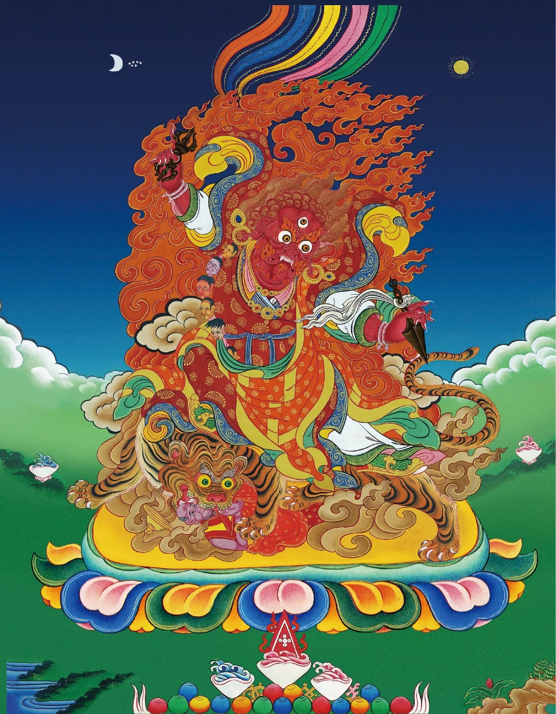

## 第2课

2019年3月20日

今天的课程与以往的稍微有些不同。按理来讲，这个法应该灌了顶再传，灌顶的话，人太少了不行，太多了也不好，中间的分寸难以把握。我想了半天，还是觉得不方便，因为听课的人里面，不一定都对密法有信心。但如果这次不传，又有点可惜，所以我为大家念一下传承，也简单地讲一下这个修法。

这个忿怒莲师的修法，是法王如意宝在不丹虎穴开取的伏藏品，属于密法，这次以比较公开的方式为大家传授。像这样的略修法，有些上师传的时候不一定要求灌顶，甚至连大圆满的本来清净和任运自成的甚深法，他们也不要求灌顶，上来就开始讲。但按照我们的传统，讲大圆满的修法时，一定要提前灌顶，如果讲引导法，除了要求灌顶外，还要求修完加行或是至少完成50%以上，这样的人才有资格听受。

## 次第勤修学

这几年，我每年都传了密法。听密法的人里面，没有修过加行的，我的记忆中没有。如果连加行都没修，却来听本来清净的甚深法，那他可能和无垢光尊者和麦彭仁波切一样，根基非常“不错”。这样的人，我到目前为止还没找到，如果找到了也可以给大家公布。当然，麦彭仁波切、华智仁波切和吉美嘉维尼固（如来芽尊者），他们修了多少遍加行，阅读过他们传记的人应该清楚。

这次，我的这种做法对部分人来讲是有必要的。如果像有些上师那样，非常严格，没有得过灌顶、没有修完加行的人一律不可以听受，也许很多人这辈子都没有机会听受。每个人的生命都是有限的，我在上师如意宝面前得过特别好的密法传承，如果这些一直不传，也有点可惜。我自己是发了很大的心，除此之外，没有其他目的。

有些上师传密法传得很广，尤其是西方的一些上师。一方面，他们在那样的群体中弘扬密法，特别了不起，但有些在次第上好像有一点差别——先讲本来清净的直指法，然后慢慢下来，讲中观的空性，过一段时间，就开始讲简单的基础法和世间的人规。

总而言之，如果传授密法，尤其是本来清净等甚深法门时，还是应该严格一点。这对听者来说也更有利，通过次第地修行，听受者最后一定会获得成就。即使这一世没有获得成就，但就像无垢光尊者在《胜乘宝藏论》里说的那样，无论男女老少，只要遇到了甚深的密法，得到了引导和窍诀，即使没有修行，也会依靠听闻的功德而迅速解脱。为什么呢？因为遇到了心滴果法的缘故[^1]。

有些人虽然遇到了密法，但因为工作、家庭和自己的烦恼等原因，还没来得及修法就得了癌症。最后要走的时候，不要说修法，连家里的事情都没处理完，死亡的军队已经来迎接了，所以也不得不放弃世间的一切说“拜拜”。虽然没来得及修，但无垢光尊者说得很清楚，我们因为听过甚深密法的缘故，仅凭听闻的功德，也一定会解脱。

有时候，密法也许会被人诽谤，这是正常现象。许多甚深的法门，比如禅宗、净土宗，刚开始弘扬的时候，很多人不接受。包括在藏地佛法非常兴盛的时候，也有个别论师、法相师不承认大圆满，甚至对其进行攻击。汉传佛教历史上，也有这样的情况。所以，任何一个殊胜的教法出现于世时，都会遭到一部分人的攻击，但无论他们再怎么攻击，也绝不可能将其摧毁，只会让它的真理光芒更加璀璨明晰。所以，今天趁这个机会，也希望大家对密法有一个更好的认识。

我今天本来想给大家灌一个莲花生大士的威猛莲师或缘起除障法的顶，但考虑到种种原因，还是觉得不太方便。那么，我就从字面上简单地为大家讲解一下这个修法。对有信心的人，这个修法能赐予其传承的加持和悉地，对没有信心的人，会自然而然地隐藏其意——密法中有许多隐秘方法。

## 前行

在正式传授之前，我首先为大家做一个皈依和发心，然后用莲师七句祈祷文成熟相续，之后传授《莲师多吉卓罗修法·成就一切事业》。

在这个特殊的时代，传授佛法的方式可能也需要些许的改革——有些保守派的人可能会有意见，如果有意见的话，我在教理方面也可以提供一些建议。

我先给大家做皈依。有的人已经皈依很多年了，但真正发自内心、在任何环境下都绝不改变的皈依心有没有？大家自己观察。真正的皈依心是什么样的呢？即使遇到生命危险，也绝不舍弃佛法僧外三宝，以及上师、本尊、空行内三宝，这才是真正的皈依心。皈依是一切戒律的基础，有了真正的皈依心，才会逐渐获得善妙的功德。因此，以前没有皈依的人，现在要皈依佛法僧三宝；皈依过的人，要坚定皈依的心。身处这样一个世界，我们可能会遇到各种情况——有些人舍佛、有些人舍法、有些人舍僧、有些人舍本尊、有些人舍空行和护法，等等。因此，我们一定要坚定自己的皈依心——哪怕遇到再困难的情况，我也绝不舍弃三宝，乃至生生世世皈依三宝，永不退转。

我们按照麦彭仁波切《开显解脱道》里的偈颂来皈依。我用藏文念，你们跟着我一起念，以此方式受皈依戒，并在相续中生起坚定的皈依心。

（堪布带领大家念诵皈依偈）

接下来发大乘的菩提心，“我与一切众生本来就是佛，在认识到了这样的自性后，发起无上殊胜的菩提心。”在这样的心态中发菩提心，同样念三遍。

（堪布带领大家念诵发心偈，然后念诵莲师金刚七句祈祷文）

我先给大家念一下《莲师多吉卓罗修法·成就一切事业》的藏文传承……

按理来讲，修这个法最好得过莲花生大士忿怒修法的灌顶。已经修完加行、得过灌顶的人，可以按照我去年8月份给大家传授的威猛莲师的修法修行。如果没有得过莲师忿怒修法的灌顶，也没修完加行，那就将这个仪轨当作一般的简修法来修，这样比较如法。

关于这部法的因缘和来历，上节课已经为大家做了简单的介绍。在这个各种违缘与障碍此起彼伏、众生的分别念纷杂狂野、相续中的贪嗔痴等烦恼如同山洪暴发一般难以阻挡的时代，最需要的就是力量强大、加持迅猛的法门。所以，我发自内心地认为，这部法对末法时代的众生极为重要。

昨天讲过，“多吉卓罗”翻译过来是“金刚力士”，像金刚一般不可摧毁、已经获致最高证悟的大士。许多大德都是依靠修持多吉卓罗而摆脱了违缘的危害。像第一世敦珠法王那样了不起的伏藏大师，也是因为观修了多吉卓罗才遣除魔障的，否则他在14岁的时候可能会和他的舅舅一样，被瘟疫夺去生命。

有些人因为没有遇到这样殊胜的密法和窍诀，结果在生活和修行中遇到了许多违缘，甚至连身体和寿命也受到了障碍。作为大乘佛子，最执著的就是弘法利生，而这个修法，对遣除弘法利生过程中的违缘就特别有效。所以，为了遣除生活、修行以及弘法利生过程中的种种违缘与障碍，这次决定为大家传授法王的伏藏修法——《莲师多吉卓罗·成就一切事业》。

## 创巴仁波切与多吉卓罗

之前在西方弘法的创巴仁波切，也有一个多吉卓罗的伏藏修法。1993年，我跟着法王去美国时，看到很多香巴拉的弟子都在念“吽”字，都在修多吉卓罗的法。我当时带回来了一部创巴仁波切在虎穴开取的伏藏。开取的时候应该是藏文，后来他自己译成了英文，而且每句末都保留了伏藏句点（上下两个圈，中间以横线隔开的符号）。其实西方修行人特别重视多吉卓罗的修法。

还有一件很有趣的事情，我曾经在挪威的奥斯陆大学讲过。创巴仁波切的侍者，一位藏文名叫达瓦的西方人，他1993年在加拿大的多伦多时跟我们说：“创巴仁波切当年去不丹虎穴开取伏藏，下来的时候说：‘将来，一位名叫晋美彭措的伏藏大师会来到这里开取伏藏。’”我们当时亲耳听到他说这句话，我再三地跟他确认，他说创巴仁波切的确说过。他还说他当时也很惊讶，心想：“难道悬崖上刻着‘晋美彭措’这几个字吗？不然创巴仁波切怎么知道呢？”创巴仁波切圆寂是在1987年，法王去不丹开取伏藏是在1990年，所以他当时根本不认识法王如意宝晋美彭措。

我看过创巴仁波切取出的多吉卓罗修法，有些地方与法王所取出的修法相似，不过在他的净观中，莲师多吉卓罗戴着噶玛巴的黑帽，后面还有噶玛巴德新谢巴、噶玛巴希等几位上师融入一体的修法——不同的传承，根据各自传承上师们的加持，显现的表法和形相也会稍有不同。有时候看来，上个世纪末，藏传佛教在西方的确有着特别殊胜的因缘，我相信，这和莲花生大士的加持密不可分。

尼泊尔的夏扎仁波切，住世一百多岁，一辈子修的就是多吉卓罗这个法。在藏地，许多修行人都将多吉卓罗当作秘密本尊。过去没有照片，他们将多吉卓罗画在小小的四方形卡片上（藏文叫“扎卡”），当作修行所依，然后藏在法本里经常祈祷。

个人而言，我从小就对多吉卓罗很有信心，并且经常祈祷，尤其是在上师如意宝面前得到这个法以后，修行中的违缘确实减少了很多。

## 除障猛修法

我今天为什么要传这个法呢？在法王如意宝开取的忿怒莲师灌顶仪轨的小字部分说道：莲花生大士的这个猛修法，主要目的就是遣除教法的违缘和障碍，以及修行人在修道过程中的障碍。在这样的浊世，这个忿怒修法一定会给修行人带来极大的帮助和利益。

当然，有一些人因为前世的业力现前，或外缘的障碍实在是太凶恶了，也许很难立即遣除。比如说，癌症已经扩散了，即使吃再好的药也没办法，最好的医生来了，也只能悄悄地跟家人说：“嗯，不行，不要让病人知道……”可是那个病人恰好就在旁边，而且听得一清二楚，“啊？他说什么？我是不是已经快不行了？”家人只好说“方便妄语”：“不是不是，你的情况好多了，现在吃中药就可以了。但是我还要跟医生再单独谈一谈。”癌症晚期的时候，家人会安慰病人说回去吃中药……

所以说，再殊胜的对治法，也不一定能马上解决所有的问题。当我遇到违缘时，从来不会怨天尤人。有些人因为不懂前因后果和前世今生的因缘，所以遇到事情时才会抱怨：“我修了那么多法，为什么还是不管用？我做好人也修善法，为什么生活中还是有那么多倒霉的事情出现？”

我不敢保证凡是修莲师的人绝对不会遇到任何违缘，但至少——比如说，以前医疗水平很低的时候，人只能活到40岁，但现在因为医疗水平的提高，人可以活到80岁；同样的道理，某个人本来遇到了特别大的违缘，他的修行很可能因此而夭折，但后来因为特殊上师和本尊的加持，他的慧命才得以延续。所以，即使从这个角度来讲，我们修这些法也是有意义的。

## 正行

接下来，我们开始讲《莲师多吉卓罗修法·成就一切事业》。依靠这个修法，我们能成就息增怀诛等一切事业。

那莫革日班玛黑日嘎雅！

顶礼忿怒莲师！

于此，无戏论之行者首先皈依、发心……

“无戏论之行者”，也就是不愿意广做佛事，不愿意广修大的仪轨，也不愿意学习五部大论，对广闻博学没有兴趣，只喜欢简单易行的修法，喜欢在一个清净的地方一心一意修本尊的修行人。这样的人好好修莲师，今生依靠莲师的加持，可以变成一个很好的修行人，以后心力强大起来时，就能够利益无量无边的众生。

修此法门之前，首先皈依和发心。念诵任何仪轨中的皈依和发心偈都可以。

你们修的时候，先念一遍《开显解脱道》里的皈依和发心偈，之后念一遍仪轨，到“吽”字部分时，持续不断地修诵“吽”字，“吽吽吽……”

为了让大家理解仪轨的内容，我们简单地过一下。

> 吽

“吽”既是莲花生大士的种子字，也是感叹词。仪轨中经常有“吽”和“阿”等字，这既是一种对本尊的呼唤和劝请，同时也有特殊的深意。

> 器情清净普贤佛母界，普明大悲普贤佛父坛，

> 双运胜子大乐菩提心，紫黑吽字形相空中现，

> 放光行持二利复回摄。明观主尊莲师卓吾罗，

器世界和有情世间是本来清净的，当下就是普贤佛母，即空性的法界，这是从空性方面讲；若从生起次第来说，则称为真如等持——观一切万法空性。在密法中，空性可以被称为佛母或普贤佛母。同时，空性并不是单空，而是光明周遍一切的普明大悲，这被称为普贤王如来，或者说现位等持。

也就是说，一切万法本来就是空性的，而空性和光明又是无二无别的，因此，佛父佛母双运的真实含义，其实就是现空无别。

双运像是一种表法，一者表示空性，一者表示光明，完全不是世间的男女贪欲。只不过一般人对双运有种特殊的执著和认知，所以佛像中才会有双运像。

空性和光明双运，然后显现“胜子”，即光明空性无二无别的大乐菩提心，这叫因位等持。

之后，大乐菩提心变成紫色的“吽”字（最好观想藏文的“吽”字），显现在前方的虚空中。“吽”字发出光芒上供下施——上供一切清净刹土的诸佛菩萨，下施六道轮回的一切众生。然后将光收回来，若按无上瑜伽的方法来修，则将自己明观为格热多吉卓罗[^2]。

如果没有这样的境界，对于将自己观成忿怒金刚感觉害怕的话，那就将格热多吉卓罗观在自己的前方。按照显宗和外续部的修法，本尊和行者之间有很大差别，本尊可以赐予行者悉地，这样的见解也是大多数人容易接受的。我们认为：“哇，莲花生大士很殊胜，他骑着老虎，降伏我的所有违缘，这让我很有安全感和幸福感！”既然大部分人接受这样的见解，那么我今天就以这样的方式来解说。

“吽”字收光之后，变成主尊格热多吉卓罗。“格热”是上师的意思，智悲光尊者的一篇祈祷文里面说：“生起猛烈嗔心时，心转正法莲师知，莫入歧途全知护，悉皆无二恩师知。”也就是说：“祈祷莲花生大士加持我的心转向正法，祈祷全知无垢光尊者加持我切莫误入歧途，祈祷与莲师和无垢光尊者无二无别的大恩上师时时刻刻护持我！”祈祷特别重要，我们一定要经常祈祷。

在藏地，人们对莲花生大士很有信心，遇到任何事情都会祈祷莲师，甚至在路上滑倒时，第一反应就是“格热仁波切钦”。我们经常说“喇嘛钦”，你们以后也可以念“格热仁波切钦”。“格热”是梵语的译音，翻译过来是“上师”的意思，实际上指的就是莲花生大士。西方人经常说“古汝仁波切”。法国的修行人几乎都对莲师具有强烈的信心。我觉得汉地的众生对莲师也特别有信心，藏地就更不用说了，许多年轻人依然对莲师很有信心。

信心至关重要，对缺乏信心的人来说，诸佛本尊的唐卡只不过是一幅画而已，上师只不过是有肉体的人而已，再出名的上师，还是一样吃饭、一样发脾气，也没什么了不起。所以，从某种角度来讲，自己的信心和缘分也很重要。

我这里提供一张我们所观修的主尊多吉卓罗的照片，这个形象比较符合法王的多吉卓罗修法。

> 红褐一面二臂睁三目，红黄须发眉毛竖上空，

不同的伏藏大师，开取的修法仪轨和仪轨里的所观本尊也不尽相同，因此，多吉卓罗的形象不止一个，而这张照片，恰好符合法王所取仪轨的观修内容。

这里的多吉卓罗一面二臂睁三目，“一面”表法界一体，“二臂”表胜义谛和世俗谛双运，“睁三目”表通达过去、现在和未来。

有些不太理解忿怒相的人觉得：“为什么他有三只眼睛，我们不是都只有两只眼睛嘛，两只眼睛多漂亮，他为什么有三只呢？”两只眼睛是很漂亮，三只眼睛，其实也很漂亮。我们虽然有两只眼睛，但见不到过去、见不到未来，甚至有时候连现在也见不到，只见到眼前的一小块儿，尤其是人老了以后，看什么都模模糊糊的，越来越见不到了。所以，有三只眼还是很好的，可以照见三时。

格热多吉卓罗的头发、胡须和眉毛向上竖起，这同样是表法，表无上、清净之义，或者说，表示已清净了轮回的垢染。

> 牙关紧咬利齿雪山中，暴风骤雹令鬼魅冤魂，

> 五蕴网罟消融于法界。

由于是忿怒相，所以獠牙毕露、牙关紧咬。这里将多吉卓罗的利齿比喻成洁白、伟岸的雪山，表示没有丝毫烦恼障和所知障的垢染。从这样雪山般的利齿中，喷发出猛烈的暴雨和冰雹，将制造违缘和损害的鬼魅、冤魂、怨魔、厉鬼等恶魔的五蕴解脱于清净的法界。

现在很多人有附体，不知道什么原因。不过藏地很少有人有附体，我在藏地遇到过精神不正常的人，但从来没遇到过有附体的。有些人觉得这是迷信，其实不是迷信，佛经里提到过夜叉等非人会缠在某些人的身上，尤其是在做恶梦时，它就出来了。前天晚上我做了一个恶梦，醒来的时候有点害怕，心脏一直在猛跳。我忽然想到，去年讲《药师经》时有几尊佛的名号很管用，但我忘了到底是哪几尊，于是我将七佛的名号全念了一遍，我想其中肯定有能遣除恶魔的佛[^3]。

五蕴相当于网罟，由于五蕴的束缚而不得解脱。因此，咒语“吽吽吽……”变成暴雨和冰雹，令恶魔的五蕴消融于清净的法界。也就是说，通过忿怒莲师猛修法，让那些损害佛教、伤害众生的恶劣众生的心识获得解脱、超度——并不是让他们痛苦或堕落。

在世间，人与人、国家与国家之间作战时，双方是以嗔恨的心态希望毁灭对方，“我要把你灭了！”但降伏法不是这样，其目的不是损害或消灭众生，而是让那些可怜众生的五蕴消融于法界，从而获得真正的解脱。

> 右手天铁金刚挥空中，微小怒尊霹雳降敌头，

> 左手擎起天铁橛之顶，熊熊炽燃烈火幻化轮，

> 能害魔众无遗焚成灰。

多吉卓罗右手持着天铁金刚杵挥舞在空中，从金刚杵中出现许许多多微小的忿怒本尊，如同降下霹雳一般打击损害佛教、伤害众生的魔众和怨敌的头颅，以此降伏他们，令他们获得彻底的解脱。

左手擎起天铁金刚橛，金刚橛的顶端燃烧着炽燃的熊熊烈火，如同幻化轮[^4]一般，将制造损害的魔众的五蕴和四大彻底焚毁，断除其相续中的恶业种子。

有些人可能仅从字面上理解：“是不是要将那些可怜的众生全部摧毁？”不是这样的，学过《大幻化网续》的人应该知道，修诛业并不是要伤害众生，而是让他们的五蕴消融于法界，从而获得彻底的解脱。

莲花生大士当初来到藏地，降伏了许多鬼神等非人众生。有些土地神被降伏之后，洗心革面，开始护持佛法；有些形象没有变，但心态变了，成了佛教的护法神，只是形象和生活习惯还是和之前一样，喜欢喝酒吃肉。为什么我们供护法的时候要供一些酒和肉？因为莲花生大士当时答应过他们：“你只要不伤害众生，其他的要求我们都可以满足。”我们也应该这样想：“他们已经习惯了，所以吃一点肉、喝一点酒也可以。”毕竟，他们以前经常饮酒食肉，所以我们在供养时，提供一些他们所需的物资是可以的。

事实上，从汉地高僧大德的传记和公案来看，他们在降伏了某些鬼神后，对其特殊需求也会给予一定程度的满足。

> 极怖傲然有孕母虎上，双足叉开大力士步姿。

忿怒莲师多吉卓罗双足岔开，以大力士的姿态骑在傲然、有孕的母虎上。

母虎是一位佛母的示现。她并不脆弱，而是充满自信，以傲然的姿态示现，让人见而生畏。

如果从生起次第的角度广讲，母虎以及多吉卓罗的种种标帜都表示不同的涵义，但这些内容以后有时间再说吧。

> 圆满息业装束白内衣，圆满增业装束著法衣，

> 圆满怀业装束披紫氅，圆诛业装头鬘斜挎肩，

> 忿怒悍然威猛之身相。

多吉卓罗身著的服饰表示息增怀诛四大事业。

白色内衣是圆满息业的表示。我们修莲师，同样可以圆满息业，息灭身心的疾病以及相续中的罪业。

红黄色的法衣是圆满增业的表示。修莲师可以增上名声、财富等一切所需。一般人最希求的是什么呢？就是息业和增业：息灭疾病、痛苦和困难，然后获得名声、财富和地位。所以如果希望升官发财，最好修莲师。（众笑）

紫氅是圆满怀业的表示。修莲师可以得到自己喜欢的一切，你喜欢房子能得到房子，喜欢车能得到车，喜欢人能得到人……

颅鬘是圆满诛业的表示。修莲师法可以降伏给自己制造违缘和障碍的人与非人。

多吉卓罗将颅鬘斜挎在肩上，像米拉日巴穿戴着修行带一样，我看有些老和尚下课的时候，一边拿着拐杖一边将大大的背包斜挎在肩上。（众笑）

多吉卓罗的整体身相，呈忿怒、悍然、威猛的形象。我上节课讲过，有些人与鬼神，唯有以忿怒的形象才能调伏。我在管理的过程中，也遇到过这种情况，反反复复强调过好多次，他根本不听，后来狠狠地说一下，他马上听话了。本来，父母是最慈爱自己的孩子的，但父母如果整天温柔地说：“你好好写作业哦。”孩子根本不听话。如果假装恶狠狠地说：“你再不好好学习，我要狠狠地揍你！”孩子马上就听话了。因此，即使是最爱孩子的父母，有时也有必要对孩子显现忿怒相。

忿怒相是一种很重要的手段，不仅修行中需要，世间也需要。比如说，在与一般人打交道的过程中，以温和的语气说了很多次，根本不起作用，这时以忿怒的语言稍微吓唬一下，马上就能起到作用。前段时间，我回来之后现了好几次忿怒相，效果相当好。当然，有些人不是示现忿怒，而是真的生起了嗔恨心，被嗔恨驱使的人还是很可怕的。

> 彼之头顶莲月层积上，三传上师加持虹光绕，

> 中间之处四续六续部，本尊会众悉地雨云布，

> 下方之处三境空行母，空乐赤光散收明耀耀，

> 周围三部一切护法众，黑风呼啸成办四事业。

忿怒莲师多吉卓罗的头顶上方，层层叠叠的有许多莲花和月轮的坐垫，坐垫上坐着如来密意传、持明表示传和补特伽罗耳传的传承上师们。三传上师们的加持，如虹光般萦绕。

多吉卓罗的四周，由四续部和六续部的本尊环绕。四续：事续、行续、瑜伽续、无上瑜伽续。六续：事续、行续、瑜伽续，无上瑜伽续又分为玛哈瑜伽、阿努瑜伽和阿底瑜伽。四续和六续部里的本尊，如同空中的云彩，无量无边，他们降下的悉地好似甘露，连绵不断。

像这样的法门，汉地修的人不多，而在藏地，各个教派都会修；萨迦派和格鲁派以四续部为主，宁玛派和噶举派主要修六续部的本尊。

多吉卓罗的下方，由三境的空行母环绕。

三境空行母：父母皆为密宗证悟者，由其所生之空行母，称为密生空行母；由莲师刹土等清净刹土而来的空行母，称为刹土空行母；诸佛菩萨的化身，称为俱生空行母。

法王如意宝曾将觉姆区划分为俱生法身洲、刹生报身洲和咒生化身洲，以三角形的标帜表示三境空行母。我下午跟藏族堪姆们开会时开玩笑说：“你们都是三境空行母，都是证悟者。”

这里说，三境空行母空乐无二的智慧光明，光耀夺目，时而散射，时而摄收，慈悲加持我们每一位修此法的行者。

同时，心部、法界部、窍诀部的所有护法神众环绕在周围，他们成办息增怀诛等事业，如同黑风呼啸一般，极其迅速。

法王的这个多吉卓罗的修法仪轨还没有唐卡，是吧？以后如果画的话，可以根据这个来画。

> 一切平等一味一智性，起现遍布虚空幻网相，

实际上，仪轨里提到的格热多吉卓罗、三传上师、四续六续的本尊以及空行和护法众，他们的本体始终安住在空性法界中，从未动摇，与空性本体无离无合，但在众生面前，为了断除众生的邪见，遣除其修行和弘法利生的违缘与障碍，他们起现了无量无边、遍布虚空界的幻化相。

由于他们的幻化身遍满虚空，以及缘起不可思议的缘故，因此，无论在世界的哪一个角落，只要我们去祈祷、去忆念，他们当下就会显现，并赐予加持与悉地。

比如说，只要有手机，也有信号，那么手机就能接收信号正常使用。如果没有手机，即使有信号也没用，反之亦然。同样的道理，如果祈祷者不具足信心，即使莲师的加持遍布整个法界，也不一定能感受到；如果像信号一般的莲师的加持没有的话，即使有信心，也没办法。当然，莲师的加持是周遍法界的，所以，只要我们具足信心，这样因缘和合，我们随时随地都可以感受到莲师的慈悲加持。

在这个世界上，不可思议的因缘许许多多，有些人可能觉得：“这样的说法合理吗？难道真是这样的吗？”实际上，我们的智慧真的很有限，所以有这样的想法也情有可原。想想看，莲花生大士为我们众生伏藏了多少珍贵的法门，即使只研读一位伏藏大师的伏藏著作，多少年也不一定能研读完。打个比方，对科学一窍不通的人，如果因为自己听不懂，就觉得科学家在胡说八道，这也不合理吧？

因此，对佛法的智慧和慈悲还不太了解的人，希望不要太傲慢了，如果你真的想一窥佛法的堂奥，首先应该以谦虚的心态潜心学习，之后再和佛教里有造诣的大德们探讨，修行。即使没有信仰，但只要以开放的心态去了解和讨论，你也会有收获。

还有一些人担心：“密法会不会因为某些人的攻击而消失呢？”我想，只要这个世界仍然承认真理，密法就永远不会消失；只要世间界存在，密法的光芒就一定会熠熠生辉，恒时利益有缘的众生。

> 本来誓言本智无有二，显现空乐广大界庄严。

誓言本尊和智慧本尊本来无二无别，在众生面前显现种种空乐与智悲的现相，作为广大世间界的庄严[^5]。

实际上，莲花生大士与自己的心无二无别，若对莲师有信心，莲师就会显现在此人面前。就像彩虹本来如虚空一般无有任何实质，但在因缘具足时，也会显现美妙的形象。因此，只要我们用心祈祷，就一定可以得到莲师的加持。

另外，我希望各位以后随身佩戴莲花生大士的像。很多人的脖子上挂着各种各样的像，我非常反对佩戴凡夫人的头像，包括我的像在内。追星的年轻人，床头贴满了自己偶像的海报，班主任再怎么批评，他们还是不听。作为佛教徒，最好将莲花生大士和释迦牟尼佛当作自己的偶像，同时佩戴他们的像。这边以前做过一批一面是释迦牟尼佛，一面是莲花生大士的挂件。像这样的挂件，任何宗派的修行人都可以佩戴。虽然藏传佛教其他教派的个别人不一定对莲花生大士有信心，但其实很多高僧大德说过，如果没有莲师，也就不会有藏传佛教。莲花生大士对藏传佛教的恩德极为深厚。这一点，了解历史的人都清楚。

当然，你们是自由的，如果实在想挂很多上师的头像，那我也没办法。刚才不是说莲师挂着颅鬘吗，有的道友也是，这个上师的像，那个上师的像，身上挂的上师像比莲师颅鬘的头颅还多，但不知道这些上师的头像到底管不管用。如果挂着莲师像，毫无疑问是有益的，一定能遣除违缘，邪魔外道只是看到就会心惊胆战。

现在很多人看到一个笑眯眯的上师就觉得：“哇，这个上师好慈悲哦，我一定要把他做成挂件，挂在脖子上。我心情不好的时候就看一看我的上师。”——但是，可能起不到作用。

> 主尊眷属普皆传吽声，一切显现变成吽形相，

> 一切声响变成吽音声，一切知念等性吽本性，

> 无有希忧执著境界诵：

主尊多吉卓罗和周围的眷属，都发出“吽”的声音，一切显现成了“吽”的形相，一切声音成了“吽”的音声，一切分别念成了“吽”的本性——空乐无二的本性，在没有任何希望与担忧的无执境界中念诵“吽”字。

这次给大家传了这个法，希望每个人至少念1万遍，我们当时是念的10万遍，如果真的想遣除违缘和障碍，最少要念10万遍以上。如果实在没有时间——闻思的道友需要背诵、看书，每天都很忙，而且咒语的债也欠了很多，债太多了，还是有点累，对吧？所以我这里不做硬性要求，但还是希望大家和这个殊胜的法门结上善缘。而且，麦彭仁波切专门著过一个吽字的修法，吽字的力量和功德特别大，在浊世修这个法非常有意义。所以，是念1万遍还是10万遍你们自己决定，如果连1万遍都念不了，那念100遍也可以。

> 吽吽吽……

> 结座诸吽融本尊，眷属收于主尊心，

> 主尊唯一手印身，明净稳固皆齐全。

> 平时威仪当行持。萨玛雅！

然后持续不断地念诵吽字，“吽吽吽吽吽……”

结座的时候，观想所有的“吽”字融入本尊多吉卓罗，所有的眷属收摄于多吉卓罗的心间，多吉卓罗是唯一的手印身，即光明空性无二的智慧——本自具足的觉性，这样的觉性具足明清、清净、稳固的境界。我们在平时的行住坐卧四威仪中，观想自己的一切行为都是与多吉卓罗无二无别的“吽”字，尽量让这样的观想清净、明清、稳固，无论是说话还是修行，始终不离这样的境界。

大家在修行的过程中，一定要重视莲师法门。

这个法不能传给非法器，所以这里说“萨玛雅”，也就是要保密的意思。

> 释迦比丘勒西桑波我，佩有清净戒慧之装饰，

> 唯一成办弘法利生业。本想甚深真义藏心中，

> 莲师谛实语及愿力强，部分密语不由脱口出。

> 我虽已成众深地伏藏，广大密意伏藏之法主，

> 弘扬深法法器难得故，当舍随意多言之戏论。

> 祈愿未来多吉土美匝，开取此法弘法利有情。

这是一段结语，法王如意宝说：“我勒西桑波（法王如意宝出家时的法名），作为释迦教法下的出家比丘，以清净的戒律和清净的智慧作为庄严，唯一希望以这样的方式成办弘法利生的大业。本想将莲师交付于我的甚深伏藏法门藏在心中，可是来到不丹虎穴后，由于莲师的谛实语和愿力极为强大的缘故，这个忿怒莲师身坛城的略修法不由自主地脱口而出。我虽然是众多甚深地伏藏和广大意伏藏的法主，然而，在这样的浊世很难找到能受持甚深法门的法器，因此，我暂时舍弃了随意著论的行为。祈愿在未来，我的转世多吉土美匝能开取此伏藏法门，广利众生。”

法王与莲师的因缘不可思议。当年，莲花生大士一定对法王如意宝的前世降魔金刚有所嘱托，所以法王如意宝在不丹虎穴时，才会显得与平常完全不同。法王如意宝当天取藏的情形，经常浮现在我眼前，他老人家的神情确实与以往不同。

其实，不仅莲师的愿力很强大，法王老人家的发愿力同样强大，而且他老人家与伏藏法有着殊胜的因缘。正是由于这样的原因，这个忿怒莲师身坛城的略修法才会脱口而出。这个法门对每一位修行人都特别重要。

法王接着说，他是众多甚深地伏藏、广大意伏藏[^6]的法主，也就是说法王确实是真正的伏藏师。

关于伏藏师，大家要注意，现在有很多假的伏藏师，莲花生大士以前已经授记：未来时代，假伏藏师就像地上的蘑菇一样非常多。当然，现在是有很多假伏藏师，但真伏藏师也会不断涌现。

关于伏藏方面的内容，我想多讲一些，但一直没时间。我之前在美国的科罗拉多大学和耶路撒冷的希伯来大学，讲过一些伏藏方面的法要，如果你们想初步、大概地了解，可以看看我在这些大学演讲的视频和讲记。伏藏很神奇，西方不少人正在研究伏藏，确实很有意思。

法王如意宝确实是一位真正的伏藏大师，他老人家的腰间一直别着一枚金刚橛，其中有着甚深的密意。关于这点，我也有一些故事可以给大家分享，但以后有时间再说吧。

法王接着说，如果要写道歌，也就是开取净法类，内容将会特别特别多，但末法时代的众生，由于信心鲜少、邪见严重的缘故，不一定能接受，所以法王暂时放弃了随意著论的行为。

最后，法王祈愿他的转世多吉土美匝未来能开取此地的全部九函伏藏，以兴盛佛法，广利有情。

当时轮金刚军队来到此世间降伏魔众、弘扬密法时，法王会转生为时轮金刚军队中的一位大臣，名叫多吉土美匝。也有不同的授记说，法王未来会转世成为利吉多杰。

《集善逝之卓罗广修法》总共有九函，法王当时只取了其中的身坛城略修法。法王取完之后，让我们在那个地方留下一条哈达，我们才知道：“哦，原来法王是在这里取的伏藏。”这个伏藏法看上去是意伏藏，但实际上可能是意伏藏和地伏藏结合的伏藏法。

此甚深地伏藏《集善逝之卓罗广修法》中《身坛城略修》，是朝拜忿怒莲师多吉卓罗无余降伏魔与冤魂之胜地不丹巴卓达仓山洞（虎穴）时，

这一甚深地伏藏《集善逝之卓罗广修法》中的《身坛城略修》，是法王在朝拜忿怒莲师多吉卓罗降伏一切魔与冤魂之胜地——不丹巴卓达仓（虎穴）时开取出来的。

从前，巴卓达仓居住着特别多的非人和鬼神，那里有许多恶魔，后来莲师一一降伏了他们。

你们以后去虎穴时，可以了解一下莲师显现神通降伏鬼神和魔众的故事。我去的时候，了解了很多，那天写《梦尘回忆录》时就在考虑，到底要不要把这些故事写进书里呢？后来想到，印度和不丹的故事已经有很多了，我再写可能意义不大，所以就没有将其写入。那里确实有特别多奇妙的故事，但我今天就不讲故事了。

巴卓达仓的山洞，也就是虎穴，藏文叫巴卓达仓。刚才讲过，地伏藏《集善逝之卓罗广修法》共有九函，《身坛城略修》就是我们今天讲的这个法门。其实，多吉卓罗的身修法有许多许多，很多伏藏大师都开取过多吉卓罗的身修法。藏地许多寺院都有举行卓罗广修法的法会，我刚出家时，参加过一次，但当时还不太熟练，包括念诵和法器的使用都不太会。

经空行表示劝请，为利众生而立成文字，愿成为无余摧毁弘法利生违缘障碍之因，愿增吉祥！

经由空行表示劝请，法王为了利益众生而立成文字，祈愿此法能成为摧毁一切弘法利生的违缘与障碍之因，愿增上吉祥！

我衷心希望，有信心的人多修这个法，多念“吽”字。同时，将格热多吉卓罗或莲花生大士的像随身佩戴。莲花生大士主要示现了八种重要的相，格热多吉卓罗可以说是莲花生大士的忿怒相。有些人喜欢寂静相，“他的笑容十分灿烂，我很喜欢！”有些喜欢忿怒相，“我很喜欢他发脾气的相，每次看到就不敢懒惰懈怠了，所以我喜欢佩戴忿怒相。”

无论是修寂静相还是忿怒相，都可以。总之，大家一定要有一个终生依止的上师、本尊和所修之法，一辈子不要改变。今天修这个，明天修那个，这样不行的。虽然修很多法门也可以，但最好将一个特别殊胜的修法作为自己的主修法门，一辈子不间断地修持。

我去年说过，如果每年都能修一次忿怒莲师的法门，将对个人和集体的闻思修，以及佛法在世间的兴盛起到极大利益。这其中有外内密不共的缘起，希望大家重视。

十七胜生周铁马年七月二十三日

一个胜生周年是60年，以60年为一周期。我们当时是1990年9月12日去的，藏历是七月二十三日。我们在那儿住了两晚，下山是在9月14日。

我在《梦尘回忆录》中，将法王朝圣的足迹都标好了，以后你们也可以带上6个月的路粮，沿着那条线路去朝拜。唯一在虎穴寺待两晚可能有点困难，但也没事，山下有很多酒店，你们可以住在那儿。

我将这个法门记录下来后——虽然本来就对上师很有信心，但当时确实很惊讶：“讲了这么多的内容，而且意义这么深，竟然这么快就显现成了文字！法王老人家真是不可思议，这个伏藏法一定特别有加持！”

[^1]: 《胜乘宝藏论》：“无论是男人、女人还是孩童，只要趋入殊胜极密之法，并获得引导和窍诀，即使没有通达其意，也因听闻之功德而必定迅速解脱。因为已值遇无上果法心滴之故。”
[^2]: 密法的事续、行续和无上瑜伽续里有不同的观修方法。在观修的时候，有些是逐渐次第地观修，有些是在一刹那间明观。
[^3]: 药师七佛：善名称吉祥王如来，宝月智严光音自在王如来，金色宝光妙行成就如来，无忧最胜吉祥如来，法海雷音如来，法海胜慧游戏神通如来，药师琉璃光如来。
[^4]: 幻化轮：天人降伏非天时使用的兵器。
[^5]: 誓言本尊，是将自己观想为本尊；智慧本尊，则是观想在自己前方虚空中的本智本尊。
[^6]: 从山洞、山岩、湖泊和大海中取出之后，再以表示法立成文字，这样的伏藏被称为地伏藏；从证悟者的智慧海中直接流露而出的被称为意伏藏。
