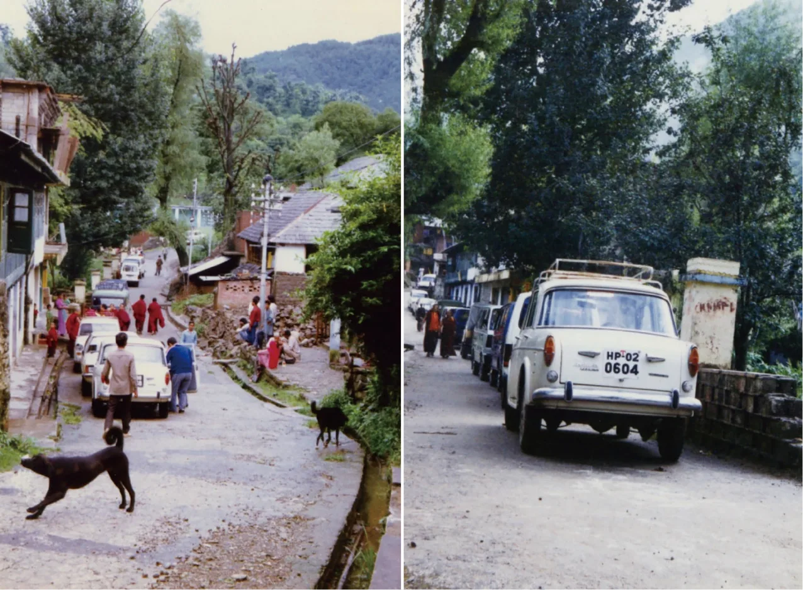
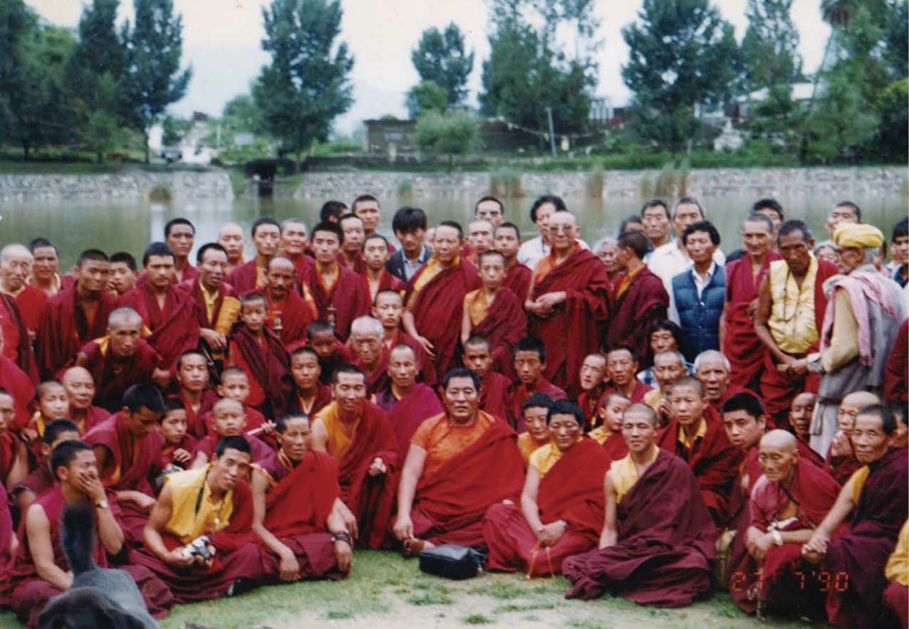

## 莲师略传讲解

法王晋美彭措·造论

索达吉堪布·译讲

2019年3月21日

今天讲莲花生大士的略传。

莲师略传，藏文中叫“巴玛瓜唐”。“巴玛”指莲花生大士，“瓜唐”是传记的意思，“巴玛瓜唐”也就是“莲师传记”。在藏地，莲师传记可谓家喻户晓。对于莲花生大士和益西措嘉空行母的传记，西方佛教徒也很重视。

## 奇妙缘起

我们今天讲的这篇莲师祈祷文，或者说莲师略传，是法王如意宝的智慧流露，也是一部我很喜欢的莲师传记。这其中的缘起，我在这里简单地讲一下。

1990年7月27号，法王带着我们一行人再次前往印度的昌迪加尔之前，先去了离那儿不远的圣地莲花湖（Rewalsar Lake）。当年，莲师在莲花湖大显神变，调伏了萨霍国王为主的众生。所以，作为密宗佛教徒，特别需要朝拜这个圣地。

法王带我们去莲花湖时说：“我们少数人，这次放下戏论，以简单的朝山方式，去各个圣地朝拜。”我记得，那天去朝拜莲花湖的人很多。

莲花湖面积不大，位于萨霍地方，村落零零星星散落在周围，地方很美。远远望去，莲花湖似乎不大，而靠近湖边，又会觉得那是一片很大的湖。这个圣地很重要，以后如果朝圣，不要错过莲花湖。

当天上午，法王先去了白玉派的菩提法轮寺。之后，乘车前往莲花湖。在我的印象中，法王比较喜欢低调，但当天附近很多寺院的佛教徒，尤其是藏传佛教徒，几乎都知道法王要去莲花湖，所以那天随行的车辆非常多。我暗暗数了一下，一共有42辆。中途休息和堵车时，我随手拍了几张照片，像素不高，但现在仍保存着。

到莲花湖时，已经是下午了，所以我们先在附近找了一个地方住下。住的地方条件一般，不是宾馆，相当于客栈或招待所。本来我们准备吃过饭再去朝拜，但法王突然很急切地说：“莲花生大士来了！我要马上去湖边。”那个时候，法王的身体很不错，他马上站起来，然后跑下楼梯，连鞋子都没穿，直接光着脚赶了过去。见法王如此匆忙，我也赶紧拿起法王的鞋子——法王在印度的鞋子有点像人字拖，我们从尼泊尔开始，就一直穿着那样的鞋子——跟着一起跑，最后在路中间追上了法王。

那家客栈的名字，我想不起来了。但我记得，我们当时住的客栈离莲花湖很近，就在湖边，与莲花湖只隔一条小马路。

到了湖边，法王非常欢喜，首先向莲花湖顶礼，之后即兴唱了一首我们从未听过的道歌，用的是藏地流行的专门唱诵莲师传的调子。我们随身带着录音机，所以将那首道歌完整地录了下来，但没有立即落成文字。

莲花湖中央有一丛莲花根，很有加持，据说是莲师示现神变时，将火海变成湖泊后所坐莲花的根，漂浮在水面上的部分就像一个小小的岛屿。当地人说，莲花根通常下沉在湖底，只有在莲师的特殊节日才会浮到水面。

当法王唱诵莲师祈祷文时，莲花根奇迹般地浮了上来，并漂到了法王面前。莲师传记里记载，当莲花生大士示现神通将火海变为湖泊后，在场的人首先为莲师供茶，然后将自己最珍爱的手镯、耳环等首饰摘下来，作为供养抛在莲花根上。法王也边唱边向它献上哈达。之后，莲花根又漂漂荡荡回到湖心。当时大概有两百人见到了这一幕，他们都觉得很稀有。

法王显得特别高兴，带大家念《普贤行愿品》发愿。一般来讲，法王不会主动让大家拍照，但当时却说：“这个湖非常有加持。来！我们一起拍个照。”法王老人家在莲花湖旁拍了几张照片，然后邀请大家合影。当天朝拜的人很多，里面有少数印度人，其余大部分都是藏传佛教的出家僧人和在家居士。按照印度的习惯，无论拍照还是吃饭，在家人一般都会让出家人排在前面。这是那天的合影，门措上师等都在里面，大家特别开心。

莲师的全传很广，这首法王脱口而出的金刚道歌，相当于莲师的略传，重点赞颂莲花生大士示现神变的经历。如今，上师如意宝的这篇莲师祈祷文在藏地和西方都非常流行，许多道场都在念诵，他们以这样的方式祈祷莲师。而且，大部分修行人都将这篇莲师祈请文放在自己的课诵集中，每天念诵。你们根据自己的情况，如果有信心，也可以在各个道场或个人家里，经常唱诵这首莲师略传。这其中有不可思议的缘起，能给你的家庭、工作和生活带来极大利益，以后会给大家讲述这方面的道理。

接下来，我从字面上做个简单的介绍。藏文的偈颂与汉文和英文的都不同，固定字数的藏文偈颂在译成汉文时，如果字数太多、太白，会失去颂词的味道；如果太略，意义又不太好懂，其他没有传承的人，仅凭自己看，不一定能明白。当然，懂藏语，但没有传承，对诗学也不是特别精通的人，也不一定能看懂藏文的偈颂。从这一点来讲，传承很重要。法王如意宝的这篇莲师略传，如果自己看的话，有些地方也不是那么好懂，所以我们一起从字面上理解一下。

诶玛吙

“诶玛吙”，感叹词或者说呼唤词，相当于汉文里的“善哉”或“奇哉”，表示对诸佛菩萨的呼唤和劝请，在这里是祈请莲师垂念自己。许多祈祷文和仪轨都是以感叹词“诶玛吙”作为开头。

> 祈祷大悲幻化身，无等智慧威力尊，

> 持明莲师予垂念，加持外内密违缘，

> 消法界中而现前，法政无余善妙果。

获得四持明圣果的莲花生大士，您拥有无与伦比的智慧，已经彻证了一切万法的实相，对一切如母有情也具有无法堪忍的强烈悲心，您威力非凡，能度化无边众生。在持明莲花生大士您的面前，我虔诚祈祷，祈祷您垂念我、加持我，让外内密的所有违缘，消于法界，让世出世间的善妙功德，悉皆现前。

莲师不仅具足诸佛菩萨的不共功德——智慧、大悲和威力，而且也获得了密宗中提到的持明果位。学过密宗的人都知道，持明果位有四种，分别是异熟持明、大手印持明、长寿持明和任运持明[^1]。

我们在获得了持明果位的莲师面前祈祷，之后向莲师禀白所求，即祈求莲师加持。一方面，让我们外内密的违缘消于清净的法界。地水火风的灾难，以及在生活中遇到的种种困难，都属于外在的违缘。焦虑、恐惧、忧伤、没有力气、心不堪能……这些属于内在的违缘。有的道友说：“我现在闻思不下去了，没有感觉，也没有动力……”这也是内在的违缘。烦恼障、所知障、习气障等阻碍我们认识觉空无二之本性的，都属于秘密的违缘。为了遣除这所有外内密的违缘，我们需要祈祷莲花生大士。另一方面，现前“法政无余善妙果”。“法”，指佛法或出世间法；“政”，指国政、政权等世间法。也就是说，为了现前世出世间的一切所求和善妙功德，我们要祈祷莲花生大士。

每个人的所求不同、喜好不同，愿望也不尽相同。总之，我们通过祈祷莲花生大士，能遣除自己学习、工作、生活以及人生中的种种违缘和障碍。

遣除违缘很重要。我们遇到的，有些是外在的障碍，有些可能属于内在的违缘。有些障碍对一般人来讲，根本不是违缘，但对某些人来说，却是非常大的违缘，心里的坎一直过不去，像这样的违缘和障碍，同样需要依靠莲师的加持来遣除。

当你们觉得有一些违缘自己始终扛不过去、熬不过去时，最好一心一意祈祷莲花生大士，一定会有立竿见影的明显效果，这是我的经验。

我在修行过程中，或者说在人生中，每次遇到乌云般的阴影时，就会通过念诵莲师心咒，或具有谛实语加持的偈颂和祈祷文，以这样的方式恳切、猛厉、一心一意地祈祷莲花生大士，之后，就像风吹云散、太阳出来了一样，阴影很快便消失于法界。

你们可能不知道，藏地的牧民每年都需要做帐篷，也就是更换帐篷的毡子。对牧民来说，这是很重要的事情，所以他们会提前观察，选一个好的日子来更换毡子。更换毡子时，需要把帐篷拆开，那时，家里的东西全都露在外面，人也站在外面，此时如果下大雨或冰雹，就是一个很大的灾难。所以，我小时候经常被他们请去“遮风挡雨”。他们每次做帐篷，都会让我好好祈祷，保证风和日丽，不要下雨。我的任务就是拿着黑色的小转经轮，坐在旁边念莲师心咒。有时候，早上天气很好，可是到了中午，就开始乌云密布，于是我对着乌云拼命地吹……好像确实有用。后来，周围的邻居让我去挡雨时，我都会信誓旦旦地答应，胸有成竹地念咒，在当时的我看来，挡雨是一件很容易的事情。

去年还是前年，六一儿童节，学校的孩子们跳舞时，好像马上要下雨，有个别道友让我去“加持加持”。我当时心想，既然我小时候可以，到底是真的假的我也不知道，但不管怎么样，我现在也试试吧。然后我就悄悄地念莲师心咒，然后躲在别人看不到的地方默默地吹……后来也许是我的分别念，太阳很快就露出来了，当天孩子们跳舞跳得非常成功。所以，我有时候的祈祷还是很管用的，但你们以后挡雨不要找我，万一不成功，我的“神变”就有点露馅了，对吧？

我也并不是在开玩笑，我们在自己的人生中，确实需要经常祈祷。你们如果有需要成办的事情，或是遇到违缘需要遣除时，都最好祈祷莲花生大士，依靠莲师的加持，事情能成办，违缘也能遣除。

> 昔日自生莲花生，为萨霍王活烧时，

> 四大害显觉空严，八功德水湖中央，

> 叶果严饰莲花蕊，现出相好庄严身。

> 聚此君臣信心海，涌动无法相容纳，

> 双手合十之莲花，速于首髻而顶戴。

国王恩扎布德去大海取宝时，发现了降生在莲花上的莲花生大士。由于莲师是直接化生在清净大海的莲花上的，并不是由世间父母的不净种子所生，所以被称为自生莲花生大士。

往昔，莲花生大士被萨霍国王活活焚烧时，四大尤其是火大的加害，显现为觉空无二智慧的庄严。四大不仅没有伤害到莲花生大士，反而更加凸显了莲师的修证和他觉空无二的智慧。熊熊烈火使莲师看上去更加美妙、庄严。其后，火海变成了具八功德水的莲花湖。在湖泊中央，有一朵由美妙枝叶、花瓣和果实所装饰的莲花。莲师以国王游舞式端坐在莲蕊上，相好庄严，观不厌足。

萨霍国王及其臣民，本来想要活活烧死莲师，结果熊熊烈焰不但没有伤害到莲师，反而变成了清凉的莲花湖。莲师的这一神变，让在场的每一个人都生起了无比的信心。他们的信心强烈涌动、无法克制，如同大海波涛汹涌，连心相续也无法容纳，似乎马上就要溢出来一样。

内心的波动，通常会引起外在行为上的变化。因此，当萨霍国王及其臣民心潮澎湃、信心强烈时，他们自然而然双手合十如莲花，高举头顶如肉髻。

这段传记内容，我想很多人都知道，但我在这里再讲一下。我不太会讲故事，但因为你们听故事的时候不容易打瞌睡，也不容易产生分别念，所以我还是简单地讲一下。

如果一堂课连一个公案也没有，全是甚深的理论辨析，即使讲得再好，也不一定有很多人接受。一会儿理论分析，一会儿引经据典，一会儿展开辩论，讲者也许有这个能力，但听者可能会走神，不容易入心。所以，有时候讲一下高僧大德和诸佛菩萨的生平事迹是很有必要的。其实，你们自己也可以通过阅读高僧大德的传记来生起信心，找到共鸣。

以上这段内容，讲的是莲师八相中，以巴玛托创匝和莲花王巴玛嘉波的寂静相示现神通，度化众生的经历。后面还有一段，讲的则是狮吼莲师森给扎卓示现忿怒相调伏众生的情况。

法王的莲师略传与其他的莲师传记稍有不同，有些说狮吼莲师是莲师在印度金刚座的示现，有不同的说法。事实上，根据众生不同的意乐、根基，诸佛菩萨在众生面前会有不同的显现，所以都可以解释。法王的莲师略传，不仅有莲师显现寂静相的事迹，也描述了示现忿怒相时的情节，这样的传记才完整。

当然，有些众生不愿意见到忿怒相，诸佛菩萨为了随顺众生的心态，在这样的众生面前也确实会示现寂静相。但实际上，诸佛菩萨除了示现寂静相以外，还会在不同的众生面前显现忿怒相。

就像人的一生，不可能一直笑呵呵的。有的人忿怒相多，有的寂静相多。既有寂静相，又有忿怒相，这样的人生才完整。你觉得某个人始终很柔和，有的人可能会说：“他在别人面前是很调柔，但在对待内部的人时，其实特别凶！”所以，他在你面前显得很柔和，不一定在所有人面前都这样。包括有些上师也会得到不同的评价，有的人说：“这位上师好温柔啊！他在讲课的时候就像观世音菩萨和释迦牟尼佛一样。”然后另一个人可能会说：“你不知道吗，他其实不是这样的，他在别人面前确实很温和，但实际上，可凶啦！我就见过他发脾气……”

总之，对于听话的众生，莲花生大士会示现寂静相来度化，而在调皮、野蛮的众生面前，则会示现威猛的忿怒相来调伏。这其实也符合我们所知的规律，任何事物，在不同的时间和空间，会有多维度的不同展现。个别人觉得：“啊，佛教不是很慈悲吗？怎么还会有这么忿怒的相啊？好可怕哦！”一方面，佛教确实很慈悲，无论在哪个场合，我们都会提倡慈悲。但仅凭寂静相，不一定能调化所有的众生，因此在内心保持慈悲的同时，有时也需要金刚怒目。

## 莲花湖的由来

当时是这样的，莲花生大士在印度的灵鹫山，也就是释迦牟尼佛二转法轮的地方禅修。莲师思维：“我现在应该去何处利益众生？”这时，在他的清净显现中，一个声音说道：“你现在去离印度金刚座不远的萨霍国，可以饶益无量众生。”

萨霍国环境秀美，物产丰饶，是一个兴旺发达的国家。萨霍国的国王，具足福德、财富与权力，有许多王妃，但没有子女。后来，有一位王妃怀了身孕，生了一位公主，取名曼达拉娃。

“曼达拉娃”，是曼陀罗花的梵语音译。实际上，她是一位早已成就的空行母。当曼达拉娃空行母降生在萨霍国之后，整个国家出现了许多瑞相。

曼达拉娃公主的成长速度特别快，普通人一年的生长，她只需要一周时间，所以短时间内就长大成人了。公主心地善良，美丽庄严，名声遍传大地。各国的国王、大臣纷纷来向萨霍国王求亲。

按照那时的传统，子女的婚姻必须由父母决定。听说现在有些地方仍是如此，是吧？父母决定子女的终身大事——到底是大事还是小事也不知道，但汉地经常说“终身大事”，所以每个人都看得很重，这件“终身大事”不成功的时候，就会特别伤心，其实这和媒体、习惯、传统也有关系。藏地一般不会说“终身大事”，只说“终身的事”。

萨霍国王虽然可以决定自己女儿的婚嫁，但考虑到，答应任何一个国家，就会得罪其他所有国家，所以他也左右为难，无法决定，只能将权力交给公主，让公主自己定夺。曼达拉娃公主不愿入于世俗成家，只希望去静处修行。国王同意后，在离皇宫不远处，为公主修建了一座禅修院，并安排了五百位宫女陪同公主修行。

一天，虚空中彩虹萦绕，莲花生大士在空中显现神变。曼达拉娃公主和宫女们见到后，因为特殊的因缘与加持，心中生起极大的恭敬与信心，因而祈请莲花生大士降临并转法轮。

莲花生大士凭借神通之力，降临在她们的禅修院内，为曼达拉娃空行母为主的女众，宣讲了许多不共内续的生起次第和圆满次第的修行法要。

正当莲师在她们内部空行界转法轮时，有一个牧童为了找寻丢失的牦牛，恰好到了禅修院附近。他听到禅修院内传来男众传法的声音，刚开始以为自己听错了，再三确认后，发现里面确实有男众在传法。

牧童回到村庄后，就其所见所闻说出诽谤的闲言碎语。当时，萨霍国的人民对公主的出离与修行生活很关注，所以消息很快就传开了，一传十，十传百，最后传到了国王的耳朵里。国王听到这个消息，大为震怒，他心想：我得罪了那么多国王，就是为了让她好好修行，现在竟然发生这样的事情！我身为一国之君，这对我来说简直就是奇耻大辱！

国王在盛怒之下，派出大臣与士兵去惩罚她们。当大批人马浩浩荡荡地赶到禅修院时，莲花生大士正在为她们传授佛法。虽然被派去的大臣和士兵并没有见到任何不清净的行为，但也只能遵照国王的命令，将莲花生大士拉下法座并绑了起来。

这时，曼达拉娃空行母在旁边急忙辩解道：“各位王臣与侍卫们，这位慈悲的上师是一位殊胜的化身，他来此是为我们传授能获致觉悟的胜妙佛法。我们每个人都是清净的，并没有受到丝毫世俗的染污。所以请你们立即释放尊贵的莲师。”那些大臣和士兵，对公主的话置之不理，将莲师捆绑后带走了，也按照国王的命令，将公主和宫女们监禁了起来。

国王对这件事情感到非常生气，他觉得一定要给老百姓一个交代，于是让大臣们挨家挨户收集木材，准备在7天后活活烧死莲花生大士。

依照国王的命令，家家户户都提供了焚烧莲花生大士所需的木材。7天后，也就是三月初十那天，国王下令执行死刑——将莲师放在堆成山的木材上活活焚烧。国王下令后，士兵点起火把，刹那间，烈火烟雾腾空而起。

那些大臣和士兵以为莲花生大士必定会葬身火海，可是出乎意料的是，整片火海转瞬间竟成了一片具八功德水的清净湖泊。在湖泊中央的莲花上，莲师以国王游舞式安坐在莲花蕊心，其相好圆满的身相，显得更加庄严、美妙。

在场的大臣、士兵——Police，是吧？那些“公安人员”非常害怕，急忙跑回王宫向国王禀报。国王刚开始根本不相信，甚至到了现场亲眼见到那样的神迹后，仍然半天反应不过来，以为是自己的眼睛花了。过了好一阵子，国王才逐渐接受所发生的一切。醒悟过来的国王，心中充满悔恨与绝望，因极度悲伤而扑倒在地，哭喊着向莲师忏悔。为了得到莲师的宽恕，国王祈求莲师接受萨霍国的国政、人民以及宝库里的所有财富。

虽然莲花生大士的身体丝毫没有受到熊熊烈火的伤害，但衣服已经被烈焰吞噬。因此，国王命令大臣立即去王宫，取来最新、最好的服饰供养给莲花生大士，其中就包括“见解脱莲花帽”。直到如今，像阿富汗等印度北部的一些国家，国王戴的帽子仍然没有太大变化。

通常而言，莲花生大士的冠冕有三种，分别是莲花苞帽（莲师降生时，诸位空行母所赐，作为部主标帜的冠冕）、鹿耳帽（莲师于八大尸陀林行持禁行时，诸位空行母所赐，作为功德标帜的冠冕）和萨霍国王供养的“见解脱莲花帽”。[^2]

萨霍国王将宝库里的莲花帽、披风、衣冠全都供养给了莲花生大士。莲师说道：“大王，你仔细听着，我的无漏金刚身，宛如虚空一般，不会被四大所害。我早已证得无来无去的果位，不需要任何世间的财物，我来到此地，只是为了开示佛法，引导你们趣入佛道。”于是，萨霍国王下令释放公主和宫女，并且命令全国人民前来莲师面前听受正法。

莲师在萨霍国待了很长时间，有的传记说是13年，说法不一。莲师为萨霍国的众生传授了大乘密法，他们皆对莲师生起了不退转的信心。后来，包括国王在内的十多万萨霍国众生，全都获得了持明果位。

度化了萨霍国的众生后，莲师和曼达拉娃空行母一同前往尼泊尔的玛拉蒂卡。法王如意宝去尼泊尔时，本来也打算去玛拉蒂卡，但因为路途遥远，所以邀请方准备租用一架直升机接送。但后来说天气不好——不知道是天气不好，还是邀请方的费用不够？因为包一架直升机的费用很贵。总之当天等了很久，但还是没有去成。听说现在去玛拉蒂卡朝圣的人很多。莲师和曼达拉娃空行母在那里闭关修持了三个月的时间，之后都获得长寿持明，成就了无死虹光身。

前面的这段传记，主要讲莲花生大士被火焚烧时，大显神变调伏萨霍国众生的经历。

我是看莲师传长大的，在很小很小还不太认识藏文的时候，就经常拿着一本莲师的传记在山上或树林里阅读。为了畅快地阅读莲师传，当时特别想精通藏文——那时要是有有声书就太好了！

山上有一些曾经出过家的修行人，我总去找他们，让他们给我讲莲花生大士的生平事迹。他们有些人讲得很好，所以，在我的智慧书函里，收藏着很多不同版本的莲师传记。

## 伏魔至尊狮子吼

莲师为了调伏不同的众生，显现了八相，每一相都是莲师非常重要的示现[^3]。以上是八大莲师中的寂静相——巴玛托创匝和巴玛嘉波（莲花王）的简短介绍。昨天讲了多吉卓罗，接下来，我们看看狮吼莲师的事迹。

> 时魔外道大象群，大力我慢身强健，

> 伸出恶行之长鼻，

莲花生大士显现神变时，骄慢的魔王、魔众和外道，像狂象群一般蜂拥而至，十分猖狂。他们身强力壮、势力雄厚，现出种种狡诈的伎俩和凶恶的手段，意欲伤害莲师，给莲师制造违缘。

俗话说，道高一尺魔高一丈。释迦牟尼佛在成佛时，遭到了魔众的干扰。莲师在示现神变时，也出现了这样的情况。在印度，大象是力量很强大的众生，发狂的大象非常危险，经常摧毁房屋，杀害人畜，所以这里将魔众和外道比喻成大象群。

> 空行狮面怒母口，顿时吞下三有界，

> 以吽啪的声动尊心，

正当那些外道和魔众想要伤害莲师时，狮面空行母以顿时能吞下三界的威力念诵“吽”和“啪的”来劝动莲师的心。其实很多降伏咒语中都有“吽吽”“啪的啪的”。

狮面空行母是一位非常重要的空行母，实际上，在莲师成就的过程中，狮面空行母经常出现。之前讲《莲师金刚七句祈祷文》时，也提到狮面空行母交给莲花生大士一个宝箧，嘱咐莲师降伏外道。后来莲师示现神变，以咒语降伏了外道。我们学院现在也一直在念修狮面空行母和金刚亥母。

> 起现降魔大等身，神变教理利齿爪，

> 享诛反方野兽餐，美名吼声震三有。

> 彼时上空诸天人，称扬彼名狮子吼，

经由狮面空行母的劝请，莲师起现降伏魔众的大清净、大平等妙身。也就是说，莲师显现为雄狮王的形象。狮子既有尖牙，更有利爪，表示莲师不仅需要以教证、理证的辩论胜伏外道和魔众，更需要以神变降伏他们。

狮子杀死猎物后，会将猎物吃掉。同样，莲师降伏了外魔野兽之后，便开始享用他所诛杀的反方。当然，这里并不是说莲花生大士通过作战杀死了很多人，然后再将他们吃掉，不是这个意思。对真正的成就者来说，就像昨天讲多吉卓罗修法时提到的那样，通过行持降伏的事业，将恶业众生的五蕴网罟超度于清净法界，让众生获得解脱的快乐，这就是最好的美餐，也是最大的法乐。所以，世间美食不一定是真正的美味佳肴，降伏魔众才是最胜妙的美味。

以雄狮王的形象降伏了外道和魔众后，莲师的威名震动整个三界，上方的天人异口同声地称赞莲花生大士为“狮子吼”。为什么莲师在这里被称为“狮吼莲师”呢？一是因为狮面空行母“吽吽啪的啪的”的劝请。同时，在因缘具足的情况下，莲师示现雄狮王的忿怒相，降伏了所有的外道和魔众，所以被称为“狮子吼”。

在法王的境界中，莲花生大士在莲花湖降伏了许许多多的外道和魔众。那里耆那教徒很多，他们叫“班佳”，一辈子不剪头发，而将头发全卷在白色的布里面。不知道他们承不承认这段被莲师降伏的历史。不过，他们也称莲花生大士为“古汝”，将莲师视为重要的传承上师。

不仅是玛拉蒂卡，莲师在印度、尼泊尔和克什米尔等地示现神变的山洞和圣地，也被各宗教的教徒当作他们的朝圣之地，他们认为自己宗教的祖师和教主，在那里降伏了教敌，展现过伟大的神迹。

众生的业力和业感不可思议，诸佛菩萨的示现也不可思议，所以确实可以有种种不同的游舞。因此，我们不能绝对地说：“莲师唯一是显现在我们面前的量士夫。”对于不同的说法，我们应该理解。各宗各派都会赞叹自己的宗派和本师，这也是合情合理的。世界上的任何一个宗教，其传承上师和持教者都会着重赞叹自己的宗派。

人类就是这样，对于自己的家庭、民族和国家很在意。如果有人说自己家的坏话——对出家人来说，遇到说自己寺院的坏话就会很生气，这就是贪嗔痴，人类共有的烦恼。宗派之间的分歧，很多时候也是因此而来。

总之，我们既要掌握自宗的不共特点，同时，也要懂得包容不同的观点和看法。

> 现量显示尊中尊，大地美女肩难撑，

> 颤动呻吟相交织。

在讲了莲师示现寂静相调化萨霍国众生的经历，以及示现忿怒相降伏外道和魔众的事迹后，法王紧接着以诗学的修辞手法赞叹莲师的伟大示现。

当时，人们亲眼现见莲花生大士将火海变成湖泊，调伏萨霍国王，降伏外道魔众。这些不可思议的伟大行为，展现了莲师无与伦比的强大威力，甚至连大地美女也觉得难以承受，以致大地不断地颤动，颤动和呻吟交织在一起。

诗学里有这样的表达，世间也有这样的说法，比如我们会说：这个功德实在是太大了，连天地都没办法容纳，大地似乎快要裂开，天空也行将塌下。

> 如是无等大上师，千万寂猛游舞戏，

> 一时展现之圣地，成为亲见喜宴时，

> 意童欢喜翩起舞，引吭唱此无伪歌。

无与伦比的伟大上师莲花生，示现的千万种寂静和忿怒的游戏，在同一时间展现在莲花湖圣地。如今，我现见这样的喜宴，内在心意的童子充满欢喜，不由自主地翩翩起舞，放声唱起这首无有勤作、任运流露的信心欢歌。

“千万”是很多的意思。莲师示现神变调化萨霍王，是寂静的游舞；显现雄狮形象，降伏外道和魔众，则是忿怒的游舞。这些游舞展现在莲花湖，而法王现在亲眼见到了莲花湖，所以非常欢喜。法王将自己的内心比作一位童子。童子因为欢喜而翩翩起舞，引吭高歌。“翩起舞”是指法王当时的心态，“无伪歌”则是指这首祈祷文——法王当时很快就唱出来了，根本没有任何的思索和造作。

> 胜皈处您三界中，利生事业不越时，

> 亲口金刚之立誓，劝请速现诸验相。

后面这部分是对莲师的祈请。殊胜的皈依处——莲花生大士，您在三界中的利生事业永远不会越时。“乃至轮回未空之前，要利益无量无边的众生”，这是您以金刚语亲口立下的誓言。因此，我现在劝请您、祈祷您，在我等众生面前，迅速现前一切加持的验相。

莲师不会放弃利益众生，而是会一直度化众生。不像有些发心人员，“我发心四五年了，已经利益众生很久了，您可以考虑换一下吗？不然我都老了。而且我现在心脏不好，一天到晚咚咚咚地跳，您可不可以关心一下？”“我不行了，头好痛，我可不可以下山了？”“我带班已经八年了，现在不带了可以吗？请您放了我吧……”有些法师好像觉得带班、转法轮是一件很痛苦的事情。莲花生大士不是这样的，他以金刚语承诺：永远利益众生，利生事业永远不会完结。

莲师您既然已经立下过利益众生的誓言，而且您在三界中的利生事业永远也不会间断，那么我现在就祈请您，请您迅速为我们众生显示加持的验相。

也就是说，众生需要的任何验相，包括身心健康、升官发财，等等，都祈祷莲师赐予。

> 尤其我等诸雪域，最胜依怙诸民众，

> 不谋而合同一心，日夜随念莲师尊，

> 悲切深情猛呼唤，大爱汝岂置不理？

尤其是我等藏地雪域最殊胜的高僧大德等怙主以及全体民众，不谋而合、一心一意、日日夜夜地随念您、祈祷您，以悲切与深情之心，猛厉地呼唤您。大慈大悲的莲师，您怎么忍心置之不理？

> 今发大悲之威力，灌顶加持具信我，

> 持教大德久住世，正法兴盛于十方，

> 众生安乐行正法，现前一切所求果。

祈祷莲师您现在就发起大悲之威力，为您的心子我，赐予加持和灌顶。同时，祈祷莲师您，加持所有的持教大德长久住世，正法恒常兴盛于十方，众生具足安乐并且精进行持正法，祈愿一切善妙的心愿都能迅速成就。

此文，是朝拜圣地莲花湖时阿旺罗珠宗美即兴脱口而出，弟子南珠由录音立成文字。善哉！

这篇祈祷文，是法王如意宝阿旺罗珠宗美在朝拜印度圣地莲花湖时即兴脱口而出——法王当时不假思索，一下就将这些偈颂唱诵了出来，当时由弟子南珠录音，并立成文字。

这篇莲师祈祷文是南珠堪布立成文字的，昨天讲的多吉卓罗修法是我立成文字的，但法王没有写我的名字。我们去印度是南珠堪布他们祈请的，所以在印度要看南珠堪布的面子，然后我就随便，不写也无所谓。（众笑）

在立成文字时，后面的小字部分也由法王确定，并不是我们随意加的。从这个地方也看得出来，法王对南珠堪布还是很重视的——善哉！

## 三点希望

今天听课的道友们，大家都对莲师有信心，而且大部分都是金刚道友，所以我在这里提几点希望和要求。

第一点：希望大家团结和合。

佛教内部的团结非常重要，无论是在同一位上师面前得过法的金刚道友，还是在同一个班级一起学习的志同道合的佛教徒，相互之间应该融洽相处，要发自内心地融合在一起。

我身边的发心道友，不管从哪方面看，都很团结，对内对外都还可以。我们作为大乘修行人，最重要的就是利益众生，虽然有时候利益众生有一定的困难，但不管怎么样，我们至少要调伏自己的心相续。无论身边人的见解和行为是否与自己相同，我们都应该以和平的方式对待，以和平的方式处理所有的问题。

事实上，团结就是和平。许多人祈愿世界和平，但世界和平可能太宽泛了，为了世界和平，我们首先要保证自己的内心和平、与周围人的关系和平，在这个基础上，世界和平才有可能实现。

有时候，我会通过身边人的语言和表情，来观察他们相互之间是不是有什么矛盾。他们很聪明，知道这一点，所以在我能看到的地方，相互之间哪怕装着也会笑一笑。表面上的和平当然也可以，但我很希望：大家发自内心地关爱身边的道友和家人。

道友之间要团结和合，同样，家庭成员之间也要团结和合，这样，家庭才会和平。也许是业力现前，现在越来越多的人看不惯自己身边的人——子女和父母互相看不惯，兄弟姐妹互相看不惯，与身边人待在一起时经常吵架，其实这是特别不好的现象。家庭是世界的细胞，家庭不和睦，世界怎么可能会和平？如果每个家庭都争吵不休，那么，整个世界也会开始动乱。因此，希望每个群体都能和平。

有些上师身边的人，整天勾心斗角，人们看到时会觉得：“噢，这个上师好痛苦啊！”如果他身边的每个人，都发自内心地关爱其他人，相互之间团结和睦，我们自然而然会得出结论：“嗯，这个上师一定很快乐。你看，他身边既没有外战内战，也没有冷战热战，很好的。”

如果你们愿意听我的话，那么，希望每个人都能够发自内心地与身边的人和平共处。

第二点：希望大家发大心。

每一位大乘佛教徒都要发大心，不要整天想着自己的烦恼和痛苦，而应该想：怎样让佛法恒久地延续。比如说，你们道场有十个人，那么，每个人都应该想：“我们以后要如何弘扬佛法，怎样才能将佛法弘扬开来？”大家要站得高一点，看得远一点，尽量弱化自私自利的心，最好将其化为乌有。

有的佛教徒，大的方面，比如护持道场、弘扬佛法、利益众生，这些根本不想，整天想的就是“我的学习，我的考勤，我的修行”。如果起心动念、说话做事，想的全是个人的烦恼和个人的事情，那活也活得不开心，做也做不了什么事情。这也是为什么有的道场最后无法维系下去的原因。而有些道场里有智慧的人，首先想的就是：“我们的道场，对众生很有利，我们的传承和法脉，能为众生带来极大利益。所以，怎样才能让我们的道场和法脉，持续兴盛几百年呢？”

每一位有闻思修因缘而待在道场的道友，都应该从长远的角度考虑道场的延续。因此，我希望你们每一位都要想到将佛法弘扬于整个世界，让佛法久住于世间，要有这样一颗广大的心！

第三点：大家要精进修行，而且要开心。

好像很多道友都有点灰心丧气的，总觉得自己已经不行了。我遇到一些道友的时候，他们跟我说：“您不要问我修行，我现在修行特别不好……”不要这样贬低自己。我觉得大部分人的修行都很好，想想看，你从原来不学佛到现在学佛，而且每天都会看书、听课，虽然有时候比较忙、烦恼稍微多一点，但很多方面我其实是很满意的。你们最懒惰的人，我也觉得非常伟大，至少你知道自己有点懒惰。（众笑）

所以，我觉得每个人都是有希望的，没有佛性、没有希望的，我一个也没看到。每个人都有希望，真的有希望，只是自己不要有自轻凌懒惰。个别道友总是觉得：“啊，我肯定不行的！我这样的恶人、我这样的坏人、我这样的……”世界上有些六根不全的人都有那么大的发心和精进力，我们这些六根齐全的人，为什么要如此自我轻凌呢？所以，希望大家精神高昂，持之以恒地精进努力，要对自己有信心——要自信，自信很重要！

## 威猛法音震三有

今天为大家传讲了莲师略传，你们以后可以经常念诵。

前段时间，我们喇荣居士林的在家人自发念诵了这个莲师略传并录了视频，这里给大家看一下。

（播放视频）

他们大概有几百人，都很年轻，不是知识分子，是周围的牧民。

念诵莲师的传记，除了能辟邪除障，让世间风调雨顺以外，还有许许多多的功德。我也希望，以后各个地方都能传出这样威猛的法音。

我们今天还安排了藏语和汉语的念诵，大家听一下。

（藏语念诵莲师略传，汉语念诵莲师略传）

汉文的调子，听上去有点——以后可能还要再改一下。这是刚刚才安排的，可能还没来得及练习，也没人教。大家念诵还是很认真的，但那个调子有点——不知道谁教的，第一次听到（众笑）。可以，挺好的，这是一个因缘。

法王的这个莲师略传有很大的加持力，希望以后将其做成念佛机，放在家里播放，可以辟邪除障。

附：

## 莲师略传

法王晋美彭措·造论

索达吉堪布·翻译

> 诶玛吙

> 祈祷大悲幻化身，无等智慧威力尊，

> 持明莲师予垂念，加持外内密违缘，

> 消法界中而现前，法政无余善妙果。

> 昔日自生莲花生，为萨霍王活烧时，

> 四大害显觉空严，八功德水湖中央，

> 叶果严饰莲花蕊，现出相好庄严身。

> 聚此君臣信心海，涌动无法相容纳，

> 双手合十之莲花，速于首髻而顶戴。

> 时魔外道大象群，大力我慢身强健，

> 伸出恶行之长鼻，空行狮面怒母口，

> 顿时吞下三有界，以吽啪的声动尊心，

> 起现降魔大等身，神变教理利齿爪，

> 享诛反方野兽餐，美名吼声震三有。

> 彼时上空诸天人，称扬彼名狮子吼，

> 现量显示尊中尊，大地美女肩难撑，

> 颤动呻吟相交织。如是无等大上师，

> 千万寂猛游舞戏，一时展现之圣地，

> 成为亲见喜宴时，意童欢喜翩起舞，

> 引吭唱此无伪歌，胜皈处您三界中，

> 利生事业不越时，亲口金刚之立誓，

> 劝请速现诸验相。尤其我等诸雪域，

> 最胜依怙诸民众，不谋而合同一心，

> 日夜随念莲师尊，悲切深情猛呼唤，

> 大爱汝岂置不理？今发大悲之威力，

> 灌顶加持具信我，持教大德久住世，

> 正法兴盛于十方，众生安乐行正法，

> 现前一切所求果。

此文，是朝拜圣地莲花湖时阿旺罗珠宗美脱口而出，弟子南珠由录音立成文字。善哉！

[^1]: 《前行备忘录》：“依照全知无垢光尊者的观点，安住大资粮道边际者，身体还没有成熟为本尊身，心已成熟为本尊身，即是异熟持明；之后见道是大手印持明；身体成为澄清以后寿命得以自在，胜法位道圆满，即是寿自在持明；如果没有得到寿自在，那么在即生当中证得见道，中阴越到二地，后得起现有学双运境界，一直到十地末际以上是大手印持明，达到究竟现前佛地，即是任运持明。”
[^2]: 《大圆满前行引导文》：莲花生大士的这顶冠冕有三种不同类型。邬金第二佛既不是由父因所生，也不是由母缘所成，而是在西南具乳海中的莲花花蕊间，于顿生觉性中诞生并证悟现有本基圆成的，当时诸位空行母赐予作为他部主标帜的冠冕，叫做“莲花苞帽”。莲师在八大尸林中行持禁行，行为远离善恶之边的时候，诸位空行母赐给作为他功德标帜的冠冕，名为“鹿耳帽”。莲师在萨霍国被国王哲拉活活燃烧的时候，他的金刚身不受火大灾害的侵袭，全身赤裸，显得凉凉爽爽一样如如安坐在莲花中央。当时国王惊奇不已，生起信心，于是下令：“打开新锦缎宝库的门，取出我所有的衣冠！”这位萨霍国王将一切妙衣、服饰，连同国政、眷属一并供养给莲师，当时国王所敬献的那顶冠冕就称为“莲花见解脱帽”。这里指的就是这顶莲花见解脱帽，或者叫做具瓣五部帽。这顶冠冕内外双层表示生圆次第双运；顶端三尖表示三身；五种颜色表示以五身来利益众生；日月表示智慧与方便；蓝边装饰表示三昧耶无边无际；金刚宝顶表示三摩地如如不动；鹰鹫的顶翎装饰表示见解证悟到极点，修行已达究竟。
[^3]: 《莲师金刚七句讲解》：（一）海生金刚：最初，阿弥陀佛心间的“舍”字，投射到邬金达那够夏大海的莲花上，莲蕊中诞生了一位八岁童子。邬金国王恩扎布德膝下无子，因其乐善好施，不时供养三宝，故国库空虚，于是到大海里取宝。在回程途中，大臣紫那木扎首先见到莲师，接着国王也见到了，对其生起极大信心，迎请到宫中作为太子，赐名“海生金刚”。 （二）忿怒金刚：莲师降伏了奸臣之子，国王将其流放到尸陀林。他在不同的尸陀林中，为有缘的人与非人宣说了种种殊胜法门；对无缘的、对佛法有邪知邪见的鬼神，以忿怒金刚的形象全部降伏。 （三）释迦狮子：在印度金刚座，莲师示现种种神通，说自己是自生之佛陀。很多人不信，并加以诽谤。为把这些众生引入解脱道，他在扎巴哈日上师座下示现出家，此时被称为释迦狮子。 （四）爱慧莲师：莲师于西日桑哈、桑吉桑瓦（佛密）等诸多上师面前，得受了以大圆满为主的众多显密教授。他听闻任何一部经典和续部，都能了如指掌、通达无碍，故叫做罗丹确哲，汉译为“爱慧”。 （五）巴玛托创匝：莲师在萨霍国示现种种神变，国王最初不承认他的成就相，命人堆积木柴焚烧他，结果烈火变成了湖，木柴变成了莲花，莲师端坐在莲花上，颈上挂着骨鬘以作庄严，没有受到丝毫损伤，此时叫巴玛托创匝。托创匝即颅鬘妙力之义，指莲师用骷髅鬘装饰身体。 （六）莲花王：萨霍国王和大臣们对莲师生起极大信心，请他担任国师十三年，并从国库里取出珍贵的衣饰、莲花帽等作供养。莲师戴着莲花帽，这时叫巴玛嘉波，即莲花王。 （七）日光莲师：在格拉佐尸陀林，莲师示现种种禁行，给空行母们传授密续法门。并降伏了一些鬼神，对其宣说诸多妙法，在日光上显示各种神变，故叫格热宁玛沃热，即日光莲师。 （八）狮吼莲师：在印度金刚座，莲师于辩论中击败了五百邪见外道，并依靠咒术的威力降伏了他们，使外道们屈服并皈入佛门，此时叫格热森给扎卓，即狮吼莲师。
