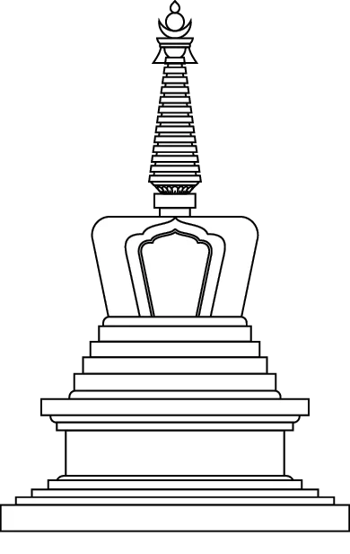

# 第111课

2018年7月13日

今天讲《大乘经庄严论》最后一堂课。从2015年3月24日开始传讲，到现在四个年头了，今天是第111课，课后我们做个简单的会供。

本论最后是顶礼佛陀，讲了很多佛陀不共的特点或功德。下面从四无畏的角度来赞叹和顶礼佛陀。

说自智与断，他利离道障，

一切诸外道，不损汝前礼。

佛陀可以在众人面前无有畏惧地亲自宣说自己的功德。四无畏在自利方面有两个功德，他利方面有两个功德。自利方面是“智与断”，即能遍知一切万法的真相，这叫作智圆满；能断除一切烦恼障和所知障，连最细微的习气都已断掉，这个是断圆满。自利的功德是断证功德圆满。

他利方面的功德第一个是道无畏，即宣说真正从轮回中出离的道和方法没有任何畏惧；第二个是道障无畏，道的障碍就是我执、萨迦耶见，以及贪心、嗔心、痴心等五根本烦恼及随眠烦恼，这些是解脱轮回最大、最根本的障碍。

佛陀所宣说的这些道理和观点，世间当中包括天人、婆罗门、国王、智者等等谁也无法推翻。我们作为佛教徒，在阐述佛陀断证圆满的功德时，也没有任何人能推翻。即使外道举出种种理由，说你们的说法不对、不合理，应该如何如何，但对我们的观点根本不可能有任何损害，因为这是非常合理的谛实语。

一说“外道”，有些人就好像特别排斥，其实“外道”并不是对外排斥的贬义词。就像我们平时说“外国人”——我国以外的人都叫外国人，但到了美国，美国人又认为美国以外的人是外国人。所以，我们说内道、外道，并不是外道的见解都不合理，只是在真正获得解脱方面，外道宗派并没有宣说彻底从轮回当中解脱的方法。虽然他们也有各自不同的解脱，但他们的解脱跟我们的说法是不同的。现在世界上很多宗教都认为自己是内道，其他的宗教是外道。各种外道也觉得包括佛教在内的其他宗教是外道。其实不同宗教之间可以互相学习、互相尊重，没有必要相互干涉、排斥或诋毁。在佛教密宗的一些誓言当中，也提到连外道也不能诽谤。

佛陀是世间当中唯一具有四无畏功德的人。有一部经典叫《宝星陀罗尼经》，当中说：“唯佛得如是，世间第一觉，唯佛是世亲，愿布甘露法。”佛陀是真正圆满觉悟的人，他是一切众生的至亲，他依靠无碍的智慧为众生降下甘露法雨，让无量众生干涸的心得以滋润。我们今生有幸遇到佛法，有幸有顶礼佛陀的机会，这是非常难得的。在任何时候，都希望大家对佛有恭敬心，而且这种心不是迷信的恭敬心，而是智信的恭敬心，智信的恭敬心是什么呢？就是一种理性的恭敬心。

无护无忘失，眷中庄严语，

永断二染污，摄眷汝前礼。

佛陀有“无护”方面的功德，因为佛陀早已断除身语意的过失，没有任何罪垢，因为没有罪垢，他根本不担心自己的过失会让别人知道或在别人面前需要隐藏，三门的行为完全可以暴露在众人面前。一般人不可能内外都完全清净，即使是菩萨也还有一些障碍，但佛陀丝毫障碍都没有了，所以叫作无护。

“无忘失”——因为佛陀没有任何过患，所以不会忘失正知正念。世间人因为有各种障碍，尤其身心不太健康或年龄比较大了，很多事情经常会忘记。有一个开玩笑的段子说：美国总统特朗普只有六七个小时的记忆，之前的事记不住。有些道友忘性也比较大，我好像也是，我可能是事情比较多，但佛教的教证、理证忘得不是很多。一些道友安排的事情，我先是答应了，后来又忘了。有些堪布、堪姆背后说：虽然他已经答应了，过两天会不会不承认啊——有这个可能，我也不是佛陀，有忘失是正常现象——这是有依据的。

“眷中庄严语”。就像狮子在野兽当中具有王者之威一样，佛陀在眷属当中所宣讲的空性、菩提心等庄严语言谁都无法对抗。

“永断二染污”。有些法师对爱听课、好好记笔记的听法者非常喜欢，对于不听法、特别不听话的人则很不喜欢、生嗔恨心。这种贪、嗔的意念佛陀根本没有。法师们有时也要想想，看看自己是不是有点偏心，对吧。

我们在断除一切障碍、摄集众眷属、具足如是功德的佛陀面前顶礼。

遍知您出游，安住皆恒常，

无非遍知行，如实汝前礼。

这里从真实摧毁习气方面来赞叹佛陀。

当遍知佛陀您去城市里面度化众生、化缘时，不管显现上如何，内心始终在安住的状态中，时时不离遍知的智慧，因此您具足真实的功德。佛陀始终安住在根本慧定或真实了义的禅定当中，所有行住坐卧的威仪都不离禅定、不离正行，在这方面与阿罗汉完全不同。

阿罗汉一是因为习气未断，二是因为没有入定，所以不能一直安住于禅定中：有的阿罗汉走路不小心也会碰上醉象、马车；有的阿罗汉以前世的习气会突然跑起来；有的因为没有正知正念，不好好看路而踩死毒蛇；有的阿罗汉虽有神通，但在黑暗中也会迷路；有些前世当过猕猴“运动员”的阿罗汉，经常会像猴子一样跳起来。

我们这里有些道友的声音特别大，如果两人讲话非常大声，可能会影响周围的人禅修。有些道友出家多年，但走路一点都不如法。我在路上看到过一些人，刚才一直在笑啊、跳啊，看到我突然就变得像马胜比丘一样寂静了——这种情况也是正常现象吧。有些人显现上是凡夫人，实际上是大菩萨也不知道。

戒律里面讲过一个公案，以前有一个阿罗汉经常称别人为“首陀罗”——首陀罗是印度最低劣的种姓，如屠夫、妓女等。印度的刹帝利种姓，相当于现在的行政官员；婆罗门种姓，相当于现在的学者；吠舍是普通百姓。因为这位阿罗汉经常称比丘为首陀罗，僧众准备对他作羯磨仪式进行惩罚或开除，阿罗汉就在自己的屋里入定。一位比丘去叫他，到门口就被他定住了。僧众等了很长时间不见人来，就又派一个人去，一连派了好几个人，都被阿罗汉用禅定工夫定住了。僧众们很不高兴，就到佛陀那里去告状。这位阿罗汉在佛陀面前还是很乖的，佛陀问他：“你为什么称呼很多人为首陀罗？”他说：“我也没办法，一开口就自然而然出来了。”佛陀对僧众说，因为他当过五百世的婆罗门，现在仍然有傲慢的习气。经过佛陀说法，他的习气当下就断了。有些人习惯性地爱说别人的过失，也可能是习气。

佛陀具有不可思议的、能够摧毁习气的功德。

于利诸众生，您恒不越时，

恒常行有义，不忘汝前礼。

这是讲佛陀不失利，即“念无失”的功德。意思是什么呢？佛陀利益众生的心和行为永远不会逾时或过期。佛利益众生的这颗心，多少亿万年前就一直是这样，在因地也好，成佛之后也好，无论化现为什么样的众生，这样的心永远不会变。世间人的利他心或想帮助他人的心是会过期的，有些人经常打电话就是好朋友，过一段时间不联系就不是了。你今天喜欢这个人，但是不是永远都会喜欢呢？世间感情最好的人也不一定能确定，也许年轻时感情很好，到了晚年就不一定。但佛陀不是这样，他永远慈爱所有众生。

《毗奈耶经》中讲过[^1]，即使大海有离开波浪的机会，但是佛陀对所化众生的悲心始终都不会离开。后面接着说：“如母有一儿，常护其身命，佛于所化者，愍念过于彼。”母亲对独子的长期爱护之心非同一般，但佛陀对所化众生的悲悯之心已经完全超越了母亲对独子的悲心，比她更为强烈，佛陀对众生的爱永远不会有变化。

“恒常行有义”：佛陀永远不会忘记利益众生的事情，佛陀是这样，诸位菩萨也是这样。我们虽然不是真正的佛，但我们都是佛的追随者。前一段时间我也讲过，现在大多数佛教徒大的方向是对的，很多人经常讲：但愿我生起无伪的出离心和菩提心！但愿我能利益众生！虽然我们利益众生的能力有限，但如果我们这样发愿，总有一天也会有利益众生的能力。佛陀最大的功德就是能利益众生。好像《大集经》里面讲过，如果有人想在无量劫当中听法，佛陀也愿意为他一个人讲法。

于诸世间中，昼夜六时见，

具足大悲心，垂念汝前礼。

佛陀的大悲心是什么呢？他昼夜六时照见十方世界的众生，看到众生哪些是在兴盛的状态当中，哪些是在衰败当中，哪些是在炒股，哪些身体健康，哪些身体不健康——我看很多道友在这方面的担心不是很多。世间人确实有很多痛苦。佛陀一直以大悲心来垂念我们、观照我们，所以我们要在佛陀面前顶礼。

《极乐愿文》里面说[^2]：佛陀昼夜六时一直观照众生，每个众生的起心动念都能无碍照见。虽然佛陀一直照见我们，但是如果我们没有祈请佛陀，佛的慈悲、智慧和力量不一定入于我们的相续。所以自己要与佛陀、上师、本尊相应的话，就一定要祈祷，对他们有恭敬心，这样自然而然会获得加持。

行为与证悟，智慧及事业。

声闻缘觉众，上师汝前礼。

这里是从十八不共法方面顶礼、赞叹佛陀。

十八不共法在行为方面有六种：如身体没有任何过失、语言没有任何过失、心没有什么忘失等等；证悟方面的有六种：如念、定、慧、解脱、清净等等；三世智慧所摄的有三种：过去法无碍，现在法无碍，未来法无碍；事业所摄的有三种：身事业、语事业和意事业。佛陀具有与菩萨、声闻、缘觉不共的十八种不共法功德，我们在具足这样功德的佛陀面前、一切声闻缘觉的上师面前，恭恭敬敬地三门顶礼。

下面是以一切种智的功德顶礼、赞叹佛陀。

三身大菩提，证得一切相，

于诸众生疑，尽断汝前礼。

佛陀具有法报化三身的大菩提的功德，证得尽所有智和如所有智的智慧。证得三身是什么意思呢？证得法身是获得了二种清净（自性清净和客尘清净）的大菩提；证得报身是拥有大圆镜智、法界性智等四种智慧的这种菩提；证得化身是在乃至虚空界之间以种种方式利益无量无边众生。这样具有法身和色身（化身和报身）大菩提的佛陀，能断除一切众生的怀疑。成佛并不是为了自己享受无比的快乐，佛获得三身五智功德的最终作用是什么呢？就是断除世间可怜众生相续中存在的三心二意的犹豫——对法、对解脱的怀疑。断尽众生的所有怀疑，就是如来的事业，在具足这样功德的佛陀面前，我要三门恭敬地顶礼。

所谓的佛果，就像华智仁波切在《现观庄严论总义》中所讲，成佛就是为了利益众生，这个是很关键的。这次讲《大乘经庄严论》100多堂课，最后总结的时候这样说：佛在因地是利益众生，获得菩提后也是利益众生。所以，在因地利益众生这件大事希望大家不能放弃，一旦放弃利益众生，大乘佛教的核心就没有了。不管在基位、道位还是果位，或者因地、果地，应始终把利益众生作为最重要的目标，这一点在座的各位应该清楚。佛陀最后获得三大菩提，证得三身菩提，又获得一切种智，那要做什么呢？并不是为了自己轻松、过得特别快乐，而是为了利益众生。

现在很多人读大学的目的是什么呢？就是自己买车、买房，自己有一个幸福的家庭，很多人的梦想是这样，一旦有一个圆满的家庭——“啊，我的人生目标已经圆满了！”这是大多数世间人的生活目标。但成佛的目标是什么？就是具有三身五智，然后能够利益无量众生。利益众生要解除众生的怀疑，在座的各位，自己稍有智慧的时候，如果别人有一些怀疑、疑惑，就尽量给他们解答，把别人心里的痛苦、烦恼、怀疑、对法的邪见都一一断除，这个功德是非常大的。

虽然我们跟前辈大德、诸佛菩萨的事业和行为相比能力非常微弱，但是这么多年以来，哪怕能暂时对一个众生的相续有一点点利益，我们也很愿意努力。以后有什么样的机缘也不知道，至少二三十年以来一直是这样。那天有一个道友讲考，他推测维摩诘居士的年龄跟我差不多，他讲的原因我忘了，我觉得我没有维摩诘居士那么老（众笑），他有什么理由到时候与他单独辩论。如果我没有那么老，对我是不公平的；如果我比维摩诘老，那对维摩诘居士也不公平。

我们赞叹佛陀能遣除众生的怀疑——这是佛陀最主要的功德之一。在学佛的过程当中，有些人真是以种种善巧方便来遣除初学者的疑惑。一些人刚学佛时有很多、很多的疑惑、恐惧、担心，到了后面好像什么疑惑都没有了，已经证得“无所谓的境界”，这可能是比较高的啦。有些道友除了自己念咒以外没有任何疑问，这也很好。到一定的时候，应该对法断除怀疑，在自己的内心当中生起很坚定、不动摇的信心，这就是我们闻思的目标。这里说佛陀的功德是非常圆满的。

无执无过失，无垢不舍置，

不动于诸法，无戏汝前礼。

这里是以究竟六波罗蜜多来赞叹顶礼佛陀。“无执”：无有执著而圆满布施度；“无过失”：永远断除一切犯戒的过失，戒律度圆满；“无垢”：相续当中永离烦恼的垢染，安忍度圆满，这是三地菩萨的境界；“不舍置”：从来不会舍弃众生，为了众生的事情日日夜夜非常精进、非常努力，有些人一听说是众生的事情，就根本不顾自己，而有些人只愿意做自己的事情，每个人的发心和根基都有差别；“不动”：恒常住于禅定波罗蜜多当中，这是静虑度圆满；“无戏”：对诸法没有任何有无是非的四边戏论，智慧度圆满。我们在通达了六波罗蜜多的尊者佛陀您面前，三门恭敬地顶礼。《白莲花传》当中讲了佛陀的许多功德，最终成佛的时候六波罗蜜多全部圆满。

最后是归纳佛地的功德，从本体、因、果、作用、具足、分类六个方面阐述。

佛地之摄义——佛地法相分析：

成就殊胜义，出离一切地，

成为众生尊，令众得解脱。

无等无尽德，显现诸世间，

亦现佛坛城，人天皆不见。

第一，本体。佛陀功德的本体是成就了真如、胜义谛，即前面讲到的二清净——自性清净和客尘清净，具足这样的功德就是佛菩提的本性。佛菩提的本性是什么呢？完全通达了胜义真相，这样二清净的大菩提叫作“成就殊胜义”。凡夫、阿罗汉、菩萨都没有这样究竟的功德。

第二，因。佛菩提的因缘是什么呢？从胜解行地到十地末尾之间越来越向上——超越下面的地，获得上地的功德，一层一层地往上去，这就是因。一地菩萨的因是胜解行地，二地菩萨的因是一地的功德，前一地的功德是因。

第三，果。佛得到的果是“成为众生尊”，成为世间所有众生无与伦比的尊主，天上天下唯我独尊——具有这样非常圆满的功德。因此佛陀是所有众生的怙主，称为两足之尊、世间导师、三界主尊。

第四，作用。成佛的作用是什么呢？“令众得解脱”。成佛后，佛的工作、事业是什么呢？就是让众生不断地获得解脱，弥勒菩萨成佛之后也是利益众生。当然，佛利益众生是无勤的，并不像我们这样是很累、很费劲的。有些道友很想利益众生，但有时不但利益不了众生，还被很多人欺负，又产生厌离心，又产生嗔恨心，这样不是很好。利益众生也要循序渐进，今生当中好好发愿，然后慢慢就可以利益众生。大家要记住：佛的事业就是“令众得解脱”。

第五，具足。佛陀具足世间凡夫、声闻缘觉完全无法比拟、不共、无等、无尽的智、悲、力等功德。我们前面讲过，连佛陀的影子都能让鸽子获得安慰，所以我们念不同佛的名号有很大利益。你念上师的名号，如果上师是成就者，肯定是有利的，如果上师不是成就者，只是一般的老师，你喊多少遍都不一定有很大的加持。你不如念舍利子、目犍连的名号，他们毕竟是断除许多障碍的阿罗汉，他们的名号有一定的加持力。如果你念文殊菩萨、观世音菩萨的名号，他们断除了人我执和法我执，这样的菩萨有非常大的功德。如果你念阿弥陀佛或释迦牟尼佛的名号，那功德是不可思议的。仅仅依靠念佛的名号、佩戴佛像，功德也非常非常大。

所以，以后像我们这样的世间老师，希望你们不要把照片挂在脖子上——我不建议。当然每个人都是自由的，有些人胸前挂着这位法王、那位上师的很多头像，而莲花生大士、释迦牟尼佛的像一个都没有。我觉得自己可能有一些自私自利——像法王如意宝那样非常了不起的大德高僧，他的像完全有理由挂，因为他的很多丰功伟绩我们也看得出来，就像通过鸳鸯可以推断有湖泊一样。像我们这些人可称为佛教的老师，世间教一堂课的人也叫老师，称老师是可以的，但是如果把他的头像挂在脖子上，他自己也不舒服，对别人也没有任何意义。最有功德的是佛像，应该对佛像顶礼、供养等等。我是很真心地跟大家讲，因为有些人可能是初学者，不是很懂——刚开始视师如佛，最后不要说视师如佛，可能是视师如魔——听都不想听，讲很多是非，这样可能没有必要。

最好是对佛陀有信心，佛陀具足无等、无尽的功德，这样的功德凡夫、阿罗汉、菩萨都不具足，要知道，只有佛才有这样的功德。《福盖正行所集经》中赞叹佛的功德道：“设于多劫中，复以百千舌，称赞佛功德，少分不能尽。”假设我们多生累劫或在多少个劫当中，以千百个舌头来赞叹佛的功德，但连佛少分的功德都无法说尽。世间人有没有这样的功德？世间人的功德最多讲两天，也不用千百个舌头，一个舌头就可以。以前川普跟希拉里竞选总统，记者说：一个多月以来，你们都互相说对方的过失，可不可以说一下功德？希拉里说：川普自己很糊涂，但他有个女儿比较能干。川普说：虽然希拉里没有什么能力，但她很努力。因为她在竞争过程中很拼命，两人都是近七十岁的老人，在这样的竞争中肯定不得不努力。许多世间人的功德，用一个舌头几分钟甚至一分钟就讲完了，全世界关注的这些美国领导人，也只有几分钟的利益。但佛陀的功德是言之无尽的——这并不是佛教徒自我吹嘘，如果我们去翻阅《大藏经》、研究佛教的思想，有智慧的人从胜义谛、世俗谛很多方面去观察可知：原来佛陀的智慧确实是无尽的！

第六，分类。从显现世间而言，佛陀的功德可分为化身、报身、法身三方面。佛陀显现在一切不清净的众生面前，如释迦牟尼佛的肉身在印度金刚座出现，不清净的娑婆世界众生能看得到的这种身体叫化身；佛在清净所化众生面前所显现的身体叫报身，也叫现佛坛城；除了佛菩萨以不见而见的方式能见以外，一般世间人、天、阿修罗等众生根本没办法见的、真正的法性境界叫法身，所谓“人天皆不见”。

以上就是《大乘经庄严论》的内容。弥勒菩萨宣讲了法报化三身，法身谁都见不到——从了义的角度来讲，确实是谁都见不到，这是最甚深的道理。本来正文到此已圆满，但后来的诸位大德、智者为了弘法利生的缘起——谁都见不到，担心缘起会不会有点不好——又在后面加了一个偈颂，在众生界当中佛的事业应该不断地延续下去。但这个偈颂不知是谁加的，有人知道的话给我讲一下，因为本论有很多其他注释。

此亦依彼力，如随所化缘，

世界存在间，事业不间断。

刚才说法身谁都见不到，但是依靠法身的威力，佛的色身会在所化众生面前随缘应机施教，乃至世界存在之间在众生面前一直存在。因为佛的法身是清净的，报身、化身会不断显现，《华严经》讲：“三世一切佛，法身悉清净，随其所应化，普现妙色身。”随着所化众生的不同，佛的色身不断显现，随着色身的不断显现，佛的事业永不间断。

大乘经庄严论中第二十一行为究竟品终

《大乘经庄严论》的二十一品行为究竟品已经圆满了。

甲四、末义：

著跋：《大乘经庄严论》颂，圣者弥勒撰著圆满。

译跋：印度堪布释迦桑格（释迦狮子），主校大译师噶瓦拜则等翻译并校勘抉择。后由班智达巴绕呵达、大婆罗门桑匝那、大译师鄂·罗丹西绕稍做修改，以传讲抉择。

本来注释的内容不用念，但下面这个偈颂讲到了前面再再提过的讲闻本论的功德，因此讲一下。

奇哉！

累劫难得大乘法理集，讲闻补处尊者此论义，

获得讲闻大乘诸法德，大师菩萨地论所说同。

麦彭仁波切说：多生累劫很难得到的大乘法理集聚在《大乘经庄严论》当中，讲解和听闻弥勒菩萨的这部殊胜论典，就会获得讲闻所有大乘法的殊胜功德，这点和大师在《菩萨地论》中所说的一样。我不知道《菩萨地论》里是怎么讲的，可能是说《菩萨地论》的功德也很大，如果讲闻也能圆满讲闻全部大乘法的功德，可能是这个意思。

我们这次经过这么长的时间，有一部分非常勇敢的人一直坚持下来了，我觉得这些人已经获得了讲闻所有大乘法的功德。我在有生之年当中，可以说是第二次讲《大乘经庄严论》，以前法王传的时候我做过辅导，当时是以非常欢喜的心圆满的，以后有没有机会再讲也不好说。法王如意宝传的时候是1988年，今年是2018年，离现在已经三十年了。法王1987年去五台山，本论是1988年的秋天和冬天在喇荣传的，所有的辅导都是在露天圆满的，当时喇荣的生活条件确实不是很好，但大家修行的心非常非常切。这次传讲圆满大家应该非常欢喜。

胜乘之法甘露宴，为请无量诸众生，

于殊胜教极恭敬，欲求利他而著此。

愿勤此善皎月光，开启众慧之睡莲，

善说芬芳遍诸方，净化众生心垢染。

愿我亦于生生世，文殊补处弥勒尊，

喜眸青莲含笑视，趋入如海佛子行。

愿诸天边无际众，皆入胜乘正道已，

究竟圆满成熟净，获得遍知之果位。

铁猪年持诵文殊心咒闭关时，仅于夏季四十日之座间，麦彭嘉扬嘉措参照安慧论师之《注释》而简明扼要撰著圆满。愿善妙！愿吉祥！

2017年12月20日

译毕于以色列耶路撒冷

我在当天的日记里是这么写的：“12月20日，以色列耶路撒冷。耶路撒冷古城虽然只有一平方公里左右，但却是基督教、犹太教、伊斯兰教的圣地。有三大宗教的标志性建筑：犹太教的哭墙、伊斯兰教的金顶清真寺、基督教的耶稣受难之路。犹太教的哭墙又被称为是西墙，是犹太教的第一圣地，最早建于公元前965年，毁于公元586年，犹太人相信哭墙的上方是上帝所在，所以千百年以来，游离在全世界各个角落的犹太人回到耶路撒冷时，都来到石墙面前低声地祈祷、哭泣，还要将一张纸条放在哭墙的缝里面——里面有很多、很多纸条，男女老少都在那里祈祷，但是男众和女众是分开的，纪律比较严。去祈祷的人头上要戴一顶白色的帽子，或者说放这么一块白色的东西……下午把《大乘经庄严论》的最后一部分内容翻译完了，整部大论终于圆满了。虽然耶路撒冷的佛教气息微乎其微，但希望终有一天大乘佛法之花，可以盛放在这三大宗教之圣地上。晚上看了两个小时的电影《耶稣遇难记》，耶稣遇难的整个过程确实很残忍。”现在我每天都稍微写一下日记，有时候有意义，有时候没有什么意义。

《大乘经庄严论》翻译完了，现在是薄薄的四册，以后可能合并成一册。麦彭仁波切的注释也传讲圆满了，非常感谢所有道友！也非常感谢今天来跟弥勒菩萨结缘的道友——网上听课的人数比以往翻了两倍，你们也同样希望得到《大乘经庄严论》的加持吧。

今天还特别要祈祷、感谢我们的护法神！因为这么多堂课大家都圆满了——对你们来讲不容易，对我来讲也非常不容易。现在就是讲一堂课，也需要身体、心态、外在的环境等各方面的因缘。所以我特别感谢世间和出世间所有护法神的鼎力支持和护佑。今天有些人是以与弥勒菩萨结缘的方式听了《大乘经庄严论》最后一课，我希望佛教徒以后都能够热爱闻思修行，不要只把信仰放在口头上，要尽量系统地学习佛法。

《大乘经庄严论》讲完后，如果各方面因缘具足，可能讲《弥勒五论》当中的《宝性论》，有这个想法。但确实末法时代各方面的因缘很难说，自己的身体、寿命等因缘都是有限的，在座各位也有很多无常的因缘，所以不能确定。

今天我们好好地会供，祈祷、感谢护法神——请继续护持我们宣讲《维摩诘所说经》《宝性论》等其他大法。一部大法要传讲圆满很不容易，一两堂课圆满并非不容易，但圆满一部大法确实需要很大的勇气，也需要很长的时间，还需要各方面的因缘。现在一些人的心很乱，事情也特别多，再加上现在的食品、空气等各方面原因，许多人身体不太好，心态也不太好，所以一部法要从开始到结尾非常完整地听完，有一定的困难。

因此我们要发愿最好是即生成就，或在释迦牟尼佛的教法下成就。即使以上不能成就，到弥勒佛来这个世间转法轮时——包括只听了今天最后一堂课的这些人，因为跟弥勒菩萨的殊胜法结上了缘，都会成为弥勒菩萨的首座弟子或眷属而获得解脱。等会儿我们一起会供、念《普贤行愿品》，就这样发愿、回向。

当然还有很多值得特别回向的事情，最近天灾人祸比较多，很多地方出现地震、洪水，还有交通事故等等。有些人在开始讲《大乘经庄严论》的时候还在人间，但中间就已经离开了——包括我的母亲；有的是在听闻本论接近圆满之际离开世间。我们也特别回向中途没有听圆满的、特别忙的、必须要上班的、不得不离开的这些人。我们还要回向生生世世不离大乘佛法，生生世世遇到宣说大乘的善知识，生生世世行持布施和持戒等六波罗蜜多，等等。

总而言之，我们发了菩提心，愿我们生生世世直接或间接利益无量无边众生，断除自相续中如毒药一般的自私自利心。诸如此类的善妙回向和发愿——大家今天在法喜充满的状态当中，时而发愿，时而回向，时而想到从世间中离开的很多众生，希望他们得到暂时和究竟的利益。

大乘经庄严论中第二十一行为究竟品终

接下来我们就做一个简单的会供。等会儿发放会供品时，大家都不要说话，不然人太多会有点乱，得不到就修禅定或道友互相分一下，不一定要吃饱，尝一下就可以。不在现场的、网上的道友，你们喝一点酸奶、饮料，吃一点水果都可以当作会供品来享受。如果会供品有多余的、剩下的，也可以布施给其它众生，愿在它们的相续当中种下善根。

总的来讲，我很开心，今天是一个非常圆满的日子。今天的课是第111课——“要”发菩提心；“要”利益众生；“要”永远不离开大乘善知识和大乘正法。特别感谢世间和出世间所有帮助我们的护法神、人与非人！

整个四年下来我们非常不容易。我翻译的过程也是很不容易的，这么大的论典，而我是这么忙的人，有时自己也产生过放弃的念头，但是最终已经圆满了。以后出书的话，对下一代的人或听课没有记清楚笔记的人，可能是有意义的。《大乘经庄严论》的讲记一直在做，不知什么时候完成，当然不一定要马上完成。质量稍微好一点的大部头讲义可能需要四五年、五六年，最后圆满的话，也许将来会有一点点利益。作为佛教徒，讲经说法、闻思修行确实非常需要，这方面希望大家重视起来。

会供、回向完大概半小时后，请讲考班的道友回到经堂，大家一起普皆回向，今天是最后一课的圆满，我们已经坚持了这么多堂课，应该对自己“点赞”。今晚上应该做个好梦，梦里得到很多诸佛菩萨的加持，很多天人撒下这样的白色、红色等鲜花。听说很多道友一直在找这些花，藏地有很多不是人工种的花，鲜花供养佛陀的功德是很大的。我有时候给大家看一看花，大家觉得特别好，心里如果产生“顶礼佛陀！供养佛陀”这么一个念头，功德也不可思议。佛传里讲过义成王子供养过两朵花，最后获得的功德非常不可思议。

最后就说这么多吧，特别感谢大家！

[^1]: 《毗奈耶经》：“假使大海潮，或失于期限，佛于所化者，济度不过时。”
[^2]: 《极乐愿文》：“佛于昼夜六时中，慈眸恒视诸有情，诸众心中所生起，任何分别皆明知，诸众口中所言语，永无混杂一一闻，顶礼遍知无量光。”
