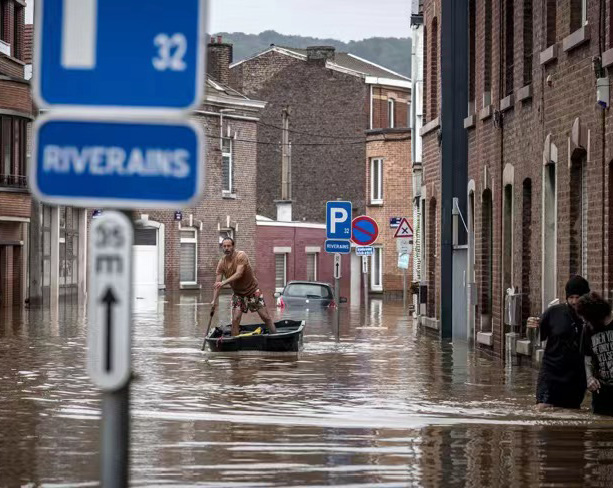
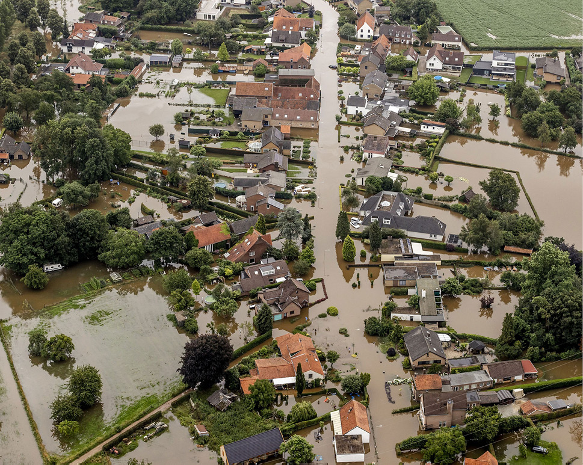
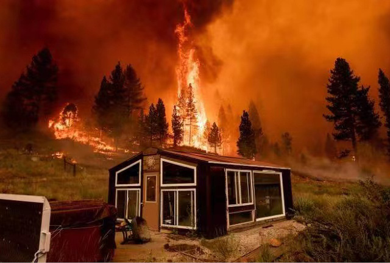

# 第34课

2021年7月27日

今天我们继续学习宣说第三转法轮密意的《宝性论》。前面已经学习了三品，第一品首先讲如来藏，每个众生都具有如来藏；第二品讲到清净障碍以后现前法身、报身、化身的菩提；第三品讲到菩提的六十四种功德——法身离系的三十二种功德，报身异熟的三十二种功德。

这样的功德做什么呢？利益众生。下面紧接着是事业品。

第四 事业品

获得这些功德以后佛的事业任运自成、永不间断。

戊四（能证方便事业之义）分二：一、宣说任运不间断之理；二、以比喻决定。

己一（宣说任运不间断之理）分二：一、略说；二、广说。

庚一（略说）分二：一、略说任运自成之义；二、略说不间断之义。

一般略说只有一层意思，但这里分成略说任运自成和略说不间断，这是比较特殊的一种分法。

辛一、略说任运自成之义：

我们有些人想度众生，需要勤作，不是任运自成的，一定要很努力地、很费劲地去造作，但最后的结果有时候好、有时候不好，好的话自己有成就感，不好的话自己会很失望。

但佛陀不会如此，他是什么样的呢？所有的事业任运自成，相当于大自然的客观规律一样，成佛以后利益众生无有任何勤作，就像自动化机械一样，是自然运转的，不需要人工操作。

所以，我们有些人可能会想，成佛以后佛陀每天为了那么多众生不间断做利他的事业，会不会很累？个别宗教也认为，造物主日日夜夜在帮助众生，是否和这种说法一样？实际上是不一样的。

当然，有些经典说佛陀昼夜六时观照众生，或者恒时以慈悲心饶益众生，这是佛陀在有执著的众生面前示现的。

化界化方便，化界调化事，

彼境应时往，遍主恒任运。

一、“化界”，佛陀利益众生时，他完全了知所化众生不同的根基、界性、意乐、爱好、种姓，还有相续当中不同的烦恼随眠等，但佛陀没有“这是好的”“这是不好的”“这是上等的”“这是下等的”的分别，是以任运自成的方式利他。

佛陀现见所化界的众生，但是没有执著。

二、“化方便”，这些不同根基、不同意乐、不同界性的众生，依靠什么样方式度化他们呢？佛陀完全知道度化众生的方便方法，有些需要寂静相，有些需要忿怒相，有些以显宗法，有些需要密宗法，以各种乘和各种形式度化他们，这是方便。

如颂云：“其自性虽离贪嗔，贪心者前示似贪，因所化嗔示嗔恨，顶礼住大菩提彼。”佛陀的自性虽然离开了贪嗔，但是因为所化不同，于贪心者面前示现贪者，嗔心者面前示现嗔恨，实际上佛的相续没有被贪嗔所染，因此顶礼住于大菩提者。可见，度化众生的方法和方便，佛陀完全明白。

三、“化界调化事”，佛陀把这些不同所化界的众生，安置于人天的增上生，或安置于三菩提的决定胜果位。在这样的过程当中没有任何执著和分别，也是任运自成的。

四、“彼境”，佛陀知道哪些地方有什么样的众生，他对调化众生的环境也是明白的。佛陀有时候从舍卫城出去调化某某众生，有时候去迦毗罗卫国，有时候在王舍城，有时候去其他城市里面调化，所以佛陀对整个环境也非常清楚，但是没有这方面的分别执著。

五、“应时往”，了知度化众生的时间。我们不该度的时候去度，结果不成功，时间掐得不准，环境也是弄得不好，根基更不用说。但佛陀对时间、地方、所化众生的事、调化的方便、所化众生的界性这五个方面全部都了如指掌。这些遍主佛陀的事业全部是任运自成的。

《华严经》云：“譬如日月游虚空，照临一切不分别，世尊周行于法界，教化众生无动念。”就像世间的日月周游在虚空当中，照临万物，但是不会有分别，同样，世尊周行于法界的所化众生面前，但他不会有任何的分别念。佛陀度化众生特别善巧，而且能完全了知众生的根基，应机施教。

孔子观机逗教

虽然我们没办法像佛陀那样，但基本上也要知道每个众生的根基、爱好、兴趣，这个也很重要。以前我在讲《弟子规》的时候也引用过[^1]：有一次孔子给别人说完法以后回去。公西华给孔子倒茶时，子路匆匆忙忙前来，问：“如果有人给了我一个建议，我要不要立刻执行？”孔子以很肯定的语气说：“你先回去跟父辈们商量商量，如果可以的话再去做。”另一位弟子冉有悄悄来到孔子面前，问了同样的问题。孔子回答说：“马上去执行。”

两个人回去以后，公西华问：“先生，这两个人的问题一模一样，为什么对前面的人说要商量，对后面的人说直接执行？到底哪一个正确？”孔子说：“因为子路逞强好胜，做什么事情都有点夸张，我要求他再三思维，慢慢执行；冉有比较谦虚低调，而且没有自信，所以我让他立即去做，增加他的信心，让他果断一点。”

孔子并没有尽所有智和如所有智，也不是任运自成地利益众生，你们学儒教的人不要跳出来说“我要皈依孔子，因为他跟佛一样”，其实也不是，他有一些特点和智慧，否则不可能两千多年以来他的思想一直那么活跃，但跟佛陀相比很多方面还有一定的距离。如果不信，你们可以翻开《大藏经》，看看佛说的大乘小乘、了义不了义的经典，那个时候你会完全明白的。

前面讲到了任运，佛陀对利益众生的时机，不管时间、地点、方便全部都清楚。

辛二、略说不间断之义：

此处讲事业不间断。

具胜功德珍宝聚，智水大海福慧日，

无余决定修行乘，无中边广如空遍。

对于《宝性论》，心稍微散乱就听不进去了、不懂了，所以听的过程当中，对每一个科判、每一个偈颂都要好好地观察。

“具胜功德珍宝聚，智水大海”，因为具有出离之因，故而具有总持、等持等最殊胜的功德宝藏。大海里玛瑙、珊瑚等各种珍宝具足，佛陀在因地的时候也具有总持、等持、六波罗蜜多等功德宝藏。菩萨十地相当于大海，大海一方面具有前面的这些总持、等持等宝珠；另一方面充满无有垢染的智慧水。意思就是说，佛陀在因地的时候，具足功德珍宝，还有智水大海。

“福慧日”，示现之因，福德资粮和智慧资粮如日光般能成熟众生。佛陀在因地时积累福德资粮和智慧资粮，相当于日光，可以成熟万物，依此无余地修行所有的乘。因为佛陀在因地的时候有福德资粮和智慧资粮，而且无余通达显乘、密乘，都有学习，以这个因圆满的缘故，如来事业不间断。这是日轮的比喻。

“无余决定修行乘”，大海与日轮比喻的共同点就是无余决定行持了大小乘等所有乘。就像有些人求学的时候，对显宗密宗、五部大论无不精通，之后得到法师证书时，不管讲什么都很好。佛陀也是如此，在因地的时候有各种功德的珍宝，还有福慧二资的日轮，依此修行了所有的法。

“无中边广如空遍”，以此因缘，佛陀获得了无中无边广大如虚空般、周遍一切的大菩提。所以佛陀的事业不间断。

以上前面两种比喻是从因方面讲的，之后的如虚空的比喻是从果方面讲的。

佛见无垢功德藏，于诸众生皆无别，

以佛大悲风吹散，烦恼所知之云雾。

佛陀得到了这样的菩提以后，照见所有的众生相续当中具有如来藏，进而摄受他们，让他们也能像自己一样获得佛果。

如果众生相续中不具足如来藏，就像一块石头、木头，那么佛陀再怎么转法轮也不会成熟。但是佛陀以他的智慧照见“原来不仅是我能证得菩提，蚂蚁以上的所有众生，都有如来藏。”不管你是考得好的人，还是考得不好的人，甚至根本没有参加考试的，在外面游荡搞破坏的人，相续当中也有如来藏。佛陀照见一切众生的所有功德以隐藏的方式具足，没有任何差别。这是宝藏的比喻。

虽然众生有如来藏，但是佛陀发现他们的相续并不是像佛一样，还有如云雾一般的烦恼障、所知障。

佛陀在因地三个阿僧祇劫修大悲心，对众生产生悲悯心，用大悲心的风遣除障碍众生的乌云。这是佛的事业不间断。

也就是说，佛陀在众生位时修持十地和积累二资粮，最后得到了正等觉果位。这时候，他发现众生相续当中也具足如来藏，就以大悲的风吹散众生两种障碍的云，因此也可以说事业不间断。这是一个总结。

任运自成的略说和不间断的略说已经讲完了，下面分别广说。

庚二（广说）分二：一、任运自成之义；二、不间断之义。

辛一、任运自成之义：

何者依何化，何为何处时，

无彼分别故，能仁恒任运。

“何者”，对任何一个所化众生的根基意乐都很清楚。广说其实跟前面比较接近，讲义里略说的部分还广一点。

“依何化”，依靠什么样的方便方法调化众生，是寂静还是忿怒，显宗还是密宗，声闻乘还是菩萨乘，佛陀也是很清楚的。

“何为”，以什么样的行为，暂时以人天乘，还是三菩提，以什么样的事，安置于什么，决定什么样的事。

“何处”，前往什么样的地方，“时”，什么时机，这些佛陀完全一一了知。

但在了知的过程中，佛陀没有此和彼的分别念，所以能仁佛陀的事业恒时是任运自成的。

《华严经》中云：“如来净法身，饶益无量众，法身亦无念，我利诸群萌。”如来以法身利益无量众生，正在利益无量众生的时候，如来没有“我已经度化了某某众生”“我今天去舍卫城”“今天去王舍城”“今天去鹿野苑”“我上午去”“我下午去”等念头。在某些公案中，显现上佛陀好像这样说，但这不是最究竟的意趣，在佛陀真正的境界当中并没有这些，佛经当中也是这样讲的。

于何所化界，依众方便化，

所化之所为，何处与何时。

略说和广说，意义都是一个，只是从不同层面、不同角度来分析的。

对种种不同意乐的众生，佛陀完全了知以什么样的方式能度化他们，把他们暂时安置于人天的增上生，究竟安置于决定胜的果位。“何处”指的是什么地方，“何时”指的是什么时间，在什么时候机缘比较成熟，这些完全明白，但同时没有真正的勤作。

昙摩流支翻译的一部经典，叫《如来庄严智慧光明入一切佛境界经》，其中也用了很多的比喻，比如日轮照耀整个世界，但它没有分别，不会想今天要让这朵花盛开，明天要让那朵花盛开，同样，佛陀没有分别，不会觉得这个是上等根基，我要讲大乘法；这个是中等根基，我要给他讲独觉法；这个是下根基，讲声闻乘；或者这个是具有正见的人，我要给他讲清净的法；这个是有邪见的人，我要给他讲其他的法。

再比如，大地不偏于任何方向，非常平等地让整个大地上所有的草木、万物依靠它自然生长。大地不会想“我要让东边的树长起来”“西边的那一棵树要让它长起来”“南边的这朵花要让它生长起来，让它开花”。同样的，佛也没有这样的分别，心没有高下，但他仍然以六度和他的法语来利益众生。

这部经宋代的法护也翻译过，有些柬埔寨的法师也翻译过。

佛的境界我们确实不太懂，如果真正是佛，他有这样无为的智慧，祈祷他的时候自然而然能得到加持。

千江有水千江月

那天有一个人说：“停车的时候一直找不到停车位，我就祈祷上师。后来又想现在大家都在找停车位、都在祈祷，那上师肯定很累，所以也不敢祈祷上师。后来因为祈祷‘喇嘛钦、喇嘛钦’，我找到了停车位，于是又忏悔——上师您辛苦了，刚才您这么忙还要给我找停车位……”

我也理解，大家都学过唯物论，“此时不是彼时”，如果是实有的加持、实有的佛、实有的上师、菩萨，可能确实特别累，就像现在出什么事情的时候，这里也叫警察、那里也叫警察。如果同时有几个地方发生交通事故，作为交警很麻烦。如果佛也是这样，当我们每一个人都祈祷时，尤其是开法会的时候，有些人祈祷得特别好，有些人祈祷得不是特别好，但不管怎么样，大家都在念“炯丹迪德银夏巴……”时，佛陀都得去看，“这个人怎么样，那个人怎么样”，对每个人都以勤作的方式来回应，确实很累。

但实际上，我们讲过，月轮在虚空当中，虽然没有分别，但依靠缘起力，它的光芒直接现于所有水器当中。如果水器有垢染、动摇，月影显得不是很清楚；如果水器特别清净、澄清，月影就显得特别清楚。同样，有再多的人祈祷都不用担心，“现在很多人正在祈祷的时候，佛陀他肯定很忙。我不祈祷，不然佛陀太辛苦了，我的业力很深重，我的业障会不会沾染了他。”有些实执非常严重的人可能有很多的分别念，其实，这是因为我们对佛教不是很懂。如果我们真正学了了义经典，包括《宝性论》中的道理，应该会明白。刚才我所引用的经典，在《宝性论》的很多注释中都经常引用。

我们要了解佛陀的境界，要知道这是一种自然规律：如果我们很真诚地祈祷，那佛陀的加持自然而然融入我，因为他在因地的发愿现在已经成熟了，这种缘起没有改变、无有欺惑。对这样的道理，自己要明白，明白以后，我们要真诚地祈祷。

我们有时候祈祷本尊、祈祷护法神，确实很灵验。如《圣大解脱经》所讲，念念都不错，念念都不乱，念念都是真诚的，有时进、日进……这样非常专注地念，效果完全不同。

大家要知道，佛是任运自成的。所谓的佛，并不是以勤作的方式有时候特别忙、有时候特别闲。如果让一个领导来帮助我，可能他开心的时候来帮我，不开心不一定来帮我。我以前说过，有一个领导拿一百块钱放在功德箱里面，对三尊佛进行供养，供养的时候，他说：你们怎么分呢？你们自己看，反正我供养一百块，我也不知道你们的地位有什么差别，中间佛的身体看起来比较高一点，那你多拿一点也可以（众笑）。我觉得有这个心也可以，这个人还是比较可爱的。但他们说，这个人不是很可爱，身体又黑又粗大，脾气又不好。

辛二（不间断之义）分五：一、宣说名称分类；二、解说义本体；三、以比喻表示彼等之理；四、广说喻义；五、归纳不间断之理。

壬一、宣说名称分类：

出离彼显示，彼果彼摄受，

彼断彼障缘，无有分别故。

佛陀事业不间断一共有六个方面：出离，彼显示，彼果，彼摄受，彼断，彼障缘。无有分别故。

“出离”，首先是具有出离的因，就像大海一样，因地时修持总持、等持、神通等。

“彼显示”，示现之缘，藏文中是缘，也有说是因，从意义上没有什么差别，积累二资粮，像日轮一般的比喻。

“彼果”，依靠这两种因缘，形成像虚空一样的菩提果；

“彼摄受”，有了果以后，摄受具有如来藏的众生；

“彼断”，对境像云雾一样的所断障碍；

“彼障缘”，能断除障碍的缘，也就是佛陀的大悲，如风一样。

虽然显现上依靠六种方法进行运作，实际上无有分别。

有些外文注释中说，这几个次第不是依次的，但这种说法是不对的，应该一步一步上来，先因地再果地，再摄受众生。在摄受众生时，发现众生有障碍，然后用大悲风将其吹走。这几个并不是分开的，应该这样来理解。

壬二、解说义本体：

刚才是名称，现在是义，后面是比喻，从不同层面来宣讲佛陀的事业不间断。

出离即十地，二资是彼因，

彼果胜菩提，菩提摄众生，

无量障烦恼，随烦恼习气，

诸时摧彼缘，即是大悲心。

“出离即十地”，从极喜地到法云地共十地，从无明当中出离，得到究竟解脱。能决定出离至究竟果位的因，是依次经行菩萨十地。

“二资是彼因”，福慧二种资粮是让十地功德越来越增长的最好的因或缘，因为依靠二种资粮可以让菩提的果显现出来。

以上是两个因的圆满。

“彼果胜菩提”，获得了圆满正等觉的菩提果位，佛陀的事业也不会间断。

“菩提摄众生”，得到菩提以后，摄受众生。华智仁波切在《现观庄严论》的修行次第中讲到，成佛并不是做其他的，就是利益众生。十地圆满以后现前菩提，之后摄众生，这个很重要。不管你是得到了毕业证，还是评上了法师、堪布、堪姆，如果比以前更傲慢、更有嫉妒心，也不去转法轮、不去利益众生、不去发心，这样确实不行。佛陀获得菩提以后，观察我成佛以后干什么？就是要摄受众生。大家应该知道这个次第。

“无量障烦恼，随烦恼习气”，这些是要断除的。摄受众生的时候，要断除众生如来藏上无量的障碍和习气。

“诸时摧彼缘，即是大悲心”，一切时中要摧毁障垢必须依靠佛的大悲心。以大悲心示道转法轮，众生才可以解脱。

一般来讲，自己有了智慧的时候，肯定有大悲心；有了大悲心，看到众生可怜的时候，应该以大悲心的风摧毁众生相续中的乌云。

当然，我们在座的都一样，虽然我们没有得到佛的果位，没有像佛那么广大的大悲心的风，但至少也有一点点风吧。至少自己学了几年，跟其他众生相比，自己稍微懂得一些佛教真理；懂得佛教真理后，看到其他众生，要不要为他们宣说？如果他们没有如来藏，就可以不用管了，但实际上并非如此。唯识宗以上的修行人都知道，断善根、属于一阐提的众生是没有的，所有的众生都有成佛的缘分，只不过是迟早而已。因此，哪怕在他们耳边念一遍观音心咒，或者做一点点善事，逐渐也会在他们的阿赖耶上种下种子。

所以，我要想摄受众生的时候，要看到众生最严重的习气，有些嗔恨心的烦恼很重，有些贪心的烦恼很重，有些邪见很重，这个时候，在自己力所能及的范围内，适当给别人示道、开示。

开示是度众生最主要的方法。有些佛教徒没有水平，很多都比较现实；稍微做过闻思修行的人就有点不同。我们也能看得出来，有些信众没有很好地闻思修行，只是执著一个相，包括藏族老乡，他们信心很好、很虔诚，但是不懂佛理，每个人都说“给我吹一下”，现在疫情期间，吹是最不方便的，对吧？（众笑）戴着口罩吹的话，我自己也不满意，就好像吹到自己脸上来了；但不吹的话，他们习惯性地一直“给我吹一下，呼——”，有些老年人嘴里只有一颗牙齿，有些是一颗都没有了，就这样张着嘴。

本来我们这里是佛教很兴盛的地方，但有些人连出离心的功德也没听过。其实他们懂得一些佛理的时候，可能就会明白了。有些其他信众也是这样的。

那天去女众那边，有些居士大声地喊“啊！上师啊！活佛啊！”这说明用这种方式不一定能遣除自相续中的障碍。现在世间大城市里的一些人，看到一个喜欢的明星出来时，就在这里跳起来了，拿着各种颜色的荧光棒……

以后，我们这边有什么灌顶、法会的时候，作为真正的佛教徒，不要太激动，大家应该很真诚地听法、受灌顶、受加持。不能让人一看，就觉得佛教徒特别疯狂。当然，如果你们特别激动，我们也不反对，你想吹一下也好……不过，去年疫情期间有一个喇嘛吹了好多人，后来全部都感染了，真的这样的。（众笑）

壬三、以比喻表示彼等之理：

当知此六理，依次如大海。

日轮及虚空，宝藏云与风。

一、十地菩萨如大海，二、二资粮如日轮，三、得到的菩提果位如虚空，四、摄受众生如宝藏，五、众生相续当中的烦恼障碍如云，六、佛陀的大慈大悲如风。

这样的比喻也是按照次第来安立的。比如，一个世间很成功的老师，知识如大海般非常丰富；对他所有的专业也是非常明白，如日轮一般；最后他有虚空一样广大的思想；这个时候他要了解他的所化弟子、学生，看看他们相续中如云一样的障碍是什么样的，然后他有特别好的爱心，把自己拥有的智慧传给他们。

佛教当中很多比喻对应的意义，也可以在日常生活当中找到影子，可以一一对应。

世事无常，应祈祷佛菩萨

最近很多地方出现各种灾难，我们可能也要根据自己的信心来祈祷度母、莲师、观音菩萨。大家也知道很多地方，包括前段时间的河南，最近我看到国外的有些地方也是各种各样的……给大家提供几张照片看一下：

这个是最近的伦敦，出现大暴雨；

还有最近的德国，很多房子、车子也是这样的；

这是比利时的；

还有一个是荷兰的。这是欧洲的很多国家。

这是加州火灾。

北美很多地方遭遇前所未有的高温，美国西部也有火山爆发，西欧的洪水死了很多人。放眼整个世界，确实大自然的灾害、气候的变化比较特殊。

在这个时候，有些佛教徒也没办法做其他事，但有时也感觉不知道自己什么时候会出现无常，无常感更加强烈。从整个世界来看，这是外面大自然给人类的一种警示，我们人内在的地水火风四大不调的现象可能同样也会发生，所以，每个人看到这些以后会有无常感。但光知道无常没有什么用，我们活着的时候、现在自由的时候、各方面具足条件的时候，一方面，要经常祈祷诸佛菩萨，缘起不可思议，很多痛苦可以化为乌有；另一方面，我们看到这些世间的变化，自己对修行也有一种紧迫感，我觉得这个很重要。

我们现在能在这里学习大乘佛法、学习弥勒菩萨这么了义的论典，应该算是比较幸福的。但与此同时，可能很多众生在恐惧当中挣扎、在痛苦当中翻滚、在无奈当中求救，作为一个大乘的修行者，至少应该通过念经回向。等会念《普贤行愿品》的时候，大家也把功德回向给众生。

世间当中有很多非人、鬼神，他们捉弄人、捣乱的力量很强，比人类还强，有时候他们不满的时候，会给整个世界带来各种灾难、痛苦。大家也知道，到目前为止，疫情还没有消失，大家应该清楚它已经吞没了多少众生的生命。诸如此类的事情也不知道将来会发生多少，这个时候，大家应该祈祷诸佛菩萨。

壬四、广说喻义对应：

前面单独讲了意义和比喻，现在广说喻义对应。

具智水德宝，故地如大海。

一地到十地具有智慧的水，还有各种总持、等持功德的珍宝，以这个原因，用大海来比喻。

有情生存故，二资如日轮。

因地时的有情依靠智慧资粮、福德资粮“生存”，到果地时现前果的功德，这叫做示现之因。福慧二种资粮以日轮来比喻。

这两个都是在因地的时候，一个是出离之因，一个是显示之因。

广无中边故，菩提如虚空。

因为得到菩提的时候，这种境界深广不可思量，无有中、边，这种菩提以虚空来比喻。

《宝性论》里，弥勒菩萨最喜欢用的比喻就是虚空。

真佛法性故，众生界如藏。

佛陀得到菩提以后发现，真正圆满正等觉的因其实在众生位的时候就有。每一个众生相续中具有如来藏，所以佛陀一定要摄受这些众生。

比喻如宝藏，虽然外面有垢染，实际上里面是珍宝，很珍贵。

客尘遍不成，故惑如云聚。

众生的客尘自性是能遍的，有垢染遮障，遍于所有的众生，但是胜义当中不成立。这些客尘是暂时的、偶然性的，所以究竟不存在。因此，自性清净界中的这些障碍相当于乌云一样，需要遣除。

散彼近住故，大悲如狂风。

如果要吹散烦恼的乌云，需要示道近住。近住，具足的意思。示道近住，就是需要具足示道。以这个原因，能遣除一切障碍的大悲心如同狂风一样。这是最后一个比喻。

壬五、归纳不间断之理：

前面任运也有一个归纳。

依他而出离，自见众生同，

前面讲到，佛陀在因地一地到十地的时候，也要发愿度一切众生、救护一切众生，依他而出离。

成佛最初的动力是什么呢？就是要利益众生，这是最根本的。

成佛以后，看到众生跟自己一模一样，有解脱的希望，所以这样度众生的事业并不是没有意义的，还是很有意义。首先我们要有一个出离心和菩提心、度众生的信心，因为自他同等具有如来藏。

事业未圆故，有际不间断。

如果这些众生有边际、没有如来藏，可能佛陀就下岗了、没有什么事业了，但实际上乃至虚空存在之间，佛陀的事业不会终结，而且有际——轮回的边，也不会间断。

轮回的边没有间断，佛陀的事业也就不会间断。《入行论》云：“乃至有虚空，以及众生住，愿吾住世间，尽除众生苦！”这个愿还是很重要的，大家也应该发愿，只要虚空存在，众生存在，愿我住在世间，尽除众生的痛苦。不要“我先成佛，我先去闭关了，你们在这里发心……”轮回没有空，佛的事业不会间断，就像《普贤行愿品》里讲的一样。

我们的发愿也应该如此：先有菩提心，然后有信心——相信自他都可以度化，再刚强的人也可以度化，自己要发誓。有些发心人员确实度众生很多年了，也可以坚持下来；有些可能菩提心不具足，一直蜻蜓点水般地游来游去。

其实真正度众生要有信心和耐心，一直居住在一个地方做一件事情是很好的。原则上，过几年需要换一下发心人员，但有些做得特别好的，建议不换也可以，因为对那个领域他很熟悉，跟周围的人也合得来，做事效果也很好。否则不断地换，在不同的环境当中又要重新接触，又要重新磨合，又要重新沟通，有一定的困难。如果做事做得比较好，时间长一点，这是很好的。

《入行论》中说：“乃至有虚空，以及众生住，愿吾住世间，尽除众生苦！”法王如意宝也经常引用，我们也要想：只要虚空存在，众生肯定存在；只要众生存在，我要度众生。我不会像声闻先趋入涅槃、趋入寂静的一边，哪怕再苦再累，我还是尽量住在轮回当中度一些众生。当然度众生不是那么简单，众生是野蛮的、刚强的、难化的、粗暴的、不讲理的……各种各样，对他越好，他反而可能忘恩负义。但是这个没事，对发了菩提心的人来讲，任何时候，这些都是修安忍的机会：来了脾气不好的人，“哇，机会来了”；来了性格不好的人，“哇，机会来了”。

一般在一些清净刹土中，很多菩萨都比较“伤心”，因为他都没有修安忍的机会，如果没有修安忍，六波罗蜜多就不圆满。娑婆世界中，修安忍的机会是最多的。所以，我们要有很多修行的方法。

当然，理论上我会说，实际上也修不好，不管怎么样，理论上能讲的话也不错，自己给自己点个赞。

[^1]: 《论语》：子路问：“闻斯行诸？”子曰：“有父兄在，如之何其闻斯行之？”冉有问：“闻斯行诸？”子曰：“闻斯行之。”公西华曰：“由也问：‘闻斯行诸？’子曰：‘有父兄在。’求也问：‘闻斯行诸？’子曰：‘闻斯行之。’赤也惑，敢问。”子曰：“求也退，故进之；由也兼人，故退之。”
