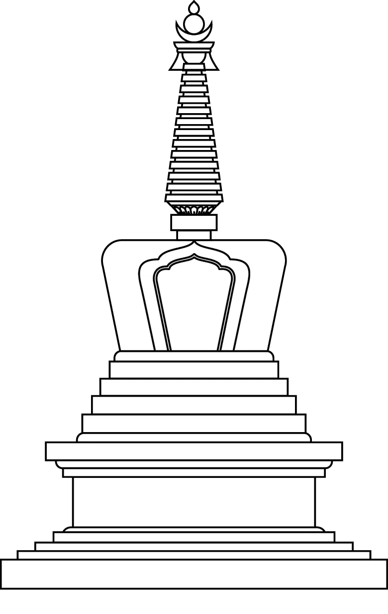

# 第42课

2021年9月1日

今天讲《宝性论》的最后一段。

甲四（解说圆满造论事宜）分二：一、广说所说义；二、以讲法归纳宣说。

前面刚开头的时候讲造论的支分、造论的本体，最后解说圆满造论之事。

乙一（广说所说义）分三：一、如何造论之理；二、断除损法之理；三、回向造论福德之理。

丙一（如何造论之理）分五：一、依何宣说；二、为何宣说；三、以如何方式宣说；四、所说之本体；五、恭敬顶戴之理。

丁一、依何宣说：

依靠什么样的依据宣说或者造这部论？

依可信教理。

这部《宝性论》讲述了七个金刚处的道理。弥勒菩萨是十地菩萨，释迦牟尼佛把所有佛法都交付于他，他是佛陀的补处，应该是最有权威、最有智慧的人，可是他很谦虚地说：我并没有以自己的分别念臆造、杜撰，而是依靠特别可信的佛经的教和理。

“教”，比如《陀罗尼自在王请问经》《如来藏经》《吉祥鬘请问经》《佛说无增无减经》《入诸佛境智光庄严经》《涅槃经》《宝女经》等众多宣说如来藏方面特别了义的末转法轮的经典作为依据，这是依靠“教”。虽然是弥勒菩萨，但他也没有凭自己的想象去造。

“理”，即理证、正理，用了作用理、观待理、证成理，和最究竟的法尔理这四种道理来宣说的。

意思就是，弥勒菩萨依靠教证和理证而宣说。

以后我们自己讲辩著还是需要依据，这个依据最好是经典和论典，还有上师的窍诀。佛教当中特别了不起的大德们也是依此宣说的。

《入中论》中云：“如彼通达甚深法，依于经教及正理，如是龙猛诸论中，随所安立今当说。”龙猛菩萨他自己通达这些法理也是依靠释迦牟尼佛的佛经和理证；月称论师也是按照龙猛菩萨《中论》为主的道理造了《入中论》。并不像现在有些人说的：“我不依靠任何依据，凭我自己的智慧宣说。”当然如果你有特别超胜的智慧，倒也未尝不可，但弥勒菩萨、月称论师、无著菩萨都是依靠经教而讲，更何况是现在的浊世众生了？你说你具有“无与伦比的智慧”，大家可能会产生怀疑。

这部《宝性论》依靠什么而宣说呢？就是依靠教理而宣说的。

丁二、为何宣说：

是什么样的目的而造这部论典、宣说这部论典呢？

为自唯清净，为摄具信解，

圆善者说此。

弥勒菩萨造这部论有两个目的，第一个是自利，如何自利呢？“为自唯清净”，作者弥勒菩萨本身已经证得十地，所有的障碍除了极其细微的所知障以外全部都已经断除。但是就像《入菩萨行论》前面说的一样，他很谦虚地说：我是为了究竟清净自相续当中的障碍，得到佛的无余涅槃，以这样的目的造这部论典。这是从自利方面讲的。

从利他方面讲，这部论为了摄受什么样的众生呢？通过《宝性论》的善说，摄受对甚深和广大的意义具有不可退转信解心的人；以及前面讲过，想获得比福德三事更超胜智慧的人，为了摄受这些有缘分的所化众生。

他有两个目的，一是摄受对大乘甚深佛法有不退转信心者；再者，他要摄受那些想获得比受一点戒律、行一点布施、做一点禅修功德更大的人，这些人更有智慧，更喜欢清净的善业、喜欢积累智慧资粮。

他主要是利他，一个是有信心的人，一个是有智慧的人——想比积累福德三事功德更大的人。《宝性论》好像一个广大的喜宴，依靠这种喜宴能摄受很多人，有信心的人也来了，有智慧的人也来了。

这次学了《宝性论》以后，一方面对持戒、布施，我们也没有否认，这些也都很重要，但更重要的应该是闻思修行这些大乘究竟了义的法要——七金刚处或者四金刚处。

有些道友好像对有相的善根方面很重视，比如过午不食、日中一食，或者持戒、经常捐款、做慈善……但是学《入大乘论》或者学《宝性论》的时候，没有那么投入。当然作为出家人，持戒是非常重要的，但是昨天前面也讲了，其实认认真真地闻思从功德上面来讲，完全是超越持戒、布施和禅修的。这是弥勒菩萨说的。

有一些人习惯性地对某些有相的善事很重视、不间断，但是往往在闻思修行的方面，尤其是对了义大乘经典方面，不是那么精进。有时需要在认知方面有所突破。

这里，弥勒菩萨要摄受什么样的人呢？一个是要摄受对甚深法义具有不退转信心，昨天前面讲的有诚挚信、欲乐信、清净信的人；还有一个，要摄受比具有福德三事功德更大的人。如果我们以后遇到这样有缘者，也要尽量摄受他们。

为什么宣说？为自利和他利而宣说。

丁三、以如何方式宣说：

依灯电宝珠，日月有眼见，

从比喻上讲，依靠灯光、闪电的光、宝珠的光、日光和月光，只要有眼目就能见到色法。

光是一种外缘，内缘是自己必须有眼睛。如果没有眼睛，盲人面前有这五种光，也照样看不到色法。

依佛大义法，辩光而说此。

下面讲四无碍解，但颂词里面只有三个无碍解，词无碍解在颂词里面不明显。有些翻译把词无碍解也加在里面，但弥勒菩萨的原文中确实没有。

依靠圆满佛陀放出了四种光，哪四种光呢？四无碍解的四种光。

第一，义无碍解。一切万法的总相也好、自相也好，对治法也好、烦恼法也好，佛陀全部通达无碍，非常精通，没有任何阻碍。

第二，法无碍解。能宣说这些意义的法，包括文字、名称，或者能宣说它的、能表示它的所有的法。用法来表示意义，对这些法完全通达，没有任何阻碍。

第三，词无碍解。要宣说这样的法，一个是有意义，一个是有能说的法，还要依靠世界上不同众生的不同语言文字，这方面的言词无有阻碍，这叫词无碍解。

这在颂词里不明显，但非要在颂词上加一个字的话，我也不敢，所以没有加。有些不懂藏文的人说“你译错了，别人都加了”，但是我确实不敢，你们敢的话加上吧（众笑）。但是注释里面有词无碍解。

第四，辩无碍解。对于这样的语言、言词，包括它的分类、法相、作用等，辩才无碍。

就像依靠五种光能见色法一样，弥勒菩萨依靠佛陀四无碍解的光宣说了《宝性论》。

丁四、所说之本体：

所宣说的本体是什么呢？

具义与法系，断三界惑语，

令显寂功德，佛语余反之。

“具义”，妙法的本体具有甚深的意义；这样甚深的意义与没有任何垢染的词句法联系在一起，比如说“诸法无常”，无常的意义和表达它的言词连在一起；这样的能诠是能断除三界一切烦恼的语言，能断是词句方面的，所断是烦恼方面的；还能令相续当中获得寂灭的功德，也就是佛陀的语言，总共有四个特点。和这四者相反的是颠倒邪说。

大家应该知道，《宝性论》里面所讲的意义非常深，这样甚深的法跟正确无垢的语言连在一起。《宝性论》里讲的是断除烦恼、障碍的方法，并不是讲军事、爱情、经济、社会问题。它能断除三界众生相续中的烦恼，烦恼断除以后，对治的智慧更加突显，让真正的智慧能现前，获得究竟的寂灭涅槃。具有这四者，就是大仙人如来的佛语，是无垢经论所抉择的。与此相反的都是颠倒邪说。

《别译杂阿含经》当中说，一次，舍利子遇到一个婆罗门，婆罗门问：“你去哪里？”舍利子回答说：“我去释迦牟尼佛那里听法。”外道问：“你怎么还要去听法？天天听法没有意义。小牛刚开始需要母乳，长大以后不需要，你也应该这样。”舍利子说：“佛法不相同，目的是为了解脱，一直不断地希求佛法，最后才能获得菩提。”

我们也可以这么想，如果我们学的是世间知识，读完就可以了，不需要一直在学、一直求；出世间与解脱道相关的法完全不同，因为这些与解脱有关。这里很多道友一直学了多少年也没有学完，一直不断地追求。这样的殊胜佛法，如同《缘起赞》中所说：“众外道徒之虚词，犹如狐狸充狮子。”有些外道徒也会说很多似是而非的法，但实际上很难与佛法相比。《本事经》中亦云：“邪见害愚夫，如火烧众物。”世间有很多邪见，能损害愚笨的凡夫人，就像火能烧坏世间万物一样。因此，与这四金刚处相反的法，可以说是颠倒邪说，我们不应该受持。

丁五、恭敬顶戴之理：

唯一依佛说，无乱心诠释，

随得解脱道，顶戴如佛经。

这是我们经常引用的教证，希望大家能背诵这些关键的教证。

这部论典唯一依靠圆满如来正等觉所宣说的教言、佛的密意，没有自己捏造、杜撰，自己没有任何贪求名闻利养的心。

一般来讲，造论的条件：上等者是登地菩萨，中等者能面见本尊，下等者精通五明，至少也是没有散乱心。这里的“散乱心”是指贪求名闻利养的心。没有为了名声、财富等等的散乱心，是以解脱为目的，相应解脱道。

具足这四种条件，不管是什么样的语言，我们都可以顶戴、接受，如同对待佛经一样。

意思就是，弥勒菩萨说，你们像佛经一样接受《宝性论》也是可以的，为什么呢？因为第一我是依靠佛的密意宣说的，不是自己杜撰；第二我宣说这部论典时没有自私自利的心，完全是利他心；第三不是为了获得暂时的人天果位，而是为了获得最究竟圆满的佛果；第四，所有内容和词语都是相应解脱道的，没有跟解脱道相违的法。具足这四种条件的缘故，应该像对待佛语一样顶戴。

平常包括有些法师讲经说法时，虽然不是像弥勒菩萨宣说的《宝性论》那么准确，但是你也可以顶戴。有些上师、堪布、堪姆，包括有些辅导员，他们讲得好你就可以接受。接受的原因是什么呢？我们经常会引用这个教证，第一个、他是依佛菩萨的密意宣说；第二个、他在讲的过程当中没有自私自利的心，不求名不求利；第三个、他的目的是令自他获得菩提的果位；第四个、他所说的语言文字都是跟解脱道相应的法。所以，具足这四种条件，你就可以接受别人的善说。

或者我们去弘扬佛法的时候，也可以把它作为依据。比如我到某个地方去传法，首先我讲的内容一定符合诸佛菩萨的教言；第二个不是为了得到名声和财富；第三个是为了让自他获得解脱；第四个，我宣说的语言跟解脱道相合。只要具足这四个条件，我就尽量地弘扬佛法。

希望大家能背下这个教证，以后在有些重要的场合可以引用，以前上师如意宝也经常引用这个教证。

刚才造论方面的五个道理已经讲完了，接下来讲，断除损害法的道理：

丙二（断除损法之理）分三：一、认清清净方便而教诫依止；二、认清退失之因而教诫断除；三、断除退失深法之果。

丁一（认清清净方便而教授依止）分二：一、断除自我杜撰之理；二、断除偏执之理。

戊一、断除自我杜撰之理：

原来藏文是比较长的偈颂，我翻译为两个比较短的偈颂。所以藏文是一个偈颂，这里有两个偈颂。

此世无何人，智慧高佛陀，

如理遍智知，胜真如非余。

在娑婆世界当中，没有任何一个人的智慧超越佛陀，为什么呢？因为佛陀如理如实地通达一切尽所有法和如所有法。他如理如实地了知、完全彻知、完全通达了所有尽所有和如所有的真如，或者说胜义和世俗所摄的万法真如，他全部一一了知。我们经常说，“天上天下无如佛，十方世界亦无比。”与此赞颂文中所说的一样，佛陀是了知一切万法的大智者，也可以说是一切智智。

《释量论·成量品》当中，通过证成佛陀是量士夫，把这个道理也讲得很清楚。

仙人自安立，经藏不搅彼，

佛经经常用“大仙人”指代佛陀，不是东北的“大仙”，一说“大仙”东北人有点害怕。

佛陀在第二转法轮、第三转法轮当中安立了哪些经是了义的，哪些经是不了义的。任何一个人没有必要自己去杜撰，把本来了义的说成不了义的，把本来不了义的说成了义，不应该搅乱了义不了义，也不应该颠倒讲述。

很多中观著作当中引用过一个授记无著菩萨的教证，在分析经藏的了义不了义方面，无著菩萨非常擅长。

我们学过的《大圆满心性休息大车疏》第八品当中，专门讲了两把“钥匙”——秘密和意趣，其中就有关于了义不了义的辨析。其实按照宁玛巴自宗，或者按照无垢光尊者、麦彭仁波切的观点来讲，第二转法轮宣说空性的部分和第三转宣说如来藏光明的部分都是了义的。个别观点只承认光明不承认空性，有些只承认空性不承认光明，这其实已经误解了如来的密意。所以，我们一定要弄清楚如来的了义密意。

毁坏佛理故，亦害微妙法。

本来圆满正等觉的微妙正法非常殊胜，但是我们没有讲清楚了义不了义，就会毁坏佛理。对如来的微妙教法有损害，而且自己也造了非常严重的罪业。

我们分析了义不了义的时候，应该按照麦彭仁波切的《中观庄严论释》，还有按照《定解宝灯论》的分析方法和无垢光尊者《心性休息》的观点来解说，知道哪些是不了义的，哪些是了义的，有不同的分析方法，大家都应该知道。如果这些道理不懂，只是因为自己看不惯、想不通，就说是不了义的，这是不合理的。

了义不了义的道理非常重要。因为佛陀要引导各种不同的众生，如果对根基浅薄的人讲了义法，他根本接受不了，会对自相续有损害，所以在部分众生面前，可以暂时说有我、有法、有补特伽罗等，有很多不了义的说法。到了最后，关于佛陀最究竟、最甚深的意趣，在密宗当中、在《宝性论》当中也会讲的。佛陀是遍知，但如果我们没有很好地解释，已经搅乱了佛陀的教法，这样对佛法有损，对自己有害。这些道理在《涅槃经》《解深密意经》里面讲得比较多。

戊二、断除偏执之理：

烦恼愚者谤圣者，彼执见造轻说法，

慧不沾彼执见垢，净衣染变油染非。

具有烦恼、无明的人经常诽谤佛陀、龙猛菩萨等圣者。一个是有烦恼的人，一个是非常愚痴的人，经常谤佛、谤法、谤僧。自相续当中有恶劣的见解，这种偏执的人会造下轻毁佛法的罪业。我们的智慧不要被这些实执的垢染染上，如果染上以后不可救药。

这里讲了一个比喻，比如清净的衣服上面没有什么染污，那很容易给它染上红色、蓝色等各种颜色；如果这个衣服已经被油染坏了，那再想重新染上不同的颜色也没办法。

所以每一个人首先不要诽谤圣者和经论，其次自己的相续千万不要被世间各种颠倒邪说所染污，否则，一旦染上了，想要改过来就很困难。

有些人从小有福报遇到好的善知识，遇到好的法，遇到好的教言，一直在正确的路上没有走偏；有些人刚好有信仰的时候就被其他邪说染上了，中间要转过来是很困难的。不管外道还是其他世间邪说，一旦染上，就像衣服弄脏了就很难清洗一样。最好是正确的见解不要被其他邪说染上，依靠清净的相续，在佛道正确的路上不断前行。

切勿沾染邪说

我经常想，幸好我从小遇到佛教，如果我的家庭信仰其他宗教，或者根本不信佛教，那我从小受这个影响，现在可能真的无可救药。而且我自认为自己的见解非常正确，因为我从小看到的世界、从小所接受的价值观就是这样的，所以，不被邪说染上还是非常重要的。不然，不仅仅是自己受害，还可能会害很多人。

梁启超为什么诽谤《楞严经》呢？当时，他读了一遍、两遍、三遍、四遍，当读到第五遍的时候，他觉得：如果连我都不懂的话，这肯定是伪经。在中国像我这样有智慧的学者有几人？佛经哪有那么难的？于是，他就开始写文章，讲了一些所谓的依据：经中提到了什么仙人，但仙人在佛经里面是不会有的；文字太美了，不合理……这样诽谤以后，他不久就得了肾癌。做手术的时候，医生切错了，本来该切的一个肾没有切，反而把不该切的切了，于是，他在很短的时间中死了。很多人认为这是因为他诽谤大乘《楞严经》。这都有历史记载。

他确实造了恶业，影响也很深。当时梁启超是一个大学者，我以前也引用过梁启超的一些话，从某些角度来讲，梁启超对佛法还是有些认知，但是没有学究竟，最终自己造了非常大的业。从此以后，学术界开始有很多人说《楞严经》是伪经。

其实，说《楞严经》是伪经，根本没有任何理由，这在我以前刚讲《楞严经》时也说过。原来有一本《闲谈问答录》，收录了我早年的课后答疑，里面也提到，有一个人觉得《维摩诘经》是伪经，我让他说出理由。他说：“第一个理由，维摩诘是在家居士，却把佛的出家弟子如舍利子、目犍连、阿难都训斥了一顿，作为在家人，这样做是不如法的；第二个理由，经名是《维摩诘所说经》，并不是佛陀所说。因此，这部经是后人所造。”

我告诉他：第一个理由不成立，因为这样的公案在佛经中相当多，《三戒论释》中也讲过：“一般而言，出家人胜过在家人。但在特殊情况下，具有智慧即相续中具足得地等殊胜功德者为主。”第二个理由也不成立，比如《心经》就是观音菩萨所说。因此，他认为伪经的理由不充分，而且这部经在藏文中也有。

现在有些人对佛法根本不懂，却认为自己坚持的就是真理，但实际上，他诽谤的语言影响很大、很可怕。大家这方面要注意，一旦染上就无可救药了。

丁二、认清退失之因而教诫断除：

这里讲了十种因，教诫不要舍法。

劣慧不信善，依邪我慢故，

贫妙法障性，不了执了义。

贪利随见故，依止背法故，

远离持法故，信劣舍佛法。

有些人可能会想：如果大乘是究竟了义的，为什么很多人不能接受，反而舍弃了？实际上，这不是法的过失，是人的过失。大乘佛法是没有过失的，但是有些人没办法接受。怎么没办法接受呢？这里讲了十种人。

一、“劣慧”，有些人对甚深的法确实不了解，智慧浅薄的人对甚深的法，包括对空性、如来藏，没办法接受，所以会舍弃。如《入行论》中所说：“慧浅莫言深。”智慧浅薄的人，不要跟他说甚深的法。

二、“不信善”，本来每个人都具有“自性住种姓”，但“随增性种姓”因缘没有成熟，所以对善法没有信心。有人经常说：“你再等等，你现在还没有到达我这个境界。”有些开车的司机跟旁边人说：“你再过十年可以有我的技术。”所以，虽然本来有如来藏，但有些人种姓还没有成熟、没有苏醒，对法也不会有信心。

三、“依邪我慢故”，有些人很傲慢，本来是功德的事情看成非功德，不是功德的事情反而认为有功德，这种傲慢人也会舍弃善法。有一个教言里面说，佛的弟子当中，像贪心大的难陀、嗔恨心大的指鬘、痴心大的周利槃陀，他们都可以救度，但是傲慢心大的人不可救药。有些人特别傲慢，也不信正法，这个比贪嗔痴还严重，很难救度。

四、“贫妙法障性”，有些因为前世对法的积累特别少，业力很深重、障碍很深重，这种人也会舍弃佛法。

我们有些人业力太重了，因为前世对法一点没有熏习，一说睡懒觉，开心得不得了；得到很深的法时，倒是一点感觉都没有，“哎哟，太苦了！太累了！太饿了！太冷了！太困了……”所有的这些词全部加在上面。如果有信心的话，听一堂课有很多的正面的、开心的词，“好幸福啊！好快乐啊！好开心啊！好阳光啊！好美好啊……”业力深重的人确实不会这样。

五、“不了执了义”，还有些人将不了义的执为了义，将了义的执为不了义，这种人也会舍弃佛法。

六、“贪利”，还有一种人特别贪婪，和刚才讲的一样，对吃的、喝的、睡的这些方面特别重视，对妙法则没有什么意乐。口口声声说佛法殊胜，但实际上对自己吃的、喝的、穿的方面，包括感情方面越来越执著，口头上一切万法皆空，但实际上一点都不会往这方面趋入，这也是一种舍法的因。

七、“随见故”，还有一种人有坏聚见等很多恶见。坏聚见一般每个凡夫人都有，但不仅是坏聚见，在这个人相续当中，可能有常见、断见、邪见、恶见等各种不好的见解。外道有三百六十种见解，这些恶见特别多。

所以，有些人正见寥寥无几，邪见不计其数，这种人也不会接受这样的法。

八、“依止背法故”，还有些人经常依止一些背离甚深正法的恶友，让人退失信心、增加烦恼。

九、“远离持法故”，有些人远离了宣说大乘妙法的善知识，经常和善知识关系不好，包括给他讲课的堪布、堪姆、辅导员，关系也不好。

但这种人往往很奇怪，和不三不四的人关系特别好，“过来过来，我请你吃饭，今天一定要吃好的。”对恶知识很亲近，但对善知识特别讨厌。这跟众生的福报有一定的关系，和前世的因缘也有关系。

十、“信劣舍佛法”，他对正法的信心很微弱，喜欢一些颠倒的邪说。有时候去一些道友的家里也看得出来，我以前特意去过一个道友家，他的经书上有很多灰尘，脏得不得了，旁边有些邪说的论典倒摆得整整齐齐。那个时候有录音机，他家有一个大大的录音机放在那里，我特意按了一下，唱出来的都是世间歌曲。虽然有一些佛教磁带，那个时候很早，都是用磁带，但这些磁带基本上动都没有动过，上面大概有一尺厚的灰尘。像这种人也没有信心，所以他们会舍弃如来的正法。

因此，众生的根基确实不同，有一些舍正法的因，自己也应该能观察到；观察以后，如果自己能断除这些正法的违品，建立正面的信心、智慧，包括前面讲的正见，也是很好的。

当然众生的根基不同，对上中下也有不同的定位。如《中观四百论》云：“为下根说施，为中根说戒，为上说寂灭，常应修上者。”一般来讲，对下根者说布施的法，对中根者说持戒的法，对上根者说空性寂灭的法。如果自己的根基等能跟上，经常修的是上根者的法，也就是智慧波罗蜜多，如果能长期修的话，那包括布施、持戒等其他的功德自然圆满；但如果根基不够，比如直接为下根者宣说空性法，或者为中根者宣说空性法，都不会成功。因此，应机施教，随顺众生的不同根基意乐而宣说，也是非常重要的。

丁三（断除退失深法之果）分二：一、断除恶趣之理；二、断除轮回之理。

戊一、断除恶趣之理：

深法何智说，火及猛毒蛇，

刽子手霹雳，非应极恐怖。

火蛇敌霹雳，唯能离性命，

非能令堕入，恐怖无间狱。

“深法何智说”，从甚深法当中退失有什么样的因呢？有几种因，这样的因智者们会宣说，颂词中没直接说明。

这里讲到，如果对甚深法退失信心，那是很恐怖的。为什么呢？佛陀和前辈大德、智者们是这么说的：世间当中最恐怖的是什么？被猛火焚身，发生火灾时，身体全部被烧焦；遇到凶猛的毒蛇，像印度黑蛇，还有七步蛇，被它咬了以后，很快的时间会死亡；还有刽子手，在刑场上执行死刑；还有被雷劈……世间当中，这些还是很恐怖的，但从某种意义来讲，这并不是最恐怖的。为什么呢？不管是被火烧、被刽子手砍、被怨敌杀害、被雷劈死，最多只能毁坏今生的身体，不可能让我们多生累劫在无间地狱等恶趣当中感受无量的痛苦。

《入行论》云：“若纵狂象心，受难无间狱，未驯大狂象，为患不及此。”意思是，放纵狂象般的心，会让我们感受无间地狱的痛苦；而被没驯服的大象踩死，只能毁坏我们这一世的身体，这种过患与前者根本没办法相比。如果心没有调伏，生生世世会损害我们，让我们堕入无间地狱，这是更可怕的事。

所以，应该断除非理作意。

戊二、断除轮回之理：

谁屡依恶友，于佛具恶心，

杀父母罗汉，行非行破僧。

若定思法性，从彼速解脱，

任何一个人，如果依止了像提婆达多那样的恶友，对佛产生邪见、具恶心，让佛身出血；杀自己的父亲；杀自己的母亲；杀害离贪的阿罗汉；还有破和合僧。这些就是所谓的造五无间罪，在显宗当中是最可怕的，死后不经过中阴就直堕无间地狱。

但如果能思维法性义、观空性，或者观如来藏，那么依靠法的威力，很短的时间就可以得到解脱。像阿阇世王，先是依靠恶友造了三个无间罪，后来依靠善知识的引导观空性，迅速就从地狱中解脱出来。我们也是一样，即使今生中造了无间罪，依靠对治法也有机会获得解脱。

但唯有一个不能解脱的是什么呢？

何人心嗔法，彼焉有解脱？

这句话很重要。任何一个人如果对法产生嗔恨心，比如大乘了义的如来藏、空性方面，或者菩提心方面的正法，没办法接受，心里产生嗔恨心，然后舍弃。这个人怎么会有解脱的机会呢？

为什么这样说呢？造五无间罪虽然是很大的罪过，但是我还可以忏悔，马上修空性法，当我思维最殊胜的大乘法时，依靠这种对治力可以得到清净。

但如果我把最殊胜的大乘佛法舍弃了，以什么对治呢？没有另一个对治法。比如，虽然我造了杀盗淫妄、犯了很大的错误，但只要没有舍弃上师，还有忏悔的机会，通过祈祷上师，依靠上师的加持力，我可以忏净。但是如果我舍弃上师，就没办法获得悉地。

同样的道理，如果没有舍弃正法，法有能力救度。如《心地观经》中说：“法宝能摧生死狱，犹如金刚碎万物。”法能摧毁生死的监狱，像金刚能摧毁万物、粉碎万物一样。

以前，我用藏文写《忠言心之明点注释》时，引用过一个教证，当时法王说很好，但我现在想不起出处了。意思是说，依靠密宗的坛城，显宗最严重的罪业——五无间罪也有机会忏悔清净，但是如果谁舍法，则无药可救了。《无量寿经》中说舍法罪特别严重，原因也是这样的。

如果谁舍法，确实没办法救，因此大家一定要注意，在修行过程中，千万不要舍法，不要舍弃上师。如果做到这两点，即便你修得不是很精进，只要临死之前没有破誓言，那么得过殊胜法的人，就有机会获得解脱。

“何人心嗔法，彼焉有解脱？”这句话大家一定要记在心里面。不管他人、自己，谁舍了法，谁舍了上师，就没办法。

《句义宝藏论》中同样讲了不能舍弃上师，如果舍弃了，那修其他佛、本尊都不可能成就。这方面也有很多道理，以后有机会学习《七宝藏》时可以讲一下。

丙三、回向造论福德之理：

三宝净佛性，净菩提德业，

七处如理说，我得善愿众，

见具无量光，无量寿佛陀，

复法眼无垢，生得大菩提。

前面讲了，佛法僧三宝其实摄于佛宝当中，法宝、僧宝究竟意义上是佛宝，佛宝对应三个金刚处。

“三宝净佛性”，第一品讲清净如来藏的意义；“净菩提”，第二品讲的清净菩提；“德”，第三品讲佛陀离系和异熟果清净的功德；“业”，第四品讲如来无勤利他的事业。这七个金刚处，弥勒菩萨已经如理地宣说了。

其实这是一个回向文，也是对上述内容的总结文。

弥勒菩萨说，我所得到的所有善根回向给有缘众生，让每个众生都能见到具足无量光、无量智、无量寿的佛陀，也就是阿弥陀佛。弥勒菩萨最后将善根回向一切众生往生极乐世界，见到阿弥陀佛，暂时得到登地菩萨远离一切恶见、现前见道的无垢法眼，也就是不畏深法的清净忍；究竟得到无上圆满正等觉的大菩提。是这样的一个回向文。

普愿沉溺诸众生，速往无量光佛刹

我们也应该这样回向。虽然这次讲的课数不是特别多，但我们从2019年到现在，用了三年才学完《宝性论》。

我讲法的善根也好，你们辅导、听闻、将来宣说的善根也好，都回向给所有众生：愿他们往生极乐世界，得见阿弥陀佛，圆满一切地道功德。我们心里应该这样想，等会儿课后回向时也要这样想。

其实，要完整学完这样一部论，在过去，还是比较容易的；而现在，大家都知道，国内外也好，包括自身各方面违缘特别多，能善始善终圆满这些课程确实也不容易。

有些人可能只有头没有尾，有些只有尾没有头，但这些人不算。有头有尾的人确实很了不起，一节课都不落，一分钟也没有打瞌睡，心连一秒钟也没有散乱，我们要把这些善根一起回向。

乙二、以讲法归纳宣说：

由何为何因，如何宣说何，

等流是何者，是以四偈说。

“由何”，本论依靠什么而宣说？“依可信教理”。

“为何因”，以什么理由或必要而说？就是宣讲自利利他的偈颂：“为自唯清净，为摄具信解，圆善者说此。”

“如何宣说”呢？“依灯电宝珠，日月有眼见，依佛大义法，辩光而说此”，依靠灯光和电光等比喻这一偈颂来说明。

“何”，宣说什么样的意义？“具义与法系，断三界惑语，令显寂功德，佛语余反之”，以这个偈颂来宣说。

“等流[^1]是何者”，能说的依据是什么呢？“唯一依佛说，无乱心诠释，随得解脱道，顶戴如佛经”，是以这个偈颂来宣说的。

关于如何造论之理，以这些颂词做了宣说。

二说自净法，一说失毁因，

尔后二偈颂，则是宣说果。

“二说自净法”，即“此世无何人，智慧高佛陀，如理遍智知，胜真如非余。仙人自安立，经藏不搅彼，毁坏佛理故，亦害微妙法”，以这两颂宣说了自己清净的方便法。

“一说失毁因”，以这一颂[^2]讲了十种失毁的因：“劣慧不信善，依邪我慢故，贫妙法障性，不了执了义，贪利随见故，依止背法故，远离持法故，信劣舍佛法。”

“尔后二偈颂，则是宣说果”，即“深法何智说，火及猛毒蛇，刽子手霹雳，非应极恐怖。火蛇敌霹雳，唯能离性命，非能令堕入，恐怖无间狱”，以这两颂说明断除堕入恶趣的因。

说眷属坛城，忍证菩提法，

略摄二种果，是以末颂说。

愿以此善根功德，暂时让众生转生到阿弥陀佛的清净刹土和眷属坛城中。到了那里以后，现量见到法性，获得对法没有任何畏惧的法忍，最究竟证得菩提。如果简单作回向，就是暂时得到前面所说的法忍，究竟获得菩提果位。

“三宝净佛性，净菩提德业，七处如理说，我得善愿众，见具无量光，无量寿佛陀，复法眼无垢，生得大菩提”，最后以这两颂做了回向。

著跋：

大乘宝性论，怙主慈氏撰著圆满。

大乘宝性论，是如来的大补处怙主慈氏撰著，随同大阿阇黎圣无著所造注释而解说，撰著圆满。

译跋：

具德无喻城大智者婆罗门仁钦多吉之侄子大班智达萨嘉纳与译师释迦比丘罗丹西绕于无喻城由梵译藏。

这位大班智达叫萨嘉纳，藏地译师释迦比丘罗丹西绕是后来阿底峡尊者时代的，其实《宝性论》也有前译的。他们在无喻城将此论从梵语译成藏文。无喻城在克什米尔，玄奘大师取经时曾经路过，是一个很出名的城市。《宝性论》是罗丹西绕和那里的班智达一起翻译的。

因为这次讲的是颂词，不是注释。后面有些小字是笃布巴的注释，所以在这里不用讲。

结文

我看了一下日记，这部《宝性论释》是2016年开始翻译，中间断断续续，又是翻译又是校对，到2019年才译完。我的日记里关于《宝性论》的内容比较多，本来还做了一个梦，但只要一说，你们就会转发，今天就不说了。

下面我念一段日记：

2019年3月6日

今天，在这里的闭关圆满了！

期间，我完成了《宝性论》的最后校对、翻译；《梦尘回忆录》9万多字的初稿也写完了，而且我还将法王当年去印度、尼泊尔、不丹时，从智慧中流露出来的莲师祈祷文、紫玛护法神修法等，也翻译成汉文，一并附在书里。

这两个多月，依靠三宝、护法神的加持，一切都很顺利。白天精进地翻译、修行，没有出现障碍，晚上睡梦也非常吉祥，真是一个很有成果的美好假期！

也非常感谢很多人，在我做寒假作业的过程中，没有打扰我。

闭关期间，我每天吃得简简单单，早饭吃点糌粑，中午一菜一汤，晚上基本不吃。今天借我房子的居士看我出关，就请我去如是素餐厅吃大餐，作为庆祝，我也答应了。

那个居士今天应该在场，好像是昨天来的。我闭关的时候，他从来不管我，“从今天开始，我就不管了，三个月后再见！”我就喜欢这种风格。（众笑）

今天，《宝性论》已经圆满了，特别感谢所有的发心人员，也特别感谢本尊、空行、护法给予的大力支持！

今天刚好是会供日，各方面圆满顺利，非常好，大家一起来做会供和回向……

[^1]: 等流：此处是相续之意。
[^2]: 藏文在此处是一颂，但翻译成汉文后，变成两颂。
