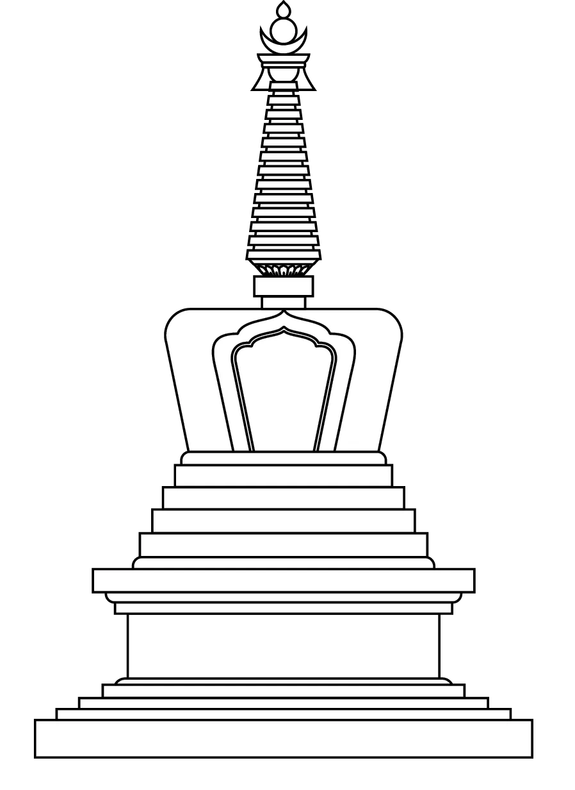
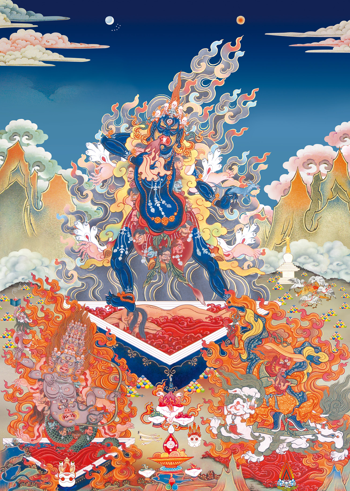

# 第146课

戊三、若具智慧则得解脱：

具有智慧得解脱，如毒为咒所摄持，

若无智慧方便缚，如药致病受逼迫。

是故心中当生起，证悟实相之智慧。

具有空性智慧就能获得解脱，如同毒药被咒语摄持后反而变成妙药。如果没有空性智慧，方便反成了束缚的因，如同在某些情况下药反倒会导致生病而受到痛苦的逼迫一样，所以我们的相续中一定要生起证悟实相的智慧。

诸位平时应尽心尽力地祈祷，令自相续生起无常的观念和空性的智慧，如此，我们的修行就不会误入歧途。否则，仅仅只是执著修法的相，整天以嗔恨怨敌之心观想实有的忿怒本尊，这样已经将良药变成了毒药。

《宝积经》中云：“迦叶，具智慧者依方便得解脱；不具智慧者依方便受束缚。”

这个教证非常好。那天我在温州时，在我所住的宾馆旁边有一间网吧，很多年轻人进进出出，我不禁想到：若是具有智慧，依靠网络等方便能令自他获得许多利益，而没有智慧的人依靠这些方便却带来束缚，整天沉迷在贪嗔之中，非常可怜。

我以前翻译《定解宝灯论》《大幻化网总说·光明藏论》时，先将翻译出来的内容写在黑板上，然后再由发心人员抄写，十分费劲，现在依靠电脑等现代科技，印刷法本非常方便，每位金刚道友拿到手后，能够令其法身慧命得到滋养。当然，这与各位发心人员的辛苦努力和智慧是分不开的，我在此对所有的发心人员表示感谢。

《道情歌集》中云：“远离大悲入空性，依彼不得殊胜道，倘若唯一修大悲，住此轮回不解脱。何人智悲能圆融，不住轮回与涅槃。”

远离了大悲心而修习空性，则不能获得殊胜道，若是仅仅修大悲心而没有空性见，就将住于轮回无法解脱。何人能将慈悲与空性智慧圆融，那就既不住轮回，也不住涅槃，能获得圆满正等正觉的果位。

又云：“愚者为之受束缚，智者依之速解脱。”

愚者依靠这些方便会受到束缚，智者依靠方便法则将于短暂的时间获得解脱。例如，愚者依靠密法造作恶业，智者依靠密法获得成就，因此，具有智慧很重要。

如是了达诸法之自性后，如若尽最大努力修持，则可速得解脱。《圣铠庄严经》中云：“何人若以大努力、大精进修此无生、无灭、极深之空性法，则速通达菩萨之法界，圆满总持、辩才，获得无上之法，蒙受诸佛出有坏赞叹，守持清净戒律，获得清净安忍、无上之精进、无缘之静虑、广大之智慧而疾速现前圆满正等正觉菩提果。四大天王撑伞祈请转妙法轮，照亮诸人天而令彼等证无上菩提。”

这里讲了，具有智慧的人能圆满六度，最终获得佛果，连四大天王都前去请转法轮，经他传法后能让无量众生获证无上菩提。

丁七、宣说六度之摄义：

现在是以上所有内容的结尾，

若行六波罗蜜多，当知如同魔术师，

三轮体空二善资，获得寂灭佛陀果。

我们在行持六波罗蜜多时不应对其具有实执，应该像魔术师表演魔术一样，以三轮体空的方式积累二种善法资粮，这样才能获得寂灭的佛果。

六度所摄的任何善法都有作者、所作之对境、所作之善法三者。

六度所摄的任何善法都有能作、所作的对境、所作的善法三者。

正在行持时，如若以无有实执如幻化之心或者以如幻术的方式而行持，则可速得佛果。

正在行持六波罗蜜多时，当以名言中如梦如幻、胜义中不缘一切的方式来行持，这样便能迅速获得解脱。因此，我们在修法时不要有实执，这非常重要，否则就会成为我们修行的束缚。

《宝云经》中云：“当以不缘善法、不缘所作、不缘勤作之方式而积累福德、智慧资粮，即以如幻、如阳焰、如光影、如幻化之心而修持。”

平时在行持善法、积累资粮时，我们理应以幻化的见解来摄持，这很重要。

如果依智慧使见解清净、依方便使行为清净的话，则无有歧途，无勤而成就佛果，也能成就空中飞行等（共同）悉地。

共同成就有空中飞行等八种。

阿底峡尊者言：“如是见不愚，行为极清净，不堕入歧途，至密严刹土。”

无垢光尊者在前面已经解释过这个道理，如是见解不愚昧、行为极清净之人不会堕入歧途，最终能趋入密严刹土。

甲三、回向本品善根：

如是善根之妙雨，助生净心庄稼丰，

资粮贫乏可怜众，疲劳心性今休息。

从福德资粮的天空中降下善根的妙雨，帮助众生清净心田中的善法庄稼茁壮成长并获得丰收，愿资粮贫乏的可怜众生疲劳的心性从今天开始得到休息，不要再劳累了。

无垢智慧之清净虚空界中密布善根的层层浓云，从中降下极为清凉的甘露法雨，使众生勤于正法、善法的庄稼茁壮成长，愿以此息灭三有中的一切贫苦，

无垢光尊者的智慧虚空中善根的浓云密布，从中降下《大圆满心性休息》的甘露法雨，使众生善法的庄稼在福德的田地里茁壮成长，愿息灭三有一切可怜众生贫乏的痛苦。

从而令众生疲劳的心得到休息，因享受菩提果的安乐而心满意足。

无垢光尊者讲得非常好，相信大家都依靠《大圆满心性休息》获得了许多安稳与安乐。

愿于痛苦烈火此世界，普降无垢甘露妙法雨，

一切众生证悟心性已，获得清凉智慧之大海。

愿在此被痛苦的熊熊烈火燃烧的世间界中，普降无垢清凉的甘露法雨——《大圆满心性休息》，以此遣除所有众生的苦恼，令众生真正证悟自心的本面，获得清凉的智慧大海。

愿众享满莲德严饰湖，此乃地道海鸥所依处，

畅游福慧二资之大海，此中掀起六度之浪花。

愿一切众生都能享受功德严饰的湖泊，这是所有海鸥的依靠处。也可以说，地道功德的海鸥依靠湖泊或大海而生存，畅游在福德与智慧二种资粮的大海中，海中翻腾着六波罗蜜多的浪花。意思是，在积累二资粮的同时也具足了六波罗蜜多，愿所有的众生享受六波罗蜜多和地道功德所严饰的一切福德资粮和智慧资粮。

愿于漫长岁月无始终，辗转漂泊轮回旷野中，

遭受诸多苦难逼迫众，以我之乐获得佛大乐。

在漫长的岁月中，可怜的众生们无始无终地漂泊于轮回旷野中，遭受了诸多苦难逼迫，愿依靠我的功德令他们获得永久的安乐，即佛陀的果位。

愿见诸法如梦如幻后，遣除执著实有之妄念，

如幻化中成办诸善聚，现有轮涅平等同清净。

最后是回向偈。愿所有众生能现见如梦如幻的本义，并且遣除将一切执为实有的妄念，在如幻化般的境界中不舍弃善法，好好地积累资粮。幻化中有痛苦的幻化和快乐的幻化，愿我们早日离开痛苦的幻化，获得快乐的幻化，最后获得轮回和涅槃同等清净的境界。现在我们的境界中轮回和涅槃差别很大，通过修持如梦如幻，达到一定境界之后，所有轮涅之法全部同等清净。

这是无垢光尊者对我们衷心的祝愿，我们也要好好地发愿，愿我们依靠无垢光尊者的法要真正证悟如梦如幻的境界，在如梦如幻的境界中继续行持善法，最终证得轮涅平等。

如果对幻化八喻的具体含义不太理解的话，大家不妨看看《大圆满虚幻休息》，这其中将八大幻化喻讲得非常清楚。

以上《大圆满心性休息》的显宗部分已传讲圆满，八层菩提心的“高楼大厦”至此竣工，按理来说应该开一个金刚娱乐法会，以示庆祝。

大圆满心性休息中第八品发殊胜菩提心释终

（1995年版，密法部分）

（2004年版，密法部分）

护法三怙主
