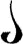

# 第10课

> 丁三、依照湿生之理而修：

> 为净湿生之习气，皈依发心空性中，

> 唯诵诸尊之名号，明观本尊修生圆，

> 如聚温湿形成身，极为易成而出生，

> 无需观修种子字，及标志等广修法。

净化湿生习气的生起次第修法比较简单。首先皈依、发心，然后念诵空性咒语“索巴瓦”将一切法观为空性，然后于空性中刹那将自己明观为本尊，同时念诵本尊名号。

如同湿生容易形成一样，（此生起次第修法）首先皈依、发心，于空性的境界中仅仅念诵或忆念本尊的名号而观想，即从种子到身相之间的所有广修法均无有。

夏天湿气旺盛时，湿生众生的身体很快就能形成，因此净化湿生习气的生起次第修法比较简略，不需要如前一般观想种子字或标志，只需要念诵名号即可。当然，观想的方法，无论是事续、行续、瑜伽续还是无上大瑜伽续，根据自己的见解和境界来决定。很多宁玛巴的伏藏法中都有这种修法。

> 丁四、依照化生之理而修：

> 为净化身之习气，刹那明然修生圆，

> 如同化生刹那现，无需名渐修生圆。

卵生有两次出生，因此净化卵生习气之生起次第修法有略修和广修两次；胎生虽然只有一次生，但生的时间较长，所以需要广修；湿生很快，修法也简略；而化生更快，因此净除化身习气的生起次第修法更为简略，刹那明观即可，不需要如前一般的次第观修，连念诵本尊名号也不需要。

如同化生刹那形成一样，（此生起次第修法）仅仅忆念本尊完毕，明然观修，连从诵名号中观想本尊之戏论也无需观修。

《大圆满心性实修法》中，净除化身习气的修法就是以普贤如来为本尊进行观修的。

## 一即一切之修法

普贤如来的修法非常容易，而且加持力无比强大，根据诸多续部的教证来看，一切寂猛本尊全都可以摄为普贤如来一尊。《大圆满心性休息大车疏》第九品的末尾也讲了一个普贤如来的略修法，你们课后好好看一下。

以前在新加坡，我给那边得过灌顶的道友传讲了《大圆满心性休息实修法》，也给他们讲了《大圆满心性休息大车疏》的密宗部分。他们国外的人和藏族人有点不同，他们的上师特别多，分别戏论也很严重，不一定会长期修。其实任何法门，如果只修几天就放弃，肯定得不到大的利益。我对无垢光尊者特别有信心，觉得无垢光尊者的法门加持力强大，所以当时好心好意地给他们传了《大圆满心性休息实修法》，也说过让他们终生修持，但我说的话没什么分量，也许他们早就舍弃了。

去年，他们让我去新加坡给他们再讲一次。但我今年没有兴趣出国。那次是1999年去的新加坡，距今已经五年了，不知道他们修了没有。佛法的加持不可思议，就算只修几天，暂时来讲也有利益，但如果没有长期修，不一定能解决根本问题。

希望你们能终生修持此法。五年之后，如果你们还在修持《大圆满心性休息》，我会觉得你们是不错的修行人。如果再过五年，你都忘了自己得过这部法，“这部法我以前好像得过，但具体什么时候得的，我现在记不清了，反正从那以后我再也没有看过，也没有修过”，以这样的态度修任何法都不可能相应。

无垢光尊者在《大圆满心性休息大车疏》第九品的最后部分讲普贤如来的修法时说，这是修一本尊即修一切本尊的方法。我们得过了很多灌顶，所有的生圆次第要一个个地去修，恐怕很多人都没有这个时间和精力，所以不如专修这个普贤如来的略修法。

法王如意宝的全集里有一个普贤如来略修的灌顶，《上师心滴》中也有一个普贤如来略修的灌顶，说明普贤如来的修法非常重要。尤其是对修学密宗的人来说，普贤如来是一切传承上师的根源，诸佛都是普贤如来的幻化。

无垢光尊者在《大圆满心性休息实修法》的“净除化身习气之极略修法”中，专门引用续部的教证介绍这个修法的功德。功德极大而且可靠的修法，大家一定要好好修，其他不可靠的、依靠分别念而造的假法，谁都没必要重视。可是现在的众生特别颠倒，一些假活佛、假堪布、假和尚胡编乱造的假冒伪劣产品，很多人视若珍宝，而无垢光尊者的金刚语却没什么人重视，甚至觉得“这些法可能过期了吧”。凡夫的分别念真是可怕。

总而言之，希望大家不要舍弃这些具有特殊加持的法门。我相信你们这一两天都有新鲜感，暂时会修一下，但最关键的是要一直坚持，对法的希求心要保持长期不变，这才是最重要的。

> 丁五、主要修法：

> 如是前述四修法，自何生摄主修彼，

> 为净习气皆当修，尤其初学依卵生，

> 稍稳固者依胎生，极稳者依湿生修，

> 串习真实稳固者，依照化身瞬顿生。

所有的人四种修法都应当修学，但要以胎生修法为主。

这四种修法都应该修学，但我们是胎生的缘故，胎生的习气更重，所以应该以胎生的修法为主。这也是宁玛巴的很多伏藏法中胎生的修法次第较广的原因。

按初学者等顺序次第而修，自己属于四生中的哪一种即当修学彼之修法。

我们这里有没有蛋生的？如果有蛋生的，就以蛋生的修法为主。

此外，多次修生起次第后主要修圆满次第，第一、二、三、四四种圆满次第修法首先也应循序渐进而修。

首先修生起次第，之后按次第修圆满次第。

> 丙二（趋入圆满次第之方法）分四：一、有相无相之方法；二、生圆无离无合而显现之方法；三、修生圆次第之作用；四、宣说圆满次第是成佛之捷径。

> 丁一、有相无相之方法：

> 圆次亦分有无相，摄生次后如云消，

> 无缘中住为无相，当知彼圆生次第。

圆满次第分有相圆满次第和无相圆满次第。

生起次第修完之后，不一定需要摄收，应当像云消于法界一般。比如观想文殊菩萨，最后要不要摄收呢？如果你没有执著，就不需要摄收，直接如云消于法界就可以了，最后在无缘中安住。

> 初学者破生次执，对治显现之实执，

> 现时自性离戏论，不散修依有相次；

> 稳固者破圆次执，对治空性之相执。

初学者如果有相的执著，就修空性；稳固者如果有空性的执著，就修无缘。这些教证，上师如意宝以前讲法时经常引用。

也就是说，当我们修完生起次第，最后回向时，如果对文殊菩萨或普贤如来等所观修的本尊还有相执，认为自己是文殊菩萨或普贤如来，就观空性；如果对空性有执著，就修无缘离戏；如果没什么执著，那最后的收座即使没有也可以。

如是依次收摄（生起次第之修法本尊依次融入种子字吽），

无垢光尊者只是大概地解释了一下颂词，并没有逐字解释，所以这也不完全是自释。我之前在讲《入菩萨行论》时，觉得很有必要造一个《大圆满心性休息》颂词的注释。无论是《七宝藏》，还是《三休息》，无垢光尊者自己写完颂词后，都没有逐字解释，也不会再详细解释“比喻是什么”“对应的意义是什么”，有时只是引用一个教证就不管了，让我们自己去领会。他老人家毕竟是大活佛，所以简单地“加持”一下就可以了。

最后摄于马尾毛百分之一许极细的生命文字“那达”与“奔达”中，那达与奔达又融入法界，于此境界中安住，即是无相圆满次第，

有些藏文中布达和那达都有，有些并不明显。比如观想金刚萨埵，金刚萨埵最后变成金刚萨埵心咒（ༀ་བཛྲ་ས་ཏྭ་ཧཱུྃ）；金刚萨埵心咒前前的咒字融入后后的咒字，最后融入吽字（ཧཱུྃ）；吽字下下的字符融入上上的字符，最后融入日月明点（ྃ）；然后月轮融入日轮，日轮再融入日轮上面的布达，布达融入那达（），那达融入奔达，最后消融于法界。这是最后的摄收部分，有些仪轨中具足全部的观想次第，有些没有，如果没有，我们也不用观，仪轨是怎样，就按照那样来观。

此乃初学者所修的法，依此可摧毁对生起次第自相实执的分别念；于生起次第的境界中心不散乱，无散无收而安住，由此显现明乐无念之智慧即是有相圆满次第，此乃修习稍得稳固者的行境，依此能对治断空之边执。

> 丁二、生圆无离无合而显现之方法：

> 外界一切诸显现，生起次第方便性，

> 无执心识圆次慧，诸时无合无离现。

依照前述方法而修，已经达到极为稳固之人于一切威仪中，见空、闻空、知空之法性无实的智慧与自然无分别之寂止无二无别而显现即是自性清净之圆满次第。

见到的一切显现是空性的，听到的一切声音是空性的，心中觉知到的一切分别念与法性智慧无二无别，这样的胜观与无分别之寂止无离无合而显现，就是圆满次第。

此外，各论典中随同各续部的圆满次第而说是就总的圆满次第而言的，

无垢光尊者在这里讲的圆满次第，与其他某些论典中所讲的稍有不同。其他一些论典中讲的圆满次第，是从总的圆满次第的角度来讲的。

诸如有些大瑜伽论中宣说了五种次第，即自我加持之次第；种种金刚之次第；充满大乐之次第；匝兰达热之次第；不可思议之次第。

有些瑜伽论中宣说了五种圆满次第。

自我加持之次第：为了生起寂止而修生起次第，观想心间明点光团，呼气时随同五大颜色的季节相应而修，

比如夏天是白色，春天是灰色，冬天是黑色，秋天是黄色。这些内容，《上师心滴》中有。

并观想所有的病魔罪障向外清除；

上师如意宝的《直指心性注疏》中也讲了类似的修法。

吸气时，观想诸佛菩萨功德之悉地的同时，心专注心间的光芒，由此迅速成就明乐无念之智慧，从而得到共同与殊胜悉地。

自我加持之瑜伽，实际上是通过呼吸来遣除相续中的病魔和罪障。吸气时，观想获得了诸佛菩萨的一切功德，同时专注于胜义与世俗的根本因——心间的五光明点。

《五次第论》中云：“恒住于心间，不变一明点，修彼之士夫，必定生本智。”

观明点一定要注意，如果前面的基础没有打好，好高骛远直接观明点的话，比较危险。所以最好先观佛像，这样较为安全。等相续中的出离心和菩提心成熟了，心也能安住时，再观这些也不迟。

此中的明点前文已有宣说。
