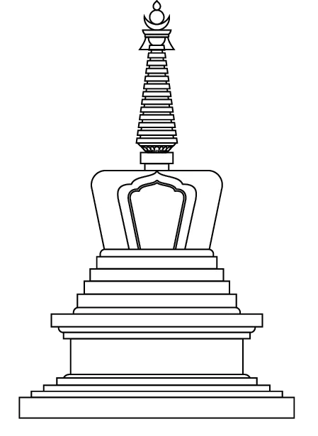
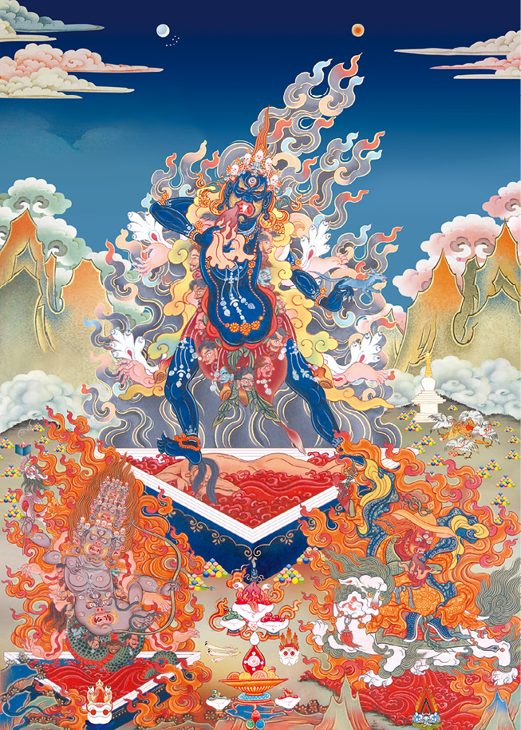

# 大圆满禅定休息引导文精华摄义

无垢光尊者·造论

索达吉堪布·译讲

顶礼心之尊，光明之智慧，

无垢净自性，修要此宣说。

这是顶礼句。

首先坐于舒适坐垫上，观寿命无常、轮回痛苦，生起厌离心，对众生生起无量悲心而发菩提心。现有明观为密严刹土，自身观成如彩虹般的金刚萨埵，手持金刚铃杵，念诵百字明。

前面是观无常，然后观轮回的痛苦，观菩提心，观金刚萨埵。这个观修方法大家都懂。

于头顶莲花日月中央，观想一切上师的总集普贤王佛父佛母形象：身体湛蓝，金刚跏趺而坐，手结等印，放射无量光芒。将整个虚空界观成清净的报身刹土，所有根本传承上师、本尊、空行融入。祈祷相续中生起实相之证悟的所有次第各修三日，于半个月期间修心。

宣说前行终

向普贤王如来祈祷相续中生起实相之证悟。所有的次第各修三日，总共在半个月期间修完加行。

上面，第一个修无常，第二个修对轮回的厌离心。这两个都是生出离心的。第三个对众生观悲心，发菩提心。第四个观金刚萨埵，念百字明。第五个，顶上观想普贤王佛父佛母。这在《上师心滴》里面有，法王的教言当中也有。

修大圆满的过程中，修普贤王如来特别重要。这三种修法，修的时候要再三地祈祷普贤王如来，愿自己相续中生起证悟实相的真实境界。或者用《上师心滴》里面的修法也可以。这叫做前行。

正行分三：

一、乐光明。身体跏趺，双掌覆膝，向外排气后缓慢内吸，明观三脉四轮，脐间观想红色“阿（Λ）”字燃火触及顶上的白色“杭（）”字，从中降下甘露，触及心间淡蓝色“旺（བ）”字，从而生起乐融融的境界。在未生这种大乐之前一直修持。生起之后，再观想“旺”字变得越来越细微，最终心于无缘中放松而修。三日将成就空乐离戏之智慧。

这个修法，前面已经讲过，大家应该都懂。无垢光尊者在这里以简单的文字讲修行。修乐的境界，通过这种方式修三天。

然后，第二个是明光明。

二、明光明。身要、脉要与前相同，由经精脉、血脉内而吸气时，观想现有轮涅一切化光融入心脏中央的五光团，从而生起明空之智慧。吻合持风于心间，缓慢吸气，最终越来越细微，于无缘中放松而修。三日后显现明空无念之光明。

身要和脉要，以及其他各别的修法，与第一个引导的修法相同。不同的是什么呢？经由精脉、血脉内而吸气的时候，观想现有轮涅的一切法全部化光，融入自己心脏中央的五色光团，从而生起明空的智慧，在心间持风，缓缓吸气，最终越来越细微，于无缘中放松而修行。经过三日修行之后，能显现明空无念的光明。

前行修十五天，乐光明修三天，明光明修三天，然后是无念光明。

三、无念光明。身要如前，心要有三。

（一）射：于心间观想白色“阿（ཨ）”字放光，随着念诵二十一遍“哈（ཧ）”，“阿”字从头顶趋至虚空界，于忆念自然消失中安住，从而生起无念光明之智慧。（二）持：晴天时，背向太阳而观虚空界，一心不散而安住，从而生起无念之智慧。（三）修：专注虚空，再依次观土石山岩等所有显现，结果均成为如虚空般无实有，自身也变成了虚空一样，内中外皆变成虚空，在与虚空无二无别的境界中如如不动、一心不乱坦然修持，从而将生起一切法无念本解脱、本来实相本净灭心之智慧。

正行光明之教授终

无念光明，身要、脉要也跟前面一样，不同的是心要有三种观想。第一个“射”法，于心间观想白色“阿（ཨ）”字放光，随着念诵二十一遍“哈（ཧ）”字，“阿”字从头顶趋至虚空界。于忆念消失的同时，“阿”字也消失。在这种境界当中继续安住，能生起无念光明之智慧。这是无念光明的第一个修法。

第二个修法，是前面学过的“持”的修法。晴天的时候，背向太阳而观虚空，一心不散而安住，从而生起无念之智慧。

第三个讲“修炼”，心专注于虚空，再依次观外面的土石、山岩等所有显现，结果成为如虚空般无实有。观想外界的山河大地变成虚空，自己的身体也如虚空，最后外内密的一切法，包括自己的分别念，全部变成虚空，在与虚空无二无别的境界中如如不动，一心不乱坦然修持，从而生起一切法无念本解脱、本来实相本净灭心之智慧。

这里没有说修多少日，基本上每一个都修三天或一天。如果每个修三天，这个就修九天，加上前面的十五天，大概一个月吧。《禅定休息》的实修法至少应该修一个月。

正行光明之教授圆满。

后行：应当对一切均无有耽著，修炼无生自解脱的妙力。

前面也讲了，最后所有的修法，对什么都不要执著，修炼无生自解脱的妙力。

撰著如是明与乐，无念光明觉受文，

善根愿众证心性，获得不住本法身。

将撰著如是明、乐、无念光明觉受引导文的善根，回向给天下无边的一切众生，愿这些众生真正证悟心的本性，获得不住法身的果位。

最深精华光明智，依上师言诸体悟，

我于刚日托嘎处，谨述愿此善说兴。

最甚深的精华光明智慧，依靠上师的教言和自己体悟的境界，已全部立成文字。这部《禅定休息》，将持明者革玛燃匝为主的上师们的教言，和大班智达无垢光尊者自己修行的智慧结晶，全部汇集起来。无垢光尊者在刚日托嘎寂静善处宣说圆满，愿这个善说——指大圆满善说，兴盛于世界各地。

这次翻译，刚开始我一直想：“能不能翻译？”阅读前前后后的文字，再三地考虑。无垢光尊者既然说这个善说要兴盛，如果光以藏文弘扬，藏地的人那么少，而汉族人占了世界人口的五分之一，所以还是应该翻译。这个“兴”字，对我的触动比较大，所以后来就翻译了。

大圆满禅定休息引导文精华摄要，无垢光撰著圆满。善哉！善哉！！善哉！！！

2009年3月3日译毕于喇荣静处

（1995年版，密法部分）

（2004年版，密法部分）

护法三怙主
