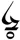

# 第10课

2011年12月21日

昨天我们讲了生起次第的分类。修行生起次第，不同的详略续部中有不同的仪轨，历代伏藏大师的伏藏品中也有很多仪轨。我们喇荣的各大法会中念诵的金刚萨埵修法、阿弥陀佛修法等仪轨，都是依照各种续部教义编撰而成，其中也有修生起次第的内容。根据不同分类，有些仪轨较略，有些则较广，就如我们藏地的一些大修法，内容通常特别详细。

上节课讲到，先以智慧来抉择一切万法自性的基续——等净无二的意义，然后随同这种智慧，以改造的心进行修持，就是生起次第，也叫比量瑜伽。

下面我们讲圆满次第。

> 子二、圆满次第：

借助方便的甚深窍诀，能现前基续大净等自住任运之坛城，名为圆满次第或现量瑜伽，也叫本性之道。

圆满次第有这三种不同的名称。它和生起次第有什么区别呢？在抉择基续大净等、修持基坛城上，二者并无差别，但圆满次第依靠风脉明点，借助无勤瑜伽、有勤瑜伽的甚深瑜伽方便方法的窍诀，能现前基续本来清净、任运自成的坛城，即自心明空无二的本体。通过方便方法的修持，可获得这样的成就。

圆满次第在初期也需要一些造作，但最后可现前无造作的瑜伽。在这种修法中，当风融入中脉时，瑜伽士可现量出现远离四边八戏的境界，因此圆满次第也可称作现量瑜伽。它趋入的是基续本来清净任运自成的基坛城，因此也叫做本性之道。

密宗的修法，从本体的角度而言，可分为生起次第和圆满次第这两种道。就如我们学中观时，先以唯识的见解抉择一切万法由心造，然后在此基础上进行推理观察，最后了知心的本体在胜义中原来是空性的。生起次第相当于唯识的观点，先在名言中抉择一切万法是清净的——器世界皆是无量殿、清净刹土的本体，有情世界皆是本尊、佛陀及空行的本体；然后到圆满次第时，再将这样清净的本体抉择为与空性无二无别；在空性智慧的摄持下，如此清净的境界最终远离一切四边八戏，完全融入不可思议、无法言说的法性。

所以，生圆次第与大乘显宗的一些抉择方法有一定的相似之处，但也并非完全相同。

圆满次第虽有许多类别，但包括在切要实修所依脉、风、明点，

就如前几天我们学《文殊大圆满》时所讲，圆满次第的修持需要明观三种脉。在不同续部中有很多关于脉的介绍，人体内的脉非常多，有一万八千脉等说法；风有二万一千风等；明点有胜义明点、世俗明点、最细微明点等等。圆满次第的修法极为丰富，但归纳而言，切中要害地修持有相圆满次第，就是以修风、脉、明点为主。

诸如宝瓶气、细微明点、融乐，

许多密宗修法中都有宝瓶气。一般来讲，将上气下压、下气上引，中间在腹部长时间持住气，就如满瓶一样，这就是宝瓶气的修法。

还有心间观五色明点的修法，比如观想上师融入自己心间的明点，明点化光，最后融入法界。这是细微明点的修法。

融乐的修法，就如观想“杭”字（）融化变成甘露，最后遍满整个身体，产生乐的觉受。

风脉明点有以上等多种修法。

切要实修能依光明明点，诸如空色、顿超，

前面讲了风脉明点，此处是光明明点。光明明点就如《时轮金刚》所述，有十种空色。什么是空色？通过一种修法，最后能显现本尊、空行母等形象，这些形象在真正观察时，就像彩虹一样现而无自性，但在显现上，以自己风脉清净的力量，在外境的阳焰或云雾之中，完全可以现前这种空色的本尊相。

无上密法大圆满中的顿超，也是一种切中要点的实修。通过顿超的修法，首先会在虚空中看到明点和金刚链，然后逐渐可成熟为单身佛、双身佛乃至无量无边的圣尊等清净相。

总之能现前四金刚智慧的各种方便，

总而言之，通过修行圆满次第，能显现四金刚——身金刚、语金刚、意金刚以及智慧金刚的种种方便。

在续中都有不同程度说明，如“五次第、六加行……”。

比如《密集金刚》在讲圆满次第时，有语远离、意远离、幻身、光明身、双运这五种次第。

过去藏地修持《密集金刚》的人相当多，格鲁派的许多大德也为之作过注疏，但现在似乎很多寺院已经不太注重闻思密续了。有一次我去甘孜一家书店，发现宗喀巴大师所有的显宗著作都被请光了，而包括《密集金刚》的注疏在内的密宗书籍，却还留下不少。《密集金刚》当中的五次第，不仅在藏地，当初在印度也曾一度广泛流行，月称论师等大德也经常修持此法。

六加行在《时轮金刚》中有相关讲解，包括收摄、禅定、运气、持风、随念和三摩地。持风和运气中专门讲过风脉明点的修法，最后修到三摩地时，能显现十种空色的许多境界。

总之，在不同的续部中有众多风脉明点的修法。

我们宁玛派大圆满的修法，不太强调风脉明点的修持，更注重直接认识心性。如果所化对象是利根者，更是不需经过生圆次第，完全可以依靠认识心性的窍诀而直接获得成就，这样的现象不在少数。

当然，也有些人仅靠大圆满的直指法不一定能认识心性本面，这时就可以依靠生圆次第的修法。每个众生的爱好和根基各不相同，有些人喜欢戏论勤作，而有些人更适合直断。正因如此，佛陀才对众生宣讲了如此之多的显密教法。

就像世间销售的产品，每个顾客的爱好和需求也各不一样。同一个品牌的衣服，有些人喜欢花色，有些人喜欢蓝色，有些人喜欢其他颜色。其实衣服在本体上并没有差别，同样可以保暖，但每个人就是有自己独特的偏好。喜欢紫色的人，就是不愿意买蓝色；喜欢黑色的人，就是不会选白色。同样，修生起次第和圆满次第时，有些人与勤作的瑜伽更为相应，有些人则与无勤的瑜伽更为相应。所以，我们不能简单判断哪种是对、哪种是错，真正的佛法不可如此片面取舍。

当然，对于一些鱼目混珠的现象，我们应当清醒辨别。比如有些人将自己的名字冠上“某某佛”的称谓，这一点我就特别看不惯。虽然指出这些乱象对我个人而言没什么好处，难免得罪不少人，包括一些信徒，但是从佛教整体的利益出发，这些话也不得不讲，因为自古以来从没有一个人敢把自己称为佛。那些真正对佛教有过卓著贡献的大德，比如无垢光尊者、宗喀巴大师，后人出于敬仰，尊称他们为“第二大佛陀”，这种情况是有的，但是自己宣称“我就是某某佛”，说明他连佛和菩萨的差别都没分清楚，连佛该有怎样的功德都不知道。如果你真的是佛，那到底具不具足佛的一切功德呢？

如今很多人由于对佛法缺乏了解，常常将佛当作一个特殊的大人物，就像世间所谓的气功大师、特异功能者，或者成功的企业家那样。以这样的层次来理解佛，是极不合理的。所以，一个人如果在佛法上没有闻思基础，很容易做出不如法的行为。

如此宣说圆满与未圆满的一切，从实修方式的角度而言，包括在心的所缘与身语的勤作——能依有相道，与离勤无相的圆满次第两种当中；

圆满次第中有些已将整个风脉明点的修法全部宣说圆满，有些并未圆满。从实修方式来讲，凡是依靠心的所缘和身语勤作的这类修法，就叫做能依有相圆满次第，因为风脉明点需要依靠心的造作来修持。当然，相比于生起次第，这是一种更加无勤、无有造作的修法，最后的成果也是现量现前的。

另一种是离勤无相圆满次第——大圆满。其中具备当下认识自心本性的所有窍诀。

总而言之，密法的修行包括生起次第和圆满次第，圆满次第当中又包括有相的风脉明点修法和无相的大圆满直指本性法。

从所实修的侧面而言，包括空智光明、现智幻身、二者双运智三种。

从实修本体而言，包括认识空性的智光明和认识显现的智幻身，以及二者双运智慧这三种。

无垢光尊者曾说过，讲现智幻身的是《密集金刚》，讲空智光明是《胜乐金刚》，讲双运智慧的是《时轮金刚》。这三续部分别是，以显现为主的父续，以空性为主的母续，还有以双运为主的无二续。这些续部中讲了许多相关道理。

早年我阅读过很多续部，其中专门讲过空智光明和现智幻身的具体区别，总之，前者以空性为主，后者以显现为主。

所有圆满次第，全部是直接或间接使业风融入中脉而现前清净智慧。

这一点非常关键。圆满次第中有些是直接将不清净的业风融入中脉，从而现前清净智慧，有些则是以间接的方式。麦彭仁波切和华智仁波切在有关生圆次第的修法中都对业风作过解释，一切二取执著和分别动念，都是业风的功用、业风的现前。通过圆满次第的修行，所有能取所取的分别念最后都会融入中脉。

我们平时经常观修中脉在身体中间，两侧有精脉和血脉——这只是显现上的中脉，真正的中脉其实是心的本性、心的光明。真实的中脉也叫胜义中脉或法界中脉，不同的教言中对此有很多讲解。

华智仁波切说过，在最究竟的层面上，千万不可认为中脉是一根管子那样的实有存在。真正意义上的风融入中脉，实际上是指一切能取所取的执著分别念全部融入法界之中。因此，法界也称为法界中脉，即心性本面光明和空性无二无别的法尔性。风融入中脉后，就能现前无有任何耽著的无二智慧——这才是真正的修证。

所以，我们修持圆满次第的根本目的，并不是要得到开天眼、身轻如羽、不饮不食等效果。有些道友听闻解脱法时毫无感觉，但一听说有不用吃饭的修法就格外感兴趣，好像一直在挨饿一样。其实用不用吃饭都没关系，你现在又不是没饭吃。对我们来说，穿衣吃饭并不是要紧事，最关键的是要认识烦恼的本性。如果烦恼没有清净，我们就会始终漂流于轮回之中，遇到许许多多的麻烦。而一旦完全认识了心的本性，那时也许外在还像普通人一样，照旧要走路、要说话，但内心的烦恼已经全部融入法界，此时业风已清净于中脉之中，真实的智慧自然现前。

此续中，宣说了有相圆满次第四轮细微明点瑜伽及方便道次第上门、顿然下门的窍诀以及无相光明大圆满的窍诀。

《大幻化网》中宣说了有相圆满次第和无相光明大圆满的窍诀。有相圆满次第中有四轮（顶轮、喉轮、心轮、脐轮）及心间不同明点的瑜伽修法。其中有次第上门及顿然下门的窍诀：前文提及的宝瓶气、绝地火等修法即是次第上门；利根者依靠真实手印或幻化手印，以明点运行的方式修持而获得解脱，即为顿然下门。因为需要依靠方便方法来修持，所以这些修法被称为方便道。

无相光明大圆满则不需要生起次第和圆满次第上门、下门等任何修法。所有脉、轮以及种种身体勤作，其实只是方便方法，相当于一种工具。关于此理，一些当代著名的世间瑜伽士也持有与佛理类似的观点，他们同样认为：我们的身体实际上只是一种认识心灵的工具。

所以，在最究竟无上大圆满修法当中，我们的身体造作只是认识心性光明的方便法而已。那么，我们在修行中还需不需要毗卢七法或大圆满的不同坐式呢？有些人确实需要，因为依靠身体的特定动作或运行方式，可令智慧自然显现。比如，一个人在舞池中唱歌跳舞，当时的声音和动作会使他情绪高昂；但如果置身清静之处，配上清雅的音乐，他的心境也会自然而然变得宁静平和。

要令我们的感觉和分别念产生转变，外在的造作可以产生一些外缘性的影响，但并非主因。最根本的主因是什么呢？就是认识心的本性。不论生起次第还是圆满次第都是这样，一旦认识了心的本性，就会了悟：万法的本性也是如此。

当然，万法不等同于我的心。在显现中，外部世界是无情法，我的心是有情法，二者截然不同。密续也承认，器世界和有情世界并不一样；但是，从本体皆为清净和光明的角度而言，二者没有任何差别。

比如，我的这颗心，与我前面放着的茶杯，显现上一个是心识，一个是无情法，但从究竟本体而言，二者都是远离一切戏论、不可言说的。这样的本性，我的心和这个茶杯其实同样具足。因此，从不同的角度可以观察出不同的道理。

总之，修行光明大圆满，不需凭借前面所讲的方便道和智慧道的窍诀。

如是凭借二次第道遣除垢染，现前实相。

通过生起次第和圆满次第可遣除垢染，现前实相。具体而言，首先依靠生起次第的见解，可了知一切万法本来清净，依此可逐渐消除原本世间人认为万法不清净的执著；再通过圆满次第的修持，能将生起次第中一切皆为清净，或未修持时一切皆不清净的这所有执著统统消除；最后即可现前一切万法现空无二的本体或明空无二的究竟实相。

归根结底，我们必须承认一切万法本体是清净的。对于这个道理，本论的见解部分有非常精妙的阐释。如果缺失这一基础，我们修行密法很容易陷入误区，甚至会与世间一些特殊功法混为一谈。要知道，静坐、安住、毗卢七法、乃至风脉明点的修炼，不仅佛教中有，很多外道也有，包括现在世间流行的一些气功，其中也涉及类似的调身调心之术。如果我们把密宗的见修行果当成世间功法来对待，那将十分可笑。

因此，我们必须真正了知密宗的见解，才能理解其相较于其他修法的超胜之处。我们这样说并不是固执己见或自吹自擂，实际上，不管通过理论还是实证，都可以明确得出结论。唯有建立这样的见解，才能找到终极的真理。

如果自性不是清净的，那么以与实相相违而作意的生起次第、

如果万法本非清净，我们以一种与万法本性相违的清净见，强行观想一切都是清净、空性的，再凭空想象出观音菩萨、阿弥陀佛、释迦牟尼佛等本尊，这显然是一种不符合实相的执著，那样的执著肯定不该修持——这里是以生起次第为例。

在平庸之身中遮风等来修行，万事万物即使在自己面前呈现本尊身，可是就像虚幻的石子现为马象一样，成了不符事实的妄相，

圆满次第也是同样。正因为一切万法是清净的，我们阻挡不清净的业风，令其逐渐入于中脉，最后完全变成清净，这样的修法才能成功。

如果一切万法本来不清净，我们的身体自然也不清净。在这样的身体中观想一个个脉轮，那就像拖拉机里的零件一样；观想风融入中脉，那就像汽油在管子里运行一样。如此费尽力气观想，最后即便观出万法现为本尊相，这种相也只会是颠倒——既然万法在名言中不是清净的，就不可能呈现本尊形象。

这相当于将虚幻的石子现为马象一样。一些幻化师通过咒语和幻术之力，可以将石子、木块等物变幻成大象、宫殿等种种境现，但这终究只是一种幻觉。显宗的不净观等修法也与之类似，虽然能将整个世界观为白骨，但这种景象也如《入中论》所说一般，只是一种颠倒的显现。[^1]这样观修是为了压制烦恼，故意以心的作意而呈现这般景象。对于一些贪心特别严重的人，这样的修法是有必要的，一切都变成白骨，就不会再对异性产生贪心。但是这种修法只能暂时压制贪欲，并不能根除贪心的种子。

密宗的观想与此完全不同，若将现前的本尊理解成白骨观或是幻师变大象那样，则完全不符合真理，成了颠倒的妄相。

执著它也成了颠倒识，五毒道用、行为无取无舍也与之同理，如此一来，承许这样的道超胜显宗那实在是极其稀奇的事。

如果万法本体不是清净的，那我们修生起次第、圆满次第时所显现的清净相就不符合实际道理，执著它的识也就成了颠倒识。

正因烦恼的本体是清净的，五毒才可转为大圆镜智、成所作智等五种智慧，所以我们才说烦恼即菩提、烦恼即智慧。若烦恼本体不清净，烦恼即菩提就无从说起，就像把牛粪说成是快餐面，在名言中也是不合理的——我今天吃了快餐面，现在口里还有这个味道。所以，烦恼转为道用或五毒即五智之理，只有在其本体清净的前提下才可以成立。

很多大圆满瑜伽士到达一定境界之时，行为上已无取无舍，可受用五肉、五甘露等。汉地著名的济公和尚就是一个例子。如果修行人确已认识一切万法本来清净，自然就没有垢净之分；但如果未能认识，如此行事就已沦为疯狂。表面上看，疯狂者和成就者同样可以做一些无取无舍的行为，但实际上二者的性质截然不同，因为这种行为一定要以认识本体清净为前提才是如法的。

这一点极为关键。无垢光尊者在许多教言中都强调过：若已认识其本性，烦恼即是菩提；若未认识，烦恼就不是菩提。如果你对此完全没有认识，一边生着嗔恨心，一边说“我现在生的是菩提心”，那嗔恨强烈之人，岂不是菩提心发得最好？如此一来，我们承许密宗道超胜显宗，岂不是非常可笑？如果一些行为本来不清净、不符合真理，显宗未曾去做，而密宗却特意去做，那相比之下岂不是显得低劣？所以，认识本性非常重要。

如果显密仅从方便而言见解无有差别，那么轻易、快速的方便法，在显宗中为何没有宣说？

以前格鲁派个别论师认为，在修法和方便上，密宗比显宗超胜，因为密宗有生圆次第、持咒、观想等许多方便方法；但在见解上，二者并无差异。

这种说法是不合理的。如果二者的见解完全一致，那显宗为何不宣说这些更加轻易、快速的窍诀和方便方法？如果承认密宗与显宗的见解虽然本体上相同，但次第上有差异，这还说得过去；如果认为二者见解无有差别，那为什么不能同样宣说这些方便呢？正是因为众生根基不同，有些人无法接受更高的见解，所以才不能对他们宣说密宗的方便方法。

所以，因乘没有因果任运自成的见解，要知道显宗行人暂时也不能堪为宣说那些方便的法器。

我们应该知道，对于密宗的心性法门，有些众生不堪为法器，当然，这只是暂时，不是永远。我们之所以为广大受众开设净土班，正是因为有些老菩萨和显宗修行人，一提起密宗就心生畏惧。既然他们暂时接受不了密法，就先学净土法门。可惜即便这样安排，有些人最后还是退出了。其实完全无需害怕，但他们暂时不堪为法器，这也是没办法的事。

我们要认识到，不了知本来大净等本相而只是口说以方便法强制性使众生转变成佛陀者，不能修成符合万法实相而趋入二次第的道，对密宗是个大诽谤。

如果不能从智慧上了知一切万法的清净本性，仅在口头上宣称以一些方便方法可以令众生成就佛果，这是完全不合理的。但总有些人这样说：密宗有不同的方便方法，但见解上与显宗一模一样。汉传佛教有些大德也认为，显密在见解上都承许完全相同的空。若真是这样，显密还有什么区别？有些略知一二的人会说：密宗多了一些咒语、修法，还有生起次第、圆满次第、大圆满的车确（直断）和脱噶（顿超），通过这些方便方法，就能强制性地获得佛果。然而，若依靠这样的理解，根本不可能修证万法实相。

假如修行者的见解与显宗一样，只承许一个空，而修行上却能强制性地证悟，那这些修法便与实相不符，这样一来，依靠生起次第和圆满次第则不能证悟万法的实相。为什么这样讲？因为见解上若认为万法实相只是单空，修的却是另一种与见解不符的方便方法，如此修行，最后证悟的也只能是另一种法。

如果这样来理解密宗，表面上看似赞叹，实则是对密宗最大的诽谤。因为这意味着密宗不能抉择万法的实相，或者密宗的教导是偏离万法本性的另一种成就方法，这肯定不合理。所以，在这个问题上有非常甚深的道理值得思考。

我之前也再三强调过：我们必须先抉择万法的本体并非单空。如果仅是单空，我们在证悟单空时就应该获得佛果；然而，在获得佛果或成就时，相应的功德是从哪里来的？其本体上是否具足？若本体具足，那就不是单空；若本体上没有，那么一地到十地菩萨乃至佛陀的无量功德又源自何处？

所以，但凡学过《佛藏经》、《宝性论》及密续的人都会明白，必须将第一转法轮、二转法轮和三转法轮的所有教义融会贯通，才能真正圆满地解释如来圣教。

> 癸二（从实修角度说方便解脱二道）分二：一、方便深解道；二、智慧解脱道。

> 子一、方便深解道：

如本续云：“奇幻稀有法，非从他有来，依方便智慧，如此之中起。”

《大幻化网》这样讲道：这种可获得明空不二的不可思议境界的奇妙稀有之法，并非从他处而来，而是依靠一种极为殊胜的方便智慧而现前。

主要依靠方便的殊妙行为强制性显现出自住之本智，从而能迅速成就果，

前面讲过，无上密乘从修行本体而言分为生起次第和圆满次第，从修行方式而言分为解脱道和方便道。其中的方便道，可以依靠各种方便方法，以强制性的方式，令众生本具的远离一切耽著相状的智慧直接现前，从而迅速获得成就。

如同依靠玛吉嘎（一种点金剂）的配制一瞬间能将铁转成黄金。

此处以一种叫玛吉嘎的点金剂作为比喻。玛吉嘎一接触铁就可令其马上变为黄金，同样的道理，只要所有方便因缘具足，依靠方便道就可令修行者快速获得成就。

那么，方便道具体是什么样呢？

也就是说，依靠修炼六轮，（脐下火）炽燃、降下（甘露）的双运生起大乐智慧，

六轮就是顶轮、喉轮、心轮、脐轮，再加上密轮和海底轮。此处与前面所讲的生圆次第修法非常相似，只是四轮与六轮的差别。

首先观想庸俗的身体当中有三脉四轮或三脉六轮，然后观想头顶的“杭（）”字降下甘露，令脐间绝地火燃烧炽盛，将整个身体全部烧尽，最后再次降下甘露，最后生起四喜、四空的境界。这是圆满次第一般的修法。

特殊根基的密法修行者，也可依靠空行密处修法，这些在其他《大幻化网》注释中有宣说。

主要依靠空行密处双运的降、持、返、遍，生起融乐无变之智，

这种修法中，明点有降下、受持、返回，最后遍于全身的不同阶段。

关于密宗的双运、双修之法，我一般不会详细翻译，因为现在汉地有些出家人和在家人，在这方面经常对密宗产生误解，所以翻译出来可能更容易起到负面作用。以前有些上师直接翻译了密宗的特殊修法，最后非但没有给众生带来利益，反而将很多人引入诽谤之道。

其实，这种修法普通的世间人绝对不可以修，也不可能修得成。修行此法有极高要求：必须将所有解脱道的风脉明点完全修持圆满；彻底断除有漏的贪执；还要能真正将自身观为本尊，而不仅仅是作意；双运的对境也要完全现前为空行的身体；在享用的过程中，要做到一刹那也不生世间的贪恋，一刹那也不会漏下有漏的精华。

达到这样的境界后，有极个别的瑜伽士会行持此道，这是不可否认的，以前确实有些伏藏大师如此修行。然而现在，绝大部分人不要说达到能修双运的境界，就连自己的贪执都压服不了。某些汉地女众的行为，尤其令人感到可悲、可叹、可怜——连基本的戒律都无法守持，还口口声声说自己是空行母、要修这种道，其中甚至还有出家人，她们也许是精神失常了。我身边虽然没有出现这些非法之行，但我知道佛教徒中的确有些不正常的人，会给一些上师发这类信息，这实在很可怕。

还有一些男众出家人，仗着以前曾在某个寺院或佛学院待过，就去城市里以双修、寻找空行母等名义，将很多人彻底引入邪道。这种方便道不是谁都可以直接修持的，说实话，包括现在藏地某些所谓的上师接受空行母，我也不认为他们确实有密意。因为一般来讲，只有解脱道圆满成熟以后，才能依靠她身方便道而修持，根本没有直接修持的说法，但这些人不要说方便道，就连解脱道都不懂。

有些人就此破了戒；有些人根本没有受戒，相当于找了个世间配偶。人在业力现前时，各种情况都会出现，但我希望学修密宗的人不要以密宗来造业。如今其他的宗派和修行人常常误会藏密有不如法之处，这其实很大程度上是修密者自己造成的。有些人歪曲密宗的教义，在世间肆意鼓吹。我听说有个所谓的“上师”拿金刚萨埵的双运像来引诱他人，真是可怕。你要是实在守不了出家戒，可以公开还俗，这也是正常现象。麦彭仁波切也讲过，还俗虽然会失去个人的戒体，但对佛教没有任何损害。可如果你心怀贪念，却还装作有什么密意，这就让人特别看不惯。

一些人已经精神失常、陷入幻觉，这是着魔的表现，根本不是诸佛菩萨和上师的智慧境界。上师真正的智慧，应该体现在大悲心、信心、出离心、菩提心上，而不会显现为贪嗔之心。如果一个人令你相续中的烦恼不断增加，这绝对不是真正的好上师。

现在有些所谓的修行人，常常有不如法的言行，我们也经常看得到、听得到。这背后有方方面面的原因，根本在于对密法没有真正了解；其次是对佛法和密宗信心不足；此外，见解上有问题，对因果不负责任，对恶趣毫无畏惧。他们仅凭分别念随便胡言乱语，却不知在别人眼中自己已经成了疯狂者。

希望每位道友都努力做一个清净的修行人，如果实在不行，至少也要做一个懂得忏悔的人。千万不要借密宗之名来行诋毁密宗之实。我们作为密宗弟子，如果自己不能保护好密宗，有其他显宗学人或非佛教徒来诋毁密宗，这尚且可以理解；但如果我们自己来毁坏密宗，这就极不合理了。所以，希望大家在这方面尽量注意。

以前我们学院有一些口里胡言乱语、行为疯疯癫癫的人，后来都被开除了，包括一些出家人。有些人被开除之后，就去别的地方继续骗人。我曾经去过一个城市，听到那里有一个假上师经常散布歪理邪说，他的追随者普遍缺乏智慧，竟然信以为真。其实，他那些道理不要说是密宗，就连一些外道的层次都不如。所以，大家在这方面应当警惕，一定要对自己的今生来世负责，尤其要对我们的佛教负责。

连同修行其分支大乐禁行的许多行为。

如果确实有相应的能力，就可以像以前印度的一些瑜伽士那样，行持金刚歌、金刚舞等诸多分支的禁行。

具精进者通过方便于入定中不同程度地领受所证基续真谛无别离戏超心之义的力量，对后得现有大净等之理自然生起定解，

真正的精进者，在解脱道已修持到位的前提下，通过入定的力量，可对后得一切显现皆为大清净、大平等之理生起定解。

依靠脉要而持受成为分别念乘骑之风、作为缘的粗细明点，

分别念的乘骑是风，大圆满中经常这样比喻，因为一切起心动念都要依靠风而起现。其外缘则是粗细明点，因为分别念要依靠世俗和胜义明点进行运作。

如果持受了能动之风，自然也就持受了意识，连同分别念乘骑——风融入空乐中脉法界，

如果我们真正能持受所有的业风，能专注于中脉，就能自然持受意识，连同分别念乘骑——风融入空乐中脉法界。

现在很多人不知道生圆次第的作用是什么，其实就是令所有分别念业风融入中脉，也就是融入无有能取所取的法界之中。修持生起次第或圆满次第，不是仅仅通过一些外在的动作，暂时令心感到舒适、暂时不生分别念，这并非究竟的目的。众生流转于轮回的根本因是起心动念和贪嗔痴等烦恼，真正以方便方法令分别念和烦恼融入法界，这才是最重要的，也是修持生圆次第的究竟目的。

由此明点与脉的运行得以清净，

一旦分别念融入法界，明点和脉的运行就会自然而然全部清净，不会再有一个臭皮囊将各种脉轮连在一起。所以，外相的修持并非关键，最重要的是认识其本体清净。

进而四轮之风心堪能，

那个时候，心专注到哪里都可以，心的本来光明自然而然呈现，心也变得堪能。

中脉脉结解开，

《大幻化网》的其他注疏中讲过：脉上共有二十一个脉结，当所有脉结完全解开之后，就已获得佛果。我们在显现上就是因为被许多脉结所束缚，所以才会不断涌现各种烦恼和分别妄想。

次第增上智慧显现，无余灭尽迁移习气，成就究竟果位大乐金刚身。

流转轮回的迁移习气被智慧火全部烧尽，最终获得真实的佛果。

[^1]: 《入中论》云“诸瑜伽师依师教，所见大地骨充满，见彼三法亦无生，说是颠倒作意故。”
