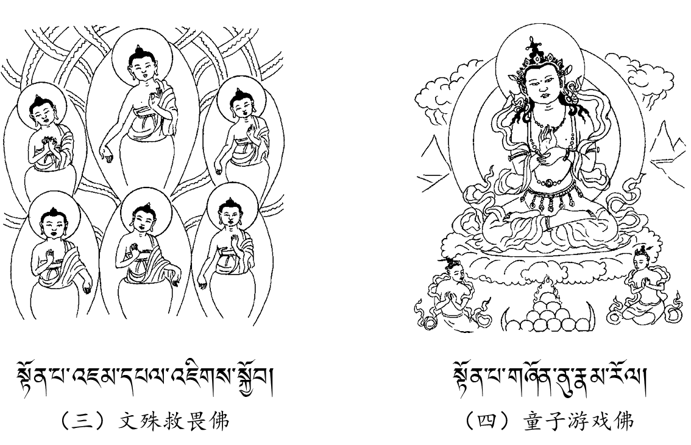
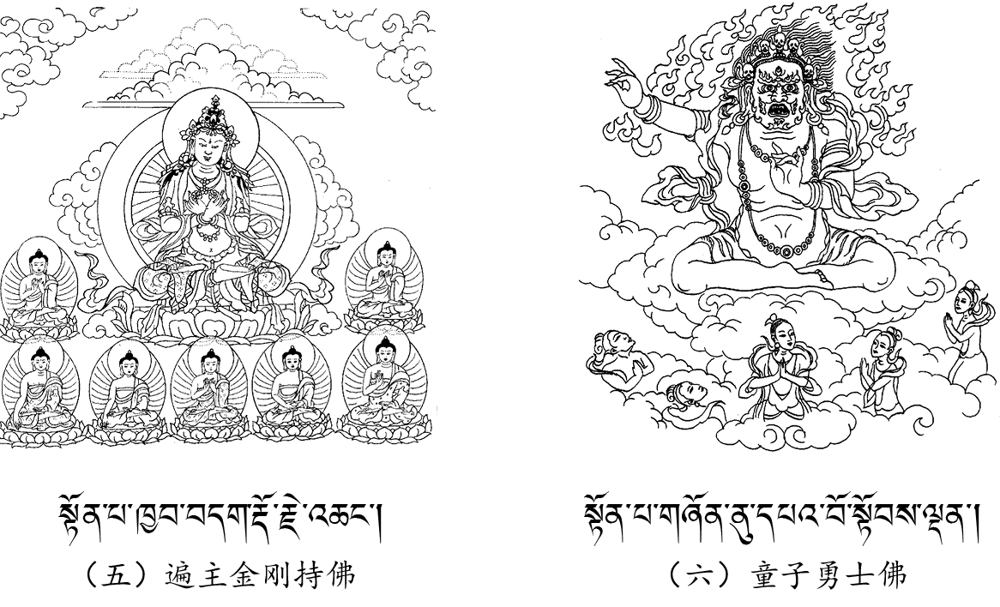
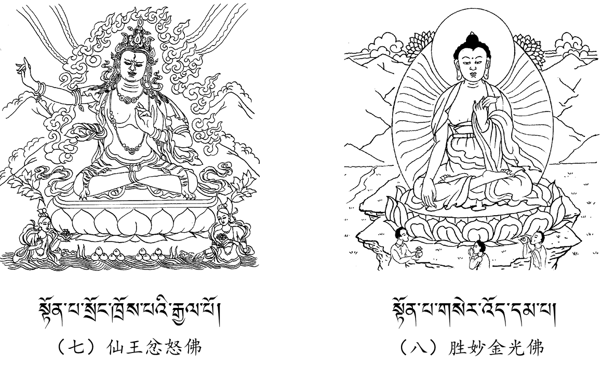
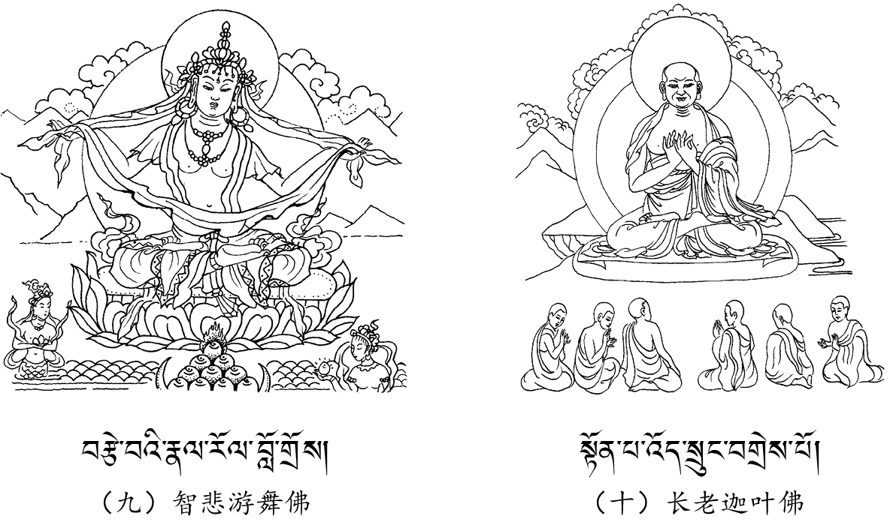
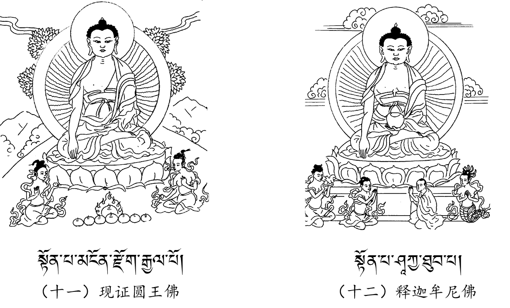

# 传承略史·宝珠鬘讲解

2007年1月14日

南卡秋戒嘉措尊者·造论

索达吉堪布·译讲

> 顶礼本师释迦牟尼佛：

> 酿杰钦布作丹涅美样 大悲摄受具诤浊世刹

> 荣内门兰钦波阿嘉达 尔后发下五百广大愿

> 巴嘎达阿灿图协么多 赞如白莲闻名不退转

> 敦巴特杰坚拉香擦洛 恭敬顶礼本师大悲尊

> 顶礼法王如意宝：

> 内钦热沃贼诶样堪色 自大圣境五台山

> 蒋华特杰辛拉耶拉门 文殊加持融入心

> 晋美彭措雅拉索瓦得 祈祷晋美彭措尊

> 贡觉多巴破瓦辛吉洛 意传加持得证悟

> 顶礼本师释迦牟尼佛

> 顶礼文殊智慧勇识

> 顶礼传承大恩上师

> 无上甚深微妙法，百千万劫难遭遇，

> 我今见闻得受持，愿解如来真实义。

> 为度化一切众生，请大家发无上殊胜的菩提心！

首先，讲一下闻解脱的传承历史。我从字面上简单给大家念念，不一定详细解释，你们自己可以慢慢看。

【传承历史】

| 深法寂猛密意自解脱传承略史：

深法：指无上大圆满法，因为在所有显宗、密宗的教法当中，它是最甚深的，一般凡夫难以通达。

寂猛：寂静本尊，有四十二尊。忿怒本尊，有五十八尊。实际上，任何一个众生就是依靠寂静和忿怒百尊坛城来获得解脱的。

密意：寂猛百尊的密意，本来都是自然解脱，无离无合的。

但是这样的道理，很多众生都不了知。所以，这个伏藏品就是给大家宣说这样的道理。因此，现在所传的中阴闻解脱法，全称为“深法寂猛密意自解脱”。

| 顶礼三身寂猛尊！

如云：“为令诸位信士生诚信，如源雪山说至普贤我。”

水的来源是雪山，同样，人们要了知佛教的来源，就必须知道其历史。无上密法的传承来源，就是普贤如来。

| 深法寂猛密意自解脱中，中阴闻解脱此法传承，包括如来密意传、持明表示传与补特伽罗耳传三种。

传承的必要，就是为了让人坚信及说明来源可靠。《日月吻合续》中云：“首先宣说历史义，若未宣说历史义，于此大密了义教，将有不诚信之过。”

如果不知道佛法的来历、历史、见解，那么，很多人对大乘密法的了义教法，不一定生起信心。所以，首先要宣讲传承上师和历史的来源，这非常有必要。

| 第一如来密意传分为三，即是法身普贤佛父佛母、第六大金刚持、本师金刚萨埵。

首先，讲如来密意传。如来密意传是指，眷属相续中的证悟境界和本师相续中证悟的境界，实际上无二无别、没有增减，只不过名称上叫传承，即眷属和本师的相续或意义无二无别。

| 法身普贤佛父佛母：于法界自性清净的密严刹土法界宫中、无为法本来任运自成、现空方便智慧平等安住的出有坏即普贤佛父佛母，也就是说，法身无垢不成立任何本体，在所化众生前示现大悲有面有臂的形象，具足庄严相好，从远离一切戏论相的境界中，安住于密严刹土法界智慧，五光萦绕的宫殿中。

报身显现为五光萦绕，但实际上有没有真正的白、红、蓝等这种五光呢？没有。其实是五部如来的智慧在内明时，如同透明的水晶当中所显现的光芒，是自然而然的具足。所以，在基位的时候，这样具足的方法，就叫做五光萦绕。

先讲到普贤如来的密意，然后是普贤如来佛父佛母。其实，所谓的普贤如来佛父佛母，就是一切诸法的本体——空性和光明无二无别。他们在众生面前示现时，是有臂有形相的。实际上显空无二，就叫做普贤佛父佛母无二无别。

一般来讲，显宗法最初的传承，是由释迦牟尼佛传下来；而密宗，尤其是大圆满，其传承是来自于普贤如来。

有些人认为：如果释迦牟尼佛以前的传承是普贤如来，那密法是不是除了释迦牟尼佛以外的一种传承呢？不要有这种疑惑，不用担心。因为，密宗大圆满法，首先来自普贤如来，然后是第六金刚持，接下来是金刚萨埵，再由金刚萨埵显现为大圆满的十二大本师。这十二大本师当中，就有本师释迦牟尼佛。

所以，密宗的传法，普贤如来是最初的祖师，并且，释迦牟尼佛也包括其传承中。但在此处，传承祖师是以法身、报身和化身的方式而表示的。实际上本师释迦牟尼佛的本体，与普贤如来佛父佛母的本体无二无别。

我们有些道友对五部大论方面，还是有一定的闻思，但是，对无上大圆满方面，可能是第一次了解，大家对这些理论，要认真通达。

| 出有坏普贤如来圆满的密意传予第六大金刚持以后加持大灌顶，通过如此加持而对一切所化众生油然生起悲心。在所化众生的眼前现示无量相好身，幻化相有许许多多，略而言之就是大慈大悲、善巧方便之主尊出有坏第六大金刚持。

凡是报身、化身所显现的形相，都是第六金刚持的化身。

| 出有坏第六大金刚持将密意传予本师金刚萨埵并予以加持。本师出有坏金刚萨埵从大离戏界中，由自然本智动摇而自然现出受用圆满身，并且，大智慧光芒射收，三十六事业身自然安住光明点中，具有六十圆满，

金刚萨埵显现受用圆满身的时候，有三十六种事业身。三十六种事业身，对应大圆满的十二大本师。即十二大本师中每一位本师，有身语意三种，这样就是三十六种事业身。

十二大本师中的每一位本师，都有五种圆满——环境圆满、本师圆满、时间圆满、眷属圆满、法圆满，总共为六十圆满。

六十圆满和三十六种事业身，合计为九十六种法。无垢光尊者在《胜乘宝藏论》中，对此有详细说明。

因此，具有这九十六种功德法的本师，就可称为教主。以后我们如果有机会学习《七宝藏》，其中会有详细说明。

| 无量佛陀身了然呈现在眼前以后，他们也以金刚萨埵的光芒而聚集于五部佛中，并且由五部中出现。尔时金刚萨埵的舌光芒中，自生文字自然发出三遍“将一切有情安置无上菩提”之声。结果金刚萨埵的自然本智中，法性普贤佛母自生，进而自然无尽的悲心普射十方。由此本性中，出有坏金刚萨埵之身，聚集无数眷属的受用，灿然出现大圆满的光明身，五部如来等无数佛陀及各自坛城，金刚萨埵聚集受用，并且十二次灿然出现大圆满的光明身，

十二次灿然出现的大光明身，就是十二大本师。关于十二大本师的图片，在《上师心滴》法本的前面有，《胜乘宝藏论》的前面也有关于十二大本师的详细介绍，纽西隆多堪布翻译的《大圆满传承源流·蓝宝石》前面也有。

总之，在受用圆满身前现十二次灿然的大光明身。对一些道友而言，关于如来密意传的这些道理，解释起来不是特别好懂，像看小说一样，但大圆满的法语都是这样，我们大概理解就可以了。

| 从而圆满受用诸法。此时诸法自性远离所缘收摄。其后，念及大悲的众多对境而自然显现。当时于妙光庄严之处层层楼阁中，本体明觉之王“金刚萨埵”，现为坛城主尊，由身语意自生本师的自性中，如如不动而出生，这也是无有迁变的，所有安乐刹土也从现喜刹土到说之不尽的佛陀自然本智自明的本性中自住。出有坏本师金刚萨埵的密意加持予大持明者嘎绕多吉。

这以上称为如来密意传。

关于如来密意传，在《大圆满前行》的上师瑜伽中，也有一个简单说明。总而言之，所谓的如来密意传，是金刚萨埵、第六金刚持或普贤如来相续当中的境界和证悟智慧，主尊跟眷属无离无合、无二无别。这样的传承或者法性，称为如来密意传。

| 接下来抉择持明表示传，由本师金刚萨埵的加持中，于佛陀灭度后三百六十年时，在金刚座的西方达那够卡洲，有一座具足完美布局的乐积精舍。

持明表示传跟汉传佛教里的禅宗比较相似，但不是完全相同。如果有些人说：“你们密宗的莲花生大士、嘎绕多吉等，他们传法跟佛教的一些传法不相同。”我们就可以用此理来驳斥。

佛陀灭度三百六十年，大概是佛法第三次结集的时期。

| 国王俄巴绕匝、王后光明母生有一公主名叫色达玛，她出家为尼，在西方的一座海岛，搭起茅棚，与名叫达革得玛酿丹玛的侍女一起修行。当时有一天夜里，梦到一位身色洁白之人把一个由五部佛种子严饰着的水晶瓶放在她头顶。依此公主感到身体不适，

这里的身体不适，只是怀孕的征象，并不是像世间人怀孕一样，非常痛苦，在其他历史资料中也有这样的说明。

| 当时间到期，由右肋侧的位置生下一位没有父亲的儿子。

这和释迦牟尼佛在蓝毗尼花园降生的方式比较相似。

| 比丘尼说：“我竟然生下这样一个没有父亲的儿子。”讲了许多悲伤的话。侍女说：“奇哉！这是佛陀的一位长子。”

母亲不知道，侍女却知道，看得出她比较聪明。

| 可是她却执意不听，让人将孩子扔到灰坑里。结果光芒、妙音以及彩虹等佛陀现身于世间的瑞相纷纷呈现。于是比丘尼说：“我的那个儿子如果真是佛陀的化现，是否没有死而仍然健在？请去看一看。”

由于过了两三天，母亲看到出现各种瑞相，所以这样说的。

| 过了三天去看，结果发现孩子上身从灰间直挺挺显出、面带微笑。于是人们用白哈达裹着抱回来，用香水进行沐浴，诸天人也从空中为他沐浴并作吉祥祝福等等，出现了许多稀有的瑞相。此后（母亲）无微不至精心抚养他。当地的人们都说：这个小孩藏在灰里也没有死去，由此也为他取名起尸灰色。

有一本书叫做《走过西藏》，里面有专门研究西藏民俗的内容，其中讲，白色的哈达是藏地特殊的吉祥物。这里可以看出，佛陀灭度三百六十年后，距今有两千多年，就已经有白色哈达了。哈达在当时算是一种吉祥物。

因为这个孩子在灰坑里没有死，把他抱出来后，身上的颜色应该是灰色的，所以人们就称他为“起尸灰色”。

| 到了七岁，小孩说：“把我送到印度诸位班智达跟前，我有难题要请教。”人们都说：“你刚刚到七岁，一颗牙还没有换。”他说：“我有要研讨的正法。”

不管我有牙齿也好、没有也好，反正我关心的就是跟班智达们进行辩论。

| 于是他得以见到外祖父俄巴绕匝和五百位班智达。当起尸灰色向对方提问时，所有班智达都无法答复，而他们反过来问小童子的所有问题，他都对答如流。由此，班智达们全部生起信心，顶礼其足。国王说：“我有一个极其可爱的外孙。”为此给他取名“极喜金刚”。

当然，关于嘎绕多吉的历史，不同历史书里有不同的介绍方法。但是在这里，我们应这样了解。

| 诸位班智达为他取名“札嘉巴瓦”。后来嘎绕多吉在北方“阳光”山间有大量非人聚集的地方入定三十二年，结果大地震动、传出妙音、光芒四射、天降花雨。尤其令所有外教大大衰落。外道的一位国王说：“此人弘扬光大内道佛教，使外道教法衰败。”因此吩咐道“杀掉此人”。他们千方百计谋杀大阿阇黎嘎绕多吉，可是怎么也未能得逞。阿阇黎嘎绕多吉飞到虚空界，由此外道国王及眷属感到惊奇不已，纷纷顶礼而皈入佛教。

凡夫对神通非常执著、容易起信心。《百业经》和《毗奈耶经》当中也讲，如果显现神通，凡夫很容易起信心，如果是传法，讲一些道理，他们不怎么起信心。

| 此后，嘎绕多吉与空行母得瓦如丹玛和得雪云丹塔益玛三人，在玛拉雅山宝聚佛法兴盛之顶峰，将佛陀所宣说的无余法藏，尤其是自生大圆满六百四十万偈颂，凡是以前记在心中的法，于三年期间立成文字，在达革温雄山洞印持并交付空行母委托保存。

玛拉雅神山，在如今斯里兰卡境内，《敦珠佛教史》前面有介绍，现在成了斯里兰卡一个出名的旅游胜地，它是公认的密法最初兴盛的圣地。

六百四十万偈，就是六百四十万续。

嘎绕多吉是最开始将密法弘扬到人间的大圆满祖师。在其他历史书当中也讲，金刚手菩萨亲自化为“吽”字，入于嘎绕多吉，所以，嘎绕多吉是金刚手和金刚萨埵无二无别的化现，专门到人间来弘扬密法。在《上师心滴》及大圆满有关典籍中，首先是嘎绕多吉的祈祷文，这非常重要。

当时在达革温雄山洞中作了伏藏，让空行母乃至轮回未空之前，一直保存。

| 后来，他在金刚座东北隅过五由旬的清凉大尸林中安住境界，为诸空行母传法。

印度金刚座往北，大概五由旬处，就是这个清凉大尸陀林。十多年前上师如意宝去印度时特意去过，当时上师说：“我们既然到了印度金刚座，有关大圆满的历史都讲了，嘎绕多吉曾居住在这个清凉尸陀林，所以我们一定要朝拜。”当时我们包了一个大拖拉机过去的，那个尸陀林不像我们这边的尸陀林，尸体不太多。尸陀林旁边有一个夏瓦日尊者的山洞——夏瓦日尊者是印度八十四大成就者之一。观音上师最开始到印度的时候，依靠种种缘起，在那个山洞里住过一晚上。

这个清凉尸陀林离金刚座不远，而且印度和中国之间的关系越来越好，所以，在座的各位，如果以后去印度金刚座，还是要去一下这个清凉尸陀林，它是嘎绕多吉传授过密法、非常殊胜的圣地。

以上讲了嘎绕多吉，下面是西日桑哈。

| 当时，汉地祥匝洲，施主格瓦罗丹和光明母有一个具头陀功德名叫西日桑哈的儿子。

这在现在的历史资料中不是很明显，尤其在汉传佛教的历史中，基本上没有。有些大成就者都是隐藏瑜伽士，所以，汉传佛教的有关历史当中，不一定能非常明显地找出来。

| 有一次，他想到“金洲”城市去，于是骑着具力黑色骆驼向西而行，当到达边缘时，圣者观世音菩萨在上方的虚空中亲自降临授记道：“奇哉，善男子，如果欲求殊胜果位，前去清凉大尸林。”

原来大多数人去印度的时候要经过新疆。其实西日桑哈是受观音菩萨授记之人。汉传佛教的很多高僧大德和一些出家、在家的修行人，经常得到观世音菩萨的授记。

我们这里好多人也是，观世音菩萨在他的梦中或白天显现，让他到学院或藏地去。很多人是这样说，不过是真的假的也不好说。如果是真的，当然非常好。一个人好好修行的时候，我觉得他说的应该是对的；但有的人起烦恼、破坏学院纪律，我就觉得：“怎么得观音菩萨授记的人，在这里搞这样的事呢？”

| 于是，他依靠神足通、神境通的力量来到清凉大尸林拜见大阿阇黎嘎绕多吉，祈求说：“请为我宣讲真实教授。”

当时，西日桑哈在嘎绕多吉面前如是说。

| 大阿阇黎发现他是具有缘分者，于是恩赐所有窍诀宝藏教授，尤其是大圆满六百四十万续部之义。他在二十五年中深入探究，遣除怀疑以后进行实修，而得到证悟的境界。

法王如意宝经常讲：西日桑哈本来是非常利根者，但他从汉地到印度清凉尸陀林，并依止嘎绕多吉长达二十五年的时间，通过各种探索的方式，最后遣除一切怀疑，得到证悟境界。这样的最后有者或有缘者，也需要长期依止善知识，何况其他人？

今天，有一个人说，他以前一直在学院中修，然后有些人跟他讲：“不要听上师的课，这只是增加分别念，你自己好好观心就可以了。”最后我没有给他这次的“闻法证”，那你就观心吧，因为我认为，不管怎么样，一定要闻思。即使像西日桑哈那样的大成就者，也要在二十五年当中依止善知识，闻思修行。没有闻思修行，光是盲修瞎炼，我是不太赞叹。这并不是我这样的凡夫以分别念来抉择的，法王如意宝的传统和法王如意宝的密意，大家应该都明白。

| 大阿阇黎西日桑哈在索萨洲尸林安住境界，将密宗所有修部的能成熟灌顶和能解脱教言，特别是自性大圆满的所有法部精华所包括的结晶无上阿底、真实金色、光明心滴以及所有实修法，以满瓶倾泻的方式传授给邬金堪布莲花生。

满瓶倾泻，就是一个瓶子里面的东西全部倒入另一个瓶子里。当然，不能完全以世间的比喻来理解，不是说瓶子倒完后就空了，是不是西日桑哈相续当中什么都没有了，让莲花生大士全部得到了呢？不是这个意思。是西日桑哈相续当中所有的功德、境界、证悟不减少的同时，莲花生大士全部同样得到。就像米拉日巴依止马尔巴罗扎的时候，最后上师以满瓶倾泻的方式，将自己相续当中所有的证悟，全部传授给米拉日巴。

| 在位于索萨洲大尸林中央、面积广大、连同宝轮和宝伞都是由黄金和白银做成、放射无量光芒的自然佛塔前，为班智达无垢友（即布玛莫札）、具头陀功德的嘉瓦益西多（即嘉纳思札）以及邬金阿阇黎莲花生三位同门切合要点传授要诀进而予以加持。

西日桑哈在这样的佛塔面前，为三同门传授要诀。布玛莫札、嘉纳思札，莲花生大士，即我们密宗当中的三同门。

有些历史当中讲，是嘎绕多吉传给蒋华西宁，即文殊友；文殊友传给西日桑哈；西日桑哈传给莲花生大士、布玛莫札和嘉纳思札。所以，在传承方法上有点不相同。但此处的历史里，没有提文殊友。

有些书里的传承次第是：嘉纳思札、布玛莫札、莲花生大士、赤松德赞、贝若扎那、益西措嘉、全知无垢光尊者、智悲光尊者、蒋扬钦则旺波、华智仁波切、麦彭仁波切、托嘎如意宝、法王如意宝。在《大圆满前行》《大圆满心性休息》等很多传承历史中，都是这个传承。无论近传、远传，都可以这样安立。

但这里的传承次第是：极喜金刚、西日桑哈、嘉纳思札、布玛莫札、莲花生大士。

| 如此持明表示传的历史抉择完毕。

关于补特伽罗耳传的历史，也就是由邬金莲花生大士传下来的上师们的名称间接了解，

前面已经讲了，从莲花生大士传到赤松德赞，直到我们的全知上师。在《大圆满前行引导文》里有传承上师的法相和传承次第表，我们在这里可间接了解。

| （莲师）发愿：“为了于浊世利乐达贡和（藏地）北方的一切有情，愿事业勇士有‘噶玛’名称者广行利生事业。”并给予加持。

这叫做发愿传承或者发愿印持传承，有这么一种说法。当时莲花生大士在自己的弟众当中，特意交付佛法，然后发愿将来在达贡地方和藏地的北方，为利益有情，有一位叫做“噶玛”的人，弘扬此法。

现在从整个藏地来讲，不管是卫藏、多康，以及前藏、后藏，这部“闻解脱”法非常兴盛，在整个藏地的各大寺院当中都会修持。而且，不仅是藏地，在西方国家，很早的时候，《中阴密法教授》已经译成英文，后来通过英文传到中国。

为什么索甲仁波切的《西藏生死书》如此出名？它所讲述关于中阴的道理，全部来自噶玛朗巴的中阴密法教授，只不过是通过现代语言和生活方式向众人表达而已。因此，以莲花生大士的特意加持，后来的人对中阴密法非常有信心。我看在座的各位，应该对密法尤其是六中阴法，有特别大的信心。

我去年就准备传这个法，后来非常害怕，因为人特别多。现在学院的治理整顿工作还没结束，再加上来自各个地方的人，如果太多的话，实在没办法安排，最后就取消了。这次传法也是一直保密，几个月前，我就一直在心里暗想，包括法本的翻译、闻法证的制作等很多方面的事，都不敢公开。

我们在座的道友们也应该明白，对噶玛朗巴的法，尤其是莲花生大士发愿摄持的这个法，自己还是有一定的因缘，否则，恐怕现在不一定能接受到这样的法。

| 补特伽罗耳传：伏藏师噶玛朗巴出生于达波上方，

此法属于伏藏法。伏藏法是我们宁玛巴的六大传承之一，它有一个独特的传承。一般而言，莲花生大士的伏藏法，是他亲自授记，在《莲师广传》当中有一百多位伏藏大师的授记说明。而这一百多位伏藏大师所有的伏藏品，贡智·云登加措曾经做过结集，即现在的《宝藏法》。

噶玛朗巴的中阴法，是伏藏方面最兴盛的法。现在很多人死了以后，念四十九天的超度，就是用噶玛朗巴的这个伏藏品——闻解脱法。

所以，首先介绍伏藏大师噶玛朗巴。

| 是大成就者尼达桑吉（日月佛）的长子，授记与缘起聚合以后，他从达波地方刚布达杰神山如起舞般岩石中，秘密开取《深法寂猛密意自解脱》的所有伏藏法。

尼达桑吉也是非常了不起的莲花生大士亲自授记的伏藏大师，他也叫日月佛。噶玛朗巴在十五岁的时候，从神山取出现在这部《六中阴》法要。

| 此外还取出了《莲花寂猛》等伏藏品。

当时根据伏藏的授记，《莲花寂猛》等伏藏品可以传给十四位法主，但闻解脱法对谁都不能传，伏藏大师只传给儿子，没有传给其他任何人。

| 据说，由于伏藏授记的明妃缘起有所破坏，也招致了一些流言蜚语。

因为他当时没有找到一位具相的明妃，后来在开取伏藏的过程当中，出现了很多违缘，同时也遭到别人的诽谤。

| 但是他也生有一子。当时《密意自解脱》弘扬的时机未到，他便将一卷（空行）黄纸给人看，由此出现了寿障。

密法的因缘、传授，在时机没有成熟的时候不能传。即使是伏藏大师本人，也没有权力传给别人。他在一辈子当中没有传给其他人，只传给自己的儿子一人，当时是允许的。

只是把空行文字给别人看了，并没有传给任何人，由这件事而出现寿障。有些时候，伏藏品有空行文字，也有宝箧伏藏。

原来我们上师的传记当中也讲到空行文字。这些空行文字，我们看不懂，但是伏藏大师看了空行文字以后，通过其表示，马上就能让伏藏品，如仪轨、修法内容等出现。

| 内在拥有无量功德、无碍行持任何事业的他知晓自己即将圆寂，便说：“明年此时，我的身体会出现数多莲花图案。”

这个数多莲花图案，可能是他圆寂以后出现的舍利是莲花部的佛像，或是其他的。我也看过一些历史，但关于噶玛朗巴这个说法，不是特别明显，所以，这也可能有其他意思。

在《敦珠佛教史》中关于噶玛朗巴的传记比较略。有一部《伏藏大史》，是一部非常大的历史典籍，可能这里有广的，以后方便的时候再看看。

| 也讲了许多神通。第二年临近圆寂时，为儿子传授《密意自解脱》的灌顶和言教以后叮嘱道：“对别人一律都不能宣讲，此法务必交付有‘尼达’名字的一位大德，他将广行利生事业……”作了许多授记以后示现圆寂。

噶玛朗巴尊者把伏藏从神山当中取出来，其中《莲花寂猛》传给十四大法主，而闻解脱法只单独传给儿子。以前上师如意宝也讲过这段历史，闻解脱法在前三代，就是独传。三代之后，整个藏地、汉地等很多地方，会非常兴盛。

| 噶玛朗巴尊者的父亲是大成就者尼达桑吉，他住世到一百二十岁。噶玛朗巴的儿子是尼达秋吉，他从小就对正法虔诚信奉，智慧高超，极其可爱，具有慈悲菩提心，并且通达所有学问，

我刚才还没有来上课的时候，装成别人给一个老师父打了个电话，我说：“师父啊，你可不可以给我帮帮忙啊？”他说：“不行，不行，我现在特别忙，不行！”我说：“你不是发过菩提心吗？”“唉，发菩提心也要在空的时候才可以。”

后来我想想也是，他没有说自己没发菩提心，他是认可发菩提心的，但是发菩提心呢，需要有空的时候才可以利益众生。

| 尤其对自性大圆满的法义了如指掌。他从十七岁开始讲经说法而且精通灌顶，令所化众生起信，利生事业极其辉煌。他从达波来到隆波地方，见到喇嘛仁波切色雅簪札绕莫（即日月光），

色雅簪札绕莫，是梵语，“色雅”指太阳，“簪札”指月亮，“绕莫”指光，意思就是日月光。前面讲的授记里不是有一个叫“尼达”的名字吗，这是藏语。“尼达哦色”，“尼”指太阳，“达”指月亮，“哦色”指光。但是刚才授记里面只有一个“尼达”，没有“哦色”。

| 梦境和缘起都恰到好处，因此将《深法寂猛密意自解脱》供养喇嘛尼达哦色（日月光）并说：“您已得到授记，是第三代传承，这部法，我一丝一毫也没有传给任何人，在三代之前都是独传，从第三代以后广利有情，您也是在六年当中不要传予别人，自己实修，六年过后再传授他人，会对众生大有利益。

尼达秋吉只是从父亲那里接到这个传承，然后他自己在一辈子当中只是传给尼达哦色，除此之外，对任何人都没有传过。尼达哦色是第三代传承，此法在三代之前都是独传。六年以后尼达哦色才可以传讲。

| ‘噶玛朗巴事业兴北方’，这是教法于北方兴盛的授记。此深法的下门大乐部分，在十年期间切莫传授给人，此后传讲不会出现违缘。”

因为授记当中就讲‘噶玛朗巴事业兴北方’，他的事业在北方。

“下门大乐部分”是一个方便道的修法，当时要求此法十年期间不要传给任何人，但这个法在藏传佛教当中，到目前为止，基本上没有着重弘扬传授，没有公开传授。但闻解脱法三代之后已经广传。所以，此法由尼达秋吉传给尼达哦色。大家一定要把传承历史搞清楚。

下面介绍尼达哦色。

| 尼达秋吉的弟子就是喇嘛仁波切色雅簪札绕莫，他的出生地是隆波则嘎，种族是朗钦华戒桑给族，父亲是位医生，名叫阳嘉，他是长子，从小就信受佛法，独自到古瓦地方去修行，因此他很小的时候就被人们叫做“大修行者、大修行者”。

古瓦应该是一个寂静的地方，并且很多人对尼达哦色有如是的赞叹。

| 他依止了至尊札巴仁波切等多位上师，对内外密法都通达无碍，精进修行，并善于讲经著论，有极高的证悟境界，成为浊世一切众生的殊胜引导者。当众多上师善知识和所有施主迎请尊者到刚波下方嘉真毕一带时，我有幸以得拜见。

“我”指《略史宝鬘论》的作者，叫南卡秋戒嘉措。南卡秋戒嘉措是尼达哦色的弟子。闻解脱法前面有一个传承祈祷文，里面尼达哦色和南卡秋戒嘉措的名称都有。南卡秋戒嘉措自己示现得很谦虚，但实际上也是非常了不起的大成就者。

| 受到慈悲摄受，求什么法都得到恩赐。这位至尊的传记有一大函，著作也有《辨别海》等不可思议的大量论典。实际上，这位尊者就是印度的伏藏大师班则玛德，在《集密意续》等中有许多关于他的授记，是邬金仁波切莲花生大士加持的大德，绝不是一般的人。

当然，能把这个法一直流传于世，肯定不是一般人。

| 他的弟子就是僧人我南卡秋戒嘉措，种族为嘉绕瓦，父亲是切耶切城的南卡。

下面就是介绍作者本人。南卡秋戒嘉措也叫南卡，他的父亲也叫南卡。

| 我的这位父亲最初成家无儿无女，因赌博而输得倾家荡产，他有一个名叫喇嘛秋哲的弟弟，住在贡波下方达瓦坡色的耶当寺，于是他就到弟弟那里诵经。

他父亲就像现在的有些人一样，不太争气，将家产全部输光，可能妻子也跟他离婚了。若是有钱的时候，妻子会比较关心吧。

父亲的弟弟，是个出家人。父亲实在没办法，家也没有了，然后到弟弟那里去当一个居士，每天念一点经，坐在那儿混日子。不过这应该是示现，他应该非常了不起，是大成就者吧。

| 与名叫得瓦班玛的尼姑情投意合，结为伉俪，于铁狗年生下我。后来又生下一个妹妹。当我五岁时，又生了一个弟弟。可是还没有过一年父母与妹妹三人都不幸去世。

南卡秋戒嘉措的母亲，是个尼姑；嘎绕多吉的母亲，是个尼姑；世亲和无著菩萨的母亲是尼姑……但有些女众不要认为自己是修密宗的，以后为了弘法利生就要还俗。不能这么想，自己有没有这样的力量不好说。

| 弟弟由一位“格年玛”施主和另一个人收养，在十二岁时出家，精通所有学问和佛法，具有圆满的功德，精心恭敬上师，对遣除一切有情的病魔违缘所作的巨大利益实在无法想象，并且成为世法、佛法圆融的吉祥怙主。现在任塘卓寺的住持。

因为他们两个都成了孤儿，这样弟弟由另外一个人收养。而且，他弟弟在世间法包括处理事情等很多方面都非常了不起，佛法也是通达无碍。就是世法、佛法全部圆融无碍。

当时南卡秋戒嘉措写此略史时，他弟弟是塘卓寺的主持。

然后下面讲他自己。

| 我也是从五岁就由叔叔喇嘛秋哲巴抚养，

这位叔叔喇嘛还是不错的，原来他父亲倾家荡产的时候是叔叔照顾，然后他变成孤儿的时候，也是叔叔喇嘛抚养。

| 从六岁开始学习文字，九岁把读诵学成。十一岁在证悟者仲秋多前作居士，取名南卡嘉措，得受了观音法门、文殊开许灌顶等许多法的传承。在叔叔喇嘛面前得受了《除暗明灯之引导》、大圆满密类等众多法要。从十三岁开始在殊胜上师阿里瓦面前当沙弥，当我十六岁时，叔叔喇嘛圆寂。

父亲叫南卡，他自己的名字在此加上一个嘉措。南卡秋戒嘉措十一岁时受居士戒，十三岁时当沙弥。

我们这里的有些老出家人，如果要写自传的话，不知道在佛法方面有没有这样的内容：我在十几岁的时候如何，然后五十岁的时候才学佛……

南卡秋戒嘉措十六岁的时候，叔叔喇嘛秋哲巴圆寂。

| 后来我在上师南嘉桑吉面前得受大圆满引导法。十八岁，在南卡西年巴座下研学《时轮金刚》、《集密意续》以及《普明续》等法。在二十一岁时担任叔叔的曼木寺住持。

刚才说他叔叔在耶当寺，这里说是曼木寺的主持，可能叔叔有几个寺院吧。

| 当时，于哦秀切境内嘎巴嘉吾地方，在伏藏师桑吉朗巴之子上师益西多吉面前得受《集密意续》，

桑吉朗巴在下面会讲的。在我们宁玛巴中，噶玛朗巴、桑吉朗巴和绕那朗巴，是对伏藏法方面非常有贡献的大伏藏师。

| 也就是在那时见到了生生世世的上师索南嘉灿，并且约好转匝热神山时求法。后来转匝热神山完毕便在上师索南嘉灿面前听法。二十四岁时于魏土寺在上师藏钦巴面前受近圆戒，法名为南卡秋戒嘉措。

南卡秋戒嘉措的上师是索南嘉灿，是他生生世世的上师，说明以前就有缘。南卡是父亲的名字，南卡嘉措是当居士时的名称，后来受比丘戒时，中间加了秋戒二字。他名字的取法挺有意思。

| 其后，迎请上师仁波切索南嘉灿到曼木寺，广转甚深法轮。上师慈悲摄受，以满瓶倾泻的方式恩赐了方便道、解脱道、灌顶等所求的一切法，其深恩厚德实在无以回报。在上师仁波切色雅簪札面前，得受了《密续集》、新旧派的灌顶等为数不少的法要。尤其上师也郑重赐予《大悲黑怒母》《深法寂猛密意自解脱》法要，并让我把所有直指实修法修行纯熟，其大恩大德无以回报。在瑜伽士上师匝古巴面前，得受噶举派许多不可思议的深广法宝。仲巴桑吉华瓦前，得受密宗新旧派、大手印、断法等数多不可思议的传承。此外，还得受了新旧密宗的灌顶等不可思议的经教。

《密续集》是宁玛巴所有密宗续部集聚在一起的典籍，德格的版本中有非常多函。

可以看得出来，南卡秋戒嘉措在上师面前，得了这么多法要。

| 我先后依止了秋戒通瓦敦丹、噶玛巴秋札嘉措、红帽秋华益西、秋戒札巴活佛、秋吉意桑则巴、金昂仁波切、哲贡巴弟兄、古波瓦弟兄、哲巴嘉旺秋吉、秋戒旺修秋吉南罗瓦、措普译师、伏藏大师绕那朗巴、仲·索南白巴、萨迦巴华丹桑波、智者索南嘉措、策坡仁波切、香兰拉、喇嘛嘉灿、达玛索莫、仲巴·索南嘉灿父子、喇嘛嘉阳云讷、仲·布耶绕匝、温波门兰札巴、噶玛智革、仲·匝那索嘎绕、具相温哲华姆等四十二位上师，得受了不可思议的经教，也闭关了几年。

伏藏大师绕那朗巴是一位对整个密宗贡献非常大的大成就者，这在《藏密佛教史》当中有介绍，他前后见了莲花生大士二十五次，有二十五种大的伏藏品。后来，宁玛巴的密宗续部，全部放在《大藏经》当中。

南卡秋戒嘉措一生依止了四十二位上师，这里的每一位上师都非常了不起，如果详细介绍，其传记足有一大函。我们在此只是提了他们的名字。

现在藏传佛教当中，同一时间出现这么多非常了不起的大德，基本上没有，所以，那时候众生的福报因缘真的非常好。

| 四十一岁时，在单纽嘉城区的左侧建立了法轮顶道场。四十六岁到拉萨跟随红帽法王朝拜觉沃佛像。对我本人来说无有所需，但还是住持了五六座寺院。

对南卡秋戒嘉措尊者个人而言，不管从哪方面来讲，都没有需要，但他还是住持了五六个寺院。

以前本焕老和尚跟我说：对我个人来讲，没有什么必要，但我还是住持这个寺啊、那个寺啊。然后老和尚给了一张名片，上面写了很多头衔。

| 六十六岁，在单纽嘉城区的右侧刚坡附近，创立“吉祥宝洲”道场。上师们慈悲摄受，毫无隐瞒地恩赐了法教，我也时而立下誓言，表面上作了修行，然而大多数时间都是在懈怠中度过，由于缺乏毅力、无有精进，因此很难在相续中生起善妙的觉受证悟。

南卡秋戒嘉措尊者非常谦虚，不然作为大圆满，尤其是《六中阴》的传承上师，每天都是睡懒觉、懈怠、没有毅力，这是不可能的。他很谦虚地说，自己虽然发了一些誓言，但在大多数时间中，都在懈怠度日，在相续当中没有生起什么善妙的觉受智慧。

| 而依靠以往积累的善业，也凭借诸位上师无量的大悲，今生当中也是万事如意，快乐圆满。

南卡秋戒嘉措尊者说：我修法倒是没有成功，但是依靠上师们的加持和自己往昔的业力，即生当中生活很顺利、快乐，圆圆满满。

他说得也对。可能我们有些修行人也有这种想法，虽然自己得了很多法，但因为有懈怠在自相续中，到目前为止没有生起什么大的证悟。但是，依靠上师的加持，还是过得很快乐，没什么顾虑，应该比较圆满。

| 对临终老人我崇拜并有信心的人们，请将下面的言教记在心中：随顺众人，是世法的根本；

我们要随顺他人，对上面的人要恭敬，对中等的人要配合，对下面的人要爱护。随顺他人，是我们做任何世间法或是出生智慧、道德的根本。

出家人也好、在家人也好，跟谁都合得来，这一点真的很重要。这是世法的根本，如果世法都没有，出世法很难以生得起来。

| 尽量利他，是佛法的根本；

尤其是修大乘佛法，一定要尽量利他，不能说“我空的时候才可以修菩提心”（众笑）。实际上也对，没空的时候怎么修菩提心？

| 思维死期不定，是无常观的根本；

无常观中本来有比较多的分类，《前行》中有七种无常的观修方法，但其中最主要的就是死期无定。我什么时候死啊？这一点是无常观里的根本。

| 思维轮回痛苦，是因果的根本；

轮回痛苦的修法当中本来有比较多种类，但是要知道：现在所有的痛苦，就是前世造恶业而出现的。所以，要知道轮回痛苦，这就是因果法的根本。

| 心向正法，是理念的根本；

世间当中有乱七八糟、各种各样的力量、愿望、希求等。但是所有的愿望当中，我们要一心一意地求佛法方面的。如果白天晚上，什么时候都想着佛法，这就是所有理念中最无上的。

| 以心观心，是修法的根本；

所修的法可以说非常多，但是比较深的、最关键的，就是依靠自己的心来认识心的本体。通达自心的本来面目，就是修法的根本。

| 一心不乱，是实修的根本；

我们在实修任何一个法的时候，不要散乱。如果心有散乱，那就没办法了。

| 无散安住，是教言的根本；

心经常安住在上师所讲的道理中，这就是教言的根本。

| 无取无舍，是行为的根本；

最后，达到一定的境界时，不要有取舍，这就是行为的根本。

| 无希无忧，是果位的根本；

到了一定境界时，对任何事情都没有希望，也没有担忧，这就是果位的根本。不过有些人，根本什么都不在乎，这些像石头一样的人，别人赞叹无所谓，诽谤也无所谓，这不一定是到了最高境界。

真正到了一定果位的时候，不会有希忧等取舍。

| 具清净观，是助伴的根本；

要对谁都观清净心，如果整天观这个人的行为不好、那个人的说法不好、这个人的心态不好、上师不好、道友也不好，这样的话，跟谁都没办法相合。应该对什么都观清净心，这就是助伴的根本。

| 自心作证，是持戒的根本；

内心惭愧的话，就是持戒的根本。

| 信心稳固，是皈依的根本；

在皈依境前面，经常要讲信心。

| 自轻他重，是发心的根本；表里如一，是誓言的根本；一切众生是父母，要回报恩德；处于恶时浊世，要精进修行。

现在处于末法时代，一定要精进修行。如果没有精进，佛法的甚深道理不一定在相续中生得起来。

| 总而言之，心要归向正法，栖身于深山静处，

总而言之，所有修行人的心，时时刻刻都要往正法方面想。这些大成就者的修行教言，真的对我们非常有用。

所有的事情当中，心归向于正法最重要。身体方面，除了一些利益众生的事情以外，大家要尽量住在清净的寺院或道场当中。

| 上师的教言铭记在心并精进实修，要做到临终无憾无悔。后代雪域的心子要牢记，这是我的肺腑之言。

后来在雪域的这些修行人，或不是雪域、但来到雪域的这些心子们，一定要记住，这是尊者的肺腑之言。

| 年迈老人我所留的遗嘱也仅此而已，希望铭记。深法寂猛密意自解脱中阴闻解脱的此法，上师传给我时这样说过：“多次得受此法的一切有情不可能堕入恶趣。”我认为极其甚深，因此希望予以重视。萨玛雅！

尼达哦色尊者给南卡秋戒嘉措传讲此闻解脱的时候，就告诉他要尽量多给别人传授，多次听闻此法的人，绝对不会堕入恶趣。在藏传佛教当中，没有得到闻解脱灌顶的人，基本上没有。尤其在宁玛教法当中，在我们附近，无论走到哪里，凡是有人死亡，家人一定会给亡人念七七四十九天闻解脱法，如果实在条件不具足，也至少念两个七日、三个七日。

藏传佛教中得过闻解脱灌顶的人非常多。我们以前也得过此闻解脱的灌顶，如果现在能多多接受，绝对不会堕入恶趣。

所以，在座的各位，应该对此法予以重视！

| 以上传承次第的此略史，应多康的善知识喇嘛秋嘉屡屡劝请，为使如我一样浅慧之人生起诚信，土羊年七月初十，僧人南卡秋戒嘉措于单纽嘉城区的右侧刚坡附近色单呵德河右方吉祥宝洲撰著，由南部小僧人索南嘉措记录成文。以此善根为例，愿一切有情脱离轮回大苦海而得解脱！愿吉祥！！

2006年12月18日译于喇荣
