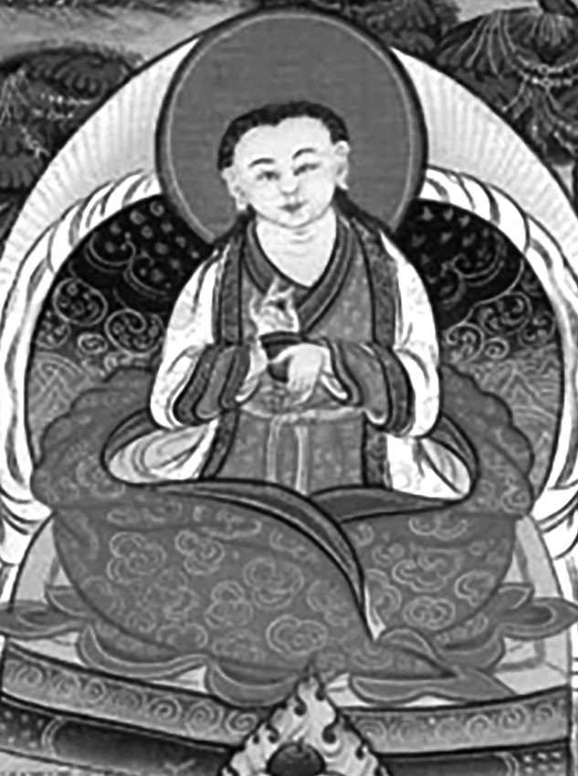
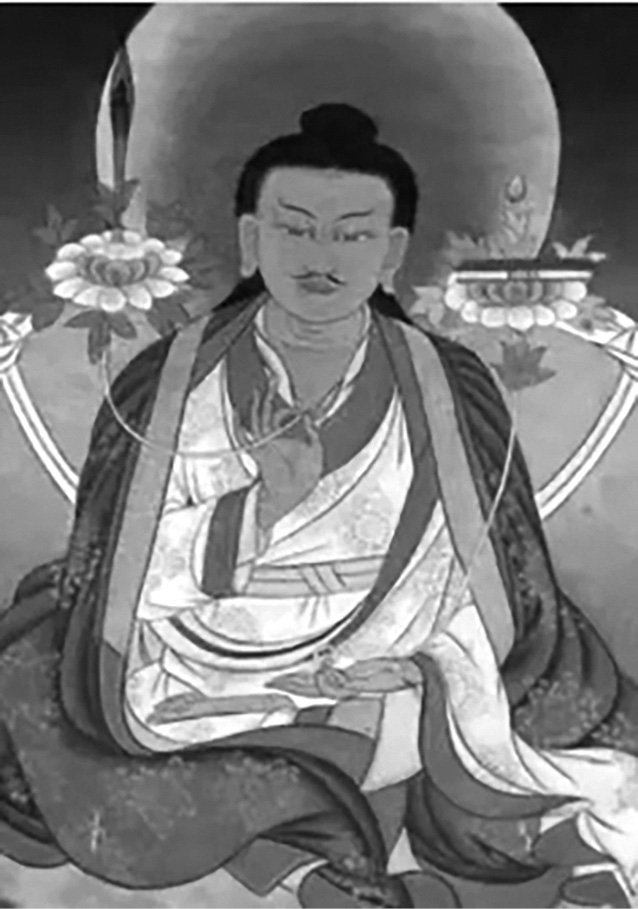
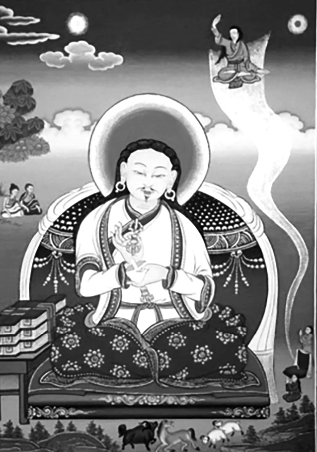
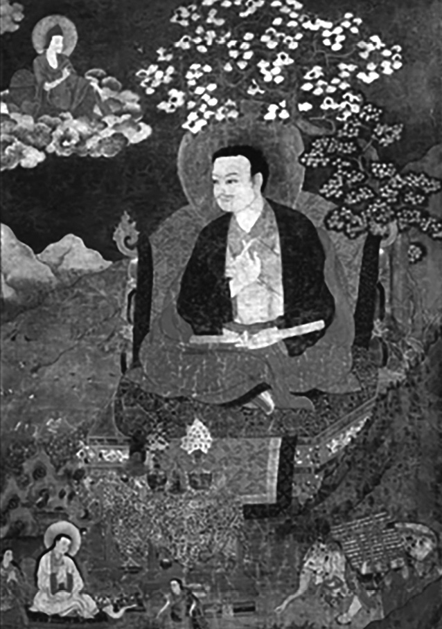

## 入大乘论讲解

荣索班智达·造论

索达吉堪布·译讲

## 第1课

2021年7月23日

今天开始讲《入大乘论》。传讲方式是：先念藏文传承，之后讲课。

## 听受条件

《入大乘论》跟其他课程有点不同，你们不管听藏文传承，还是我用汉语讲的课，最好是得过密法灌顶、对密法有信心、对上师三宝不会诽谤，而且这部法必须听完，也许三个月左右。如果不具足这些条件，最好暂时不要听，如果听了，对你也不一定有利。这一点，我每天都会提醒大家。

如果有人因特殊原因得不到传承，法师、堪布、堪姆可以给他补念。关于我的课，在现场听受可以得传承，事后通过视频、音频听闻得不到传承，但可以得到一种加持。如果你没有听全藏文传承，但当场听了我用汉语讲课，传承也可以算圆满。不过，听音频、看文字，应该得不到传承。这次我开许堪布、堪姆，以及今年新选上的法师，以后可以给人念《入大乘论》的传承。

## 翻译及传授缘起

1987年秋天，也就是我来学院的第三年，法王如意宝刚从五台山回来后，我听过《入大乘论》。那时候学得不深，只觉得《入大乘论》特别特别殊胜，这么殊胜的论典太不可思议，对密法生起了极大的信心。后来在学院给大家讲课时，引用过其中的一些比喻、推理和理论，但也是只言片语。我一直想把它翻译出来，但这个工程有点难，因为荣索班智达的造论风格比较特殊，就像《显句论》一样，跟印度论典的风格相同，既没有科判也没有注释，文风比较难懂。所以，二十多年来，我一直不敢动笔。

2019年底，本来我要去一些国家传法，如俄罗斯、迪拜、英国，那里有几所不错的学校，我想去跟他们聊聊，也许对将来的众生有一点点利益。即使没有利益，也想去参观参观，和知识界的人交流一下。但后来，快要去的时候，因为种种原因被取消了，不但没有去成，包括我的出行也受到限制，五个月内不能出四川省。

怎么办呢？我左思右想，这种违缘应该转为道用。也许翻译《入大乘论》的因缘成熟了，我就用三个月的时间，把初稿完成了。2021年1月到3月，又认真地做了校对，终于把《入大乘论》翻译出来了。今年初，我想最好给大家讲一遍，因为有些论典特别殊胜，如果没有讲，很多人不一定懂。为了讲这部论典，我做了很多准备，里里外外也创造了各种因缘。

今天，终于有这么一个开端了，希望讲闻此论能善始善终。所以，我中午交一些钱念经，祈祷护法神加持，也希望诸位道友好好配合。毕竟在末法时代，道高一尺魔高一丈，不管个人还是集体，各种违缘层出不穷。如果这部法没有完成，其间讲者死了，或者听者死了，或者虽没有死但像死了一样，也是有点可惜。祈求护法神、空行、本尊加被，大家也要努力。

学了《入大乘论》，应该对你们是有利的。前几天我问一位堪姆：“你听过、看过《入大乘论》没有？”她说没有。她问：“这部法殊不殊胜？”我说：“殊胜。”“有没有《圣大解脱经》殊胜？它到底是显宗还是密宗？”其实，她不清楚也可以理解，这部法在汉地确实不太出名。但在西方还算可以，西方对莲花生大士、荣索班智达、无垢光尊者，尤其是晋美朗巴（智悲光尊者）的法很喜欢。如果作者是在家人，就特别受欢迎，但若是出家人，则不那么喜欢——也许这是我的偏见。正因为如此，莲花生大士的任何一部法，包括他的传记、祈祷文、修法仪轨等，不同语言文字的版本特别多，到哪里都是修莲师法门的人，他们一看到莲花生大士的照片，就觉得比较适合自己。可能莲花生大士跟西方人一样，思想等很多方面比较包容吧。

在西方，知道荣索班智达的人也比较多。而其他国家和地区，这方面的资料比较少。

## 作者简介

正式讲《入大乘论》之前，先给大家简单讲讲荣索班智达是什么样的人。下面先看一些唐卡——

这张荣索班智达的画像比较出名，很多英文和中文的资料都有。

这张是藏传佛教一些著名寺院的壁画。

这一张摘录于维基百科，也比较常见。

最重要的是，我们书上放的这张。它收藏于美国纽约的鲁宾博物馆——我去过那里一次，还讲过课。这张荣索班智达画于17世纪，颜料全部是矿物质。

关于荣索班智达，麦彭仁波切的著作、敦珠法王的《藏密佛教史》等中介绍，他住世119年。早年去美国弘法的一些大德，在相关资料中介绍，荣索班智达的生卒日期是1012年到1088年，并没有说他活了100多岁。还有一些藏地大德说，他是1012年到1131年住世的。

但如果说荣索班智达生于1012年，有些经历不太好解释。因为荣索班智达的传记中说，他很小的时候，就遇到了阿底峡尊者，阿底峡尊者认定他是自己的上师美德嘉那的转世，也有说他是印度班智达加纳仁莫的转世。不管怎么样，荣索班智达从小就见过阿底峡尊者，并用梵语跟他辩论过。如果是这样，阿底峡尊者在藏地的时间是1044年到1055年，荣索班智达不可能早那么多年出生。

无论如何，荣索班智达是后弘时期，也就是朗达玛灭佛后出现的一位了不起的大班智达，他精通梵语，对显宗、密宗各乘无师自通。他曾说过：“我不算孤陋寡闻，因为我看过一切显密经论；我也不算广闻博学，因为我只是看过一遍。”[^1]

藏地公认，荣索班智达具有陈那论师的智慧、世亲论师的多闻、旃扎古昧（月官论师）的讲经能力、法称论师的辩论能力、马鸣论师的造论能力。很多论师的功德全部聚集在他一个人身上。

他的一些具体经历，我在这里不多说，你们可以看看《青史》。在藏地历史中，《青史》《红史》《白史》非常出名。《青史》中的格洛罗扎瓦（古罗修那华），就是荣索班智达的弟子。

荣索班智达有两位亲传弟子，都造过他的传记。17世纪的智悲光尊者，也造过他的传记，跟《青史》中两位弟子所记录的内容比较接近。第二世敦珠法王在《藏密佛教史》中也写了一大段荣索班智达的生平，我以前翻译过。所以这里不多讲这些历史，如果方便，你们可以自己了解一下。

我们学《定解宝灯论》的时候，书中也提到过荣索班智达，如云：“印度具德月称师，藏地荣索秋桑尊，异口同声一密意，建立本净大空性。”其实，藏地中观应成派的观点，并非兴盛于前弘时期，但按照麦彭仁波切《中观庄严论释》中的观点，这一最殊胜、最究竟的中观见解，却与前弘时期宁玛派大圆满的见解有点相似，主要是讲本来清净——抉择万法皆为空性，包括寻找心的来龙去脉时，心也是空性。荣索班智达降生到这个世界上时，藏地不一定有中观应成派的观点。因为《入中论》虽然在前弘时期有一个译本，但它主要是由后弘时期的巴察译师翻译出来的。因此，荣索班智达不一定看过月称论师的观点，而是以自己的智慧抉择后，与月称论师的中观见解不谋而合。所以，麦彭仁波切说他们二者“异口同声一密意，建立本净大空性”。

《大幻化网总说·光明藏论》《密藏续释》中，也提到过荣索班智达的观点。荣索班智达的著作，据说有六十多函，特别多。藏传佛教中，他也是造论比较早的智者，在他之前，造论的现象不算很多。有些学者认为，在藏传佛教大德造论的历史中，除了莲花生大士以外，荣索班智达是比较早的一位了。但可惜的是，现在留存于世的只剩三函，其中的内容有：《三宝释》，这是《大幻化网》的注释，非常有名，我从拉雪堪布那里得过传承，前几年有些上师也请他念过；《誓言广释》，是讲密宗的誓言；还有《真实名经》的注释；莲花生大士《窍诀见鬘论》的注释，我也开始翻译了，但比较难懂；还有《黑蛇总义》，以前慈师讲过。

至于《入大乘论》，很多人可能听都没听过。汉文也有一部《入大乘论》，是坚意论师（安慧论师）造的，有三品两卷，北凉时翻译出来的。我大概看过，内容是讲当年有些人不承认大乘佛法，这部论依靠理证来建立大乘是佛说。而荣索班智达的《入大乘论》与此不同，主要讲的是密法。

## 解释论名：入大乘论

所谓“大乘”，按照阿底峡尊者的观点，大小乘以发心来区分，发菩提心属于大乘，没发菩提心属于小乘。《经庄严论》讲到大乘和小乘的差别时，说大乘具有七大，即所缘大、智慧大、精进大、方便大等[^2]。

但这里的“大乘”，不仅仅是显宗的大乘，更重要的是密宗的大乘——大圆满。书中第五品会讲到大圆满的五大和六大明点，其中引用了大圆满心部的很多教证。大家都知道，大圆满分为心部、界部、窍诀部，本书的“入大乘”指的是入于大圆满心部。

既然如此，此论为什么不叫“入大圆满论”呢？有些智者对此也做过合理的分析：从荣索班智达的传记中看得出来，当年朗达玛灭佛后，藏地的出家人几乎绝迹，只有一些在家瑜伽士在弘扬佛法。这段时期是前弘时期、后弘时期的分界线，也是藏传佛教的转折点，尤其在后弘时期，有些人过于偏激，对前弘时期密宗的降伏、双运等非常排斥，甚至在阿底峡尊者出现后，第二秘密灌顶和第三智慧灌顶都不准有。当时藏地的这些规则，相当于现在的法律。很多人诽谤密法，不理解密法，所以荣索班智达不能公开说是“入大圆满”。在讲大圆满时，如果只引用教证，不一定会被众人认可。荣索班智达的智慧无与伦比，于是他依靠推理，让大家不得不承认无上大圆满。在这样一个历史背景下，这部论典的名字只能叫“入大乘”，表面上是一部入大乘佛法的论典，实际上是依靠特殊的理论，建立密法的正确性、殊胜性。

从某种意义上，讲《入大乘论》不同于讲其他密法，对听众的资格稍有开许，包括在经堂里听的、通过个人平台听的，这次没有严格限制。原因是什么呢？希望通过严密的推理方式，让根本不了解密法的人，不得不承认密法的殊胜性。

《入大乘论》的“大乘”，可以理解为密法的大乘。显宗大乘的“七大”，在密法中也同样具足：所缘大，是深广的续部；修行大，是自他都能修成的圆满正等觉佛果；智慧大，是生起次第和圆满次第的智慧；精进大，是短短一生就能获得无上圆满的果位；方便大，是具足双运、降伏等众多方便；事业大，是息增怀诛四种事业。这是与显宗大小乘不共的“七大”，以这种方式趋入密法。

本论共有六品，比较特殊的是，它没有顶礼句，也没有立誓句。一般来讲，藏传佛教的论典有四种情况：有顶礼句和立誓句；没有顶礼句和立誓句；有顶礼句而没有立誓句；有立誓句而没有顶礼句。《入大乘论》就是没有顶礼句也没有立誓句，相当于汉地有些法师造论一样，想到什么就直接写下来。没有可能也好一点吧，因为有些顶礼句以诗学来讲时，好长时间都不知道在说什么，理解起来有点困难。所以，荣索班智达开门见山，直接入于论典。

## 第一 等同如幻品

## 观察烦恼的法相

| 简略宣说入大乘理：

其实也不“简略”，讲起来还是比较多。尤其本论是以理论和推理的方式来讲的，学了以后，很多人对密法会有感觉。

你们学的时候一定要认真听，课后如果有时间辅导，当然是最好的。否则，你今天觉得好懂，但以后让你讲的话，“这是怎么说的？当时怎么讲的？”那个时候，可能就找不到北了。

| 想要从轮回海解脱的行者、

我们学密法，是要从轮回苦海中获得解脱。这是出离心。没有出离心而学密法，是没办法成功的。所以，第一个要想到从轮回中解脱。

希望大家真要有这样的心态，不然，你觉得人世间太快乐了，肯定没办法解脱。心还是很重要的，不管往生极乐世界还是获得大圆满果位，都不能对轮回恋恋不舍、念念不忘。有些讲净土法门的法师，在网上放一张戴着墨镜看大海的照片，看上去特别快乐，好像特别眷恋这个娑婆世界，不太想往生极乐世界，所以还是要有出离心。

| 想要修行无上菩提的人们，首先理应观察诸烦恼的法相。

发了菩提心的人，要想自他一切众生获得圆满佛果，首先应观察贪嗔痴等三毒或五毒烦恼的法相。

在座的人，应该都是想得到解脱的。若想解脱，一定要学会观察烦恼到底是什么。

| 为什么呢？因为共同经教中共称“正是由于被诸烦恼束缚，众生才漂泊于轮回海中”，

无论是显宗的大乘、小乘，无论是南传、藏传、汉传，佛教的所有观点都承认：因为被根本烦恼、随眠烦恼所束缚，众生不由自主地漂泊在轮回大海中。这是佛教共同乘的观点。

有些外道认为，流转轮回是无因而产生的；有些说是大自在天把众生带入轮回的；有些说这是上帝的安排……不同宗教有不同的说法。但是，凡是佛教徒都承认，漂泊轮回的主要原因就是烦恼。

为什么要先观察烦恼呢？因为，正是由于烦恼的束缚，我们才一直流转轮回。如果不破除烦恼，就没办法解脱轮回。

| 其后就应当寻找那些烦恼的最殊胜对治道，进行修习。

先要了知烦恼的法相，然后寻找烦恼的最殊胜对治，即断除贪心、嗔心、痴心的方法分别是什么。

《宝性论》中也说，生病的人，要先知道自己得了什么病，病因是什么，才能对症下药[^3]。同样，我们也应寻找对治烦恼的方法，然后再开始修行。

这里的语言不多，但对我们的心有很直接的作用。

| 为什么呢？因为没有通达诸烦恼的法相，也就不会通达它的对治；

如果不了知烦恼的危害、没通达烦恼的法相，怎么对治烦恼呢？比如，你本来是胆病，反而去吃其他药，肯定是无法治愈的。所以，首先应通达烦恼的法相，再去找它的对治法。

| 如果没有通达它的对治，就不会了知修行它的方便；

如果不知道什么是烦恼，就不知道如何对治；如果不知道如何对治，修行就会南辕北辙。

| 如果没有离开那所有烦恼，就不会有得到解脱的机会。

不管你修显宗、密宗，如果没有离开烦恼，那就没有解脱的机会。这是从反面讲的。

从正面来讲，知道烦恼的法相后，就要弄清如何对治；知道对治法后，要精进修行；精进修行后，才会离开烦恼；离开烦恼后，才会得到解脱。这是一环扣一环的。

所以，想解脱就要根除烦恼，如果烦恼一大堆，表面上你是大修行者，是学显宗、学密宗的大法师或出家人，别人也赞叹你：“哇，好厉害呀！您是不是在喇荣求学？是不是某某上师的弟子？”但实际上，你没有断除自相续中的烦恼，肯定是徒有虚名。而要想断除烦恼，就一定要懂它的对治法，这是非常关键的。

| 仅仅以这些道理，就会领悟无余的所知。

只要懂得这些道理，就会对所知万法全部通达，一点都不会剩下。

作为一个希求解脱者，知道烦恼，知道对治，知道修行，知道修行后会离开烦恼、得到解脱，那学法仅此而已。

当然，“所知”中还包括造飞机、造坦克、造航空母舰，但对于求解脱者来说，这些不算是所知，是根本没有意义的。所以，如果你知道烦恼，知道它的对治，知道它的修行，那一切所知都包括在这里面，已经足够了。

| 为什么呢？因为只是了知心的自性如何、心迷乱的分位以及心没有迷乱的分位，就包括了一切所知万法，

我们要知道，烦恼就是自己的心，心在迷乱时是烦恼，没有迷乱时是自性、是智慧。所以要了知心的三个分位：心的自性是怎样的；正在迷乱、被贪嗔痴束缚时，心是怎样的；通过对治而远离迷乱、获得成就后，心是怎样的。

这三者，实际上就是基、道、果：最初心的自性，叫做基；心迷乱时通过修行来对治，叫做道；最后断除迷乱，心清净了，叫做果。

懂得烦恼是什么样子、如何对治它、对治后怎么解脱，这是我们最需要的。学习《入大乘论》，简单来说，就是认识烦恼，断除烦恼，最后获得解脱。

| 也不会像声闻、缘觉菩提一样生于一边的解脱门，

声闻、缘觉虽然也有断除烦恼的方法，但它堕入寂灭涅槃的一边，并没有同时远离轮回和涅槃，与大乘密法有很大差别。

《入行论》中说，“要依靠无我的智慧，断除一切所知的障碍”，原因就在这里。

| 为此宣说观察诸烦恼的法相。

这里给大家做一个总结：我们一定要观察烦恼，并不是佛说什么、菩萨说什么，我们就相信什么，而要凭自己的智慧来观察烦恼的法相。

## 略说烦恼无实体

怎么样观察呢？下面以问答的方式来剖析。

| 若问：这个所谓“烦恼”的法相，是成立实体而束缚众生，还是无有所断的实体但显现似乎束缚呢？

这个问题分为两方面。前面是有实宗的观点，包括有部、经部、唯识宗，他们认为烦恼有真实的本体，众生被贪嗔痴等烦恼束缚得紧紧的，像被镣铐绑住了一样，沉溺在轮回当中。后者则是中观自续派、应成派的观点。

下面是破斥他宗和建立自宗：

| 诸烦恼无有所断实体的法相。

如果对方问：烦恼有没有实体？答：没有实体。

这是概括性的回答。

## 从有实宗的角度观察烦恼无实体

### 一、声闻宗

| 若问：如何无有所断实体的法相呢？

如果对方问：“烦恼怎么没有实体呢？你看贪嗔痴这么厉害，我们无始以来漂泊在轮回中，就是因为烦恼的力量。”

如果《入大乘论》学得好，你至少可以从理论上认识到烦恼没有实体，没必要怕它。当然，修行上还要进一步串习。

接下来依次破声闻乘的观点、唯识宗的观点、中观宗的部分观点。而中观应成派的观点，与自宗比较接近。要抉择万法本来清净，就需要应成派的究竟观点。离戏的大中观和光明的大圆满，只是名称不同而已，从空性的角度来讲，二者无有差别。《定解宝灯论》中也讲过，中观应成派与大圆满在某种意义上是一样的，主要见解都是离戏[^4]。

| 声闻宗共称：“诸位圣者阿罗汉无余断除了见所断、修所断的三界所有烦恼，完全斩断三有一切结后获得阿罗汉果位。”

这是抛出对方的观点。学过《俱舍论》的人都知道，声闻得到阿罗汉果时，见断、修断已全部断除，三界轮回的所有烦恼也断除了。所以，按照声闻乘的观点，见断、修断的烦恼应该是有，不然没什么可断的。正因为烦恼有实体，断除它之后才能得到阿罗汉果。

下面荣索班智达分析：

| 如果观察“诸位阿罗汉所断除的那些烦恼，有多少实体的数目”，则不会得到实体的数目。

我们可以观察阿罗汉断除的这些烦恼，到底有多少实体的数目。

关于烦恼的数目，大小乘的说法略有不同：小乘的《俱舍论》说见断是88种，修断是10种，加起来共98种。大乘的《阿毗达摩》《智者入门论》说见断是112种，修断是414种。[^5]

| 为何得不到呢？

小乘认为，见断、修断有98种，贪心有贪心的实体，嗔心有嗔心的实体，每一种烦恼都有它的实体，怎么没有实体的数目呢？

下面观察烦恼的实体：

| 如此观察，见所断的诸烦恼中，见苦谛所断、见集谛所断等，那些是一个实体，还是有一一不同的实体？

见断和修断以苦、集、灭、道来分，在见所断的烦恼中，见苦谛的所断有多少，见集谛的所断有多少……四谛的这些烦恼，是只有一个实体，还是每一谛缘欲界、色界、无色界有不同的实体呢？

| 如果是一个实体，那么断了一个见苦谛所断，就可以完全断除了一切所断。这样一来，修其他道就成了无义。

如果88种见断是一个实体，那么断了一个见苦谛的所断后，就可以完全断除一切所断，包括见集谛的所断、见道谛的所断、见灭谛的所断。因为你承认它们是一个实体，那只要断了其中一个，其他的也就统统断了。如此，断除道谛、集谛、灭谛的所断就没有用了，这些修行也没有意义。

这一点，小乘是不会承认的，因为他们自己也认为见断、修断是分开的。《俱舍论》提到有五类所断：见断四类，修断一类。如果是这样，见断的所断断除后，修断的所断也该断了，其他修行就没用了。

今天所讲的内容，可能深一点。但深一点也可以，你们会入于一种特殊的“状态”。

| 假设说有一一不同的实体，那么四谛，只是归集无余所知分成四谛[^6]而已，因此缘于对境四谛，所断的烦恼各个均无疑成了四个，

如果说烦恼有一一不同的实体，见断有四谛的各自所断，修断有四谛的各自所断，那么一切所知可以归集为苦集灭道四谛，缘四谛的所断无疑也就成了四个。

| 如此一来，所知的分类就无法认定数目。

在苦集灭道四谛中，以苦谛为例。按小乘的说法，不清净的五蕴都包括在苦谛中，那瓶子也是苦谛的一分；缘瓶子的心也是苦谛的一分；瓶子在方向上又可分为东南西北的瓶子，在时间上可分为过去、现在、未来的瓶子，在材质上可分为金瓶、银瓶、木瓶，在类别上可分为天人的瓶子、龙类的瓶子、人类的瓶子……由此，所知万法是无边无际的。四谛当中，缘苦谛的一个瓶子，所知的数目就不计其数，更不要说把这些一一断除了。

| 这样，单单苦谛，了知无常、苦、空、无我相，就是苦法智忍，由此见苦谛所断一一也各成了四个。

仅仅是苦谛的所断，还可分为苦、空、无常、无我——这算是一种苦法智忍[^7]，它是《俱舍论》的特殊说法。该论中说，法智忍和法智、类智忍和类智，分别是缘欲界、缘上二界（色界、无色界）四谛的智慧[^8]。通达四谛后，将于无间道、解脱道断除障碍。

这里的意思是，苦谛的任何一个法，比如瓶子，从本体上了知它是无常的、痛苦的、空性的、无我的，这叫做苦法智忍。此外，还有苦类智忍、苦类智，分类特别多。拿苦法智忍中的无常来说，有东方瓶子的无常、西方瓶子的无常、南方瓶子的无常、北方瓶子的无常，可以分为四种；其中瓶子的颜色，又分东方瓶子的颜色、南方瓶子的颜色……这样一来，所知万法的数目太多，所断没办法一一断除。

因此，如果认为烦恼不是一个实体，而是缘四谛有各自不同的实体，那烦恼根本断不了。因为所知万法无量无边，缘每一种所知的烦恼都要断的话，不太现实。

分析到这里，对方也不得不承认：虽然烦恼是要断，但承许所断是“一体”也不行，因为一体的话，分四谛就没必要了；承许是“他体”也不行，否则，缘四谛的所知无穷无尽。所以，小乘说要断88种见断、10种修断，这只是宗派的说法，真正从理论上分析，断除这些数目的烦恼不切实际。

我们一步一步断烦恼时，首先遮破声闻乘的观点：“烦恼是要断，但它有实体。如果没实体，我们就都解脱了。”平时很多人也总说“我烦恼太重”，那“太重”的话，烦恼肯定有实体，否则哪来轻重的概念？这次学了《入大乘论》，就要把这个“太重”的烦恼挖出来，以理论为后盾进行剖析。如果按照世间人或声闻乘所说，烦恼是真实存在的，那可以承认“我烦恼太重”，但这在荣索班智达的智慧面前，是不成立的。所谓“烦恼束缚了我”，实际上跟“虚空把我紧紧捆住”的说法一样荒谬。如果认识到这一点，每个人的烦恼就会减轻。

学完这部论，相信每个人都没烦恼了。最后，我要烦恼没人发心了。（众笑）

[^1]: 《藏密佛教史》：“他到了十三岁时，闻法似乎已尽善尽美，对一切所知无所不晓，他也亲口说：‘我也并非孤陋寡闻，因为一切法无所不闻，也并非广闻博学，因为一切法只听过一次。’”
[^2]: 《大乘经庄严论》：“由从所缘大，如是修行大，智慧精进大，善巧方便大，真实成就大，佛陀事业大，具足此大故，决定谓大乘。”
[^3]: 《宝性论》：“当知疾病当断因，当得乐住当依药，苦因灭彼如是道，当知当断当证依。”
[^4]: 《定解宝灯论》：“远离戏论大中观，自性光明大圆满，义同名称不相同，此外无有更胜见。”
[^5]: 《智者入门论》：“见四谛所断，一百一十二，九修道所断，四百一十四。”《大乘阿毗达摩》：“如是见所断烦恼众，总有一百一十二烦恼……如是修所断烦恼众，总有十六烦恼。”
[^6]: 藏文中的“分成四谛”，也可以解释为“安立四谛”。
[^7]: 四谛都有法智忍，即先在欲界断除苦谛见断，并获得法智忍，然后在色界、无色界断除苦谛见断，之后在三界次第断除四谛的其他所断。
[^8]: 《俱舍论》：“法智缘欲苦谛等，类智行境上苦等。”
