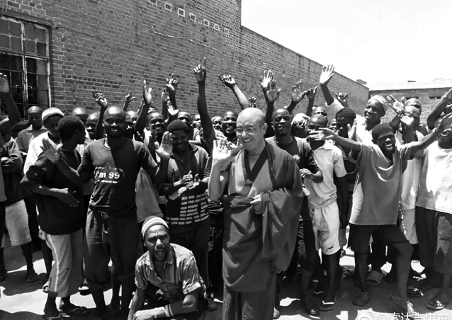

# 第8课

2021年8月7日

听闻《入大乘论》的条件，前面也讲过，大家应该知道。对于密法，大家都比较希求，觉得难得。但现在外面很多人得知在传这部法，就打着各种旗号，甚至以我的名义来做一些事情，这样很不好。

你们若想听法，要先观察哪些是善知识、哪些不是善知识。如果是真正的善知识，具有法相，由他来弘扬也很好。但现在有些人很精明，不管做什么，都会找准人们的兴趣爱好，然后投其所好，在弘法中夹杂各种私利。比如念传承、传法之前，提供各种二维码，成了供养的“方便”，对此大家要注意。

以特别好听的名义来达到个人目的，这种现象从长远来看，不会长久。但暂时而言，他们不管是介绍个人还是团体，确实很会包装，讲起来头头是道，似乎非常真实。有些佛教徒若没有抉择的智慧，会给自他带来违缘和障碍。甚至自己到处推荐的这个人，并不是正面很有名，而是负面很有名，有这个危险性。

另外，我还想说的是，特别感谢发心人员。这个时代，要想学习佛法，不管是显宗法、密宗法，都需要很多人的发心。在此过程中，把所讲的文字记录下来提供给有缘者，确实非常重要。这个工程需要时间和效率，不是那么简单的。做一两节课或一两部法也许可以，但把很多法一如既往地认真完成，确实要付出极大的心力。

包括我讲的个别词句，有些人不一定听得懂，有时候语速比较快，再加上有口音，普通话就会变成“不懂话”，很多人不知道说了什么。但整理文字的人听懂后，将其立成文字，大家一看，“哦，当时有点发音不准，原来是这个，藏族人念这些字是这样念的”，最后会明白我要表达的是什么。当然，我也知道做文字工作要付出很多精力，不然很难达到这样的效果。有人如果听课时不是特别明白，事后反反复复去看文字，对理解法义会比较有帮助。

现在是末法浊世，圆满一部法不是那么容易的。所以，里里外外如果没有大的违缘，我们一定要尽量完成。《入大乘论》已经讲了一部分，除了比较好懂的公案、故事，有些内容比较深，不能讲得特别快。对于这部法，我们能传完就尽量传完；实在不能传完，像《楞严经》一样拖很多年，也不是不可以，凡事都要靠因缘。下周，我想先把《圣大解脱经》剩下的一两堂课完成，然后再讲《入大乘论》。

现在这一品“辩答品”，主要是讲问答，有人提出问题，然后作者回答。其实这样的问答很有意义，因为佛法真理若依靠辩论、推理来证成，有智慧的人就愿意接受。有些人学佛以信心来接受，不一定需要特别多的辩论，而有些人没有信心，有很多怀疑，甚至是邪见和偏见，这种人就必须依靠非常有逻辑的推理，才能心服口服。

在佛教中，辩论是非常重要的，特别是藏传佛教，很好地保留了这一传统，其特点是经得起理论推断。真金不怕火炼，只要是真理，就不怕被人质疑，所以，藏传佛教在当今很受欢迎，因为它的教义能让人信服。

这个时代，人们的分别念比较重，但这些分别念并不厉害，有些怀疑也比较简单，很容易断除。尤其是西方人，喜欢思辨，热衷于提一些问题，接受藏传佛教比较容易。当然，过去西方人信仰宗教，也不是特别喜欢辩论，大多数人是出于信心，并没有像佛教这样，以智慧面对面地互相辩论。

在辩论过程中，对于佛教的教义，谁都没有权力改变。包括各教派的教主，像宗喀巴大师、莲花生大士、萨迦班智达，按照佛所说的道理去解释就可以。佛经的内容不需要改革，并不会随着时代而变化。因为佛陀所揭示的智慧，纵然过了几百年、几千年，也照样可以顺应人心。其他有些宗教不是这样。有些宗教因为各方势力不同，彼此发动一些战争，又产生了一个新的宗教。这时候，他们的经也好、论也好，内容会随之改变，以适应新宗教的宗旨，这种现象并不少见。

不管怎么样，佛教的这种辩论方式，在现代的城市里，在有智慧的人面前，应该可以弘扬得开。只不过弘扬也需要因缘，因缘不到位可能不行。

我去过一些欧美国家，看到佛教在那里的弘扬状况后，特别感动于藏传佛教的很多高僧大德，当初把佛法带去西方。但有点遗憾的是，藏传佛教中因明、中观、密法的思想，这些具有逻辑推理的法，并没有在人群中得以广弘。西方人喜欢修上师瑜伽、接受灌顶，这些当然也很好，但对真理有一些辩论的话，也许更需要。

本品全部是相互问答。作为佛教徒，我们要学会答复一些问题，尤其在有智慧的人面前，令其得到满意的答案很有必要。

昨天讲了一个问题，荣索班智达通过很多故事、公案，把对方的疑惑已经解决了。今天解决第二个问题。

## 关于“因果相续永远不会消失”的辩论

| 还有人辩论说：显现为因果的这些有实法，不仅仅显现为长久稳固，而且因与果的刹那相续不会有朝一日中断、消失，

对方认为因果是实有的。理由是，“种瓜得瓜，种豆得豆”，这种因果关系显现得很稳固。种子和果实、父母和子女这些因果法，显现的时间比较长久。而且因与果的刹那相续，不会有朝一日中断。

这个说法，与因明的观点有些相似。因明认为，心的前后相续会不断延续下去。比如说我是人，死了之后，人的心相续在下一世变成动物，动物的心相续又变成天人……这一世的心传到下一世，相续不会中断。

他们认为，不管是物质的相续，还是心的相续，就像河流一样，会一直不断地延续下去。

为什么呢？

| 因为在清净世间智慧前也显现，假设相续断了，那么也就成了断派。

《现观庄严论》、智悲光尊者的《功德藏》中，经常提到“清净世间智慧”。清净世间智慧不是佛的智慧，也不是一地到十地菩萨的入定智慧，而是菩萨的后得智慧。菩萨出定之后，能看到因果的相续，包括了知众生的相续，所以，相续应该是存在的。如果说不存在，就跟顺世外道断见派没有差别了。

这是对方提出的问题。

如果有人在某个场合这样问你，你不看荣索班智达的回复，只凭自己的智慧回答，会怎么样呢？大家也可以想想。

下面的回答很关键。其实，荣索班智达所讲的每一段内容，对我们日常生活都很有用。听说这次许多人听得比较认真，以前听其他课时，第一堂课和最后一堂课会来听听，中间的课经常迟到、早退、旷课，但他们这次听得比较用心，不知道能不能善始善终。

| 对此回答：出有坏佛陀宣说缘起法，是说如果有因则会生果，如果因缘灭了，那么果也会灭，仅此就是遣除二边的大解脱道，而并没有说“因果相续永远不会消失”。

荣索班智达回答：大慈大悲的本师释迦牟尼佛，确实宣说过缘起法。这个缘起法，说简单也很简单，即“有因则有果，无因则无果”。粗大的因果，农民也知道，“今年种庄稼，明年就有粮食”；牧民也知道，“今年好好放牧，明年就有小牛和牛奶”。而细微的因果，只有佛陀才能照见。

佛陀在《百业经》《贤愚经》《佛说因缘经》《稻秆经》等诸多经典中所讲的缘起法，可以遣除外道的常边和断边，是真正的大解脱道。但是，佛并没有说“因果相续不断”。虽然个别经典从字面上看，好像因果相续一直存在，但实际上不是这个意思。

| 如是出有坏佛陀的所有微妙法典与佛陀的所有遗骨舍利，以及世间的所有典籍与灵塔，以不共的手印印持，即是以缘起咒“耶达玛黑德札巴瓦，黑敦得堪达塔嘎朵哈雅巴达，得堪匝友讷如达，诶旺巴德玛哈夏玛讷”印持一切，就是佛陀的手印印持。

荣索班智达的有些表达，还是很难懂。我觉得这里的汉文稍微好懂一点，藏文更难懂，把每一个词翻译出来不是那么容易的。

它的意思是，佛陀所有的微妙经典，包括第一、二、三转法轮的佛经；佛陀所有的遗骨舍利，八万四千舍利塔；世间所有的典籍，包括文学、哲学、科学；世间所有的灵塔，都以一种不共的手印来印持。

这里的“手印”，并不是用手结的。《大幻化网》在讲手印时，有佛的智慧手印、身语意的手印等很多种。但此处是说，所有佛经、佛舍利，以及世间的典籍和灵塔，都要以佛的不共智慧来加持、印持。印持的方法是什么呢？以缘起咒。

缘起咒是什么呢？就是我们平时常念的“耶达玛黑德札巴瓦，黑敦得堪达塔嘎朵哈雅巴达，得堪匝友讷如达，诶旺巴德玛哈夏玛讷”。后来的大译师们，会在此咒的最前面加上“嗡”字，有祝愿吉祥之意；最后加上“梭哈”，表示祈愿能实现、能达成。所以，前面加“嗡”，后面加“梭哈”，这就是缘起咒[^1]。

缘起咒非常重要，南传佛教、北传佛教、藏传佛教都要念，只不过念诵的方式、发音不同。各教各派也要念，因为它是佛陀最究竟、最甚深的密意精华。而且，在佛陀八万四千法门中，最主要的就是因果法，因果法在缘起咒中讲得很清楚——按照前辈大德的传统，咒语的意思不用翻译，可直接念诵梵文发音，但把它的意思翻译出来也可以。

在汉地，缘起咒的念诵音调不同，吉藏大师、慧远大师等很多大德，在书抄中收集过。在藏地，拉萨人念的缘起咒，跟康巴人、安多人的发音也有点不同。但不管是哪一种念法，都表示佛陀甚深的缘起法。

我们装藏时，需要将缘起咒——最好是梵文或藏文，上下不颠倒地放入佛塔、佛像[^2]。此外，还要有本尊心咒等其他咒语。比如，给文殊菩萨像装藏的话，要放入文殊菩萨的心咒，还有“嗡啊吽”、缘起咒、不共的五部陀罗尼等。如果没有其他加持圣物，可以把这些咒语和一些清净的材料装进去。

值得注意的是，有些商家卖的三宝所依，说是已经装藏了，但并没有真正装藏。龙王宝瓶一打开，里面都是各种石灰；佛像里面的咒语，是上下颠倒的，这样过失很大。所以，装藏的时候，无论是佛塔、佛像，还是其他三宝所依，缘起咒都不可缺少。

念诵缘起咒也很重要。比如，开法会的时候，每天到了下午结座时，要先念字母咒，再念三遍缘起咒，这表示“我修的本尊法，以缘起法来印持，希望能很快成就”。

开光时也要念缘起咒。本来开光仪轨比较广，但若实在没有其他仪轨，先念七遍字母咒，再念七遍缘起咒也可以。当然，严格来讲，开光的人要有一定的修行境界，是出家人更好。在藏传佛教中，除非是证悟者，否则在家人开光的比较少见。

此外，打卦的时候，也要念缘起咒。

包括晚上做了个恶梦，早上醒来后，要念一下空性咒，或者莲师心咒，或者三遍缘起咒，让恶梦依靠缘起法变成吉祥。

修禅定、做善事，最后也要念缘起咒。依靠佛陀的智慧来印持，以不可思议的缘起力，你想什么就成什么，一切如愿以偿。

平时经常念缘起咒，可以忏罪障、开智慧。我翻译过麦彭仁波切的《百咒功德》，共有102个咒语，最后一个就是缘起咒，里面讲了它的很多功德[^3]。

所以，我们要多念缘起咒。如果有条件共修，每人念一万遍或十万遍，大家共修一亿遍，会让整个世间的缘起变得吉祥，所有违缘都变成顺缘。缘起确实不可思议，在世间当中，一切的一切都是依缘起而生。如果缘起好，哪怕干了坏事，最后也会变成善事；如果缘起不好，你做了多少善事，也会变成伤害自他的恶事。

概而言之，缘起咒相当重要，它是佛陀真正的智慧精华。自己以后怎么念、怎么修，每个人应该多想想。为什么这个短短的咒语是佛法的核心呢？接下来可以慢慢解说。

| 它的意思是“诸法因缘生，如来说是因，诸法因缘灭，是大沙门说”，

“诸法因缘生，如来说是因”，是讲由集谛中产生苦谛。整个轮回的因和果，就是集谛和苦谛，这是大慈大悲的佛陀以无碍智慧照见后宣说的，并不是其他人讲的。这是轮回方面。

“诸法因缘灭，是大沙门说”，是讲依道谛来证悟灭谛。轮回的因和缘一旦灭了，轮回的果也会灭。依靠什么来灭呢？依靠道谛来灭，之后现前灭谛。这也是大沙门——我等本师释迦牟尼佛宣说的。这是涅槃方面。

轮回的因果二谛是佛陀说的，涅槃的因果二谛也是佛陀说的。

这个偈颂，藏汉有各种不同的翻译，但比较常见的是这两种译法。

还有一种译法：

| 或者“诸法因缘生，诸法因缘灭，我师大沙门，常作如是说”。

此偈在汉文很多佛经中提到过。

以前，马胜比丘去城中化缘，他的威仪很寂静。舍利子看到后被深深吸引，问他：“你的老师是谁？”马胜比丘回答：“释迦牟尼佛。”“他所传的法是什么？”马胜比丘就念了这个偈颂。

因为前世的因缘，舍利子当下证得法眼。因为他跟目犍连有约，谁先得道就要告诉对方，于是他赶紧告诉目犍连。目犍连听了这个偈颂，也得到了法眼。于是他们一起去皈依释迦牟尼佛。之前目犍连和舍利子是外道，听到释迦牟尼佛的传法后，都获得阿罗汉果。

对舍利子和目犍连来讲，马胜比丘是有恩德的“介绍人”。我们学院的有些人，也是起初连一句佛号都不知道，后来通过其他人的行为和介绍，才开始认识三宝的。

从马胜比丘的故事来看，行为确实非常重要，如果他的行为特别恶劣，容易让人产生邪见，舍利子和目犍连后来不一定会皈依。可见，弟子的行为，某种意义上代表了上师或道场，如果非常粗暴，让人很生厌烦心，别人也会依此推测：“这个人如此霸道，他的上师肯定更凶恶，没有必要去皈依。”反之，如果弟子的行为特别寂静调柔，别人也会对他的上师生起信心。

所以，每个人的行为，不仅仅代表自己，还代表自己的宗教、自己的道场、自己的上师，依此也会引发很多因缘的延续。

这个偈颂，我们以前经常讲。前后两偈的内容基本相同。

| 诸法并不是像世间诸位本师所说的那样由作者所造、

诸法并不是由上帝或真主等主宰者所造的，他们创造世界、养育众生、控制世间。

| 自在天所幻化、

也不是由印度教承许的自在天、梵天所造的。有些天王认为自己是造物主，尤其是自在派有这样的说法。

| 自性所生、

也不是由数论外道承许的自性所生。他们认为，二十五谛法中自性是因，从自性中生出万法。

| 以时间驾驭、

也不是像鸱枭派所说，从时间中产生的。

| 无因而生，

也不是像顺世外道所说，一切都是无因而生。

《如意宝藏论》对360种宗派讲得特别细致，如果有兴趣，你们可以看看。这几年，我把《如意宝藏论》辛辛苦苦翻译出来了，如果想了解佛教显密各派和所有外道的不同观点，论中把他们的见修行果都讲得特别清楚。

总之，不能承许一个“实有的创造者”，上述见解都要舍弃。很多宗教认为有一个造物主，但不管是真主还是上帝，如果去观察：他是如何创造万物的？造物过程是怎样的？他到底是不是实有？可能都经不起观察。

按照佛教的说法：

| 一切法是由因缘所生，这也是如来所说，并不是他人所说。

《中论》云：“我稽首礼佛，诸说中第一。”我们要顶礼佛陀，为什么呢？因为他所说的法在众说中是第一。

这不是我们自赞自夸，拼命说佛陀好了不起。不像现在有些人，赞叹自己的上师时，恨不得把他吹上天，“我上师是最好看的、最慈悲的、最伟大的，他的智慧无与伦比”，但实际上这只是他的自现——在自己境界前显现的，并不是别人有目共睹的。称赞佛陀并非如此，“诸说中第一”，是赞叹佛陀宣讲的缘起法，它揭示了世间万法的创造因缘。

| 任何法的因缘灭了，果就会灭，这也是大沙门佛陀出有坏所说，天等世间中无有其他说此语者。

天上天下没有第二个人能说出这样的真相了。赞叹这一点的话，作为佛教徒，用不着有任何畏惧。佛陀所说的缘起法，是万事万物的因果规律，不管是有信仰的人、没有信仰的人，或是宗教徒、非宗教徒，都不得不承认。

我们能遇到这么好的见解，真的很幸运。否则，一直被遍计思想束缚而自以为是，智慧成熟后却发现很多道理说不过去，只能声称“这是老师说的、这是祖师说的，是不能观察的，它本身就是这样”，没有理证来成立的话，真的很难令人信服。如果对缘起法生起定解，就会明白，只有这样才解释得清楚。尤其是学了《缘起赞》《中观庄严论》《中论》，会对世间因果有更深的认识。

其实这些并不难，深奥的科学原理我们不一定懂，但这个道理只要一讲，大家都听得明白。当然，没有人讲的话，光是自己看书，不一定能真正通达。

| 而佛陀并没有说“因果的相续永远不会消失”。

虽然因果缘起非常重要，但佛陀在了义经典中并没有说“因果永远不空”。

| 解说缘起之义的其他经中也说：世间是以业与烦恼为因造作、产生的，业与烦恼的因灭了，世间也会灭，这也是佛陀了知而宣说的。“不住生老衰败苦、佛自知说胜解脱”的意义也是如此。

确实，《稻秆经》《大宝积经》《毗奈耶经》《杂阿含经》等大小乘的佛经中，都讲过因果。

还有一部佛经中说，若想不住于生老衰败的痛苦，世尊在证悟之后，宣说了殊胜的解脱道。其意义也是承认因果存在。

如果我们学得不深，可能会产生疑惑：“佛一会儿说因果有，一会儿又说没有，到底怎么回事？”

| “诸比丘，此有故彼有，此生故彼生，如是无明之缘生行……产生轮回之蕴。此灭故彼灭，无明灭故行灭……轮回之蕴灭”的意义也是如此，而并没有说“因果的相续永远不会中断”。

另外，声闻乘的经典中，也讲过顺式的轮回因缘：有因就有果，有了无明，就会有行、识、名色、六处、触等，前前的因产生后后的果。

在此不得不提一下，十二缘起法很重要。《杂阿含经》中说，佛陀有一次去城中化缘，路上遇到一个叫阿支罗迦叶的人。他对佛陀说：“我有个问题想请教。”佛陀说：“我现在要到城里去，等回来再给你答复。”但他一而再再而三非要问：“痛苦是自生、他生、共生还是无因生？”佛陀就慈悲地告诉他：“这些都是无记的，没有真实的生。”然后揭示了一切痛苦是“此有故彼有，此起故彼起”，并讲了十二缘起的规律。阿支罗迦叶听完后就得道了。

佛教的缘起法，除了内在的十二缘起，还有外在的缘起，比如从种子到果实，因果也在不断循环。若通达了十二缘起，就能通达佛的教义。《毗奈耶经》中讲过，有一个大国王叫仙道，他送给影胜王[^4]一副宝甲[^5]，价值十亿金钱。影胜王忧愁自己没有上好的礼物回赠。有个大臣见国王面带忧色，就问：“今天您得了这么珍贵的礼物，为什么还闷闷不乐？”

国王说：“这个宝物价值连城，我国没什么奇异珍物作为回报，为此我不开心。”

这个大臣很有智慧：“我国有释迦牟尼佛，是人中妙宝，十方世界无与伦比。”

国王说：“确实如此。你有什么打算？”

大臣说：“我有个建议，画一幅佛像作为回礼，送给仙道王。”

国王听后很高兴：“好主意！那我要先征求佛的同意。”

于是，他去问释迦牟尼佛。佛不但同意，还让他在佛像的下方写上三皈、五戒、十二缘起，在佛像的上方写下厌离生死和希求涅槃两首偈颂[^6]。

影胜王回宫后，按佛陀的吩咐画好佛像、写上法语，然后派人送给仙道王。

仙道王见到佛像后，生起极大的欢喜心。但他连佛的名号都没听过，就问佛到底是谁。旁人告诉他：“这是释迦牟尼佛。他原为净饭王太子，当年是如何修行得道的……”然后又给他广讲了三皈、五戒、十二缘起等。晚上，仙道王一心思维十二缘起的生灭道理，迅速获得了圣果。

所以，十二缘起、四谛、三皈依这些道理特别殊胜。仙道王在特别偏僻的地方，连佛的名号都没听过，但依靠佛的教言也得度了。

在座的各位，以后不仅要在有信仰的地方弘扬正法，更要在佛法不兴盛，连佛陀名号都没听过、佛像都没看过的地方弘法利生。哪怕给当地人念几句“嗡玛呢巴美吽”“嗡班匝儿萨埵吽”，对他们的利益也不可思议。

前几年我去非洲时，看到人们经常处于饥饿中。我专门去了那里的监狱，本想讲些简单的佛理，但在讲的过程中，看到有些人在远处饿死了，有些病得很严重，根本讲不下去。后来为了给他们种下善根，我带大家一起念观音心咒“嗡玛呢巴美吽”。

课前我想找一下视频，但暂时没找到，只找到几张照片——

你看，这是监狱里的人，这是监狱的高墙，他们和我一起唱“嗡玛呢巴美吽”，比我们还开心。监狱里非常简陋，只有一个大院子、几间小房子，小房子里连床也没有。

像这样的地方，我们应该要去弘法，实在不行就造佛像。原本，我很想在非洲造几尊佛像，但当地原始宗教特别排斥，他们有各自的宗教，没有那么容易。

| 遣除二边，是以行者没有迁移而遣除了常边，如云：“讽诵灯镜印，火晶种酸声，令蕴结生者，不迁智当证。”

此偈出自《中观缘起藏论》，麦彭仁波切对此论好像有一个注释。这个偈颂在《智者入门论》中也有。《中观庄严论释》则翻译为：“经忏[^7]明灯镜印章，火晶种子酸与声，蕴结生亦不迁移，智者理当通达此。”

此偈讲了几个比喻：

1．“讽诵”，老师念，让学生跟着念，最后学生也会了，但并不是老师口中的知识迁移到学生的肚子里去了。

2．“灯”，后面的灯用前面的灯点亮，但并不是前面的灯光迁移到后面的灯上了。

3．“镜”，镜中可以显现面容，但并不是面容跑到镜子里去了。

4．“印”，盖章时字会印在纸上，但并不是这些字从印章上迁移到纸上了。

5．“火晶”，火依靠火晶而产生，但并不是火晶跑到火上了。

6．“种”，苗芽从种子中产生，但并不是种子迁移到苗芽上去了。

7．“酸”，我们听到酸的东西会流口水，像望梅止渴一样，但并不是把酸迁移到我们的嘴里了。

8．“声”，我们发出声音在空谷回荡，但并不是我们的声音迁移到空谷里了。

“令蕴结生者，不迁智当证”，我们下一世会结生五蕴，但并不是今生的五蕴跑到下一世去了。不然，这个五蕴从人迁移到天人，又迁移到饿鬼……这会有常有的过失。

那天有个道友讲考《释量论》的“有情受生时，呼吸根及识，非不待自类，唯由身体生”时，前面解释得还可以，但在讲呼吸时，没有讲清楚，所以被我扣分了。后来，女众有个堪姆讲得还不错。其实，众生投生到下一世时，他的呼吸要观待前世的习气，这在阿赖耶上有个细微的缘起。包括在母胎中呼吸，也是前世习气的延续。这个延续并不是完全迁移，不是前世的气息通过某个密道进入下一世，但如果没有前世的习气，又不可能产生后世的呼吸。

这八个比喻很重要。关于前世后世，现在很多人认为要么是常有，要么是断灭，但若懂这种缘起法，众生如何从前世投生到后世，就很容易理解。

不仅如此，还可以观察外境中“种生苗芽”的因果：苗芽没有种子不行；有了种子的话，并不是种子上的一切都转移到苗芽上了。要想解释这些，只有依缘起法才能讲明白。

科学家说，因果的延续靠一种“能力”。那这种能力是什么样的，我们可以分析一下：前面的因，如果能力没有灭，不可能产生后面的果；如果能力已经灭了，更不可能产生后面的果，否则，石女的儿子也可以生子了。

明白了缘起法，什么现象都可以解释。否则，前世今生、因果法则很难安立。

总之，这样的缘起法，可以遣除常断二边。以上讲了行者并没有迁移，以此遣除了常边。

| 是以因缘产生而遣除了断边，如云：“极其细微法，何者抉择断，是为不知者，不见缘起义。”

因为万法依靠因缘而产生，以此遣除了断边。

此偈也出自《中观缘起藏论》。意思是，有些法极其细微，就像刚才的呼吸习气，如果将其抉择为断灭，这种人不懂缘起法，不知道有些法可以延续到后世。

| 而没有解说成“是以因果的相续永远不中断来遣除断边”。

荣索班智达有点反感“因果相续不断”的观点，说这不是大乘的意趣。

| 清净世间的智慧前显现也是一样。诸位菩萨的清净世间智慧前显现，是因为菩萨们仍然还没有灭尽二取的习气。

如果认为“圣者菩萨也看得到因果的相续，所以因果不灭”，荣索班智达说，这是菩萨还没有断所知障，所以觉得因果之间有一种相续。

菩萨能看到众生前世是什么、后世是什么，好像有一种相续。但这是因为菩萨没有灭尽二取的习气，把相似的因缘认为是一种自相的相续，实际上，并没有真实的相续。

| 一切如来具不具有清净世间智慧也有其他安立。

在佛陀的入定智慧中，肯定什么都不成立，那后得是否也有清净世间智慧呢？其他论典中有分析，这里没有阐述。后几品应该会讲到。

| 因此，执著这种宗派的行者，就好比有个像乌鸦一样忧心忡忡的人行走在已开拓好的正轨大道上，见到路基稍有改变，就担心有坑，而跑到路边，结果被荆棘丛扎到。

执著“因果相续不断”的人非常可怜。他们明明走在平坦宽阔的大道上，但就像乌鸦一样忧心忡忡，见到路基稍有改变，就担心前方有坑，非常极端地跑到路边，结果被荆棘扎伤了。

很多经论中经常提到“乌鸦”。乌鸦疑心很重，吃东西的时候害怕有危险，经常在这边吃一口，又跳到那边吃一口，就这样跳来跳去，不像麻雀一样在原地慢慢吃。

我的屋檐下就有一对乌鸦夫妻，今天它们可能正在“装修”，一只在窝外站岗，一只在窝里“咚咚咚”。过了一会儿，又开始换班，一只跑到外面看，一只进去了，不知道在弄什么。有时候，大自然的这些鸟类很有意思。

乌鸦全身漆黑，看起来不太吉祥，但其实它很孝顺。民间有种说法是“乌鸦反哺”，乌鸦的父母年老无法觅食时，乌鸦就会一直喂父母，直到它们去世。人们经常看不起乌鸦，骂人也是“你这个乌鸦嘴”，但实际上，我们讨厌的这种恶鸟特别孝顺。相反，我们很喜欢的喜鹊，看起来黑白相间、非常漂亮，其实最不孝顺——如果父母老了，年轻喜鹊就会把父母杀死，再把肉吃掉。在我小的时候，父母经常说：“你们不孝顺的话，就会跟喜鹊一样。”

人人喜欢的，不一定善良；人人厌恶的，却非常孝顺。这也是世间的颠倒。

| 同样，（诸有实宗行者）本来已经踏上了出有坏如来宣说的“有因则生果、若因缘灭则果灭”遣除二边的大解脱通衢大道，但一直担忧因果的相续断灭而堕入断见，于是跑到执著相续常有的边上，结果扎到了有实见的荆棘丛。

同样的道理，有实宗的所有宗派，从小乘宗到唯识宗再到中观自续派，本来已踏上了佛陀宣说的“有因则有果、因灭则果灭”的大解脱正道，远离了常断二边的邪道。但是，他们一直害怕“承认因果相续断灭，就会堕入断见”，于是跑到另一个极端——执著“因果相续不断”的常见，最后扎到了有实见的荆棘。

通过分析比喻和意义，我们对任何法都不要执著为实有，如果认为因果之间有一个永远不断的实有相续，就会被破得体无完肤。佛陀真正的缘起法，是“有因则有果、因灭则果灭”，这是非常甚深的。依靠这样的道理，空性法也是可以建立的。

若想通达缘起法，我们要多祈祷诸佛菩萨、传承上师。如果明白了“因果虽然不虚，但现而无自性”的缘起规律，就会远离常断二边戏论，逐渐通达缘起性空。如果通达了缘起性空，就会圆满所有的地道。所以在这方面，大家应该努力地学习和修行。一旦自己稍微有点定解和能力，应该把这些智慧传给有缘的众生。

[^1]: 缘起咒：嗡 耶达玛黑德札巴瓦 黑敦得堪达塔嘎朵哈雅巴达 得堪匝友讷如达 诶旺巴德玛哈夏玛讷梭哈。
[^2]: 《浴佛功德经》：“诸佛世尊具有三身，谓法身、受用身、化身。我涅槃后，若欲供养此三身者，当供养舍利。然有二种：一者、身骨舍利；二者、法颂舍利。即说颂曰：诸法从缘起，如来说是因；彼法因缘尽，是大沙门说。 若男子、女人、比丘五众应造佛像。若无力者，下至大如䵃麦，造窣覩波形如枣许，刹竿如针，盖如麸片，舍利如芥子，或写法颂，安置其中。如上珍奇，而为供养，随己力能，至诚殷重，如我现身，等无有异。”
[^3]: 《净除业障百咒功德》：“此缘起咒是一切善逝的法身，谁见缘起即见善逝。哪怕是将它放在柚柑子大的小佛塔当中，今生中也能生起梵天福德。持诵一遍此咒能清净一切罪业，平息、遣除一切违缘，如果观想任何事物而诵，相当于造佛像或佛塔。若观想任何供品而诵，则等于供养遍满世间界的供品。如果恒时念诵，则圆满一切心愿，任何损害也不能侵害，完整受持一切正法。如果诵十万遍，那么将如愿实现一切所求之事。在它的各种事业仪轨中也有宣说。大圆满系解脱咒中说，这也是能获得化身安住相续解脱的心咒。总之，一切如来的手印，犹如诸法的生命一般，功德不可思议。”
[^4]: 影胜王：世界上第一个造佛像的人。
[^5]: 宝甲具有五德：一者盛热之时着便凉冷，二者刀斫不入，三者箭射不穿，四者善辟诸毒，五者能发光明。
[^6]: 《根本说一切有部毘奈耶》：“佛言：大王善哉妙意！可画一铺佛像送与彼王，其画像法先画像已，于其像下书三归依，云：我从今日乃至命存，归依佛陀两足中尊、归依达摩离欲中尊、归依僧伽诸众中尊。次书五学处：一不杀生，二不偷盗，三不欲邪行，四不妄语，五不饮诸酒。次书十二缘生流转还灭，所谓此有故彼有，此生故彼生，从无明缘行乃至积集而生。此无故彼无，此灭故彼灭，从无明灭乃至积集俱灭，皆广书之。复于像上边书其二颂曰：汝当求出离，于佛教勤精；降伏生死军，如象摧草舍。于此法律中，当修不放逸；能竭烦恼海，当尽苦边际。”
[^7]: 经忏：日常讽诵的经文。
