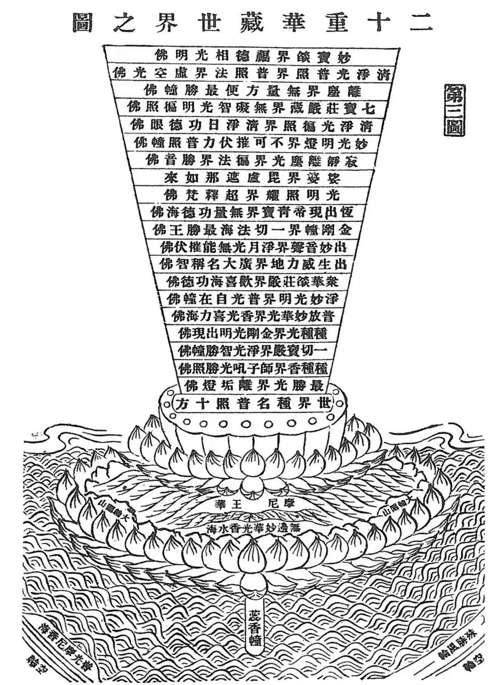
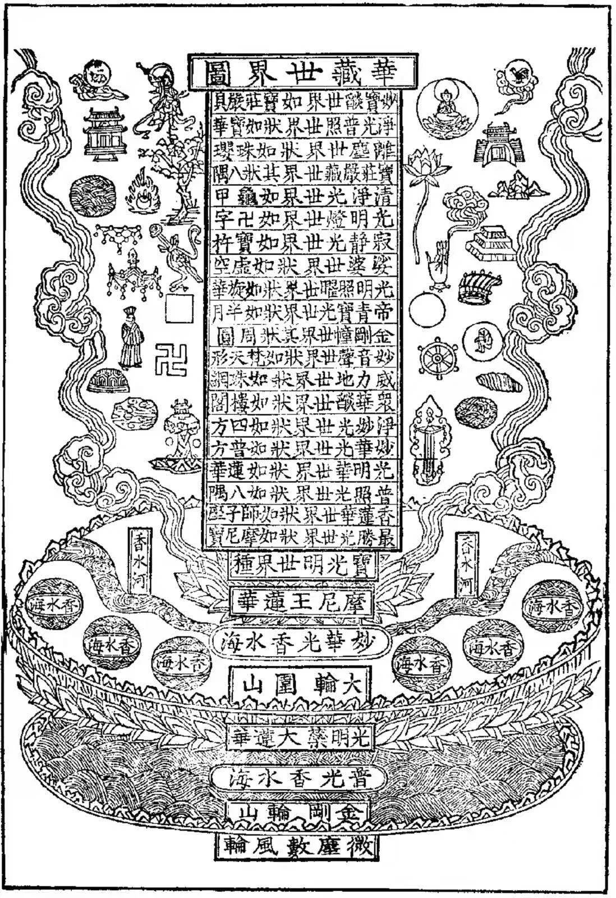

# 第4课

2022年4月25日

我们正在讲《七宝藏》之一的《如意宝藏论》。

无垢光尊者在撰著《如意宝藏论》的时候，特意将它交付给三大护法神。当年，他在刚日托嘎造《七宝藏》，三大护法神亲自到来，有些磨墨，有些做笔，然后跟尊者一起笔录。所以，《七宝藏》是护法神特别保护的法。

## 守护清净的誓言

这次听课的金刚道友，一定要守护誓言。由于时间太紧，我们在课堂上没有特别做忏悔，也没有特别供护法——因为基本上每天都在供。但过一段时间，共修的金刚铠甲咒念完以后，大家还是要好好念金刚萨埵心咒。不然，我担心你们——包括我自己在内，在誓言方面会出问题。

堪布阿琼说：别解脱的戒律依靠身体和语言，比较简单；菩萨戒依靠心的善与不善，所以要难一点；密宗的誓言全部安立在觉性智慧上，我们的心如果不清净，很容易破誓言。

尤其是金刚道友之间，一定要和合。这次听《如意宝藏论》的人，我没有其他条件，唯一要求与金刚道友和睦相处。和道友打架、吵架或不说话的人，最好不要听。

不管你是什么身份，凡是这次听课的，包括以后听音频的，都必须守护誓言。护法神的慧眼时时都在盯着我们，谁也没法隐藏任何事情。这里人多，关系也复杂，个人也好，集体也好，都难免发生一些事情。万一有什么，当天务必忏悔清净。不然，我会比较担心。

藏地很多上师，为了保护自己，都不太敢讲《七宝藏》。当初学院开《七宝藏》课，那么多堪布，这个不敢讲、那个不敢讲，最后密法部分只有请丹增活佛出来讲。所以，我有时会问自己：“直接讲《七宝藏》，会不会有点危险？”

今年的情况，不知道会怎样。总之，你们不要把《七宝藏》看成一般的法，否则我会非常担心。很多情况一定要注意。

以前，法王如意宝讲《法界宝藏论》和《窍诀宝藏论》的时候，一再提到：虽然密宗的誓言有千千万万，但主要还是与金刚上师身语意有关的誓言。对金刚上师与弟子之间、金刚道友与金刚道友之间的誓言，法王如意宝尤其重视。

以前，像这样的传法场合，凡是破密宗誓言的人，无论如何都不能参加。传法或灌顶的坛城里面，如果有一个破誓言者，所有的修行人都会被毁坏，就像一只老鼠有传染病，一窝老鼠都会被毁坏。这话是恩扎布德说的。

这方面，我自己会注意，也会忏悔，希望你们也能这样。虽然在课堂上，我们没有时间专门做忏悔、供护法，但大家在听《如意宝藏论》期间，自己一定要念一些长的忏悔文，或念金刚萨埵心咒、百字明等。

下面我们开始学习《如意宝藏论》。

在末法浊世，听闻大乘佛法非常不容易。像《如意宝藏论》这样显密圆融的法，尤其难得。所以大家听课的时候，要有希求心和欢喜心。

我最初的发心是，听闻的人越多越好。但由于因缘的变化，现在只有一部分人能听。正在听受的道友，将来如果能圆满，那是最好的。哪怕只听一部分——现在第一品已经听完了，再继续听第二品，也非常好。

《如意宝藏论》确实是一部佛教百科全书，把器情世界、净与不净等重要的佛教思想，阐释得非常清楚。

平时，我们应该经常祈祷无垢光尊者。我以前翻译过尊者的传记，可惜比较略。无垢光尊者虽然很伟大，但可能弟子们不够重视，所以传记这么简略。如果只看传记，尊者跟其他大成就者好像没什么差别。真的，麦彭仁波切和无垢光尊者的传记，还不如现在有些人的传记广。现在很多人自己给自己写传记，让人读了以后，感觉他比两位尊者还厉害。

学过麦彭仁波切和无垢光尊者论典的人应该知道，他们的智慧也好，大悲心也好，对觉性的直指也好，对我们确实有一种不共的缘起。所以，我们应该在无垢光尊者像前，经常祈祷。虽然像只是一种外在的幻化，但依靠它，也能引出自相续不可思议的实义。

《如意宝藏论》主要讲应舍的轮回和应取的涅槃。第一品讲了轮回的显现之基。接下来，第二品继续讲显现的庄严刹土。

关于本基，大德们有不同的看法。有些人说，最初的本基就是如来藏；也有些大德认为，最初的本基没有分轮回和涅槃，但如来藏并不是本基，它是轮回和涅槃显现的基础，算是一种基现。就像《宝性论》中所说，如来藏是轮回和涅槃的基，是在本基之后的显现。

总之，第一品讲了轮回或器情世界的本基是什么。接下来讲，这样的本基可以显现什么样的世界呢？

学懂了《如意宝藏论》，对大乘佛教的不共教理会非常清楚。

## 第二品 庄严刹土

> 戊二（宣说显现之世界）分二：略说总别能化刹土；广说分别娑婆世界。

> 己一（略说总别能化刹土）分三：略说能化刹土与本师显现之理；广说彼等；宣说彼等之摄义及于彼生信之功德。

> 庚一、略说能化刹土与本师显现之理：

所化是众生，能化是佛刹和本师。一个是刹土，一个是佛陀，二者都是能化。

那天我讲过，这次我只讲颂词，传承也只念颂词。你们至少在一个礼拜内，把前面三堂课的注释看完。如果没看完，那就自觉一点，星期一不要听了。我今天再次提醒，下一堂课要看看谁没有看完。如果以上颂词的注释一遍都没看，暂时就不要听课了。

> 如是三界轮回中，以佛大悲庄严刹，

> 成众生利如宝珠，引导从有至寂灭。

前面讲到，三界轮回是依靠三种习气显现的。如是显现的六道众生，像微尘一样多，他们依靠什么得到救度呢？依靠“大悲庄严刹”。佛陀会以自己的大悲力，安置庄严的佛刹来度化众生。阿弥陀佛的极乐世界也好，毗卢遮那佛的刹土也好，东方不动佛的刹土也好，都是佛陀以大悲力显现的。

有了刹土以后，佛陀就像如意宝珠一样，开始成办众生的利益。只要众生祈祷，自然就赐予一切所需，根本用不着以“我要利益众生”的粗大分别心来驱使。《华严经》中讲，佛的刹土不可思议。依靠庄严的刹土，依靠特殊的缘起力，佛陀利益众生非常容易。

十方佛陀的事业，都是将众生从三有轮回引至寂灭涅槃的究竟果位。他们能了知众生的种种意乐，并用适合的法门度化他们。佛陀度化众生的法门如虚空界，各种各样，数不胜数。在多如微尘的可怜众生前，佛陀会化现林林总总的刹土和化身，广兴利生事业。

《华严经》中云：“不动于本座，一念游十方，无量无边劫，常化诸众生。”佛陀安住在自己的境界中如如不动，并在一刹那间遍游十方刹土，于无量无边的劫数中，以大悲力度化众生。所以，众生虽然可怜，但有佛陀度化他们，我们也不用特别担心。

有时候，佛法好像已经隐没，众生的相续越来越粗暴，肯定会在无边无际的轮回继续流转，这种情况怎么办？下面就讲这个问题。

> 普天众生诸刹土，三时佛陀行大利。

在遍天下的刹土中，不清净的众生无量无边，任何数字都没办法统计。为了度化种种刹土的种种众生，过去佛示现了无数的方法，现在佛幻化了无数的方便，未来佛会兴起无数的事业。就像大海离不开波涛，只要有所化的众生，佛陀的悲心和事业就永远不会间断。所以，不用担心。

> 此刹本师调化法，暂时汇集尽宣说：

关于娑婆世界本师调化众生的方法，无垢光尊者暂时汇集了一些教理，尽可能细致地给大家宣说。这相当于第二品的立誓句。

娑婆世界的本师，可以说是释迦牟尼佛，也可以说是贤劫千佛、毗卢遮那佛或与我们有缘的七佛[^1]。有关这些本师调化众生的方法，无垢光尊者在这里暂时宣说。

为什么说“暂时”呢？可能无垢光尊者的意思是，以后如果因缘具足，还可以在别处宣说。有时候我们也会说：“本来还有很多话要讲，但暂时就讲这些。”本来，无量刹土有无量的庄严、清净，可以展开细说，但暂时只是把这方面的教理汇集起来，把我们娑婆世界的本师调化众生的道理讲清楚。

学了《如意宝藏论》以后，在一般的显宗课上听不到的很多道理，大家都会明白。里面的很多内容，都是其他论典根本没有的。如果分析，它们完全符合显密的甚深教义。

以上是略说，下面是广说。

> 庚二（广说彼等）分二：广说刹土；广说本师。

> 辛一（广说刹土）分二：总说三身刹土；别说基藏花严刹土。

> 壬一、总说三身刹土：

> 本师如意普贤性，无始之时证菩提，

麦彭仁波切的科判造得很好。先总说三身刹土。

第一个是法身普贤王如来。普贤王如来在无始无终之时，就已经证得菩提，是智慧法界无二无别、显现像如意宝一样的本师佛陀。

在大多数人的概念中，普贤王如来是有着蓝色身体的一个佛陀。没有看到别的论典怎么说，但我个人的观点是：所谓的普贤王如来，其实是本基中出现基现的时候，第一刹那以六种特点获得证悟的利根者，并非只有一个——任何一个众生，只要在本基中显现基现的第一刹那，以自证的方式获得成就和菩提，就可以称为普贤王如来。

从法性的角度，并没有具体的数字可言。任何时候，凡是以自证的方式获得菩提、从来没有漂泊过轮回的利根者，就叫普贤王如来。这是普贤王如来在本体中的觉悟方法。

这里“无始之时”，有时候指大圆满讲的“本基”——从本基当中出现基现的时候，既可以说无始，也可以说有始，它并不是一个实有的东西。这个时候现证菩提的，就是法身普贤王如来。

> 法身任运成报身，化意语身三菩萨，

从清净的法身中，任运自成地显现出五部报身。《大圆满心性休息》和《法界宝藏论》对报身都有很多分析。

先从法身中显现五部报身，再从报身中显现化身——我们的本师释迦牟尼佛就是化身佛，然后化身又显现出许许多多的化身，比如投生化身、种种化身、殊胜化身等——其他论典有讲。

在我们娑婆世界，有身、语、意三位化身菩萨。藏文本中的次第是意、语、身，不知道无垢光尊者有什么密意。意化身是大势至菩萨，语化身是观世音菩萨，身化身是文殊菩萨。三位化身，就是我们经常说的三怙主。

在藏地，各个神山都是三怙主的神山，一些大德和国王也都是三怙主的化身。其实，任何地方都有三怙主的化身。汉地也会说，某大德是文殊菩萨的化身，某大德是观音菩萨的化身，某大德是大势至菩萨的化身，等等。

三位菩萨，一位表示智慧，一位表示悲心，一位表示力量。智、悲、力是佛陀最主要的功德。要利益众生，有智慧没有悲心不行，有悲心没有智慧也不行，智慧和悲心都具足，没有力量也不行。佛陀的智悲力都已经圆满。

经常祈祷这三位菩萨，能开智慧，具足悲心，拥有利益众生的强大力量，不会被各种违缘摧毁。所以，我们要多祈祷三怙主。

> 于六趣处利有情，无始无终久远住。

法报化三身，尤其是化身，会在无边无际的六道轮回中，显现各种各样的形象，无始无终地利益有情。虽然佛陀也有降生、涅槃等无常相，但那都只是示现。实际上，轮回未空之际，佛陀利益众生的事业永远不会完结。

《华严经》中说：“佛身充满于法界，普现一切众生前。”佛陀的身相充满各个世界，普遍显现在一切众生面前，以各种形象来利益他们。《入楞伽经》中云：“依法身有报，从报起化身，此为根本佛，余皆所化现。”依靠法身显现报身，从报身显现化身——就像《现观庄严论》中讲的那样，法报化三身是佛陀的根本体相，其余的种种身相，全是三身化现出来的。

一般来讲，佛的法身有二十一种无漏法[^2]；报身有三身五智、五部如来等显现；化身的身体具有相好圆满，智慧有尽所有智和如所有智，语言有六十种梵音。佛以这种种功德来利益众生。

科判先从三身刹土说起，让我们大概地知道，佛陀度化众生的能化刹土是怎样的。

> 壬二、别说基藏花严刹土：

我们以前在学院闻思的时候，每个人都拿一个长条的藏文书夹，抱在怀里。现在很多人都拿一本书，揣在包里。我这个书夹，在法王面前用了很多年，自己觉得上面有法王的加持，一直舍不得洗。天气热的时候带着它，路上的人可能会往这边看：“什么东西？”是有点脏，嘿嘿。

下面别说基藏花严刹土。这里的花严刹土，跟汉传经典中的华藏世界比较相似。

> 尤利娑婆世间界，法身界中密严刹，

> 自现光明射五光。

这里是讲华藏世界的报身刹土。汉地的唐密也好，藏密的事续和行续也好，都经常提到毗卢遮那佛。汉地有些寺院，到现在也比较重视毗卢遮那佛。

关于毗卢遮那佛和释迦牟尼佛，藏地有大德说无二无别，也有大德说是别别他体。实际上，他们都是所化面前的显现，只不过一个是报身，一个是化身。虽然索巴派和无垢光尊者代表的康巴派，具体观点有差别，但两派都承认毗卢遮那佛在五部佛的中间，是报身的代表，从中显现了化身释迦牟尼佛。

法身普贤王如来、报身毗卢遮那佛、化身释迦牟尼佛，这是娑婆世界比较通用的称呼。

报身刹土华藏世界是什么样的呢？

“尤利娑婆世间界”：佛陀尤其要利益娑婆世界。

“法身界中密严刹，自现光明射五光”：法身幻化出无量无边的报身密严刹土，报身刹土又放射出无量无边的光芒。这句偈颂没有讲化身。实际上，报身毗卢遮那佛在密严刹土中，放射无量无边的光芒，幻化出无量无边的佛和菩萨。

按照《大幻化网》的说法，此处佛和菩萨都是自现，所以毗卢遮那佛是在自己的境界中显现了无量无边的佛菩萨，并不是他现。如果是他现，具有不同相续、别别他体的人，完全可以看见。

毗卢遮那佛在密严刹土，以自现的方式幻化了诸佛菩萨。就像普贤云供一样，法身显现无量的报身，报身再显现无量的光芒，每一个光端又显现无量的刹土，然后在无量的刹土中利益无量的众生。

毗卢遮那佛在密严刹土中自现的五色光芒，可以说是五部如来的显现。

唐密也好，华严宗也好，对毗卢遮那佛和华藏世界都比较重视。有关华藏世界的修法仪轨，跟共同乘的提法有所不同——实际上也没什么差别。在藏地，外密的仪轨中有很多这样的修法。

《梵网经》里也提到一个华藏世界[^3]。经中讲了释迦牟尼佛到华藏世界见卢舍那佛，然后到兜率天，为天人说《魔受化经》后，随即下生南赡部洲利益众生的过程。跟这里的华藏世界有一定差别。

《梵网经》中的说法，可以看成世尊成佛之前的一种示现。当然，按照密宗不共的说法，佛陀先是在尼连禅河安住于三摩地，把身体放在河边，到达密严刹土现证圆满菩提，之后再降到人间，在金刚座示现成佛，利益众生。

这里讲到了佛的世界，大家应该记住。

以上按照麦彭仁波切的科判，广讲了刹土，包括三身刹土和花严刹土。接下来广说本师。

> 辛二（广说本师）分二：总别刹土本师显现之理；断除于彼之疑虑。

无垢光尊者经常在自己的著作里面，加入一些辩论和密宗的内容。即使讲显宗的法，他也会把相关的密宗道理讲得很清楚。

> 壬一、总别刹土本师显现之理：

> 受用圆满身近依，宝莲花藏庄严刹，

> 花基花藏庄严刹，等同百万娑婆界，

> 尘数刹土严彼国。

报身毗卢遮那佛所依靠的是什么世界呢？依靠的是宝莲花藏庄严刹。因为如同珍宝的莲花瓣，所以叫“宝莲”。因为像莲花一样清净、圆满，整个世界以花为庄严，所以叫“华藏”。对此，注释中也有解释。

宝莲花藏庄严刹，又叫做花基花藏庄严刹，它的范围非常大，等同百万娑婆世界极微尘数的庄严刹土。所谓的华藏世界，并不是像加拿大等某个发达的西方国家那样。

按照显宗的说法，在我们娑婆世界，日、月、四大部洲，包括欲界天和梵天在内，为一个小世界。一千个这样的小世界，叫做一个小千世界。一千个小千世界，叫做二千中千世界。一千个中千世界，叫做三千大千世界。释迦牟尼一个化身佛的所化刹土，是三千大千世界，并不只是我们南赡部洲。十亿个日月四洲世界加在一起，才是一个娑婆世界[^4]。百万个娑婆世界的极微尘数庄严刹土合起来，叫做华藏世界。

学习《如意宝藏论》，要有一颗广大的心，因为里面有太多不可思议的世界。其实，我们如果学过天文学，接受起来也很容易。既然浩瀚的宇宙有数不清的类似银河系的星系世界，佛教宣说的超越普通人寻伺分别的不可思议的佛刹境界，为什么不能存在？大家千万不要用针眼般的分别念，来衡量不可思议的诸佛刹土。

凡夫人的分别念非常有限。不要说别的，我们天天拿在手里的手机，虽然里面的操作系统都是凡夫人开发的，但对我们来讲也不可思议——这么个小小的东西，怎么能装下这么多的视频、音频、书籍？缘起真的不可思议。

以凡夫人的思维模式，都能开发出不可思议的东西；浩瀚无垠的华藏世界或娑婆世界，超出我们的认知又有什么奇怪的呢？

《六十华严》和《八十华严》都描述了华藏世界。现在一些寺院，还专门画了华藏世界图。《华严经》中云：“是故莲华藏，世界海庄严。一切虚空界，光明遍充满。”华藏世界如海一样，庄严着整个法界，光明遍照十方虚空。这些大乘经典的教义，真的不可思议。以后，你们可以多研究一下。

《华严经》中还说：“一一微尘中，有无量佛刹，一中知无量，无量中知一。”《普贤行愿品》也讲：“一尘中有尘数刹，一一刹有难思佛。”对我们而言，一个微尘那么小，里面可能有东西吗？实际上，一个小小的微尘中，可以有无量的刹土，无量的刹土中有无量的如来，无量的如来有无量的眷属，无量如来和无量眷属能度化无量世界的无量众生。

听起来，我好像在讲神话故事，如此浩渺的世界，分别念确实很难理解。但随着闻思的不断深入，我们会逐渐接受不可思议的华严世界，并由衷地赞叹：“哇，真的不可思议！”

在实相的世界里，有太多的“不可思议”，比如，佛的刹土不可思议，佛的功德不可思议，佛的加持不可思议。对这些“不可思议”的境界生起定解非常重要，因为实相即是如此。

两千多年前，人类文明还处于低级阶段，释迦牟尼佛就依靠自己的智慧，提出了“宇宙中有无量世界”的观点。而随着现代天文学的不断发展，这个观点也不断得到印证。喜欢研究的道友，可以比较一下毗卢遮那佛的华藏世界与现代天文学的世界观，看看二者有什么异同。

在汉地，有很多大德在讲《华严经》，有的一讲就是五年，甚至更长的时间。我们也应该培养自己讲法、闻法、研究佛法的善妙习气。

凡夫人身上有很多不好的习气，要尽量断除。对贪嗔痴等烦恼习气，要想办法强迫自己改正。比如，“我的心一定要善！如果生了一个不善的念头，我就狠狠地惩罚自己！”以一种猛厉的手段来斩断相续中的恶毒习气。

所谓的闻思，并不是坐在听法的行列中，一边吃，一边睡。时间平等地流逝，有些人通达了佛法的奥义，有些人非但没有通达，自相续反而越来越粗暴——这样白来世界一趟，非常可惜。

对甚深的大乘教义，大家一定要好好学习。以后还有没有这样的机会，确实很难说。

我经常在想：作为佛教徒，拜拜佛，烧烧香，求求保佑，并不是很难；依止一个善知识，聊聊天，灌灌顶，得点加持，也不是很难。难的是什么？静下心来，探究大乘佛教的甚深奥义。这是最关键的一个问题。

所以，大家现在应该好好求学。你们很多人都比较年轻，年轻的时候遇到深法，晚年也许会有一些弘法的机会。即便没有机会，对外面的器情世界和内在精神世界有了一定了悟，也会成为人生最珍贵、最有价值的收获。

接下来讲：

> 彼中毗卢遮那佛，以跏趺坐覆莲茎。

毗卢遮那佛在宝莲花藏庄严刹，身体覆盖莲茎，以金刚跏趺的坐式，如如不动地坐在华藏世界庄严的莲花上。毗卢遮那佛是圆满的报身，代表五部佛。

> 彼佛所有毛孔中，降香水流上佛土，

> 无数离诠严利众。

毗卢遮那佛的每一个毛孔，都降下无数的香水，变成无数的刹土，以远离能诠所诠的方式，利益无量无边的众生。这也是一种不可思议的显现。

在宝莲花藏庄严刹，毗卢遮那佛身上流出香水，香水变成无量的世界，无量的世界有无量的如来，无量的如来以远离能说所说的方式，庄严和利益无量无边的众生。

此处讲了毗卢遮那佛的身体降下香水，化现刹土、利益众生的情况。

> 等印之上香水海，广大莲茎巨蕊上，

> 一一刹有无量刹。

毗卢遮那佛双手结等印，等印上面有一个香水海，海中有一株巨大的莲花，莲花上有层层叠叠的花瓣，花瓣中央有巨大的花蕊，花蕊上的每一个刹土，都由无量的刹土所庄严。

注释中说，在花蕊的上面，上下以层叠的方式，共二十五层。意思是，以花蕊为基础，一层一层上去，一共有二十五层。并不是花蕊的上面有二十五层，下面有二十五层。

毗卢遮那佛结的等印上面有香水海，海上有莲花，莲花上有许多花瓣，花瓣中间有花蕊，花蕊上有无量无边的刹土，利益无量无边的众生。

大家不要认为是：毗卢遮那佛双手结等印，中间有一个钵盂，钵盂里面只有一个二十五层的花蕊，除此之外，什么都没有。不是这样的。毗卢遮那佛的莲花花蕊上，有无量无边的佛刹。

这跟我们平时的世界概念有点不同。

除了显宗《华严经》等很多经典有宣说，《胜乘宝藏论》第一品讲能化的十二圆满佛陀，第二品也讲到了华藏世界。我记得里面引用了《应成续》《珍珠鬘续》中的教证。可见，了义续部也有华藏世界的说法。

《胜乘宝藏论》的内容有二十五个分类，但名称没有用“品”，而是说有二十五层高楼，第一层是能化的佛陀，第二层是华藏世界。讲法跟这里基本相同，只是比《如意宝藏论》要略一点。

> 尤其中央花蕊上，二十五层三千界，

> 彼此无数如锦氅。

尤其在中央的花蕊上，二十五层刹土的每一个层，都有和娑婆世界一样的三千大千世界，形态种种，色彩斑斓，并自现无量的佛陀和众生。

我们很难想象这样的世界。西方人对华藏世界的庄严比较感兴趣。现在有些历史学家或编电影、搞艺术的人，也觉得华藏世界不可思议。很多描绘龙宫、天界的电影，编导们也大都运用了不可思议的佛教理念。

这里说，毗卢遮那佛结的等印中间有香水海，香水海上有莲花，莲花的花蕊上有二十五层刹土，每一层都有一个三千大千世界，由无数的世界所庄严。

“彼此无数如锦氅”，总共有二十五层，每一层的世界都有种种不同的颜色和形状，就像锦氅一样。锦氅就是锦缎做成的大氅，五颜六色，图案和花纹各不相同，看起来特别华丽。有些图上画的华藏世界，二十五层世界全都一模一样，并不是这样的。

汉地《华严经》讲的华藏世界有二十重——这里是二十五层，我选的这两张图，稍微有点差别：一个有如来的名号，一个没有如来的名号。古代的佛经，有一部分是由木刻印刷的，这两张图都是木刻版。《华严经》和《如意宝藏论》都承许，第十三层是娑婆世界，只不过上下世界的名称有些不同，尤其是第一层和第二层。

对不可思议的二十五层世界，我们应该以不可思议的信心来接受。《宗镜录》说：“如莲华藏世界中境界，尽作佛事。以是智境，非情所为。”意思是说，佛在华藏世界的境界中，所做的一切佛事，都是为了利益众生。这样的智慧境界，不是凡夫分别念能行持的。

作为凡夫众生，我们刚开始接触华藏世界，可能会接受不了。但只要不断地学习，慢慢地理解，尤其是多看《华严经·毗卢遮那品》，以及唐密的一些仪轨和修法，最后对不可思议的华藏世界，自己心里会比较清楚，也比较能接受。

下面简单介绍华藏世界的二十五层“高楼”。

> 第一祥生普明刹，

毗卢遮那佛手中的第一层世界，是祥生普明刹土，无垢灯如来在这里居住。注释把每一层世界的如来名都列了出来。

> 第二莲花庄严刹，

第二层世界叫做莲花庄严刹土，有狮子净光如来住世。

> 第三宝饰庄严刹，

第三层是宝饰庄严刹土，有金刚光如来住世。

> 第四英花遍布刹，

第四层是英花遍布刹土，有喜光力佛住世。

> 第五众善清净刹。

第五层是众善清净刹土，有吉祥王佛住世。

> 第六层为繁花刹，

第六层叫为繁花刹土，住着声自在如来。

> 第七真生威严声，

第七层是真生威严刹土，有智海如来住世。

> 第八妙音流布刹，

第八层是妙音流布刹土，住世的如来是威严无敌佛。

> 第九金刚胜幢刹，

第九层是金刚胜幢刹土，有圣王如来住世。

> 第十层为大日刹，

第十层是大日刹土，有法性无量佛住世。

> 十一光明色刹土，

第十一层是光明色刹土，住世的是梵王如来。

> 十二清净光刹土。

第十二层叫做清净光刹土，住有光严如来。

从第一层开始，一层一层往上，每一个刹土都有如来居住。我们的娑婆世界在哪里呢？在第十三层。

但今天不讲娑婆世界，明天再说。

[^1]: “七佛”即：过去庄严劫末的毗婆尸佛、尸弃佛、毗舍浮佛，现在贤劫初的拘留孙佛、拘那含牟尼佛、迦叶佛和释迦牟尼佛。
[^2]: 法身二十一种无漏法，即：三十七菩提分法、四无量心、八解脱、九次第等至、十遍处、八胜处、无诤、愿智、六神通、四无碍解、四一切种清净、十自在、十力、四无畏、三不护、三念住、不忘失法、永离随眠、大悲心、十八不共法和一切相智。
[^3]: 《梵网经》，佛教大乘戒律经典，后秦鸠摩罗什译，有上下两卷。上卷叙述释迦牟尼从第四禅擎接大众到莲华台藏世界见卢舍那佛，问一切众生以何因缘得成菩萨十地之道，所得果是何等相，以及卢舍那佛为说菩萨修道阶位四十法门。下卷述说释迦牟尼受教已，示现降生、出家、成道、十处说法，于摩醯首罗天王宫，观诸大梵天王网罗幢，因说无量世界犹如网孔，一一世界各各不同，佛教法门亦复如是。
[^4]: 《阿毗达磨俱舍论》：“四大洲日月，苏迷卢欲天，梵世各一千，名一小千界，此小千千倍，说名一中千，此千倍大千，皆同一成坏。”
