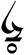

# 第64课

2025年10月8日

今天，我们开始讲《如意宝藏论》的第二十品，也就是光明修行的正行。

现场的所有道友，以及通过视频、音频听课的佛友，都必须得过无上瑜伽的灌顶，并发誓将来修完加行。如果没有得过灌顶，最好不要听后面的内容。否则，可能给自己带来麻烦，甚至受到护法神的惩罚，对自他都没有利益。请大家务必按要求来。

今天这堂课，是《如意宝藏论》最重要、最甚深的部分，都是直指心性的教言。就我个人而言——前面也讲过，根本没有资格宣讲这样的直指法。但无论如何，我希望能借此机会，创造一个善妙的缘起。

无垢光尊者在这里开示的道理，很难用语言表达，我只能为大家念诵一遍——仅此而已。如果你自己有信心，最好认真对待，好好学习注释的内容和后面的引导法。对密法和传承上师有信心的人，依照后面的实修引导法实地修持，一定会得到传承上师的加持，从而认识自心的本来面目。

## 第二十品 光明修行

> 复如何修正行法。

前面的共同加行和不共加行，我们都已经圆满了。在思所生慧部分，完成了共同五加行；在第十九品，又完成了三个不共加行——若将生圆次第分开算则有四个，即皈依、发菩提心、生起次第和圆满次第。

法王如意宝的《文殊大圆满》中，不共加行包括皈依、发心、积资净障和上师瑜伽；正行则分为圆满次第与大圆满。生起次第并不明显，只是在仪轨中略有体现。圆满次第主要讲风、脉、明点的修法；而大圆满则有不共的前行、正行与后行。这里的修法与《文殊大圆满》略有不同。

所有的共同与不共加行圆满之后，接下来就该修持正行了。正行分为略说与广说。先讲略说。我们下面要学习的，是《如意宝藏论》最甚深、最精华、最核心的内容。

> 壬二（正行）分二：略说；广说。

> 癸一、略说：

> 初于寂静悦意处，诸前行法渐圆满，

> 即修正行光明智。

莲花生大士的密宗道次第修法中，《珍宝鬘》非常重要，主要讲寂止和胜观的修法。里面强调，应当选择远离散乱、环境悦意、令人心旷神怡的山林静处。无垢光尊者也说，在开始修正行之前，要找一个适合闭关的寂静地方。

前行修法包括皈依、发菩提心、生起次第、圆满次第和上师瑜伽。无论修什么法，上师瑜伽都极为重要。你们这次闭关，也要好好修上师瑜伽。如果上师瑜伽已经修好了，正行就可以修《如意宝藏论》的实修引导文。

修法不一定只有一个。如果修某个法不顺利、不成功，可以尝试一下其他法门。诸佛菩萨传下来的引导文，有各种善巧方便。

前行法圆满以后，就可以逐渐修持光明正行的大圆满，也就是“修正行光明智”——以寂止和胜观的修法认识本智。有时候一说寂止和胜观，大家就认为是前行或基础法，不是正行。不能这样理解。在《如意宝藏论》中，大圆满的正行修法就是寂止与胜观，通过修止观来认识自心的本来面目——光明本智。

这是略说，也是对后面内容的概括。接下来是广说，分为修行方便寂止和修行方便胜观：一个是寂止的修法，一个是通过方便引生胜观智慧的修法。寂止部分又分为总说和别说，先讲总说。

> 癸二（广说）分二：修行方便寂止；修行方便生胜观。

> 子一（修行方便寂止）分二：总说；别说。

> 丑一、总说：

> 彼无方便不生慧，起始设法求静虑，

为什么要修持寂止？因为必须借助方便才能生起智慧。就像土地、水分、阳光、肥料等因缘具足，庄稼才能生长一样，大圆满的自然本智、无上智慧，虽然本性具足，但也不可能无缘无故就显现。必须先修寂止，让心静下来，才会慢慢显露。

现在，我们有些修行存在问题，有一定风险。比如个别禅宗行者，不修人身难得、寿命无常，也不修皈依和发心，一来就直接安住，什么都不作意；藏传佛教有些人在西方弘扬大圆满，不用修加行，也不用修寂止，什么前行都没有，就给人直指。虽然“直指”只是一些文字，看起来没什么，但它的甚深意义却远非文字那么简单。

美国弗吉尼亚大学有位教授，上世纪八十年代来拜见过法王。前几年我去美国，又见到他。他说自己看过《上师心滴》《布玛心滴》，还翻译过一些密法——是关于《七宝藏》方面的。但他最后却说：“这些内容几乎差不多，没必要保密吧？”

我当时坐在车里，听了很不开心。后来的那堂课，我着重破斥他的观点，之前准备的课几乎没讲成。我说：“大圆满的保密是有甚深意义的，修行不讲次第肯定不行。”如果没有寂止，心一点都不能安住，觉性很难生起。

有些人从小习惯禅修，早晨起床也好，晚上睡觉也好，平时稍微有点空闲也好，都喜欢打打坐，让心静下来，这一点非常好。如果没有寂止，不可能产生真正的智慧。所以，为了让相续中的自然本智生起来，我们最初要想尽办法“求静虑”或“求禅定”。只有让心安静下来，其他功德才会生起。

寂止的修法有很多，去年我翻译并讲过一些，之前在《禅定休息》和《虚幻休息》里面也讲过一些。

> 所缘所依生无缘，从中显现法性智，

> 初生寂止之次第，亦依各自续说修。

修寂止的时候，前面要有一个所缘的所依或对境。《经庄严论》中说：“依于所缘已，无缘尽生起。”意思是，依靠所缘才能生起无缘。

所缘的所依可以有很多，比如一尊佛像、一块木头、一个阿字等——其他宗教也有观十字架的。通过专注所缘，让心慢慢静下来，就能进入无缘的、无有任何执著的寂止境界。在这种无缘无执的境界中，法性智慧会自然显露。法性智慧即是我们本具的觉性。

无垢光尊者在这里的修法，是先让心安静下来，然后从中显露自然本智。而在《法界宝藏论》里面，则是显现的时候观显现的那一面，安住的时候观安住的那一面，不破不立，在这样的境界中认识自心的本来面目。

最初生起寂止的次第是怎样的呢？依靠不同的续部，会有不同的次第。《密集金刚》、《胜乐金刚》、《时轮金刚》以及玛哈约嘎、阿努约嘎的诸大续部，都讲了心的安住方法，却各有各的特点。法王如意宝在《直指心性》的注释中，引用了许多持心的方法。

就像《经庄严论》所说，需要依靠所缘才能产生无缘，初学者很难直接安住无缘，所以先要借助所缘，比如观想释迦牟尼佛、毗卢遮那佛或普贤王如来等。法王的教言中有很多观修方法。先让心静下来，然后在静下来的心的本体上，认识它的本面。

以上是寂止的总说。下面是别说，分为略说、广说和彼是方便之理三个方面。首先讲略说。

> 丑二（别说）分三：略说；广说；彼是方便之理。

> 寅一、略说：

> 于此摄略说少许，身中住脉风明点，

> 心性稳故切要重。

我们这一生，要想广博闻思所有续部非常困难。所以无垢光尊者在这里将父续《密集金刚》、母续《胜乐金刚》、无二续《时轮金刚》等续部的要义汇合起来，浓缩在风脉明点的具体修法中——通过这些修法可以生起智慧。

无垢光尊者用“三个切要”，讲了一个极略的窍诀。所谓的切要，即是切合要点之意。三个切要是指脉切要、风切要和明点切要。脉是心所住的地方，风是心活动的乘骑，明点则是心安住的所依。首先是脉切要——即身体的要点，身体要坐直，因为身直则脉直，脉直则心直。我们体内有三条脉，即中脉、精脉和血脉，这是我们修行的所依。观修的时候，姿势很重要。

所谓的风切要，是指命的要点，因为生命的气息和活动能量都依赖于风，人的生命依靠风而存在。

所谓的明点切要是指勤作。明点即是界性，它具有勤作、动摇的特点，是能量的精华。通过运动和活动，明点能够增长；明点增长，身心就会变得堪能。法王如意宝在圆满次第教言中提到的“勤作风脉明点”，其中的“勤作”主要是指明点的运作。

按照续部的方法如理修持，所有动摇的风心最后都可以融入中脉。风心融入中脉后，便会逐渐稳固下来；风心一旦稳固，分别念就会消失；分别念消失，就可以认识自心的本性。所以，风脉明点的修法极其重要。无垢光尊者说，这种修法切中要害，是极为关键的窍诀。

有些父续的教法，认为通过修风生起明乐的心识是最究竟的修法，属于胜义谛；有些母续——比如《胜乐金刚》，则承许依靠明点产生的明乐无念更重要。无垢光尊者说，单单将这些修法执为最殊胜的见解是错误的，并不能获得解脱。注释中引用了恩札布德《成智论》的教证说明：不能单独依靠风、脉、明点中任何一个来成就。

正如经续中所说：“大乐非无常，大乐恒时常。”此理在《光明藏论》中也有阐述[^1]。这里所讲的大乐，并非世间男女接触所生的无常的快乐。否则，世间的畜生也可以获得大乐。有许多过失。此处强调的是，通过无上瑜伽身心不二的方式获得真正的大乐。

对于风脉明点的修法，有些人不太理解，认为大圆满不需要修这些。这个说法是不对的。无垢光尊者在后面的实修引导文中，讲了很多风脉明点的修法。还有人说：“修风脉明点会不会变成外道？”下面会说明，两者是截然不同的。注释中引用了一些教证，来说明修风脉明点对认识本性很重要。

不知道今年有没有安排修扎龙？应该有吧？去年很多人都在修。在修持的时间上，我有一点小的建议：以前我们都是在寒冬腊月——冬天最冷的时候修，我也带过一次，那时候特别冷。但去年他们说：“不能太冷了，应该在稍微暖和一点的时候修。”然后选了不太冷的时间。可能传承里也有天气暖和时修的教言。

接下来讲第二个部分——广说。

寂止的修法有两种：一种是所依风脉瑜伽，一种是能依修明点瑜伽。风脉为所依，明点为能依。在藏语里，风脉明点叫扎龙特列。风脉是基础，明点是依之而修的能依。如果不修风脉明点，身心就无法堪能。

现在很多修行人，尤其是汉地的许多道友，对修风脉明点很感兴趣。可如果没修好，会有一定危险。不过按照这里的教言来修，应该不会有什么危险。

下面先讲风脉的修法，再讲明点的修法。

> 寅二（广说）分二：所依风脉瑜伽；能依修明点瑜伽。

> 卯一、所依风脉瑜伽：

> 身直金刚跏趺坐，双手覆膝颈微仰，

> 气息平直眼不动，外排垢气吸柔风，

> 风吻合观三脉轮，修色数量所触形，

> 妄念自灭明清住，指无念智修胜观。

这里讲的圆满次第，跟《文殊大圆满》的修法比较相同。具体修法在注释中有，我这里简单说一下。有些地方不会详细讲，有些地方稍微讲一点。

开始的时候，身体要坐端直，最好金刚跏趺坐。如果实在做不到，半跏趺也可以；要是半跏趺也困难，普通盘腿坐也行。坐好后，左右两手像无垢光尊者的手印那样，盖在两个膝盖上。这叫心性休息手印，非常重要。

大家等会儿下课后，你们自己用这尊无垢光尊者像给自己加持一下。我不特意做加持。这是法王如意宝亲自赐予的。老人家本身就有加持，里面的装藏也很殊胜。今天我们修正行法，希望依靠传承上师的加持，大家能如法观修。

坐好以后，双手放在膝盖上，脖子稍微往后仰一点，不能往前倾，也不能仰得太厉害——有些人一直往后仰，这样不对。要保持身体端直。

呼吸要平稳自然，不要声音很大，也不要刻意放缓，平直就好。眼睛不动，直视前方的虚空。

修持之前先排气，排三次或九次都可以，这个大家应该都会——也就是修前行时常用的排气法。

然后吸气：将外面的风和自己的气息融为一体，吸进身体里。然后稍微持风，也就是修宝瓶气，让风停留在腹中，不上不下，安住下来。如果持风时间太长，感觉到身体不适，就可以放松下来，不用持了。

接下来，要在身体里观想三条脉：中脉、精脉和血脉。不同续部对精脉和血脉的左右位置，说法不太一样，我们可以按《文殊大圆满》的方法来修。

具体怎么观呢？中脉在身体正中间，往上通到头顶梵净穴。精脉和血脉在下面汇合，然后从中脉下端汇入中脉；往上则分别进入两个鼻孔。观呼吸的时候，要观它的颜色、形状、数量和所触。比如土风是黄色，四方形；水风是白色，月牙形；火风是红色，三角形；风风是绿色，张弓形；虚空风是蓝色，圆形。而且在不同的季节，风的运行也不一样，夏季是火风，秋季是风风，冬季是水风，春季是地风。

实际观修的时候，风的形状、颜色、冷热等触感都会有所不同。具体怎么修，注释里写得很详细，后面的实修引导文也讲得比较明白。通过这些修行，最后风或气会融入中脉。

具体的修法有很多。比如观想分别念一直往外跑或者往里收，观想风的各种颜色、形状和冷热触感。有时会数数呼吸，比如数六次、六十次等。有时还会观想风心与六道轮回相应，显现天、人、地狱、饿鬼、旁生等各种处境和景象。

这样修持一段时间，就会出现内、外两种验相。外在验相，会显现我们常说的十种空色，比如阳焰、彩虹等各种光色现象。内在验相，则是内心的分别妄念平息，生起明、乐、无念的境界，心安住于清明如虚空般的状态。这就是所谓的“直指无念”。

修到最后，心感到疲惫，风脉观修进行不下去。这时心会自然内收、安住，在安住中观心的本来面目，会发现它是清明的，没有任何的相，也不是单纯的空性。这个时候，真正有修证的上师会为你直指：“你当下内观的明乐无念的状态，就是大圆满本来清净的觉性。”这就是直指无念、直指自然本智，也可以说是修大胜观。

后面紧接着会讲胜观——其实这里讲的就是大胜观。你该证悟的，通过风脉的修持已经基本证到。一般说来，寂止只是让心安住，大胜观才是真正认识觉性。但无垢光尊者在这里指出，依靠风和脉的观修也可以认识心性。

现在世间很多瑜伽馆也有所谓的瑜伽修法。他们强调调息、持风、身体练习，主要追求健康或健身效果。他们虽然也会持风，但缺乏密法的窍诀，只停留在外相上。这类修法大多源自印度的玛哈约嘎或藏传佛教的玛哈约嘎。

现在一提到瑜伽修法，人们通常认为跟养生有关，不属于佛教，所以不会排斥，国家也不遮止。但深层次的瑜伽，其实是佛教密宗最甚深的修行方法，跟世间的瑜伽有天壤之别。

有人会问：如果身体里真的有中脉、精脉、血脉，用CT或者X光能不能照出来？三条脉都是光脉，而不是有质碍的物质。有质碍的东西，现代仪器可以显示；但光脉是智慧脉，一般来讲是看不到的。即使用神经学的仪器去测，也肯定测不出来。

但这并不意味着它不存在。实际上，风脉的修法是一套完整的修行体系。在上个世纪八九十年代，很多气功师通过短时间的念修，都能获得一些感应或效果。我们如果按仪轨如法修持，肯定修会出验相。

关于风和脉的修法，我们简单过一下。下面讲明点瑜伽。

> 卯二、能依修明点瑜伽：

> 复修明点之次第，依绝地火融明点，

> 大乐中修无分别，四轮三脉上下中，

> 白红明点入中脉，中合诶旺双运者，

> 具五极微光明性，最胜中具虚空色，

> 不分别他成寂止。

“诶旺”一词不好懂，可以理解为显空或智悲。

依靠明点修持寂止，同样是为了认识心性。按次第分为三个阶段：先修绝地火，再修真实瑜伽，最后明点融入法界。

1．修绝地火：如同《文殊大圆满》中所说，在身体中央观想中脉，两侧为精脉与血脉，下方像藏文的“恰（ཆ）”字，在脐下四指处，与中脉相连。然后，在脐间正对的中脉内观想绝地火。绝地火呈三角形，上面尖锐、下端稳固，具有炽热的体性，像藏文的短阿（Λ）。

2．修真实瑜伽：绝地火修好之后，两个鼻孔开始吸气。当风接触到脐下的绝地火时，就像吹风助燃火星一样，绝地火立刻产生火焰，然后沿着中脉向上升，到达中脉顶端。那里有一个倒立的“杭”字（）。“杭”字遇热开始融化——如同甘露或冰淇淋，它能产生一切大乐。

随着绝地火的上升，杭字便一滴滴融化，甘露首先充满顶轮，接着是喉轮，再至心轮，然后到脐轮——四轮次第被甘露充满。整个过程就像往瓶子里滴入牛奶，一滴一滴，直到全身脉轮全部充满。

3．明点融入法界：前面提到，杭字融化后，甘露遍满全身。这时，在光明与智慧无二无别的大乐中稍作安住。然后再观三脉四轮，三脉即中脉、精脉、血脉，四轮为顶轮、喉轮、心轮、脐轮，分别对应上、中、下的位置。上有白色的杭字，下有红色的阿字。来自杭字的白明点从顶轮下降，来自阿字的红明点从脐部上升，然后在心间汇合，融入中脉。白红明点的结合，象征大乐与空性、悲心与智慧的双运，由此生起明乐无二的智慧。

随后，阿字与杭字逐渐融入，成为五种极细微的光明明点——即光明心。最后，这些光明明点也消融于虚空，在无分别的境界中成就寂止。

这个修法非常甚深。具体细节在注释中有说明，实修引导文也讲得比较清楚。这是第二个明点瑜伽的修法。下面直指它是方便之理。

> 寅三、彼是方便之理：

> 诸经论典说持心，于风外境所缘依，

> 成就寂止此相同。

有人认为修风脉明点是外道法门，是低劣的，大圆满不需要这些。无垢光尊者指出：并非如此。很多经典和论典都讲了持心法，即通过修外在的风和所缘境——比如佛像、木头等，来成就寂止。

注释中说：《日藏经》和《阿毗达摩》等大小乘经论，都讲了依靠修风令心安住的方法，所以并非低劣之法。如果风脉明点的修法是低劣的，那显密经续与论典中关于风脉明点的修法，都与外道的言教没什么差别了。

真的有人说：“修扎龙、修风脉明点是外道的修法！”外道确实有类似的修法，但名称虽同，意义却完全不同。内道修风脉明点，是为了认识心的本性、获得解脱；外道修风脉明点大多为了强身健体，或者追求某些共同成就，不会以解脱为目标。所以，不能因为表面相似，就说“做火供就是婆罗门教”“修风脉明点就是修气功”。

懂得甚深的法理很重要。否则，光是学个五部大论，或者只接触过大圆满本来清净的直指教言，很容易产生误解。无垢光尊者在《如意宝藏论》中讲的修法，跟其他论典确实有所不同。我们如果没有学过，很可能说出“修扎龙跟外道没差别”的话来。

无垢光尊者在注释中指出：“对于生起等持的方便，诸经续是一致的，无有相违之处。”意思是说这种话的人不懂经续的密意。风脉明点的修法确实很重要。

接下来讲修行方便生胜观，分为两个方面：一是认识自然光明胜观，二是破除其他邪分别宗派。其中认识自然光明的胜观又分最初的直指法、中间的护持法和最后产生的功德。

首先讲最初的直指法。这个直指法非常深奥，大家只能通过祈祷来认识，除此之外没有别的办法。

> 子二（修行方便生胜观）分二：认清自然光明胜观；破其余邪分别宗。

> 丑一（认清自然光明胜观）分三：初直指法；中护本性法；末由彼生功德之理。

> 寅一、初直指法：

> 彼方便成胜观智，明乐超越住不住，

> 有无是非诠表相，自证离戏明清澈。

> 无有偏堕如虚空，明清不动如日月，

> 离妄念浊如大海，自然本智心性明。

> 圣众直指之法身，俱生恒常当修行。

寂止法已经讲完，现在讲认识心性的另一个方便——胜观智慧。无垢光尊者在注释中说，这个法是他的上师具德法王革玛燃扎四大手印中最主要的直指本智的修法。

风脉明点的修持看起来有勤作，但通过这样的勤作，可以进一步认识自己的心性。

这里的胜观是指明乐无念的境界。它起初显现为明与乐，但这个明乐并不是父续母续所说的明乐。这个明乐超越了住与不住、有与无、是与非等一切分别，也超越了一切语言、比喻和概念的诠表，与我们平时的理解完全不同。

这里的明乐无念是自证自觉、远离戏论的明清心性。它无有偏堕，如虚空般平等；明清、不动摇，如日月般无分别——主要是从光明角度而言；远离一切妄念浊垢，如大海般澄净。这样的自然本智就是我们的心性。

这个道理说起来简单，可以通过几个比喻来理解：心性如同虚空般没有偏堕，又如日月般明清、不动摇，还像澄清的大海般远离妄念。这样的自然本智就是这里直指的法身。

这个直指法身的传承来自历代圣众上师——从嘎绕多吉、蒋华西宁、西日桑哈、加纳思扎、布玛莫札、莲花生大士、益西措嘉，到无垢光尊者的上师革玛燃扎，再到无垢光尊者、华智仁波切、麦彭仁波切、法王如意宝等。一代又一代的上师，以不同的方式直指法身：有时在寂止心上直指，有时从胜观的本体空性、自性光明、大悲周遍上直指，有时从本体空性、自性安住上直指。

在藏地各大教派中，这个精髓教言一直以不同的名称出现，包括噶举派的大手印、宁玛巴的大圆满、格鲁的大中观、觉囊派《时轮金刚》的六支精藏、萨迦派的道果、断法派的教言，以及显宗的般若波罗蜜多等。虽然名称各异，但藏地八大教派、八大修派所修持的精华都是这个。

不仅是藏传佛教，北传佛教的明心见性——包括天台、禅宗、华严在内的八大宗派所承认的心性或心的本来面目，实际上也是这个。除此之外别无他法。

无垢光尊者说，他自己体会到的意义也是这个。反正他已经为我们直指了，认不认识全靠我们自己。而且这不仅是他个人的体悟，佛经和续部对此都有提及。注释引用了很多经典、续部和论典的教证，可以让我们生起信心。希求解脱的人应该好好依此修行。

颂词中的“俱生”，指的是俱生智慧，也就是法身。对这样的俱生智慧，有缘者应该恒常修持。如果能长期坚持，修行一定会获得成功。这是最初认识觉性。

《如意宝藏论》最精华、最“好吃”的部分，已经分享给大家了。对我来说，这样做有一些风险。不管怎样，大家都忏悔一下吧。应该都念完一万遍金刚萨埵心咒了吧？如果还没念完，明天早上八点前一定要完成。不然是不行的。这个法很深。一髻佛母虽然只有一只眼睛，但还是看得比较准。

认识本性以后，接下来需要护持，下面讲这个问题。

> 寅二、中护本性法：

> 所现任何相分别，如海浪解实相中，

> 放松不失澄性要。

一旦认识了心的本性，无论显现什么分别念，都要先认出它，既不跟随，也不破除，更不耽著，只需要自然放松，安住于澄清的境界。这即是护持心的本性。

如同海浪无论如何起伏，始终不曾离开大海的本性，我们所有的分别念皆从本性中生起，在本性中解脱，最终与光明空性无二无别，所以无利无害。这是就平时的行为而言。

这样的修行方法要怎么继续下去呢？

> 不沉不昏不掉举，不著不动离运行，

> 澄清静虑慧不断，观修自然俱生智，

> 此乃最深精华要。

如果认识了觉性，平时不管是修风脉、修明点还是修胜观，都要做到不昏沉、不掉举，不贪著修行的觉受，身心不要动摇。气息运行自然，不用刻意去控制；禅定就像澄清的水一样明净，胜观的智慧也不会间断。就算中间有点散乱、有点闪失，也能用正知正念拉回来。

观修自然本智、认识本来面目，不是依靠勤作而来的。就像《经庄严论》里说的，心先安住于所缘境，不散乱；如果散乱了，再拉回来重新安住。这是显宗密宗、大乘小乘通用的修法。通过这样有勤作的修法，最后可以趋入无勤作的修行境界。

这里说，稍微认识心性本面后，平时要尽量做到不昏沉、不掉举，不刻意勤作，始终安住在禅定与智慧中。无垢光尊者指出，这是经典、续部和论典中最甚深的精华窍诀，是日常生活实修的重点。当然，前提是首先要对心性有所认识——如果没有认识，光是不掉举、不昏沉、不动摇，就像石头或初生婴儿一样，没有太大的意义。

最重要的是先认识心的本性。一旦认识，就要随时安住在这种境界中，无需刻意造作。要在不离正知正念的状态中，时常护持自己的心性。

[^1]: 《光明藏论》：“大乐恒常周遍之自性。”
