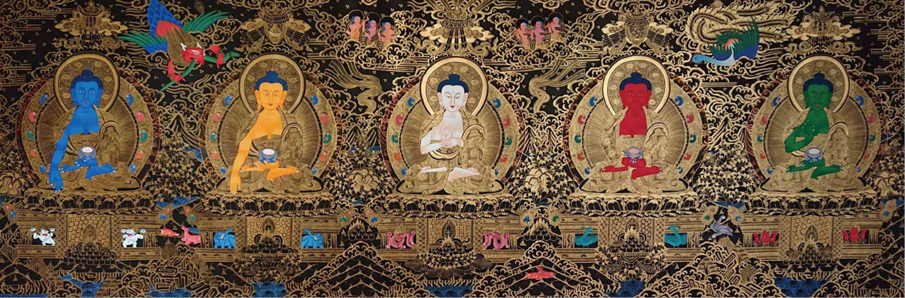

# 第69课

2025年10月15日

今天讲《如意宝藏论》最后一课。第二十二品究竟之佛果分为三部分：所依五身、能依五智与所行事业。佛的五身与五智已经宣说圆满，下面先讲事业，之后讲本论的结文。字面意思都比较简单。

所行事业没有细分，只有一个科判。

> 庚三、所行事业：

> 事业化身之游舞，应机调化随应现，

> 随从信解相应心。

在世间，人们主要依靠身、心、工作或事业三者而存在。佛陀的果位也体现在三身、五智与事业上。除此之外，并没有一个像世间人所认为的那种独立实有的“佛陀”。

佛陀的事业主要是化身成所作智的游舞。三千大千世界的众生都被业和烦恼所缠缚，必须随顺他们各自的根基、意乐和界性才能度化。所以，佛陀会示现相应的身相与法门来应机施教。

我们以前也讲过吧？《妙法莲华经·普门品》中说：若众生应以佛身得度，便显现佛的身相；应以声闻、缘觉身得度者，即现声闻、缘觉身；若以帝释、梵天、遍入天、四大天王身得度，即现相应身相；乃至应以婆罗门、比丘、比丘尼、优婆塞、优婆夷身得度者，皆现同类身而说法；若以人、天、龙、乾达婆城等天龙八部身得度，也现相应身相为之说法。

在我们这些众生前，佛陀也会示现种种善知识形象来度化。因此，我们经常会说“视师如佛”。但要将身边的上师视为真正的佛陀，也有一定困难。因为佛陀是相好庄严的化身，而今任何一位具德上师，似乎都达不到那样的圆满。即使是华智仁波切或麦彭仁波切这样的善知识，在弟子面前也显现为具有烦恼习气的有漏之身。所以，我们很难“看得上”。

既然这样，为什么还要将善知识视为真佛呢？关键在于，佛陀的起心动念、所作行为，无一不是为了利益众生。如果一位上师，所作所为全是为了利益众生，那无论他示现什么形象，诸如密咒士、婆罗门、在家人，甚至是看似低劣的屠夫或妓女，都是有密意、有必要的——因为是在行持佛陀的事业。只要能饶益众生，再低劣的身份也跟真佛无二。从这个角度来理解视师如佛，完全没有问题。

利益众生是佛陀最大的事业，而利益众生归根结底是应机施教。所以，大家今后弘扬佛法一定要观察对方的需求。若对方需要广说，就以广说来饶益；若对方需要略说，则以略说来引导；若对方需要借助故事、比喻或公案得度，就以相应方式接引。

我们在《论语》里看到，孔子对询问和了解弟子的情况十分重视。一个善知识到各地弘法，也应该先了知当地人的心态、生活习惯、起心动念，以及他们喜欢什么、不喜欢什么，等等。这样才能根据他们的心态、意乐，施以相应的教法。

否则，你自己认为：“这是一部非常殊胜的法！”对方却毫无感觉，甚至心生反感。那即便你讲的是佛法，也不一定能利益众生。无论做什么，相应对方的心意都很重要。当然，也不是说连恶人的心态也要随顺。如果对方喜欢杀盗淫妄，做各种坏事，那千万不能迎合。我们是为了利益他们，才尽量相应他们的意乐，而不是单纯讨好他们。

佛陀利益众生无有前后刹那，都是随机显现，而且每一分示现都能契合众生的需要，令他们获得真实的利益。这是佛陀的一部分事业。下面还有一部分：

> 至世间际行利乐，置道所依道与果，

> 导众生至解脱道。

最后一句中的“解脱道”，有的版本是“解脱洲”。

如同《现观庄严论》中所阐释，佛陀的事业主要体现为将众生安置于道与安置于果。安置于道又分为安置于凡夫道与安置于圣者道。

佛陀利乐有情的事业不是暂时性、间断性的，而是直至轮回未空之际永不中断、一直行持。那是否意味着所有众生都必然成佛呢？当然不是。就像并非所有大学生都能考上公务员一样，要让所有众生都获得佛菩萨的果位也不可能。

佛陀度化众生时，会根据众生的根器与因缘分层引导：对于根器低劣、因缘较差的众生，会想办法给他们相续种下解脱种子，尽量安置于人、天乃至阿修罗等善趣，作为将来修道的所依——阿修罗跟解脱稍微有一点缘分。

对于已得善趣的众生，佛陀会想方设法深植善根、逐步引导，将他们安置于三菩提道。这里的“道”，特指圣道，涵盖从见道至修道的菩萨位，以及声闻、缘觉等圣者果位——包括预流果、一来果、不来果等。

对于已得圣道的众生，佛陀会通过相应法门进一步引导，使他们的境界不断提升——比如让一地菩萨进阶至三地、四地，乃至最终获得大光明灌顶，成就佛菩提的果位。总之，佛陀的事业就是引导无量众生走向解脱和成佛。

作为佛陀的追随者，我们虽然没有能力像佛那样，以圆满的智、悲、力，令无量众生直抵最高境界，但至少应该随顺佛陀的本怀，朝这个方向不断努力。

佛陀的事业有三个特征：广大、不断利益、不越时。

第一个“广大”，意为无有偏袒。无论是天界众生还是恶趣有情，乃至虚空边际的任何生命，佛陀都会平等绕益。佛教的思想非常广大，没有任何偏袒——不会只利益亲人或对自己好的人。我们以后摄受弟子、传授佛法，也应该尽力断除亲怨执著。这一点非常重要。否则很难真正利益众生。

第二个“不断利益”，只要轮回未空，佛陀利益众生的事业就不会中断。如同《四百论》所说：“诸佛所动作，都非无因缘，乃至出入息，亦为利有情。”佛陀身口意的所作所为，都不是无因无缘的，乃至一呼一吸，都是为了利益众生。

显现上，佛陀也有出息和入息，但却并非无意义。我们凡夫人呼吸，往往只是生理反应；有些嗔心重的人，隔着电话都能感觉到他气息短促、躁动。佛陀的呼吸不是这样。大乘经论中说：佛陀每一次呼气，都能遍及三恶趣，利益无量众生。世间人对他众的帮助与佛陀对众生的饶益根本没法相提并论。

不仅佛陀，很多大乘善知识也是如此。法王如意宝在世时，显现上跟我们一样，非常普通，但他无论说什么、做什么，都始终以利益众生为根本。显现上除了吃饭睡眠，其他时间都在利益众生，没有任何自私自利的想法。

月称菩萨说：“具智慧世尊，一切身语意，无有为自利，唯行利他众。”具有智慧的世尊，身语意都不为自利，唯一行持利益众生之事。以法王为代表的高僧大德们也是这样。他们的所作所为、所思所想乃至起心动念都在利他，丝毫不考虑自身利益。

世间人也提倡“全心全意为人民服务”。以前上学的时候，有一位姓白的老头子，“毫不利己、专门利人”，大家都学习他的精神。普通人要做到“毫不利己”，可能有点难。

不过，真正的大乘佛子与善知识，所作所为确实都为了利益众生。上师如意宝的亲传弟子也好，再传弟子也好，大多都有不错的利他心。当然，由于前世的愿力、今生的因缘和做事的能力不同，弘法利生的规模也有大有小。

所以不管怎样，我们现在都要发利他的大愿。

我经常看到一些虔诚的藏族老乡和汉地居士。他们的信心非常坚定，非常纯洁，没有任何杂染。很多学过五部大论的人，都未必有那样的信心。然而，他们对真正的佛理却比较陌生，不要说甚深的密宗见解，甚至对因果观等基本的显宗法义都不懂。我想，在座各位应该都有利益众生的智慧与能力。如果能用合理的方法引导他们，帮助他们认识佛法的教理与意义，那是再好不过了。

在未来的日子里，每个人都应当随顺自己的因缘，不忘利益众生的发心。有了这样的发心，机会自然会出现。我们要牢记前辈大德和上师的教诲与嘱托，尽心尽力利益众生。哪怕吸气、呼气、吃饭、睡觉，都要想到利益众生。平时的言行举止、所作所为，直接也好，间接也好，都要给众生带来利益。

过去有一位尊者，在一位幻化师的屋顶住了几天。临别时，幻化师为了表示感谢，对他进行供养。尊者说：“我只是在此停留了几日，并没有做什么，你为什么要供养我？”幻化师答道：“我是一个幻化师，将一切都看作无实。但我知道，您在这里的几天，我的幻化格外成功，都是因为您赐予了不共的加持与力量！”真正的大德，不管住在哪里，都会给当地带来利益。

一个心怀利他的人，无论是高僧大德，还是普通僧人，甚至只是一个平常的世间人，他安住的地方都会有一种特殊的力量。因为这样的力量，当地自然风调雨顺、吉祥安乐。这是一种自然规律。

第三个“不越时”，是指佛陀的事业不超越时间——众生得度的因缘什么时候成熟，就什么时候去度化，既不会提前，也不延后。众生相续中哪怕生起一刹那的善念，佛陀也会当下现前，赐予饶益。

《百业经》中说：“假使大海潮，或失于期限，佛于所化者，济度不过时。”这个偈颂在经中好像是长行文的形式。大海的潮汐或许有失期的时候——这是一个假设句，实际上不可能出现，佛陀却永远不会错过救度众生的时机。只要因缘具足，佛陀随时显现。换句话说，只要是有缘者，佛陀一定会度化。

那我们是不是有缘者呢？这要观待自己是否创造条件。如果我们真诚祈祷，佛陀一定会现前，那自己就是有缘者；而如果不祈祷，纵然相续中本具如来藏与佛缘，也不能成为真正的有缘者——暂时来讲是这样。

许多大德在注释中都提到：在藏传佛教里，“有缘者”“具缘者”是非常重要的概念。无论是上师度化你，还是佛陀度化你，你都需要具足缘分。如果因缘不成熟，即使你有善根、有如来藏，善知识也不一定现前。

法王如意宝经常引用“假使大海潮”的教证，汉译《毗奈耶经》中也有。我是直接将汉译文用到注释中——可能是义净译的。这个教证非常关键。无论是上师，还是佛陀，他们的加持与事业都从来不会“越时”。只要我们诚心祈祷，因缘成熟时，他们的加持一定会融入你、度化你。但如果不主动争取，即便相续中具足善根，今生也难以成熟，甚至要等到下一世、再下一世，乃至百劫之后也说不一定。

正如《入行论》中所说：“犹如乌云暗夜中，刹那闪电极明亮。”众生相续中的善根，犹如黑夜中的闪电，转瞬即逝。当短暂的善心萌芽时，自己一定要好好把握。世间人经常说：“时不再来！”“抓住机会，千万别错过！”同样，我们也不能错失与佛法或佛陀结缘的良机，一定要努力争取、虔诚祈祷。这一点极为重要。

下面讲这一品的摄义。

> 戊三、摄义：

> 此等解脱最胜果，现前究竟之光明。

注释中说，以上所讲的佛陀功德可以归纳十二类，即三十二相、八十随好、四清净（即身清净、境清净、等持清净、智慧清净）、十力、四无畏、四无碍解、四种正念（与我们平常所说的“正念”略有不同）、三无护、大悲、不失法性、断尽习气和十八不共法。若再进一步细分，则有一百六十四种法。

当证得无学果位，即究竟佛果时，以上功德都会一一现前。它们并非凭空而生，而是我们本自具足的如来藏光明的显现。依靠具足法相的密宗善知识的引导，之后依教奉行、精进修持，便能断除一切障碍，最终成就三界导师——佛陀的果位。成佛之后，利益众生的事业任运自成，这是必然规律。

以上是对究竟果的安立与阐述。

大乘窍诀论如意宝藏中，修行究竟果第二十二品日月宝光广释终

接下来讲圆满结尾事宜，分为两部分：以何方式造论及如是回向造论善根。其中，以何方式造论又分为两点：如何造有必要之论与造论之方式。先讲造论之必要。

> 乙三（圆满结尾事宜）分二：以如何方式造论；如是回向造论善根。

> 丙一（以如何方式造论）分二：如何造有必要之论；作者如何造论之方式。

> 丁一、如何造有必要之论：

> 经续窍诀精华义，为善缘众尽证悟，

> 无误闻思修次第，善说轮涅取舍理。

全知无垢光尊者在此宣说了自己造论的目的——为了利益后世的修行人，同时阐明了造论的方式与缘由。

为了利益有善缘的众生，无垢光尊者汇集了显宗经典、密宗续部以及传承上师们从未中断、一脉相承的窍诀精华深义，然后造出了这部《如意宝藏论》。也就是说，这部论的受益者并非没有缘分的人。我们在这里讲了这么久，山沟里、洛若镇、色达县的很多人都没有缘分，甚至连法本都不会请。而真正具缘的众生，则会依此获得全部的证悟。

如何依之无有错谬地实修呢？应该遵循闻思修的次第，而非一开始就讲大圆满。当然，我们现在的因缘比较特殊，个别人是先接触密法，再学习显宗，或者先修一修密法，然后再闻思显宗的教理。暂时来讲，只能这样。

按照常理，应该从第一品开始，先学习世界观、宇宙观等，让相续生起闻慧，再逐步深入思慧和修慧。无垢光尊者遵循闻思修行的次第，无有任何错乱，清晰地阐明了轮回是所舍、涅槃是所取的道理。

表面上看，注释与偈颂的次第略有不同。在偈颂中，无垢光尊者以舍轮回、取涅槃为框架，以闻、思、修为主线，以利益当代与后世众生为目的，将经藏、续部、窍诀及传承上师的教言汇集一处，善加撰著。而注释的意义也基本如此，没有什么差别——可谓万变不离其宗。

我们能够学习此论，确实幸运。在藏地，噶举派有自己的道次第，萨迦派有自己的道次第，格鲁派有自己的道次第，我们宁玛派也有自己的道次第——即《心性休息》与《如意宝藏论》。这两部论宣讲了宁玛派完整的显密道次第，而且全部是实修窍诀。

《如意宝藏论》前面的显宗理论讲得比较广，尤其是外道的内容。我翻译的时候很有兴趣，很想给大家详细介绍一下外道的各种思想。现在，世间人的思想非常复杂——藏地可能好一些，大城市或其他民族的很多人，今天还是虔诚的佛教徒，明天在网上接触到别的宗教，便马上舍弃三宝、改换门庭——这种情况时有发生。

无垢光尊者在论中一个一个地剖析，先陈述外道的观点，再从各个角度进行遮破。所以，我也很想借翻译和讲解之机，将外道各宗各派的观点一一阐明、破斥。但时间毕竟有限，生命不等人，最后只能在偈颂上简单过一下。

这次讲《如意宝藏论》，前面有五十多堂课，密宗部分讲了十一堂，总共有六十九堂。在座的各位，现在既有藏文法本，又有汉文法本，我希望你们专心学习一下。全知麦彭仁波切对此论是如何赞叹的、在《七宝藏目录·珍宝明镜》中怎么讲的，华智仁波切又是如何赞叹的，大家都应有所了知。

昨天讲考只轮到一个人，他对本论的总体内容还是有所把握——下来确实看过，非常好。我希望有更多人深入学习此论。如果实在没时间看《如意宝藏论难释》和第十二品注解，至少也应该看看麦彭仁波切写在前后的偈颂——非常触动人心。

对《如意宝藏论》的翻译，我原本是放在后面的。后来想到麦彭仁波切在前后偈颂中不断强调——作为宁玛巴弟子，一定要重视《如意宝藏论》，才将翻译计划提前了。

这部论有很多窍诀，无论是对弘法利生，还是对个人实修，都很有帮助。论中关于本来清净、任运自成等密宗修法，都是以简单而浓缩的方式开演的。有缘者若能依靠这些窍诀实修，一定能获得成就。论中的教言确实是后代修行者的无上珍宝。

接下来讲作者如何造论之方式。

> 丁二、作者如何造论之方式：

> 此理广慧虚空中，闻思修云极密布，

> 利乐闪电传苍鸣，珍宝法雨严世间。

在广阔无边的智慧虚空中，闻思修的云层集聚密布，伴随着利乐众生的闪电与阵阵雷鸣，降下了珍宝般的《如意宝藏论》的法雨，庄严了整个世间界。

这里的意思是：在智慧的虚空中，通过闻思修积聚相应的功德后，利益众生的力量会非常迅速、非常强大。可以进一步理解为：如同天空中的闪电与雷鸣迅猛而有力，当因缘具足时，无垢光尊者闻思修所积聚的功德便催生了《如意宝藏论》这一利乐教法，并且迅速而有力地在世间弘传。此时，珍贵的法雨普降十方，整个世界得到滋润与庄严。

庄严一词有几种意思，比如开显庄严、装饰庄严等，此处指对世间的真实饶益。

这部论典的注释又叫《白莲花》，“白莲花”是一种形象化的修饰，象征着清净与圆满。一方面，我们可以这样理解：在智慧的虚空中，积聚起闻思修的密云，伴随着利乐众生的闪电与雷鸣，最终降下《如意宝藏论》的法雨，普益一切众生。

另一方面，无垢光尊者说，在他自己的智慧虚空中，由闻思修汇聚的密云不断集聚，于世间响起利乐的雷鸣与电光。以此因缘，《如意宝藏论》如珍宝法雨般沛然降下，令整个世间蒙受法益。

从这个意义上讲，在座各位有机会学习《如意宝藏论》，也算得到了法雨甘露的滋润。对我们而言，在短暂的人生闻思修习无垢光尊者的《四心滴》《七宝藏》等，至关重要。否则，即便学习了因明、《俱舍论》等，虽然这些也属于明处，极有价值，但与真正斩断相续中的无明烦恼，恐怕还有一定距离。

人生短短几十年，一晃就过了，以后还有没有机会闻思更深的密法，很难说。因此，大家应该趁现在有机缘，好好用佛法庄严自己的身心、成熟自己的相续。这一点非常重要。

如同白莲花内外洁净、无有染污，闻思修行此论也唯有利益、没有过患。

接下来讲如是回向造论善根，分为回向善根与回向摄义两部分。首先是回向善根，即回向获得五部佛的果位。这里的回向方式与其他地方略有不同。由于众生根基不同——有的与东方佛刹有缘，有的与中方、南方、西方、北方的佛刹有缘，因此分别回向他们成就不同刹土的佛果。

> 丙二（如是回向造论善根）分二：回向造论善根；彼回向之摄义。

> 丁一、回向造论善根——回向获得五部佛：

> 1．回向获得毗卢遮那佛：

> 愿以如秋满月福，众得法界净虚空，

> 不动无漏大悲尊，怙主毗卢遮那佛。

这样的善根纯洁无瑕、清净皎洁，就像秋天的月亮。现在应该是秋天了。前几天的月亮都很好。无垢光尊者将此秋月般纯净的福德回向一切众生，愿他们都获得密严刹土相好威光灿然、利益一切菩萨圣者、于法界智慧中如如不动的怙主毗卢遮那佛果位。

毗卢遮那佛的特点是什么呢？他获得的功德如如不动，能利益一切圣者菩萨——其实不光是毗卢遮那佛，五方佛都是一到十地菩萨的行境。这位具足大悲的尊主，安住在如虚空般的清净法界密严刹土中——此刹土位于东南西北四方的中央，没有任何动摇，以无漏的方式利益诸位菩萨。

无垢光尊者希望众生都证得安住于法界中央、如如不动的毗卢遮那佛果位。

在座各位对五方佛应该都有所了解。我这里准备了一张图片。大家可以跟随图片进行观想。

我们每个人都应当发这样的愿。因为仅仅是见到佛陀的形象，也具有极大的功德，许多经论都曾提到这一点。毗卢遮那佛其实有不同的形象。东方不动佛的身相颜色与毗卢遮那佛也有差别。但有一个版本是这样画的。不同画派所画的佛尊，其手印、颜色等也各有不同。

我们也将此善根回向给一切众生及有缘者，愿他们都能依此功德，成就毗卢遮那佛的果位。

> 2．回向获得不动佛：

> 以无垢善愿群生，离惑得智龙王处，

> 具备深广慈云藏，怙主不动佛大海。

这里也用了一个比喻：以此造论、闻法、讲法、学修所生的无垢善根，回向一切众生，愿他们远离一切烦恼，获得如龙王住处般深广的智慧，并具足甚深广大的慈悲云藏，即东方怙主不动佛的大海。

这里将不动佛喻为大海。大海是龙王的居处，也是一切云雾的来源。海水蒸发以后，在空中变成云雾，云雾凝结成雨水，又汇入大海、变成海水，如此循环不尽。无垢光尊者借此比喻，愿一切众生依此善根，证得如大海般蕴藏无量智慧与慈悲的东方不动佛果位。

不动佛又叫作阿閦佛。以前我放牛时，旁边有位老喇嘛，天天念不动佛心咒。那时我不懂，听他念什么“刚嘎呢 刚嘎呢”“卓扎呢 卓扎呢”[^1]，还以为他在喊村里的“更噶”和“珠匝”——当时我们村里有一个女的叫更噶，有个老头子叫珠匝。

他有时会吓唬我们，有时又会逗我们。每次他念咒的时候，我们都觉得奇怪：“他为什么天天叫这些人？”

不动佛的短咒“嗡赞扎玛哈若卡那吽啪的”，麦彭仁波切也有一些相关的修法。

> 3．回向获得宝生佛：

> 愿具众德净胜善，得二资成圆德尊，

> 降下有寂乐源雨，怙主宝生佛果位。

将此具足清净功德的殊胜善根，回向给所有众生，愿他们都能成就二资具足、功德圆满、能降下轮回涅槃安乐之源的利乐雨、圆满一切众生愿望的南方怙主宝生王如来的果位。

宝生佛身色金黄，安住于南方刹土。我们也将功德回向给自己，愿我们都能证得宝生如来的果位。

> 4．回向获得无量光佛：

> 此善愿我诸众生，摧毁死主等四魔，

> 渡过生老病死海，获得怙主无量寿。

科判中是“无量光”，颂词中是“无量寿”，意思相同。将此善根回向众生，愿我与一切众生都能摧毁死主魔、天子魔等四魔，渡过生老病死的大海，获得怙主无量寿佛的果位。

经常祈祷阿弥陀佛，不仅能远离横死与“常住”的死亡，还能获得无病、快乐、财富圆满等利益，最终渡过生死苦海。西方极乐世界的阿弥陀佛，又叫长寿佛、无量寿佛。愿众生都能成就这样的果位。

以上是中间及东、南、西、北五方佛的回向。关于毗卢遮那佛与不动佛谁是五方佛的主尊，荣索班智达与无垢光尊者各有阐释，索巴派与康巴派的论著也有不同观点。这在相关的《大幻化网》注释中有具体论述。不同的安立各有其必要，也可能是因为所依的续部不同——索巴派侧重这个续部，康巴派侧重那个续部。

> 5．回向获得不空成就佛：

> 如意妙高殊胜善，愿得满众之心愿，

> 事业竟降成就雨，怙主不空成就佛。

撰著《如意宝藏论》的广大善根，如同如意宝般殊胜、妙高，能满足众生所有的愿望。愿以此善根，能令所有众生心满意足，事业圆满，降下成就之雨，最终证得不空成就佛的果位。不空成就佛代表成所作智，身相为绿色——其他注释可能有不同的颜色。

接下来是回向摄义，分为两方面：回向成为永久暂时利乐的因，以及回向利乐主因之法理兴盛——利乐的主要因缘是佛法，为了佛法兴盛而回向。

> 丁二（彼回向之摄义）分二：回向成为永久暂时利乐之因；为利乐主因法理兴盛而回向。

> 戊一、回向成为永久暂时利乐之因：

> 以彼如意广回向，愿自他越轮回海，

> 生生世世勤利他，击大法鼓传世界。

这个回向非常重要。如果在朝圣或值遇特殊对境的时候，没办法完整回向，也应该念此偈颂发愿：愿我今生来世都具足弘传大乘佛法、“击大法鼓”的缘起和因缘。

前面回向一切众生皆证得五方佛的果位，这里说，愿以此如意宝般的广大善根，祈愿自他一切众生超越轮回苦海，安住第六大金刚持普贤如来果位而成就究竟所愿，并且唯愿我生生世世，身语意所作都能利益他众，击大法鼓传遍三世间，驱散一切无明黑暗。

与世间很多人相比，我们至少在名相上是幸运的。他们活着的目标就是上个班、挣点儿钱、得一点儿享乐，平平安安度过人生。除此之外，没有更深、更高、更远的追求。而我们活着的目标是令自他都解脱轮回，并且生生世世利益众生。

利益众生有各种各样的方式，最主要的是“击大法鼓传世界”。通过自己的语言、行为等各种方式，将佛法的教理传递到十方世界，这就是击大法鼓、转大法轮。

击法鼓的范围不能小，越大越好。我之前说过，现在是人工智能或AI兴盛的时代，人类的生活方式发生了翻天覆地的变化。我们佛教徒不能以吃好玩好为目标。不能有这种不负责任的心态。应当想尽一切方法，令佛法传遍世界。

我认识一位非洲的法师。他以“法传非洲”为志向，发誓要将佛法传遍整个非洲。他努力了四十多年，如今已经七十多岁，仍然坚持不懈地在做。他其实是一个普普通通的人，但因为愿力坚定，最后因缘和合，开创了不凡的事业。

他的口号是“法传非洲”。我们也应该有自己的口号，比如法传亚洲、法传欧洲、法传大洋洲、法传北美洲、法传南美洲……乃至覆盖七大洲。南极洲没什么人，只有企鹅；北极圈内有一些人，包括挪威、芬兰、俄罗斯、加拿大的一些村镇，还有北极熊和其他动物。不管怎样，我们的愿力应该涵盖一切众生界——无论人类、非人或动物，愿他们都能蒙受法益。一定要把正法传出去。

我们应当发这样的大心与大愿。我希望大家把目光放得远一点。很多人其实是有机会走出去的。今后有机缘，一定要走出去。如果条件不具足，也要在自己的范围内尽力而为。比如，我待在一个县里，那我能不能用佛法利益整个县的人？至少身边的人是可以利益的吧？

这段偈颂，许多大德都认为极有深意。我们平时应当默默发愿：“愿我能以佛法利益众生！”愿力的范围要尽量广大。今后，我们可以借助人工智能等新技术，用与众不同的方式去做一些事情。如果能够这样，或许真的能给很多人种下善根，让他们得到利益。希望大家在这方面多多发愿。

接下来讲第二个，为利益安乐的主要因——佛法兴盛而回向。

> 戊二、为利乐主因法理兴盛而回向：

> 愿此法理如日月，普照十方诸世间，

> 智慧莲花尽绽放，佛教广弘悉兴盛。

这是无垢光尊者在造论结尾广利有情的发愿。

愿《如意宝藏论》的法理如同太阳和月亮的光芒，普照于东南西北、四方四隅以及上下等十方世界。当此等大乘佛法的光芒照耀世界的时候，愿众生智慧的莲花得以开启、尽情绽放，佛教广弘兴盛，众生幸福美满、吉祥辉煌。

莲花有两种，一种是青莲花，一种是睡莲花。青莲花在月光升起时绽放，睡莲花在日光照耀时开启。它们虽然有不同的开花因缘，但都统称为莲花。无垢光尊者祈愿佛法如日月般照耀世界时，众生智慧的莲花能随之绽放，让佛法传遍十方。

利益众生也好，智慧绽放也好，都依赖于正法的兴盛——唯有正法兴盛，众生才能获得真正的安乐。因此，我们也应如是发愿：祈愿佛法如意宝的光芒普照整个世界，令一切众生都像莲花绽放那样，获得真实的法益。

我刚才想，要让无垢光尊者的佛法如意宝弘扬于世界，应该将《七宝藏》等翻译成各国文字。现在我们只有藏文、汉译和英译本，虽然懂汉语的人很多，可以算得上广弘，但像法文、日文等其他语言，翻译得并不多。

《西游回忆录》里面，提到过一位翻译家，叫秋吉尼玛，以前在纳帕谷为法王做过翻译。他在上个世纪八十年代来过学院，当时发愿要翻译《七宝藏》。现在从网上看，他翻译的《七宝藏》并不全。其他几部都有，唯独缺了《如意宝藏论》和《句义宝藏论》。目前《七宝藏》的英文版本，即是秋吉尼玛翻译的，标价大约150美元。但《如意宝藏论》和《句义宝藏论》并没有包括在里面。

在座的道友或以后的听众当中，有没有人发心参与《七宝藏》的翻译？因为无垢光尊者发愿，他的法理要传遍整个世界。而法理要遍及世界，文字上必须先传开——翻译成各种语言，不然很难实现。

现在，我们的“视频口译”已能覆盖七十多种语言。将来，可能连很多小语种也能覆盖。从语言层面看，这就是在实现无垢光尊者的誓愿。但更重要的，可能还在后面：比如，虽然我们有了英文译本，传播面也比较广，但到目前为止，西方人大多还停留在接受传承上面，真正理解《七宝藏》法理的人并不多。

我希望无论是西方、东方，还是南方、北方，未来世界的众生都能领受无垢光尊者教法的光芒——这也是尊者当年的发愿。

这以上，《如意宝藏论》的偈颂部分已经讲完。接下来是本论的结文。

> 甲四、尾义著跋：

《大乘窍诀论如意宝藏释·白莲花》，乃抵至自他宗派海彼岸之比丘金刚持慈诚罗珠，于珍宝莲积札山山脚之具德任运自成洲撰著圆满！善哉！善哉！！善哉！！！愿增吉祥！

今年的密法课到这里就圆满了。像这样每年讲一点，也算是给有缘的人提供一点方便。非常感谢大家，也非常感谢诸位护法神和空行众在传讲过程中赐予的护佑与加持。

明天正好是会供日，特别好。为了酬谢诸位护法、空行，我准备了一些会供品。明天上午，先讲一个简单的上师瑜伽修法，然后举行一个非常大型的会供。

[^1]: 不动佛心咒：“那莫Ra那扎雅雅 嗡刚嘎呢刚嘎呢 若匝呢若匝呢 卓扎呢卓扎呢 扎萨呢扎萨呢 抓德哈那抓德哈那 萨儿瓦噶儿玛巴让巴Ra呢美萨儿瓦萨埵南匝耶索哈。”
