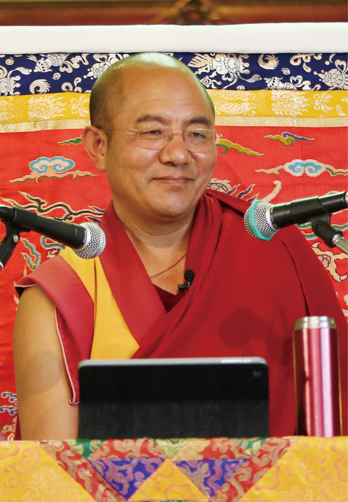
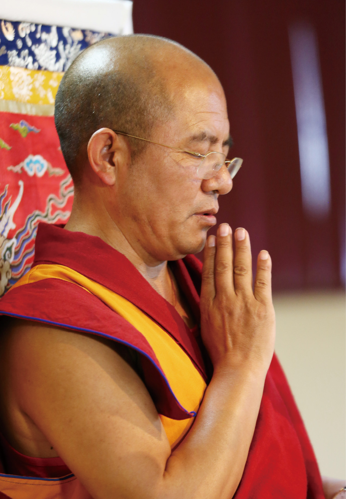
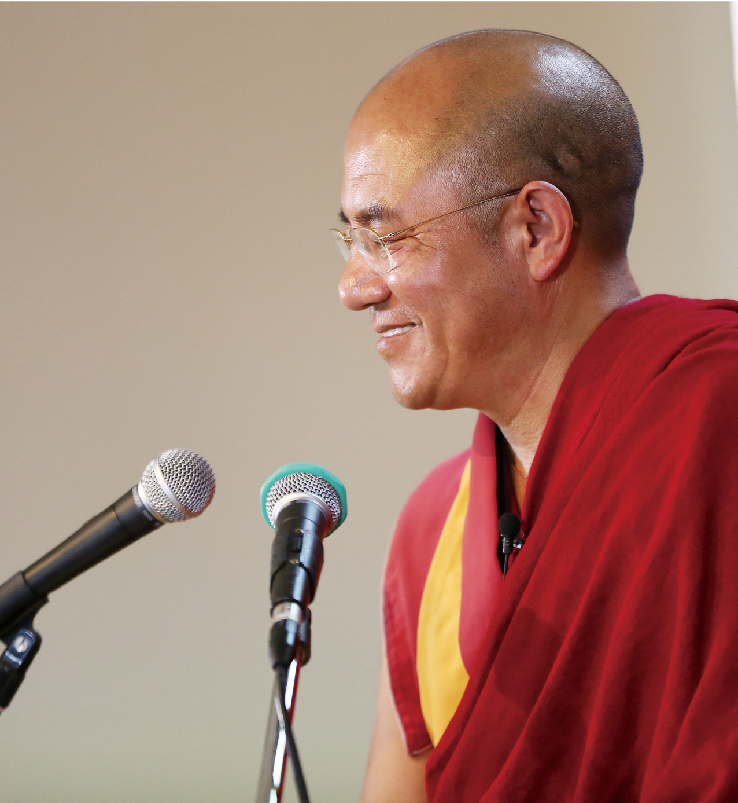

《入行论·安忍品》讲解

第1课

2014年10月5日

今天，我们一起学习寂天菩萨的《入菩萨行论·安忍品》。讲课之前，我想简单地跟大家说一些事情。

珍惜闻法机会，学好“安忍品”

首先，希望每一位道友能够尽量安排时间，完成我们道场所安排的这五堂课。当然，作为在家人，各位在工作和家庭上有很多事情要处理，但如果你们的时间能够安排得过来，那最好把这五堂课听受圆满。这是第一件事情。

第二件事情是关于听课的要求。我们每天的课堂安排：课时基本上为两个半小时，其中一个多小时是讲课，然后用接近一个小时来互动。在讲课的过程中，大家应该尽量专注。因为我们每天都在下午两点开始，此时大家可能会有点困，尤其一些人在吃好午饭之后，到了两点身心都放松下来了，也许不太能专注。

我比较敏感，只要看到有人在打瞌睡，我就很想打他（众笑）。有一次我参加在北京举行的国际慈善论坛，一位美国的教授说他很不幸运，因为他是下午的第一位演讲者。他说下午第一节课的课堂状况都不太好，人人都在打瞌睡。

所以，我首先想提醒大家几点。一、尽量不要打瞌睡。二、这五堂课期间不能开手机，或者至少要把手机调到静音状态。幸好今天这里没有手机信号，缘起很好。虽然这次听课的人数不是很多，但如果有人接电话、有人收信息，那可能也会影响大家。三、讲课时间大约一个小时，这期间大家尽量不要走动，不然我的心也容易散乱或者变得迷迷糊糊，看到有人来来去去我可能就讲不下去了。

其实，我们每天的任务比较重，要在五堂课讲完“安忍品”的一百三十多个颂词，即一堂课要讲接近三十个颂词。按照以前我在学院的讲课进度，我可能要用五堂课才能讲完我们今天一堂课的内容，就是说，我过去可能要用二十五堂课的时间，才能讲完我们这五堂课的内容。所以你们没有时间打瞌睡，我也没有时间散乱。总之，对于我们每天的课程，希望大家都能很认真地对待。

你们来听课很不容易，我知道不管是哪个城市的人，哪怕要空出一个下午的时间都非常困难。对我来说，要安排这五节课也很不容易，我为此考虑了很长时间，因为听受学院课程的人数非常多，现在有了网络直播，任何地方的人都能听受。最近我们正在讲解《大圆满心性休息》，直播时的在线人数每天大概有一万六千人，而报名参与课程的人数共有两三万，但现在我来了这里，学院的课程就要全部暂停。本来我想在这里安排直播，好让国内的一部分人也可以听受，但是今天因停电不能直播。无论如何，我们这里的人可以一起学习。

你们能够空出这五堂课的时间，真的十分难得，而我空出这段时间也不容易，因此我们应该共同认真地学习。这五天的下午，我每天会讲解大概三十个颂词。我对你们的要求是：至少能够记住每个颂词的字面意思。两天后我很有可能会出题考一些年轻道友，如果最后你们连基本的字面意思也解释不了，那我在此待一个星期就有点浪费了，而你们每天抽空来上课也不太有意义。以上是我的要求，希望大家能够认真地学习。

至于传法方式，我会以藏文给大家念一遍当天所讲的颂词，然后用汉文来讲解。讲课的时候，我们也会用网络直播等现代科技。所以说，这次结合了古代和现代的传法方式来给大家传授。我在很多具有菩提心的上师面前得过很多次《入行论》的传承。虽然我为人很差，但是我的相续应该有前辈传承上师们的加持，所以我会用藏文来给大家念传承。我会先把当天要传授的三四十个颂词念一遍，然后再用汉语来给大家讲解。

这次你们一定要学好“安忍品”，昨天法师也说这一品很重要，大家应该认真地学习。我本来发愿每年要传讲一遍《入行论》，但是实行起来有些困难。希望你们每年都能学习《入行论》，至少能够把它的“安忍品”学习一遍，如此会对你的自相续很有帮助。

（堪布念《入行论·安忍品》传承）

认识嗔恨之过患

“安忍品”是《入菩萨行论》的其中一品，它的内容主要分为三个方面：断除嗔恨、修持安忍、恭敬一切有情。

首先我们要断除嗔恨心，因为它对我们的今生来世都有非常大的危害。虽然我们现在看不到来世，但是凡夫还要生生世世在轮回中流转，而嗔恨心会把我们以前所造的善根全都摧毁，也会对我们的来世造成巨大的危害。

一嗔能摧毁，千劫所积聚，

施供善逝等，一切诸福善。

如果我们生起一刹那的嗔恨心，便会摧毁千劫以来，即百千万亿年中我们所造的善根，像供养诸佛菩萨、布施、持戒等等，所有善根会被全部毁坏。

嗔恨心的确非常可怕。《入中论》与其他经典提到，生起一次嗔恨心能够摧毁一百劫的善根。不同经论的观点稍有不同，如果从理论上分析，已发菩提心和没有发菩提心的人，其善根也有差别。这方面有各种说法，但我们在此没有必要特别详细地去剖析。

总而言之，如果我们没有以无缘智慧、菩提心和回向摄持，而且很容易便产生嗔恨心，那么虽然我们积累了非常多的善根，它们也会一下子被摧毁无余。所以，嗔恨心确实极其可怕。

有些人可能想，凡夫人一定会生嗔恨心，那我们积累的善根是否永远没法保留下来呢？不会如此。学习大乘佛法的人都会明白，一般来说，大家修任何善法都要以回向摄持。前辈高僧大德也说过，如果我们以回向来印持，善根便不容易被摧毁。所以，大家每次做了任何善法，都可以念诵《普贤行愿品》来回向，它也是我们今天的课后念诵之一，如此大家的善根就不容易被摧毁。

事实上，人们轻易就能把自己的善根摧毁。佛陀在《遗教经》中说：“嗔恚之害则破诸善法。”嗔恨的害处是把一切善法破掉，而且很多功德也会因此消失。所以，大家在修行的过程中一定要改变自己的性格。以前嗔恨心非常严重的人，通过学习《入行论》后要尽量减少嗔恨心，这非常重要。

佛经中记载了一个公案：以前有位嗔恨心非常严重的比丘，有一次他在辩论中落败后便气死了，之后他转生为一条毒蛇；当时佛陀派了目犍连、舍利子等很多弟子去度化它，但是也不成功；后来佛陀亲自为它说法，它才知道自己以前做错了，那一世死后它便转生到天界。

有些人可能因为前世的业力或者其他原因，今世经常爱生气。如果你生嗔恨心，一方面会摧毁善根，另一方面也有很多过失，因此大家要注意，千万不要每天发脾气、生嗔恨心。

的确，嗔恨心有非常严重的过失，大家最好修忍辱，但是安忍并不容易：

罪恶莫过嗔，难行莫胜忍，

故应以众理，努力修安忍。

这个颂词很重要。整个世界的所有罪恶，比如杀、盗、淫、妄语、粗语、离间语、贪心、嗔恨、邪见等等，一般可以归纳为十种不善业，而十种不善业中最严重的就是嗔恨心。原因就像前面所说，非常严重的贪心不会摧毁我们的善根，但嗔恨心则能摧毁很多善根。因此，在所有罪业、恶业当中，最严重的莫过于嗔恨心。

至于修行方面，哪一个法最不容易修呢？就是修安忍。其他的修行如闭关、守持戒律、吃素不吃肉等等，我们行持起来没有什么困难。但是，大家都知道安忍特别不好修，尤其是面对与自己关系不好的人，或别人对你说一些难听的话或者骂你的时候，要安忍下来是非常困难的。所以，这个颂词的第二句说：难行莫胜忍。

虽然嗔恨心的过患非常严重，修安忍也很困难，但是我们还是需要修，大家应该通过各种真理、教言、窍诀等不同方法来努力地修安忍。确实，我们佛教徒尤其要安忍，如果佛教徒的脾气和性格都不好，甚至比非佛教徒更暴躁、有更严重的嗔恨心，像毒蛇一样差劲，那别人会觉得不学佛比较好。如果一个人的性格很不温顺，他会让别人害怕，谁也不敢碰、不敢接触。因此，大家以后应该通过各种方式来修安忍。

另外，如果一个人有嗔恨心，他会特别痛苦。嗔恨不仅使他在白天修行不好，也会使他在晚上睡不好：

若心执灼嗔，意即不寂静，

喜乐亦难生，烦躁不成眠。

如果我们的内心燃烧着嗔恨心的熊熊烈火，让它不断地燃烧得非常厉害，我们的心便完全不能处于寂静的状态。有些人一生嗔心肩膀就会发抖，不能自制。尤其在汉地，很多人也许过去受到电影、电视的潜移默化，他们在生嗔心的时候，总要马上把面前的东西砸烂。现在，一些电影如果是由较大的公司制作，经常会有把车砸烂的情节；如果由较小的电影公司制作，一般也会有把架子上的东西摧毁、把锅瓢等东西乱摔的情节，这些都是嗔恨心的象征。

嗔恨心正在燃烧的时候，我们的心根本寂静不了，因此会坐卧不安，昼夜都不舒服，身心都感到特别疲累。一个人一旦生起嗔恨心，哪怕他看大海、公园、蓝天等美景都觉得不漂亮，会觉得周围的人特别烦，看个个都是坏人。有嗔恨心的人所看的世界都特别丑陋，从佛教的角度，这是心不寂静的表现。另一方面，这种人在生活中连一刹那的喜乐、快乐也得不到。不管是跟同事还是家人，刚吵完架的人一定是愁眉苦脸的。

有嗔心的人白天在生活中找不到自己的喜乐、快乐，晚上更会因为烦躁而睡不好、做噩梦。如果你在白天跟人吵架，生了嗔心，那你在晚上会经常失眠，或者做一些非常迷乱的梦，梦中你跟白天吵架的人要么打架，要么互相厮杀，这是很多人的经验。有些人平时跟朋友的关系不好，他们的梦境会出现怨敌和战争的画面，不可能有快乐的场景。虽然他们晚上有睡眠，但是因为他们的内心世界非常痛苦，所以他们早晨起来的时候都是双眼通红的。

相比之下，很多人尤其是一些修行人安忍修得好，因此他们很少生嗔恨心。无论身居何处，他们白天会过得很开心，晚上也睡得特别好——不管待遇如何，他们都活得非常快乐。

至于有嗔恨心的人，即使他们的生活条件很好，但是因为他们的脾气非常差，所以平时也不会快乐。我的一位朋友就是如此。他到任何地方都入住五星级以上的宾馆，但是他在那些宾馆里却从来都睡不好，总感觉特别难受，而且看到那些服务员便心生厌烦，每次都和服务员吵架。本来五星级宾馆的服务员跟一般的服务员不同，他们受过培训，有良好的素质，但是由于我朋友的心态不好，因此经常和他们吵架。

大家尽量不要让自己的心相续有嗔恨，如果有就要尽快让它消失，否则它会影响你的生活、健康和情绪。情绪波动对我们自己有非常大的危害，所以这里说，有嗔心的人活得不快乐。另外，他们还经常会有生命危险：

纵人以利敬，恩施来依者，

施主若易嗔，反遭彼弑害。

有些人用自己一生的财富、名声和各种东西来帮助其他人，像一些老板用自己的财力、金钱等资源来帮助别人，对他人有很大恩惠，但若他们非常容易产生嗔恨心，例如经常爱骂人，那他们有可能遭到杀害。

比如说，世间企业的一位老总对下面的员工有非常大的帮助，他准时发工资，也给员工相当不错的待遇；可是，如果这位老总脾气很坏，每天都在骂员工，久而久之那些下属不但不会对他报恩，甚至很有可能在受不了的时候把他杀了。那些员工常常得到老总的帮助，怎么会有杀他的动机呢？一般来说是不会的，但是这种现象时有发生，因为一些人经常挨骂，最后实在忍受不了。

现在一些家庭悲剧也是由此而生。有些父母的脾气特别差劲，经常打骂孩子，长此下去，孩子在受不了的时候真的会伤害父母，这种现象非常普遍。本来父母很疼爱孩子，给他生活费、学费，对他也特别好，但是因为父母的脾气很差，以致最后酿成悲剧。因此，大家关爱别人的时候，一方面经济上的帮助很重要，但更重要的是你要用真心来关爱别人，这对受助者来说更为需要。

我经常跟藏地的一些老师说，一方面老师给学生传授知识很重要，但更重要的是给予学生内心的爱。一位没有爱、脾气很差的老师，即使他教学上做得很好，但如果他打学生打得很厉害，最后很多学生都会憎恨他。确实，脾气不好的人很让人讨厌，到一定时候很有可能他身边的人会做一些危害他的事情。

我在学院讲课的时候，不敢对学生大发脾气，不然他们想杀我，那就十分危险（众笑）。这方面我懂得保护自己，如今社会上有各式各样的人，人际关系很复杂，能让自己活下来比较重要，对吧？

现在一些企业集团的负责人，虽然给员工不错的工资待遇，但因为他自己脾气不好，久而久之让很多员工难以忍受，最后他们只能离职。员工离职不是因为待遇或者人际关系的问题，是因为老板的脾气让人受不了。

同样，国内很多夫妻婚后天天吵架，最后彼此都实在难以忍受，只能离婚。虽然他们明明知道离婚对自己的家庭、孩子、父母都不好，但若长期争吵下去，每天都像活在一些阿拉伯国家一样，长年累月处于战争的状态，所以他们最后不得不选择离婚——把“战事”结束。虽然离婚之后的生活状况比较可怜，但是他们也没有更好的选择。总之，嗔恨也会给家庭带来非常大的危害。

在更广的层面，现在世界上国家与国家之间的冲突都是源于嗔恨心。如果人们解决了嗔恨的心态，国家之间哪有这么大的争论啊？肯定没有！爆发第一次和第二次世界大战的最根本原因就是嗔恨心。

嗔恨还有其他过患，如果一个人有非常严重的嗔恨心，他身边的人会远离他：

嗔令亲友厌，虽施亦不依。

若心有嗔恚，安乐不久住，

如果你的嗔恨心非常严重、脾气很不好，那跟你最亲密的人，比如你的父母、儿女、亲人和你最好的朋友，都会对你生起厌离心，最终都不愿意和你待在一起。如果亲朋好友都想离开你，那其他素不相识的人就更不用说了，他们更不愿意和你待在一起。嗔恨心会导致你身边的人全部离你而去，使你处于孤独和寂寞的状态，非常可怜。

这方面我们自己不一定能够发现。一个脾气非常差、性格很不好的人，虽然他觉得跟他最亲密的人，像家人和父母不可能对他生厌，但是到某些时候，因为他的心就像烈火一样，让人难以忍受，谁接近谁就会被烧伤，所以谁也不愿意跟他接触。比如他身边的人不想跟他出游：“他性格不好，我不想和他一起去，不然大家会在路上吵架。算了，不要和他去。”这种现象时有发生。

如果旅游团有一位脾气不好的人，团友之间会一直吵架。我听说有一个十天的旅游团，当中有一位脾气不好的人，到旅程结束时，他跟所有团友都吵过架。一些脾气不好的人会跟家里的所有人吵架，跟父母吵、跟儿女吵、跟配偶吵……脾气差劲的人犹如动物园中特别霸道的恶狼，他对任何人都接受不了，别人看他一眼他也会特别不高兴。这种人很可怜，但却大有人在，因为他没有好好地调整自己的性格。

事实上人心都是善的，只不过因为环境和教育的原因，人们的心没有受到良好的培养。以前，印度有一位本来性格很善良的小孩，后来他在一个动物园跟猛兽恶狼一起生活、成长，长大后他的性格已经变得完全没有悲心，只懂嗔恨别人。一个人的成长环境和他以后的心态、性格非常有关系。

一些人由于没有在大乘佛教和慈悲心的教育下成长，所以他们的心态很浮躁，容易产生嗔恨心。这些人成家立室后，很容易出现一些家庭暴力的情况。最近有则新闻，一位父亲对他的孩子非常不好，有一天他想把孩子打死，可是他打了一个晚上，孩子还没有死。不知道他们父子之间有什么业力，现在世间有各种意想不到、令人哗然的负面新闻。

大家遇到任何事情，都要先让自己冷静，最好不要暴躁，不要很容易便生嗔恨心，否则虽然你自己未必能发现，但实际上已经造成了许许多多的过患。

下面总结性地说，嗔恨心有以上的诸多过失，而安忍有功德：

嗔敌能招致，如上诸苦患。

精勤灭嗔者，享乐今后世。

颂词的前两句说，嗔恨能够招致以上所说的各种痛苦。有嗔恨心的人不仅自己很痛苦，还会给自己的生生世世带来非常多的过患。

历史上，人们的大多数恶业都是因嗔恨而造。我探访过汉地的一些监狱，像山东和厦门的监狱，也曾经和一些犯人交流。他们忆述，犯罪的时候确实是因为一念之差，那一刻嗔心爆发就动手杀人，一念之间任由嗔心驱使，不能自制，事后自己也感到非常后悔。

我们平时认为自己很正常，但是在嗔恨心的影响下可能就变得完全不正常，此时每个人都很有可能做出一些坏事。不管是朋友、家庭，还是感情上的一些关系，人们都有可能在特别生气的时候伤害对方。这种情况屡见不鲜，尤其是夫妻间吵架，过程中有些人很想咬对方一口，或者很想把对方掐死，有很多诸如此类的心态。

人们平常感受不到自己的这些心态，总认为自己和对方有什么深仇大恨呢？但是据一些犯人所说，夫妻吵架的时候彼此都特别生气，真的会产生捅对方一刀的想法，如果运气不好，一些人确实会把心中的想法变成现实。监狱里很多人都说，那一刻不知道自己在做什么就把别人打死了，最后只能一直在监狱待着。现在他们回想起来，也认为当时不应该杀人，至今仍然觉得对不起受害者和自己的家人。有时候人们在嗔心的驱使下，真有可能会做特别不好的事情，最后也要为此感受众多痛苦。

因此颂词的后两句说，大家要特别精勤地灭除嗔恨这个敌人，如此我们的今生和来世都会快乐。

大家经常在网络上看到一些没有嗔恨心的上师，像印度的创巴仁波切和其他公认的高僧大德，他们的样子很慈悲，而且他们面对任何生活处境都过得很快乐。大家同样是人，但是他们相续中有大悲菩提心和无私的爱心，对其他的人也好，动物也好，国家也好，他们都没有嗔恨心，即使别人诽谤或者说他们的过失，他们的心态还是如此平静、快乐，脸上也总是带着灿烂的微笑。

大家同样是人，有些人有良好的精神食粮，有些人则没有这些知识，最终给自他都带来痛苦。所以大家应该懂得，嗔心会让我们感受各种痛苦，而修行安忍会让我们快乐。

分析嗔恨心之因

嗔恨心的过患十分严重，不过它不是无因而生，那它是依什么因缘而生呢？我们要分析嗔恨心的因缘：

强行我不欲，或挠吾所欲，

得此不乐食，嗔盛毁自己。

嗔恨心就像一个人一样，需要吃饭来滋养，它需要一个能成长的根本因。这个因是什么呢？就是人们强行让我做一些我不愿意做的事情，这是嗔恨心的其中一个因。比如一个人不愿意去某个地方，但是别人非要让他去；或者一个人不愿意做一件事情，但是别人非要让他去做。确实，很多人会在这种情况下生起嗔恨心。另一个生嗔恨心的因，就是别人阻拦我做我想做的事情。

总之，我想做的别人不让我去做，非要阻挠我；我不想做的别人非要我去做，此二者就是嗔恨心最好的粮食。有了粮食，嗔恨心的身体就会旺盛，变得强壮。嗔恨心犹如我们的敌人，若它变得强壮、有实力，我们就很容易被打败。

所以，大家跟别人在思想上或者观念上有冲突的时候，要想：“我现在不要制造嗔恨的因，不能生嗔恨心。”当自己的观点和别人不一样的时候，自己会很不高兴，彼此也会生起嗔恨心。国与国之间也是同样，比如两国都认为某块土地是属于自己的。总之，嗔恨的因是我的意愿被其他人违逆。因缘具足的时候嗔恨心就会现前，之后它会危害我们：

故当尽断除，嗔敌诸粮食，

此敌唯害我，更无他余事。

我们要全力以赴用各种方法来断除嗔恨心的粮食。嗔恨心的粮食是什么呢？正如刚才所说，其一是我想做的事情不让我去做，其二是我不想做的事情非要我去做。你们想一想，其实家庭成员之间的吵架，是不是很多时候都是由于大家各持己见所致？

在我很小的时候，我的父亲和母亲偶然会吵架。那时我们是牧民，晚上要把牦牛拴上。我母亲为人比较放松，她说：“不用拴了，让它们自由一点。”我父亲则说：“一定要把它们全部拴上，不然万一被别人偷了、被狼吃了怎么办？”然后他们就为拴不拴牦牛的事情吵起来，而我则在旁边劝他们不要吵架，但也没有办法阻止。其实，家庭成员很容易为了一些小事吵架。

在断除嗔恨心方面，我希望你们首先从自己的家庭着手。有些人说学习《入行论》后家庭更团结，真的会有这种情况。显现上出家人在家庭方面没有很多烦恼，但是对于在家人经常面对的一些家庭问题，我还是了解的。我接触过一个表面上看来十分和睦的家庭，我跟其中一位家庭成员说：“你们从来不吵架，不会互相争吵吧。”他说：“你们出家人有所不知，表面上我们关系很好，但实际上每天都吵架，大家都有互相看不惯的事情。”可能很多家庭都是如此。

你们以后应该从家庭和睦的角度来处理问题，不要勉强别人做他们看不惯的事情，也不要强制别人跟自己有相同的想法。对于别人的观点和处事方式，大家不要太多参与、给与意见，干涉别人的“内政”是不合理的，别人也有他自己的“国家”及其发展方式。国外经常讲人权，其实家庭也要讲人权，每位家庭成员在自己的生活范围内都有自主活动的权利。大家不能太狭隘，否则会导致诸多不快乐。

我们要断除嗔恨心的粮食，为什么呢？因为任何人一旦生起嗔恨心，那对自他都有害处，没有一点好处。“这个人嗔恨心非常严重，但是他真的很优秀”——不会有这种说法。华智仁波切在《大圆满前行》中说，弟子不可以依止一位“嗔心严重但其他方面都很好”的上师[^1]，为什么呢？因为所有法相中嗔恨心是最坏的，根本不会有一位嗔恨心很严重的好上师！如果一个人有严重的嗔恨心，但是修行很好，这是不可能的——他连嗔恨心都没法胜伏，根本谈不上别的修行。

有些人本来嗔恨心特别严重，但是通过学习大乘佛教，性格就慢慢地转变了。确实，大乘佛教相当有加持力，世间根本没有像《入行论》这样对人们生活有帮助、能够改变人们性格的论典。大家遇到如此珍贵的窍诀，真的很不容易。一些人觉得中了几百万奖金很幸运，但是钱财很容易就会花光。现在，有些人有了一点钱便去买地，一下子让几百万消失在地里，之后发现无法套现就非常痛苦。

所以，奖金不一定很有价值，比财富更有价值的是你们学好“安忍品”，如此你一辈子都会过得很快乐，这就是它的价值——金钱买不来，地位或世间的任何东西也换不来。大家应该注重精神价值，世间的东西不一定能让我们快乐。

此处说嗔恨心除了干坏事以外，不会干其他好事，因此我们的相续不要有嗔恨心。若你生了嗔恨心，你发现后要想：“哦，我现在有嗔心，这肯定不对。不管怎样，我产生嗔恨心不能解决问题，而且对家人或者对其他人生起嗔恨心都不合理。”

藏地的家长生起嗔恨心后会打孩子，不知道汉地有没有这种情况。这在美国是不允许的，任何人即使是家长，打孩子的话会被关进监狱。事实上，大家对小孩、家人、老人或者其他人都不应该生嗔恨心。若你经常不由自主地发怒，那说明修行不好，这时候你要先让自己的心冷静，再逐渐把嗔恨心断除。

要想办法消除嗔恨心

麦彭仁波切在一个教言中提到，一旦我们生起嗔恨心，要马上把它断除是很困难的；此时我们应该不说话、不做任何事情，先让自己安住，眼睛直望天空或者虚空，如此不到一分钟，自己原来糟糕的心态就会慢慢平息；之后你才开始说话或者做事，这是一个很深的窍诀。

事实上人很难没有情绪波动，这是正常的现象。但是在生气、情绪波动的时候，你要先安住，千万不要在嗔恨的状态下说话和做事，更不要被嗔恨心指挥而去打人、杀人，否则后果不堪设想。总之，你在生起嗔恨心后要想办法把它摧毁。我们不应该被嗔恨扰乱自己的心态：

遭遇任何事，莫扰欢喜心，

忧恼不济事，反失诸善行。

这个颂词很重要。你们年轻人最好把《入菩萨行论》背下来，就算你不能全背，至少也要背下“安忍品”。我非常喜欢这一品的所有颂词。

大家无论在任何时候、任何环境、任何国家或者地方，遇到任何事情都不要扰乱自己的欢喜心，应该恒时让自己处于快乐的心态。为什么呢？因为扰乱自心不会让事情有所改变，反而你内心越烦躁、嗔恨心越大的话，事情便会越糟糕。一些人因为特别生气以致说话不到位、行为也不正常，所以他们所办的事情无头无尾，甚至周围的很多人也要马上远离他们，这对自己是非常危险的。

因此，大家在任何时候都不要改变自己的欢喜心。真正的修行人在任何时候，生病也好，出现违缘也好，做生意遇上挫折也好，他们都会很坦然地面对。像我们今天早晨面对停电那样，大家日后要以平常心来做事情，如此很多逆境会奇迹般地转为顺境。

佛经中说，若心得自在，诸法亦自在[^2]。如果你的心态能够调整、转变，你会发现世界上的很多事情，其实再重大也没有什么大不了。如果你的心稳固，就算天塌下来，大地还是稳固的；如果你的心已经垮了，即使大地是稳固的，不过对你来说也已经裂开了，没有任何修补方法。你们每个人以后肯定会遇到很多不愉快的事情，也要面对死亡、病痛和生活中的各种无常，通过这次学习，大家要知道那时候烦乱着急是不管用的。

每个人的心态都不相同，比如今天早上停电，有些人看来很坦然：“没事，这是正常现象，没有电更好。”学院停电的时候，很多人说：“没有电怎么办呢？”我说停电很好，现在汉地很多高级的咖啡厅故意把灯关掉，我认为这是最好的享受，电费是很贵的（众笑）。从另一方面来看，停电是很好的，可以减少我们对它的严重依赖。

同样，如果亲人去世，对我们来说，也可以减少对他人的依赖。一些人说：“我家人死了，怎么办呢？我不想活了。”难道你自己不能独立吗？以前你可能和亲人形影不离，此时你可以测试自己的坚强性和独立能力。

事实上，佛教一方面承认世间的一般规律，另一方面也承认规律背后有一个秘密的道，即一种隐秘、鲜为人知的运作方式。很多世间人觉得，如果一般的道走不通，自己就做不了某些事情，实际上这是不一定的。虽然今天停电，交通灯不能正常运作，但是大家照样开车也没有发生意外。不知道刚才你们过来的时候有没有堵车，但若交通灯正常运作，可能堵车会更严重。（众笑）

下面分析不为嗔恨所恼的理由：

若事尚可改，云何不欢喜，

若已不济事，忧恼有何益？

这个颂词很重要！在任何时候，我们都不应该生起嗔恨心，不应该生气和让自己不愉快，为什么呢？因为已经发生的事情，如果它有补救的余地，你为什么不欢喜呢？你可以补救，把问题解决，因此你不用不欢喜；如果事情已经完蛋，就像破碗一样补救不了，你再怎样哭也不能把它复原。一些小孩打破碗后会遭到父母打骂：“你为什么把碗打破呀？”碗已经破了，就算你把孩子打死，碗仍然是破的，此时生嗔恨心也无济于事，改变不了现状。

大家在任何时候都要观察自己的心态，同时看看事情有没有救回的余地，如果有，你就把事情补救回来，没有必要苦恼。比如一些粮食洒在地上，你把它捡起来洗一洗就可以了。如果事情已经尘埃落定、没法扭转，你再哭骂、再伤心也没有必要。

一些人经常喋喋不休地说家人的不是，或者没完没了地骂家人，这真的没有必要。有些人每次吵架的时候，都把对方几年前，甚至几十年前的一件事情挖出来，为此说个不停，虽然他们已经提起过无数次，但是还要不断地提起。这是不管用的，过去的事情已经过去，再谈也没有必要。总之，此颂的意义非常重要。

分析嗔恨心之对境

若我们要真正修持安忍，首先要认识嗔恨心的对境就是和我们常说的“护亲灭敌”有关——保护自己的亲人，毁灭怨恨的敌人。我们都是为了这些事情而生嗔恨心。

不欲我与友，历苦遭轻蔑，

闻受粗鄙语，于敌则相反。

人们平时不愿意自己和自己的朋友遭受痛苦，或者遭受别人的轻蔑、侮辱，不然会很容易生起嗔恨心；人们也不愿意自己和自己的朋友受到别人当面的粗语谩骂，或者背后受到肮脏的语言攻击，以上两者都是从爱护自方来说的。

对于敌方，一般人的想法恰恰相反，人们希望与自己关系不好的敌人及其亲友遭受痛苦，也希望他们遭到别人的毁谤。凡夫人会想：“此人与我的关系不好，他的企业倒闭了，真好啊！”“他受到了别人的攻击，我应该好好吃一顿。”

人心确实是很坏的，总想着一定要保护自己和自己的朋友。即使别人没有说你，而是说你朋友的过失，你听到后也会开始维护：“这是我朋友，你不能这样说！”如果说过失的话题是关于你的敌人，你也愿意参与其中，但若别人赞叹他，你就开始受不了，并且生起嗔恨心：“其实他没有这么多功德……”在护亲灭敌方面的所欲和不欲，就是嗔恨心的对境。

任何时候都应坚忍

在正式修行的时候，我们要勇于面对轮回的痛苦，乐于修持安忍。一个人若要变得坚强，首先要安忍地面对痛苦。我在今天早晨的课上也说到，轮回中苦多乐少，也引用了以下的教证：

乐因何其微，苦因极繁多。

无苦无出离，故心应坚忍。

此颂前两句的意思是，我们在轮回中造快乐的因，像做善事、做功德是很罕见的，而造恶业、做坏事的情况多不胜数。城市中很多人会造恶业，比如干一些欺骗人的勾当和杀生，后者的情况在沿海城市尤为严重。可能你们也有很多需要忏悔的地方，比如：吃过一些活物像海鲜或者其他生命；另外，你们跟朋友消遣或者去一些地方的时候，可能也造过很多恶业。总之，城市中造恶业的人非常多，而经常行持善法，比如去道场的人应该不多。

我写过一本书，名叫《苦才是人生》。很多人说人生是幸福的，我就特意反过来说“苦才是人生”，人生的确有许许多多的痛苦。很多人觉得那些有财富、有势力的人很快乐，比如一位亿万富翁或者一位国家总统，其实他们的内心有很多痛苦。真正没有痛苦的是心里有修证的人，他们经常都很自在、开心、快乐，有没有金钱或者地位对他们来说并不重要。

大家都知道世间有诸多痛苦，但痛苦不一定是坏事。这个颂词的后两句说，我们感受到痛苦的时候，会容易生起出离心；此时我们还要把痛苦转为道用，一定要让自心坚忍起来，不要害怕、不要脆弱。《中观四百论》中说：“谁不厌三有，彼岂敬寂灭。”如果我们没有对三界轮回生起厌恶之心，又怎会对涅槃寂静生起恭敬心和欢喜心呢？不可能的。涅槃的寂静和轮回的痛苦完全对立，我们只能对其中一者生欢喜心。

一位佛教徒朋友跟我说：“我住在美国很舒服，就像住在天堂一样。”我说：“这样你可能生起不了出离心，就不能从轮回中解脱。”大家可以看看这个城市的环境，它让人很快乐，但是你们不要过于沉迷其中，否则没有机会生起出离心。有些人觉得自己现在的生活很好：“我现在的日子过得可以呀，跟生活在天界没有差别，我不用出离，待在这里已经很好了。”一些有福报的人经常说：“我不愿意出离轮回，我现在家里的条件很好。”其实他们不知道轮回的痛苦。

大家不能总认为自己永远都有和现在一样的福报。虽然你因为前世的福业，所以如今的生活条件很不错，但你是否已经为自己的生生世世买了保险，能够保证以后的生活都会像现在一样？很难说。因此，大家一定要修出离心。

在修行的过程中，苦行是非常有必要的，世间也有一些人在行持苦行：

苦行伽那巴，无端忍烧割，

吾今求解脱，何故反畏怯？

在印度，一些其他宗教的信徒为了修行会走进火里燃烧自己的身体。现在，个别人为了让自己的天尊欢喜，他们会用火种燃烧自身，或者每一个季节去恒河沐浴，或者用矛等武器刺进自己的身体。诸如此类对自身的砍割摧残，实际上不能让人们从轮回中解脱。

外道为了一些无实义的目标，尚且能够忍受苦行；而我们希求自己和所有众生，都能从三界轮回中获得究竟的解脱，那在修学的过程中遇到一些痛苦，又有什么可害怕的呢？大家一定要有坚强的心，不要怯懦，千万不要有畏惧和害怕的心。任何事情就算刚开始的时候举步维艰，但是只要我们持续不断地串习，最终定会变得轻而易举。为什么呢？

久习不成易，此事定非有，

渐习小害故，大难亦能忍。

这句话很重要。只要我们长期串习，一定可以把任何事情做成功，因此大家要持之以恒地修行和做有意义的事。正所谓“世上无难事”，只要你肯下决心、持续地努力，世间没有什么事情是难以成办的。

修心、修行也是同样，刚开始的时候你们可能觉得有些困难。一些刚来学院，或者从来没有修行过，没有听过佛法的人，要安坐一个小时是很困难的，这期间可能要换无数次坐式，时而躺着、时而坐着、时而靠着，他们总觉得自己的身体受不了，感到特别累；而对于经过长时间串习的佛教徒来说，安坐三四个小时是非常简单的事情。

修安忍也是如此，刚开始的时候，你听到亲友说你一点过失便会感到特别难受：“你怎么和我这样说话？”但若你慢慢地把安忍修好，那时候即使跟你关系最差的敌人说你的坏话，你也能够安忍。最后，你能够达到像佛陀那样的境界——怨敌真的来杀你的时候，你也可以坦然面对。

通过修炼，世界上任何一件事情都会变得轻而易举。昨天我刚好在电视上看到一些杂技表演。那些杂技演员在高空中把一个人扔来扔去，我看到也为他们感到害怕，但是因为他们训练到位，所以能够在空中顺利表演。我想，如果我在年轻的时候加入他们，我的身体素质应该能够训练到像他们那样吧？每个人经过训练，应该都能做出那些动作。当然，我不愿意参与这些身体上的训练，我比较愿意在自心上修安忍。

如果你长期在某件事情上进行相关的深度锻炼，最后一定可以驾轻就熟，佛教对自心的深度锻炼也是如此。有些佛教徒只是光听一些理论，没有好好地思维或者反观自心，这不是深度的锻炼。若你长期很认真地修安忍，你不仅能够在生活困难之时，或者家人、其他人骂你的时候安忍，甚至在最难忍的情况下，你都能够安忍。凡夫的心通过持续不断的训练，便能达到佛的境界，那时候世间没有你安忍不了的事情。

事实上，我们平时也毫无意义地忍受了很多痛苦：

蛇及蚊虻噬，饥渴等苦受，

乃至疥疮等，岂非见惯耶？

人们经常在日常生活中遇到很多痛苦，比如被蛇咬、被蚊子叮，没饭吃、没水喝，身上出现疥疮等等。我们不是也在忍受着这些吗？都在忍受着。那我们为什么不修有意义的安忍呢？应该要修。

大家平时不难见到，很多人每天为了生计而忍受很多痛苦，比如工人要上班，农民在田地里工作，渔夫在海上捞鱼，这些都是很累很辛苦的工作。我们自己或者身边的人也曾经在医院接受打针输液，大家对生活中的这些痛苦并不陌生。不知道你们这边有没有输液？（有人摇头）挺好的，西方一般不提倡输液。

总之，大家应该坚强面对生活中的痛苦，不能太娇弱：

故于寒暑风，病缚捶打等，

不宜太娇弱，若娇反增苦。

大家应该按照这个颂词所说的去行持。这里的天气变化多端，一会下大雨，一会刮大风，一会太阳特别猛烈，我都不知道这到底是什么天气。昨天别人问我：“新西兰的天气怎么样？”我答：“说不清楚。一会下暴雨，一会刮大风，一会晴天，而且万里无云。”我来的时间比较短，所以说不清楚，你们应该说得清。

无论如何，不管遇到严寒酷暑、刮风下雨，还是受到病痛的束缚、别人的捶打，我们在任何情况下都不能太娇弱。我们自己的心态很重要，如果你太娇弱、太脆弱、太敏感，经常把一点小事情放大，那么你便看不到其他东西，很容易就会感到痛苦。有些人只要遇到一点小事情就不高兴，无论外面很热还是刮风下雨，任何天气他们都可以觉得很痛苦。这样确实不好，大家应该换一种心态来看待生活，那么不管你面对什么外境，你都可以找到快乐。

比如，对于面前的半杯水，悲观的人会想：“水已经喝剩一半了，怎么办啊？真悲伤！”乐观的人会想：“还有半杯水，真好！”虽然他们两人看到同样的半杯水，但是悲观的人因为关注没有水的空白部分而感到很悲伤，乐观的人因为关注充满水的部分而觉得很快乐。

你们在面对生活中各种事情的时候，都不能太娇弱，为什么呢？如果你坚强起来，即使是非常重大的事情，你也可以坦然面对；如果你太娇弱，遇到很小的事情就感到非常痛苦、伤心和焦虑，那么你很容易和别人发生摩擦。现在，很多家庭“战争”不是源于大事上的争论，而是因为一些区区小事。很多时候，家人之间的吵架是完全可以避免的，因为一般都不是为了什么大事，彼此可以共同商量，不用像在联合国会议上那样严肃地谈判。

世间很多争论都是可以息灭的，前提是我们的心不能太娇弱、太脆弱，否则任何事情都会给自己带来威胁。比如你觉得自己所坐的座位不能太硬，也不能太软，哪会有一个让你感到完全舒适的地方呢？或者吃饭的时候，你觉得不能吃得太饱，也不能吃得太少，不能吃甜的食物，也不能吃苦的食物……什么都不行的话，你的生活应该困难重重。大家应该随遇而安，遇到任何事情都可以接受。

世界并不完美，每个人的人生都是苦多乐少，但只要我们还活在这个世界上，都应该尽量乐观，勇敢地面对人生的各种挫折。这方面我本人还是可以的。法师要求我在今天早晨讲一个题目——“如何在病缘中修行”。这是我的专业，因为我经常生病，但是我觉得自己没有因此耽误修行。虽然今早我讲得不多，但是自己真的很有意乐讲解这个话题。病痛、违缘、不顺都是人生不可避免的事情，作为修行人，大家尤其要坚强地面对，这就是最好的解决办法。

娇弱和敏感的心态会让自己过得特别痛苦。有些人因为太脆弱，遇到一件非常普通的事情就忍受不了，选择去自杀。换作一个不太脆弱的人，在相同的情况下，他根本就不会自杀，甚至连吃饭都不会耽误（众笑）。我听国内的一些大学老师说，不同地方都有学生自杀的现象。他们也说了那些学生自杀的原因，我知道后总觉得：“哎呀，太可怜了，原来是为了这么一件简单的事情……”如果小孩子的心灵很脆弱，那他会因为一件小事情而觉得活在这个世界没有意义。确实，每个人都要学会坚强，而坚强是完全可以通过学习来获得的。

下面讲勇敢的人和怯懦的人之差别：

有者见己血，反增其坚勇，

有人见他血，惊慌复闷绝，

此二大差别，悉由勇怯致。

故应轻害苦，莫为诸苦毁。

有人看到自己在流血，比如在战场上被别人打伤，此时他反而会生起勇敢坚强的心；另一个人看到别人在流血，自己却会昏厥、害怕。这两种情况有如此大的差别，是因为一者勇敢、一者怯懦。所以，我们应该坚强地战胜痛苦，千万不要被脆弱的心毁坏自己，这很重要。

确实，人与人之间有很大的差别。修行方面，有些人从电视上或者照片里看到喇荣的环境后就想哭，觉得学院的生活好苦，自己就不敢去修行；而有些人在修行的过程中遇到很多困难也觉得不值一提。世间方面也是同样，有些人非常坚强，完全可以忍受非常大的痛苦；有些人则非常脆弱。在一次车祸中，一位修行人受伤出血非常厉害，但是他还坚持去帮助其他伤者；现场有些人根本没有受伤，但是看到别人受伤出血，就表现得像伤者一样，动也不动，看起来特别痛苦。

无论是世间还是出世间方面，我们都会看到两种人——坚强的人和脆弱的人。美国有一位18岁的男孩，他在农场的时候不小心让衣服卷入机器之中，最后他的双手被绞断。当时现场只有他一个人，他唯有用嘴巴含着笔来拨电话。救护车来到后，他还提醒救护人员不要忘记把他的断手拿走，好让他到医院能进行接骨手术。这件事情在当地很轰动，像她那样的人真的很坚强。

另一方面，世界上也有一些人很娇弱。藏地有一种叫麻草的野菜，就是米拉日巴尊者经常吃的那一种，它的表面有刺，很容易把人扎痛。我们有一位老乡，他跟别人打架的时候身上沾了一点麻草，感到有点痛就大声地哭起来，还喊道：“我受伤了！”好像别人用刀把他刺伤了似的，但实际上他只是接触到一点野草而已。

一般来说，修行人和世间人还是有差别。不管是家庭上的问题还是修行上的违缘，修行人面对再大、再艰苦的困难都能够忍受，不会退缩；世间人遇到一点小事情就会怯懦，他们不敢去修行、不敢持之以恒地做一些有意义的事情，轻易言弃。总之，勇士和懦夫的差别很明显，而战胜烦恼的人才是真正的英雄：

智者纵历苦，不乱心澄明。

奋战诸烦恼，虽生多害苦，

然应轻彼苦，力克嗔等敌，

制惑真勇士，余唯弑尸者。

有智慧的人即使经历再大的痛苦，他澄明的心都不会被扰乱。真正有智慧的人，像以前藏地的一些高僧大德，他们不怕任何痛苦，在监狱里也修行得非常成功。汉地的虚云老和尚在112岁的时候经历了“云门事变”，当时很多人把他打得昏厥过去，甚至他的侍者也以为他已经圆寂。其实他在定中去了弥勒菩萨的刹土——兜率天，此后他的境界反而更加增上。所以说，有智慧的人在任何情况下，他们的心都不会被扰乱。我们应该随学他们，任何时候都要战胜烦恼。

忍受痛苦之功德

虽然烦恼这个怨敌会给我们带来很多损害和痛苦，但是我们可以克胜它们，而只有战胜烦恼怨敌的人才算是真正的英雄。世间所谓的英雄，是以杀人多寡来衡量的，他们杀人就像杀尸体一样，并不算是真正的英雄。

希特勒战败后非常绝望，他先让情妇服毒而死，然后自杀。他临死的时候说，虽然他杀了千千万万人，但实际上他不是一个英雄，因为他没有战胜自己。我看过他的传记，这是他亲口所说的，也讲得有道理。此外，法国的拿破仑曾经是欧洲叱咤一时的英雄，但后来被放逐到一个荒岛上，最后在懊恼后悔中离开世间。总之，英雄不是以杀人多寡来衡量的；战胜烦恼的人才是真正的英雄。

其实受苦有很多功德：

苦害有诸德，厌离除骄慢。

悲愍生死众，羞恶乐行善。

在轮回中，我们受到损害或者感受痛苦都有很多功德，什么功德呢？可以让我们生起出离心，遣除我们的傲慢，对身边的众生产生悲悯心，另外还会让我们对行持恶法有惭愧心，以及对行持善法产生意乐心。

大家有时候感到痛苦，不要认为是坏事，这应该是好事。当然，大家平时不一定遇到什么痛苦，但倘若遇到，也千万不要跟世间人一样想：“好倒霉，我这个人到底做了什么业啊，人生怎么如此不顺……”大家应该反过来思考，如果你的人生非常顺利，那你不一定想从轮回中出离，如此则不一定有解脱的机会。

分析作害者

下面是辩答，为什么我们对敌人产生嗔恨心，却对自己的疾病和痛苦之因不生嗔恨心？

不嗔胆病等，痛苦大渊薮，

云何嗔有情，彼皆缘所成。

一些世间人说：本来我可以不生嗔恨心，但在敌人面前，如果我不生嗔恨心、不狠狠地骂他，他会危害我，所以我应该对他生起嗔恨心。

寂天菩萨对此回答：凡是对你有危害、给你带来痛苦的东西，你就对它产生嗔恨心，那么身体上由于四大不调而生的风、胆、涎等各种疾病，它们也让你痛苦，你为什么不对这些病痛生嗔恨心呢？

此时一些人会说：两者不相同，疾病由因缘而生，不是故意来害我的，而敌人是故意的，所以我应该对敌人产生嗔恨心。

这种说法不对：

如人不欲病，然病仍生起，

如是不欲恼，烦恼强涌现。

虽然我们不愿意生病，但只要身体的四大不调、前世所造的业等因缘具足的时候，病苦自然就会产生。这是对方也承认的。

寂天菩萨进一步说：同样道理，你不应该对敌人生嗔恨心，因为他在嗔恨心的驱使下才会危害你；他也不想生起嗔恨心这些烦恼，但在因缘具足的情况下，烦恼就不由自主地产生了。你觉得病痛是由因缘而生，所以不应该对它生嗔恨心；其实你敌人心里的烦恼也是由因缘而生，所以你也不应该对怨恨的敌人产生嗔恨心。

一些人觉得敌人和疾病的性质不相同——敌人故意要害我，因此我要生嗔恨心，但疾病是无意的。这个有意无意的差别，只是基于一些不全面的剖析而已。

下课之后，你们应该看看相关的讲记。这次因为时间关系，我只能给大家简单地讲解。最初我传讲《入行论》的时候，不是讲得很广，只汇集成三本书，出版了上中下三册，包含在台湾的《慧光集》中。之后，我广讲了一遍《入行论》，备课期间也翻阅了藏地和印度的一些著述，那次共讲了201堂课，汇集成十本书，你们在网上应该可以找到。它从理论上讲解得更加细致、更加丰富，在此就不再赘述。

心虽不思嗔，而人自然嗔，

如是未思生，嗔恼犹自生。

敌人没有刻意地作意：“我一定要产生嗔恨心”，他们没有这种想法，但是嗔恨心在因缘具足的时候自然就产生了，它不是由人们的造作而生，其他烦恼也是如此。

概括地说，一切危害都由因缘而生：

所有众过失，种种诸罪恶，

彼皆缘所生，全然非自力。

所有过失和各种罪业都由因缘而生，世间根本没有依靠自力而生的现象。确实，别人对你生嗔恨心也好，对你不满也好，这些都是依靠因缘而生，大家要懂得因缘聚合的道理。佛陀说：“诸法因缘生，诸法因缘灭。”因缘法很重要，一切罪恶和过失都由因缘而生，它们全都不是特意造作而产生的。

下面是今天的最后一个颂词，它的意思是，除了因缘以外，没有谁会特意激发你的嗔恨心：

彼等众缘聚，不思将生嗔，

所生诸嗔恼，亦无己生想。

所有因缘聚合之后就会产生嗔恨心，但这些因缘没有“我要生起嗔恨心”的念头，敌人也没有“我一定要生起嗔恨心，进行攻击”的想法。只要因缘具足，嗔恨心就会产生，当中没有一个造作者，也没有人去作意。

因此我们要理解，怨敌是受烦恼驱使而对我们做出各种行为，而其烦恼是在因缘具足的情况下产生的。佛经说我们要对怨敌生起悲心，不能以牙还牙地以强硬的方式与他们对抗。总之，对于自他相续中的嗔恨心，大家应该好好地观察它的因缘，如此你会谅解对方，以及找到化解矛盾的办法。

现场互动

⊙ 问：密法中有中阴救度法，它是不是真的很有帮助呢？实际操作的时候有什么要点要注意吗？是否每个人都要经过49天的中阴期？有例外吗？如果有例外，是在什么情况下出现呢？

堪布：很多人都可以用得上中阴救度法，尤其是受过相关灌顶、教言、传授，以及对此有所学习的人，对他们来说中阴救度法是很有帮助的。如果一些人对这个法门没有信心，没有进行过相关训练，那对他们来说不一定有帮助。就像学净土宗念诵阿弥陀佛圣号一样，它本来是一个非常好的法门，但若你对这个法门没有信心，不念佛也不做任何佛事，那它对你有多大帮助也不好说。

中阴法门是一个伏藏法，由藏传佛教的噶玛朗巴开取，他是著名的108位伏藏大师之一。这个伏藏品的后面讲到，即使你没有受过严格的密法相关训练，也可以看、可以听、可以接受。本来密法是要保密的，包括一些相关的佛像，但是这个噶玛朗巴的伏藏品和莲师的教言都提到，只要是有信心的人都可以接受中阴教法，而且还授记它会广传于全世界，因此中阴法门是一个比较公开的密法。

藏传佛教在1961年之后才真正开始在西方弘扬，但是中阴法门在更早的时候就已经传过去了。它的英文译本于1927年出版，在美国和英国流通，此后它也被翻译成其他语言，所以它是一个开放性较强的密法。但是，若要成就其中的事业或者真实地行持，那还需要藏传佛教中的一些灌顶、教言、观修、咒语等等，这些都是密不可分的。

关于中阴阶段的49天是否有例外，我不是很清楚。虽然我以前肯定经历过中阴阶段，但是现在想不起来，而这一世的死后中阴，则仍未经历，所以这方面我也不太好说。（众笑）

按照一些经论所讲，一般来说中阴身最久会在49天之内找到自己的生处。但是也有一些特殊情况，有些中阴身很早就找到生处，而藏传佛教一些大德的传记中记载，有些中阴身因为特殊的业感，过了三年还没有找到下一世的生处，仍然在中阴漂泊。所以，佛经所说的49天中阴阶段是就大多数情况而言，一些特殊众生的中阴阶段可能较短，也可能较长，这与众生自己的业力、生前所做的善法恶法有一定关系。

⊙ 问：我们知道堪布有很多著作。我最近也想写一本书，但是光在书名上就斟酌了很久。我想请堪布分享一些著作经验和方法。

堪布：一般来说，写书的时候可以先把书名定好，然后根据书名的意义去写，但是也可以先写内容，之后再根据内容来定书名。我一般的做法是，先列一个主要的提纲，先想好要针对哪方面来写，我写《残酷才是青春》这本书的时候就是这样做的。当时我看到很多年轻人对感情和事业很纠结，大多数人都认为青春是美满、美好、非常快乐的，但是他们没有想到，如果在青春时期有些地方没有注意，那会造成很多痛苦。于是我抓住这个要点，先把书名定下来。

当然，你也可以在整理完全部内容后，根据成品来给它取名。我的方法是，先把书名定下来，心中大概有个框架，然后围绕着这个框架，考虑每一个部分要用多少个章节来说明，每一章节要分别讲些什么，最后把我想表达的观点总结起来。这样可能比较方便。

而在西方，也有很多学者会先把书写好，然后再专门去探讨、确定书名。这样可能会出现一些书名和书的内容不相符的情况。现在，有些作者会取一个最吸引人的书名，读者看到书名后，想要了解个中道理，但最后发现书的内容根本没有书名所表达的道理。无论如何，你可以选择自己觉得合适的方法。

⊙ 问：关于“安忍品”的第一个颂词：“一嗔能摧毁，千劫所积聚，施供善逝等，一切诸福善”，我有一点疑惑，因为有种说法是，如果我们缘严厉的对境生起猛烈的嗔恨心，那已经回向的善根也会被摧毁。

堪布：对，也有这种说法，但是刚才讲解的时候，我说到已回向的善根不容易被摧毁。《极乐愿文大疏》中讲到失坏善根的四种因：没有回向、颠倒回向、把善根在别人面前宣扬、对所做的善根产生后悔。从教证来说，以回向摄持的善根不容易被摧毁，没有以回向摄持的善根则容易消失殆尽。此外，以三轮体空的智慧来摄持的善根也不会被毁坏。所以我的观点是，已回向的善根不易被毁坏，这是通过一些教证来观察的。

⊙ 问：尊贵的堪布仁波切您好！请问什么是大圆满？念六字大明咒和阿弥陀佛圣号可不可以获得大圆满的虹身成就？

堪布：大圆满是大大的、圆圆的、满满的（众笑）。应该可以这样说吧。

大圆满是藏传佛教中密法的一种修行法门，也是密法中最高的修行方法。实际上，当我们的心能够圆满证得所有清净不清净、轮回涅槃，或者说万事万物、所有显现、器世界和有情世界一切法的究竟本性，这种境界就称为大圆满。依靠传承上师的教言、自己的信心和众生本具的力量，一旦此三者因缘聚合，我们对万法通达无余的时候，就是证得了大圆满。

所以说，禅宗、净土宗等不同派系，都是趋入这种究竟境界的不同大门。藏传佛教有六大派，最早的教派称为宁玛派，宁玛派的教法包括了非常多的大圆满续部，以及诸多高僧大德对大圆满的相关教言。在藏传佛教的历史中，获得大圆满虹身成就的修行人非常多。我专门为此编撰过一本书[^3]，其中收集了很多藏传佛教虹光成就者的简略历史。当然，这只是一个略记，如果大家翻阅大量历史资料，确实会发现获得虹身成就的修行人是相当多的。

如果只依靠念诵阿弥陀佛圣号或六字真言来获得虹身成就，恐怕有一定困难。那有没有修行人依此成就的呢？的确是有。在藏传佛教的历史上，不排除有人念六字真言或阿弥陀佛圣号后获得虹身的。那是不是每个人依此都能虹身成就呢？这方面没有可靠的出处。

而依靠大圆满的修法来获得虹身成就，则有续部的依据。修行人通过修持某些大圆满的教法，让自己的心融入法界，此时外在的四大融化为光，就是虹身成就，这在大圆满相关的《遗体燃烧续》中有专门的说明和解释。所以说，一般学习宁玛派密宗的人会有虹身成就，但通过其他修法能否获得相同的成就，则有待观察和分析。

⊙ 问：尊敬的堪布您好。以我的理解，本论中提到的“嗔”是一种怒火。怒火是不由自主地产生的，就像您所开示的一样，它由因缘、业力等因缘聚合而产生。人们的一般理解是，怒火生起后会有两种出路：一种是以“嗔”的形式在外在的行为上爆发出来，另一种是以“按”的形式把它压下去。怒火既然有害而无益，那我们就要把它压下去，这种强压就是论中所说的“坚忍”。

虽然怒火是不由自主地产生，但是也有它的力量，如果我们不把这股力量发泄出来，而用坚忍的心把它强压下去，那会否对身体造成伤害？抑或它只是暂时被降伏，成为我们的潜在威胁，之后还会爆发出来？请堪布开示我们如何善忍、如何把嗔恨彻底根除。谢谢！

堪布：在佛教中，嗔和怒是两种不同的概念。嗔是五个根本烦恼之一——贪、嗔、痴、慢、嫉妒（如果再加上无明，就是六个根本烦恼），怒是一种随烦恼，因此嗔和怒原则上是不同的。怒是五十一个心所之一[^4]，心所分善和恶，而怒是属于恶的心所。

如果把嗔压在心里，不让它爆发，对身体有没有危害呢？实际上，我们应该先了解嗔心的危害性。另外，当我们知道它是因缘而生，那会有两种情况：一种情况是它会自然消失，因为它不可能像其他物质一样，在身体里存在、积聚以致最后爆发，不会有这种现象；另一种情况是，我们真正了达嗔恨心的本体，如此可以把它根除，要做到这一点，我们就需要证悟空性。在证悟空性后，我们知道心是由因缘而生，此时嗔恨心就不会有产生的机会。

作为初学者，暂时要先观察嗔恨心给我们带来什么危害。此外，刚才说“故心应坚忍”，我们现在要坚忍、坚强，对痛苦要有忍耐心，否则在与烦恼、嗔恨的交战中，我们很容易会遭遇失败，被它们摧毁。《入行论·安忍品》的脉络是：先相应初学者讲解以观察来认识嗔恨的本体，了知它是由各种因缘聚合而生；至于如何把它摧毁、根除、灭绝，后面会慢慢分析。

⊙ 问：扎西德勒！我有两个问题。第一个问题，在修学佛法的过程中，我答应过自己的上师要做一些佛法上的作业，但是有时候自己没有时间，或者比较懈怠，没有很好地去做作业，所以自己对自己有一种挫败感，也觉得在佛法的修学上没有希望。请堪布开示，我该怎样克服这种心理。第二个问题，您刚才说“别人令自己生气的时候，应该先安住，让自己的心平静下来”，那平静下来后，我们应该用什么善巧方便来面对那些人和事？

堪布：关于第一个问题，可能很多修行人也有相同的疑惑。因为大家都觉得，如果没有系统地学习，便没有办法知道佛教诸多经论的含义，但若要系统地学习，就要像学生一样，要做作业，有一些压力，可能自己也经常觉得跟不上进度。其实你们不应该有挫败感或者失败感，因为此时正是成功的开始。

任何一门知识，不论你学过还是未学过，想要真正去掌握，都不可能是轻而易举的，你要在时间等方面有所付出，累积一定的经验。当你认识到自己的一些错误或者比不上其他修行人的时候，其实你还是有一点进步，否则你可能永远觉得自己没有问题。所以，我觉得你的情况是很正常、普遍的。

第二个问题，安住之后，怎样去面对那些人和事？面对的方法有很多。事实上只要你的心态已经平静，就说明你原来生起的嗔恨心已经消失，恢复到正常的心态，此时你用这颗平常心来做任何事情，都是非常方便和有意义的。

今天由于时间原因，组委会没有特别安排英文翻译。我们原来考虑我讲一遍，然后翻译人员用英文重复一遍，但这样很费时间，因为讲课的内容很多。明天开始，需要用英文听课的道友可以集中坐在一起，然后翻译员可以对着这个范围大声地讲。我看有些道友还是需要英文翻译。从明天开始，我们在安排上稍微改变一下。虽然这对其他人有一些影响，但我们应该能够安忍。

今天吃早饭的时候，我在手机上播放一个课程，是一位大德以藏语讲解经文。旁边有位年轻女孩子说她很反感，希望我把音量调小一点。我跟她说“你忍一忍”，但是她没有听懂；我想“算了，还是我自己忍一忍吧”，就把它关了。如果明天一些道友受到翻译声的影响，可以坐到前面来。后面的位置可以让给需要翻译的道友，这样翻译员的声音可以大一点。传法的时候让大家都能听明白是很有必要的。对于明天的安排，我想大家都能安忍，应该没有问题。

⊙ 问：顶礼大恩上师！我们正在学习《入行论·安忍品》，而佛教徒千百年来给人的感觉就是逆来顺受，很消极，现在甚至有些人会以修安忍为借口，随意调侃佛教。佛教徒即使看到一些有千百年历史的寺庙被破坏，仍然在修安忍，最后只好看着它们被改为其他用途。您怎样看待佛教徒在维护佛法精神的时候，仍然要修安忍呢？

堪布：我觉得在任何情况下，修安忍是佛教徒必须做的事情，也是修行的必经之路。有些世间人把安忍视为佛教徒的脆弱之处，以此来欺负佛教徒，比如占用佛教道场。此时我们用和平谈判，或者一些合理的方法来解决问题是很好的。现在全球都是用和平谈判来解决大家的分歧，因此佛教徒更不应该与别人发生冲突，或者以嗔恨心对待他人。此外，各个地方都有它的法律和一些基本、公认的观念，我们应该可以从中找到解决问题的方法。

在19、20世纪的时候，各国之间以冲突为主，因此很多国家的国歌都非常强调斗争。但是时代已经不同，现在各国之间都以和平、和谐为主；而在全球化的环境下，人与人之间也是如此。所以说，佛教的精神跟这个时代十分相应。作为佛教徒，我们应该提倡无私、忍耐的大乘理念，但我们不应该脆弱，也不能为了自己的事情而伤害别人。

大家要细致、细微地分析佛教中的安忍。一些佛教徒认为修安忍是很脆弱的表现，或者担心因此而会被欺负：“我要修慈悲心，不害别人，但别人会不会趁机来欺负我，或者侵占我的所有财产呢？”寂天菩萨也说，我们要安忍、不能嗔恨，同时要坚强、不能脆弱。大家要知道，修安忍和脆弱不是同一回事，修安忍和悲观也不是同一回事。其实，在坚强而不嗔恨的情况下，我们也可以有很多方法、空间去合理地处理问题。

[^1]: 《大圆满前行》：“当今时代有人说：‘某某是一位好上师或好比丘，只是嗔恨心很大。’其实在世界上没有一个比嗔恨更严重的过失了，怎么会有嗔恨心大的同时又是一位好上师或者好比丘的人呢？如印度单巴仁波切也说：‘百种贪心之业不及一刹那嗔心罪业大。’很显然，口出此言的人并没有懂得这一道理。”
[^2]: 《大乘宝云经》：“若能于心得自在者，于一切法亦得自在。”
[^3]: 指《密宗虹身成就略记》。
[^4]: 此处是按《大乘阿毗达磨集论》的观点而说有五十一种心所，其他论典对心所的数目有不同的说法。
