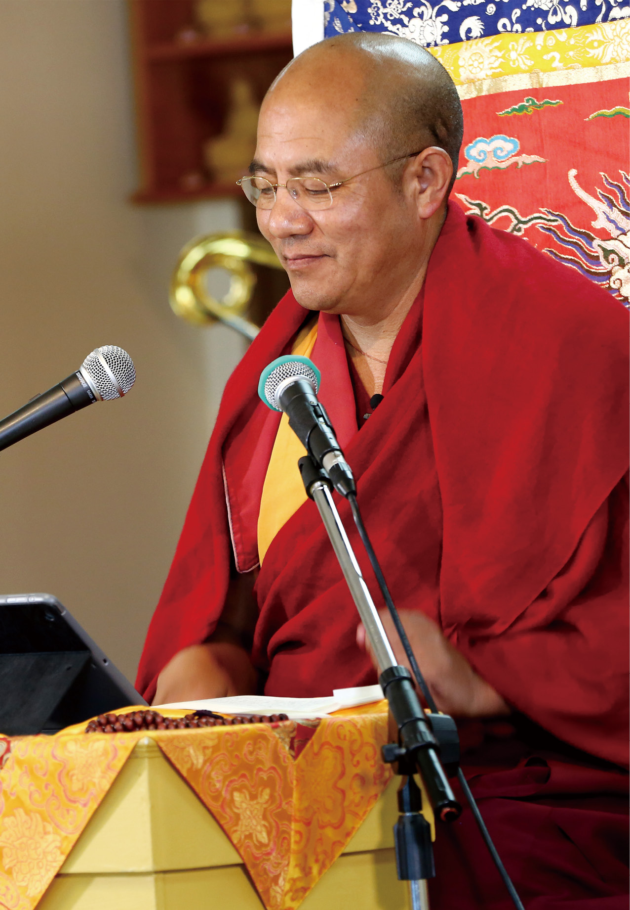
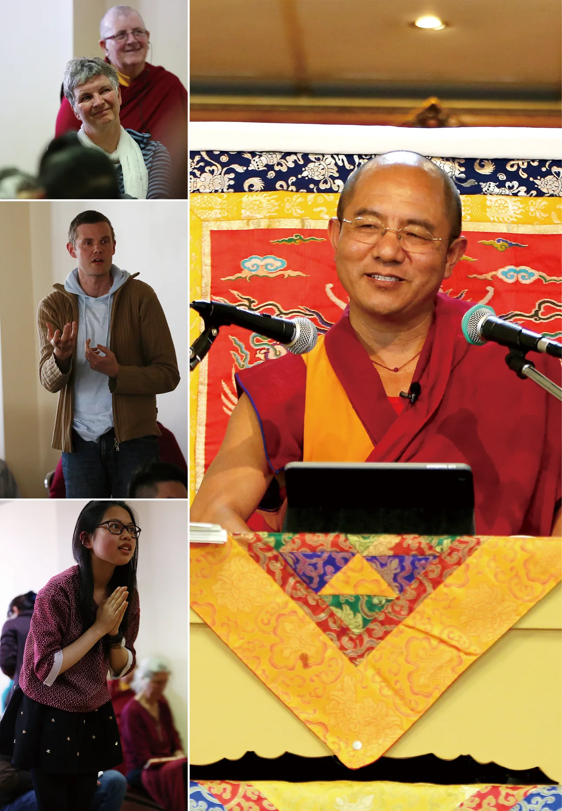

# 第2课

2014年10月7日

今天继续讲《入菩萨行论·安忍品》，这次我们准备用五堂课来给大家做简单的介绍。昨天第一堂课因为停电而没有直播，今天的课则有网上直播。在场的道友应该都有第一节课的传承，但是网上的道友应该没有，因此我先把昨天所讲的颂词用藏文给大家念一遍。

（堪布念传承）

以上是昨天的传承。接下来是念今天的传承，我会分为三个部分来念，每个部分大概有七个颂词。我讲解了前一部分的相关颂词后，才念下一部分的传承。

（堪布念传承）

在第一堂课的时候，我说过我们学习这部论是非常有必要的，因为现在的世间人烦恼深重，尤其有很多嗔恚心。嗔恚心能够毁坏我们自己的善根、毁坏家庭的团结以及破坏世界的安宁。嗔恨心对任何关系，不管是个人、家庭、人群、部落、国家之间的关系，还是人与动物之间的关系，都会带来非常大的损害。因此，大家要经常学习安忍，这是非常有必要的。如果你的心不能安忍下来，那你可能修不了更高的法。

此次新西兰这边的中心让我讲这几堂课，我是非常乐意的。藏传佛教的一些上师们经常在不同的国家、群体中传讲《入行论》。有时候他们实在没有时间把《入行论》全部讲完，只能传讲某些内容，这时候他们多会选择讲解“安忍品”，这是大家有目共睹的。我传讲《入菩萨行论》的次数比较多，曾经用一个月、两个月甚至几年的时间把它讲解完毕，但是从来没有单独传讲过“安忍品”，所以我觉得这次是一个很好的机会。

现场听课的道友，如果在工作等各方面允许的情况下，希望你们尽量把这五堂课听受圆满。如果有个别的课你们真的来不了，中心以后可能会把这五堂课在网上发布。不管怎样，大家学习任何一个法都最好把它听受圆满，而作为大乘修行人，你们只学习一遍《入菩萨行论》是不行的，应该每一年或者每三年就要重新学习，这非常有必要。我自己每过一段时间便会主动传讲《入行论》，因为在讲解的过程中自己也有机会学习一遍，否则很容易忘掉里面的诸多好道理。所以，今天我们非常有必要共同学习《入菩萨行论·安忍品》。

你们以后听课要像赶飞机一样——什么时候开始，所有人都要准时到达。我自己在任何场合，不管是讲课还是听课都很守时，而且对于课堂上的纪律，我的要求比较严格，这方面大家要注意。

遮破自主之作害者

现在我们继续讲解“安忍品”。前面说到生起嗔恨心有各种原因，它是一种缘起法。至于生起嗔恨心的缘起、原因，其他宗教各有说法。前几天，我们在奥克兰大学分析了世界上不同宗教各自的历史和观点。比如在印度有胜论派、数论派和其他的像耆那教等不同宗教，他们有各种各样的观点、理论，其中较为现代人熟悉的是：人类由造物主创造，而造物主是恒常不变的。

这种说法是否合理呢？当然，我们这里是讲安忍，不是去判断各种外道的观点是否合理。但是，我们有必要通过理论来对每一个宗教的教义进行剖析，过程中不需要太过在意会否令对方生气或者不高兴。在藏传佛教中，大德们会用最尖锐的理论来剖析格鲁派和宁玛派之间的不同观点；平时僧众互相辩论的时候，也会用最尖锐的语言来剖析对方的观点。总之，以理论对教义进行剖析是非常合理的。任何一个宗教，如果它的教义经不起观察，便很难令人信服。

此处要遮破的，是数论派[^1]和胜论派[^2]关于嗔恨心根源的说法，此二者在印度比较兴盛，而他们分别认为嗔恨心是由主物和常我产生的。你们也可以分析，应该怎样承认才算合理。

纵许有主物，施设所谓我，

网上的道友，如果你们有法本，最好是看着文字来听课，毕竟现在能够背诵《入行论》的人比较少。

数论派主张有主物，他们认为世间万法都由主物所造，包括人类和人们相续中的嗔心、贪心等等；胜论派假设、设施了一个所谓的我（一般称为神我，或者常我），他们认为这种我能够创造人类和世间的万事万物，包括嗔心。

以上两种外道的承许都不合理。为什么呢？

主我不故思，将生而生起，

主物或者神我有没有作意的分别念？他有没有“我要产生众生”的想法？或者有没有“我要生起众生心中的嗔恨心”这一分别念？

如果他有分别念，那是不合理的。因为他既然是主物、神我、世间的造作者，自己却被分别念所困扰和束缚，那他就是不自在、不自由的。这与外道自己的假设相违，有这样的过失。

如果他没有分别念，就是说没有创造的心，那他不可能有创造的行为。我们知道，世间所有人都不是一次性而是次第性产生的，那主物有没有次第性地去创造呢？比如他是不是要想：“我现在要造西方人，先造西方的某个人，然后再造东方人，之后再让某人的心里产生嗔心……”如果他没有分别念，那次第性产生的万事万物就不是由他所造。因此，认为主物创造一切只不过是外道自己的说法罢了，实际上这样的主物存不存在呢？真的难以成立、难以安立。如果这个主物没有分别念，就是说他没有任何计划、没有故意地、没有特意地创造，那便与我们所有人都承认的万事万物是次第性地产生的说法相违，是不合理的。

就算主物是故意去造作，我们也需要进一步分析外道的理论，比如主物是怎样故意去造人类？什么时候开始计划、创造？什么时候准备造每个人心中的嗔心、贪欲等心态？……这些都需要有个说法。

剖析之后，我们知道“主物创造我们的嗔心”之说法是不合理的。以上是总说，下面再个别分析数论派和胜论派各自的说法，说明他们都是不合理的。

首先破数论派。他们认为所谓的主物和我（或称神我）是常有的东西，这个我可以享受世界上的欲妙等一切外境，但是这种说法是不合理的，怎么不合理呢？

不生故无果。常我欲享果，

于境则恒散，彼执亦不息。

根据数论派的观点，所谓的主物是周遍于全世界的唯一东西，而且是恒常的，他有几种不同的特点。这个颂词第一句的意思是，既然主物是恒常、常有的，他就不可能有变化——不可能前一刻没有果，而下一刻产生了果。他只能恒常处于只有因、没有果的阶段。

我并不是反驳其他宗教的观点，但可能现在很多宗教徒也要对此思考，如果主物是常有、永远不变，那他不可能创造任何东西，包括某个人或者某个人心里的分别念——如痛苦，等等。

此外，数论派还承认一个常有的常我，他能够享受世界上色声香味触等所有外境，比如娱乐、妙音。如果他能够享受，而他本身是常有的，那他应该恒时都在享受。比方说，他看到一个美丽的花园，那这个花园应该永远都是美丽的，不可能变成一个丑陋的花园；如果他听到特别动听的声音，这个声音永远也不可能变成难听的声音，为什么呢？因为他自己的本体既然是常有，他所享受的所有外境也一定是恒常不变的。如果他今天听到动听的声音，明天听到不动听的声音，那说明他自己的本体已经有所变化。

刚才主办单位说网络不好，有时候可能会中断一下，但是也不会中断很久，希望网上听直播的佛友们注意。虽然我们心目中的新西兰是像天堂一样的世界，但是有时候也会停电，对此我也意料不到。他们本地人说过去10年未曾停电，我一来到就遇上了。（众笑）

刚才说到，如果常我是恒常不变的，那么他的享乐和对外境的任何执著永远都不能停息。如果他只会在某些时候执著外境，一时关心这位众生，一时不关心，那说明所谓的常我已经变成了无常，如此便与数论外道认为常我是恒常不变的观点相违。这方面大家需要好好地观察，人们把永远不能改变的东西称之为常有，但是这种常有的东西到底存不存在呢？如果存在，它具体的本性是什么样？作为宗教徒，大家要从理论上观察。

有些人可能会问：“佛教也说如来藏的本体是常有的，那会不会有以上关于常有的过失呢？”不会有过失。因为佛教的任何一部经典，都没有承认如来藏是一种实有、成实的东西。如来藏远离四边八戏，是一种不可思议的状态，也是空性和光明无二无别的法界性。佛教并没有说如来藏是一个实有的东西，也没有说无常是由此创造的，这在《楞伽经》和麦彭仁波切的相关论典中有着非常明确的剖析。

当时印度有个别的宗教认为，人们的嗔心不是从自己的想法中产生出来的，而是由一个外在和创造世界的主物、常我在背后操作而产生的，最后人们只能身不由己、被烦恼所转。但是寂天论师说，实际上这种说法不合理。

为什么呢？我们首先问对方：“你们所谓的操作者是常有的还是无常的？”如果对方答是无常的，那便与佛教所说的从因缘而生没有任何差别，下面会讲到这一点。无常就是因缘法，依因缘而生是合理的，佛陀也说：“诸法从缘生。”但是对方不承认因缘而生，却承许常有的因，如此就有我们刚才所说的过失。

前面是破数论派的观点，下面是破胜论派的观点。胜论外道认为常我产生嗔恨心，但是这种说法实际上也不合理。

彼我若是常，无作如虚空。

纵遇他缘时，不动无变异。

胜论派认为所谓的常我是恒常不变的，这个常我为什么偶尔让众生产生嗔恨心，或者产生贪心呢？对方说，他的本体是常有的，偶尔产生嗔心的根本原因是外缘的作用。比如我看到敌人，因为敌人这个外缘，所以我产生了嗔恨心；如果我看到一位特别可爱的朋友，依靠这个可爱的对境，我会产生执著的贪心。所以对方认为，常我本来是常有的，但是依靠不同的外缘，他产生了不同的效应。

人们如果没有详细地观察，表面上可能觉得这种说法没有问题，但是如果认真地观察，事实上这种说法是不合理的。为什么呢？如果所谓的常我，他的本体正如你们胜论派所承认的是恒常不变，那么外缘根本不可能对他起作用。为什么呢？因为他的本体就像虚空一样，如虚空般的常有不可能被任何外缘改变。

凡是常有的东西，任何因缘都不可能令它的本体有丝毫改变。如果这个常我的本体可以随外缘而改变，我们可以进一步分析：他在没有具足因缘之时的本体和他在具足因缘之时的本体——前者不是后者，后者不是前者，那已经有变化了，如此就破除了对方关于常我的观点。

如果对方承认造物者是常有，那么各种外缘对他也无济于事，他的本体不可能动摇、不可能改变。如果他的本体有所改变、有所动摇，那么他依靠外缘已经变成了无常，这就跟佛教所说的无常法没有任何差别，也违背了对方自己本来的观点——造物主的本体是常有的。

现在，很多人会思考世间的万事万物是不是由一个人或者神所创造？当然，个别的宗教会说，有某种具有分别念的造物主在掌控我们，但他们有什么具体的理论？这值得大家观察。前段时间我在学校演讲的时候引用了《爱因斯坦文集》中的一句话，爱因斯坦怎么说呢？他说：“你很难在造诣较深的科学家中间找到一个没有自己的宗教感情的人。但是这种宗教感情同普通人的不一样。在后者看来，上帝是这样的一种神，人们希望得到它的保佑，而害怕受到它的惩罚……可是科学家却一心一意相信普遍的因果关系。”他所指的因果关系并不是佛教中的善有善报、恶有恶报，而是指世间基本的客观规律，这与我们此处所说的佛教观点相近：无为法不可能产生有为法，有为法的因可以产生有为法的果。

此处所说的主物、神我，在其他宗教或者地方可能有不同的名称，但实际上都是同一种说法。大家要用自己的智慧来分析，一定要找到一个合理的说法。我们的分别念比较重，现在人们甚至对本来合理的东西也经常产生各种分别念。所以，不管你有没有信仰，遣除自他的分别念都是非常重要的。

无论你是学佛还是信仰其他宗教，甚至你没有任何宗教信仰，也需要一个理由。否则你光说自己不信任何宗教，“我才不信这些”，好像世人皆醉你独醒似的，但实际上没有信仰也是一种信仰。你认为不相信某种东西是合理的，那你这个“不相信”的观点或者智慧到底有多少可靠的依据？你不相信的理由是因为这是父母给你说，还是老师给你说的，还是你用自己的智慧抉择出来的？如果是其他人给你说的，那他们有什么依据？如果你自己认为“我不信才是好”，那么你的感觉也需要有个理由。

有些人只凭自己的感觉，就决定不相信某些东西，这种“不相信”真的是非常可靠的智慧吗？不一定。世界上人们不相信的东西非常多，但那些“不相信”不一定符合事实。比如我以前不相信海洋中会有国家，后来通过学习才知道，原来海洋中有很多岛屿国家。人们一般根据自己以前的阅历和生活环境来判断并选择是否相信某些事物，但到一定时候，当自己过去根本无法想象的一些事物现前时，人们才发现原来那些事物是值得相信的。

同样道理，大家没有学佛的时候，可能不相信轮回因果，但是通过很长时间的闻思修行，你不得不相信，因为你没有任何让自己不相信的依据。麦彭仁波切在《中观庄严论释》的总义中再三地说[^3]，我们一定要产生不为他人所动摇的信解，这很重要。这种智慧和坚固稳定的信心，需要通过反复地闻思和修行，才能逐渐生起。仅仅是看一本书，或者听一两堂课是不可能生起的。以上说了任何常有的事物都不可能被因缘改变的道理。

作时亦如前，则作有何用？

谓作用即此，我作何相干？

有些人认为本来“我”是常有的，但是依靠外在、无常的有为法，在因缘具足的时候可以产生嗔恨心、讨厌怨敌的心等等，这也是不合理的。怎么不合理呢？如果“我”的本体是恒常不变的常法，从来都没有改变，那就根本不可能起任何作用。

对方说，本来“我”是常有的，但是因为外在的因缘而起作用。那我们观察这个“作用”与原来的“常我”是一体还是他体？

如果此二者是一体，就是说作用跟这常有的东西是一味一体：原来是常有的东西，没有“作用”的时候是常有的，具足“作用”的时候也是常有的，这个东西从来没有改变过，那它起到什么作用呢？没有作用。

如果此二者是他体，那是什么样的他体关系呢？他体关系只有因果关系和同体关系。如果是因和果的关系，那常有的东西作为因、无常的东西作为果——这是不合理的，所以因果关系不成立；同体关系就如火和火的热性一样，无常和常有的关系如果就像火和火的热性一样，这也是不可能的。

所以，对方所谓的“起作用”根本没办法安立。

分清楚胜义谛和世俗谛

到底嗔恨心是怎样产生的呢？佛教说万法由因缘而产生，这是最合理的，我对佛陀所说的因缘法坚信不疑。佛经中经常讲到因缘法，比如《造塔功德经》云：“诸法因缘生，我说是因缘。”一切诸法由因缘而产生，这是佛陀用狮吼声宣说的。在世间所有学者和智者的声音当中，佛陀就像群兽中的狮子一样，没有任何畏惧地发出吼声：一切诸法都由因缘而产生，不是由谁来支配和造作。一旦因缘灭，相关的法也就灭了。大家要懂得万法本身是空性，但是在显现上确实是从因缘而产生，这一点非常重要。

是故一切法，依他非自主，

知已不应嗔，如幻如化事。

世间万事万物的法，没有一个是如其他宗教所说由主物、常我、常有的造物主或者其他东西来产生的，而是根据各自不同的因缘而生。我们知道这个道理后就不会产生嗔恨心。对方来骂我、打我、抢我东西的时候，我知道这是因缘而生，他并不是造物主派来的，也不是由谁在背后控制。

明白诸法由因缘而生是非常重要的，比如一个人来骂我，他为什么骂我呢？跟我自身的因缘有一定的关系，也和他的烦恼有很多关系，这方面我们之后会分析。表面上对方故意来害我、欺负我，但实际上当中有非常多的因缘，因缘具足后就会产生这些事情。如果大家用胜义谛的智慧去观察其中的因缘，其实每一个因和每一个缘，包括我和作害者全部都是空性，丝毫也不能成立。但是如果你没有详细观察，只要因缘具足的时候，各种法会现而不灭地存在，如梦如幻。

高僧大德和大成就者懂得因缘法，所以不会对众生产生丝毫的嗔恨心，反而会对他们产生极大的悲悯心。他们觉得这些众生非常可怜，没有懂得万法本来就是随因缘而显现，反而执著某些法为一件事物、一个人，还认为一个人的好与坏、所生的贪心、嗔心等都是实有的——这是多么可怜、愚痴的事情啊！他们以菩提心摄持，在因缘法的世界中显现各种身相来度化众生。通达万法真相的他们，不会对以因缘而生的法产生痛苦、贪爱和执著。即使他们在显现上有少许贪恋，但实际上不会执著，这是非常关键的。

大家应该经常思维：一切都由因缘而产生。表面上这个人看来在害我，但实际上是因为他自己有很多因缘，我和他之间也有很多因缘，所以他才会做出这样的事情。如果你没有通达因缘法，自己的心态便没法调整。一旦你懂得了因缘法，就像很多信仰佛教的人一样，很多事情都会想得开。在藏地，人们无论遇到什么事情，都经常说：“这是因缘法，没有办法”，这句话非常重要。

比如地震的时候，一些藏人的家里死了很多人，但他们不会自杀，因为他们知道这是因果报应，是因缘法；当家庭出现纷争、遇上很多问题或者离婚的时候，他们会说：“没有想到会变成这样，但这是因缘法。”

这是他们日常的口头禅，背后有着甚深的缘起性空之理，即万事万物在胜义中全部是空性，而在世俗中是如梦如幻。在因缘聚合的时候，有些事情确实会发生，那时候想阻止它们发生是没有办法的。万事万物都不能超离缘起性空，因缘是非常微妙的，这方面大家要明白。

有些人可能会想：“既然嗔恨心如梦如幻，我们就没有必要把它灭除。”也有些人可能会想：“我们自己也是如梦如幻，那我们不用修行了；既然全是如梦如幻，还修什么法呢？”寂天菩萨很聪明，知道很多人有这些分别念，他马上给我们说出法音：

由谁除何嗔，除嗔不如理。

嗔除诸苦灭，故非不应理。

刚才说到不仅嗔恨心是如梦如幻，就连敌人和自己也是如梦如幻，一切都是因缘而生，所以我们不应该产生嗔恨心。此时对方问：“既然一切法全是如梦如幻，包括你自己、你的嗔恨心和嗔恨的对境——怨敌也是如此，那谁来断除如梦如幻的嗔恨呢？”现在很多人分不清胜义谛和世俗谛，他们经常说：“一切万法都是空性，没什么可贪的。”但实际上他们连自己正在贪著也不自知，有诸如此类的现象。

虽然一切法如梦如幻，但若你没有断除如梦如幻的嗔恨，它仍会对你产生如梦如幻的痛苦。因此，大家要在如梦如幻的境界中，断除如梦如幻的嗔恨心，获得如梦如幻的快乐。同样，世界是如梦如幻的，但我们为了不要死于如梦如幻的饥饿，还是要寻找如梦如幻的食物，维持如梦如幻的身体，这是有必要的。这方面见解和行为还是有一定的差别。

有一次苏东坡去听佛印禅师的课，但说法地方的座位已经全满，就像今天我们这里一样。佛印禅师和苏东坡经常互相开玩笑。当时佛印禅师说：“今天学者没有地方可坐，因为所有座位都坐满了。”苏东坡说：“既然如此，那我可以把法师的四大五蕴假合之身当成座位。”苏东坡的意思是：如果没有空的座位，我可以坐在法师您的头上。他说得很不客气。

这时佛印禅师说：“我现在给你提个问题，如果你能回答，就可以坐在我的头上；如果你回答不出来，就要把你腰上的玉带留给我们寺院当纪念品。”苏东坡接受了挑战。佛印禅师问：“四大本空，五蕴非有，学者到底坐于何处？”意思是，四大本来是空的，五蕴都不是实有的，那你到底坐在什么上面？苏东坡回答不来，只好把他的腰带留在寺院。

我曾经对此开玩笑，如果我是当事人，会回答：“虽然本性上四大是空的，但是法师的四大如梦如幻地存在，我可以如梦如幻地坐在你如梦如幻的身体上。”不过苏东坡没有分清楚胜义谛和世俗谛，所以回答不出来，只好认输。

这个颂词说，嗔恨也是如梦如幻的，那我们有没有必要以修行来把它灭除呢？有必要，我们要以如梦如幻的修法来断除如梦如幻的痛苦。世俗中还是有必要把痛苦灭除。

一切法在胜义中全部是空性，但在世俗中并非没有显现。现在很多修行人分不清楚胜义谛和世俗谛，很多人听到万法皆空，比如《心经》所说的道理，就觉得世俗中也没有眼耳鼻舌等等，什么显现都没有，这种想法是不合理的。

纵使万法没有本体，可是我们在没有达到这种境界、没有证悟之前，一切万法都是如理如实地存在，所以我们一定要想尽所有办法证得如梦如幻的境界。虽然嗔恨心和作害者都是如梦如幻，但尚未证悟的我们仍然要用如梦如幻的对治方法来断除如梦如幻的嗔恨心，否则它还是会给我们带来危害。

总之，敌人对我们的加害是因缘所致，我们不应该对他们产生嗔恨心：

故见怨或亲，非理妄加害，

思此乃缘生，受之甘如饴。

通过前面的分析，我们知道一切万法都由因缘而生，包括今后我们在工作和生活上，也可能遇到两种情况：其一是与我关系从来都不好的冤亲债主和怨恨的敌人会来害我；其二是以前与我关系非常好的亲朋好友，尤其是自己特别珍爱的那些人，以后可能因为种种原因，或者没有任何道理地对我妄加诽谤，甚至加害。

现实中每个人都会面对这些情况：一些人是无缘无故地害我，一些人因为某些因缘而害我；另外，一些人一直都特别恨我，也有一些人以前跟我关系很好，尤其是某些亲人、生意伙伴等等，可是后来他们与我背道而驰，而且对我造成的损害比怨敌更为严重。现在很多人发现，其实敌人和素不相识的人对自己没有利益，但也没有害处，反而自己身边最信任、最可靠、最依赖的人，会出乎意料地对自己造成最严重的伤害，这种现象十分普遍。

这时候我们该怎么办呢？要以牙还牙、以怨报怨，还是通过其他方式来面对呢？此时我们应该好好地思维：事实上这些加害都有其因缘。大家一定要想到“因缘”二字，这两个字很重要。下面也会说到，害我的人可以是前世的亲人、怨恨的敌人，或者是不亲不怨的一般人。他们对我的作害可能有原因，也可能没有原因。

现实中真的会有些人莫名其妙地对你作出伤害。我一生都特别乐意去帮助别人，也非常认真地落实于行动，但有时候我也会遇到这种情况。比如我通过传法等从各方面帮助某个人，即生中我也肯定没有伤害过他，而且对他恩德很大，可是他不但没有报恩，而且还无缘无故对我特别不满意，进行诽谤。我只能解释为这是我的因缘，自己应该甘之如饴地接受。这确实是非常难以做到的，但是作为修习大乘佛法的人，我们都应该如此行持。

可能你们很多人也有相似的遭遇。比如你帮助了一位特别贫穷的人，让他成为你的生意伙伴，在你的支持下他终于事业有成，但后来他把你的所有生意和金钱全部骗光、偷光，对你造成特别大的损害。这时候你会想，如果当初没有培养他，自己便不会落得今天倾家荡产的下场，弄得这么可怜。你觉得自己今生不但没有欠他的地方，而且还赐予他很多利益。此时你要想到，这应该是自己前世欠他的，没有任何办法，只有安忍。

大家平时也会面对相似的情况，我自己也不例外。虽然我没有任何生意，可是在传授佛法的过程中，会经常遇到一些人莫名其妙地对我特别不满，甚至有意无意地做出伤害的行为。对此我经常思考，这些事情的背后都有其因缘。我身边的人也经常遇到这些事情，同样你们将来也会遇到——一些你对他特别好的身边人比如子女，将来他们长大后不一定会好好地对你报恩。

现在很多父母把所有希望都寄托在自己的儿女身上，把自己一辈子所有的精力和钱财全部用在他们身上，但是儿女长大之后不一定会报恩，他们有能力的时候也不一定会好好地对待父母，甚至对父母造成相当大的危害。所以大家要承认，人际关系的好与坏，是随很多因缘而变化的。

嗔恨心不随人们的意愿而生

（堪布念传承）

不知道今天有没有听英文翻译的道友？有一部分，是吧？今天没有来得及安排，但是过两天通过耳机有同传，那样会好一点。如果其他道友怕受翻译的声音影响，可以坐到前面来。翻译员最好大声地给需要听英文的道友翻译，受到影响的其他道友可以修安忍……开玩笑，也不能太大声，不然一些人安忍修不好，在课堂上吵起来也不好说，不过我想大家应该不会这样吧。

若苦由自取，而人皆厌苦，

以是诸有情，皆当无苦楚。

痛苦并不是随人们自己的意愿而产生。如果痛苦是随自己的意愿而生，而世间中任何一个人都不愿意自己痛苦，那么人们都不应该有痛苦了。事实上，不管你相续中产生嗔恨心还是痛苦，这些都有其因缘。明白这一点很重要，我刚才提到藏人常常说的“因缘而产生”，这是一个非常深的窍诀。我要再三强调：如果你在今后的人生遇到一些不愉快的事情，应该想：“哎呀，这是因缘而生的。”

其实这种想法对你自己也是很好的安慰，因为痛苦由因缘而生，所以这不仅仅是对方的错，你自己也是因缘之一，对方以外也有很多因缘才会构成你的痛苦。任何人都不愿意接受痛苦，同样，我们都不愿意自己的相续中产生嗔恨心。前面也提到，嗔恨心不是随一个人自己的意愿而生，比如你所怨恨的敌人不会想：“我一定要发起嗔恨心，生起嗔恨心之后便可以去战斗。”希特勒也不会想：“我现在一定要培养好自己的嗔恨心，然后在嗔恨心非常炽盛的时候去打仗。”只要产生嗔恨心的因缘具足，一系列的后果自然就会产生。

因此这个颂词说，嗔恨心并不是随人们自己的意愿而生；如果是随自己的意愿而生，那么世间中就不可能会有痛苦，因为每个人都讨厌自己产生烦恼和嗔恨心。现实中很多人发完脾气后都感到非常后悔：“哎呀，我那天不应该说那些话。”“那天不应该在众目睽睽之下骂人。”骂人之后，几乎每个人自己的心里还是会不舒服、不高兴。

学员：“别人骂我的时候，我不骂回去才后悔。”

堪布：“是吗？”

学员：“那天别人骂我，我忍了，可是之后特别后悔。我想他凭什么骂我？我也没有招惹他。但是我当时没有还骂，现在特别后悔。之后我很生气，气得缺了课，感觉自己正要去打仗似的。以前我会还骂，还骂的时候就感到特别爽。”

堪布：“那你现在怎么样？”

学员：“我一生气就憋，您看我脸上这些包，我预约了明天去医院检查。所以我要把这个理论好好地想一想，因为我是无缘无故被骂的。”

堪布：“无缘无故啊？”

世间所有众生都不愿意受苦，但是现实却与此完全相反，众生往往要在自己不愿意的情况下承受痛苦，比如无缘无故受到别人的谩骂。这说明嗔恨心并不是人们自主所造、自愿而来的。如果包括嗔恨心等所有烦恼都从众生自己的意愿而生，就是说烦恼已经把握在自己的手里，那一切众生都应该没有烦恼。因为所有众生都愿意自己的心态平和、正常；不愿意产生各种烦恼，然后被它们束缚以致产生极大的痛苦。

每个众生由于其业力、因缘各不相同，因此所感受的果报也各有差别，即生中大家所感受的痛苦还是跟其他众生不一样。佛经中有一位非常著名的尊者叫优波鞠多，有一次他去化缘的时候，看到渔夫的家里有一个孩童，这个孩童跟其他人完全不相同。怎样不相同呢？这位孩童已经获得了圣果，但是他的口里有着非常难闻的臭气，身上长满各种疮。当时尊者的很多眷属都不理解，为什么已经获得圣果的人还会有这样的情况呢？

优波鞠多说了小孩前世的因缘：这个孩子前世是维那师，有次一位阿罗汉发出一些让他很厌烦的声音，因此他生气地对阿罗汉说：“你身体是不是被虫吃掉了？”然后就把对方丢到低贱人的家里。以此因缘，即使孩童现在已经获得圣果，但是还要感受这种痛苦。

有些众生正在明显地感受与他众不同的痛苦，因为他们有各自不同的因缘。因此大家要想到，痛苦不是随人们自己的意愿而显现的。若痛苦是随人们的意愿而显现，那大家都知道，谁也不愿意感受痛苦，没有人会有生起痛苦的意愿，如此我们的世界就应该没有痛苦——但这与现实不符。

作害者是悲悯之对境

在产生烦恼、非常苦恼的时候，我们不仅会做害人害己的事情，也会对自己最心爱的人漠不关心；别人也是同样，所以我们要原谅别人的嗔恨心：

或因己不慎，以刺自戳伤，

或为得妇心，忧伤复绝食，

纵崖或自缢，吞服毒害食，

妄以自虐行，于己作损伤。

世界上很多人因为没有很好地观察，不知道烦恼的本体不是自性存在，所以在烦恼现前的时候，很有可能做出伤害自己的事情，这种现象比比皆是。比如，一些人会用刀或矛刺伤自己；一些人因为得不到异性的欢心，或者遇到感情上的问题，便特意去绝食、自杀、跳楼等等；一些人会以跳崖、服用毒药或用绳索上吊的方式来自尽。

在国内，人们不能一次买很多安眠药，每次只能买一两瓶，医院对此也有控制，以防一些人把买到的安眠药全部吃掉，然后永远沉睡。不过，仍然会有一些打算自杀的人，今天买一点，明天买一点，一个月后把积累的安眠药全部吃掉——买的时候是次第性地买，吃的时候是一次性地吃。这些人会以服用毒药等种种非理方式来虐待自己、杀害自己；如果连自己也伤害，那对别人就更不用说了。

产生烦恼的人确实特别可怜。人们平时对自己的身体那么执著、那么爱护，但是在生起烦恼的时候，也会伤害自己的身体、选择自杀。八十年代中国有一位出名的诗人叫顾城，当时很多年轻人喜欢读他的诗。他后来移民到新西兰这里，有一次因为感情问题，他先用斧头把妻子砍死，然后自己也吊死在一棵树上。你们这里的树特别大，昨天我在一个花园看到一些树，就想：“这是不是顾城自杀的地方？”但应该不是那里。当烦恼真正现前的时候，人们可以伤害自己的妻子、儿女等等，就像疯子一样失去自制能力。

之前看过一则新闻：有一位平时热爱打麻将的母亲，因为怀胎生孩子所以六个月没有打麻将。有一次她准备给孩子洗澡，便把孩子放在盆里，但是由于盆里的水冷了，因此她把盆子放在炉子上，打算稍微加热一下。此时她收到朋友的来电，说缺一个人打麻将，于是她赶紧跑去打麻将，连孩子放在炉子上也忘记了。她丈夫回到家里的时候，孩子已经被煮死了。这位丈夫非常生气，他拿着刀冲到麻将馆，把妻子的两只胳膊砍断了。后来因为来不及抢救，这位妻子也死了。实际上这位丈夫既爱自己的孩子，又爱自己的妻子，但是在盛怒之下，他没有来得及观察，便马上砍死了妻子。

不管是自己还是别人，在日常生活中产生嗔恨心是非常可怕的。月称论师在《中观四百论广释》中说，一个人在生起嗔恨心的时候，他的精神是不正常的，因此身边的人应该对他慈悲，不要对他生厌。比如，一位高明的医生知道病人的精神有问题，他根本不会在意病人的行为，不会对病人生气。

大家以后也应该如此行持，当你遇到别人十分生气、爆发嗔恨心的时候，要知道他已经发疯了、精神不正常，不应该把他的行为记在心上，这时候跟他讲道理是没有用的，要等他心情平复后再跟他讲。

因嗔恨心而失去理智的情况，不仅会在个体中出现，也会在群体中出现。世界上很多战争不仅仅是一个人就能发动的，当人群集体产生嗔恨心的时候，就很有可能爆发战争。在人类历史上，很多不愉快的历史事件都是源于人们的嗔恨心，比如第一次和第二次世界大战，当时很多国家的民众都产生了极大的嗔恨心。

人们在生了嗔恨心后，可以连自己最爱的身体和家人都不顾，做出自杀的行为，这时候他们根本不可能理会其他人的感受，因此他们对我做出伤害的行为是情有可原的。大家以后在家人、朋友生气之时，不要讨厌他们和他们的行为，他们也是身不由己。

下面也会说，当别人怀着嗔恨来害我们的时候，我们怎么办？要想到对方的行为情有可原，要理解、包容他。你们以前可能经常跟家人吵架，或者遇到一些不愉快的事情就马上生气，但是在学习了《入菩萨行论》后，我想你们很多人的性格会有所改变，脾气变得温顺，这是很多人的经验。

上师如意宝在讲解《入菩萨行论》的时候，说到他年轻时的一个故事。上师十来岁的时候，他的寺院正在传讲《入行论》，当时有几个特别调皮的小喇嘛——年纪很小的出家人，他们经常逗寺院里一位叫卓玛的老太太。每次卓玛老太太提水的时候，这些小出家人就逗她，特别调皮，让老太太非常生气。她气呼呼地对他们说：“难道你们不是在听《入菩萨行论》吗？以前我在竹庆寺的时候，很多出家人听了《入行论》后性格越来越温顺，可是你们这些小和尚却越听越调皮，性格也越来越差劲。”毕竟那些小喇嘛年纪还小，可能没有认真地听。他们反而变本加厉地逗老太太，让她更加生气：“我要向你们的法师告状！学习《入行论》应该变得越来越温顺，但是你们却越来越调皮！”她跟法师告状后，法师就开始打那些小和尚。

你们在听完《入菩萨行论·安忍品》后，自己的性格不应该像那些小和尚一样，应该变得越来越温顺。可能你们以前经常跟家人、同事及其他人发生摩擦，或者遇到一点事情就会不开心，马上骂人，但是以后应该会有所改变，这就是佛法的作用。

我也特别喜欢这部《入菩萨行论》，它确实对很多人有帮助。许多道友跟我分享，他们在学习了《入行论》后，人生有了新的思考和方向。的确如此，用佛教的术语来说，这是大乘佛教不可思议的加持；用现代人的说法，这是非常好的教育。《入行论》的确是人生中特别难得的一本书，所以大家应该好好地学习。

自惜身命者，因惑尚自尽，

况于他人身，丝毫无伤损。

即使众生特别珍惜自己的身体，但是在烦恼的牵引下，他们还是会一反常态，伤害自己、结束自己的生命，那么伤害与自己毫无关系的人更是意料中事了。

现在自杀的人数非常多，不知道新西兰的自杀人数多不多？也多啊？听说在发达国家，80岁以上的人自杀比例很高，为什么呢？

大家想一想，像汶川地震、马航客机失事等灾难性事件，确实有很多死者，但实际上自杀的人数更多——现在中国一年就有大概30万人自杀。以前台湾有些法师用各种方式来呼吁，全世界的社会要通过教育来防止自杀，控制自杀人数，但从数字上看，我们现在所做的仍然无济于事。

大家现在学习了这么殊胜的论典，应该明白自杀只不过是在烦恼驱使下的行为，没有任何好处。有些人会想：“活着没有意义，还不如死掉算了。”其实活着还是有意义的。前段时间我去了监狱讲课，我跟里面的人说：“你们不是最可怜的人，自杀的人才是最可怜的。虽然你们暂时没有自由，但是还有生命，你们今后只要努力，还是可以看见外面的世界。”大家的心要宽广一点，尤其是年轻人，不然你很容易受到现在的网络和媒体影响，遇到一点问题就自寻短见。

故于害我者，心应怀慈悯，

慈悲纵不起，生嗔亦非当。

害我的人是非常可怜的，我应该尽量对他们产生悲悯心；即使对他们生不起悲悯心，也不应该产生嗔恨心，因为害我的人非常可怜，他们自己也非常痛苦。

按理来说，学习大乘佛法的人应该对作害者产生悲悯心，不应该生嗔恨心。有时候世间人也会表现出宽宏大量的胸怀。以前英国有位首相叫威尔逊，他在竞选期间举行了一次街头演讲，当天一个年轻人朝他扔鸡蛋，打在他的脸上，蛋清、蛋黄布满了他的脸，让他很长时间都睁不开眼。他擦脸后，若无其事地对那位年轻人说：“你打得非常准，很不错。要是我当选了首相，我会要求国防部长把你的技术用上。”这些政治人物也许内心非常生气，但是表面上装作若无其事，当时很多媒体说他的脸色没有任何改变。如今在美国的选举过程中，候选人有时候也会被扔鞋、扔鸡蛋。

作为修行人，如果别人向你扔鸡蛋，而你马上就想扔什么东西回击，那说明你的修行真的不成功。你看世间人为了达到选举的目标，可以在别人面前装作若无其事，擦掉脸上的蛋液后还要赞叹对方；我们作为修行人，尤其是学习大乘佛法的人，能不能做到呢？大家有必要扪心自问。

此外，当别人做出嗔怒的行为，比如害我、打我的时候，这到底是不是他的本性呢？我们该不该因此生气？大家有必要用智慧来观察：

设若害他人，乃愚自本性，

嗔彼则非理，如嗔烧性火。

若过是偶发，有情性仁贤，

则嗔亦非理，如嗔烟蔽空。

棍杖所伤人，不应嗔使者，

彼复嗔使故，理应憎其嗔。

当敌人以嗔恨心来害我的时候，我要观察这种嗔恨是不是敌人的本性。此处用两个角度来观察。

如果嗔恨是敌人的本性，我不应该对他产生嗔恨。因为他本身就是烦恼深重的粗暴之人，就像火一样，谁跟他接触都会被燃烧，所以对于具有嗔恨这种恶劣本性的敌人，我不应该对他生气。

如果嗔恨不是敌人的本性，也就是说他的本性是贤善的，只是偶然生起了嗔恨心，那我也不应该对他生嗔恨心。为什么呢？因为嗔恨不是他的本性，只是偶然发生，就像乌云不是虚空的本体，乌云只是偶尔遮蔽了虚空，不可能永远把虚空遮蔽。既然嗔恨不是对方的本性，那他对我是无利无害的。

大家以后遇到别人对你不好、谩骂你的时候，要像寂天菩萨一样用智慧观察：“他到底是不是个坏人？如果他是个坏人，我没有必要生气，因为他就像恐怖分子一样，谁跟他接触都会非常危险，跟坏人接触肯定会有不快的遭遇，所以我不用对他生嗔恨心；如果他是个好人，那他只是暂时有点让人生气而已，如此我也不用介意，因为这并不是他的本性，所以我也不应该生嗔恨心。”

我昔于有情，曾作如是害，

既曾伤有情，理应受此损。

我们今生遇到的任何损害，都跟自己的前世有一定关系。虽然今生我没有对某人做过坏事，但是因为我前世害过他，对他造了恶业，所以他今生会害我，这是事实。

佛经中有一个公案。一个女人的孩子险些要被罗刹女吃掉，她抱着孩子来到了佛陀面前。佛陀告诉她，其实她和罗刹女之间的怨恨不是这辈子才产生的，她们已经冤冤相报了很多世。在最初的时候，一个女人经常拿一只母鸡的孩子来吃，当时母鸡生了嗔恨心，并且发愿：“你经常吃掉我的孩子，将来我也要吃掉你的孩子。”母鸡在下一世投生成一只猫，而那个女子则投生成一只母鸡；那一世猫经常吃掉母鸡的孩子，当时母鸡产生嗔恨心，并且发恶愿将来要吃掉那只猫的孩子。再下一世的时候，猫投生成一头驴，母鸡投生成一头豹，而豹经常吃掉驴的孩子。她们就是这样生生世世冤冤相报，到了佛陀时代，她们就投生成罗刹女和那个女人。众生之间的恶缘，佛陀是完全了知的。

众生只能看到今生的事情，有时候你觉得跟某人有非常大的冤仇，无论你怎样善待对方，对方仍然不断地害你。事实上，在漫长的轮回中，今世是非常短暂的，你现在感受到别人的无故加害，背后一定有很多因缘，其中之一就是你前世的业力，这种说法非常正确。

此外，我是自己痛苦的因缘之一，所以我不应该对怨敌生嗔恨心：

敌器与我身，二皆致苦因，

双出器与身，于谁该当嗔？

当别人用棍棒或者其他东西来打我时，我不应该生气，为什么呢？因为我提供了身体、别人提供了武器，依靠这两种因缘才会产生我的痛苦。

一般情况下，如果别人打我们，我们会生气：“啊！你怎么能打我啊？”其实这是不应理的，为什么呢？因为我们生气的原因是身体有痛苦，而痛苦的产生有两个条件，其一是别人所提供的武器，其二是我们自己所提供的身体；此二者只要其中一个不具足，就不可能产生我们身体的痛苦。所以，如果我们在因缘上详细地观察，其实此二者没有任何差别。

身似人形疮，轻触苦不堪，

盲目我爱执，遭损谁当嗔？

身体如同人形的大脓疮，轻轻触碰也是苦不堪言，众生因为执著这个特别脆弱的“我”，才会遭受各种痛苦。凡夫的身体很脆弱，一点痛苦也忍耐不了，十分可怜。受苦之时我们不应该怪别人，应该怪自己，因为一方面我们将本来不存在的五蕴执著为“我”，另一方面这个五蕴的“我”极其脆弱，只要接触一点火星就忍受不了，听到别人的一句话或者稍微被碰一下就承受不了。

众生执著一个没有意义的“我”，因此给自己带来很多痛苦。所以，无垢光尊者在《大圆满心性休息》中说：“一切痛苦不乐根，此身极大烦恼源。”

（堪布念传承）

愚夫不欲苦，偏作诸苦因，

既由己过害，岂能嗔于人？

愚昧的凡夫希求快乐，不愿意受苦，但是偏偏经常造痛苦的因，希求和行为背道而驰。我们以前根本不知道自己在造痛苦之因，比如对别人产生嗔恨心，现在才知道这是不合理的。佛陀在《业报差别经》中说：“一切众生，系属于业，依止于业，随自业转。”一切众生都系缚于业的范围之中，只能随业而转，业果成熟之时也没有办法。

从前琉璃王进攻释迦族人，释迦族请求佛陀保护，佛陀说释迦族的业力现前，他也阻挡不了琉璃王。之后，目犍连用神通把释迦族人放到钵盂里，再把钵盂拿到三十三天。他打开钵盂的时候，那些释迦族人都变成了血水。所以说，众生业力真正现前的时候，谁也没有办法保护。

现在，很多人想方设法医治一些病人，或者释放一些关在监狱里的人，但这是很困难的。有时候业力现前时，他们今生一定要感受这些痛苦。下面用比喻来说明这个道理：

譬如地狱卒，及诸剑叶林，

既由己业生，于谁该当嗔？

宿业所引发，令他损恼我，

因此若堕狱，岂非我害他？

为什么说我们所受的痛苦都是业力现前呢？比如地狱里的阎罗卒、狱卒、武器、剑叶林、塘煨坑、所有的寒地狱和热地狱等等，这些并没有人特意去设计、打造，只要众生自己的业力现前，这些现象就会出现。所以，地狱里的业力众生不应该对谁产生嗔恨心。

我探访监狱的时候也有这种想法。监狱里的众生由于今生在人间造了恶业，业力现前就会显现监狱的高墙、狱卒等，在这种环境下感受痛苦。一些犯法的人由于业感所致，最后只能待在里面，所以大家要诚信业因果。世间有些事情你不想它发生，但是业力现前时你根本控制不了。在业力方面，大家今后在处理问题的时候，应该详细地思维。

《大圆满前行》提到一个公案：一位在山林居住的比丘正在煮法衣，准备给法衣染色。刚巧有人丢失了一头小牛，找牛的时候碰上了这位比丘。他打开比丘的锅，此时大家都看到里面正在煮牛肉，完全没有法衣和染料，所以大家都认为比丘偷了小牛。国王为了惩罚比丘，便把他关进监狱，而那时候比丘的弟子全部都记不起这位师父。12年过去，比丘的弟子以神通观察，发现上师被关在监狱，他们就把事情的经过告诉国王。国王听后很后悔，自己竟然把一位大德关在监狱。当时比丘说：“这也没办法，是我自己的业现前。”然后比丘讲了他前世的故事，原来他前世当农民的时候冤枉了一位独觉，让这位独觉坐了很长时间的冤狱。以此原因，比丘今世要感受冤狱的果报。

所以说，我们现在看到的一些现象，都跟我们前世的业有一定关系。显现上，梦参老和尚被关在监狱三十多年，他自己也经常说，这是自己的业现前。后来，梦参老和尚遇到一位被关了两个月的和尚，这位和尚不断地抱怨。梦参老和尚对他说：“你应该像我一样被关33年。哪有被关了这么短时间的人，就抱怨得这么厉害的。”

今后大家在生活中还会感受不同的痛苦，此时你要想到，这是自己的业现前，不应该有很多抱怨，也不应该对任何人生气，这些都没有必要。我们所处的任何一个环境，都跟自己的业有关。昨天一些道友问我：“我们在新西兰这里不太习惯，感到很痛苦，但是现在又不方便回国，我们该怎么办？”我说：“你们现在的业就是如此，先待在这里，等这个业消了再说。”

大家应该想到，不管在任何地方，我们都要承受自己的业。在探访监狱的时候，我确实对此深有体会。一个人只要做了不好的事情，相应的果报自然会在自己的相续中成熟，到了一定时候，果报定会现前。所以在某种意义上，地狱和监狱是一样的，只不过果报成熟的时间根据不同的因缘而有快有慢，前者是下世的显现，后者是今生的显现。当然，众生除了感受痛苦的业，也可以感受快乐的业，所以希望大家以后多做善业，不要造恶业，否则对你自己的今生来世都不利。

其实敌人对我们也是有帮助的，下面宣说具体的理由：

依敌修忍辱，消我诸多罪，

怨敌依我者，堕狱久受苦。

若我伤害彼，敌反饶益我，

则汝粗暴心，何故反嗔彼？

依靠怨敌，我现在可以修安忍，消除自己多生累劫的罪业，最终能够获得解脱；至于怨敌，他们现在依靠我而生起嗔恨心，之后会在地狱受苦。如此看来，我实际上害了怨敌，而他们反而饶益了我，因此我不应该对敌人产生嗔恨、粗暴之心。

这时候一些人可能会有一些疑问。

若我有功德，必不堕地狱，

若吾自守护，则彼何所得？

一些人会想：“敌人因为我而产生嗔恨心，最后堕入地狱，那我会不会因此堕入地狱呢？”另外还有一个疑惑：“我现在依靠敌人修了安忍心，获得功德，那敌人会否因为成就了我的功德而不堕地狱呢？”有些人可能会这样反过来问。

这个颂词的前两句回答了第一个问题，作者说我们不会堕入地狱。为什么呢？因为因果是依靠众生各自的心来造作，并不是依靠外缘。现在我对敌人如理如法地修安忍，并没有对他生起嗔恨心，没有对他以牙还牙，如此只有功德，没有恶业，那怎么会堕入地狱呢？不会的。虽然敌人因为生起嗔恨心而堕入地狱，但是我自己在修安忍，所以我不会堕入地狱。

此颂的后两句回答了刚才的第二个问题——如果敌人成就了我，他能不能获得解脱呢？不能。因为我对敌人修安忍，是在保护我自己的心，但是对方在生嗔恨心，他没有保护自己的心，我的安忍也不能保护他的心，那他怎会得到快乐的果呢？一定得不到的，这就是心的差别。

可能很多人都有同样的疑惑：“如果敌人因为我而生嗔恨心，就是说我作为别人生嗔的外缘，那虽然我在修安忍，但是我会不会堕入地狱呢？”不会的，因为你在修善心，心善地道善，所以不会有过失。

此时有些人可能会有另外一个问题：“若我故意害别人，让别人修安忍，那能否让他获得快乐呢？”

若以怨报怨，则更不护敌，

吾行将退失，难行亦毁损。

有些人想：“如果我加害别人，让他的安忍增上，能否让他获得解脱呢？”这是不合理的。如果我们去害别人，别人不一定修得了安忍，反而可能让他的烦恼更严重，那就更加危险了；此外，我们也失毁了自己的菩提心和安忍心。因此这种做法肯定是不合理的。

现在有些电影或者电视剧，包括藏传佛教的电影，都有一些出家人跟别人打打杀杀的情节，比如敌人到寺院打出家人，出家人便拿着刀枪还击，或者出家人用少林武功伤害众生。事实上，这些都不符合大乘佛教的教义。根据大乘佛教的教义，别人害我的时候，我要修安忍，但是我不会害其他人以让他们修安忍，因为别人不一定有这种境界。

有些佛教徒会以“让别人修安忍”为借口，故意害别人，这是不合适的，大家最好不要这样行持。有些人说是想让家属多修安忍心，便经常骂家人，但是对方不但修不成安忍，反而会造很多恶业，因此以怨报怨是不合理的。

心意无形体，谁亦不能毁。

若心执此身，定遭诸苦损，

轻蔑语粗鄙，口出恶言辞，

于身既无害，心汝何故嗔？

此处通过另一种方式来观察。当敌人诽谤我，或者用嫉妒的语言来谩骂我的时候，其实我没有任何损害，我不应该生嗔心，为什么呢？因为这对我的心和我的身体都没有构成危害。所谓的“我”只有我的心和身体，除此二者之外没有其他的我。

首先，别人的谩骂、诽谤对我的心或者意识没有伤害。我的意识本来就没有颜色、没有形状等等，因此别人根本不可能损害我的心。另外，我的心所执著的这个身体，也不可能被别人的语言所损害。

这个观察很尖锐。你们可以想一想，当别人骂你，或者用最难听的语言来诽谤你的时候，比如背后说你坏话，诽谤你偷东西等等，对方的语言伤害了你的心还是你的身体？如果说是伤害了你的心，你的心本来就没有本体，它没有颜色、没有形状等等，谁也找不到自己的心在哪里，所以对方的语言不可能对你的心有任何危害；如果说是伤害了你的身体，但是你的皮肤、骨骼、肌肉等都是完整无缺的，所以对方的语言不可能对你的身体起到任何作用。

现代人真的需要修安忍，尤其是一些国家的总统候选人，一定要把安忍修好，因为他们会受到各种各样的抨击。这时候学过《入行论》的候选人会有优势，在受到别人谩骂的时候，他们会想到这不可能对自己的身体构成损害，因为语言和身体根本是两个本体；此外，他们也会想到这对自己的心更加没法构成损害。所以，在自己的身心都很健康的情况下，他们不会在意别人的恶语、粗语。对他们来说，这些语言只不过是空谷回声，是别人口里吐出来的空气罢了，瞬间便消失无踪。

如果大家达到像寂天菩萨那样的境界，便不会在遭受别人谩骂的时候以牙还牙，和对方吵架。一般人们吵架，刚开始的时候声音比较小，然后声音越来越大，隔壁的人也能听到，不久之后周围的人全都听到了。

藏族人有句话：“长期吵架的人没有人劝，长期生病的人没有人看。”意思是，第一次生病的人亲朋好友会去探望，第二次生病的话，别人也会去探望，但是对于长期生病的病人，别人不可能每天都去探望，最后就没有人去探望他；劝架也是如此，如果一个人只是偶然吵一两次架，别人会去劝一劝，但是对于长期吵架的人，别人不会理会他：“他们家天天吵架，劝不了的，不要去管了，还是算了吧。”

所以，大家最好不要长期生病，更不要长期吵架。如果你听到一些难听的语言，就想：“这些语言对我的身心都不构成危害，我为什么要生气？我还是好好地保养自己的身体。”因为生气的话，你的气血就会不足，对你的五脏六腑都不好。希望大家今后都能成为一个健康的人。

现场互动

⊙ 问：请问堪布，刚才您说：“心意无形体，谁亦不能毁”，我觉得很有道理。我们生活在这个社会，每一个人都有自己的群体，总会受到周围的人关注。我们都希望在自己的群体中有一个好的形象，而我们自己也应该是诚实、忠诚、善良的。所谓“谎话说一千遍就变成了真理”，如果我们总是受到诽谤，虽然所有事情都有其因缘，此时我们应该修安忍还是有必要适当地解释？

堪布：我觉得适当地解释也是合理的。“千遍谎言成真理”的确是一个事实，不过，我们没有必要一遭受诽谤就马上用各种语言去攻击他人。我们还是可以在不同的场合中适当地解释、合理地了解其他人的想法，或者用其他方式来探讨事情、理性地处理问题，这些都是必要的。佛教并没有要求我们对现实中别人的所有行为，像无因诽谤等全部默默承受。所以，大家可以在不同的场合以合理的方式来解决问题，前提是我们要懂得其中的因缘，不能带有嗔恨心。

⊙ 问1：如果我遭到诽谤，但是对方不讲理，在我尽力解释后他仍然胡说八道，此时我可不可以骂他？

堪布：可以，你可以跟他一起胡说八道。（众笑）

问2：刚才您提到生嗔恨心会堕地狱，总之对自己没有益处。但是我觉得我的嗔恨心是对方给我的，如果我不把嗔恨心塞回给他，我自己还要堕进恶道，那是什么道理呢？所以我觉得，对方让我生气，我也要让他不好过，为什么我还要安忍？

主持人：对不起，堪布，打断一会。这位妹妹，你可以做你想做的事情，如果你还骂之后，心情平静了，那可以再来找堪布，好吗？

问3：我已经做了我想做的事情，但是我不平静。我的意思是，与安忍相比，还骂让我的心里更舒服。如果我不还骂，心里就特别郁闷，心情也不能平复。至少在我还骂的那一刻，我自己爽了。

主持人：知道了，你现在就是为了要爽。等一下我们可以再讨论这个问题。

⊙ 问：顶礼上师！人们通常都带着极大的恐惧心理去面对和经历死亡，您曾经在开示中讲过我们要利用佛法去利益临终者。另外，索甲仁波切在他的著作中也有提及，如果我们能够让临终者在安详圆满，没有恐惧、无有挂碍的心情下经历死亡，那是极大的布施。如果我们面对的是一位没有次第修学、没有闻思修行的临终者，他在奄奄一息的时候仍然非常留恋这个五浊恶世，完全生不起出离心，我们应该如何开展临终关怀工作？您刚才说每个人在业力现前的时候也改变不了什么，我可以这样理解吗？请上师开示，谢谢。

堪布：临终关怀是非常重要的，这方面值得我们佛教徒关心，因为我们接触的人非常多，而每个人都要面对死亡。当然，我们的临终关怀不一定适合某些人群，因为他们有个人、家庭、传统规矩等各方面的考虑。但是，对于一部分人像佛教徒和佛教爱好者等等，我们有两种方式来开展临终关怀工作。

其一是根据临终者的生前所学，为他做临终关怀。比如他是学净土宗的，那就给他多念佛号；如果他学过中阴法门，或者曾经与其他法结缘，关怀工作就以那些法门为主。

其二，如果临终者以前没有与一些法门结缘，或者没有学佛，我们至少可以在他的耳边念一些观音心咒和阿弥陀佛圣号，这对他非常重要。临终之时，人们连世界上的一针一线都没法带走，此时临终者最需要什么呢？需要善的声音和善的意念。

功德光为《毗奈耶经》撰著了一部注疏，当中说到人们在临死的时候产生善念非常重要，如果那时候能够产生忏悔心，以前的罪恶也能清净。明白这个道理后，我们一定要根据临终者当时的情况，以适合他的方法来做临终关怀，不一定对所有人都要用同样的方法，这跟佛教所强调的善巧方便、应机施教是如出一辙的。

比如这位临终者以前只学净土宗，我会主要为他念阿弥陀佛圣号或者观音心咒，因为观音心咒和三宝的名号对任何众生都有利益。在藏地，人们会为临终者念“嗡玛呢巴美吽”，这跟汉地为临终者念“南无阿弥陀佛”的传统类似。表面上这些念诵看起来是一件小事，但事实上对逝者有非常重大的意义。因此在临终关怀方面，大家应该在不同国家、民族中以不同的善巧方法来帮助众生。

⊙ 问：佛教讲“人身难得、寿命无常”，如果修行人能够很深入地理解个中意义，我相信很多人会对行善和修行有迫切感。不过纵观全世界，人口非常泛滥，特别是在亚洲；另外，现在一些心理学医师会以催眠的方式来为人们做前世回溯，很多人发现他们的前生也是人的身份，所以我心底里总觉得人身并不是特别难得。当然，我知道自己要生起人身难得的感受，这会对我的修行很有帮助，但是我好像没有那种迫切感。希望堪布能够通过一些比喻，来给我们形容人身到底有多难得。

堪布：佛教所讲的人身难得，并不是说所有人的人身都很难得。藏传佛教中的米拉日巴尊者曾经对一个猎人说：“佛说人身难得，但像你这种用来造恶的人身，并不难得。”这句话引申出什么意义呢？佛教所说的人身难得，是指暇满人身难得，即远离八种无暇[^4]、具足十种圆满[^5]的人身。这不仅是藏传佛教的说法，汉传佛教中也有宣说八种闲暇的佛经（《佛说八无暇有暇经》）。

人身可以分为普通人身和珍宝人身。前者就是一般的人，跟动物没有什么差别，只是关心后代、繁衍、吃喝，这些人不具有修行解脱的顺缘，因此这种人身并不难得。而后者珍宝人身，就是佛教中最难得的人身，这种人即生可以生起出离心等功德，踏上解脱之道。

关于暇满人身，《大圆满心性休息》的第一品讲得非常细致，其中也说到哪些是难得的人身，哪些是一般的人身，哪些人身比旁生还可怜——有些动物只吃草、不损伤任何生物，但是有些人所造的恶业比旁生还厉害，这样的人身很可怜、并不难得。以上是一个方面。

从另一个方面来说，与地狱、旁生、饿鬼相比，人身还是难得的，为什么呢？因为此三道的众生数量非常多，而获得人身的众生数量非常稀少，前者就像晚上星星之数，后者犹如白天星星之数。从数目来看，人身和其他动物比较起来确实难得。

⊙ 问：顶礼上师！刚才上师说到生起嗔心是业力现前，按照佛法来说，业力现前不是一件好事吗？因为坏事在发芽结果后就不会再出现。很多佛教徒认为生病看起来是坏事，但实际上是好事，那么我们是不是应该多生嗔恨心？如此消业消得更快？这是第一个问题。

第二个问题，在世间角度来看，安忍可说是一种压抑，如果我们能够在嗔心发出来之前把它控制，那相对于我们在发怒的时候才去对治、观察原因，前者是不是更好？比如我们平时已经接受、认识到嗔恨是由因缘而生，那嗔恨就不容易爆发出来，如此我们就不用修安忍了。请堪布开示。

堪布：网络中断了。那不要紧，我们还是可以继续，能不能听课也是一种因缘。诸法因缘生，诸法因缘灭。

关于第一个问题，刚才我并没有说嗔恨心由业而产生，只说是从因缘而生。嗔恨是烦恼的其中一种，它不是由业而产生的。佛教说业和烦恼是轮回痛苦的因，业和烦恼是什么？业是恶业，烦恼就是嗔心、贪心和痴心。众生依靠贪嗔痴这些烦恼造业，而业产生轮回中的各种痛苦。嗔恨心依靠因缘而生，什么因缘呢？敌人自己的因缘，敌人现前，别人的各种语言，我们相续中的无明没有断除，我们自己前世的业缘和今生的因缘，等等。这些因缘具足的时候，我们就会产生嗔恨心。

产生嗔恨心的后果是什么？肯定不是好的后果，因为龙猛菩萨在《中观宝鬘论》中说[^6]，贪心、嗔心和痴心三者产生的都是不善业，不会有任何善业；而由无贪、无嗔和无痴三者产生的就是善业。所以，只要我们产生嗔恨心就不会有好结果。这是对第一个问题的回答。

第二个问题，我们应该在什么时候控制嗔恨心，是当它在最外层准备爆发的时候，还是当它仍在最底层潜意识、尚未爆发的时候呢？我们现在通过学习“安忍品”来了解嗔恨心，其实对以上两方面都有帮助。大家先要知道，万法都有其因缘，所以我们不应该产生嗔恨。事实上，敌人也是在因缘具足的情况下才会加害我们，这方面我们之后会继续讲解。

大家明白了嗔恨心由因缘而生，就不要等到嗔恨心最猛烈、爆发的时候去压制它，而是在一定程度上把嗔恨心的潜层种子毁坏。真正明白道理是一种教育——我们对嗔恨心的来源有所了解，知道不应该对敌人生嗔，比如遇到敌人诽谤，我们自然地想到这跟敌人的前世有关，如此就不会生嗔；这跟嗔恨心爆发时的强行压制不一样——那时候我们会说：“不能产生嗔恨心，要忍！”

寂天菩萨在我们没有产生嗔恨心的时候，让我们懂得各种道理，如此在一定程度上能够把嗔恨心的种子摧毁；而当我们真正面对对境、遭到敌人谩骂的时候，寂天菩萨没有说我们要把嗔恨心强压下来，只不过此时我们会想起学过的道理，比如敌人的语言对我的身心都没有损害，如此嗔恨心就不可能爆发，那就不需要我们特意地压制。所以说，不管是毁坏嗔恨心的种子，还是真正面对敌人、准备爆发嗔恨心，学习“安忍品”对此两方面都有对治能力。

⊙ 问：上师您好！之前我在学习《入行论》的时候有一个颂词说，凡夫人若对高僧大德这些严厉对境生嗔恨心、起恶分别念，要在地狱中待一大劫。最近我了解到高僧大德会发善愿：凡与我结缘的众生，不论善缘恶缘，比如看到我、听到我的声音、接触我，甚至打骂我、要取我命的众生，愿他们都能从我这里获得利益，成为菩提之因。

有一个公案是关于佛陀身边的一位侍者。他很精通经论，可以倒背如流，但是最后因为对佛陀生起邪见而堕入地狱。佛陀是断尽一切障碍、圆满一切智的，难道佛陀没有发过善愿吗？我的疑问是：一些众生因为对高僧大德生起嗔恨心而堕入地狱，这跟圣者的善愿是不是相矛盾呢？请上师开示。

堪布：《入菩萨行论》的前面部分也提到，即使与大德结上恶缘也会逐渐成为善缘。它的意思是，众生若对高僧大德和菩萨产生恶念，由于这种恶业非常严重，会对自己造成很大的痛苦，这是真实的。不过，因为圣者们发了菩提心，依靠他们的菩提心和发愿力，那些众生所产生的恶缘未来也会变成善缘。

关于释迦牟尼佛身边的善星比丘，佛教中有两种说法，不了义的说法是你刚才说的最终堕入地狱；另一种说法是，他虽然因为产生邪见和恶念而要感受痛苦、堕入恶趣，但是他待在恶趣的时间并不长。所以说，一些众生对其他不同的对境产生恶念，要感受非常长时间的痛苦；如果对境是佛陀或者高僧大德，虽然由于对境严厉，那些众生也会有一些恶报，但是依靠圣者的发愿力，他们还是可以在短暂的时间中获得解脱。

刚才你前面所说的《入行论》那部分是从对境上说，高僧大德是严厉的对境，和其他对境不相同。你后面所说的是圣者的发愿，依靠圣者的利他心，与圣者结恶缘跟与其他人结缘不一样，因为圣者对那些众生的救度不相同。

我们经常说，众生即使对三宝产生邪见也有其意义，有些经典提到，众生甚至以嗔恨心来看经书等三宝所依，也会在他们的相续中种下解脱的种子。比如一个人以嗔恨心来看经书，他会堕入恶趣，不过这是暂时的，他不可能在恶趣待很长时间，从恶趣解脱出来后，他最终一定会获得圣果，因为他和经书结了缘。

这种业在《俱舍论》中称为杂业，比如你和领导的关系很好，但是得罪他也是很不好的，此时情况就变得复杂，一方面领导有能力帮助你，另一方面也可以对你有损害。三宝跟其他对境并不一样，如果一个人对三宝生嗔恨心，这是一种杂业，我们要根据他当时的心态、行为、业的造作过程等方面来分析，不能简单地说“凡与三宝结上的缘都是善缘”，也不能说“缘三宝所造的业，跟缘普通对境造的业一样”，这方面大家要细致地分析。

[^1]: 《入菩萨行论·善说海》第九品：“数论外道认为万事万物均可包括在神我心识与主物无情法二者当中，其中神我如前所说具有五种特点，它不是任何因果。而主物也具有唯一、恒常、无情、谁也见不到、一切的作者五种特点，是一切众生之因。”
[^2]: 《入菩萨行论·善说海》第九品：“胜论派与吠陀派将所谓的大自在天作为圣尊，认为他具有清净、应供、常有、唯一、一切的作者这五种特点，是一切众生之因。”
[^3]: 《中观庄严论释》：“应当随入三察清净圣言与依量成立的理证之道，自己生起殊胜的解信，以不随他转、不被他夺的广大慧眼亲睹过去未来诸佛出有坏所由经的通衢大道，义无反顾而踏入。其中，并非人云亦云、盲目随从，而是凭着自己理证智慧的力量而坚信不移，无需依赖他人或仰仗他力，独立自主，即是所谓的‘不随他转’；由于获得了解信，一切邪魔外道也无法使之背其道而行称为‘不被他夺’。”
[^4]: 八无暇：地狱、饿鬼、旁生、长寿天、边地、持邪见者、佛不出世、喑哑。
[^5]: 十种圆满：所依圆满、环境圆满、根德圆满、意乐圆满、信心圆满；如来出世、佛已说法、佛法住世、自入圣教、师已摄受——前五种为自圆满，后五种为他圆满。
[^6]: 《中观宝鬘论》：“贪嗔痴及彼，所生业不善，无有贪嗔痴，及彼生业善。”
