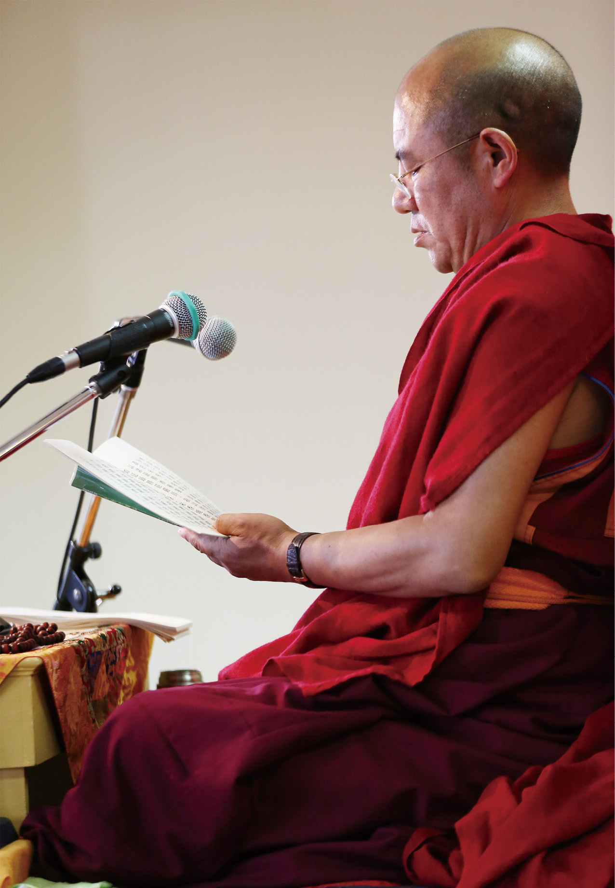
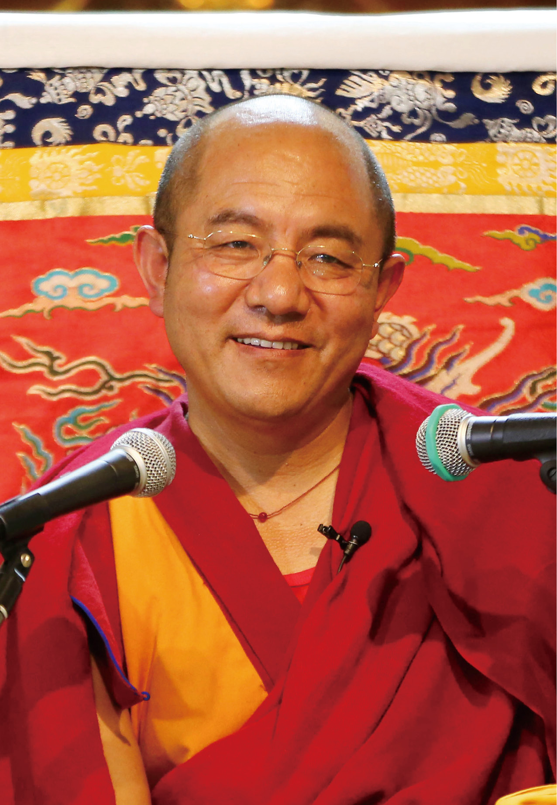

# 第3课

2014年10月9日

今天是《入菩萨行论·安忍品》的第三堂课，之后还有两堂课，下一节课是在后天。明天这边有一个灌顶，网上没有直播。

今天我会分三个部分来念藏文的传承，现在先念第一段。

（堪布念传承）

这次我用五堂课的时间，就《入菩萨行论·安忍品》的颂词为大家做简单的字面介绍。你们不一定在这五堂课就能把“安忍品”学得很好，不过我希望这次研习可以成为一个好的缘起，大家将来也应该认认真真地把它再学一遍，这对你们的生活有非常大的用处。

我认为佛教的道理不是宗教上的说法，它们都是事实、真相。当今时代瞬息万变，发展得非常快，我们现在所接触到的世间知识，在我们年老或者来世的时候都不一定能够用上。但是，佛陀在超过2500年前所宣说的道理，像我们现在所学的“安忍品”，它的内容还是那么鲜明、鲜活。

不知道这里学校的教学规划跟我们那里是否一样。以前，教育局每五六年就会把课本改一遍，但是不管教学内容怎么更新也跟不上时代，世间的知识就是如此。佛教的内容虽然是二千五百多年前的思想，可是它对我们的影响却是历久常新，因此我们不能认为它只是一种宗教的说法。如果佛教的说法合理，即便是非佛教徒也应该接受；如果佛教的说法不合理，即便是佛教徒也不需要接受。

我们不是非要传讲自宗的法，也不是非要让你们皈依，以便信徒人数越来越多，我们没有这样的目的。如果我们所学的知识对自他都没有意义，那我们的人数再多、队伍再庞大实际上也没有任何意义、没有任何价值；相反，如果它对自他的身心健康都有好处，那我们学习这些知识就非常有必要。

最近，我接触了很多这里的佛教徒，他们在生活中切身地感受到自己是佛法的受益者，这很重要。我们所学的知识一定要对自己的今生来世都有用处，这也符合现代人非常现实的想法，人们很少会学习一些天方夜谭、没有多大用处的知识。总而言之，此次大家学习寂天论师的《入行论》，一定要先从字面上了解颂词的意思，然后再逐渐深入，思考其中的道理，这很重要。

别人的侮辱毁谤  
对我的形象和财富没有影响

接下来的颂词说，世人的诽谤对我今生来世的修行并没有危害，我应该忍受别人对我的任何诽谤，不能因为别人的一句话就马上生起嗔恨心，这是没有必要的。

谓他不喜我，然彼于现后，

不能毁损我，何故厌讥毁？

有些人认为：“我一定要维护自己的形象，别人的诽谤会让很多人不喜欢我，这对我传讲佛法、弘法利生等方面造成困难。”人们都希望自己的朋友越来越多、敌人越来越少。为了保护自己、维护自己的形象，我们都不愿意听到别人对自己有丝毫的诽谤、讥毁、造谣、挖苦。这种想法不合理，为什么呢？如果你有功德、有学问、有德行，即使别人说了伤害你的语言，实际上对你没有任何损害，犹如乌云不会对虚空构成危害。

面对别人的侮辱、毁谤，大家应该想到，这对自己的今生来世都没有损害。首先，我们分析这些语言对自己的今世有没有损害：如果一个人本来就很清白，虽然一些说法或者谣言会暂时影响别人对他的印象，但事实上黑的不能变白、白的不能变黑，最后真相定会水落石出，他的清白还是会展现在世人面前。所以，别人的语言不可能在即生中对我有所损坏。此外，别人的谣言讥毁都是不符事实的，无中生有的东西不会对我的来世有危害。既然这些语言对我的今生来世都没有危害，我为什么要讨厌别人的讥毁呢？

这一点很重要。有些人很在意别人对自己有不好的印象，他们对少许讥毁自己的话语也特别在意，但是我看世界上的名人却与此相反。现在，人们在网络上对任何人都可以谩骂一番，不知道国外的情况怎么样。在国内，即使是人品非常好的人，网民也会以各种各样的理由来谩骂他。

一般来说，修行人不可能听不到谣言，我们也不可能把所有造谣者的嘴巴全部封住，世间人也说：“谣言总是有，不听自然无。”每个人都因为各自不同的业而感受不同程度的讥毁，但是不管怎样，我们都不应该在意。一般世间人只要听到关于自己的少许谣言就受不了了，会马上大发雷霆，可是作为修行人，我们的心胸应该宽阔。

听说这里很多人心胸宽广，不会很狭隘，不会只听到一两句关于自己的谣言，便不顾说话的全部内容而立即生气、痛哭——这是不合理的。我昨天问了一些这边的道友：“西方人的身体看来比中国人高大，他们的心量会不会比东方人还宽阔？”一位道友回答：“是是是，他们的心态很宽广，一般不会容易生气。”另一位道友则说：“差不多吧，有时候他们的烦恼很厉害、很深重。”具体情况我也不太清楚。

总的来说，即使别人讲你坏话，修行人也要心甘情愿地接受。藏传佛教中有句话：“众人不悦，正合我意。”意思是，别人出于不满而说我的坏话和过失，这正是我最喜欢听到的语言。如果别人骂我，我可以在自身上寻找过失；如果别人赞叹我，我会变得傲慢而失坏道心。不过，世间人很喜欢受到他人的赞叹，所以说修行人跟一般人的处世方式正好相反。

有些人经常跟我说赞叹的语言，我清楚自己是个什么样的人，他们的赞叹肯定是口头上的，与事实不符。比如昨天我戴着帽子去放生，有些人说：“你好帅啊！好帅啊！”另外，我的修行境界很差，有些人却说：“你的修行很好啊。”有些人会特意去当面赞叹一些修行境界不高的人。事实上，不管是当面还是在背后，我们听到别人说自己的过失是一件好事，可以趁机自我反省。

如果一个人受到太多赞叹，就像世界上很多名人一样，最后会堕落，下场非常可怜，为什么呢？因为他们身处高位或者过着正常生活的时候，身边的人没有提醒他们，只有盲目的赞叹和赞颂，让他们过于陶醉、迷失了自己的人生方向；可一旦无常到来，他们不知如何面对，此时便有可能做出各种危险的事情。因此，大家要学会接受负面的诋毁。

一些人可能会想：“如果我遇到很多诽谤，那可能对我的收入、利益、利养有影响，所以我不愿意受到诽谤。”下一个颂词讲到，我们不要太过在意世间的财富利益，所谓生不带来死不带去，世间的利益没有多大意义。

谓碍利养故，纵我厌受损。

吾利终须舍，诸罪则久留。

有些人说：“别人的诋毁会对我的财富、利养、金钱有影响，他们千万不要诋毁我，否则我会生嗔恨心。”现在的企业经常讲品牌文化，要维护自己的企业形象，太多流言蜚语会给人负面的印象，从而对企业的收入、效益、利润等有影响。

但是寂天论师从另一个角度来考虑，他说我们没有必要特别在意现有的财富和财产，没有必要讨厌经济上的损害，为什么呢？因为即使我有再多利养，最终还是要把它留在人间。在离开人间的那一天，我带不走一丝一毫的财富，就连一根线也没法带走，那时候我自己就像从酥油中抽出一根毛般独自而去，丝毫也不沾染。

有些人在临终之际真的特别可怜，他们生前辛辛苦苦地赚了很多财富，也为此而造了很多罪业，但是却没有想到自己那么快便撒手人寰，要把生前的所有东西全部留在人间。这时候财富、利养没有任何利益，但是缘它们而生贪嗔之心的恶业，以及积累财富的时候所造的不善业，会一直伴随自己到来世。

表面上人们有了富饶的财产后会觉得自己非常成功，但是在某种意义上，财富越多的人其实越迷茫，他们不知道自己的人生方向。在生活清贫、朴素、简单的时候，人们会有自知之明。世界上一些人本来有很好的德行，但是他们在拥有庞大财富后，连失坏了品格也不自知。

《释迦牟尼佛广传》[^1]中讲到古代修行仙人互相诅咒、谩骂的方式[^2]，那是怎么样的呢？他们诅咒别人的时候，会说：“愿你财富圆满。”如果对方财富圆满，他的智慧和德行会衰败，修行就不会成功。如今我们祝愿别人的语言“祝你发财，祝你健康”——正是古代修行人互相咒骂的语言，因为对方很容易因此堕落。

的确，就像《大圆满前行》中所说[^3]，我们在临死之时，一切都带不走。《教王经》也说[^4]，当国王离开人世的时候，财富、眷属等一切都不可能跟随，唯一如影随形、紧紧跟随到自己后世的，就是自己生前所造的善恶业。

你们应该思考，自己今后的所作所为不能只是为了今生，也要考虑来世。现在有些人因为环境和教育的原因，他们只关心今生的利益，不愿意聆听前后世、业因果的道理，这样确实非常愚痴。不管是西方人还是东方人，凡是切合事实的道理，我们都应该去了解、接受。若你生前根本不愿意接触这些道理，在离开人间的时候才发现原来来世确实存在，那是多大的损失啊！

有些人跟我说，西方人一般关心今生、当下的状况，而不关心因果、六道轮回、前生后世的问题。不管你是否愿意聆听这些道理，你一定要对这方面有所了解、思考。如果你考虑之后觉得这些不符道理，你可以排斥、放弃；如果你找不到任何理由来驳斥，只是带有疑问，那你应该继续思考。

像我们现在所讲的《入行论》等一些经论，会偶尔提到因果方面的道理，比如来世堕入地狱、前世的善恶业等等。现在有些人对这方面的概念比较模糊，他们学习经论的时候会产生一些怀疑。产生怀疑是正常的，禅宗也说“大疑大悟，小疑小悟，不疑不悟”，意思是，你没有任何怀疑的话，就不可能有任何开悟。所以，大家刚开始学佛的时候，对其中的道理有所怀疑是合理的。但是，现在有些人的怀疑很不正常，他们的怀疑已经成了邪见，并不是基于任何理由。这样不太好，我们还是需要有正见。

以上讲到追求利益来养活自己很不好，下面讲邪命养活是不合理的：

宁今速死殁，不愿邪命活，

苟安纵久住，终必遭死苦。

这个颂词的中文翻译不好理解。在表达内容方面，如石法师的《入行论》翻译是很好的。但是一些人说有些颂词读起来没有《大圆满心性休息》那么顺畅，希望我重新翻译。虽然我念汉语《入行论》颂词的时候有些字读得不太好，但是我觉得没有必要重新翻译。我看你们一些汉族人也念得不太流畅，之前讲考的时候，一些大学生也不是读得很好，可能是译者要把很多内容浓缩为一两个字的缘故，所以可选的字词不多。

此处说，我们宁可早点死去，也千万不要以五种邪命来让自己安逸地活在世间。大家没有必要邪命养活，虽然依靠这些邪命能让你的生活暂时过得不错，但是当你离开世间时，你要背负所有这些罪业前往来世，这是非常可怕的。无论你是修行人还是世间人，都应该宁可清白地离开人世，也不要非常肮脏地活在这个世界。

不管是什么种族、什么国家的人，西方人也好、东方人也好，南方人也好、北方人也好，只要他在这个世界上生存，就一定要活得清白。佛教的教言确实是真理，它非常正面，有很多正能量。无论你承认与否，从古代到现在，人们真的很需要佛教的教育。

这里说我们不应该邪命养活，即不要依靠不正当的途径来养活自己，如此活得再长久也没有意义。一些世间人会以不正当的手段来获得财富，这就是邪命养活。至于修行人，则千万不要依靠五种邪命来过活。五种邪命主要是针对出家人和修行人来说的，也间接地说明了一般世间人应该注意的地方。五种邪命是：

1．诈现威仪：本来自己是个很差劲的人，行为非常恶劣，但是为了得到别人认可而获得财富名声，行为上便装得如理如法。

2．谄媚奉承：为了达到自己的目的——得到财富、供养，便失实地用花言巧语来赞叹别人。

3．旁敲侧击：依靠转弯抹角的语言，令施主慷慨解囊，让自己得到财富。

4．赠微博厚：通过给对方一些小恩小惠，让自己获得这样那样的东西。比如给别人一个小小的加持品，但是要求对方给自己大大的供养。

5．巧取讹索：巧立名目，通过不同手段来获得丰厚的财物、供养。

以上是养活自己的五种不正当手段。作为修行人，大家不管在任何时候都不应该邪命养活。现在一些世间人很有正义感、人生过得很清白，他们无论在工作上还是私事上，都是凭自己的辛勤付出来换取收入，他们宁可失去财富，也不愿意做一些不正当的事情。这种做法非常合理，每一个人都很需要如此行持。世间人也有“宁为玉碎，不为瓦全”的说法，我们宁可让非常珍贵的玉碎掉，也不要为了表面上的完美生活而做不正当的事情。

财富没有实质

人们非常执著世间的财富，但是寂天论师说，这和我们梦境中的财富没有差别，我们不要对短暂人生中的财富太在意：

梦受百年乐，彼人复苏醒，

或受须臾乐，梦已此人觉，

觉已此二人，梦乐皆不还，

寿虽有长短，临终唯如是。

所谓百年富贵终是梦，一个人在梦中享受了百年的快乐，另一个人在梦中只享受了一瞬间的快乐，虽然他们在梦中所感受的时间有长有短，但是在醒来之后，梦中快乐都已消失，这方面两者没有任何差别，他们最后都要回到现实。

同样，我们的今生也是一场梦。在各自的人生之梦中，一个人依靠各种不正当的手段来获得成功，另一个人则不成功，但是在他们死亡后，他们今生的显现都已消失，这方面两者没有任何差别。人们在死亡的时候真的没有差别，比如一位国家总统和一位乞丐，他们生前在权力、财富上的差别，在死后都已消失，此时没有成功与不成功的区别。在某种意义上，他们的灵魂也没有什么差别，不管他们生前造恶业还是修善法，两者都要在下一世重新开始新的一段梦。现在，很多企业家说自己去到某个地方，从零开始白手兴家。同样，一个国家总统和一个乞丐，不论他们生前成不成功，在下一世的开端，两者都要从零开始。

虽然我们在世间中的寿命有长有短，但是最终所有人都要随着自己的业离去。因此，大家不要特别贪著世间的一些事情，你要思考自己应该用什么方式、方法在今生存活、生活，这是很重要的。《金刚经》中说“一切有为法，如梦幻泡影”，一切有为法就像梦幻、泡影一样。这并不只是佛教的说法而已，如果你好好地观察，会发现世间的事物确实如此。

人们现在特别执著的事物，比如地位、名声、财产、身体、容貌等等，它们的本体实际上跟水泡没有差别。水泡表面上看起来很漂亮，但是只要被风一吹，它就会破灭。同样，可能你们觉得现实生活中的车子、房子、银行卡、房产证等都很吸引人，觉得它们的本体都很坚固，但是其实它们和梦中的财产没有差别。

可能你的银行存款有一万、两万甚至几百万，不过当你离开世间的时候，这些都用不上。为什么现在一些欧洲国家会接受很多私人存款？因为他们知道，几十年后那些存款人都会死去，如果当事人没有安排妥当，那些存款就会收归国有，他们的国民就可以享福。为什么现在很多银行都开通了国际性的个人银行业务？这是有目的的。（众笑）

这个颂词很重要，很多前辈大德也经常在不同的经论中引用。希望你们以后不仅能够背诵这些颂词，还能把这些内容应用到自己的日常生活中。大家要知道人生如梦幻，世间也有许多关于这方面的格言，比如南柯一梦、黄粱美梦等等，但是它们的深度都不够，只是表面上的说法而已。

若真的从教理上观察，你昨晚在梦中所感受的和你以前在人生中所经历的，实际上两者都是一样的。这一点你们自己可以思考，你以前在生活中感受到的一切，比如你年轻时的经历，它和你昨晚的梦有没有差别？应该找不到任何差别，这方面大家要好好地分析。

在我们命终之时，任何利养都带不走：

设得多利养，长时享安乐，

死如遭盗劫，赤裸空手还。

即使你在活着的时候通过各种不正当的途径而得到各种利养，并且快乐地享受世间生活，但是在你死亡之时，所有通过非法途径得来的财富就像遇到盗贼一样，被抢劫一空，此时你只能赤裸裸地离开世间。

现在的一些恶人就是如此，他们生前以不正当的方式获得财富，享受了很好的生活，但是他们命终的时候带不走任何东西，就像被洗劫的人一样，空手前往后世。佛陀在《涅槃经》中说：“善恶之报，如影随形。”除了善和恶的报应外，其他的利养、财富、亲友等都不可能永远跟着你。当然，没有受过正规佛法教育或者闻思的人很难相信这一点。

作为佛教徒，我们应该想到人生真的非常短暂，只不过是几十年的生活过程而已，真正跟随我们的是自己的善恶业，所以我们现在就要断除一切不正当的利养，一定要行持善法。

有些人认为邪命养活也有一定利益，但是这种说法不合理：

谓利能活命，净罪并修福，

然为利养嗔，福尽恶当生。

一些人认为：“我有钱的话可以做很多事情。虽然我得到财富的途径并不正当，也不清净，但是只要我有钱，我可以经常供养三宝、忏悔、布施以及行持许多善法。这样我就能遣除很多罪障，积累众多福德资粮。因此，别人如果阻碍我获得利养，我应该对他生嗔恨心。”

这种说法是不合理的，我们平时一定要行持真实清净的善法，不要只做形象上的善法，但实际上却造下非常严重的罪业。此外，正如“安忍品”的第一个颂词所说，一刹那的嗔恨能够摧毁一千劫的善根，也会产生种种恶业和果报。所以，为了利养而对别人产生极大的嗔恨心是不合理的，根本不可能利益众生和积累资粮。所谓的利养，就如《大智度论》中说[^5]，能够断掉我们解脱的命根。

不管是出家人还是在家人，对修行人来说，利养是很不好的。在家人需要有一些钱财、住房、眷属，但是在满足了基本的条件后，你不能再贪著多余的人、事、物。有些人本来自身能力有限，做任何事情都特别差，但是因为自己的欲望非常强烈，所以生活得非常苦恼。现在这种情况比比皆是，比如一个人本来就非常懒惰，不愿意干活，但是因为贪欲、欲望非常炽盛，他需要辛勤地工作，最后他就算有一个月十几万的工资仍然不满足，这种人恐怕不会快乐。

作为在家人，如果你有一些能力，你可以有稍多的贪欲；如果你没有能力，又特别懒惰，爱睡觉、爱吃喝，同时却想得到非常丰厚的财富，那是不合理的。作为出家人，尤其是一位戒律清净的出家人，应该从来都不用为衣食、生活发愁。佛陀在经中说，末法灾难深重的时候，即使世间的在家人仅能在指甲般大小的土地上耕种，出家人也不会遇到生活上的艰苦和困难[^6]。事实的确如此，我们在任何地方也看不到生活困难、挨饿的出家人。虽然有些出家人显现上要亲自劳动、下田种地，但这些只是他们的示现。事实上，不管是什么地方的出家人都有吃有穿。

历来出家人的生活都很清净，而且他们对生活的要求也不高。以前藏地个别地方的出家人可能没有吃全素的习惯，因此在生活上可能会沾染一些罪业；如今不仅出家人是素食者，大多数在家居士也以素食为主，生活得非常清净，这方面汉传佛教做出了非常大的贡献。素食一方面非常健康，另一方面也不会对众生的生命构成威胁。现在人们在寻找食物方面非常容易，大家应该尽量吃素。

总之，在各种因缘具足的情况下，出家人不用担心自己的生存和利养；至于在家人，则应该在短暂的人生中尽量行持善法，这很重要。

如果一个人活着的时候会造非常严重的恶业，那不如早些离开人间比较好：

若为尘俗活，复因彼退堕，

唯行罪恶事，苟活义安在？

如果我们为了追求今世的舒适、现世的利益而退失自己的安忍道心，唯以造罪来苟活于尘世，这样的生活又有什么意义呢？没有任何意义。

古人常说：“宁可清贫，不作浊富”。意思是，一个人宁可生活得平平淡淡，简简单单，也不要过着特别肮脏、污浊的富裕生活。现在有些人的生活就像疯子，只是贪著吃肉、喝酒，整天沉迷其中，迷迷糊糊的，连自己在做着什么事情也不清楚。

在人类社会中，佛教所弘扬的确实是正面的教育。刚才也提到，佛教不仅是一个宗教，它的见解和道理符合事实，也对人类的心灵健康有明显帮助，比如佛教提倡人们要过知足少欲的生活，还有大慈大悲、智慧、善良、信心等概念，这些名词都不需要重新改造，因为它们所代表的理念任何时候都切合人类的心灵需求。

有些人跟我说佛教要与时俱进，毕竟整个时代都在改变和更新，因此佛教也需要更新。世间很多东西都随时代而变。比如十年前的电脑和手机，这些电子产品现在已经很少有人用了，有一部分也已经被淘汰，这些产品需要不断地更新。另外，世界上很多国家都在不断地修改他们的法律、法规和政策。不过，二千五百多年前的佛教思想已经十分成熟，它的道理符合事实，况且真理不会随时代而变，所以佛教的教义本身不需要改革。

这并不是我们佛教徒在自赞自夸，非要说佛教很了不起，而是因为佛教的道理真的与事实相符。无论是在任何学校，还是面对任何群体，我都可以大胆地宣说佛教的道理，因为这些道理没有人能够反驳。如果我说的道理与科学相违，我会因为害怕别人反驳而不敢说。但是，只要佛教的道理经得起观察，那不管我们宣扬佛法的对象是什么人——西方人也好，东方人也好，我们都不需要用矫饰的措辞来解释自宗的道理。

如果你不懂得佛教的道理则另当别论，否则你会明白，佛教的教育就是一种生活方式，而且这种生活方式不仅适合古人，也特别适合现代人。大家可以观察其他宗教和学术领域，甚至历史上的所有知识和资料，但是你也很难找到如佛教这般殊胜的思想和智慧。佛法不需要任何改造，我们如今就可以把它的内容直接应用到生活中。像之前所讲的一部分“安忍品”，它犹如是昨天才写成的文章，特别相应我们现代人的心态，因此我们没有必要絮絮叨叨地说要改革佛法。

现在的教育认为，人们在某些时候可以依靠非常肮脏的手段来活着。这是没有意义的。你看世界上的一些罪犯，他们做了很多不正当的行为像贪污、谋杀等，他们也清楚自己的所作所为并不符合世间轨则，而他们的罪业最后也都在世人面前暴露无遗。佛教说人们一定要过知足的生活，这是非常合理的，值得大家好好地观察。

昨天有一个颂词念了藏文传承，可是还未解释：“棍杖所伤人，不应嗔使者，彼复嗔使故，理应憎其嗔。”意思是，我不应该嗔恨那些使用棍杖等武器来伤害我的人，应该嗔恨棍杖；其实我不应该嗔恨打我的人，应该嗔恨他相续中的嗔恨心，因为嗔恨心在背后驱使、操作，他才会做出伤害我的行为。这是对昨天颂词的补充。

不应对诽谤者生嗔

有些人可能想：“如果我受到诽谤，其他人会对我产生怀疑，所以我应该对诽谤者生嗔恨心。”这种说法不合理：

谓谤令他失，故我嗔谤者，

如是何不嗔，诽谤他人者？

很多人会想：“别人不应该诽谤我，否则其他人会怀疑我，对我失去信心。”我们有时候也会想：“别人最好不要说我的过失，不然其他人会怀疑我，认为我是个坏人。”很多人会因为这些顾虑而对诽谤自己的人生起嗔恨。

寂天论师对此回答：“别人遭到诽谤的时候，你为什么不对诽谤他的人产生嗔恨心？如果别人受到诽谤，其他人也会对他产生怀疑；别人跟你一样，都不希望其他人对自己产生怀疑。”这一点很多人学不好，人们总觉得其他人遭到诽谤没有问题。此处说，因为害怕别人对自己失去信心，所以应该嗔恨诽谤者，这是不合理的，因为你并不会在他人遭受诽谤的时候，对诽谤者产生同样的嗔恨心。归根结底，你只是关心你自己而已，你产生嗔恨心纯粹是你的我执和我所执在作怪。

现在有些人很固执，总觉得：“我骂人的时候，感到特别爽。”昨天有位小女孩就是这样说的，后来我就不敢跟她交流、不敢朝她的方向看，不然她会为了爽而骂我。她如果骂我她会很爽，不过我可能不太爽，那样的话，我能否继续讲课也不好说。（众笑）

总之，作者反问为什么别人遭到诽谤的时候你不嗔恨诽谤者？因为如果别人受到诽谤，其他人也会对他产生怀疑，也是不好的，你为什么不对其他诽谤者生起嗔恨？这引申了下面的答辩：

谓此唯关他，是故吾堪忍，

如是何不忍，烦恼所生谤？

对于刚才作者的责难，一些人会说：“其他人对某人生疑，是某人自己的事情，和我没有关系，所以我可以堪忍。但若我自己受到诽谤，我则很难忍受。”这种想法不合理，为什么呢？因为诽谤者不管是诽谤你还是别人，他的诽谤都是依靠烦恼而产生；此外，无论是你还是别人受到诽谤，其他人也会对你们误解、不信任、失去信心。

从因缘方面来说，诽谤者的烦恼依靠因缘而生，而遭受诽谤的你或者别人也有各自的因缘，因缘具足之时，诽谤就必然出现，所以不应该嗔恨诽谤者。另外，别人也和你一样，不愿意受到诽谤。对于任何诽谤，没有人会愿意接受。如果你不想受到诽谤，却觉得别人应该接受，这种心态是颠倒、不正确的，应该尽量制止。

以上讲了在自己的利养和自身遇到障碍的时候要修安忍。下面说，当我的上师和亲友遭到诋毁时，我也要修安忍。

不应对损害上师三宝、亲友之人生嗔

（堪布念传承）

我们应该对摧毁三宝的人安忍：

于佛塔像法，诽诋损毁者，

吾亦不应嗔，因佛远诸害。

一些人可以安忍别人对自己的损害，但是作为佛教徒，如果看到别人摧毁佛像、佛经、佛塔，或者诋毁佛法僧三宝，他们认为这实在是无法忍受的，因此应该生起嗔恨心。这种想法不合理，《宝性论》中说，佛陀没有任何烦恼痛苦，佛法是一种真理，圣者僧宝也不会有痛苦，不会真正被损害。因此，如果别人诽谤佛法僧三宝，我们不应该对他生嗔恨心，更不应该以牙还牙。三宝远离一切增损，从了义的角度来说，这些都是无为法，不可能对其有任何损害。

现在有些佛教徒的家人不信仰佛教，他们甚至会诽谤三宝、把佛像打烂或者把法本烧掉，内地的家庭经常有诸如此类的情况。此时一些佛教徒会特别生气，他们可以接受自己遭到家人的谩骂，但是作为佛教徒，他们觉得不可以忍受家人毁坏三宝所依，因此产生了非常严重的烦恼，做出各种行为，比如跟对方离婚等。

当然，佛教徒要尽量阻止别人对三宝及其所依作出任何损害，因为这些恶业的果报非常可怕，在短暂的人生中造下如此严重的恶业是没有必要的。另外，在最究竟的意义上，佛法僧三宝远离任何损害，因为究竟的三宝并不是有相的，正如《金刚经》说：“若以色见我，以音声求我，是人行邪道，不能见如来。”觉悟的智慧就是佛陀，真正的真理就是法宝，如文殊菩萨般在相续中现前了灭谛和道谛的圣者就是僧宝。我们所见到的佛像、佛塔不是最究竟的三宝，因此佛教徒千万不要因为它们受到损害而生嗔。

历史上藏地有朗达玛灭佛，汉地和印度也分别经历了三次重大的灭佛运动。当代也有人破坏了阿富汗的大佛，不过，很多大德和上师在接受记者采访时很正面地说，毁坏一尊佛像对佛教、佛法并没有很大损害。在“文化大革命”期间，很多藏地寺院的佛像都被摧毁无余，但高僧大德并没有怨恨，他们知道这是时代的问题，佛像被毁不会让佛法有任何损失。

当大家见到信仰其他宗教或者不信仰佛教的家人和身边人毁坏三宝所依、诽谤佛法的时候，我们佛教徒没有必要生起嗔恨心。现在有些佛教徒会为此而十分生气，产生严重的嗔恨心：“我一定要杀了他！”杀人是不合理的，佛教徒应该修安忍，不应该有如此过分的情绪。作为一位大乘佛法的行者，无论在任何情况下，包括在怨敌面前或者佛法受到损害的时候，我们自己都应该保持一颗澄清、纯真的心，永远不要让它受到染污，所以尽量不要生起嗔恨心。

不仅是佛法，在自己的上师、道友等等遭遇损害的时候，我们也不要生起嗔恨心：

于害上师尊，及伤亲友者，

思彼皆缘生，知已应止嗔。

如果有人加害我们的上师、道友、家人、亲友，此时我们该怎么办呢？当然，如果有人说上师或者传承的过失，我们应该尽量制止，但若实在制止不了，无垢光尊者在《心性休息》中说，此时我们应该捂着耳朵，不听对方的胡言乱语。这时候我们没有必要跟对方吵架或者发生肢体冲突，更没有必要与对方拼个你死我活。

现在一些佛教徒为了维护自己的上师、道场、宗派，他们会动员很多人来与对方搏斗，这不是大乘佛教徒应有的做法。昨天也提到，现在一些跟佛教有关的电影、电视，其情节完全不符合佛教的教义，哪会有佛教徒会以嗔恨心拿着刀枪冲锋陷阵？不可能的，这与真正的佛教教义不符。

当我们的上师、眷属受到别人的诬蔑或损害的时候，我们应该用正当的途径去面对，而没有必要退缩：“我要修安忍，要规避一下。”我们应该以非常合理的途径来与对方对话、和平协商，这是有必要的。如果这样也起不到任何作用，我们要想：“这一切都由因缘而生。”比如你的上师常常被人诽谤，你可以想：“这是上师的业力现前，阿弥陀佛！上师的业力很重啊。”（众笑）总之，你一定要恒时制止自己生起嗔恨心。

《中观四百论》中说[^7]，国王可以分享自己的地位和权力，但是在死亡之时，却没有办法让其他人来承担自己的业。所以，不管是为了自己、父母、亲友的利益，还是为了上师、道场、佛法，我们在任何情况下都千万不要造恶业。

以理观察，不应对加害者生嗔

修安忍的时候，我们要用智慧来观察，别人的加害其实需要具足很多因缘：

情与无情二，俱害诸有情，

云何唯嗔人？故我应忍害。

别人伤害我的时候，需要具足两个条件，其一是有情的人，其二是无情的武器像刀、棍等等。此二者要同时具足才能构成伤害我的行为，为什么我只嗔恨有情，却没有对武器生嗔恨心呢？比如，别人用棍棒打你，一般来说我们很少会对棍棒生嗔恨心，只会对打自己的人产生嗔恨心，别人向你扔石头的时候也是同样。

当然，有个别的人嗔心非常重，他们遇到任何不愉快的事情都会把东西弄坏、砸烂，例如一个脾气很坏的人，如果他无论如何也不能把一道门关上，那他最后会使劲地把门破坏，不过这种情况并不常见。在有情和无情两者的条件具足下才会产生伤害你的行为，但是我们平时只对有情物生嗔恨心，这是颠倒的。此外，还有什么是颠倒的呢？

或由愚行害，或因愚还嗔，

此中孰无过？孰为有过者？

别人因为愚痴而加害你，你因为愚痴而对他生嗔恨心，此二者之中，谁有过失？谁没有过失？一方面敌人特别愚痴，因为他不懂得因果的道理，无缘无故就对你作出伤害；另一方面你也特别愚痴，因为你不懂得嗔恨心能够摧毁自己的善根，而对敌人生起了嗔恨心。你们两者就像是被附体的人一样，都在发疯，一者加害别人，一者生起嗔恨心，两者都是愚痴所致。你需要好好地分析，害你的人有没有过失？生起嗔恨心的你有没有过失？到底谁对谁错？

这些分析的确非常有智慧、有道理，你们可以对此思考，互相探讨。以前我们因为习惯而觉得自己生嗔恨心是合理的、别人害我是无理的，但是现在应该知道，生起嗔恨心也是颠倒愚痴所致。所以，如果作害者有过失，那我生嗔恨心也有过失；如果我生嗔恨心没有过失，那作害者也没有过失——这是一种推理方法。

因何昔造业，于今受他害？

一切既依业，凭何嗔于彼？

你所受到的一切损害，全是前世的恶业所致。一切万法既然都是依业而生，那你为什么要嗔恨加害者呢？印光大师说：“如来成正觉，众生堕三涂，皆不超出因果之外。”世间的因果业网确实非常庞大。

探访大学的时候有些人问我：“上帝属于六道轮回中的哪一道？”当时我没有正面回答，因为别人不一定能够接受，我只是说每个宗教都有不同的观点，都有各自的解释方法。这是辩论中的一种技巧，以后你们辩论的时候也可用上。关于辩论，《释量论》中特别讲到，有时如果我用对方的观点去跟他辩论，会失去我自己的观点；如果我用自己所理解的去跟对方辩论，他不可能得到满意的答案。所以，其他宗派不可能归入我们的宗派，而我也不可能随他而转。有时候我们要把各自的宗派分开，不能混为一谈，如此便没有任何危害。

一切果报都是由业而生，这是佛教自宗的说法。我们在前面也讲了，受到损害的时候，我们要想这是自己的业力现前，这很重要。我们懂得这些道理后，将来在生活中一定要善待别人，不要那么容易便生嗔恨心。这次学习“安忍品”，你们的脾气应该会暂时变好，不过一段时间之后，可能嗔心又会像“充电”一样，慢慢恢复如初，凡夫人一般都有这种毛病。

如是体解已，以慈互善待，

故吾当一心，勤行诸福善。

通过上面的分析，大家应该完全明白，原来所谓的嗔恨、对境都是依靠种种因缘而生，所以从现在开始，我们应该以慈悲心来善待所有人，并且一心一意地修持善法，不能流于表面。有时候我们说修行真的很容易，依靠一部论典或者一段话，甚至只是一句教言，也许你的一生就会从此改变。

我在藏地的时候阅读了华智仁波切的传记，他在藏地非常出名，是《普贤上师言教》的作者。传记中有一句话让我非常有感触，他经常说自己没有什么优点和功德，有一次他的弟子问他：“上师，你真的没有任何优点和功德吗？”他笑着说：“其实我还是有一些优点和境界，我的《入菩萨行论》法本从不离身，这就是我的修行境界。”

这一点我想我们所有人都能做得到。现在很多人把《入行论》的法本印制成小册子，应该很多人都请了。如果你经常把它随身带着，说明你对它有感情，也会在有空的时候念诵里面的一些内容，如此你会感受到它巨大的加持力。

在藏传佛教中，每个教派都会传讲《入行论》，而且很多出家人每年都会重温它的内容。《入菩萨行论》如今也被翻译成英文，在西方国家十分受欢迎。总之，你们这次学习了“安忍品”，以后一定要用慈心来对待一切，这很重要！

为断嗔而除贪

若我们要对治嗔恨，便要先断除它的根源——贪心，这很有必要：

譬如屋着火，燃及他屋时，

理当速移弃，助火蔓延草。

如是心所贪，能助嗔火蔓，

虑火烧德屋，应疾厌弃彼。

此处作者用了一个形象贴切的比喻。假如某间房屋着火，人们为了防止火势蔓延、燃烧到周围的房屋，他们会立刻将周围的草、木材等易燃物品迅速移开，即使这些东西再贵重，但是为了抢救其他房屋，人们也会在短时间内把这些东西全部舍弃。同样道理，我们所贪执的任何人事物，都是助长嗔火蔓延的因，所以为了防止嗔火大发，以及防止它把我们功德的屋子全部烧毁，我们首先一定要断除贪心。

很多人可能不理解，贪心和嗔心看来是两种截然不同的心态，为什么我们为了防止嗔心就要断除贪心？事实上，只要你对某件事物生起了贪心，背后一定有执著，而执著会产生嗔恨心。当今很多感情问题都是由于人们对伴侣生起了非常严重的贪心和执著，正是因为特别执著，所以人们对伴侣的所作所为特别敏感，依此而生的嗔心也极其猛烈。

很多年轻人经常跟伴侣说会爱对方一辈子，但是背后的意思是会恨对方一辈子，一辈子都会对这个伴侣生嗔恨心。因为他们只是想把伴侣关在一个由他们掌控的监护室，监督伴侣的一举一动，他们没有办法放弃对方，也不能忍受对方做出与自己意愿相反的事情。

国家与国家之间的战争，都是源于他们对各自地盘的贪执。人与人之间所产生的嗔恨心，包括由此而来的冲突，都是源于人们对自己的身体、财产和感情的执著。所以，一般来说嗔恨的背后有着非常严重的贪执，正因如此，佛陀在《妙法莲华经》中说“诸苦所因，贪欲为本”——一切痛苦之因都是以贪欲为根源。

藏传佛教的萨绕哈巴尊者说：“贪执纵有芝麻许，竟引痛苦无边际。”如果我们对任何一法有芝麻许的贪著，就会引致如山王般的痛苦。这是千真万确的，如果一个人对某些人事物越来越贪著，他的痛苦和嗔恨心也会越来越严重，反之亦然。你们也知道出家人的生活比较简单，没有特别贪著的人和事，因此他们对别人没有嗔恨，也不会与别人冲突，这就是他们与在家人在生活上的不同之处。佛陀所讲的无贪、无嗔、无痴实际上就是快乐。

世间中所谓的爱，只是用另一种方式包装的烦恼。因为教育的原因，很多人把爱情错看成是非常美好、甜蜜的，甚至把它当成是人生唯一值得追求的东西。但是若你真正尝到它的滋味，你会发现美丽的包装背后，它会给你带来很多痛苦。佛教认为世间有没有快乐呢？有一些，但是这些快乐非常短暂，而且人们还要为此付出很大代价，否则不可能品尝到这些短暂的快乐。

世间人可能觉得佛教的说法太决绝、太悲观，但若你真正用智慧去观察，便会发现贪嗔痴确实是烦恼。汉语中的“烦恼”二字形容得很贴切，无论在什么时代，人们都经常说：“心好烦”“好烦恼啊！”我们若想成佛，最需要对治的就是烦恼。

每个众生都有贪嗔痴这三种根本烦恼，唯一可以减少此三者的方法就是修空性、修无我和修慈悲心。如果我们的相续中有了这些境界，便会因为息灭了贪嗔痴而活得很快乐。佛教中和平、慈悲等概念，能够让世间所有人感到十分幸福，虽然我们的成长环境、生活方式可能与此不太相同，但是我们可以学会调整。

如彼待杀者，断手获解脱，

若以修行苦，离狱岂非善？

如果通过承受短暂的小痛苦，就可以断除巨大的痛苦，那该多好！比如对一位死囚来说，如果砍断他的手可以使他免于死刑，他肯定乐于去忍受，因为只要能够活命，接受这种酷刑还是值得的。所以，在修行的过程中，若我们忍受一些苦行、修一点安忍便能断除来世堕入地狱的痛苦，那真是非常好的事情。

下面继续讲用小苦来断除大苦的道理：

于今些微苦，若我不能忍，

何不除嗔恚，地狱众苦因？

如果我们不能忍受今生短暂且微小的痛苦，反而大发嗔心，那以此所感的地狱之苦远胜于此，我们在来世肯定更不愿意去忍受。因此，我们为什么不在当下就断除嗔恨呢？

（堪布念传承）

我们现在修安忍时的痛苦，跟往昔我们所受的毫无意义之痛苦相比并不严重。

为欲曾千返，堕狱受烧烤，

然于自他利，今犹未成办。

安忍苦不剧，复能成大利，

为除众生害，欣然受此苦。

我们在轮回中因为贪欲而成千上万次堕入地狱，感受烧烤等种种痛苦，而且这些痛苦对自他都毫无利益。与此相比，修安忍的痛苦没有那么剧烈、严重，还能成办巨大的利益。因此我们现在为了利益众生，为什么不欣然地修持安忍呢？

表面上看，我们为别人而修行或忍受痛苦，这有一些困难，但是佛教徒一定要发心广大。有些佛教徒在世间法方面很能干，他们愿意每天花十多个小时在工作上，但是在弘扬佛法和修行方面，他们却花不到一个小时，这样不太合理。作为佛教徒，我们发了无上菩提心，至少也应该利用生活上的部分时间来利益一切众生。如果你在短暂的人生当中不做这方面的事情，确实值得惭愧。

在苦行方面，一些佛教徒可以为了世间的会议而经常出差、东奔西跑，却不愿意当面与其他佛教徒共同商量弘扬佛法的事情；一些佛教徒可以为了世间的事情而经常接电话、发信息和上网，却不愿意为了弘法利生的事情而开手机、与别人沟通。我在学院中也接触过这样的人，他们为了世间法的事情什么都肯做，什么地方都愿意去，多少钱都可以花，但是对于弘扬佛法方面的事情，他们却特别吝啬，几百块、几千块都不愿意花，也不愿意接电话，不爱跟别人沟通，不愿意开会。

作为佛教徒，我希望大家可以把弘法利生看成是人生中的一件大事。如果没有这种观念，那你为佛法付出的力度可能不够。

怨敌受到赞誉，理应随喜

假设我们的敌人受到赞叹，我们也要修安忍：

人赞敌有德，若获欢喜乐，

意汝何不赞，令汝自欢喜？

如果别人赞叹敌人的功德，敌人和赞叹者都开心，我们也可以随喜而获得快乐。但当我们观察自心的时候，往往会发现自己的心特别可怕，假设别人赞叹敌人，我们的心不会快乐。既然赞叹者会开心，为什么我们不赞叹敌人，好让自己享受快乐呢？或者，我们为什么不在别人赞叹敌人的时候随喜，好让自己也享受快乐？

这是我们所有人的通病，当别人赞叹你的敌人，你会露出不悦的表情；当别人赞叹你的朋友或者你自己，你会特别开心。在与别人交流的过程中，人们的表情经常显露出他的心态。我比较敏感，在谈话的过程中，我会经常观察某两个人的关系好不好。若我谈起另外一个人的功德，而对方的表情立刻有变，那我估计他们的关系不太好，有时我会猜错，不过很多时候我都猜得对。不管怎样，赞叹和随喜别人很重要，因为你不仅能够得到快乐，还能让自己活得非常有意义。

下面说到随喜的功德：

如是所生乐，唯乐无性罪，

诸佛皆称许，复是摄他法。

如果我们经常随喜别人，会让自己恒时处于快乐的状态，如此我们不会有嫉妒心，也不会造罪业，这是非常好的，诸佛菩萨也经常赞叹这种人。另外，佛教经常讲六度四摄，爱语就是四摄（布施、爱语、利行、同事）之一，即经常赞叹别人的功德。因此，为了让自己处于很平和、快乐的心态，我们应该经常宣说别人的功德、尽量不说别人的过失。

昨天法师说，有一位修行人一辈子都没有说过别人的过失，这种人很值得我们羡慕。一些人只要听到有人说别人的功德，他们就会闷闷不乐、默然不语；如果听到有人说别人的过失，他们就非常开心、到处打听，也会参与其中，用尽自己的口才来说别人的过失。这很不好。

如果你们以前特别爱说过失，今后应该少说一些；如果你们以前就不爱说过失，今后也应该尽量不说。一些修行人即使看到别人有过失也只会念：“嗡班匝儿萨埵吽！”别人有什么做得不好的地方，就让其他人自己猜，毕竟你没有说别人的过失，这是一个很好的方法。

谓他获乐故，然汝厌彼乐，

则应不予酬，此坏现后世。

此处用另外一种方式来说明我们应该断除嫉妒心，因为它会毁坏我们的今生来世。这个颂词略为难懂。

有些人看到敌人因为受到赞叹而快乐，他们会不高兴，产生厌恶、嫉妒之心。敌人受到赞叹的话他们会不开心，但若自己受到赞叹他们会很开心，这种心理是不合理的，为什么呢？敌人感受快乐，如果你为此而不开心，那么你也不应该给下属发工资，因为那时候下属也是快乐的，但这样肯定行不通。

如果你看到别人高兴，自己就会不高兴，那么敌人受到赞叹而高兴，和你的员工得到工资而高兴，两者在道理上是一样的，既然前者会让你不高兴，后者也应该让你不高兴。

再者，如果你因为不愿意见到别人高兴而不给下面的员工发工资，他们会因为得不到自己辛辛苦苦赚回来的报酬，而让你今生吃苦头；至于来世，你也会因为没有给他们应得的财富而不会有好结果。其实，只要是让别人高兴的事情，我们都应该尽量去做。

此处说，你应该给下属发工资，因为这是他们自己辛勤工作后的回报，他们也需要得到这些财富；同样，怨恨的敌人也应该得到赞叹，因为这是他以自己的功德而应得的。这种推论在因明中称为同等理，一些人可能不了解，实际上以上两者的道理都是一样的。如果你不能随喜敌人因为受到赞叹而快乐，你也不应该随喜下属因为得到工资而欢喜。不过，若你不能随喜后者，甚至不给发工资，你就已经违背了世间法；同样，若你不能随喜敌人受到赞叹，你也违背了大乘佛法。对于此处的观察方法，你们要再三地思考。

他赞吾德时，我亦欲他乐，

他赞敌功德，何故我不乐？

当别人赞叹我的功德时，我很乐意接受，并且一直笑着，非常开心，但如果下一刻别人赞叹敌人的功德，为什么我的表情就突然改变呢？这是不应理的。

有时候我们从人与人之间的互动也观察到这种情况。当别人赞叹与你关系好的人，你会马上说：“对对对，他很好。”但若别人赞叹与你关系不好的人，你会说：“不一定，他没有这个功德。”同时你的面色也会改变，旁人能一下子看得出来，他们会想：“这两个人的关系不好。”此时一些聪明的人会补上一句“刚才我说错了，其实他也不太好”，然后转移话题，但是一些比较笨、观察能力差的人，还会不断地赞叹你的敌人，让你越听越不高兴。

事实上，无论是你的敌人还是你自己受到赞叹，你都应该高兴，即使别人认为你的敌人有功德，你随喜的话，自己也有功德。赞叹者在赞叹别人的时候，他的心里是很欢喜的。你们在与人交流的过程中，也可以用智慧来观察，当别人赞叹你的敌人时，除非你的敌人是位圣者、宠辱不惊，否则他应该会高兴，同时赞叹者也高兴。同样，别人赞叹你的时候，你和赞叹者也高兴。这样说来，人们在赞叹的时候，受赞叹者和赞叹者都欢喜，那在别人赞叹敌人的时候，为什么我们不能随喜呢？

我们往往都有一个毛病：如果与自己关系好的人受到赞叹，我们会很高兴；当与自己不亲不怨的人受到赞叹，我们的反应比较平淡，既不赞叹，也不随喜，但是，别人如果在我们面前赞叹那些与我们关系不好的人，我们的表情会马上变得难看。凡夫人一般都有这个坏毛病，大家修安忍的时候要常常注意。

初欲有情乐，而发菩提心，

有情今获乐，何故反嗔彼？

大家刚开始发心的时候，都是为了能够在将来度化天下无边的一切众生离苦得乐，而发无上圆满的菩提心。因此在今后的修行过程中，当你看到任何众生，包括你的敌人依靠自己的能力获得一些快乐的时候，你都应该随喜，千万不能对他有任何不满。

我们发心要度众生，现在一些该度的众生没有依靠我们的帮助，他们自己已经获得了快乐，此时如果我们不随喜，还要对他们生嫉妒心，那已经与我们的初心相违，是非常不合理的。你本来要去度那些与你关系不好的人，但现在你却因为他们凭自力获得了快乐而闷闷不乐，这种心态确实非常不好。我们为什么要嗔恨这些众生呢？不应该嗔恨。

大家在今后的生活中应该尽量改变自己的不良心态，虽然作出这些改变并不容易，但是确实很有必要。如果你能改掉这些坏毛病，你的生活会过得很快乐，不会有很多痛苦。每个人都希求幸福，这需要一个非常好的窍诀——如果你的心快乐，生活就会非常幸福。

现场互动

⊙ 问：顶礼上师！我有两个问题。第一个问题是代我的儿子问的，他说在教育小孩方面，妈妈肯定有嗔，但是没有恨，那是否没有太大的过错？第二个问题，我正在学习您讲解的《藏传净土法》，在讲到供养支的时候，您提到我们要供养清净的食品，藏人一般会把供完的供品放到很高和清净干净的地方，但是在新西兰，如此实行比较困难，请上师开示我们该怎样做。

堪布：父母对孩子、老师对学生、上师对弟子，在此几种关系中，前者需要对后者严格，前者需要采取种种严格的方法来培养后者，这是很有必要的。世间人也说：“严师出高徒。”如果父母严厉，孩子长大后不管是对世间、出世间的道理和规矩都会比较明白。如果父母不管孩子，孩子的前途一般不会太好。

嗔恨心的本质是负面的，所以父母不管怎样也不应该对孩子生嗔恨心，否则会造业。老师也好，上师也好，道场的住持也好，在维护学生、徒弟或者道场的过程中，都不应该产生真正的嗔恨心。关于这个问题，我曾经和我们学院里的一位堪布辩论了好几天，他认为有过失，我说没有，后来我们找了很多教理，包括《方广大庄严经》等等。无垢光尊者说，如果产生真正、自相的嗔恨心，就会构成恶业。

所以，在上师引导弟子或者老师教导学生的过程中，前者在显现上可以对后者生嗔恨心，比如上师装作生了嗔恨心来打弟子，并不是真的生起了嗔恨心，他的本意是为了保护弟子，如此没有罪业，但是，如果这位上师真的生起了自相的嗔心，这个业是非常严重的。

作为父母，你们最好不要对孩子生嗔恨心，不然它会变成恶业。恶业一旦形成，即使是上师可能也不好面对，那作为凡夫人的父母就更不用说了。因此，父母可以在显现上对孩子生嗔恨心，但是最好不要产生真正的自相嗔心。这是对第一个问题的回答。

至于第二个问题，我在《泰国游记》中谈及了关于供品的事情，当时引用了藏传佛教一位伟大的大德——乔美仁波切的一个教证来说明。诸佛菩萨没有执著供品的心，在供养完毕后，大家可以按照汉传佛教中的方法来处理供品。以前我去其他地方的时候，会把刚供完护法的供品洒在宾馆的外面或者顶层天台。但是，现在的宾馆不一定开放顶层天台，而我觉得把供品洒在宾馆附近的花丛中有时候也不合适。所以，我现在会把这些倒在其他的清净地方。

不同的传承都有一些不同的做法和规则，在处理供品方面，因为传统的生活方式跟现在大城市的生活方式完全不同，此时大家可以按照汉地的方法来处理，或者观想诸佛菩萨在接受完供品后，把它们赐给自己，之后你可以用自己觉得合适的方法来处理。

以上的做法应该是合理的，虽然这些没有非常可靠的依据，而且汉地不同的大德也有不同的说法，但是现在的生活方式与古代并不相同，人们很难按照以前藏地大德的做法，把供完的供品全部放在干净的地方，毕竟在大城市里除了垃圾桶外，人们也没有处理这些东西的地方，因此大家只好用适当的方式来自行处理。

⊙ 问：上师您好！请问我们现在所修的安忍，有没有一个限度？我是初学佛的，有一次我去印度听法，参加的人非常多。本来大家都坐得整整齐齐，每个人之间还是有一点空间的。但是之后一下子来了二三十人，不知道是蒙古人还是其他地方的人，总之一大堆人一直往人群里挤，他们坐下的时候差不多要坐到其他人的身上，这时候我该怎么办呢？

堪布：安忍的限度应该是无限的。（众笑）

为了听受佛法，你的情况已经算是不错了。在我们学院，有时候经堂挤得比你所说的更严重，一些已经坐下的人甚至没有空间站起来。本来经堂里通常只有五百人，但是最后可能有好几千人，这种情况经常发生。安忍修得好的人根本不会因此发脾气，也不会感到痛苦，他们认为这对自己的修行来说是一件微小的事情，但是一些人会为此感到不舒服。

许多修行人对自己的法本、本尊的像、转经轮等等比较在意，因为这些东西是不能被跨越的。如果自己的位置上有这些东西，而一些根本没有学过佛的人在上面跨来跨去，甚至坐在、踩在法本上面，此时很多人都安忍不了。原来有个人说：“如果你踩在我的头上，我还能够忍受，但若你踩在我的释迦牟尼佛佛像上，我是不会客气的！”

我们在任何情况下都一定要修安忍。当然，凡夫人的安忍是有限的，如果对方的行为不是太过分，我们还是忍得了；如果对方特别过分，我们可能会失去自己的安忍之道，此时大家要注意。虽然你的座位被占，但我觉得那不要紧，有时候大家可以坐得拥挤一点，这种情况是可以忍受的。

⊙ 问：刚才您说一刹那的嗔恨能够摧毁一千劫的善根，但是平时我在生气的时候，总想不到或者感受不到发脾气会有那么严重的后果，然后我就开始发脾气，事后也不觉得会有什么后果。我想请您在这方面再作一些开示。

堪布：“一嗔能摧毁，千劫所积聚，施供善逝等，一切诸福善”，这是寂天菩萨说的，不是我说的。你的问题很好，我以前也思考过。历史上对《入菩萨行论》讲得最广的是根桑秋扎，他对这个颂词分析得非常广，用了很多篇幅。关于这个问题，相当多的讲义都是从摧毁我们前世的善根方面来说的，这些都是我们看不见的过失。我们现在可以感到自己的身心不舒服，或者看到嗔恨对家庭的破坏，但是我们看不见自己的福德受到摧毁，只能依靠教证和前辈大德的智慧来印证。

事实上，如果你只是产生了微小的嗔恨心，那不一定会摧毁你千劫所造的善根。很多讲义中说，若把登地菩萨作为对境而生嗔恨心，就会有如此严重的过失，这才是最主要的。如果你对普通的凡夫人产生嗔恨心，后果应该不会那么严重。但是，嗔恨心要有多猛烈才会产生如此严重的后果，这条界线并不明显。

无论是在感觉上还是理论上，我觉得我们平时所生的嗔恨心应该相对微小，也但愿它不要太严重，不然凡夫人的善根应该很容易便被摧毁，以致修行没法增上，毕竟脾气再好的人也会生起嗔恨心。一些大德也有类似的解释，以圣者为对境所生的嗔恨心才会有摧毁善根的严重果报。我们现在很难真正遇到得地以上的菩萨，因此对圣者产生嗔恨心的情况为数不多。如果你对一般的凡夫人产生嗔恨，还是会有果报的，但这是否会让所有善根完全灭尽，可能性应该较小。

⊙ 问：顶礼上师！我有两个问题。第一个问题是，在学佛一段时间后，我觉得在做事方面缺少了动力。因为我想来想去，反正爱情、事业等都是空性，而且人生经历多了，发现很多事情最后都没有什么结果，所以我缺少了一些动力。第二个问题，如果我对任何事情都修安忍，自己好像变得没有原则性。比如在处理事情或者接触其他人和事的时候，我想最后反正都要忍耐、柔和、随顺，那自己可能没有必要去做某些事、说某些话或者去表达意见。

堪布：其实你不是因为学佛才没有动力。世间的一切事情如梦幻泡影，这是事实，不是因为你学佛后事实才变成如此。我们平时所感受的一切万法在胜义中都是空性，在世俗中都是无常。你所积累的一切财产，在你死亡的时候都带不走，最后你会发现人生确实是一无所得。学佛后你明白了这些道理，便不再迷茫于世间的事情，所以，你认为自己没有动力，反过来说其实是一种动力，因为你已经认清了什么才是真正有意义的事情。

以前你在没有意义的事情上花了很多时间，但是学佛后你已经对事实有所了解，你现在明白了死亡的时候什么也带不走，包括名声、爱情和其他东西。人们经常都对没有意义、不合理的事情非常有动力，自心也因此而波动得非常厉害，该执著的不执著，不该执著的却去执著，产生非理作意，也特别卖力去成办这些事情，忘记了自己将会死亡的事实。

世间的事物为什么叫世俗谛呢？因为世间中的一切都是假的。这不是因为佛教说它们是假，我们便认为它们是假的。如果你以智慧观察，你会发现世间的万事万物确实是虚幻的，一切万法都是不可得的，我们说人生是一场梦的原因也是如此。我认为你不是因为学佛而变得没有动力，你是因为在学佛以后，明白了世间事物如梦幻泡影的真相，减少了执著，使你对追求这些东西的所谓动力变得无影无踪。

至于第二个问题，学佛后不代表我们在处理事情的过程中都要软绵绵。现在很多佛教徒觉得，未学佛的时候自己很强硬、很厉害，学佛后自己则好像没有原则、没有方向了。其实学佛之后，佛教徒更应该坚持原则，但是过程中也不是非要怀着嗔恨心或者使用不正当的手段。我之前也说，作为佛教徒不等于我们在任何事情上都要随顺别人，并不是说：“我要修安忍，所以你想吃我的话，我就让你吃；你想坐在我的身上，我就让你坐吧。”

成为佛教徒不代表我们要受到别人欺负，不是别人要我们做什么，我们就做什么。我们可以通过和平、合理的方式，来处理一些必须解决的问题。事实上人与人之间也不一定要以嗔恨心互相对待。人类之间怀着嗔恨心，以打仗、伤害众生的方法来处理问题是不合理的，不值得赞叹。

佛教徒在处理问题的时候可以坚毅、坚强、勇猛，但是同时不要伤害众生。不害众生就是我们的原则。如果你伤害了众生，即使你做事再成功也没有意义；如果你生起了嗔恨心，即使你觉得自己所做的事情再有意义，实际上也是不合理的。除此之外，我觉得佛教徒不应该是软绵绵的。

你看佛教徒在东西方的影响和贡献，比如一位成功的高僧大德能够吸引多少人心，让多少人走入正道。另外，很多佛教徒在藏地办学校、建寺院、做慈善等等，这些事情是普通人成办不了的。佛教徒只要有利他心，应该可以解决很多问题，我们不一定非要生起嗔恨心，以动刀、吵架等方式来解决。

佛教徒可以用不同方法来处理问题，也可以为了有意义的事情或者正义的立场而坚持。在面对家人、朋友或者其他人的时候，你还是可以有你的意志，显示你的勇敢、坚强、力量，做回你自己，但是大家最好不要生起嗔恨心，不要做出打杀等伤害别人的行为。

现在，像联合国等世界性组织也提倡以和平的手段来化解矛盾。另外，世界上很多成功人士包括一些国家总统，也不是以嗔恨心或者杀人等手段来获得成功。在处事方面，佛教所提倡的基本上与世间人获得成功的方法一致。因此，佛教徒不代表要被欺负，也不代表要被别人看不起和践踏。佛教徒一定要勇敢和坚强，同时在处事的过程中掌握分寸。

⊙ 问：顶礼上师！虽然人生如梦，但是我们也要把这一世过得有意义。余秋雨先生说：“看似一片香火，却由欲焰点燃。”可能他的意思是，现在大多数佛教徒烧香拜佛，只是为了自己的人天福报，并没有好好地把大乘菩提心落到实处。刚才上师提到建学校，据我所知上师也在行持这些善行。请问上师，我们如何在礼佛、赞佛之余也能具体地利益众生，包括照顾老弱病残、弱势群体、重症患者等等？我们如何把佛教和慈善事业完美地融合？请上师开示。

堪布：我以前也有对余秋雨先生的这句话做过了解。他说这番话的背景，和他当时所看到的佛教徒群体，应该跟现在的情况有些差别。现在，国内的大多数佛教徒并不只是流于烧香拜佛、供养、皈依等表面行为。可以说，有相当多的知识分子正在了解佛教的内涵、学习佛法，而且他们不仅在知识层面上了解，也会在生活上实际行持。因此，现在的佛教徒群体应该跟以往有所不同。

当然，现在也有个别的佛教徒是形象上的佛教徒，或者对佛教的理解比较模糊。但是，如今有相当多的佛教徒正在接受正规的佛教教育，进行系统的学习，尤其是现在的一些寺院，他们在很多城市开展佛学教育，让很多在家群体通过不同的方式来参与，这跟以前有非常大的差别。的确，佛教的利他行为，跟世间的慈善不太一样，慈善事业只是佛教中的个别行为。

佛教徒最重要的是要先学习，然后再去行持造佛像、建学校等善行。刚才我们也和法师探讨，一位佛教徒如果没有很好地听闻、思考、学习佛法，便会处于迷茫的状态，虽然表面上他在建学校、建医院、建寺院，但他未必是真正的佛教徒。真正的佛教徒是什么呢？就是懂得佛教的教义。佛教离不开教法和证法，此二者的根本就是教育。根据我自己的亲身体会，做慈善和利他很重要，但是行持的时候都不能离开佛教的教义。

在此基础上，我们也不能只是偶尔性地做些慈善，我们做任何事情都要有连续性、有头有尾。一些事情可能要持续地做十年八年才能看到效果，这方面很多人根本不在意，他们只是短暂地做几天、几个月或者几年的慈善。其实，莫说要成办佛教中广大的慈善事业，人们就算在世间做简单的生意，如果没有超过十年的努力，恐怕也难以看出结果。总之，不管是佛教方面还是世间方面，若想取得成功，都要有持之以恒的精神。

大家应该挑选好自己的人生重点，然后长期在这些事情上下功夫。作为一位佛教徒，你可以给自己定下不同的目标。比如，在学佛方面，你要精通哪几部论典；在利他方面，你要做哪些事情，包括办道场、做慈善……之后，你一定要在这些事情上坚持下去。当然，你可以偶尔做些重点以外的事情，但有些事情若没有长期坚持，效果不一定明显。

无论是出家人还是在家人，我们佛教徒都要对自己的人生有所规划。你要想一想自己的学习重点是什么、为此要学习多久，如六年、八年、十年；你也要考虑以后应该把这些知识用在社会的哪一方面；至于修行，你要计划在哪些重点上下功夫。总之，没有人生计划的人是迷茫的。

⊙ 问：一些嗔恨习气非常重的众生，他们明明知道不可以生气，可是仍会因为不能自控而生气。他们每天发脾气，也每天为此忏悔，忏悔的时候心底里也感到很后悔，这就是所谓的“勇于忏悔、绝不改过”。通过此次学习，一些道友可能在知识层面上知道自己不可以生气，但是在生活中行持不来，还是经常发脾气。他们自己也为此而感到不自在、不开心。关于这方面，请问堪布有什么开示？

堪布：一方面，我们要完全断除嗔恨的种子是非常困难的，因为它是俱生的烦恼，非常坚固，无始以来便与我们的分别心在一起。另一方面，我们通过忏悔确实能够清净以前因贪嗔痴而生的罪业。如果我们每天忏悔，又每天生嗔恨心，那我们的修行会否停滞不前呢？关键在于长期修行。初时你的嗔恨心可能非常严重，但是通过大乘佛教的长期熏习，你的心会慢慢改变。我们要完全不生嗔恨心很困难，但是经过长期串习，我们的心态仍然可以有非常大的改变。

以我自己为例，在小学和中学的时候，我的脾气很不好。现在当我回到以前学习的地方，基本上找不到我背书的影子，但到处都能找到我打架的影子。我就读的中学在一座山脚下，那天我们开同学会，我回忆起自己以前都跟谁打过架，只有一位同学除外，不过我只是不记得有没有跟他打过架而已。至于打架的地点，我记得是在学校附近，这个山、那个山、学校的四周……基本上到处都有我打架的影子。

当时我的心态确实不好，没有遇到大乘佛教的时候，我有很多坏毛病。后来我学习了《入菩萨行论》及一些大乘典籍，心态便逐渐改变。现在的我肯定不会跟别人打架，这不是故意装着的，而是发自内心地不想打架，整个心态跟以往有很大改变。所以说，大乘佛教的加持、力量可以让人们的心态在短短几年、几十年中完全改变。

当然，佛教徒有必要对自己的错误进行忏悔，这很重要，但是比忏悔更重要的是我们要懂得“安忍品”中的道理。刚学习的时候，大家可能对里面的每一个道理比较陌生，但是通过多次学习，它会潜移默化地让我们的嗔心逐渐削弱。学习一遍“安忍品”并不能把你的嗔心一下子灭掉，不过如果你今年看它一遍，明年也看一遍，如此经过反复地学习，到一定时候你会从根本上明白，嗔恨真的是不好的心态，不应该让它产生。

烦恼有一个特点：在我们没有认出它的时候，它很凶恶和狂妄；当我们认出它的时候，无论它是贪心、嗔心、嫉妒还是傲慢，它都会变得很脆弱。烦恼就是如此奇怪，它就像小偷一样——当你没有认出小偷的时候，他会经常来偷你的东西，但是一旦你认出或者注意到他的时候，他就不敢来了，即使他还光顾，次数也不会多。

忏悔很重要，但是忏悔需要具足四种对治力，其一就是对于自己所造的恶业，发誓今后永不再犯。嗔心是心态上的，所以你很难做到再也不生嗔恨心，虽然你忏悔的时候有永不生嗔的想法，但是在以后因缘具足之时，你仍会产生嗔恨。因此，我们现在很难通过忏悔来根除嗔恨。但我们可以首先通过闻思来把它压制，慢慢地削弱它的力量，然后再进一步修持空性，以空性智慧来对治它。当我们真正认识空性，嗔恨心会被完全根除，再也不会生起。

要是我们经常把大乘论典尤其是《入菩萨行论》带在身边，我们自相续的烦恼一定会减少，因为法本的加持不可思议。同时我们也要经常发愿，希望自己能够把任何众生都看成是自己的亲友、父母或者佛陀。终有一天，无论你遇到什么众生，都一定会对他们生起悲心和欢喜心。

[^1]: 麦彭仁波切所著，堪布于2002年由藏译中。
[^2]: 详见《释迦牟尼佛广传》之“永不希求世间利乐”。
[^3]: 《大圆满前行》：“纵然是数以千计僧人的上师也不能带走一僧一徒，即便是数以万计眷属的君主也不能带走一奴一仆，自己只能赤手空拳地离开人间，就像从酥油中抽出一根毛般独自而去。此时自己的地位、财产、名声、眷属、亲友等，一切的一切全部要留在世间。”
[^4]: 《教王经》：“国王到达死亡时，受用眷属不跟随，士夫无论至何处，业如身影紧随后。”
[^5]: 《大智度论》：“是利养法如贼坏功德本，譬如天雹伤害五谷，利养名闻亦复如是，坏功德苗令不增长。”
[^6]: 如云：“纵诸在家者，指甲上耕田，我之出家众，生活无贫穷。”
[^7]: 《中观四百论》：“如王分权利，不能分罪恶，智者谁为他，自摧毁后世。”
