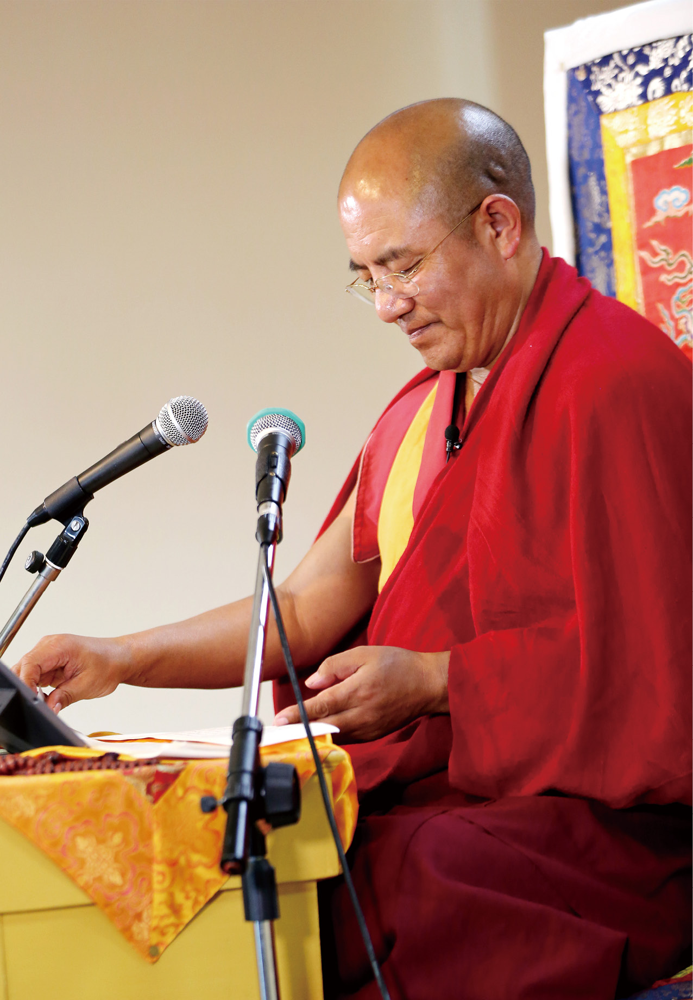
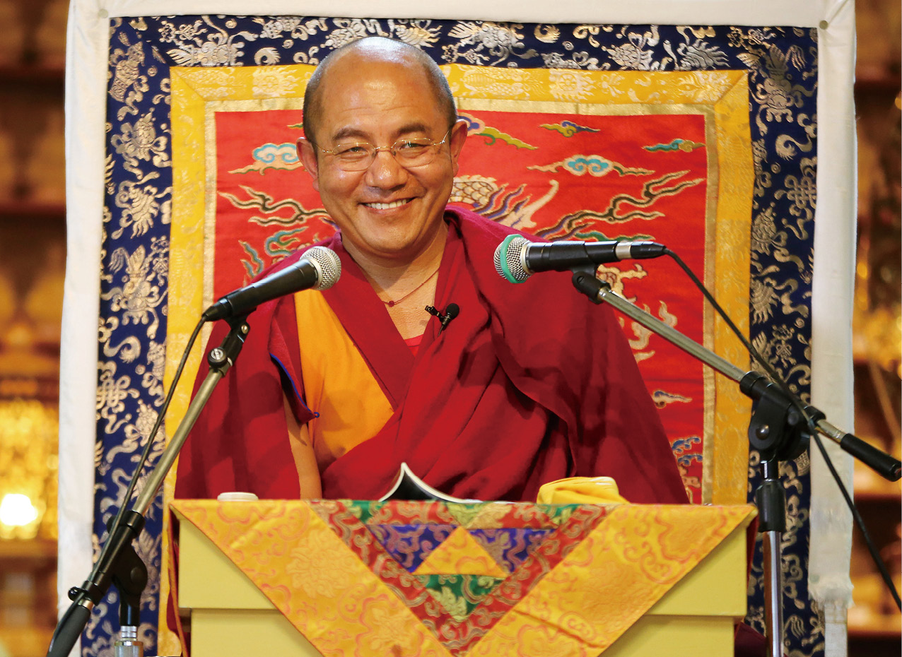

# 第4课

2014年10月11日

这次我们用五堂课的时间来给大家传讲《入菩萨行论·安忍品》，今天是第四节课，明天下午是最后一堂课。我先以藏文念今天第一部分的“安忍品”传承。

佛子不应嗔恨任何众生

（堪布念传承）

今天我们继续学习《入行论》中的“安忍品”。昨天讲到，在刚成为大乘佛教徒的时候，不管是在家人还是出家人，我们都已经发了菩提心。大乘佛教跟小乘佛教有差别，前者有发菩提心的过程。如果你光在口头上宣称自己是大乘佛教徒，却从来没有发过真正的利他菩提心，你其实不算是大乘行者。

阿底峡尊者说，外道和内道之间的差别以是否皈依来区分，小乘和大乘之间的差别以是否发菩提心来区分。可能你们大多数人都认为自己是大乘佛教徒，但是进入大乘最基本的判断标准，就是看你有没有发菩提心，这方面大家应该好好地扪心自问。

如果你没有发过菩提心，你就根本没有进入大乘佛教；即使你在口头上发了菩提心，但是你心里有没有产生过这种想法？如果没有，你也算不上是大乘佛子。现在，不管是藏地、台湾、欧美还是汉地佛教中的很多人，都认为自己是大乘佛教徒，但是对于刚才的问题，许多人的答案可能都是否定的。我不太清楚新西兰这边的情况，但若我们对发菩提心方面没有重视，就不能算是真正的大乘佛教徒。

昨天最后一个颂词是针对发了菩提心的人来说的，如果你发过菩提心，就更不应该对任何众生产生非常严重的嫉妒心和嗔恨心。当然，凡夫人要完全不生嫉妒心和嗔恨心非常困难，因此，我们要在产生这些不良心态的时候立即忏悔。佛陀在《地藏十轮经》中说[^1]，有两种人没有所犯的罪，一种人从来也不造恶业，另一种人虽然造过恶业，但以惭愧之心已经发露忏悔。此二者均可以说是佛陀的追随者。希望大家都能懂得佛教的道理，学会忏悔，这很重要。

我们已经发了菩提心，愿一切众生获得安乐，因此不应该对他们生起嗔心和嫉妒心：

初欲令有情，成佛受他供，

今见人获利，何故生嫉恼？

我们在刚进入大乘的时候，都在诸佛菩萨和上师面前发过誓愿：从现在开始，我要用自己的发心和力量来度化三界轮回中的一切众生，让他们成佛，受到十方众生的供养、尊敬和承侍。我们当初发心是让所有众生都成佛，并不是发心只让与我们关系好的众生成佛，而对与我们关系不好的众生置之不理。

如果我们现在见到个别的众生获得利养、名声、财富，自己却生起嗔恨心、嫉妒心，那已经完全违背了我们当初的发愿。因为我们的初心是让所有众生获得快乐，但是我们并没有通过实际行动让这些众生得到利益，甚至在他们获得利益的时候，我们还要对他们生嗔恨心、嫉妒心，这是非常不合理的。

以下用比喻来说明此理：

所应恩亲养，当由汝供给，

彼今已自立，不喜岂反嗔？

比如，在世间中你本来要用自己的力量来帮助亲友，像你的父母、孩子，你应该尽量用自己的资源来帮助、养育他们，但是现在你不用付出什么，因为他们凭自力或者通过其他人的帮助，已经获得了利益、利养、财富、名声。按照世间的道理，你现在不应该生起嫉妒心或者不喜之心，反而应该为他们得到利益而感到极大的欢喜。

按理来说，你应该孝顺父母，本来你要照顾、供养他们一辈子，可是现在有人代替你帮助和供养他们，让他们生活得很满足、很快乐。从世间的角度，你不应该对那些人恨之入骨，应该非常感恩他们，为什么呢？因为照顾和帮助父母完全是你的责任，但是现在有人帮你照顾他们，或者你的父母能够生活自理，你不用付出什么就能完成自己的责任，那是多么高兴的事情啊。若你反而因此不欢喜，那是非常不合理的。

以上的比喻正好说明：大乘佛教徒要做利益众生的事情，这是我们自己的责任；现在有其他施主来帮助或者提供利养给一些众生，若我们对那些得到满足的众生不生欢喜心，甚至对他们生起不正当、负面的心态，那实在不合理。

如果你对那些得到快乐的众生产生嫉妒等恶心，就会毁坏自己的菩提心。换句话说，相续中具有嫉妒心和嗔心的人不可能有菩提心：

不愿人获利，岂愿彼证觉？

妒憎富贵者，岂有菩提心？

一些人不愿意让敌人或者与自己关系不好的人获得任何利益，像财富、名声、赞叹等，既然他们连暂时的世间荣华富贵也不愿意让别人享用、拥有，那他们怎会让别人拥有更超胜的如来果位呢？肯定更不愿意了。比如，你不想别人得到几毛钱的利益，却想让他当上世界首富，那简直是个笑话，根本是不可能的事情。

同样，若你连一般世间利益像名声、财富、地位，都不愿意让其他众生得到，那你希望让他们得到正觉是不可能的。只要你对世界上任何一位有财富、地位、世间福报的人生起了嫉妒心或者嗔恨心，你的相续便不可能有真正的菩提心。作为佛教徒，如果我们平时的行为十分糟糕，说明我们没有菩提心。

《入菩萨行论》一针见血地指出我们的过错，每位佛教徒要经常用里面的理论来观察自己。有些道友认为自己在学习菩提心、出离心、无二慧方面学得不错，一些人甚至经常夸夸其谈，认为自己修密法已经达到很高境界，说自己有一些超胜的功德、神通、神变等等。但是，如果你没有大乘最基础、最基本的菩提心，那更高深的境界就更不用说了。

尤其现在有个别的佛教徒性格很不好，他们一开口就说别人的长短、过失，经常在道友、志同道合的人面前说别人的是非，或者看不惯别人拥有比他更胜一筹的财富、名声、健康，然后就开始诽谤他人。这些爱说别人过失的人经常闷闷不乐，当别人有一点福德现前时，他们就会不高兴，脸色、语气、神态立刻改变。有些嫉妒心重的人甚至一知道别人有些财富，可能心脏病都要发作了。

如果世间人有这些情况，我们可以理解，也不感到稀有，毕竟他们没有受过佛教的系统教育，只是按照世间的规则、自己的固有习惯来行事。但是，个别的佛教徒已经学佛十年、二十年，却连身边的一些小事都忍受不了，这从他们的行为可以看得出来。

我曾经接触过一些佛教团体，里面的人际关系比世间的团体更复杂，现在的情况应该比以前略好。一些世间团体，比如非常国际化的一些企业，他们的员工不一定有很高的个人素质和修养，但是因为内部的一些硬性规定，他们一定要按照某些原则来办事，例如同事之间不能互相说过失等等。因此，那些没有信仰的团体看起来比一些佛教团体更团结和合、烦恼更少。

佛教群体中有感性的佛教徒，也有理性的佛教徒，前者的信仰也许是基于感性或者一时的冲动。在待人处事的过程中，他们的心情容易变得复杂，冲动起来的话，会哭、会笑、会骂人，甚至会做各种令人意想不到的事情，行为上可能比企业员工更没有约束。所以，有时候佛教团体看起来比世间的团体更复杂。

不管怎样，如果你自认为是一位大乘佛教徒，至少不要有非常严重的嫉妒和嗔恨心。此处作者说，嫉妒心和嗔恨心严重的人，哪会有菩提心呢？不会有的。佛陀在相关的经典中讲，我们要修安忍，因为嫉妒、嗔恨的人不可能产生真正的修行境界。《大乘阿毗达摩》中说：嫉妒心的定义是对别人的财富或者超胜功德生起一种无法忍受的痛苦、烦恼之心，属于嗔恨的范畴；它的作用就是摧毁我们的善根和资粮。

有强烈嫉妒心的人白天不快乐，晚上也睡得不好，需要经常服用安眠药。确实，有嫉妒心的人不可能有大悲心和菩提心，如果你连这些最基本的功德也没有，那要修更高的法、达到更高的境界、获得更超胜的出世间功德就更不用说了，将会非常困难。

大概十年前，国家做了一些整顿，我们佛学院的汉族出家人需要离开。当时有位东北的和尚在四川的寺庙里挂单，他的性格不好，经常跟道友吵架，而他常常拿着一个金刚橛。那个寺庙的住持老和尚对他不满意，有次住持跟其他人说这个人很不好，其他人回应：“老和尚，你不能说他，人家是修普巴金刚、修金刚橛的。”老和尚说：“他连慈悲心都没得，修啥子金刚橛哦！他的人格差得很。”（众笑）

的确，连慈悲心都没有的人，还说自己修普巴金刚密法有境界，这是不可能的。佛教徒要先皈依、发菩提心，然后接受灌顶、受密乘戒，一步一步地修上去。利他心是大乘非常基础的一个法，欠缺它的话，恐怕就说不上更高的密法修行了。慈悲心和菩提心修起来确实是比较困难，但是无论如何我们一定要把它们修好。

此外，我们要恒时观察自己有没有嫉妒心、嗔恨心等恶心。修行人要经常观自己的心，这是最关键的。如果你没有观察自心的习惯，你的心就像野蛮的猴子一样，随时都会改变方向。相反，如果你经常关注它，总有一天你可以把它调伏。很多大乘修行人本来是地道的凡夫，但是经过长期的观察自心，最后他们都成为特别了不起的修行人和成就者。这是我们亲眼所见的事实，因此大家也要好好地观察自心。

不应为利养生嗔

下面说，我们为了利养而争论或者产生嫉妒心是不合理的。为什么呢？因为若以智慧观察，实际上我们所嗔恨、嫉妒的对境都是非常虚幻、了不可得的。

《入菩萨行论》汇聚了非常多的零散教言，思路不一定很连贯，可是它对人们的不同心态都有所剖析。为什么在讲到断除嫉妒、嗔恨的时候要提到不同的对境，要用不同的篇幅来破名声、破利养、破对怨敌所生的恶心？因为每个人的心态和烦恼都不相同，有些人堪忍不了别人有名声，有些人堪忍不了别人有财富或者有良好的人际关系，有些人则特别脆弱，遇到一点挫折便没法抬起头来，忍受不了修行上的痛苦……

作者通过不同的理论来让我们对自身的烦恼有方方面面的了解，如此我们在面对各种对境的时候，才能够掌握好自己的心态，在该坚强的时候坚强，在该放手的时候放手，分寸有度。现在，很多佛教徒在不该安忍的时候安忍，该安忍的时候却不安忍，就是因为缺少教育、不懂道理之故。

我们要获得世界上任何一种知识都需要教育，没有教育的话我们连世间法也做不好。为什么世界各国都重视教育？因为它可以把人们潜在的能力开发出来。同样，依靠佛教的教育，我们能够把对今生来世有利的出世间功德宝藏开发出来。虽然不同地方的教育资源和教育方式都不相同，但是世界上任何一个角落的人都需要教育。我们既要学习古人的智慧，也要学习这个时代的知识，此二者必须结合，我们才能成为真正的修行人。

若已从他得，或利在施家，

二俱非汝有，施否何相干？

一些没有财富的人看到别人得到财富会生起嫉妒心，比如一位企业家，他的企业没有什么盈利，当他看到别的企业赚钱，他会很不高兴。修行人也是同样，如果别人得到施主的供养而他得不到，那他会不高兴。我们的人性就是如此，在没有竞争的时候人们的承受能力还是可以的，一旦有了比较、竞争，比如看到别人有财富而自己没有、别人成功而自己不成功、别人有名声而自己不出名，此时人们便会非常苦恼。

此处以智慧剖析，现在别人得到利养，实际上就算别人没有得到利养，财富仍旧留在施主家，这两种情况下你都得不到那些财富，那施主供不供养别人跟你有什么关系呢？

别人得到财富的话你就特别难受，别人得不到财富的话你就很开心，这是没有必要的。一位企业家应该为其他企业家的成功而高兴，但是世间人没有这种想法，他们觉得竞争对手的成功相当于自己的财富被夺走，会很不高兴。现在的所谓竞争背后，人们都有这种心态。

即便在同一个家庭，如果哥哥发财，妹妹也会不高兴：“我们是一家人，为什么他有钱我却没有？”同辈之间也有很多比较、竞争，比如你以前的同班同学已经有房、有车，如果你还没有的话，你会很不高兴。总之，当别人拥有一些你没有的东西，你可能会出现一些不好的心态。其实，不管别人是否拥有那些东西，都跟你没有任何关系，你不高兴是因为自己的虚荣心在作祟。如果我们详细地观察，会发现人们的苦恼大多数都没有意义。

有一部分痛苦是每个众生都难以回避的，例如病痛或者欠缺基本的生活条件，没有吃穿等等。另一部分的痛苦是根本没有必要的，是因为你对事情抱有希望和担忧才有的。这是思想、心态上的苦恼，与现实无关，百分之七八十不会真的发生在你的身上。尤其在感情问题上，人们经常有希忧、竞争和斗争的心态，因此经常感到非常痛苦。此处说，众生应该学会观察，否则会因为不正当的竞争心而带来不必要的痛苦。

如果别人得到利养，我不应该对他们产生嗔恨或者不满之心，反而应该恨自己、对自己不满，因为我没有利养不能怪别人，只能怪自己以前没有好好地创造利养之因：

何故弃福善，信心与己德？

不守已得财，何不自嗔责？

一些人由于没有名声财富而感到很苦恼，这是不应理的。因为一方面他们即生中没有为了名声财富而努力，比如没有好好地创业；另外一个根本原因，是他们在生生世世中没有积累众多福德资粮。所以说，他们已经舍弃了最根本的福报之因。

比如参加考试的两位学生，一位考得很好，一位不及格，后者因此对前者产生嗔恨、不满，这是不应理的，因为后者自己没有好好地复习，去怨恨别人根本没有道理。同样，你为什么舍弃对自己有利的福德善法？为什么舍弃对上师三宝的信心？为什么舍弃自己的闻思修行，以及清净戒律等高尚品德？世间中的很多福报都是依靠这些善缘而来。

现在大多数人很盲目，他们追求财富、快乐、荣华富贵，可是他们所造的业不会让他们得到这些东西，他们的愿望和行为背道而驰，确实十分可怜。如果你真想得到财富，为什么舍弃福德善业？为什么你现在不珍惜眼前的机会，不好好地保护你的福德和出世间的财富呢？若你现在用信心、智慧、悲心多做一些善事，你在将来完全可以得到诸多世间福报。

以智慧来分析后，如果你还要生气，那你不应该对敌人、竞争对手产生嗔恨心，而应该责怪自己，对自己产生嗔恨心。以前藏传佛教的很多修行人经常对自己棒喝，自己惩罚自己：“我这样的坏人为什么不好好修行啊？我为什么这样差劲？”如此行持非常有用。不管是语言上还是行为上，大家反复观察自身是很有必要的。

我们以前造恶业以致即生中非常不顺利，故应为此感到非常惭愧，不应该对别人产生嫉妒心：

于昔所为恶，犹无忧愧色，

岂还欲竞胜，曾培福德者。

我们应该呵斥自己：“我今生遇到诸多不顺，也得不到利养，原因就是我在往昔没有很好地积累资粮，还造了很多杀盗淫妄等自性罪和佛制罪。当这些罪业的果报现前，我不仅没有丝毫的惭愧心，还要怨天尤人，总觉得：‘为什么我得不到利养？为什么我长得难看？为什么？’”

有智慧的人畏因，没有智慧的人畏果。很多人因为对因果缺乏诚信，或者对这方面不了解，所以他们总认为现在发生的很多问题只跟今生有关，却不知道这与自己的前世有关，而自己今生的很多行为又与来世有关。世间人非常盲目，很多人并不知道前后世、业因果的道理。相关的经典中说：“欲知前世因，今生受者是。欲知后世果，今生作者是。”如果你想知道自己在前世造了什么因，看看你今生所感受的便知道了；如果你好奇自己在来世会得到什么果，看看你今生所做的就知道了。

有些人经常找上师或者有神通的人问自己的前世是什么样，台湾的海涛法师经常说：“你想某某部位长得好看，就要好好地做某某功德、善法。”法师说得有道理，如果你今生长得好看，说明你前世造过一些福德。为什么有些人长得好看，做任何事情都非常顺利，也有很多财富和不错的地位？这与前世的善业有关系。如果你即生体弱多病、受到各种诽谤、有很多不好的心态，甚至各方面都觉得自卑，这说明你前世造了非常可怕的业。

那么你的将来会怎样呢？现在很多人很愚痴，不去思考这个问题。而在藏地，不管是出家人还是在家人，大家都特别关心自己的未来，尤其是来世。现在很多人很现实，他们只关心即生中自己老了以后的事情，像养老、医保等。对于今世和来世，也有一些佛教徒只关心今世，这从他们的言谈举止中可以看出来，“我来世可能会往生极乐吧，应该可以吧。”似乎只是随口说说，并没有特别关心。

当然，非佛教徒不懂得来世的存在情有可原，但是我们佛教徒一定要对这些道理有所了解。以前上师如意宝说：“作为一位修行人，自利和他利当中，我以他利为主，他人的事情比我自己的事情重要；今世和来世当中，我以来世为主。”的确，来世更值得我们重视，因为它非常漫长，而今世只有短短的几十年。

像我这个年龄的人，再过十年就六十多岁，再过二十年就七十多岁了。今天在座有多少人是七十多岁的？我现在已经觉得自己很老了，今世活得再长也只不过是十多年的光阴，最多也是二十多年而已。但来世不是几年、几十年的事情，它比几百年、几万年更漫长。大家即生遇到佛法，已经得到了关键的解脱钥匙，所以我们现在一定要行持非常强大的善法，如此对我们的生生世世都有帮助。按理来说，每一个人都非常有必要去关心自己的来世。

自利和他利当中，他利更重要。现在不像出现饥荒的年代，那时候每个人都有可能会饿死，如今人们不用再为自己的温饱问题担忧，我们的人生价值就在于我们能否帮助别人，这是最合理的。我老家那里在1959、1960、1961这三年出现了非常严重的饥荒，那段时间没有人想生小孩，而我是在饥荒的第二年来到这个世界。1962年之后，人们有了基本的生活条件才开始生小孩，我才开始有更多的兄弟姐妹。

现在全球的形势比较乐观，将来应该不会出现大饥荒，我们要生存下去应该不成问题，因此我们没有必要特别想着自己的事情。对我们来说，现在最关键的是什么呢？就是知道怎样的人生才有价值。哪怕你给身边个别的人带来暂时的快乐或者一点帮助，你也应该为此尽心尽力，我认为这就是我们活在这个世界的价值。

此处说，今生贫穷的人为什么对自己前世所造的恶业没有一点惭愧心，却对有福报、行持善法的人产生嫉妒心和嗔恨心，要跟他们恶性竞争、对抗？这是非常不合理的。有智慧的人会尽量断除嫉妒心和嗔恨心。佛教徒确实要注意自己有没有嫉妒心，因为它非常可怕。

很多汉地和西方的电影、电视都有由嫉妒心所引发的重大剧情，像汉地古装剧中的宫廷斗争，像西方好莱坞电影中的一些情节，我们从中可以看到，嫉妒是一种非常复杂的心态，影响着人与人之间的互动。一些人生了嫉妒心后会谋害别人，以前藏地的仓央嘉措非常出名，但是有些内部的人对他生起了嫉妒心，逼他离开布达拉宫，最后他迁流到远方，一直在蒙古、五台山等地弘法。此外，大译师贝若扎那的智慧与才华无人能比，他受到当时藏王赤松德赞的最高礼遇，引来一些奸臣的嫉妒，后来他们联合王妃来诽谤贝若扎那，使他被流放到嘉绒地区（即现在马尔康一带）。

嫉妒心会让人不讲道理，所以有智慧的人要尽量把它断除。那天有人跟我说，他和妻子因为感情问题而吵架。我说你们应该好好地讲道理，他说：“没有什么好讲的，爱情本来就是不讲道理的。”我说：“既然如此，我给你讲道理也没有用。”他认为该说的已经说了、该吵的架已经吵了，暂时来说双方都没有谈判、沟通的余地。如果我们产生嫉妒心，也会变得不讲道理和很不快乐，所以我们应该经常以智慧来剖析自己的心态。

愿敌痛苦不应理

（堪布念传承）

刚才讲了关于利养方面的道理，下面从自己、敌人得到快乐的层面来分析。《入行论》的写作风格是从不同的角度、层面来剖析我们心灵的痛苦和嗔恨心的过失。这里说很多人希望怨敌不快乐，其实这对自他都没有意义：

纵令敌不喜，汝有何可乐？

唯盼敌受苦，不成损他因。

当敌人在生活中遇到不顺、遭受痛苦的时候，比如他拥有的企业倒闭、名声损坏或者遭到袭击等等，此时一些人会幸灾乐祸，特别开心。如果你用智慧观察，在敌人遭到痛苦的时候，你有什么可高兴呢？根本没有什么值得高兴。

现在有些人的心地很坏，他们总希望别人不顺利、不快乐、不要发财、不要成名，他们渴望得到这些成就，却不想别人得到，而且还一直盼望别人遭受痛苦。这种想法真的非常不合理，如果他人自己有福报，你如此发恶愿并不会成为他人受到损害的因，反而会给自己带来各种痛苦。

以前有个公案，一位心地很坏的孩子发恶愿，希望自己将来成为国王，把所有沙门的头统统砍掉，另一位孩子则发善愿，希望自己将来成为国王，可以供养那些沙门。结果，有一天发恶愿的孩子在路口睡着了，当时国王的马车奔驰而过，把他的头颈辗断了。现实生活中，人们遇到的一些突发事情是由自己的恶心所致。非常强大的恶心会给自己带来诸多不顺，最后让你非常不快乐。宗喀巴大师说：“心善地道善，心恶地道恶。”如果你保持善良的心，会给自己的今生来世带来吉祥和快乐。

心善、心正的人确实有种力量。一些研究心理的科学家做过一个实验：他们事先录制好两段音频，一段音频收录了人们在生气状态下说的话，另一段音频收录了人们在和善、开心状态下说的话；之后科学家把两段音频分别对着两株长势相同的同一种植物重复播放，结果听着前者的植物很快就枯萎了，由此可以说明心的力量。因此，大家不要认为恶心很好，任何时候我们都要尽量避免产生恶念。

《大圆满前行》中讲过一个公案，以前有位出家人，听说与他关系不好的另一位出家人有了女人，便开心地对侍者说：“煮上好茶，我今天听到一个好消息，我们的对手破戒了。”虽然他自己没有破戒，但是因为对手破戒而特别高兴。其他大德听到此事后，非常惋惜地说：“不该这样！一者破戒，一者随喜破戒，后者的过失比前者的过失更大啊！”

现在很多人会因为自己的竞争对手，或者与自己关系不好的人在工作上、家庭上、感情上、名声上遇到失败，遭到挫折而幸灾乐祸，感到非常高兴。在美国“911”受袭事件发生后，听说对美国有看法的个别年轻人特别开心，马上去喝咖啡庆祝。那时候大概有三千人死亡，对此我们不应该开心，但是人们处于嗔恨和嫉妒的状态下，心态会变得很不正常——在该高兴的时候不高兴，在不该高兴的时候高兴。如果对方跟自己的关系好，他们做任何事情我们都能够忍受；如果对方跟自己的关系不好，我们却希望他们没有任何名声和财富，这些都是不合理的心态。

修行很重要，其主要目的就是对治烦恼。藏传佛教的米拉日巴尊者说：“若想知道一个人的生活好不好，关键看他脸上的气色；若想知道一个人的修行好不好，关键看他对治烦恼的情况。”如果你烦恼深重，说明你的修行肯定不好。

一些人说自己要闭关三年三月三日三小时三秒，要修大圆满、大手印、大威德……所修的法都以“大”字开头。虽然他们所修的法很大，但是自己的心却很小，什么事情都容纳不了，只要遇到一点小事情便马上哭哭闹闹，和别人吵架，这是因为大法没有融入自己狭小的心之故。修行大法的人不能光说不修，否则就是自欺欺人、在说大话了，应当感到羞愧。

刚才讲到你希望怨敌遭受痛苦，但是不一定能够如你所愿。退一步说，即使你如愿以偿，别人现在受苦了，你也不能从中得到什么：

汝愿纵得偿，他苦汝何乐？

若谓满我愿，招祸岂过此？

如果你发的恶愿如愿以偿，敌人真的遭到破损、灾害，你又有什么可高兴的呢？没有什么可乐的。

前几天这里有个女孩说，她在骂别人的时候感到特别爽。当时我看了她一下，感觉她的神情不太对，就装着没有听到，也不敢再往她的方向看。

表面上，你骂别人或者看到怨敌遭受痛苦后感到很满意、很快乐，其实你还是很痛苦的，为什么呢？因为恶心不仅在今生为你招来非常大的过患，也会给你的来世带来各种痛苦，所以这种“爽”实际上是不好的，需要好好地对治。

以下用比喻来说明嗔恨的过患：

若为嗔渔夫，利钩所钩执，

陷我入狱篓，定受狱卒煎。

嗔恨心和烦恼就像渔夫一样，他们以名声、利养等妙欲铁钩钩着我们这些凡夫众生；我们众生就像鱼类一样，一旦被渔夫钩住，定会陷身于地狱之篓中，被阎罗狱卒们丢进油锅里煎炸，感受着燃烧的痛苦。

佛陀在《正法念处经》中说：“众生堕地狱，其因大嗔恨。”众生堕入地狱的根本因就是大的嗔恨烦恼。其他的经典也讲，众生产生嗔恨心会堕入地狱，产生贪心会堕入饿鬼，产生痴心会堕入旁生，堕入地狱的根本原因就是嗔恨心。

因此，修行人应该恒时保持平静的心态，尽量不要产生大的嗔恨心。即使你生起嗔恨心，也要像我们那天所讲，先让自己暂时停下来，安住一会，哪怕是三五分钟都可以。烦恼就像台风一样，是突然性的，短时间内就能让我们造下各种恶业。

一般来说，人们的嗔恨心是暂时性的，不会持续很久。如果我们在嗔恨心爆发的当下把它认出，便可把它的伤害性减到最低。不过，有时候嗔恨心以潜藏的方式存在，比如家庭成员之间吵架后，双方会一直互不理睬，持续很长时间。此时，我们要想到地狱的因是嗔恨心，一定要把它断除。

名声不会带来利乐

至于名声方面，我们不要贪执别人对自己的赞颂：

受赞享荣耀，非福非长寿，

非力非免疫，非令身安乐。

表面上我得到荣耀、名声或者受到别人赞美是很好的，但是实际上并没有益处。藏地有个说法，名声就像秋天的小虫，待它长出翅膀，很快就会死去。小虫在秋天长翅膀，长了之后过两天就会打霜，马上就是冬天，那时候它们都会死去，因此长出翅膀就是它们活不了很久的标志。同样，一个没有福报的人有了名声，就是他马上要堕落的标志，十分危险。

此处说名声、荣耀和别人的赞叹并不是好事：它们不是福德，因为福德对我们的生生世世有利，但是名声对来世没有帮助；它们不能让人长寿，对我们的生命没有好处，人们不会因为有了名声便多活几十年；它们很难给我们带来好的力量，却往往会带来负面、造恶业方面的力量，像一些正在坐牢的人，他们以前有名声、有权势，可是他们没有把这些用在正途，反而因为一念之差，为了维护自己的名声而造罪；此外，它们并不能让我们免疫于疾病和违缘；它们也不能让我们永远健康和快乐。

藏传佛教的贡塘·丹毕准美尊者说：“名誉的雷声阵阵地响起，福报的云雾渐渐地消散。”意思是，当一个人的名声越来越大的时候，他的福德会逐渐消去。有些人在有点名气或者财富后，便迷失了自己，好像变成了另一个人似的。当然，从历史上看，一些有智慧的高僧大德、成就者会以自己的名声来感化很多众生；现在也有一些世间的明星、名人，依靠自己的名声来弘扬正义。因此，佛教并不是彻底地否定名声和财富。

佛教要破除的是人们对名声、财富、权力的过分贪著。佛教也讲，一个人在没有贪执的情况下，可以享受成千上万的金钱。此外，本师释迦牟尼佛的名声响彻三界，在人类历史上，像释迦牟尼佛那样出名的智者也是非常罕见的。虽然佛陀已经示寂超过2500年，但是现在他的追随者还是如此之多，可见佛教并不是彻底地排斥名声。这里讲的是人们对名声的贪执会给自他带来不利，经过作者的分析，稍微有智慧的人便会明白这方面的道理。

下面继续剖析，虚名对我们的今生来世没有帮助：

若吾识损益，赞誉有何利？

若唯图暂乐，应依赌等酒。

若仅为虚名，失财复丧命，

誉词何所为，死时谁得乐？

若你再三观察名声给自身带来的是损害还是利益，你会发现它无有益处。一些人觉得有名声总比没有名声好，有些名气的话，自己无论在什么地方都有人认识，可以得到别人的款待，所以名声会给自己带来快乐。实际上这种快乐是低下的，为了虚名而活的人生没有意义。

若你贪图低下的安乐，那不用大费周折地追求名声，只要依靠一些不如法的行为就可以了，比如赌博、享用美酒、打麻将、吸毒等等。它们可以给你的身心带来暂时的快乐，可是它们没有任何意义，而且很快就会把你的人生摧毁。如果你总是跟随自己的分别念，凡是让自己暂时快乐的就去行持，这是没有头脑的表现。我们应该行持对社会有意义，或者对自己身心真正有利益的事情。

再者，若你觉得虚名对你有用处，这是不应理的。如果你为了虚名而失去财富、生命，那虚名对你又有什么实际意义和用处呢？死亡的时候名声是没有用的。现在，有些人为了名声而到处打广告、做宣传，我们老家就有个别的人为了一个名誉会长的头衔而花了好几十万，这是没有意义的。现在汉地也有相似的情况，值得我们佛教徒注意。

不管你是在家人还是出家人，都不要为了得到世间八法[^2]中的名誉、赞叹、暂时的快乐和利养财富而把佛法当作买卖品，这是完全不合理的，有非常大的过失。你的所作所为是为了名声、利养、财富，还是为了众生和自己的修行，别人会逐渐看得出来。修行人要学会观察，在死亡之时什么东西对自己有利益，最后你会明白世间的名声没有任何意义。

藏传佛教的大德卡隆巴格西说：“名声是魔王对我们的奉承。如果你的名声越来越大，可能你已经着魔了，此后你各方面的违缘会越来越大；如果你没有名声，就能保持完美的品德和非常纯洁的精神境界，成为一位清净的修行人。”

大家不难发现，人们一旦有了虚名便变得晃晃悠悠。一些人突然火起来后，无论是表情、说话的语气还是走路的姿态都跟以往不一样。由于目中无人，他们走路的时候好像只看虚空、不看大地似的，此时便十分危险了，很容易跌倒。跌倒后他们才想起身边的亲朋好友，想要寻求帮助，但是为时已晚，身边的人早已离他们而去。

我们修行人千万不要用佛法来宣传自己，不要把佛法作为提高自己名声的手段。《亲友书》中提到我们要平息世间八法，这方面佛教讲得很精准。人们所做的各种不正当手段，其目的都包含在世间八法之中，人们要么贪执快乐，要么贪执名声，要么贪执财物，要么贪执赞叹，可怜的是很多人最后都因此堕落。那些堕落的人如果当初没有搞世间八法，也许他们现在可以清净地活在人间。

因此，我们一定要懂得名声没有用。一旦名声受损我们应该理性地对待，没有必要像凡夫人一样过于执著：

沙屋倾颓时，愚童哀极泣，

若我伤失誉，岂非似愚童？

这是一个世间的比喻，愚笨的孩童用沙子堆砌房屋，当它倒塌的时候，愚笨的孩童会非常伤心，大声地哭叫。同样，当自己的名声遭到损害，凡夫人会非常苦恼，这和愚笨的孩童没有差别。

所以，修行人在拥有名声或者受到赞叹的时候没有必要去执著，在没有名声或者名声受损的时候也没有必要伤心。世间很多人的行为和孩童一模一样，他们在拥有某些东西的时候会很开心，在缺乏或者失去这些东西的时候就很痛苦。

我在《泰国游记》中提到，我在泰国的一个海边看到很多小孩用沙子来堆房屋，一旦巨浪涌来摧毁了这些建筑，他们就感到十分痛苦。当时我想，寂天菩萨可能在印度的海边也看过孩子们在堆沙屋，同时他也知道世间人在名利被破坏后的痛苦，所以他在此作了这个比喻。以后你们在海边看到孩子们在堆沙屋的时候，应该想到世间人也为名声和财富的沙屋而白白受了很多痛苦。

现在我们都住水泥房子，其实我们就像里面的小虫，相对于全宇宙来讲，每个人都很渺小。人生只是短短的几十年，我们不要为了名声、财物、感情而苦恼，耽执这些没有任何意义。我们此生遇到殊胜的佛法，现在对我们最关键的是要多修行、多行持善法，这非常重要。

不应对赞叹生欢喜心

事实上名声会损害我们的修行：

声暂无心故，称誉何足乐？

若谓他喜我，彼赞是喜因？

受赞或他喜，于我有何益？

喜乐属于彼，少分吾不得。

此颂第一句的“暂”字在藏文中没有特别意思。赞叹词本身没有赞叹别人的心，例如别人对你说：“你好厉害啊，你特别出名。”这些赞叹词只是声音而已，就像风声一样没有任何意义，你听到后有什么可快乐的呢？不值得快乐。如果你因为别人赞叹你而感到开心，你可能辩解说“我不是因为自己受到赞叹而高兴，是为赞叹者的心生欢喜而高兴”，那么赞叹者赞叹别人的时候也是心生欢喜的，此时你也应该高兴才对。

再者，若赞叹者感到欢喜，对你有什么利益呢？这跟你没有关系，因为这些欢喜产生于别人的心相续，不像外在的食物般可以分享。比如牛油果，我可以吃一半，把另一半分享给你；苹果的话也可以分成多份，我吃一份，你吃一份。但是，当赞叹者在自己的心中产生欢乐时，这种心态是你和其他人都得不到的。

此处说，人们喜欢听到别人对自己的赞美，但是我们要观察所谓的赞叹到底是什么。我以前开玩笑地说过，如果你喜欢听到自己的功德，你可以录下赞叹自己的说话，比如“你很了不起”，然后用复读机把音频重复播放；你也可以到一个山谷、大水泥房或者回音特别好的广播室里，拼命地大喊自己的功德或者喊“你很了不起”，那么赞叹你的回音会不断地传到耳中。最后你会发现，赞叹犹如空谷回声，没有什么可欢喜的。

如果你用智慧来观察，会发现别人对你的赞叹没有任何意义；同样，别人对你的诽谤、挖苦也如空谷声般没有任何实义。世界上的所有诽谤和议论，小至个人之间的议论、说法，大至国与国之间的各种争论、说法，甚至是对高僧大德有意无意的诽谤，过了一段时间后，这些言论都会销声匿迹，好像从没出现一样。

若一个人本身有功德，别人的所作所为都不能损害他的功德；若一个人本身没有功德，别人再怎么赞叹，他仍是一个坏人。所以，不管是怨敌受到赞叹还是自己受到诽谤，我们都要学会安忍。陈那论师说：“妄念大无明，令堕轮回海。”我们的妄念是个大无明，它会让我们堕入轮回之海。一旦妄念产生，人们会执是成非，也会执非成是，因此大家要注意。

他乐故我乐，于众应如是，

他喜而赞敌，何故我不乐？

有些人认为：“他人对我进行赞叹，我高兴不是因为别的，是因为赞叹者产生了欢喜心，我随喜他们的快乐而已。”作者反驳，如果赞叹者欢喜会让你高兴，那么他们赞叹别人的时候也是欢喜的，此时你也应该高兴，但是事实并非如此。别人赞叹你的时候你很开心，马上露出笑容；而别人赞叹其他人的时候你却不开心，甚至不愿意接受，同时脸上也收起了笑容，露出其他表情，一般人都是如此。

我赞叹某个人之前会看看周围有没有和他关系不好的其他人，如果有的话，我会提醒自己千万不能赞叹这个人，不然有些人会出现一些反应。大家以后说话也要注意场合，这很重要。

关于我们不应对赞叹生欢喜心这部分，这个颂词如是总结：

故我受赞时，心若生欢喜，

此喜亦非当，唯是愚童行。

当我们受到赞美和赞叹的时候，如果心里乐滋滋的，特别欢喜、开心，这没必要，是孩童的行为。

家长经常对孩童说“你跳舞跳得很好”“你唱歌真好听”“你长得越来越漂亮了，你是全世界最好看的人”，孩子就会真认为自己是全球70多亿人当中最了不起的人。我们的心态有时候就和这样的孩童没有差别，当我们听到别人说“你现在很了不起，各方面都很不错”的时候，我们就非常开心，但别人若说一些老实话或者我们的一点过失，我们就接受不了。

我们一般都是心随境转，这是凡夫人的特点；境随心转，即不管外境发生什么变化，都可以由心来控制，这就是圣者的境界。圣者有自己的原则，可是凡夫人没有原则，每天都是随着外境、别人而行。

名声受损，理当欢喜

（堪布念传承）

别人的赞誉对我无益，但是别人对我的诽谤和负面评价则对我有利：

赞誉令心散，损坏厌离心，

令妒有德者，复毁圆满事。

以是若有人，欲损吾声誉，

岂非救护我，免堕诸恶趣。

赞誉让我们的心散乱，如前所说，我们受到赞叹后会得意扬扬、脱离常态，觉得自己是世间中很了不起的人；赞叹也会损坏我们的出离心，一些人本来对轮回有一定的厌离心和出离心，但是受到赞叹之后，原来的出离心和修行状态都销声匿迹了；此外，赞誉令我们嫉妒有德行的人，让我们相续中的嗔恨之火不断燃烧，摧毁一切圆满今生来世的功德资粮。所以总的来说，有了名声不是一件好事。

那天有位修行人对我说，他以前有名声的时候修行很不好，近年他通过各种办法让自己变得低调，以隐身模式生活了一段时间，退出了不同的圈子，慢慢地他身边的人就不再联系他了，之后他的修行才逐渐增上。所以说，赞叹和名声确实有诸多过患。

如果有人想方设法损害你的名声，他实际上是在救护你，否则你会堕入恶趣，那就特别可怕了。

我们没有必要为了维护名声而做各种事情，也不要因为名声受损而感到很伤心、很痛苦，大家应该学会安忍。正如刚才所讲，有了名声后你会散乱、毁坏出离心、做各种不如法的行为，如此你会很快堕入地狱。不过，现在通过别人的诽谤，让你的名声受损，你就可以默默无闻地修行，最终免堕地狱。世间人觉得自己要得到赞叹、名声不要受损，这样人生才有希望，修行人的想法正好与此相反。

吾唯求解脱，无需利敬缚，

于解束缚者，何故反生嗔？

我们是希求解脱之人，千万不要被利养、名声和别人的尊敬所束缚。假如有人摧毁我们的名声、利养等等，帮我们解开世间八法的束缚，我们怎能对他产生嗔恨心呢？不应该的。

以前的大德们非常重视这个颂词。仲敦巴尊者是阿底峡尊者的大弟子，他的修行非常好，后代噶当派的修行都是按照仲敦巴尊者的教言来行持。他当时在拉萨热振寺附近的柏树林中修行，经常喃喃自语道：“我是希求解脱者，莫为名闻利养缚。”（就是此颂的前两句，只不过翻译不同）我们都是希求解脱的人，不要被虚名、多余的利养和别人的尊敬等束缚，如果有人来损害我们的世间利益，我们应该说：“欢迎光临！”之前我们去新加坡，那边有位道友说：“欢迎光临！欢迎你们来到新加坡！”

同样，任何人损害我们的名闻利养、世间利益的时候，我们修行人应该说：“欢迎损害。”看看大家以后能否做到这一点，很多修行人刚开始都说自己能够做到，或者在没有违缘的时候都觉得自己修得很好，但是在遇到违缘，当自己的名声、财物等各方面真的受到损害的时候，他们才知道自己修得不好，同时别人也能够看得出来。在我们各自的修行路上，遇到违缘是最好的体验，也是观察自己的最佳时机。

如我欲趣苦，然蒙佛加被，

闭门不放行，云何反嗔彼？

本来我会因为追求名声等世间八法而堕入恶趣，感受痛苦，但是蒙诸佛菩萨和上师们的加持，现在通过违缘的方式，恶趣的门已经关闭，我可免堕恶趣。当大家遇到违缘和不顺的时候要反过来思考，想到这是诸佛菩萨的加持，好让我们通过另一种方式来修行。

嗔恨是我们获得福德之障碍

下面讲到，嗔恨那些障碍我们获得福德的人不合理：

谓敌能障福，嗔敌亦非当，

难行莫胜忍，云何不忍耶？

若我因己过，不堪忍敌害，

岂非徒自障，习忍福德因？

一些人会想：“我本来可以忍耐敌人对我所做的各种危害，但是他们的诽谤会成为我积累福德的障碍，如此我的修行就不能成功，所以我没法对敌人的嗔恨和诽谤产生安忍心。”

一些修行人会有这种想法，他们认为敌人最好不要来损害我，家人也不要干扰我，不然我的修行不能成功。他们觉得为了自己的修行不被打扰而生气、不高兴是合理的，因此经常跟家人吵架：“你知道吗？我在修安忍！你不要打扰我，我要修安忍！”（众笑）他们不知道在被家人打扰的当下，就是修安忍的最佳时机，却认为要在别的场合修安忍。

安忍是所有修行中最好的修行，受到别人打扰就是最好的修安忍的机会。这里说“难行莫胜忍”，在所有的修行中，安忍是最难行持的，其他修行的功德也没有能胜过修安忍的，所以我们为什么不好好地修安忍呢？有时候我们经常觉得自己的违缘很大，比如家人不信佛教，并因此认为自己没法修行，感到非常痛苦。其实，这对你修行是很有利的，因为你在家里时时刻刻都有安忍的对境。

以前阿底峡尊者到藏地时，特意随身带着一位脾气非常糟糕、性格很差的弟子作侍者，很多弟子都建议尊者不要带着此人。当然，阿底峡尊者的修行境界非常高，肯定具足了这些功德，但是他显现上说，这个侍者不能换，他要依靠这位脾气暴躁的人来修安忍。

我们在依止上师的过程中，也经常看到上师身边有各种各样的人，例如脾气不好的侍者。此时一些人会说：“这个人很坏，性格很差，但是上师很慈悲，摄受了他，还让我们修安忍。”他们可能不好意思说上师自己要修安忍，于是说上师很慈悲，把这个脾气不好的人放在群体里让弟子们修安忍。我们在任何情况下都可以修行，尤其六波罗蜜多当中，修安忍是最重要的，所以别人来害你的时候，你要知道这是修安忍的最好时机。

“若我因己过”这个颂词的意思是，如果我因为自己的过失，不能堪忍敌人的危害，没有很好地修持安忍，那就不是敌人在障碍我，是我自己在障碍自己获得福德之因——安忍。

汉地和藏地的家庭环境不太一样。在藏地，如果家里有人修行，家人们会很随喜。但是在汉地，现在有一部分居士的家人都信仰佛教，而有些居士的家人则不信佛教，他们可能没有信仰或者信仰其他宗教。前者的情况比较乐观，一家人都信佛的话，家人们会相处得比较快乐。后者的情况就像那天我在大学里所讲的一样，一个家庭中有人信仰基督教，有人信仰佛教，有人没有宗教信仰，这样的家庭可以召开“跨宗教会议”了，各种宗教徒和非宗教徒都可以参加。

一些佛教徒可以和非佛教徒的家人和睦相处，但是他们彼此在信仰上或者某些观点上的冲突还是比较多。这时候佛教徒要学会随顺家人，否则你在家里会经常感到很难受。对于修行较好的道友来说，何时何地都是自己的修行依处，他们可以经常依靠非佛教徒的家人来修安忍。相反，如果你没有趁此机会很好地修安忍，说明你自己已经成了自己修行的障碍。

作害者是修行之助伴，理应珍视

无害忍不生，怨敌生忍福，

既为修福因，云何谓障福？

应时来乞者，非行布施障，

授戒阿阇黎，亦非障出家。

没有危害的话，安忍根本生不起来，依靠怨敌才能生出安忍波罗蜜多的福德之果。既然怨敌是福德之因，我们千万不能说他们是修行的障碍。

很多佛教徒说：“某人的脾气不好，给我制造很多违缘，让我无法修行，他是我修行的障碍。”事实上，他不是你修行的障碍，是你修行的所依，犹如善知识一样。一些人总觉得别人，尤其是其他宗教徒经常加害自己、对自己不好，认为他们是修行上的障碍，其实不然，为什么呢？这里用比喻来说明。

比如你想修布施波罗蜜多，若遇到乞丐来祈求资财，这个乞丐肯定不是你布施的障碍；另外，你想出家的话就要受戒，过程中必须依靠传戒的阿阇黎。同样的道理，若你想修安忍波罗蜜多，怨敌就是修行的所依，安忍的因就是这些怨敌，他们非常重要。很多人都说自己的福报太浅了，经常被某人加害，以致修行不顺利。其实若你真能转为道用，别人的加害就是你最好的修行顺缘。

对大乘修行人来说，世间修布施波罗蜜多的机会比较多，只要你有金钱，便可以在任何地方行持布施。如果你在印度或者其他地方向一位可怜的众生布施，突然间几百位乞丐就会来到你的身边，所以说修布施比较容易。

但是修安忍很困难，因为大乘修行人的怨敌比较少，尤其是菩萨，他们不害众生，所以很难找到敌人。当大家在生活中遇到给你造违缘的人，你应该感到非常欢喜，因为这是很难得的。当然，有些道友可能认为身边有很多制造违缘的人，甚至觉得自己的周围全是坏人，因此每天都要修安忍，会不会有这种想法？

世间乞者众，忍缘敌害稀，

若不外植怨，必无为害者。

故敌极难得，如宝现贫舍，

能助菩提行，故当喜自敌。

世间有很多乞丐，你想对他们布施多少钱财都不成问题。但是作为安忍对境的敌人，他们的数量非常稀少。发了大乘菩提心的人没有什么怨敌，尤其是大菩萨，多生累劫都不害众生，所以他们的周围全是好人，很难在世间找到损害者；而我们凡夫人生生世世都不断伤害众生，所以现在与我们之间冤冤相报的人比较多。

此处是从菩萨的角度来说，我们不能想：“我随便就能找到害我的人，修安忍的对境多得是，怎会找不到呢？”这是因为我们以前伤害了很多众生，所以现在遇到很多敌人。至于菩萨，他从来不害众生，因此很难找到加害者，这样的敌人非常难得，就像穷人家里出现的如意宝一样。所以，一旦菩萨遇到修安忍的对境，就将其视为助成菩提的良伴，以欢喜若狂的心去接受：“现在我可以修安忍了，找到一位敌人真是难能可贵啊！”

不过，大家是不是很容易便能找到敌人啊？我经常都能找到，然后就生嗔恨心：“他这个做法不对，那个做法也不对。”你们缺不缺敌人？可能也不缺吧。这里说敌人就像如意宝一样，能够长养我们的菩提心，所以我们在遇到他们的时候应该非常欢喜。

佛陀在经中说：“若闻恶人之恶语，智者菩萨生欢喜。”如果听到恶人说恶语，智者应当生起欢喜心。朗日塘巴尊者在其所著的《修心八颂》中说：“愿我目睹恶劣众……犹如值遇珍宝藏，以难得心爱惜之。”希望大家以后把大乘理念应用到生活中，认识到别人害你的时候正是自己的修法良机。此时若你真的去修，会感受到极大的加持力，让你的修行增上，这就是《入菩萨行论》的殊胜威力。

现场互动

⊙ 问：佛教徒常说，行菩萨道要爱语、布施，如果菩萨遇到菩萨，也要爱语，即互相赞叹对方吗？对被赞者来说，有时候赞叹可以是一种鼓励、一种动力，请问这种赞叹与刚才所讲的赞叹是否相违？我们可不可以接受这种赞叹？

堪布：菩萨在利他之时会行持六度四摄，六度是六波罗蜜多，四摄是爱语、布施、利行、同事，即摄受他人的四种善巧方便。事实上不同菩萨的境界也有高低，例如有些是发了菩提心的菩萨，但是还没有得地；得地以上的菩萨也有一地到十地的不同境界。同时，菩萨摄受众生的方法也是千变万化。

若是菩萨遇到菩萨，除了示现以外，不会有下地菩萨摄受上地菩萨的情况。上地菩萨会灵活运用各种方法来摄受下地菩萨，如果以赞叹的方式能够摄受，他们就用爱语来摄受；如果赞叹的方式与这位菩萨不相应，他们会用呵斥或者其他方法来摄受，不过这种呵斥的语言对被摄受的菩萨来说也是一种爱语。

比如我本身有些修行境界，如果别人赞叹我，我不一定会高兴，但若别人说我的过失，而我也真有一些境界，那我会喜欢听到自己的过失，此时这些语言对我来说就是一种爱语。所以说，不管是赞叹还是责备，教义上四摄中的爱语就是众生乐意听闻的语言。

菩萨摄受菩萨的时候会使用不同的善巧方便，这是我们凡夫人在摄受别人的时候所缺乏的。有时候我们认为跟对方说的是爱语，结果却让对方不欢喜，得罪了他们。总而言之，菩萨之间的摄受和凡夫之间的摄受有很多差别。

⊙ 问：请问大师，你怎样看待宿命论？是不是真有宿命的现象？有时候我们不管怎样努力和修行，似乎都没有结果。也有一些人总是在灾难中挣扎，比如非洲人，他们一生都在面对战争、饥饿、疾病等问题。以他们的情况，我想他们很难去修安忍心，也没有办法不生嗔恨心。有些宗教像基督教，会以神的惩罚来解释他们的遭遇，您对这些事情有什么看法？

堪布：关于宿命论，佛教中虽然承认因果不虚，但是不承认全是命中注定。因缘非常复杂，它完全不是由一个常有的东西在支配和指挥着，也不是由一个因产生出所有各种各样的现象。每件事情都涉及非常复杂的因缘，因缘的“因”指主要的因，因缘的“缘”指外缘，即其他非主要的条件。如果你学习《俱舍论》等大经大论，会知道很多现象不是由单单的一个因而生。

表面上看来，像非洲等地方的人命运似乎已经注定，永远不会改变。就现状来说，这些地方的大多数现象依靠前世的集体共业而产生，既然果已经产生，我们现在要完全改变现状有一定困难。即使释迦牟尼佛在世的时候，当时印度的释迦族人被琉璃王的军队攻击，佛陀也没有办法改变释迦族被残暴杀戮的命运。同样，释迦牟尼佛当时看到一些众生已经变成旁生或者特别可怜的人，可是除了加持以外，佛陀也不能改变众生各自的命运。这种情况就像已经审理完毕的案件一样，犯人的刑期已经确定，他已经被关到监狱里去，此时即使是法院院长或者是最高层的领导，要一下子改变现状也有一定困难。

但是另一方面来讲，现在的状况、因缘也不是永远不能改变。如果遇到特殊、强大的善之力量，当下的状况在未来也可以有所改变。

一方面，有些人认为，既然一切都由业缘而生、都是命中注定，那自己如何努力也没有用，这种想法是不对的。另一方面，若你认为全凭自己的努力，就可以把事情马上改变，这种想法也不对。所以，大家要懂得世间因果规律运作的道理，如此你便可以用因缘果报来合理解释“善有善报、恶有恶报”。

至于人们所遭受的痛苦，是不是神或者上帝的惩罚，不同的宗教都有各自的解释方法。我作为一名佛教徒的代表，只能按照佛教的观点来说：世界上像非洲等地区的一些众生，他们现在所面对的问题，确实是由他们前世的一些共业造成。

如果要立刻扭转现状，可能谁也没有办法，但是如果依靠强大的力量，极个别地方的一些问题在不久的将来还是可以改变。在古代，的确有个别国家、地区的人民通过行持善法而改变了群体的命运，就像乌金国和持明国的故事一样。所以，我们若把历史和论典中的教义结合，便会明白因缘果报的道理。

⊙ 问：请问堪布，若我们在生命中曾经遭受非常巨大的痛苦，虽然人们说时间可以治愈一切、淡化痛苦，但我们有没有其他办法让自己放弃心中的执念？此时我们应该怎样修行？谢谢！

堪布：我们很多人在生命的旅途中或多或少都会遇到一些难以忘记、非常巨大的痛苦。我们若想在短暂的时间中把这些痛苦一下子割断，可能有一定困难，但时间真的可以让这些痛苦慢慢地淡化。比如，前段时间我在上海被黑墨水弄脏了衣服，那时候我如何洗也没法把它洗掉，但来到这里之后，我让一位居士帮忙洗这件衣服，他很快便把污迹全部洗掉。当时我想，新西兰的香皂和中国的香皂是不是有差别？好像你们这里的香皂比较好。

人生中的一些苦楚、创伤，暂时来说的确让我们感到十分痛苦、难以释怀。在上海的时候，我想这个污迹暂时可能洗不掉了，几年以后应该可以。我当时抱着长期的打算，希望长时间后可以把脏迹洗掉，结果我来到这里，依靠其他的因缘它马上就消失了。对于生命中的一些创伤，我们可以观察其中的因缘，有时候你会发现原来有些因缘能够把它改变，或者有些对治能够把它洗掉，这些情况还是有的。

⊙ 问：顶礼上师！汉传佛教一直以来都主张吃素，藏传佛教则吃荤和素，在安忍等修行方面，这两种饮食习惯对修行有没有很大影响？另外，在修忍辱的程度上，如梦如幻地吃素是不是比如梦如幻地吃荤好一些？

堪布：如梦如幻地吃素和吃荤当中，虽然两者都是幻化，但是我建议如梦如幻地吃素。刚才吃中午饭的时候，我也问了常灵法师这边的修行人吃素还是吃荤。藏传佛教也好，汉传佛教也好，南传佛教也好，我问了法师很多关于这边不同宗派的佛教徒在饮食方面的问题。

刚才的道友说得对，虽然这些都是如梦如幻，但我们最好还是吃素。其实，汉传佛教吃素的观点非常符合大乘佛教的教义。以前因为交通和生存环境等各种原因，藏传佛教没有特别强调吃素，他们和南传佛教差不多，都开许吃三净肉。不过，现在很多藏传佛教的大德和修行人都在强调吃素。

我认为在藏传、汉传、南传佛教当中，汉传佛教在吃素方面起到非常大的作用，非常值得赞叹，为什么呢？如果它只是某种传统和规矩，那倒不要紧，不同宗派的佛教徒都可以按照自宗的传统而行，但是肉食直接威胁到众生的生命，所以吃素应该受到所有佛教徒的重视，而汉传佛教在这方面有很大贡献。

我们不应该为了吃一顿饭而伤害众生的生命，尤其是住在海边的人，他们可能在一顿饭之间便吃了很多生命，非常可怕。如果你们以前也吃过很多生命，今后应该好好地为此忏悔。

我本人是藏传佛教徒，但是十多年来我不仅吃素，还尽量在各种不同的场合弘扬素食习惯，因为素食和众生的生命有直接关系。此外，无论是从医学、健康还是环保等很多角度看，素食都有非常大的意义。从我个人来说，虽然人生如梦如幻，但是在此梦幻之中，吃素会让我做美梦，吃肉会让我身体不适，做很多恶梦。（众笑）

⊙ 问：上师好，我有两个问题。第一个问题，如果一个人受了三皈五戒，他是不是一定要在守好五戒的基础上才可以受菩萨戒？就是说他要在各方面都准备好的前提下，才可以发菩提心、受菩萨戒？第二个问题，受菩萨戒的核心是什么？一个人受了菩萨戒之后，他的身口意应该和受戒之前有什么差别？最大的不同之处又是什么？谢谢上师。

堪布：关于第一个问题，佛教徒在受菩萨戒的时候，不一定要五戒具足，具足一分戒以上即可。当然，很多智者对此有不同的解释方法，而比较普遍的大多数智者的解释方法是，只要具足了七种别解脱戒（比丘、比丘尼、沙弥、沙弥尼、优婆塞、优婆夷、正学女）中的一种，便可以受菩萨戒。

居士戒中有五条戒，受戒者可以选择受一分戒或者多分戒。一些刚受皈依戒的人可能只受了居士五戒中的两三条，若要居士五戒全部圆满才能受菩萨戒，那么没有五分戒的居士便因此不能受菩萨戒，这是不合理的。因此，凡是受了五戒中部分戒体的居士就可以受菩萨戒，这在《菩提道灯论难释》中有所讲解。

至于第二个问题，按照龙猛菩萨和无著菩萨的观点，我们受了菩萨戒后，言行举止上也有两种不同的学处、戒律。我在讲解《三戒论》的时候已经对当中的戒条一一做了解释，比如什么是国王五定罪、大臣五定罪等等。归根结底，我们受了菩萨戒后，有什么要特别注意的呢？就是不舍弃愿菩提心。

所有菩萨戒的根本就是不舍弃众生。不舍弃愿菩提心的意思是，不能对任何一个众生想：“我从现在开始永远不饶益你，从此不度你。”如果你产生这种恶念，就是舍弃菩提心，其他戒体自然也会从此失去。所以，菩萨戒中的愿菩提心非常关键。当然，按照龙猛菩萨和无著菩萨两大传承的分类，我们要学习菩萨戒中主要和细微的众多学处，并且进行受持。

⊙ 问：请问上师，我们怎样把这几天学到的安忍，应用到子女的问题上？父母应该怎样安忍孩子的反叛？孩子到了一定的年龄都有一些逆反心理，他们其实懂得很多道理，也对东方文化有所了解，但是因为我们生活在西方社会，这里比较自由，孩子也想对西方文化有更多了解，这时候他们的很多行为都对我们父母造成很大冲击，毕竟我们自己成长于另外一个较传统的文化中。

我在教育孩子的过程中，很容易便会跟他吵起来，当然其中一个原因，是我自己的修行不好。作为父母，我们都不愿意自己的孩子落入那种看不到未来的境地，不过他们总是摔门跑出去，甚至不愿意回家。我们父母当然不愿意抛弃自己的孩子，那我们学习了“安忍品”后，如何能够把它的内容真正应用到自己的家庭生活中？

现在年轻人的反叛心理十分复杂，可能上师也很难对每个家庭的问题提出各自的解决方法。总的来说，父母应该怎样规劝孩子？有没有好的方法使孩子不会离父母太远？身为佛教徒和父母，我们在修行和教育孩子方面都有自己的责任，请师父开示，我们怎样把安忍的修行融入亲子关系？

堪布：关于孩子的教育，如果有时间的话，我可以在每个有孩子的家庭中住一晚，看看孩子怎样和父母相处，然后结合东西方的文化，总结出有关培育孩子的经验，不过时间上可能没有办法。所以，关于怎样才是合理地对待孩子，这方面我没有经验，只有一些个人的认知、判断。

东方和西方在文化、传统方面，在某些点上的确有冲突。比如老师和学生之间，我看西方的学生对老师不太恭敬尊重。在西方的一些大学里，学生坐得比老师高，学生的腿就像放在老师的头上一样，看起来学生对老师没有任何恭敬和尊重，但是西方人认为这是平等的体现。西方的思维模式过于强调开放、自由、平等，因此，接受西方教育的孩子在某些行为上，会让认同东方孔孟之道的父母难以接受。

但是，不管是东方文化，还是西方文化，在教育孩子方面两者也有共同点：从小就要让孩子接受善良的教育。这方面东西方都没有冲突。我们一定要让孩子具备慈悲仁爱之心，不能伤害任何众生。同时，父母应该尽量调整自己对待孩子的心态，就像我昨天所讲，对于孩子所做的任何事情，父母千万不要产生真实的嗔恨心。否则你的嗔恨心会构成恶业，即使这样的恶业没有损害你的今生，也会对你的来世造成很大损害，非常可怕。

总的来说，父母要尽量把孩子培养成有爱心、有智慧的人，这是父母的首要责任。孩子如果有了爱心，那他以后不管是在家里还是其他场合，基本上不会做坏事。当然，有些孩子的逆反心、对抗心可能比较严重，容易和家人发生一些小冲突，这跟父母的教育、孩子的性格、家庭成员各自的前世业力等有关，我们很难一概而论，具体的问题大家还是要具体地分析。在大原则上，如果我们能够培养孩子成为一个善良的人，那家庭中发生一些小冲突也不算是什么大问题。

⊙ 问：堪布您好！现在像我们这些在家学佛的，很多时候会在网络上寻找一些资源，但是末法时代有很多附佛外道，一些福报不够或者智慧不够的道友，很难在网络上分辨出哪些是内道、哪些是外道。佛法都要符合三法印——诸行无常、诸法无我、涅槃寂静，这方面您可以给我们讲解一下吗？如此我们便能更好地分辨自己该学习什么、该避免什么。谢谢！

堪布：若你想分辨什么才是真正的佛法，最根本的是要先依止一位上师，这很重要。你依止某位上师之前要好好地观察。现在很多人只看上师的名气、看他的弟子多不多等等，这些方面其实不重要。像你刚才所讲，佛陀明确地宣说了三法印或者四法印的道理，那么谁能给我指明或者赐给我这条涅槃寂静的解脱道，谁就是善知识。所以，你一定要找一位能够讲经说法并且本身有修行的善知识。

不管是在网上还是实际生活中，你首先要找到真正的善知识。这一点非常关键，如果没有善知识，你的佛法修行很难成功。当今很多人认为佛法可以自学，只要自己在网上找资料，加上自己的观察和智慧便可以了。实际上，即使是世间的一般知识，要自学成才也非常困难，那么出世间的佛法就更不用说了，你一定要找一位有经验、能够真正把你引向解脱道的善知识。

佛经上有个公案。一次阿难对佛陀说：“我想到一件重要的事情，佛法的修学一半依赖于善知识。”佛陀郑重地说：“阿难，不要这么说，不是‘一半’！佛法的修学是完完全全依赖于善知识。”所以，我们初时要寻找善知识，中间对其依止，最后获得其密意，这是非常关键的。

上师如意宝一辈子都在不断地讲课，即使在接近圆寂的时候也是如此。我希望众多佛教徒能够终身学习，不要只听一两堂课或者在网上模糊地学习一点知识就感到满足。听课不是购物，如果你听一部法就像购买一个产品一样，买回来后就不再关心，这样解决不了任何问题。学佛应该是长期的，我们在几十年当中，从年轻到年老，都要不断地闻思修行，这很重要。你要持之以恒地用不变的信心和态度来学修，最后才会有成就。

我特别希望年轻的道友从现在开始就不断地闻思，让自己每年都有收获，不要总是拖延。有些人想等到自己辞掉工作、退休以后，或者事业成功以后，才开始学习，这种想法不合理。藏传佛教的措周壤卓大师说，我们千万不要等到老年才学修，那时候我们的记忆力不好，眼睛也看不清楚。你看现在很多年轻人看电脑看得太多，眼睛已经开始不行了。他们可能不到五六十岁视力就已经不好了，如此看书就有困难，若听力、记忆力也不好，那时候想要修学佛法是很困难的。

如今网络时代，大家有特别好的学佛机缘，随时随地都能学习到真正的佛法，这是网络的好处。不过它也有坏处，现在很多年轻人因为经常上网，以致该学的不学，不该学的却都学了；另外，很多佛教徒本来想在网上听佛法的课，结果却在网上看其他东西，最后把时间全部荒废，每天都在浪费生命。希望大家珍惜最宝贵的时间！

⊙ 问：谢谢上师！我的问题是关于做功课。有些人认为，只要有一颗善心、不做坏事就好了，不用做功课；有些人则说佛教徒每天要做功课，像念经、念大悲咒等等。请问上师对这两种观点有什么看法？

堪布：如果你是层次较高的修行人，应该每天都做功课、学习佛法和修行；如果你是表面上的佛教徒，只想简单地做些善事，那你不一定每天都要做功课和闻思修。现在，很多世间人都给自己找各种不同的理由：“我只要发个善心、做个好人就可以了。”“让自己放松就可以。”尤其是懒惰的人，他们有很多借口不去修行。

如今有些不懂佛法的人，他们从来没有学过佛法，却说：“学佛就是当一个好人，这样就可以了。”可是他们连什么是好人、什么是坏人也不知道，其实要当一个好人是很困难的。他们也说：“佛法很简单，佛在心中就是了。”但是实际上要达到这种境界很不容易，这一点有多年修行经验的人都会知道。此外，也有一些从来不修佛法的人说：“佛祖心中留，酒肉穿肠过，我可以尽情地喝酒吃肉。”事实上他们只有酒肉穿肠过，心中却一直没有佛祖。

所以，我们要看这些说法究竟由谁所说。如果一个人不懂佛法，他没有资格讲解关于佛教的观点、道理，因为他对佛法一无所知，根本不能代表佛教的立场。这种人就像一些从来没有做过生意的人，自己没有赚过一分钱，却对营商之事夸夸其谈，讲很多赚钱的方法，那只会成为别人的笑柄。

当然，如果对方是位成就非常了不起的修行人，他说自己不做功课或者经常把“佛在心中”挂在口边也是可以的。不过很多说这些话的人，他们内在的修为好像与他们口中所讲的不相符。总之大家要观察，说这些话的究竟是什么人，毕竟现在世间谈论佛法的人有很多，但是真正懂得佛法的人又有多少，那就不得而知了。

[^1]: 《地藏十轮经》：“世尊告曰：‘于我法中，有二种人名无所犯，一者禀性专精本来不犯，二者犯已惭愧发露忏悔，此二种人于我法中，名为勇健得清净者。’”
[^2]: 世间八法即利、衰、毁、誉、称、讥、苦、乐；一般的人都追求利、誉、称、乐，抗拒衰、毁、讥、苦。
