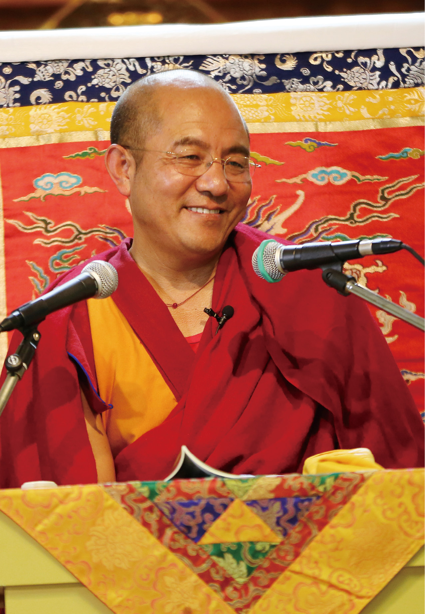
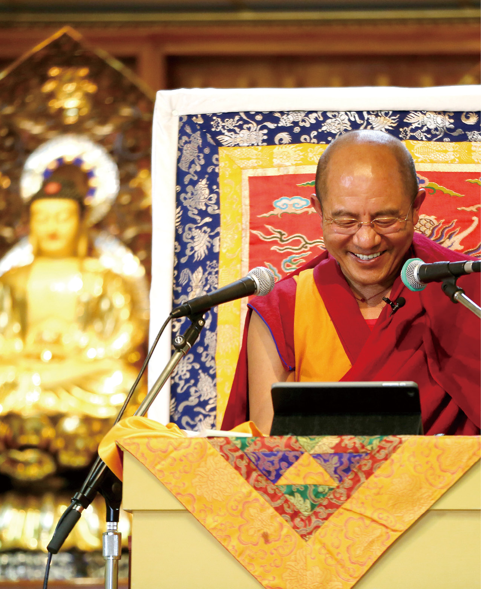
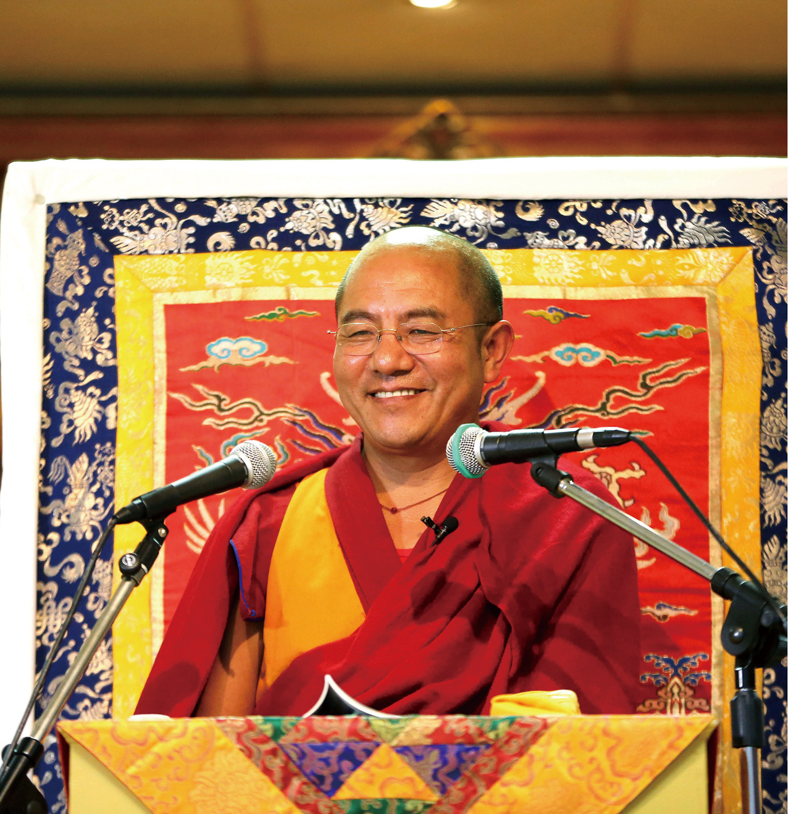
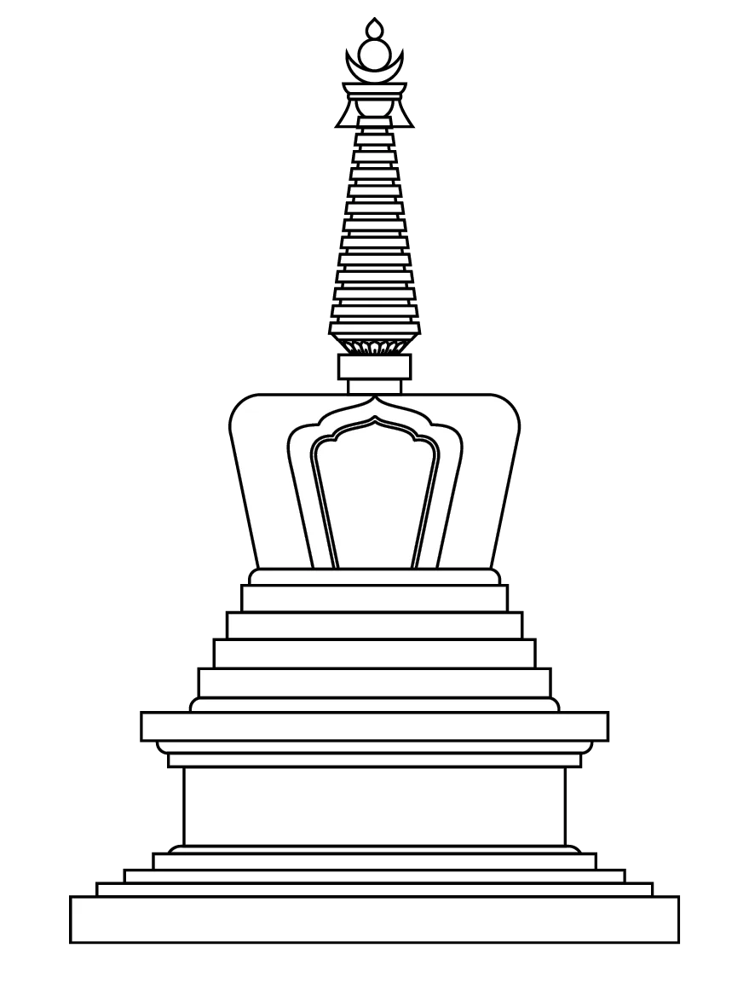

# 第5课

2014年10月12日

学佛不能囫囵吞枣

今天是《入菩萨行论》第六品“安忍品”的最后一堂课。这次我们的时间比较紧，只能用五堂课来给大家讲解。

《入行论》的颂词并不简单，按理来说，我们应该先对它的每一个颂词、每一句细致地了解，然后再去消化。就像我们吃饭的时候，应该先把口中的食物一口一口地嚼碎，然后才咽下去，这样才容易吸收营养。如果你没有把食物嚼碎就把它吞下，那可能对胃不好。

最近，他们说我吃饭的时候有个习惯——对于某些菜，我会嚼得比较碎，而对另外一些食物，我可能直接就吞下去了。我也感觉到自己有这样的习惯，可能你们也有，只不过平时没有观察而已。我们学习佛法也要像吃饭一样，先对字面的意思一句一句地好好“嚼碎”，然后再慢慢地把它“消化”，这很重要。

这次我们因为时间有限，所以我只能给大家对每个颂词做基本的字面解释，没有很多发挥，但是总的来说，我看大家的学习效果还是可以的。今天新来的道友比较多，一些人可能没有听前面的课，因此我首先给大家做个简单的介绍。

我们这次讲的是寂天论师的《入菩萨行论·安忍品》。寂天菩萨是佛教中一位非常重要的论师，出自那烂陀寺。我以前专门把他的一些详细故事和传记翻译成汉文，当中包括了他怎样舍弃自己的王位而出家，如何被文殊菩萨摄受，修行过程中如何被金刚瑜伽母摄受，他的证悟过程以及在那烂陀寺传讲《入行论》的情况，等等，他的生平有七个非常精彩的故事（又称“寂天菩萨七种稀有传记”）。

不管是在印度还是汉地、藏地，《入菩萨行论》到目前为止仍然非常受欢迎。我们学佛之人不仅要精通此论，还要把它视为自己修行过程中最重要的一部论典。藏地有格鲁派、萨迦派、宁玛派、噶举派等很多不同教派，虽然各派都有不同的学习内容，但是每个教派都会学习《入菩萨行论》。

对活在红尘中的现代人来说，《入行论》的每一句都对我们有非常大的帮助。尤其这次我们学习其中的“安忍品”，有些人问我是否特意在课堂上批评他？我并没有在课堂上说谁的过失，你之所以有这种感觉，是因为《入行论》对每个人来说确实是非常尖锐，它把你的脾气或者坏毛病挑出来，暴露你的过错，这就是佛法的力量。

我们修行佛法并不是为了赢得赞叹，而是为了找出自己的毛病和烦恼，然后通过修行来对治。此次我们用短短五节课来给大家讲解《入行论·安忍品》，我自己感到很满意，虽然我讲得不好，但是你们应能了解其中的意义。

现在我先念今天第一部分的传承。

（堪布念传承）

怨敌是应恭敬的对境

我们这次主要是抓住每个颂词的基本意思来给大家讲解，并没有按照前辈大德们的科判、分类来给大家介绍。前面说到，世间人没有经过详细的观察，把敌人和亲人分得很清楚，敌人就是敌人，亲人就是亲人。基于我们的教育和成长环境，很多人都认为敌人是我们该报仇、该嗔恨、该反对的，而亲人是我们该保护、该维护、该帮助的——世间人觉得这些都是理所当然的事情，这在佛教中称为护亲伏敌，即保护亲人、胜伏敌人。

大多数凡夫时时刻刻都不想饶益、帮助敌人，而想保护、帮助亲人。这是世间的传统观念，东方人也好，西方人也好，他们都有这种想法。但若我们真正以智慧观察，会发现这种想法是不合理的。

《入行论·安忍品》说道，我们尤其要在怨敌加害我们的时候修安忍，这是在敌人面前的安忍；另外在佛法方面，当我们遇到一些甚深法义的时候需要安忍；还有一种是修行过程中的安忍，诸如没有吃穿、长时间修行导致的失眠等各种不适，以及生活中遇到让修行中断的违缘等等。以上是安忍的大致分类。

前面讲到，六度都要依靠敌人才能修成，包括修禅定也是如此，为什么呢？因为修禅定的时候，心要忍受周围的聒噪，不能心烦意乱，这需要某种程度的安忍，所以修安忍唯一依靠敌人。现在继续讲，敌人是我们成佛之因，对我们有很大功德，不能舍弃他们。

敌我共成忍，故此安忍果，

首当奉献彼，因敌是忍缘。

在我修安忍的过程中，敌人是安忍的一个根本因，而我自己也是要修安忍的因缘之一。没有我的话就没有修行者，没有敌人的话就没有所修的对境。我们昨天也讲了无苦无出离、无害无安忍的道理。实际上敌人和我共同是安忍的因，所以，若我修成安忍波罗蜜多的功德胜果，它应该由我和敌人两家共享。

比如，一位原来修行很差的人通过修行，最后获得了阿罗汉、菩萨或者佛的任何一种果位，那这个果从何而来呢？一部分是依靠敌人，一部分是依靠他自己，因此这个果是属于敌人和他两家的。我们获得一些财富后会献新，即把最好的部分供养出去；同样，我们获得安忍这么殊胜的功德后，应该首先把它供养给敌人，为什么呢？因为敌人是我们修行过程中不可缺少的助缘。

我们若想修行有所成就，过程中必须依靠怨敌，他们非常重要。米拉日巴尊者曾说：“城市里的施主和山沟里的瑜伽士，二者有共同成佛的因缘，这个因缘在于回向。”意思是，修行人在山上修法，住在城市的人对他供养，此二者共同成佛的因缘就是回向。同样，一位修行人和他所修的对境——怨恨的敌人，此二者共同成佛的因缘是什么呢？就是修成安忍。所以，当我们在生活中遇到一些脾气不好的人或者坏人之时，我们应该像昨天所讲的阿底峡尊者一样，经常把这些身边人作为修安忍的因缘，这对我们的修行很有帮助。

藏传佛教有位舍康巴大师，当别人问他，谁是他的上师，他总回答是土登巴。旁人一听都可能认为土登巴是位很了不起的上师，事实上他是一个强盗。为什么舍康巴说这个强盗是他的上师呢？因为舍康巴本来有一定的名声和很多财富，具足了很多迷乱之因，但是后来土登巴把舍康巴的世间福报全部摧毁，损害了他的名声，抢光了他的财产，让他一无所有，结果舍康巴成了一位名副其实的修行人。从此之后，舍康巴总说土登巴是他的根本上师，而别人也误以为土登巴是常规意义上的上师，其实他是舍康巴一生中遇过的最坏之人。

在修行的过程中，如果你们经常遇到一些给你制造违缘的家人，或者一些让你生气的人，那当别人问你的上师是谁时，你可以把那些与自己关系最不好之人的名字点出来，说他们就是你的金刚上师。可能你们身边都有很多金刚上师（众笑）。总之，安忍是你和敌人共同修成的结果，并不是你依靠自力而修成的。

此时一些人可能会疑惑，为什么安忍是我和敌人共同修成的呢？敌人根本没有修行的想法，为什么他无缘无故就成为修安忍的根本因呢？

谓无助忍想，故敌非应供，

则亦不应供，正法修善因。

有些人会想：“作者把敌人说成是修安忍的因，这是不合理的。敌人从来没有想过要帮我修安忍，他们从来没有这种想法，因此把他们安立为修安忍的助缘是不合理的。”

这个颂词的后两句是寂天论师的回答。他说此处把敌人安立为修安忍的因是从作用而言，对方不需要真的有帮我修安忍的想法、计划、谋求，才能成为修安忍的因。如果说敌人没有帮助我们修安忍的心就不值得供养，那么正法也是同样。比如释迦牟尼佛所宣说的三藏十二部，像大乘的《金刚经》《妙法莲华经》《华严经》等等，这些经典都没有想要饶益我们、想要帮助我们修行的分别念，但是大家都会说这些正法是我们成就的因。

虽然令我们解脱的正法本身没有分别念，但是它可以成为修行的助缘。大家正在学习的《入菩萨行论》也是如此，它没有饶益我们、让每一个人获得菩提果位的想法，可是它可以成为我们修行的因缘。同样，敌人虽然没有帮助我们的想法，但他是我们修安忍过程中不可缺少的助缘。

此时有些人会反驳：“虽然法本没有想帮助我修安忍的想法，但是至少它没有嗔恨心，而敌人怀着嗔恨心来给我制造违缘，既然由嗔恨心驱使，又怎么会变成修行的助缘呢？”可能你们也有这种想法。大家学了《入行论》当中的辩答，以后无论是跟金刚道友还是其他人辩论也会有帮助。此处说：

谓敌思为害，故彼非应供，

若如医利我，云何修安忍？

对方认为，敌人没有饶益我的想法倒不要紧，就像正法一样没有这种思维是可以的，不过关键是敌人想害我们，经常制造违缘，危害我们的修行。修行人虽然可以像刚才所说，把敌人视为金刚上师或者善知识，在苦难中修行、锻炼，但若他们每天都要面对敌人的各种危害，到一定时候他们会感到疲累，可能从修行中退转，那敌人怎会成为应供处呢？怎会成为他们修行的因缘呢？

此颂的后两句是寂天论师的回答：“当然，敌人肯定对你有嗔恨心或者对你有所不满，但若他们就像最好的医生一样，只想一心一意地帮助你、解除你的痛苦，那你怎样修安忍？根本不可能修成安忍波罗蜜多。”

修随喜跟修安忍不同，前者依靠悦意的对境，他人所做的善法功德就是你随喜的对境，而后者依靠让我们很不快乐的对境。正如一些植物要在比较肥沃的土壤中生长，而有些植物要在艰苦的环境中生长；同样，安忍无法从悦意的土壤中生长，一定要从敌人与自己的矛盾、不快中生长。

敌人不像你的医生、父母、朋友，如果敌人也对你很好，每天对你微笑，那你不会有修安忍的机会。一般来说，菩萨多生累劫不害众生，他们容易找到布施的对境，但是找不到危害自己的人。怨敌的作用与悦意对境的作用完全不相同。因此，我们遇到敌人的时候，应该好好地珍惜这个修安忍的机会。

金厄瓦格西说，世间的事物要么让人快乐，要么让人痛苦，大多数世间人喜欢选择前者，他自己则喜欢选择后者，为什么呢？因为痛苦增长我们的功德。大部分人都选择悦意的事物，但是金厄瓦格西不一样，他认为平安、快乐的生活不能使我们修成正法。

的确，有些人可能一辈子都不愁钱财，有不错的地位，相貌也好，生活的各方面都很顺利，但是最后他们生不起出离心，也修不成安忍。因为他们的周围全是好人，没有修安忍的环境，所以一般来说他们的安忍比较差。你们可以观察，平时自己的周围有什么样的人，一些人的“资源”可能不错，到处都遇到坏人，如此你可以经常修安忍。以前有人跟我说：“堪布，你说大乘菩萨找不到加害自己的人。哎，如果我是菩萨，那多好啊！现在我的周围全是坏人，没有一个好人。”

现在的社会非常复杂，如果你没有忍耐力、没有坚强的心，那你的生活可能会困难重重。在过于强调竞争的情况下，人们的心理都比较复杂、浮躁。不过，我听说这里没有很多勾心斗角的现象，人与人之间的猜忌心比较少。在此环境下，可能你们修安忍比较困难。

这里的人看起来很诚实，很多西方人总是带着很好的表情来跟你打招呼，这跟其他地方有很大差别。我在这里的街上遇到很多陌生人，也许他们觉得我的衣服怪怪的，他们会特意跟我打招呼，主动跟我微笑。不管怎样，从表情上看这里很多人都没有什么烦恼，人们不会愁眉苦脸各走各路，也不会以凶狠的眼神视人。当周围的人都如此友善的时候，不知道你们的安忍修得成不成功？（众笑）

反而网上的很多道友，你们的“环境”很不错，有很多修安忍的对境，比如到处都有欺骗你、说你坏话、以各种手段危害你和攻击你的人，即使你根本没有做任何错事，也还是有人以嫉妒心故意给你制造违缘。当今社会有很多诸如此类的现象，许多人应该都有修安忍的机会。

无论如何，作为大乘佛教的修行人，我们应该无条件地修安忍。从表面上看，这样好像很脆弱，但实际上这是以理抉择后的行为。我们修安忍不是因为脆弱，而是因为如此行持才符合正理。贪心也好，嗔心也好，这些都是非理作意。为了打破、摧灭这些分别妄念，我们要修智慧和悲心，如此我们才能与正理更加接近。

我们在敌人面前应该修安忍，他们就像正法一样：

既依极嗔心，乃堪修坚忍，

故敌是忍因，应供如正法。

前面说到，不管怨敌有没有害心，我们都要修安忍。即使敌人怀着严重的恶心，以非常粗暴的行为来害我，我不但不对抗、不报仇，还要以坚定的心来忍耐。菩萨正是因为修成了如此坚定的心，所以他们无论在任何场合，即使面对各种令人难受的攻击，他们都能以坚定、清净、纯洁的信念来安忍。我们若要修成像菩萨般的坚忍心，就必须依靠敌人，他们是我们修成安忍的因，所以我们以后要把他们当作正法一样来供养。

正法就是法宝，是我们恭敬的对境。你应该随时随地把它们带在身边，或者把它们放在高处，然后陈设鲜花、净水、水果等供品，经常以欢喜心来供养。同样，虽然敌人表面上特别可恨，但是实际上你要把它当成法本一样来恭敬，你平时怎样恭敬《金刚经》，日后也要以同样的恭敬来对待敌人。

一些人可能平时随身带着《金刚经》，但是却尽量避免与自己关系不好的人一起吃饭、说话。他们预先打听跟自己关系不好的人会不会在某个场合中出现，然后再决定自己会否出席，这就是世间人的做法。若你真的把对方看成正法一样来恭敬，那你应该邀请与你关系最不好、天天诽谤你的人一起吃饭，至于你的好朋友，他们会否出席倒不重要。这方面应该很多人都做不到，凡夫人的确有很多难以行持的事情。

《释迦牟尼佛广传》中说，佛陀在因地时曾为忍力仙人，那时候人们特别长寿，自从佛陀发愿修安忍后，他的对手在八万四千年中天天对他加害、毁谤。当忍力仙人在街上行走或者坐在某处的时候，对方会把粪土扔到他的身上，也会用各种恶言来污蔑、诽谤他，就像现在的一些所谓游行示威一样，但是佛陀从来没有对那些众生产生对抗或者抛弃之心。

我翻译这段故事的时候感到非常惊讶，我们凡夫人跟诸佛菩萨在因地时的心态截然不同。莫说八万四千年，要是别人在两三个月中不断地诽谤我们，可能我们以后就不会再跟那些人说话、打交道了。但是，诸佛菩萨在因地时的做法却不一样，忍力仙人也好，常不轻菩萨也好，佛经中有很多他们修安忍的精彩故事。

大家应该随学诸佛菩萨，把怨敌看成正法一样来对待。看看你们下课之后，可不可以给关系最不好的人打个电话？这个难度比较高。你可以打开自己的通讯录，找出与你关系特别不好的人，然后跟他们说几句话，一旦对方开始骂你，你就可以感受一下安忍的滋味。

有些人想听关于安忍的修法，其实这个修法没有别的，当你跟敌人打电话、见面或者吃饭的时候，你跟对方把那些让彼此很不悦意、很不开心的往事重新道来，此时你再观察自己的心态，这就是安忍的修法。我们平时很有必要如此行持，因为你的人生除了有很多帮助你的好人，也有很多你认为是很坏的人，而后者有一部分也觉得你不是好人，如果你和这些人好好地沟通，也许可以减少彼此之间的很多矛盾。不管怎样，现实中大家应该有各种修安忍的机会。

作用上，众生和佛陀都是殊胜的福田

下面的一大段内容主要是讲什么呢？在修行的过程中，我们必须恭敬所有众生。它分了三个方面来说明：一、众生是最好的福田；二、我们一定要恭敬众生；三、众生是很严厉的对境，如果我们没有好好地恭敬众生，那会损害自己的利益，我们因此不会有好的下场，所以大家要特别注意。

首先，众生和佛陀都是殊胜的福田，此二者对我们成就佛果非常重要：

本师牟尼说，生佛胜福田。

常敬生佛者，圆满达彼岸。

本师释迦牟尼佛在《净愿经》等诸多经典中告诉我们什么呢？就是“生佛胜佛田”。这里的“生”指众生，省略了“众”字，一般以偈颂来表达的时候会有这种情况。

释迦牟尼佛在相关的经典中说，众生和佛陀二者都是非常殊胜的福田。佛陀在《净愿经》中说：“我曾依靠佛田和众生田，获得圆满无边的功德庄稼。”所以，我们应该恒常恭敬众生和佛陀，如此我们才能圆满六波罗蜜多，到达轮回的彼岸，获得阿耨多罗三藐三菩提。如同澳洲是这里的彼岸，对凡夫来说，正等觉就是轮回大海的彼岸，我们要依靠恭敬众生和佛陀的航船来渡过大海。

我们若想修行有所成就，一定要依靠佛陀，因为他给我们开示了解脱之道；同时我们也一定要依靠众生，否则我们不能圆满六波罗蜜多。大家看到佛像的时候都会做一些顶礼，基本上佛教徒都知道要对佛陀非常恭敬，但是很多佛教徒都不知道要对众生恭敬，也不明白其中的道理。修行成佛就像获得成熟的庄稼一样，成佛的功德来自福田，而田里的庄稼不会无缘无故地生长，必须依靠众生和佛陀。从出生资粮的角度来说，众生和佛一样都是福田，没有任何差别，这方面大家要清楚。

很多人只恭敬佛陀而不恭敬众生，这真是岂有此理：

修法所依缘，有情等诸佛，

敬佛不敬众，岂有此道理？

如前所说，我们修法若要成就，其中一个主要的因缘是佛陀，因为佛陀开示了解脱道，否则我们不会知道如何修行。可是光有解脱道也不足够，我们要在芸芸众生的帮助下才能成就，所以众生是另外一个重要的因缘。在我们修行成佛的过程中，众生和佛陀都很重要，此二者犹如我们的双目，缺一不可，两只眼睛同样重要。

现在，当一些人看到佛像、佛经、佛的追随者等三宝所依，他们会恭敬地合掌、顶礼、膜拜、供养等等。但是当他们遇到众生时，心态和行为却完全不一样，他们可能会对众生怒目而视，或者打骂、杀害众生，甚至不单是杀害，还要吃众生的肉。他们对佛陀特别恭敬，却不恭敬众生，甚至做出各种伤害众生的行为，怎么会有这样的道理呢？没有道理。

龙猛菩萨说：“众生菩提因，若欲成佛果，于众敬如师。”众生是菩提之因，我们若想获得佛果，对众生必须像对父母、上师那样恭敬。《修心七要》中也说：“于众修大恩。”意思是，我们要把众生视为自己的大恩人。在轮回之中，谁对我们有最大的恩德呢？有些人认为是自己的父母，但实际上是所有众生。作为大乘佛教徒，我们在生活中应该如何平等地对待每一个众生、每一个生命，这方面值得大家思考。

那么众生是不是跟佛一模一样呢？在某种意义上，众生跟佛不一样：

非说智德等，由用故云等，

有情助成佛，故说生佛等。

刚才讲了，不恭敬众生而只恭敬佛是没有道理的。此时有些人会想，那佛跟众生是否一模一样呢？难道众生也具足佛陀的十八不共法、四无畏等所有功德？不是的。佛和众生有相同之处，但不代表两者在各方面都相同。

学过因明的人都知道，世界上没有两件事物是完全相同的，也没有两件事物完全不相同。比如你面前有两个人，如果你从因明学的角度观察，此二人不可能完全相同，但是你详细观察的话，也会发现他们有相同之处，可能你会觉得两者有长得相似的地方。

每件事物都不一样，但从某些角度来说，它们也有相同之处，比如它们都是无常的，或者具有生灭性、刹那性等等。刚才说佛和众生相同，并不是指两者的智慧、功德等等完全一样。此二者只是在作用上有相同之处，众生的作用是让我们修持正法，最终成佛，而佛陀的作用也是如此。在帮助有情成佛这方面，众生与佛陀有相同点。所以说，我们一定要恭敬众生，这非常重要。

佛陀和众生各自的殊胜功德

以上讲了众生和佛陀的相同之处，那二者分别有什么特点呢？下面分开说明他们各自不同的功德、特点。

怀慈供有情，因彼尊贵故，

敬佛福德广，亦因佛尊贵。

佛和众生都是尊贵无比的福田，此二者各自有什么尊贵的地方呢？

“怀慈供有情”说明了众生尊贵之处，我们若想成佛，必须具足大慈大悲，而在修四无量心的过程中，有情众生是最尊贵的。龙猛菩萨说：“有情界无量，利彼亦复然。”意思是，因为众生无量，我们若发菩提心利益一切众生，其功德也是无量的。为什么说有情众生十分珍贵呢？因为他们无量无边。如果我们缘众生发无上菩提心，虽然要度化一切众生是不可能完成的事情，但是其功德是无量的，这就是有情尊贵的地方。

那么佛有什么尊贵的地方呢？这里说“敬佛福德广”，我们供养、恭敬、观想佛陀都有无量无边的功德，这就是佛陀的尊贵之处。佛跟我们世间人在很多方面都不相同。佛陀在《妙法莲华经》中说：“若人散乱心，乃至以一华，供养于画像，渐见无数佛。”我们即使以散乱心在佛像前供一朵鲜花，也能获得不可思议的功德。此经中又说：“若人散乱心，入于塔庙中，一称南无佛，皆已成佛道。”哪怕以散乱心在寺院、佛塔前或者其他场合，称念一声“南无阿弥陀佛”“南无释迦牟尼佛”，这样的功德也能让我们逐渐成佛。

如果一个人以散乱心到某个工厂里去，他会不会有所改变呢？应该不会。可见佛教的力量确实不可思议。即使你生活上遇到很多痛苦、烦恼，但是跟大家一起念《普贤行愿品》，一起开法会或者共修观音心咒、大悲咒等之后，可能你心里的烦恼、焦虑、抑郁都会一扫而空，这就是佛陀不可思议的力量。

众生和佛都有其各自伟大之处。你看我们修菩提心有无量功德，这就是众生伟大的地方，有情是我们修四无量心的对境，我们依此可以积累无量无边的功德资粮，这就是众生的特点。如果我们光是对着水泥墙、话筒等来观修悲心，觉得它们可怜，那是没有意义的，因为对境错误之故。同样，我们闭着眼睛观想话筒也没有功德，但若我们观想释迦牟尼佛的佛像，自然便会对自己的智慧和大悲心的提升有所帮助。

现在的佛教徒确实要从教理上明白这些道理。为什么我们要恭敬佛陀和众生呢？因为两者都非常有功德。当然，他们的功德体现在不同的方面，所以也不是完全一样。很多佛教徒都明白恭敬佛陀的道理，但是却没有重视众生。比如，现在很多佛教徒会做各种供养，建修一些特别辉煌的寺院，造大佛像、印经书等等，他们为了三宝所依，愿意付出几百万、几千万甚至几亿，但是却不愿意为了救护一些可怜众生而付出。

一方面我们建寺院、造佛像很重要，但是我们更要关心那些无明的众生，在精神方面他们很匮乏，不知道取舍因果的道理，因此我们应该多给他们讲一些佛理；在物质方面，我们应该建学校、提供资源给监狱里的众生或者放生等等。现在一些佛教徒认为，造佛像有功德而放生没有功德，他们觉得放生是把钱扔到大海里，是很可惜的事情。那些人根本不知道众生的生命有多珍贵！

现在，很多大乘佛教徒的发心和行为都跟小乘行者没有差别。他们觉得自己必须像出家人一样待在寺院里面，对自己的一举一动都非常注意，同时，他们也看不惯一些出家人在寺院以外的场合和其他人有所交流。他们把出家的威仪当作自己世间生活的戒律，另一方面也以自己有限的思想来定义出家人的行为，这是不合理的。

我经常提倡造佛像，这很重要，但更重要的是我们去做一些利益众生的事情，比如建学校，甚至建厕所，包括在一些环境不好的地方。你也可以建孤儿院，这会有更大的功德。

你看世间的很多众生多么可怜！比如非洲的那些孩子，就像昨天道友的提问一样，我们确实很难在今生改变他们的命运。但若大家都有菩提心、利他心，我们可以改变个别地方一些众生的命运。我们不能改变所有人的命运，但如果那里有一百个人，我们也应尽量救护其中哪怕一个人、两个人、三个人……能做多少算多少，这些都是有意义的。大家不要因为救护不了全部众生，就连一个生命也弃之不顾，这种想法不合理。

总之，我们恭敬佛法非常重要，但更重要的是去利益众生、恭敬众生，因为众生也有其特点。当然，从各自的功德而言，众生和佛有不同的地方：

助修成佛故，许众生佛等，

然生非等佛，无边功德海。

前面说到，从助修成佛的因来讲，佛和众生有相同之处，我们依靠众生修安忍、布施等会积累非常殊胜的成佛资粮；而我们依靠佛陀，修行由他智慧所流露的三藏十二部也能积累成佛的资粮。但是，众生和佛在功德上是不同的，众生自身没有多大功德，还有无明和烦恼；而佛陀的身语意，甚至连其身上一毛孔的功德也是不可思议。

佛陀的声闻弟子之中，神通第一是目犍连，可是他也无法测度佛陀的功德。有一次释迦牟尼佛在讲经说法，目犍连想以神通力知道佛陀的法音到底能够传到多远，他以神通力飞越了无数世界，但是佛陀的声音还在耳边。后来目犍连的神通已经用完（就像电池用完了一样），只能依靠佛陀的加持力回到我们这个世界。所以说，佛陀不可思议的功德是我们无法衡量的。

《随念三宝经仪轨》中说：“佛德不可思，法德不可思，僧德不可思，诚信不可思，果报不可思。”意思是，佛法僧三宝的功德不可思议，我们若对三宝生起不可思议的信心，会成熟不可思议的果报。大家要懂得佛跟众生有不同之处，佛的身口意确实有不可思议的功德。

一些佛经像《金刚经》，虽然它的字数很少，但它是到目前为止人类历史上非常珍贵的智慧。《般若波罗蜜多心经》大概有二百多字，但是它的某些句子已经成了世界上最珍贵的格言、名言。我们对这些金刚语祈祷、恭敬，会有什么作用呢？相信很多佛教徒都心中有数。佛教的典籍与世间人所写的书籍是不同的。

以前有人跟我说：“《心经》的字数不多，才二百多字，我准备造一个比《心经》的字数更多、用词更好的经典。”凡夫人的分别念极其繁多，我们可没有时间把它们一一破掉。总之，佛陀和三宝的功德确实不可思议，你们一定要对此有所了解。

下面继续说，佛陀的功德极为殊胜：

唯佛功德齐，于具少分者，

虽供三界物，犹嫌不得足。

如果某个人只具足佛陀的少分功德，比如佛一个毛孔的功德，或者佛的智慧、大悲、利生力量等任何一种功德中的少许，那我们就算以三界的所有财物，包括七宝等来全部供养，还是会显得微不足道。可以说，佛陀的功德是世间人无法比较、衡量的。

佛教中说：“倘若见闻佛，获得无量德，灭除一切障。”所以，我们在修行的过程中要经常恭敬和祈祷佛陀。我自己对释迦牟尼佛有无比坚定的信心。有些人问我：“你出家修行了这么多年，那你现在有没有神通、神变？能不能在虚空中飞翔？能不能在急流中游泳？”我跟他们说我不会游泳，更不会腾空而飞，而我学佛多年的唯一收获，就是对佛陀生起了坚定不移的信心。

我的信心不是源于盲目和冲动，是自己真的从骨髓里生起这种信心。我也发愿在有生之年，乃至生生世世都不改变这种对佛陀的信心。虽然我不知道下辈子会发生什么，但是我即生肯定对佛陀有坚定的信心，这方面我可以不杂妄语而在别人面前大胆宣说。

基于我多年以来对佛陀故事和甚深佛法的理解，以及对佛经的研究，我对三宝产生了定解，所以我绝对不可能在即生中改变自己对佛陀的信心。世间有很多不同的学说，也有一些能言善辩的人，但若我们从各方面来衡量——不管是从自己生活中的历练，还是从科学、传统文化的角度，你会发现佛陀所说的道理确实无与伦比。

我这样说并不是在随波逐流，或者盲目地附和别人，而是因为自己通过长时间的研究和学习，最终发自内心地对佛陀的金刚语生起了定解。纵使我学佛多年仍未得到出世间的功德，或者所谓的神通、神变，但是我很高兴自己能够对佛陀的功德生起了非常坚定的信心。世间的思想五花八门，而在芸芸众生当中，我在今生遇到一个如此有智慧的宗教，它完全经得起各种观察、衡量和推敲，对于自己今生成为佛教徒，我感到非常荣幸。

希望年轻的道友不要把信仰纯粹建立在简单的信心之上，你们的人生还有很多光阴，所以你们应该善用时间来研究佛教的道理。凡夫人的信心并不可靠，而且现在世界上有那么多的思想、学说，如果你没有深入研究佛教的理论，为自己的信仰打下稳固的基础，那你很容易在将来改变信仰。

现在很多人在信仰方面朝三暮四，他们一会儿是佛教徒，一会儿是其他宗教的信徒，最后就变成非宗教徒，而当自己的人生再次遇到痛苦，他们又重归佛门。这些人一生换了很多次信仰的外壳，甚至连演员也觉得他们的造型、外壳变得太多了。虽说人生如梦如戏，但你也要演得逼真一点，不然你演得太假、太浮夸，你的人生角色会很难看。

再者，你演某个角色的时间不要太短，有些佛教徒的表演来得太突然，因为他们非常冲动：“哇！我要皈依啊！我要出家！我在有生之年乃至生生世世……”他们说这些话的时候泪流满面，但是过了两天他们的心态就完全改变，跟之前判若两人。这样的行为很不好，我们应该稳重，无论做任何事情都要持之以恒。

下面是供养众生的理由：

有情具功德，能生胜佛法，

唯因此德符，即应供有情。

此处说有情具有自己的功德，那是什么样的功德呢？他们能够产生殊胜的佛法，即令我们生起佛陀的功德。我们依靠众生可以圆满安忍波罗蜜多、布施波罗蜜多等六度万行，也能产生其他的诸多功德。从此层面来讲，众生完全具备他们特有的功德。

实际上怨敌也有其功德，他能给你带来真实的利益，若他们没有在你的人生中扮演着坏人的角色，你的修行不一定成功。你看很多电影里都同时有坏人和好人的角色。昨天有人跟我说：“某部电影很好，好在哪里呢？我从头到尾都看不出谁是正义的主角、谁是反派角色。这部电影真的很好，它所表达的意义非常深。哎呀，里面的角色亦正亦邪，真让我十分感动，介绍我看这部电影的人也感动得哭起来！”这位道友今天也在现场听课（众笑）。根据我的印象，很多电影中的人物都是黑白分明，一部电影需要有正面和反面的角色才能圆满。所以，我们依靠怨敌来修安忍很重要。

佛陀在《华严经》中说：“一切众生而为树根，诸佛菩萨而为华果，以大悲水饶益众生，则能成就诸佛菩萨智慧华果。”以树来比喻的话，众生如树根，大悲心如水，诸佛菩萨的果位如花果；如果没有众生这些树根，我们最后不可能获得诸佛菩萨的智慧花果。所以，众生和佛都是我们成佛的因缘，我们一定要恭敬众生。下面会继续讲这方面的道理。

当恭敬众生之理由

（堪布念传承）

利他才是真正的报佛恩：

无伪众生亲，诸佛唯利生，

除令有情喜，何足报佛恩？

利生方足报，舍身入狱佛，

故我虽受害，亦当行众善。

无有虚伪狡诈的众生至亲，唯一就是诸佛菩萨，他们的所作所为全是为了饶益无边众生。我们若要让诸佛菩萨欢喜，以及报答佛陀的恩德，那除了利益众生之外没有其他方法。

一些世间人会跟你说，你就是他们这辈子最好的朋友、亲人等等。可是当你遇到一些困境时，他们就销声匿迹，因为他们待在你的身边是为了某种利益，并不是以最真诚的心来为你着想。不过，佛陀在任何时候都是为了众生的利乐，就像母亲恒时以慈悲来维护孩子一样，所以，佛陀才是有情众生的至亲，能够真正利益他们。

如果我们想报答诸佛菩萨、前辈大德和上师的恩德，那么除了利益众生以外别无他法。佛陀为了我们，宁愿舍弃身体入于无间地狱，而我们只有利益众生，方可报答这种恩德。所以，当你受到众生损害的时候，应该想到佛陀对自己有很大的恩德，一定要安忍。

你们以后如果遇到痛苦或者不顺，应该想到自己是佛教徒，而为了报答佛陀对自己的宏大恩德，千万不要伤害众生，即使别人再怎样加害于你，你也不要伤害他们。以前华智仁波切拜见上师的遗塔时，发了三个大愿：“在所有的未来世中，愿我不受恶友的影响，愿我不伤众生一毛孔，愿我生生世世不离正法光明。”他的发愿确实非常的殊胜。

现在我们的生活很难做到完全清净，尤其是在家人，基本上不能在衣食住行等各方面都做到清净。比如在不害众生方面，现代人要做到不对众生的生命构成直接或间接的危害是很困难的，但是我们也要尽量行持。此外，大家要发愿生生世世不受恶友影响。他们的影响真的很大，你本来是个好人，可一旦与一些坏人接触、聚会之后，你很容易被潜移默化，最后就成为他们的一分子。所以，大家应该像华智仁波切那样发愿。

佛陀对众生这么好，我们为什么不善待众生呢？

诸佛为有情，尚且不惜身，

愚痴我何故，骄慢不侍众？

具有无量功德的十方诸佛为了利益众生，尚且不惜舍弃自己的生命；我们这些愚痴的凡夫，又凭什么在众生面前傲慢，并且不恭敬、不善待他们呢？我们理应利益众生。

藏族有句俗话：“人越愚痴，就会越傲慢。”我们的相续中没有功德，因此根本没有什么可傲慢的。诸佛菩萨有广大的功德、智慧和大悲，但是他们仍然非常谦虚地利益众生。一些佛经中提到，佛陀成佛之后经常到医院里照顾、照料他的眷属，例如帮他们洗衣服等等。

具有诸多功德的佛菩萨也如此善待众生，那我们为什么要在众生面前傲慢？现在世界上的很多高僧大德，他们哪怕为了救护一个众生的慧命，也愿意卑微地奉献一切。所以从现在开始，我们要像众生的奴仆一样付出，不要做损害他们的行为。

如果众生欢喜，佛陀也会欢喜；如果众生不欢喜，佛陀也无法欢喜：

众乐佛欢喜，众苦佛伤悲，

悦众佛愉悦，犯众亦伤佛。

若我们通过各种方式来让所有众生欢喜，那么佛陀也会欢喜；若我们伤害众生，使他们痛苦，那么佛陀也会示现悲伤。所以，我们应该想尽办法令众生欢喜，以此来让十方诸佛菩萨欢喜；同时，我们千万不能冒犯或者伤害众生，否则便违背了佛陀的意愿。

有些人可能想：“这样说来，佛陀是不是跟凡夫一样有分别心呢？因为声闻缘觉无论是受到供养或者遭到加害，他们都没有喜嗔之心，能够以平等心对待各种事情，那佛陀怎会有欢喜和不欢喜的情况呢？”现在很多人的邪见比较重，他们很会狡辩，但是这些问题对熟悉佛法的人来说很简单，一定能够解答。当然，如果我们没有系统地学习，那可能会有较多的疑问。

那佛陀有没有分别念呢？佛陀有没有看不惯的众生？佛陀是否会时而欢喜，时而不欢喜？实际上，佛陀只是在众生面前示现这些分别，好让我们学会对自己的行为做出取舍，如此才能成办解脱。

下面以比喻来说明，若我们伤害众生，佛陀怎么会欢喜呢？

遍身着火者，与欲乐不生，

若伤诸有情，云何悦诸佛？

假设一个人全身上下被火燃烧，纵然有人在他面前弹奏动听的音乐，把他安置在非常优美的环境之中，或者把他照料得无微不至，他会不会欢喜呢？根本不会。一个人身体着火的时候，他只会想尽办法让火熄灭，除此之外他不会想到身外的各种欲乐。同样，诸佛菩萨将所有众生视为己身，他们多生累劫把自己的身体布施给众生，让众生获得快乐，如果我们现在伤害众生，那诸佛会欢喜吗？不会的。

昨天有道友问我：“汉传佛教和藏传佛教在吃肉方面有不同的说法，吃素和吃荤，你选择哪一个？另外，如梦如幻地吃肉和吃素是否一样？”当时我回答，虽然吃荤和吃素都是如梦如幻，但是我会选择吃素。其实，藏传佛教自古以来都没有提倡吃肉，这从很多大德的教言中看得出来，不过在素食传统方面，藏传佛教确实不如汉传佛教。

《大圆满前行》中说：“比方说，请一位母亲做客，将她被杀的儿子的肉放在她面前，我们可想而知，那位母亲会不会欢喜？同样，一切佛菩萨对所有众生就像独生子的母亲一样满怀慈爱地关照垂念，杀害任何一个被恶业所转、无有思维的旁生后做血肉供养，诸佛不可能欢喜。”因此，我们要随时随地把利益众生放在首位，如果你做某件事会对众生构成危害，那你最好放弃它，因为不害众生是最重要的。

佛陀把众生视为自己的孩子，若我们伤害众生，诸佛菩萨都不会欢喜，那我们的修行又怎么会成功呢？不可能的。我们平时的所作所为，总是为了自己获得名声、财富，根本没有想过众生。而佛陀多生累劫舍弃自己的身体就是为了利益众生，此外没有其他目的，这就是佛教的伟大之处。

对伤害众生的罪业忏前戒后

以前我们未学佛的时候，可能伤害了不少众生，如今通过学习，大家应该明白那是对诸佛菩萨很不恭敬的行为。再者，即使我们现在是修行人，但还经常以很多借口来伤害他们。所以，我们一定要忏悔：

因昔害众生，令佛伤心怀，

众罪我今悔，祈佛尽宽恕。

我们过去因为自己的无明烦恼，根本不知道众生如此重要，所以做了很多让佛陀伤心的事情。

我自己这辈子没有故意地杀害众生，从小就非常害怕杀生，对这方面非常有警觉性，因此我从来没有犯过特意杀害众生的罪业，但是在无意中杀生的情况还是有的。在座的一部分人可能从小也没有杀过众生，不过有些人可能从小就杀害了无量无边的众生，大家今天要为此在诸佛菩萨面前一一忏悔，尽量忏净这些罪障。

罪业没有实质的本体，它无生无灭，不常不断。以前阿阇世王在忏悔的时候了达了罪性本空，这是忏悔的一种方式。我们可能还未达到这种当下认识心性的境界，在此之前大家应该精进地忏悔。

在吃肉方面，你们以前可能杀过很多众生，这种情况在沿海地区尤为严重，人们很容易便危害到大量众生的生命。从今以后，大家应该尽量吃素，如果实在做不到，我们作为佛教徒也要尽量不点杀，否则果报不堪设想。总之，大家应该对过去所犯的罪业忏前戒后。

接着是发愿：

为令如来喜，止害利世间，

任他践吾顶，宁死悦世主。

为了让十方如来生起欢喜心，从现在开始，我发誓制止一切损害众生的不当行为，并且发愿利益世间的一切众生，纵使他们恒常践踏我的头顶，我宁死也不会还手。

这是一个伟大的誓言，也许我们凡夫人很难做到。在1986年，上师如意宝带着僧众一起念诵此偈，要求我们弟子和他一起发这个愿。他之后在听众很多的公开课堂上也经常念这个颂词。在实际行动方面，法王把自己的财产全部供养僧众和布施给有需要的人；虽然法王在整顿佛教、开取伏藏等弘法利生的过程中遇到过别人对他故意诽谤、制造违缘，但是上师从来没有想过报复那些众生。法王的一生就是如此，无论众生如何加害，他也毫无怨言，发愿做众生的奴仆。

我以《入行论》这四句作为自己的人生原则，也是随学上师如意宝。作为上师的弟子，这方面我感到很惭愧，因为自己不能完全按照里面的内容去实行，不过我会尽力而为。大家发过大乘菩提心，今后也应该依这个偈颂来发愿。这并不是说即使别人把你的所有东西抢光，你也听之任之。如此发愿并不等于脆弱，我们是因为知道众生非常重要，所以决定从现在开始尽量不害众生，这是佛教徒的原则。

这次你们学了《入行论·安忍品》，应该可以从道理上明白这个观点。在“文革”期间，藏地发生了很多情况，当时一些出家人纵使受到别人批评、诽谤、批斗，他们还是默默地念着这个颂词来修安忍。可能你们很多人以后也会遇到别人害你的情况，此时你要想到修安忍是很重要的。

大悲诸佛尊，视众犹如己，

生佛既同体，何不敬众生？

大慈大悲的佛尊，以智慧观照而了知众生和自己没有差别。现在我们既然知道众生和佛是同体，明白了两者都非常重要，那我们为什么不恭敬众生呢？

很多佛教徒只知道恭敬佛陀，不知道要恭敬众生，可能你们大部分人以前也是如此。从今以后，大家一定要懂得众生的重要性。佛陀在《如来藏经》中说：“佛观众生类，悉有如来藏。”众生都有如来藏，而如来藏的本体就是佛陀，因此，众生真的非常值得我们重视。

悦众令佛喜，能成自利益，

能除世间苦，故应常安忍。

我们取悦众生会有非常大的功德，它主要分为三个方面：

一、我们如果让众生快乐，诸佛菩萨都会欢喜，这是最大的功德。虽然造塔、造佛像很重要，但是佛陀最欢喜的是我们以实际行动去利益众生。

二、如果佛陀欢喜，那我们做任何利他、利己之事都容易成办。有些人以自私自利的发心修法，如此不一定能够修得成功，若你完全舍弃自己，以利他心来修行，同时也可无勤成办自身的利益。

三、我们通过取悦众生，能够遣除世间的痛苦。

这三方面的功德非常重要，因此我们任何时候都要尽量修安忍和做饶益有情之事。佛教徒不仅要学会修行大乘佛法，还要利益众生。你看那些基督教和其他宗教的信徒，他们对社会有非常不错的贡献，这是全世界公认的，他们建学校、建医院、做义工、搞慈善，总之在社会的各个角落做了很多有意义的事情。

相对而言，现在有些佛教徒只关注自己的闻思修行，完全不去饶益众生，他们觉得整天做慈善，就等于没有好好地学习佛法。事实上，佛教徒既要学习佛教的甚深道理，也要帮助、利益世间，大家应该尽量在有生之年完成这些艰巨的任务。其实，与你们所面对的世间压力相比，大乘佛教的要求并不高。

现在念诵余下的颂词，那么你们的传承就圆满了。

（堪布念传承）

此处说，众生背后有强大的靠山和巨大的利害关系，我们不能损害他们：

譬如大王臣，虽伤众多人，

谋深虑远者，力堪不报复，

因敌力非单，王势即彼援，

打个比方来说，国王的某位大臣经常损害许多百姓，但是民众之中一些有远见、深谋远虑的人，尽管他们具有对大臣进行报复的能力，但是他们不会真的报复，为什么呢？因为高瞻远瞩的人知道，大臣虽然看来势单力薄、不是很强大，但实际上他有强大的靠山，国王的权势就是大臣的援兵。

世间也有相似的情况。比如一位领导或者有特殊背景的人天天欺负你，虽然你可以报复对方，但是也不敢得罪他，因为你知道他有靠山、有背景或者背后有团队，所以只好忍气吞声。同样道理，众生的靠山是佛陀和阎罗卒，我们不能轻易得罪他们，否则后果不堪设想：

故敌力虽弱，不应轻忽彼。

悲佛与狱卒，吾敌众依怙，

故如民侍君，普令有情喜。

虽然敌人势单力薄，但我们千万不能忽视和伤害他们，因为他们的背后有大悲佛陀和阎罗卒。我们如果伤害众生，就会得罪佛陀，如此不可能得到他的加持，修行上再怎样努力也不会成功。

一些人修行了很长时间还是没有验相，这可能是因为你害过众生，或者没有观大悲心之故。无著菩萨的境界那么高，但他修了十二年也没有丝毫验相，之后他因为看到一只母狗在受苦，对它生起了难忍的悲心才能面见本尊。

敌人背后的怙主、依靠就是诸佛菩萨和阎罗卒。如果你对众生产生嗔恨心，或者加害他们，那你得不到佛陀的加持，修行无论如何都不可能成功，而当你堕到地狱时，阎罗卒也会惩罚你。我们看待众生要像百姓面对君主一样，对他的势力十分在意。如果我们让众生欢喜，便不会得罪佛陀和阎罗卒，这样我们的修行才能成功，最终成办自己的利益。

以上的比喻说明：我们若要修成正法，千万不要得罪众生背后的怙主。

下面是另外一个比喻：一方面，世间的暴君不可能给我们带来很大的损害，但若我们不善待众生，那会给自己带来非常大的祸害；另一方面，如果我们善待众生，就可以得到超越世间的尊主所赐予的大利益。

暴君纵生嗔，不能令堕狱，

然犯诸有情，定遭地狱害。

如是王虽喜，不能令成佛，

然悦诸众生，终成无上觉。

世间残暴的君王，无论他怎么生气，也不能把我带入地狱、饿鬼或者旁生道中受苦，他最多仅能判我无期徒刑或者死刑，他的折磨只对我这辈子有影响，不可能让我在生生世世中受苦。但是，如果我伤害了有情、造了损害众生的恶业，我将要在三恶趣中经历无数次的生死，在长时间中感受无量痛苦。所以，从对自身的危害来说，损害众生比得罪国王严重得多。

若我违背了法律，或者得罪了国王，对我最严重的刑罚就是坐牢，我会因而暂时失去自由、不能过正常的生活，除此之外国王不能对我有任何影响。听说你们这里没有死刑，是吧？你们国家没有死刑，我很赞同这种做法，因为不管怎样，被判死刑的人都十分可怜。按照佛教的教义，最严重的刑罚应该是终身监禁，死刑不应该是一个选项。当然，每个国家的运作方式都不相同，所以在死刑的问题上，不同的地方各有各的做法。

从获得方面而言，如果国王对我生欢喜心，他除了给我一些地位、名声、财产之外，根本不可能让我获得佛菩萨的果位。但若我现在取悦众生，我不仅能够获得暂时的人天福报，还可以圆满六波罗蜜多，究竟现前正等觉的果位。有情给我们的利益完全超越了世间的君王，所以大家应该把利益众生放在首位。

修安忍的殊胜果报

最后两个偈颂是关于取悦众生的果报：

云何犹不见，取悦有情果，

来生成正觉，今世享荣耀。

生生修忍得，貌美无病障，

誉雅命久长，乐等转轮王。

有人会想：“我们怎么见不到取悦众生的果报呢？”事实上，这是完全可以看到的，如果你让众生欢喜，你会暂时获得人天善趣的快乐果报，于来世究竟获得正等觉圆满菩提的果位。

我们依靠取悦众生，的确可以得到非常多的果报。《释迦牟尼佛广传》记载了佛陀生生世世帮助众生的事迹，这就是本师现前佛果之因；同样，阿弥陀佛、不动佛、药师佛等诸多佛陀也曾多生累劫利益众生，最后现前圆满佛果，这是长远方面的果报。暂时来说，取悦众生会让你即生享有荣华富贵。

此外，如果你修持安忍，会生生世世感得相貌庄严，《入中论》也有这方面的教证[^1]。有些人今世长得庄严，他们不管是身材、相貌还是皮肤都让人很欢喜，这是他们前世修安忍、经常笑面迎人所致；有些人即生相貌丑陋，甚至自己也不想照镜子，这是什么原因呢？就是前世爱发脾气、没有修安忍所致。也许他们前世喜欢摆脸色，或者老是哭丧着脸来见人，所以别人都不想看到他们那些难看的表情。以此因缘，他们生生世世都感得丑陋之相。

既然我们承认因果，就要尽量关心自己的来世。现在，很多人通过整容或者其他方式来让自己的相貌变得漂亮，这些方法的效果都是短暂的。长远来说，我们若要永远获得快乐的果报，就要造它的因，勤修善法，如此你的生生世世都会过得美好，这非常重要。

修安忍不仅让我们生生世世感得貌美庄严，也会让我们体健无病。有些人今天头疼，明天心脏不好，经常疾病缠身，一辈子吃药比吃饭还要多，这是因为他们前世没有修安忍。如果你从今以后好好地修安忍，你下辈子就不用吃药了，这也非常重要。

修持安忍的另一个功德是名声远扬。虽然我们佛教徒不在乎名声，但是在度化众生方面，名声也有其意义。名声好的人说话有分量，这方面跟没有名声的人有很大差别。现在有名气的人包括一些明星，很多人跟他们握手后都觉得十分难忘。听说有人以为某某是位名人，走去跟他握手，后来才发现自己认错了人，你们听过这样的故事吗？（众笑）

修安忍还有两种功德，就是长命百岁和获得与转轮王等同的快乐。就是说，如果我们修安忍，自己会有很长的寿命，不会夭折或者在中年去世；另外，我们会获得像转轮王一样的快乐，这不是瞬息万变、暂时性的快乐，而是长久且超越一般凡夫的快乐。上述所说的功德值得大家取受，它们都是修安忍的果报。

这次我在字面上给大家对“安忍品”做了简单的介绍。其实，你们这样光听一遍并不足够，我希望大家以后可以系统地学习，最好能够认真地把整部《入菩萨行论》学习一遍，这是每一位佛教徒都应该做的。藏传佛教的修行人常说，如果一个人学习了《入行论》，他的相续会变得调柔，跟未学之前完全不同。

你们除了学好《入行论》，也应该经常把它的法本带在身边，有空的话就尽量多看，当大乘佛法的加持力和自己的信心因缘聚合时，你会成为一位很好的修行人。有智慧的人会把别人的一句格言或者让自己受益的一句话，当作自己终生不变的原则来受持，佛教徒若以同样的态度来看待《入行论》，会对自己的修行有帮助。

这次传法有一些特殊的因缘吧。我初时没有答应来这个海岛上讲“安忍品”，因为它有一百多个颂词，我这么一个大忙人，哪有时间抛开手头上的所有事情，跑到无边无际的大海中的一个小岛，花那么多天来讲课啊？但是后来因为各种因缘，我就答应了。昨天晚上，我自己做了一些总结，觉得这次传法的因缘还是很好，自己可以重看一遍《入行论·安忍品》的讲义，也给大家念了一遍传承。

《入菩萨行论》的加持力非常大，我本人对这部法很有感情，虽然它非常深奥，但是我希望你们每一位能够珍视它的法本，把这部法作为你一生中非常重要的教言来修持。我在第一堂课提到，现在很多高僧大德，他们有时间的话会传讲整部《入行论》，没有时间的话就讲解“安忍品”。我刚到新西兰的时候，有些藏族喇嘛跟我说，很多大德曾经在此讲过“安忍品”，但中国那边基本上没有人讲，可能国内的人都修得不错，不需要学习安忍。

以后如果有机缘，我也想在不同的城市讲一遍“安忍品”，不过这代表我要在某地待五六天，所花的时间比较多，好像现在不允许出国太久。不管怎样，这次传讲圆满，真的十分感谢大家！我看你们课堂上都很专注，虽然讲课的时间是午饭之后，大家可能有些疲倦，但是我没有发现有人在打瞌睡。也许是我没有发现而已，不是说你们真的没有打瞌睡。（众笑）

我的整个新西兰行程，包括去两所大学的讲座，到今天已经全部圆满。问答环节后，希望大家一起回向，把一切的功德、善根全部回向天边无际的一切众生。谢谢大家！

现场互动

⊙ 问：有个问题一直困扰着我。我本身长期吃素，也不吃大蒜。不知道护法神是否要考验我，我每次参加法会的时候，总有吃大蒜的人坐在我的旁边，他们呼吸的气味很难闻。我改变不了现状，只好在心里把那个难闻的气味观成香气，不过没有成功。请问师父，既然我们知道要修安忍，我应该怎样在这种处境下安忍？如何把那个难闻的气味观成是香的？

堪布：你知道要修安忍，可以算是懂得窍诀。实际上，你不一定要把那个难闻的气味观成是香的，你可以让自己接受不香的气味。因为你本来觉得那个气息很难闻，要一下子把它观成香气并不容易。

我在佛学院的时候，经常跟一些参与学院管理的官方领导开会。他们不信仰佛教，每次来开会的时候总问我能不能在寺院里抽烟，我就假装说：“没事，你们想抽就抽吧。”然后他们就抽起来了。虽然我觉得那个气味不香，但是也没有想过非要把它观成是香的。所以，你不用管那个气味，香臭与否就顺其自然吧。

每个众生由于业力不同，所以对五感的耽著都不相同，因此你很难把自己觉得是难闻的气味硬观成香气。不管是鼻识还是其他识，你很难把自身的觉受转变。比如你本来就不爱吃甜品，你很难立刻把面前的甜品想成是美味的。每个人的触觉、味觉、听觉等等，某种程度上都跟各自不同的业力有关，你很难把当下的某种感觉转变成非常悦意的觉受。

事实上，你没有特意去做这些事情，像吃大蒜、吸烟等等，你就不会有过失，这才是重点，别人的气味是香是臭倒没有关系。

⊙ 问：堪布您好，请问“安忍品”中的安忍和六度中的忍辱是否一样？在修安忍方面，我们可以念哪些经咒来护持、加持自己？比如观音心咒可以增长我们的悲心，请问有没有特别的经咒能够帮助我们修安忍？

堪布：此论所说的安忍与六波罗蜜多中的安忍度是一样的，但是后者的境界比较高。一般来说，只有达到三地的菩萨才能圆满安忍度，这在《入中论》和《十地经》中有具体、详细的说明。那种境界的菩萨在修安忍的时候，他们即使把自身的肉一块一块割下来也不会生嗔恨心，反而生起强烈的悲悯心，所以说，那是一种比较高的出世间境界。

关于第二个问题，我们实修安忍的时候，有没有特别的祈祷对境呢？《释迦牟尼佛广传·白莲花论》记载了佛陀在因地行持六波罗蜜多的很多事迹，其中有相当多的篇幅是关于安忍度，讲得非常广。就是说，本师释迦牟尼佛在多生累劫修了无数次安忍而最终获得成就。所以，如果大家经常祈祷本师，常念“南无本师释迦牟尼佛”，那你在修安忍的过程中，会得到非常大的加持。

此外，你可以祈祷一些自己曾经依止，或者让你生信心的上师，不管他们是否在世，只要那些上师具有强烈的大悲菩提心，你就可以对他们祈祷。比如今天是“安忍品”的最后一堂课，我希望你们每一位都能真正生起安忍的境界，虽然这不是我力所能及的事情，但是我对具有菩提心的华智仁波切最有信心，因此我刚才在讲课前念了他的祈祷文：“外即佛子寂天论师者，内即大成就者夏瓦热，密行圣者观世音菩萨，祈祷晋美秋吉旺布尊。”

华智仁波切所著的《大圆满前行》有巨大的影响力，这是有目共睹的，我对他非常有信心，所以特意在课前向他祈祷。同样，你可以看看哪位传承上师的安忍修得特别好，然后把这位佛菩萨观想在自己的面前，猛厉地对他祈祷，当上师的加持跟你的佛性因缘聚合，你修安忍的时候会有非常大的力量。

修行的确需要一种力量，有时候我们在大城市或者某个地方修行，会感到缺少一些力量，所以开法会很有必要。今天早晨这里有灌顶，当时大家拼命地念诵观音心咒，我看你们的表情都跟平时有所不同，散发着某种能量。灌顶、开法会确实有其不共的力量，会对我们的相续起到一定的作用。假设今天早上只有你一个人，自己坐着念：“嗡玛呢巴美吽 嗡玛呢巴美吽……”那你可能会犯困，或者没有什么感觉。不过，当大家一起共修时，你自然就感到佛的加持融入自心，所以，共修和祈祷对修行非常有帮助。

⊙ 问：堪布好，通过学习《入行论》，我们知道苦对自己的修行非常好，它特别有功德，那我们在生活中是否应该主动地寻找这种苦呢？

堪布：你想寻找苦的话，可以用自己的头去撞墙壁，砰砰砰（众笑）！——倒也不用。其实，这要看你用什么方式。修行方面，你有空的话可以去藏地求学，或者到那里帮助可怜的众生，因为藏地的条件不好，你去那些地方也是苦行的一种。但若你刻意犯法，目的是让自己坐牢受苦，这是不需要的。

⊙ 问：堪布好，我是一位素食者，但我接触一些吃荤的人时，自己的脾气会特别糟糕，请问我该怎么办呢？

堪布：这个问题不好回答。首先，作为一位素食者，当你去市场的时候，最好不要购买活的生命，这个过失非常大。如果你在特定的环境中，因为家人或其他人的原因，要无可奈何地购买肉食，那你应该选择一些已经彻底死了的生命，如此不会有很大的过失，毕竟你自己没有吃这些肉。

修行人经常遇到这种情况——自己不愿意做某些行为，但若不做，又会受到各方面的压力。有时候我们只能随顺众生，否则自己的生活可能出现更大的违缘。总的来说，大家应该好好地观察，对于大的原则，我们千万不能改变；对于一些小事，如果你在逼不得已的情况下一定要做某些行为，之后应该通过方便方法来忏悔。

你有吃素的习惯，本来自己的性格、脾气都很好，不过，跟吃肉的人接触会让你的性格变差。要是对方不是特别重要的人，你看可否暂时跟对方减少接触？毕竟恶友对我们有很大的影响。虽然你是一个很善良、脾气好的人，但若经常跟恶人待在一起，可能会染上他们的嗔恨心和坏脾气，最后，在潜移默化下你的性格也会变得差劲。

刚才我从你说话的语气，感觉到你充满自信，是个性格非常好的人。要是你经常跟恶人接触，那你的性格以后可能有所改变。如果你实在无法改变对方，就尽量跟他减少接触；如果对方在你的生活中非常重要，你不能减少跟他见面的时间，那只好随机应变，对吧？

⊙ 问：顶礼上师，我有两个问题。第一个问题，我身边有些朋友一会修禅、一会修密、一会修净土，总是变来变去，请问我们应该怎样选择适合自己的法门？如果我选择了某个法门，然后对此系统地学修了一段时间，但是之后觉得自己的身口意还是没有变化，那可能是我自己跟这个法门不相应，或者自己的修行方法不对，这时候我应该怎么办呢？第二个问题，如果我选好一个法门，之后还可以变吗？有些人既修密又念佛，我应该正规地修一个法门，还是可以同时修几个法门？

堪布：关于第一个问题，很多佛教徒的修法总是变来变去，这样确实不好，究其原因是他们没有深入学习、没有把握重点。如果你闻思不错或者学得有方向性，一般来讲你的修法是不会变的。当然，有时候我们依靠自身的能力来选择修什么法有一定困难。

一些人有很高的学历，在世间的各方面都不错，但是他们在学佛方面也许是初学者，他们今天试这个教派，明天试那个宗派，希望在短时间内找到让自己最受益的法门。事实上，佛教不一定能在一两天、一两个月内就让你的相续有明显改变。世间任何一门知识，都不可能在一两节课后让你立刻改变，比如，你想考取一个专业资格，但是没有预先选好哪个专业，那你今天听建筑专业的课，明天听文学系的课，后天听贸易专业的课，最后你会一事无成。

同样，刚开始学佛的人比较盲目，他们对不同的法门就像蜻蜓点水，或者蚊子吸血一样，今天在这里浅尝一下，明天在那里浅尝一下，从来没有对一个法有真实的认识。佛教有很多不同的宗派和法门，你先要从中选择其一，然后下定决心来深入，这样就不会有朝三暮四的情况。

至于第二个问题，我在今天早上的灌顶开示中也说，你们无论学什么法，都需要有一个最根本的大原则，然后在此基础上广闻多学，学密宗也好，学显宗也好，这些都是释迦牟尼佛的教法，都是清净的佛法。当然，不同的宗派在一些仪轨或者教义上略有不同，但是总的来说，它们之间不会有什么冲突。

我们需要学习各种法门，可是这不等于杂乱无章，正如世间人也要先从总体上学习地理、化学、物理等不同科目，然后到了某个阶段才选择自己的专业。对于显宗的法如六波罗蜜多，以及密宗的很多道理，你都可以广泛地学，但是当你的闻思达到一定程度，用世间的语言来说，就是分专业的时候，此时你要决定自己修哪一个法。

刚学佛的时候，不管是显宗还是密宗，你都要把基础打好，就像世间的教育一样。佛教徒应该精通内道的不同教派，不能只看一部经典或者法本，而对其他典籍置之不理，这不是学习世间知识的方式，更不是学习宗教和佛教的方式。总之，我们应该以放松、开放的心态来广闻博学，然后从中抓住一个重点，作为自己终生闻思修行的核心。

主持人：

非常感谢堪布在这五天为我们传讲了《入菩萨行论·安忍品》。曾经有位记者问第十七世大宝法王：“如果您到任何地方都能拿到签证，你最想去哪个国家？”大宝法王说：“哪个国家的信众对我最有信心，我将先去哪里。”我借用这个访问，是想和大家共同邀请堪布以后再来新西兰，这要看你们的信心和修行。如果堪布不想再来，那你们要好好地反省。（堪布笑）

非常感恩堪布！这次“安忍品”的课程十分难得，相信大家都非常受益。很多人说《入菩萨行论》属于密教，但实际上它收藏于《大正藏》的显宗法门里。所以，你们不要以为听了一遍《入行论》，就可以给自己贴上学密者的标签，这个法是显密共通的。

回向之前，堪布要不要再给我们说一些结语？虽然一切都是如梦如幻，我们还是希望您可以如梦如幻地再次到访。

堪布：

这次旅程让我留下非常美好的印象。以后当我们的发愿和各方面的因缘具足时，我们应该还有共同学习的机会。学习和修行非常重要，它们的核心就是智慧和大悲心。

对我的人生来说，出访任何一个国家都非常有意义，而我无论在什么地方，最强调的就是佛教徒要有利益众生的心。无论你是出家人还是在家人，只要是一位佛教徒，利他心就是我们需要谨慎呵护的珍贵财富。希望我们以后具足各方面的因缘，可以继续利益众生和闻思修行。

这次旅程就像刚才法师所讲，真的非常圆满。我第一天来到的时候一会刮风，一会下雨，现在的天气已经变好，听说这里已经开春，就是说夏天马上要来临了。你们这里一年四季都有鲜花，它是供养诸佛菩萨的一种供品，也让我十分欢喜。谢谢大家！

[^1]: 《入中论》：“忍感妙色善士喜，善巧是理非理事，殁后转生人天中，所造众罪皆当尽。”
