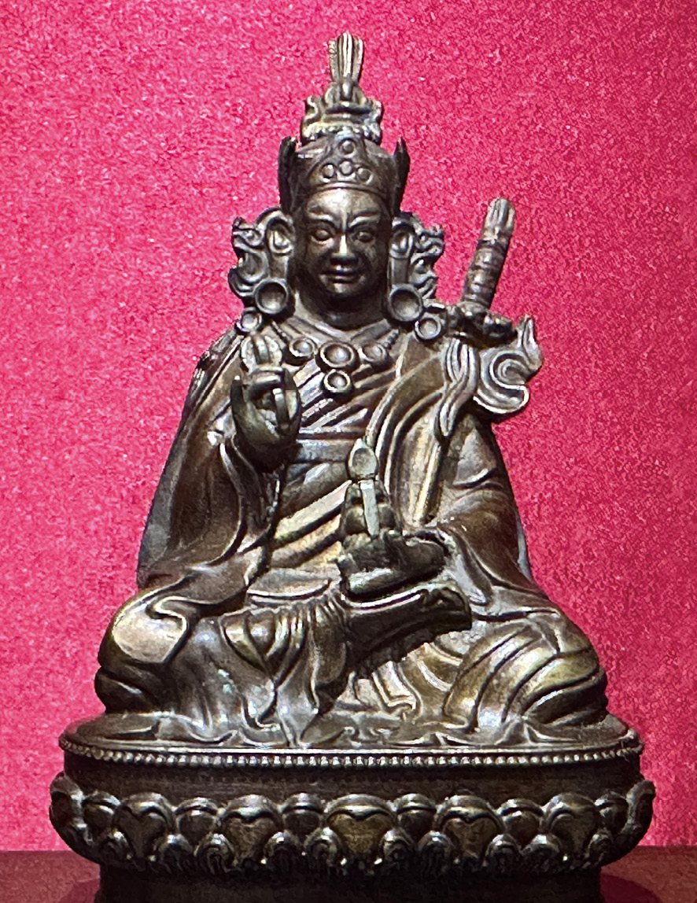

# 第19课

2026年5年13日

讲完《莲师略传》后，我准备讲慈诚罗珠堪布写的两本书：一本关于意识与脑科学，另一本用物理学解读空性。明天把汉文版发给大家。藏文版应该有吧？我们这边，懂两种文字的人比较多。书名叫《解开超脑之谜》，里面是两本书的内容。

提前准备一下，过段时间再讲。作为AI时代的佛教徒，有时读读莲师传记，有时了解一下现代科学，非常有必要。

我觉得，不论什么民族，都应该学一学这本书——依靠它能遣除很多怀疑。尤其是懂汉语、以前读过书的，更要学。没读过书、从小在寂静地出家的人，相续中前世后世的见解很稳固，不学也可以。而其他人，以前读过中学、读过大学，大多数都认为“大脑产生意识”，邪见比较重。这本书主要辨析这个问题。所以很有必要学。

其实所谓的大学，不一定真的有多“大”。

接下来讲《莲师略传》。昨天讲到莲师在藏地，开取伏藏，改造土地，建饮水工程等。

为了试探这些是否能够实现，国王请求实施。于是，莲师建起坛城，用一个上午进行意念加持，结果札玛地方的一片干地涌出了大水，被命名为“龙池”。国王请求他继续进行，于是莲师将札玛湖中间的沙滩变成了绿草如茵的草坪。下午，卓札拉瓦山上瞬间出现了大片森林，取名为“拉瓦苑”。

这几年，喇荣的阴山和阳山都种了不少树。我有时去看，觉得这辈子要在下面乘凉有点难。俗话说：“前人栽树，后人乘凉。”我们现在种的这些树，都是留给下一代喇荣人的。

莲师当年，不知道用了什么方法，瞬间就让那里出现了大片森林。应该是神通吧？

第二天上午，莲师再次进行意念加持，使得以前没有瀑布的仲卡地方出现了飞溅不息的壮观瀑布。

拉萨那一带，夏天还是不错的。现在去桑耶、青朴，风景都还可以。不过有些地方的山还是光秃秃的。

拉萨的加持确实大，历代藏王和很多高僧大德都出在那一带。至于森林，莲师当年是不是只让某些地方长出来一点？香根拉莫护法神那里也有一片。

这里有拉萨的道友，你们不要不高兴啊。

莲师问：“现在，哪里作为良田呢？”

他可能想把很多地方都变成良田。

奸臣们看到所有这一切都已成功实现，便在小前厅商议说：

当时藏地有小前厅和大前厅，类似于现在西方的参议院和众议院。国王下面有很多大臣，各种事情都要和他们商议。有时候，国王可能就是个摆设，就像英国女王一样，只是穿件白袍，象征性地坐在那里——权力没那么大。

从历史上看，赤松德赞国王好像很厉害，掌握了南赡部洲三分之二的领地——这方面有很多说法。但实际权力如何，我很多年没看相关书籍了。以前上学的时候，读过东嘎·洛桑赤列的一本小书《论西藏政教合一制度》，里面讲了一些国王执政的情况。

古代藏地政权与佛教的关系，与西方的政教合一完全不同。二者根本不是一个理路，不能一概而论。从这里也能看出，那些恶臣们抛开国王，独自在小前厅密谋。

“田地和流域都可以了，这位咒师改良环境是企图将这里拱手交给印度。权宜之计是把这个边境的蛮子遣回本土。”

自古以来，不少人打击宗教，都会给它扣上一顶“政治”的帽子。当时那些恶臣看到莲师示现种种不可思议的行为，一方面出于宗教教义的分歧，另一方面也夹杂了他们自己的阴谋诡计，准备把莲师赶回本土。

那些权势显赫的官员达成共识，向藏王禀奏：

他们开始抱团。

“尊贵的陛下，这个边境的蛮子威力无比，君王心向正法，国政会被印度夺去……”

当时国王可能有一定实力，但不同的历史记载说法不一。

这是多罗那他的观点。多罗那他对印度的情况很了解。这一点，从他写的《印度佛教史》可以看出。而他作为藏族人，对藏地的情况自然也清楚。他可能看到了当时的一些历史状况。

看到国王一心一意弘扬正法，恶臣们便开始散布谣言：外部势力正在侵入，印度人会对藏地造成危害，我们的国政会被他们夺去，等等。

他们说了许多挑拨离间的话，还对先前莲师的每一句话罗列出许多不能这么做的大量颠倒理由，

好像搞政治的人都这样吧？擅长吹毛求疵地挑毛病，然后拿出来说事儿。

并再三请求国王：“现在敬献给这位云游的咒师一些礼品，请他自行返回印度吧。”并且也这样请求莲师。

那些大臣确实过分。当年他们用这种方式赶走了静命论师，现在又故伎重演，想要赶走莲师。

不过根据大多数伏藏传记和某些历史书记载，赤松德赞在群臣的压力下，表面上不得不把莲师送回印度，背后却悄悄把莲师保护起来。之后的十二年或九年，莲师都以闭关的方式，在如今的顿珠地方给空行母益西措嘉等人传授甚深法要。后来关系缓和了，他又再回来。

我们现在看到的莲师像，都是左手拿托巴，左边怀里持着卡张嘎手。在藏语中，“托巴”又叫“嘎巴拉”，意思是颅器，这是莲师像最主要的标志。我们平时观修的时候，心间有四十二尊寂静本尊，颅腔有五十八尊忿怒本尊。莲师手拿颅器，表示他获得了至高无上的忿怒本尊果位。

那卡张嘎代表什么呢？国王赤松德赞祈请莲师回印度的时候，益西措嘉也在。莲师当场用神通把益西措嘉空行母变成了卡张嘎的形象。所以从某种意义上说，卡张嘎是益西措嘉空行母的秘密身形。不过，早期莲花生大士的伏藏像和尼泊尔的一些莲师像，卡张嘎不会超过莲师的头顶，没有现在那么高。

后来国王赤松德赞圆寂，牟尼赞普执政，莲师才离开藏地，前往罗刹国。时间方面，这里的说法稍有不同。

对此，国王心里忐忑不安，向莲师献上一藏升金粉，顶礼转绕后，讲述了所有实情。

国王对莲师说：“那些大臣不让您待在藏地，怎么办啊？”

我们想对国王说：“赤松德赞啊，您是我们心目中的国王！您不应该听奸臣的话！”（众笑）

莲师说：“我并不是为了求得黄金而来，而是为了降伏边鄙藏地的凶残鬼神，弘扬佛法，改善环境，使藏人安居乐业。如果想要黄金，只需这样做——”说完，他一跃而起，只用手碰了一下石头，石头便变成了金子。但为了维护藏王的颜面，他还是接受了约一捧黄金，说要在金刚座作供养，余下的黄金赐给藏王，并说道：“一片好心引灾难，慈悲变质嗔恨因，君王为臣所左右，藏地鬼臣真残忍。

莲师说：“我本来是怀着慈悲心来利益众生的，没想到最后却成了嗔恨的因。君王被身边的恶臣左右，藏地的鬼神真的很凶残！”

于诸行持恶业众，诸佛无能为力也。”

众生的恶业现前时，连佛陀的妙手也无能为力。

最终按奸臣们的建议执行了。

莲师听后准备离开。不过也可能藏起来了。这里的说法有点不同。

莲师为国王传授了本尊观世音五尊的修法，藏王后来成就了五本尊中的马头明王。阿亚巴罗洲的马头明王像发出马鸣声，整个赡部洲三分之二的地方都听到了。这尊像正是《幻化网续》中提到的那尊。

在《金刚萨埵幻化网》和《文殊幻化网》里面，都没有提到这尊马头明王像。可能其他《幻化网》里面有。

当时，莲师还简略讲述了《窍诀见鬘论》的剩余部分，

前面部分可能已经讲过了。

并说：“我这个法，见解要随着法身的见解，行为要遵循菩萨的行为。如果行为落到见解一方，就会生起无善无恶的断见而无可救药；如果见解流失到行为一方，那就会被有实的相状所束缚而不能解脱。

跟《大圆满前行》里面引用的内容[^1]基本相同。

我这个心法，见解最为重要。未来只知词句而未得体验之把握、似是而非的许多人，会想利益众生，

在末法时代，有些人虽然自己没有证悟，但还是想利益众生，弘扬莲师的教法。

但所有窍诀最终尚未圆满，

莲师快要走了，所有的窍诀还没有圆满。

使王族繁衍的火施也没有做完，降伏三次天龙的事也未能完成。

这些事业，莲师都还没有圆满。后面会讲到，赤松德赞的王族后代之所以出现违缘，与当时奸臣的破坏有关。

然而，莲师我预知未来，已将许多猛咒传给弟子们，并将许多猛咒和法本隐藏在石山中——依靠神变形成的大法伏藏与物伏藏，共有一百零八个，隐藏在不同地方。”

一百零八只是大体上的说法。实际上，莲师埋下的伏藏成千上万，零零散散隐藏在不同的地方。

最后，莲师再三发愿道：

因为他即将离开，没办法继续饶益藏地的众生，所以再三地发愿。

“我与无遮众施主，今生抑或他世中，愿于密严胜妙处，享受大乘瑜伽果。”

我和诸位施主的因缘畅通无阻，没有任何遮挡。愿诸位今生或来世，在殊胜的密严刹土、铜色吉祥山或极乐世界，享受大乘佛法，获得瑜伽果位。

并对众人讲了许多口传教言。

莲师在离开前，给众生讲了许多教言。

[^1]: 《大圆满前行引导文》：“如邬金莲师对国王赤松德赞说：‘君王，我的密乘见解极其重要，行为不能偏堕于见解方面，否则善空恶空黑法漫布，将成为魔见。同样，见解也不能偏堕于行为方面，否则将被实有和有相所束缚而无有解脱的机会。’”
