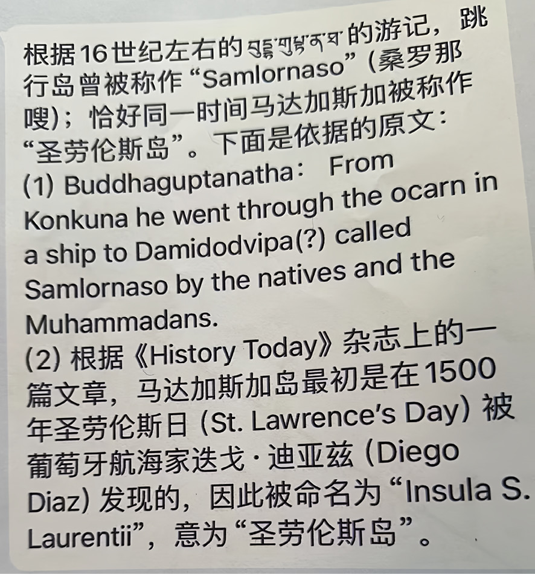
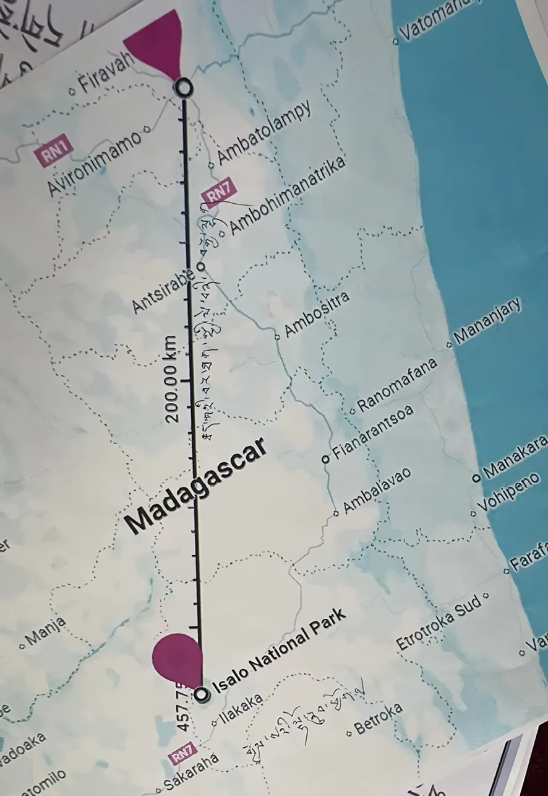

# 第21课

2026年5月15日

昨天讲到，莲师在藏地的时间，比较公认的是五十五年半。在手头的《巴协》里我没看到相关记载，多罗那他写的是十八个月。不知道他依据的是哪一个版本。

然而，宁玛派确凿可靠的众多古籍中都提到，莲师对完全竣工的法轮桑耶寺进行了开光。

当时连续三四天，每天唱歌跳舞，莲师和赤松德赞都在场。据说藏地寺院跳金刚舞就是从那时开始的。这种舞蹈后来慢慢演变成藏戏，是藏戏最早的源头。

我以前想，法王如意宝开金刚娱乐法会，可能跟莲师在桑耶开光的缘起有关。法王自己经常说，他做过格萨尔王的大将丹哲耶吾布美、莲师在藏地二十五大弟子之一的降魔金刚等，因为莲师时代的习气苏醒，和一般的修行人不一样，唱金刚歌、跳金刚舞，都有特殊开许。

布敦大师等大智者也认同这一点。

布敦·仁钦朱[^1]在他的史书里也认同这个观点。

这方面一直有争论。包括桑耶寺的修建时长，有的说五年竣工，有的伏藏说是十二年。观点不一。

由于莲师的神变不可思议，他的确能够做到这一点，但在所化众生面前显现的这些事情，也不能完全确定。

因为众生是各种各样的，所以不能完全确定。

如果有人认为“在那么短的时间内，莲师就到了所有地方，直接宣讲了许多法，还隐藏了大量伏藏品等，亲临、安住、前往各地……他无法行持如此多的种种事业”，

有人可能会想：不管莲师待了多少年，藏地那么广阔，那么多地方都去埋藏伏藏、开示法要，他的时间够吗？而且当时没有飞机，没有火车，没有信号，他怎么去的呢？

现在的藏地，尤其是康区，莲师加持过的神山特别多，红岩那一带反而少。我跟益西堪布说，你们那边莲师可能没去过，连个出名的山洞都没有。不知道青海那边多不多？应该也有一些吧。康区这边，几乎每座山莲师都去过。而且不只是去过，伏藏大师们从那些山岩、山洞、湖泊中取出的伏藏也特别多。这些都是有目共睹的，没什么好说的。

“这么多地方，莲师都去过，怎么可能呢？”——有人提出疑问。

这种想法是不对的，因为莲师能够得心应手地运用无边神变。

莲师确实有不可思议的神变，否则恐怕没那么简单。他的住世与出行，很多都是不可思议的。

后来，莲师在有缘的一个或多个行者面前现身说法，并可以亲临大部分有缘行人集聚的个别地方，就像布热巴、勒耶巴、匝兰热巴多次前往印度圣境，未来也会继续如此。

他们都见过莲师，并得过法。

努钦·桑吉益西[^2]的自传也说，他后来在尼泊尔和印度多次见过莲师。这方面的传记很多。

有人可能想：莲师同时在，其他地方有没有这样的奇人奇事呢？应该有。比如汉地的达摩祖师——《旧唐书》里有记载。他初来汉地时，梁武帝不接受他的顿门禅法，缘起不太顺——最后是二祖慧可接了法脉。

之后的情况比较复杂。达摩祖师被人毒害圆寂（有不同说法），葬在山坡上。第二年，使臣宋云（类似现在的外交官）从西域回来，在帕米尔高原附近遇见了达摩。帕米尔高原在新疆西北边。法显的《佛国记》里面说，翻过这个山脉要一个月时间。

当时达摩手里拿着锡杖，锡杖上挂着一只草鞋，正往西边走。宋云不知道他已经圆寂，便问：您去哪里？达摩说：回印度。宋云回来告诉皇帝，皇帝说不可能，达摩已经圆寂入葬了。众人打开棺木一看，里面只有法衣和一只鞋，身体不见了。这件事，很多禅宗典籍里都有记载。[^3]

关于达摩祖师，有些说法认为他就是帕当巴尊者。帕当巴尊者也是个神奇人物，他的事迹有各种版本。汉地有些人说，帕当巴尊者后来入了五台山的金刚窟，再没有出来。如果从时间上推算，达摩祖师和帕当巴尊者好像有点对不上。不过，对大成就者不能用普通的时间来推定，历史记载本来就有不同说法。

不管怎样，莲师的很多神奇事迹，和汉地禅宗大德的故事，确实有相似之处。

在另一个时期，从印度南部到西部必须坐船，途经的大海中央有一个小岛，名叫扎莫卓夺巴。该岛曾遍布飞空而行的罗刹和空行母，因此被称为“飞行洲”（卓当）。

卓当就是现在的非洲国家马达加斯加。2024年，丹增活佛给我发信息说：经一些大德确认，马达加斯加是莲师待过的地方。同时还发了一些资料过来。我刚查了日记，那些资料都还保存在里面。

十六世纪左右，有位叫布当格瓦巴拿达的人，在他的游记里称卓当为跳行岛，并介绍说，它曾经叫做“桑罗那嗖”。这跟马达加斯加最早的英文名字“圣劳伦斯”，刚好能对上。

藏族大德赞布·丹增赤列撰写的《世界广说》中，也认为卓当就是马达加斯加。

莲师当年在那里待了很长时间。具体的居住地，位于现今马达加斯加首都塔那那利佛西南方几百公里处。我的电脑上显示两百公里，实际上可能有四百公里。

2024年，丹增活佛亲自去那里探索过。后来，我们一些道友也去了，创造了一些缘起。现在那里的官方语言是法语，种姓是印度尼西亚那边的，当地人皮肤偏棕色，没那么黑。

有人认为卓当就是罗刹国，我觉得不一定。但莲师确实在那里待过，而且时间不短。其他史书也记载过“卓当”，汉译名有时叫“卓德”。

当时，大多数女子是修行明咒的残暴空行母，被称为“持咒母”；许多男子则是人相厉鬼。莲师为了调伏岛上的众生，在该岛的一个岩洞中安住。他施展法力，得知那里有六十四个境神母化成王妃的六十四个持咒母。莲师依靠禅定力直接勾召她们，运用猛咒和威猛手印，使她们昏厥，身体僵直，受到致命一击，并恐吓她们：“我要把你们放在火施的灶里焚烧。”

莲师经常用“火施”来吓唬那些鬼神——既不说扔进水里，也不说埋进土里。

现在做火供非常流行。不管去汉地哪个地方，他们都会问：“要不要做个火供？”火供确实厉害，所以你们要经常做。

结果，她们服从了莲师，承诺对他言听计从。莲师让她们招来其他持咒母的主尊，当她们全部到齐时，为她们说法。这是第一次降伏。

[^1]: 布敦·仁钦朱（1290-1364），藏传佛教史上著名的佛教学者、夏鲁派创始人，首次编订藏文大藏经丹珠尔部目录，其著作《布敦佛教史》是研究藏传佛教发展史的名著。
[^2]: 努钦·桑吉益西尊者，吐蕃赤松德赞和赤热巴坚在位时期的著名大德，莲花生大士二十五大弟子之一。
[^3]: 《虚云老和尚开示集》：“达摩祖师，梁朝普通七年，由西天航海到中国。因梁武帝问法机缘不契，便渡江，居洛阳少林寺，面壁而坐。越九年，以正法眼藏，传付二祖。化缘既毕，遂端居而逝，葬熊耳山，起塔少林寺。其年，魏使宋云葱岭回，见祖手携只履，翩翩而逝。云问师何往，师曰：‘西天去。’云归，具说其事，及门人启圹。棺空，惟只履存焉，诏取遗履少林寺供养。后人图祖师像，亦画手携只履。”
