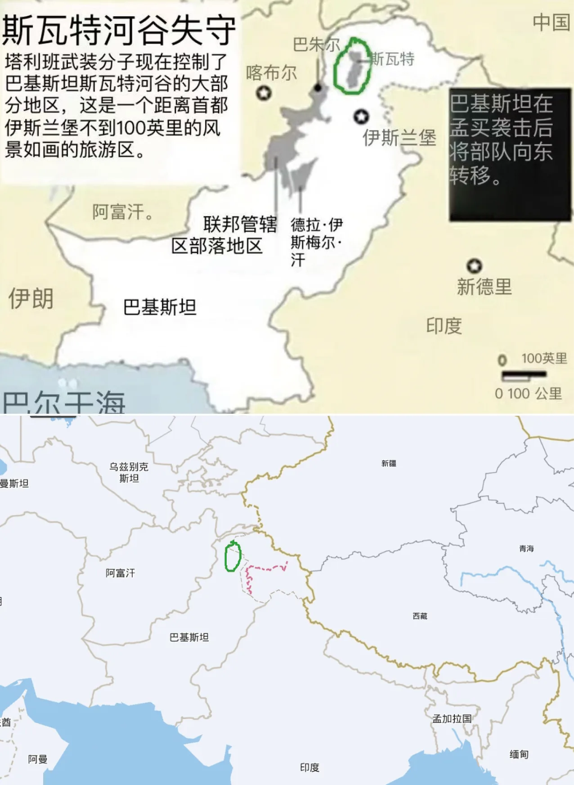
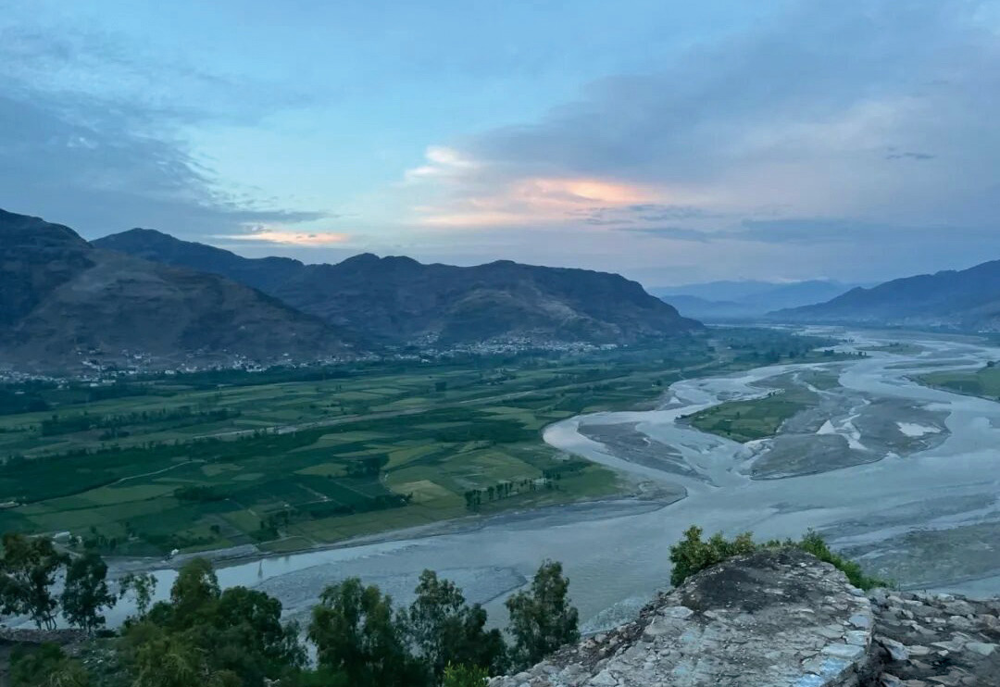
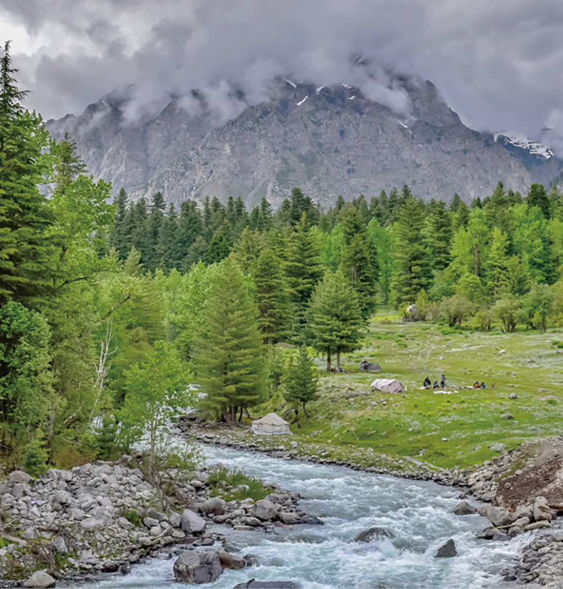
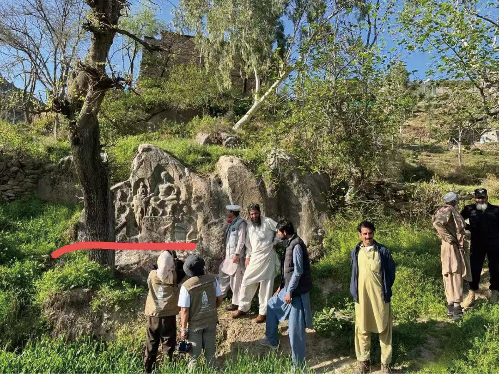
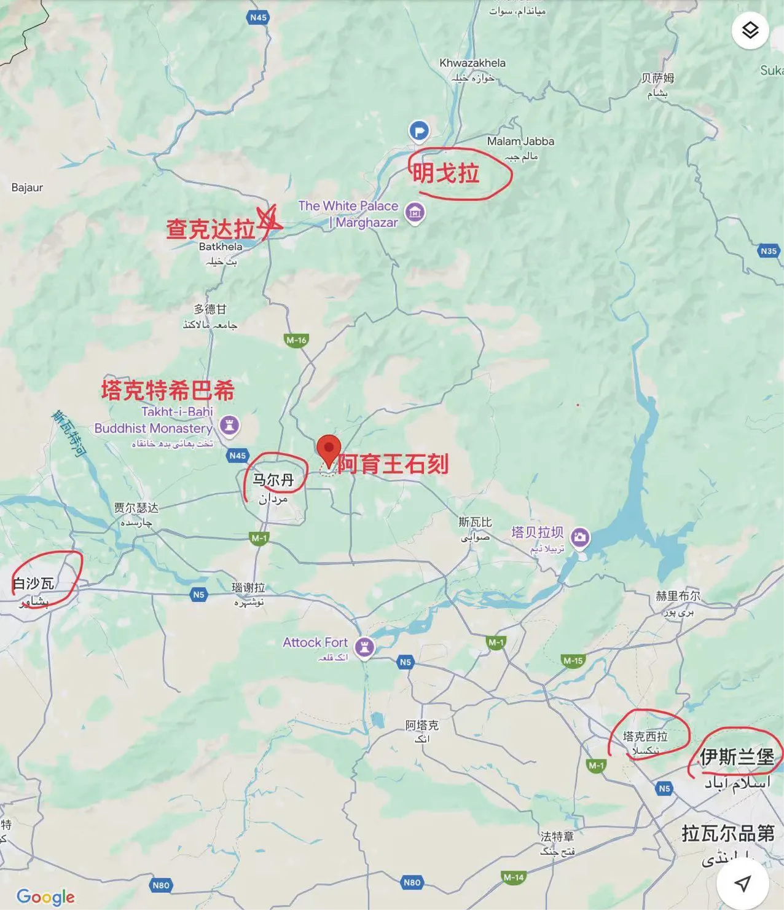

# 第2课

2025年10月2日

我今天刚得到《莲师略传》的传承，接下来跟大家一起分享。

《莲师略传》，多罗那他尊者造。嗡索德！顶礼上师！

“嗡索德”是愿吉祥的意思。

> 佛语不断妙音海，有时现相阿阇黎，

> 妙法光芒遍诸方，有时示现坛城主，

> 光明金刚意不动，莲师尊前敬顶礼。

> 吾依所得正量语，断除杜撰写此传。

“佛语不断妙音海，有时现相阿阇黎”，莲师的化现不可思议，有时显现为阿阇黎。

“妙法光芒遍诸方”，通过转法轮，令妙法遍于十方。

“有时示现坛城主，光明金刚意不动”，有时显现为密宗坛城主尊，智慧光明的金刚意始终不动摇。

“莲师尊前敬顶礼”，在这样的莲师面前，作者多罗那他恭敬顶礼。

“吾依所得正量语，断除杜撰写此传”，我断除了一切杜撰和臆造，依靠真实的正量语来撰写这部莲师传记。

作者既是大成就者，又是学者，著书立说非常严谨。他写这部传记是有历史依据的，并非道听途说、东拼西凑。

在本师正等觉佛陀的教法极其兴盛的一段时期，摩揭陀国堪为众国之首，由国王德瓦巴拉执政。

在释迦牟尼佛教法非常兴盛的时期，印度有很多国家。其中摩揭陀国，即芒嘎达，最强盛、最发达，未生怨王和阿育王都曾在那里执政。

德瓦巴拉是波罗王朝时期的国王，时间在公元8世纪左右。多罗那他的《印度佛教史》讲了很多印度王朝，比如波罗王朝、孔雀王朝等。

在吉祥邬哲雅那的领域，有一位名叫哈雅勒拉的君主依法治国。当时，有一位王族讲学者信奉三宝，

莲师的父亲是王族，可能类似汉地的诸侯王。还不是真正的国王。

他的名字在方言中叫札多，

我的弟弟也叫札多。（众笑）

印度语称为哲嘎达绕，意为“持花鬘”。他有一个具妙相的儿子，

这个儿子就是莲花生大士。

肤色白里透红，出生时无名指上有莲花图案，并有宛若莲花绽放的大眼睛和嘴唇，身上还有铁钩状的羂索形莲花等许多奇妙相。

这里的莲师是胎生的，是一个小国王的儿子。他的名字“莲花生”，有另外一种解释。

前面提到的邬哲雅那，现在叫斯瓦特河谷，在巴基斯坦境内。是一个特殊而重要的地方。几乎所有学者和历史学家都认定，这里就是胎生莲师的出生地。在化生版的传记中，莲师也出生在这里——当时应该有一个湖泊，莲师从湖中的莲花里降生。当年这个地方叫邬金，现在已被伊斯兰教彻底占领。

玄奘大师曾经路过这个地方。他在《大唐西域记》里说[^1]，那里曾经有一千四百多座佛教寺庙。后来藏地的邬金巴大师也去过，但他只在自己的传记提了一下，并没有写具体情况。再后来的达仓罗匝瓦，也去过那里。他还专门写了《邬金游记》，详细记录了他去邬金的所有情景。

后弘时期的恰罗匝瓦也曾去过印度，在那烂陀寺待过一段时间。他对宁玛巴教法有点不认可，说宁玛巴的续部在印度找不到等等。后来邬金巴大师也去了印度，并对恰罗匝瓦的观点进行了遮破，说他孤陋寡闻——只去了一小部分地方，根本不能代表整个印度。邬金巴说自己在尼泊尔的书库里见到许多宁玛续部，连名字都一一写出。在《西游回忆录》里面，法王也提到过相关内容。

邬金巴的传记中有许多大成就者的超凡显现，太神奇了，有些内容世间人不一定接受。而达仓罗匝瓦完全是学者风格——根登群佩也认可他去过邬金，他写的《邬金游记》很有意思，你们方便时可以看看。

达仓罗匝瓦说，邬哲雅那国王的皇宫叫甘多拉。我们的喇嘛大经堂，法王用的就是甘多拉这个名字。学院当时的两个大经堂，一个甘多拉，一个黑日嘎，历史上都有其名。他本来要去邬金的森达湖，也就是莲师降生的地方，但因为要花一天时间，带路的人不肯，最后没去成。

达仓罗匝瓦去印度的历程非常艰险，比如伙伴死去、大雪封路等，历经各种苦行，跟《大唐西域记》讲得差不多。这些大德的事迹非常感人。

当时的邬金，跟现在有点不同。人们享用食物时，就像持明男女在会供。在那里，达仓罗匝瓦遇到了各种各样的人。其中有个老妇女，大家都说她有一千岁。还有一次，他吃不到饭，一个女人给了他一碗，他发现是冷的，不小心倒掉了，女人很不高兴，马上口中吐火，示现神变。内容很震撼。

下面，给大家看一下地图和几张图片。

邬金莲师的出生地，现在叫斯瓦特河谷，在巴基斯坦。巴基斯坦这个国家，西部是阿富汗和伊朗，东北部是克什米尔和中国新疆，东部和南部都是印度。我画了圈的就是斯瓦特，离巴基斯坦的首都伊斯兰堡不远。

下面这个是斯瓦特河谷。有人说，附近原来有一个大湖。现在那里有很多寺院的古迹。达仓罗匝瓦看到的那些寺院，可能都没了。

斯瓦特河谷还有一个好听的名字，叫“东方小瑞士”。达仓罗匝瓦的游记里也说，那里的风景特别美。

下面这张，划了红线的石头上部，雕刻了很多佛像。

阿富汗塔利班不仅炸掉了巴米扬大佛，还曾经控制过斯瓦特河谷，炸掉了那里的部分佛像——现在还剩下很多。

丹增活佛去年去过一次。那里的具体情况如何，我没问。听说他在写现代版的《邬金游记》，书里应该有详细介绍。

斯瓦特河谷就是历史上邬金国的所在地，这一点没什么争议。玄奘和法显都去过它旁边的查克达拉，他们的著作《大唐西域记》和《佛国记》里面都有记载。

以后有机会，应该去这些地方看看。那里曾是一个佛教兴盛的国家，现在只剩下为数不多的佛教遗址和残缺的佛像。

达仓罗匝瓦去的时候，当地人经常受到蒙古人和新疆人的威胁和恐吓。这些内容，在他的游记里都写得很清楚。现在情况可能有所改变。

关于莲师示现胎生时的父母和降生地都有历史记载，依此在一部分普通人面前可以成立是胎生。至于《班玛瓜唐》即《莲花遗教》里讲的莲师传记，应该是在其他众生面前的示现，这方面以后有机会再跟大家分享。

[^1]: 《大唐西域记》：“乌仗那国周五千余里，山谷相属，川泽连原。谷稼虽播，地利不滋。多蒲萄，少甘蔗，地产金、铁，宜郁金香，林树蓊郁，花果茂盛。寒暑和畅，风雨顺序。人性怯懦，俗情谲诡。好学而不功，禁咒为艺业。多衣白氎，少有余服。语言虽异，大同印度。文字礼仪，颇相参预。崇重佛法，敬信大乘。夹苏婆伐窣堵河，旧有一千四百伽蓝，多已荒芜。昔僧徒一万八千，今渐减少。并学大乘，寂定为业，喜诵其文，未究深义，戒行清洁，特闲禁咒。律仪传训，有五部焉：一法密部，二化地部，三饮光部，四说一切有部，五大众部。天祠十有余所，异道杂居。坚城四五，其王多治懵揭厘城。城周十六七里，居人殷盛。”
