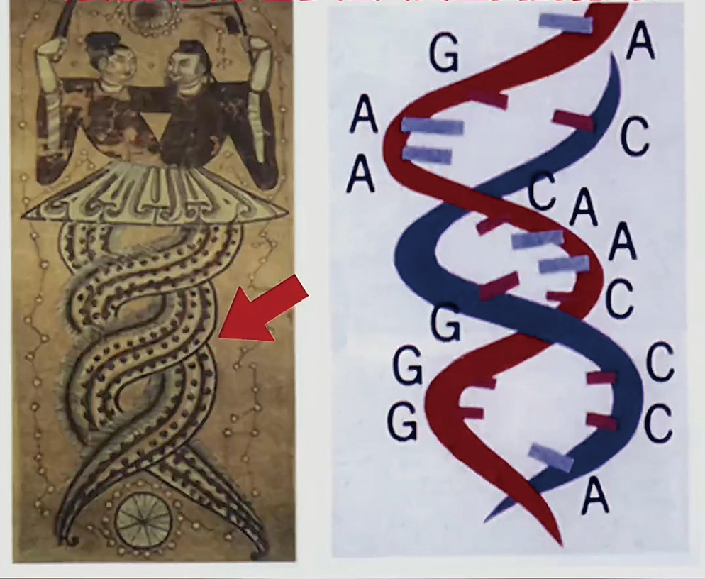

# 第4课

2025年10月4日

关于莲师降生的方式和年代，不同史料记载不一。不仅是莲师，佛陀出世的年代也众说纷纭——藏传历算普巴派和克珠杰各有说法，北传和南传佛教的观点也不一样。佛教大德帕单巴尊者的出生年代，同样有各种记载。即使是世间伟人的年龄，也经常有不同的版本。人类早期缺少统一的计时方法，想要找到一份完全无有争议且完全一致的记载，几乎不太可能。但就像某些大德讲的那样，为了利益无量众生，莲师可以胎生，也可以化生；可以同时化现，也可以先后化现。

## 人首蛇身，踩脚印怀孕—— 伏羲比莲师还“离谱”

接下来，我简单讲一下人类起源方面的话题。据一些广为人知的史料记载，藏地早期人类起源于罗刹女和猿猴，汉地的则起源于伏羲[^1]和女娲。伏羲是华夏文化之祖，也是三皇中的人皇。关于他的生平也有不同说法，但大多数观点认为，伏羲并非父母所生。他母亲因为踩了一个脚印而怀孕，十二年后才生下他。伏羲一生创造了很多奇迹，其中之一便是创造了《易经》中的八卦。虽然这方面的早期史料不多，但周文王和孔子都研究过《易经》，都承认伏羲写《易经》八卦一事[^2]。

在藏语中，八卦叫“巴卡杰”，“巴卡”是八卦的音译——学过历算的人应该都知道。以前，我家乡有个叫才让桑珠的喇嘛。我刚出家时，请他教我历算。结果只教了一天，他就不空了，说是要念经。我记得那本历算书上，“巴卡”就是八卦的意思。

人类的演化史非常漫长。最早的人类史可以追溯到720万年前，之后慢慢演进，直到今天。中国五千年的历史，通常是从公元前2700年的五帝时代[^3]开始算起。五帝之后才是夏、商、周、秦等。而伏羲生活的年代属于上古时期，远远早于五帝时代。

伏羲的身世很特殊。他没有父亲，出生时间也不清楚。但他一生极具传奇色彩。不但创作了《易经》八卦，还和女娲一起繁衍了华夏民族——当时不叫汉人，叫华夏人[^4]。有些史书说，伏羲的上身是人，下身是蛇或龙。在汉代的壁画中，伏羲与女娲经常以人首蛇身的形象出现。敦煌和故宫的文献中也有这类图案和文字记载。

我以前看过一个AI制作的短视频，里面说伏羲住胎十二年，三十几岁结婚，四十多岁著八卦，一百三十五岁写《易经》，一百九十岁示现圆寂。我对此不太相信——连他生活的具体年代都不清楚，所谓的年谱怎么可能这么准确？

## DNA双螺旋？伏羲女娲早就画过了

历史上确有伏羲其人。他来到这个世界，并非依靠人类正常的生育方式。古人对生命的认识跟现代人确实有差别，如果全部当作神话或传说，思想可能过于狭隘。而且现代科学已经发现，几千年前的人类结合图和八卦图，蕴含着丰富的生命信息和宇宙密码。

上世纪五六十年代，西方学者发现了人体的DNA结构图。1983年，联合国教科文组织在《国际社会科学》杂志上刊登了女娲和伏羲的双蛇交尾图。因为这两张图高度相似。

左图：伏羲和女娲两条蛇尾相交。右图：人类基因双螺旋结构图。

《周易》的内容博大精深，在全世界影响深远。单从历算方面看，汉地历算依它而来，日本、越南和韩国的历算也深受影响。部分欧洲国家从17世纪起，就展开对《易经》的深入研究，并在多领域受到启发。当然，我们现在的历算班也会用到。

根据某些历史记载，文成公主来到藏地后，用《易经》八卦推算出藏地地形如同魔女仰卧，必须修寺院镇压。大昭寺镇压的是魔女心脏，不丹等其他地方修建的四座寺院——也有说十二座的，镇压魔女身体的其他部位。莲师来到藏地之后也降伏了很多鬼神。

《易经》八卦是华夏文明的精神根源，已经深入中国人的日常生活。现在，各地都有很多宾馆和公园悬挂八卦图，藏地很多人也喜欢在腰间别一个九宫八卦牌。而且，《易经》对现代科学的影响也是有目共睹的。在数学与计算机科学、物理学、生物学与遗传学等诸多领域，《易经》都提供了独特的视角和启发，促进了它们的发展。

下面继续讲莲师传记，内容比较简单。

后来，莲师在一所林苑里进行依、近依、修、大修四支修行。开始时出现了巨大的爆破声和各种恐怖色相，园中失火、房屋毁坏等许多异常征兆，但他并未为其所动，继续修行，最终成就了明咒，梦中面见了阿弥陀佛为主的诸佛菩萨，并真正亲见了马头明王，空行母和人形女鬼都俯首听命。

马头明王是观音菩萨的忿怒相。

莲师对藏地最大的贡献之一，就是降伏各路鬼神，让他们承诺永远护持佛法——护法神越多越好。

不久之后，他步入红尘，继承父业，常与辅政大臣和婆罗门同行，进入皇宫，参与朝政及历算等预测之事。

在这个传记里，莲师并没有当上国王。他的父亲只是个王族。

当时，哈雅勒拉的太子阿嘉勒拉刚登基，莲师希望他依正法治国，劝谏国王广行大善。

莲师劝国王行持善法，后来他自己却遇到了麻烦。

他自己也在林苑中间建了佛殿和僧舍，周围环绕佛塔，并造了多层围墙。

莲师当时因为造佛堂和佛塔，遇到了麻烦。现在很多地方造佛塔和佛寺也有点麻烦。

当时，莲师有三个助手，一位是国王的文书，另两位是大臣。

但这三个助手对莲师并不友好。

他们心生歹意，暗地里密谋：“要想办法夺取国家归我们三人所有。”一次，文书向国王进谗言说：“这位莲花阿瓦巴色意图篡位，

国王最害怕下面篡位，怕自己被推翻。

他与林苑中大约一千出家人都是英勇善战，而且把林苑已变成经堂。

他们本是出家人，却被说成“英勇善战”。

历朝历代都是如此。即便是现在，领导们仍然担心寺院人多对政治不利：“万一里面有特务，会起坏作用！”害怕出家人参与政治。

事实上，他围起城墙的目的就是要与陛下作战。”

他们用谗言迷惑国王。

历史上，陷害一个人用得最多的手段，可能就是挑拨离间：“这个人在你身边有各种目的，对你非常不利！”莲花生大士当年也是这样被诬陷，说他图谋不轨，想跟国王作战。

国王询问群臣时，由于那两个大臣的宣扬，再加上嫉贤妒能的恶心驱使，众人都随声附和。

大家都说莲师有政治目的，对国王的政权不利。

于是国王派众臣率兵出征。当时，邬金境内的法律不允许国王杀婆罗门、沙门、班智达，

莲师当时是班智达还是沙门？好像都可以。

因此国王下旨：“辅相，你和你所供养的僧众放下资具，前往他方吧。”

辅相指的是莲师。那些人为了赶走莲师，可能想了很多办法。还好，最后没有杀莲师。

我们现在天天祈祷的莲师，当时就像一个普通人。

翻译到这里，我心情很不好：莲师都遇到这么大的事，我们普通人就更不用说了。后来莲师来到藏地，情况同样复杂，遇到了很多奸臣——今年不一定讲到那里。明年如果没死，我们再继续学。

当时国王没有杀掉莲师，只是把他赶出了国境。

由此，僧众们都走了，莲师也随之离去。

莲师不得不离开自己的国土。

大臣们说：“如果不杀他，他事后必将卷土重来，加害我们。”

国王不杀莲师，大臣们不死心，继续挑拨离间。

跟后来藏地的情况一样。奸臣势力太大，连国王都无能为力。赤松德赞只有私下跟莲师商量：“您还是回印度吧，我实在没办法！”莲师回去的路上，那些奸臣又派了十八个人去追杀。结果都被莲师降伏，全部僵在路上。莲师的神通和咒力强大，任何人和非人都伤害不了。

于是派出大量杀手，用锁链捆住莲师，铐上铁铐。然而，莲师依靠明咒的威力，断了锁链，毁了铁铐。杀手们用利刃砍他，结果对莲师毫发无损，兵刃反而断成几节。他们又将莲师放在火里，火不能烧；扔进水里，水不能沉；抛下悬崖，也未受伤；活埋地下，他从远处的洞里出来，终究无法抓住他。

当时的莲师就像米拉日巴一样，想害他没那么容易。

《普门品》里说，念观音菩萨名号，水不能漂、火不能烧、风不能吹，有很多功德。同样，我们现在祈祷莲师，依靠他的发愿力、谛实力和咒力，任何违缘也不能损害我们。学院也好，个人也好，都应该经常祈祷莲师。

如果其他的不会念、不会修，大家就多念莲师心咒，这对个人的生活和修行都非常有利。

[^1]: 伏羲，又称宓羲、庖牺，是华夏民族人文始祖、三皇之首，生活在距今七八千年的新石器时代。他教民结网渔猎、驯养家畜，变革婚姻制度、规范人伦，还创造书契替代结绳记事等。他创作的先天八卦，深刻影响了后世的哲学、天文、历法、医学、农耕等诸多领域，是中华文化的核心和精髓。
[^2]: 《易经》，又称《周易》，其产生、传承与成书过程，“时经三古，人经三圣”。三古即上古、中古和近古，上古是伏羲时期，中古是指夏商周时期，近古则指春秋战国。三圣即指伏羲、周文王和孔子。伏羲开创先天八卦，周文王在其基础上创作后天八卦，推演六十四卦，并做卦辞、爻辞，孔子为阐释《周易》而作《易传》。现在流通的《易经》实为伏羲、周文王、孔子三人而作。
[^3]: 五帝，即黄帝、颛顼（zhuān xǖ）、帝喾（kù）、尧帝和舜帝。
[^4]: 先秦之前，汉族自称“华夏”，从汉朝开始自称“汉”。但“华夏”的称谓并没有消失，而是与“汉”一起使用至今。
