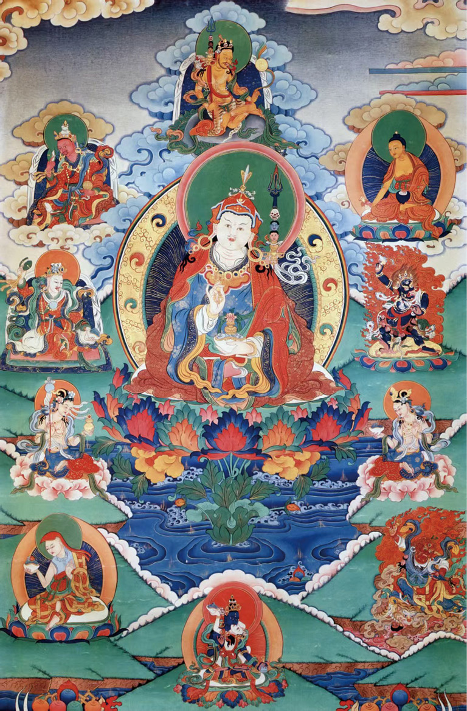
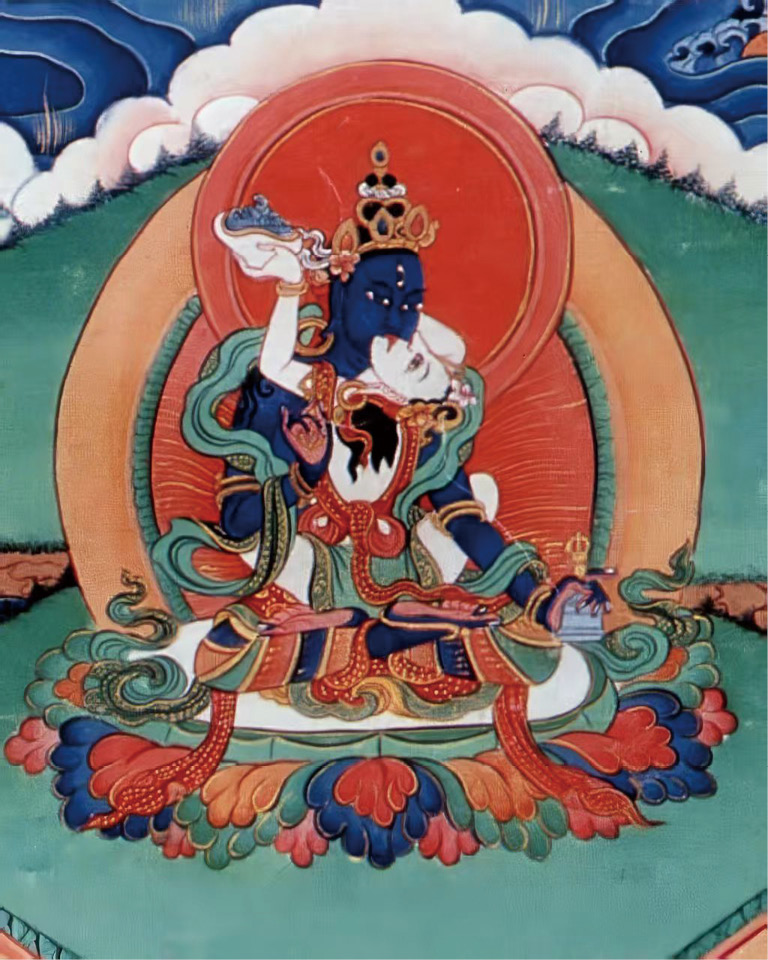
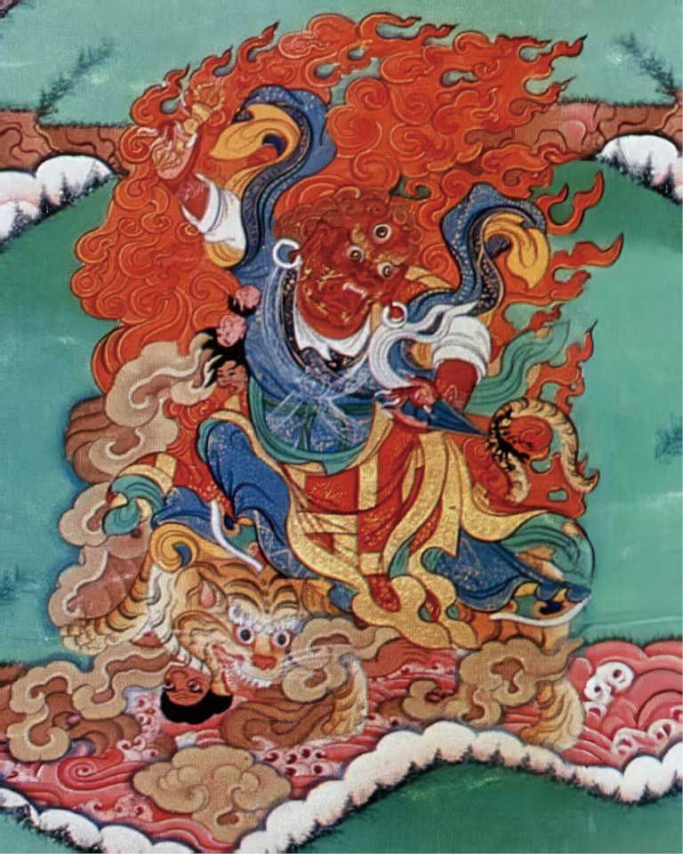
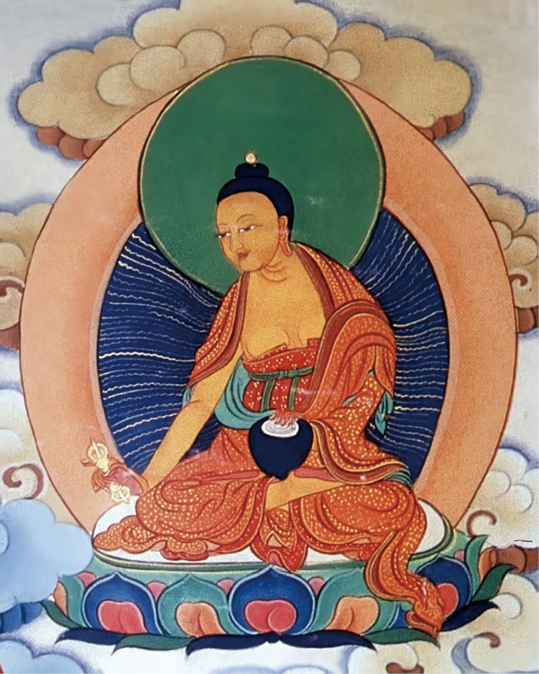
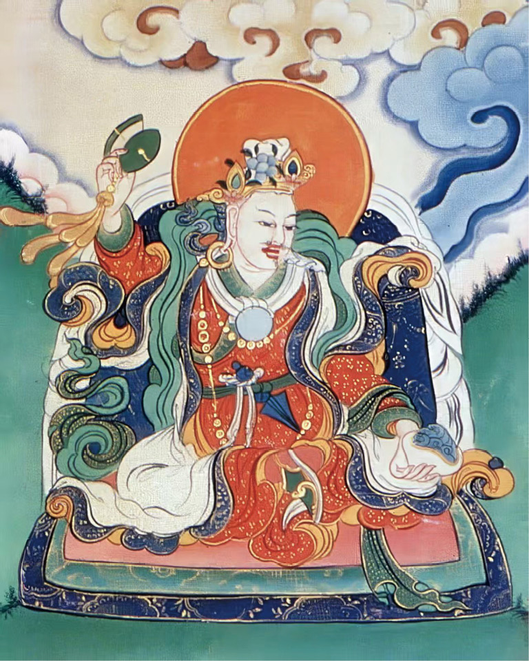
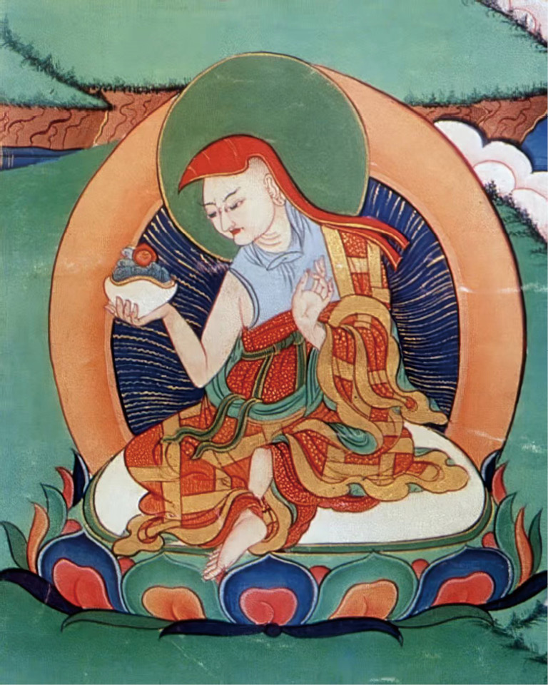
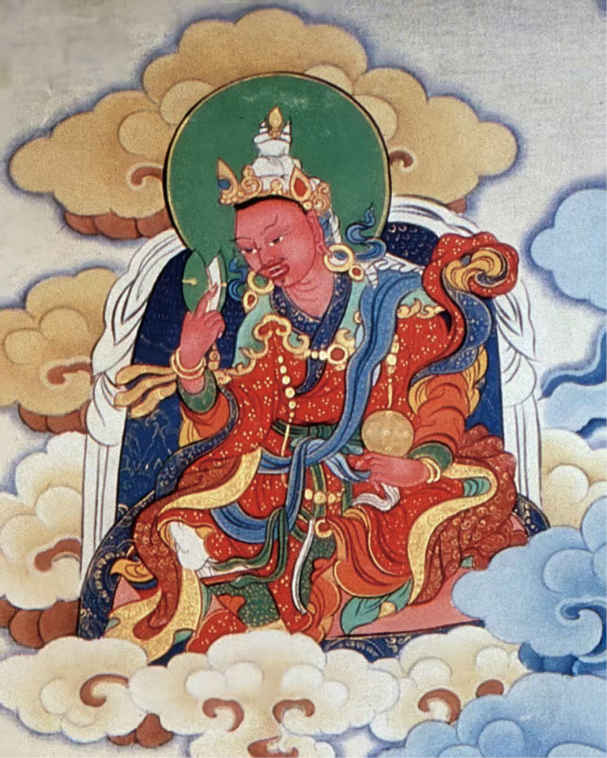
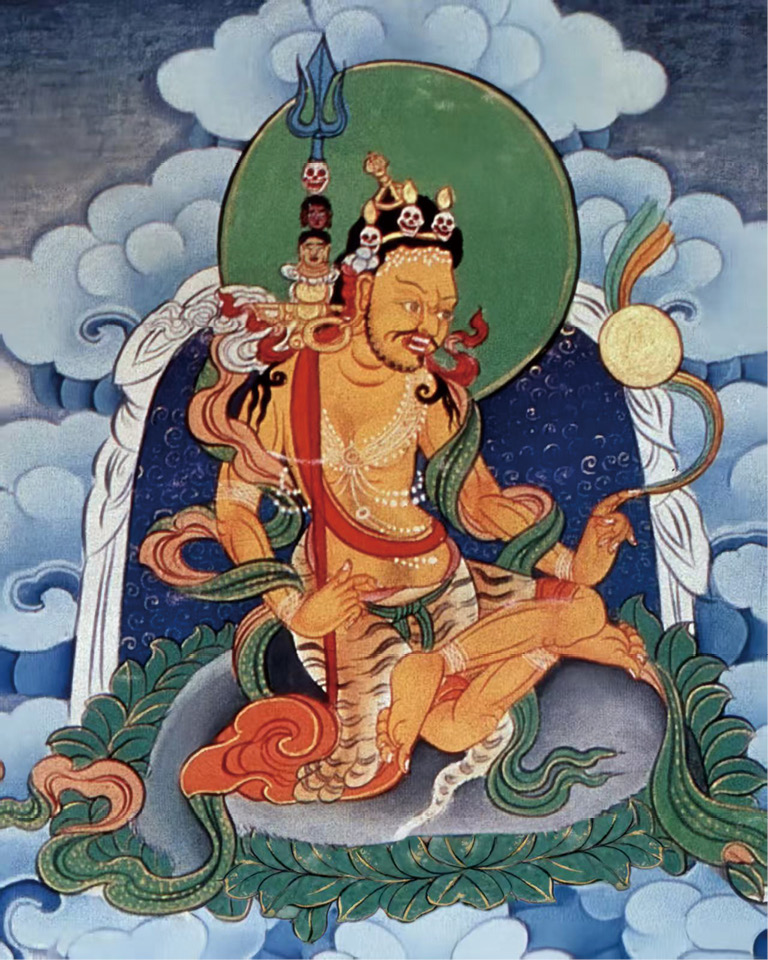
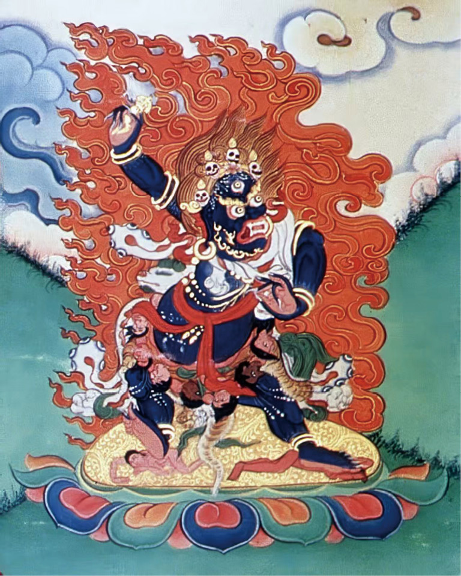

# 第9课

2025年10月10日

莲师在哲玛拉小住期间，用檀香木雕刻了一尊观音像，并在戒香寺建了一座小型度母殿。

莲师也爱建寺院、造佛像。他并没有说：“我是莲花生大士，不用做这些世俗的善法。一切都是执著！一切都是相！”

有因缘的时候，造一些寺院和佛像，非常重要，莲师也是这么做的。但是现在，即使有能力也不一定有地方，或者说不一定有因缘。

随后，他来到吉祥邬金境内，

之前，莲师被邬金国的国王和大臣赶走，后来国王在七天之内吐血而死。他现在回去，当时的国王已经不在了。

尽可能地摄受有缘弟子，并建造了一所佛殿。当时，靠近邬金的嘎赞地方，佛教复兴得很有起色，国王是一位居士班智达。

当初，莲师在邬金国遇到了不少麻烦，后来被迫离开，但在外面依止上师、云游尸陀林，反而成就了自己的修行。我们的人生也一样——虽然不能跟莲师比，但如果自己意志坚定，不退失信心，遇到麻烦换个地方继续修行，也许会有更大的进步。

任何时候，生病也好，人生变故也好，都不一定是坏事，很可能是难得的机遇。比如必须离开寺院去别的地方，那就去，没必要一直哭。再比如，现在学院规定学僧的车不能停在学院里面，那就不停，把这个变化看作修行的机会，好好把握，而不是抱怨、痛苦。懂得随顺变化很重要。

这里讲，国王是一个居士班智达。班智达肯定会讲经说法吧？如果什么法都不会说，算什么班智达？在藏地，出家人说法是最好的。但在外面的城市，出家人太少，没办法。所以很多年前，我们就在培养在家佛教徒讲法。现在有些在家人的智慧远远超过个别法师，因为他们不断学习、不断修行。这对自他都是有利益的。

在自己的能力范围内，给别人讲经说法很重要。

在木拉达那境内的巴嘎达城，君主是伊朗的德热恰，

德热恰是突厥人，非常凶残，历史上很多地方的佛教都被他们摧毁了。突厥人跟蒙古人一样，属于游牧民族。

他的军队摧毁了嘎匝的所有地区，并破坏了一些佛学院。当他们准备大肆进攻时，军兵们有的乘船，有的游泳，到达了尼拉河岸。莲师在河岸口作看式和期克印进行降伏，结果七艘大船和大约五百只单木筏连同游泳的人全部沉入河中，德热恰的所有将士全军覆没。自那以后，世世代代中，该地再未遭受过德热恰的侵犯。

看起来有点残忍。但有时候，佛教还是要显得勇猛一点，不能随便惹。其实，光是一个期克印：“嗡舍哲沃哲达那那 萨儿瓦夏仲那夏雅 东巴雅 吽吽啪的啪的索哈”就能解决所有问题。

莲师的出家名是班玛阿嘎绕，即莲花生；在坛城中受灌顶的密名是班玛桑巴瓦，即具莲生；邬金人们以前称他为班玛革勒夏，即莲花金刚，因为他额头上有一个金刚严饰的莲花盛开图案；他小时候的名字是班玛阿瓦巴色，即莲花光；弟子们尊称他为西日玛哈色卡，即吉祥大乐；后来他到邬金时，邬哲雅那的人们因他的事业与昔日的吉祥大乐班玛班匝相同，共称他为班玛班匝（即莲花金刚）。

在这里，莲师有六个不同的名号。

2009年，我在讲《七句祈祷文释·白莲花》的时候，给大家作过莲师八变的介绍。所依的教证和理证比较多，但现在记不清了。讲记上应该有。下面我再简单介绍一下。

这就是莲师八变的唐卡，藏语叫“格热桑吉”。上面画了莲师的八种不同变化相，身边还有两位空行母。大家应该比较熟悉。

关于莲师的名号和形象，不同的伏藏品和画派会有不同的观点。在《西游回忆录》里面，法王也介绍过一些。

第一个是海生金刚。阿弥陀佛心间的“舍”字，射入邬金达那够夏海中，于莲花蕊中生出八岁童子。大臣紫那木扎发现了这个孩子，报告给邬金国王恩札布德。当时国王没有太子，一直供养三宝，希望得到子嗣。国王见到这个孩子，十分欢喜，认为是三宝所赐。

之前我们在巴基斯坦地图上看到的查克达拉，据说就是当年达那够夏海所在之处。它位于斯瓦特河谷旁边。从地图上看，像一个小湖。以前我们一直以为，达那够夏是大海，实际上可能只是个湖。无论主张化生还是胎生的观点，都承认邬金国就是莲师的诞生地。

第二个是忿怒金刚。莲师降伏了一个奸臣之子，国王不高兴，被流放到尸陀林——流放尸陀林的说法跟这里讲的一样。莲师到了尸陀林，给那里的人和非人讲了殊胜的法要。有些鬼神对佛法产生邪见，莲师便以忿怒相进行降伏。这就是忿怒金刚。

第三个是释迦狮子。莲师在印度金刚座显现种种神变，有些人不信，对他进行诽谤。于是莲师示现出家相。有些传记中说，莲师是在扎巴哈德面前出家的。而在这本传记里，他是在佛智面前出的家。可能是佛智作亲教师、扎巴哈德作羯磨阿阇黎。两种说法并不相违。

第四个是爱慧莲师（罗丹确哲）。莲师在西日桑哈和佛密大师面前得到了大圆满和其他密法的教授，对所有续部了如指掌，所以称之为爱慧。

第五个是莲花颅鬘（班玛托创匝）。莲师在萨霍国王面前示现神变，将火海变成湖，身上装饰着各种颅鬘——即是骷髅的花鬘。这张唐卡上没有画“托创”，有些画像里面有。萨霍国在印度北方，以前法王去过。

第六个是莲花王（班玛加波）。萨霍国王对莲师生起极大的信心，请莲师担任国师十三年，并打开国库大兴供养。莲师头上戴的莲花帽，就是萨霍国王供养的。

第七个是日光莲师（革日宁玛沃热）。莲师在尸陀林行持禁行，为空行众传法，同时骑在日光上示现各种神变，降伏了一些鬼神，所以叫“宁玛沃热”，意思是在日光上显示神变。这个旁边画了一个太阳。

第八个是狮吼莲师（革日桑给扎周）。莲师在印度金刚座，通过辩论击败五百个外道，并示现神变，降伏了一些持恶咒者。

莲师八变在不同的祈祷文里有不同的身相。以前有人编过莲师遗教，里面也有不同的说法，大家以后可以了解。一般唐卡画师都懂莲师八变，而有些修莲师的人却根本不认识。连莲师八变都分不清，不太好。

以前我们读书的时候，很多人在寝室里贴刘德华的照片。我还在别人拍的照片上看到，有些喇嘛家里居然挂着马丁·路德·金和奥巴马的“唐卡”——特朗普的没有看到。这样不太好。作为一个佛教徒，尤其是一个出家人，家里挂上莲师八变的唐卡是不是好一点？

我以前说过，家里没必要挂各种各样的明星照片。但你们自己想什么都可以，喜欢什么也可以吧。最后会不会变成那样的人也不知道。
